# CHƯƠNG 13: THIẾT KẾ HỆ THỐNG TỰ ĐỘNG HOÀN THÀNH TÌM KIẾM (CHAPTER 13: DESIGN A SEARCH AUTOCOMPLETE SYSTEM)

Khi tìm kiếm trên Google hoặc mua sắm trên Amazon, ngay khi bạn gõ vào ô tìm kiếm, một hoặc nhiều kết quả khớp với từ khóa tìm kiếm sẽ được hiển thị cho bạn. Tính năng này được gọi là tự động hoàn thành (*autocomplete*), gợi ý khi gõ (*typeahead*), tìm kiếm theo thời gian thực khi gõ (*search-as-you-type*), hoặc tìm kiếm tăng dần (*incremental search*). Hình 13-1 (Figure 13-1) minh họa một ví dụ trên Google Search hiển thị danh sách các kết quả tự động hoàn thành khi gõ từ `"dinner"` vào ô tìm kiếm. Tự động hoàn thành tìm kiếm là một tính năng quan trọng của nhiều sản phẩm. Điều này dẫn chúng ta đến câu hỏi phỏng vấn: thiết kế một hệ thống tự động hoàn thành tìm kiếm, còn được gọi là *"thiết kế top k"* (*design top k*) hoặc *"thiết kế top k truy vấn được tìm kiếm nhiều nhất"* (*design top k most searched queries*).


---

## Bước 1 - Hiểu rõ bài toán và xác định phạm vi thiết kế (Step 1 - Understand the problem and establish design scope)

Bước đầu tiên để giải quyết bất kỳ câu hỏi phỏng vấn thiết kế hệ thống nào là đặt đủ câu hỏi để làm rõ các yêu cầu. Dưới đây là một ví dụ về cuộc trao đổi giữa ứng viên và người phỏng vấn:

* **Ứng viên (Candidate):** Việc khớp từ khóa chỉ được hỗ trợ ở phần đầu của truy vấn tìm kiếm hay ở cả phần giữa nữa?
* **Người phỏng vấn (Interviewer):** Chỉ ở phần đầu của truy vấn tìm kiếm.
* **Ứng viên:** Hệ thống nên trả về bao nhiêu gợi ý tự động hoàn thành?
* **Người phỏng vấn:** 5.
* **Ứng viên:** Làm thế nào hệ thống biết nên trả về 5 gợi ý nào?
* **Người phỏng vấn:** Điều này được xác định dựa trên mức độ phổ biến (*popularity*), quyết định bởi tần suất truy vấn trong lịch sử (*historical query frequency*).
* **Ứng viên:** Hệ thống có hỗ trợ kiểm tra chính tả (*spell check*) không?
* **Người phỏng vấn:** Không, kiểm tra chính tả hoặc tự động sửa lỗi (*autocorrect*) không được hỗ trợ.
* **Ứng viên:** Các truy vấn tìm kiếm có phải bằng tiếng Anh không?
* **Người phỏng vấn:** Đúng vậy. Nếu cuối buổi còn thời gian, chúng ta có thể thảo luận về hỗ trợ đa ngôn ngữ (*multi-language support*).
* **Ứng viên:** Chúng ta có cho phép chữ viết hoa và các ký tự đặc biệt không?
* **Người phỏng vấn:** Không, chúng ta giả định tất cả các truy vấn tìm kiếm đều sử dụng các ký tự chữ cái viết thường.
* **Ứng viên:** Có bao nhiêu người dùng sử dụng sản phẩm?
* **Người phỏng vấn:** 10 triệu người dùng hoạt động hàng ngày (DAU).

### Các yêu cầu (Requirements)

Dưới đây là tóm tắt các yêu cầu:

* **Thời gian phản hồi nhanh (Fast response time):** Khi người dùng gõ một truy vấn tìm kiếm, các gợi ý tự động hoàn thành phải hiển thị đủ nhanh. Một bài viết về hệ thống tự động hoàn thành của Facebook [1] tiết lộ rằng hệ thống cần trả về kết quả trong vòng 100 mili-giây (*milliseconds*). Nếu không, nó sẽ gây ra hiện tượng giật lag (*stuttering*).
* **Liên quan (Relevant):** Các gợi ý tự động hoàn thành phải liên quan đến từ khóa tìm kiếm.
* **Được sắp xếp (Sorted):** Kết quả do hệ thống trả về phải được sắp xếp theo mức độ phổ biến hoặc các mô hình xếp hạng khác.
* **Có khả năng mở rộng (Scalable):** Hệ thống có thể xử lý lưu lượng truy cập cao.
* **Tính sẵn sàng cao (Highly available):** Hệ thống vẫn phải duy trì hoạt động và có thể truy cập được khi một phần của hệ thống ngoại tuyến (*offline*), chậm lại hoặc gặp lỗi mạng không mong muốn.

### Ước tính sơ bộ (Back of the envelope estimation)

* Giả sử có 10 triệu người dùng hoạt động hàng ngày (DAU - *daily active users*).
* Trung bình một người thực hiện 10 lượt tìm kiếm mỗi ngày.
* 20 byte dữ liệu cho mỗi chuỗi truy vấn:
  * Giả sử chúng ta sử dụng bảng mã ký tự ASCII. 1 ký tự = 1 byte.
  * Giả sử một truy vấn chứa 4 từ, và mỗi từ trung bình chứa 5 ký tự.
  * Như vậy là $4 \times 5 = 20$ byte cho mỗi truy vấn.
* Với mỗi ký tự được nhập vào ô tìm kiếm, client gửi một yêu cầu (*request*) đến backend để lấy gợi ý tự động hoàn thành. Trung bình, 20 yêu cầu được gửi đi cho mỗi truy vấn tìm kiếm. Ví dụ, 6 yêu cầu sau đây được gửi đến backend tính đến lúc bạn gõ xong từ `"dinner"`:
  ```
  search?q=d
  search?q=di
  search?q=din
  search?q=dinn
  search?q=dinne
  search?q=dinner
  ```
* $\sim 24.000$ truy vấn mỗi giây (QPS) = $10.000.000 \text{ người dùng} \times 10 \text{ truy vấn/ngày} \times 20 \text{ ký tự} / 24 \text{ giờ} / 3600 \text{ giây}$.
* QPS đỉnh (*Peak QPS*) = $\text{QPS} \times 2 = \sim 48.000$.
* Giả sử 20% số truy vấn hàng ngày là truy vấn mới. $10 \text{ triệu} \times 10 \text{ truy vấn/ngày} \times 20 \text{ byte/truy vấn} \times 20\% = 0.4 \text{ GB}$. Điều này có nghĩa là có 0.4 GB dữ liệu mới được thêm vào bộ nhớ lưu trữ mỗi ngày.

> 📝 **Giải thích thêm (không có trong sách):** Trong thực tế, để giảm tải cho backend khi người dùng gõ nhanh, phía frontend thường áp dụng kỹ thuật **debouncing** (ví dụ: đợi 100–200ms sau lần gõ phím cuối cùng mới gửi request thay vì gửi ngay lập tức từng ký tự). Tuy nhiên, trong ước tính phỏng vấn, việc giả định mỗi ký tự gửi 1 request giúp tính toán mức tải trần (worst-case / upper bound) an toàn hơn.

---

## Bước 2 - Đề xuất thiết kế tổng thể và đạt được sự đồng thuận (Step 2 - Propose high-level design and get buy-in)

Ở mức tổng thể, hệ thống được chia thành hai phần:

* **Dịch vụ thu thập dữ liệu (Data gathering service):** Thu thập các truy vấn do người dùng nhập vào và tổng hợp chúng theo thời gian thực (*real-time*). Việc xử lý theo thời gian thực không thực tế đối với các tập dữ liệu lớn; tuy nhiên, đây là một điểm khởi đầu tốt. Chúng ta sẽ khám phá giải pháp thực tế hơn ở phần đi sâu thiết kế.
* **Dịch vụ truy vấn (Query service):** Cho trước một truy vấn tìm kiếm hoặc tiền tố (*prefix*), trả về 5 từ khóa được tìm kiếm nhiều nhất.

### Dịch vụ thu thập dữ liệu (Data gathering service)

Hãy sử dụng một ví dụ đơn giản hóa để xem dịch vụ thu thập dữ liệu hoạt động như thế nào. Giả sử chúng ta có một bảng tần suất (*frequency table*) lưu trữ chuỗi truy vấn và tần suất của nó như minh họa trong Hình 13-2 (Figure 13-2). Ban đầu, bảng tần suất trống. Sau đó, người dùng lần lượt nhập các truy vấn `"twitch"`, `"twitter"`, `"twitter"`, và `"twillo"`. Hình 13-2 cho thấy cách bảng tần suất được cập nhật.

### Dịch vụ truy vấn (Query service)

Giả sử chúng ta có một bảng tần suất như trong Bảng 13-1 (Table 13-1). Bảng này có hai trường:
* `Query`: lưu trữ chuỗi truy vấn.
* `Frequency`: biểu thị số lần một truy vấn đã được tìm kiếm.

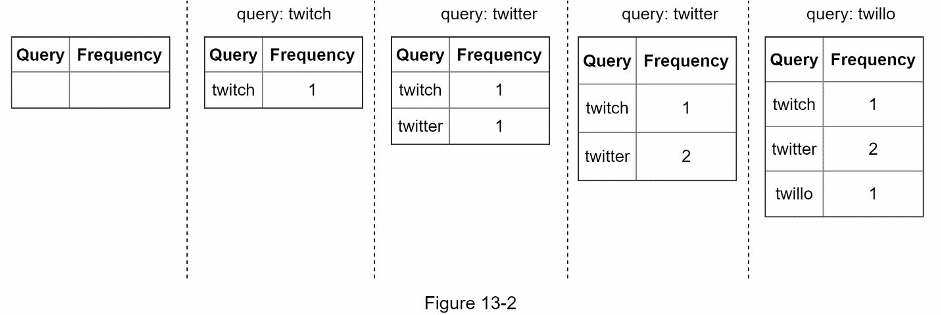

Khi người dùng gõ `"tw"` vào ô tìm kiếm, top 5 truy vấn được tìm kiếm nhiều nhất sau đây sẽ được hiển thị (Hình 13-3 / Figure 13-3), giả sử bảng tần suất dựa trên Bảng 13-1.

Để lấy top 5 truy vấn được tìm kiếm nhiều nhất, thực thi câu lệnh SQL sau:

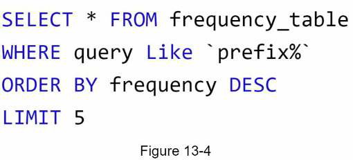

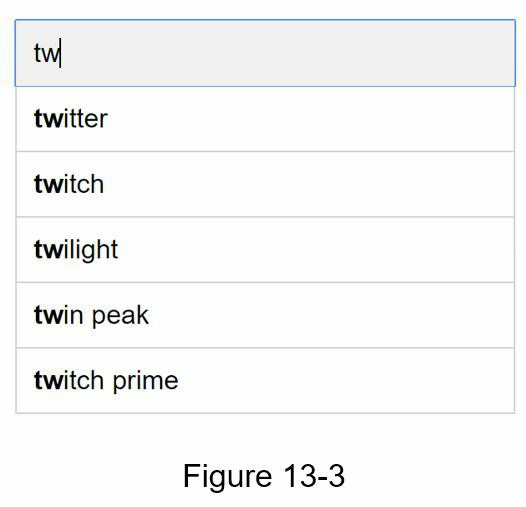

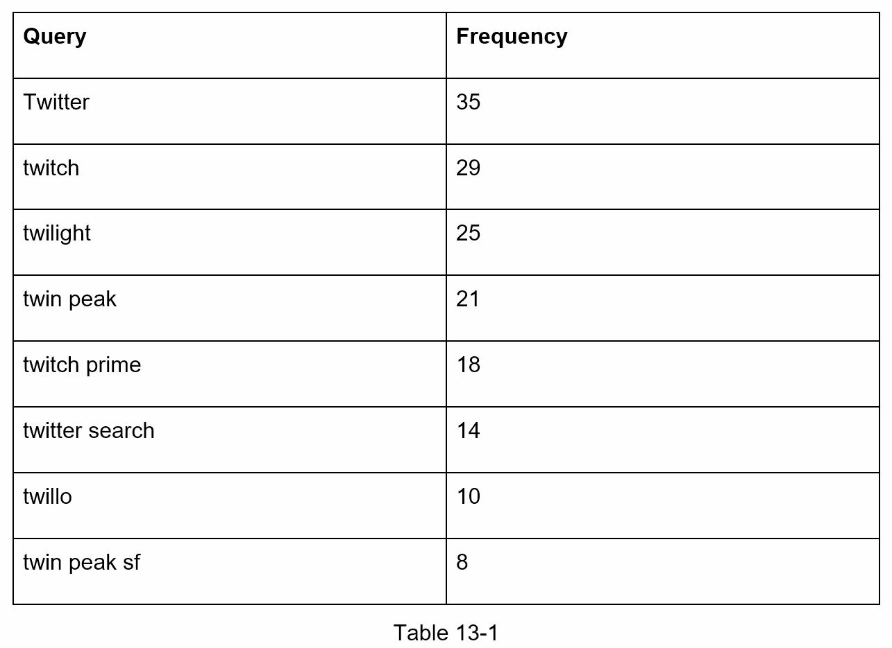

> 💡 **Ví dụ bổ sung (không có trong sách):** Câu lệnh SQL tương ứng để truy vấn top 5 từ khóa bắt đầu bằng `"tw"` từ bảng tần suất `frequency_table` là:
> ```sql
> SELECT query, frequency
> FROM frequency_table
> WHERE query LIKE 'tw%'
> ORDER BY frequency DESC
> LIMIT 5;
> ```
> Dù có đánh chỉ mục (index) trên cột `query` để tăng tốc `LIKE 'tw%'`, việc phải quét hàng triệu bản ghi khớp tiền tố rồi thực hiện `ORDER BY frequency DESC` trên tập kết quả lớn vẫn sẽ rất chậm khi dữ liệu phình to.

Đây là một giải pháp chấp nhận được khi tập dữ liệu nhỏ. Khi tập dữ liệu lớn, việc truy cập cơ sở dữ liệu trở thành một nút thắt cổ chai (*bottleneck*). Chúng ta sẽ khám phá các biện pháp tối ưu hóa trong phần đi sâu thiết kế.

---

## Bước 3 - Đi sâu thiết kế (Step 3 - Design deep dive)

Trong phần thiết kế tổng thể, chúng ta đã thảo luận về dịch vụ thu thập dữ liệu và dịch vụ truy vấn. Thiết kế tổng thể chưa tối ưu, nhưng nó đóng vai trò là một điểm khởi đầu tốt. Trong phần này, chúng ta sẽ đi sâu vào một vài thành phần và khám phá các tối ưu hóa như sau:

* Cấu trúc dữ liệu Trie (*Trie data structure*)
* Dịch vụ thu thập dữ liệu (*Data gathering service*)
* Dịch vụ truy vấn (*Query service*)
* Mở rộng quy mô lưu trữ (*Scale the storage*)
* Các thao tác trên Trie (*Trie operations*)

### Cấu trúc dữ liệu Trie (Trie data structure)

Cơ sở dữ liệu quan hệ được sử dụng để lưu trữ trong thiết kế tổng thể. Tuy nhiên, việc lấy top 5 truy vấn tìm kiếm từ một cơ sở dữ liệu quan hệ là không hiệu quả. Cấu trúc dữ liệu **trie** (cây tiền tố - *prefix tree*) được sử dụng để khắc phục vấn đề này. Vì cấu trúc dữ liệu trie đóng vai trò cốt lõi cho hệ thống, chúng ta sẽ dành đáng kể thời gian để thiết kế một cây trie tùy chỉnh. Lưu ý rằng một số ý tưởng được tham khảo từ các bài viết [2] và [3].

Hiểu biết về cấu trúc dữ liệu trie cơ bản là điều cần thiết cho câu hỏi phỏng vấn này. Tuy nhiên, đây thiên về câu hỏi cấu trúc dữ liệu hơn là câu hỏi thiết kế hệ thống. Bên cạnh đó, có rất nhiều tài liệu trực tuyến giải thích khái niệm này. Trong chương này, chúng ta sẽ chỉ thảo luận tổng quan về cấu trúc dữ liệu trie và tập trung vào cách tối ưu hóa cây trie cơ bản để cải thiện thời gian phản hồi.

**Trie** (phát âm là “try”) là một cấu trúc dữ liệu dạng cây có thể lưu trữ chuỗi một cách gọn nhẹ. Tên gọi này bắt nguồn từ từ *retrieval* (truy xuất), cho thấy nó được thiết kế cho các thao tác truy xuất chuỗi. Ý tưởng chính của trie bao gồm:

* Trie là một cấu trúc dữ liệu dạng cây.
* Nút gốc (*root*) đại diện cho một chuỗi rỗng.
* Mỗi nút (*node*) lưu trữ một ký tự và có 26 nút con (*children*), tương ứng với mỗi ký tự có thể có. Để tiết kiệm không gian, chúng ta không vẽ các liên kết trống.
* Mỗi nút trên cây đại diện cho một từ đơn hoặc một chuỗi tiền tố (*prefix string*).

Hình 13-5 (Figure 13-5) minh họa một cây trie với các truy vấn tìm kiếm `"tree"`, `"try"`, `"true"`, `"toy"`, `"wish"`, `"win"`. Các truy vấn tìm kiếm hoàn chỉnh được làm nổi bật bằng đường viền dày hơn.

Cấu trúc dữ liệu trie cơ bản lưu trữ các ký tự trong các nút. Để hỗ trợ sắp xếp theo tần suất, thông tin tần suất cần được đưa vào các nút. Giả sử chúng ta có bảng tần suất sau đây. Sau khi thêm thông tin tần suất vào các nút, cấu trúc dữ liệu trie sau khi cập nhật được hiển thị trong Hình 13-6 (Figure 13-6).

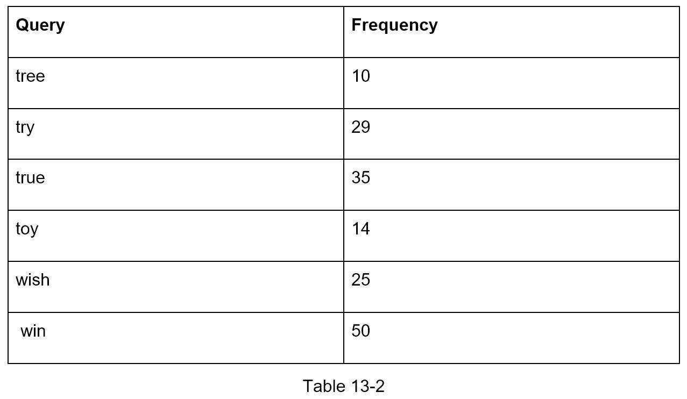

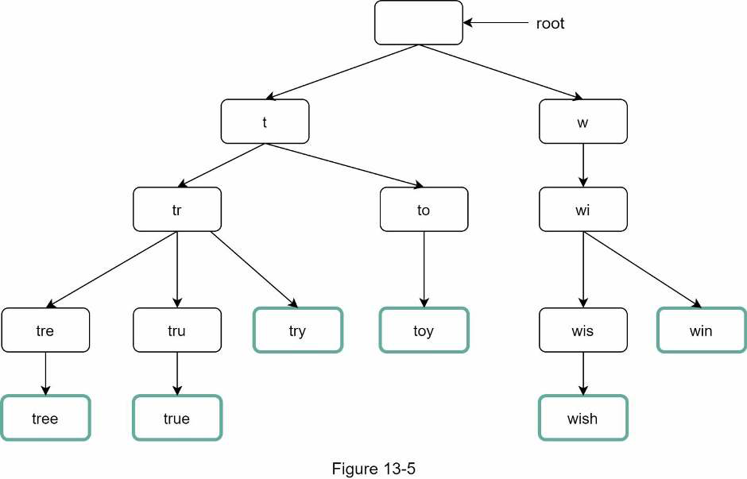

Tính năng tự động hoàn thành hoạt động với trie như thế nào? Trước khi đi sâu vào thuật toán, hãy định nghĩa một số ký hiệu:
* $p$: độ dài của một tiền tố (*prefix*)
* $n$: tổng số nút trong một cây trie
* $c$: số lượng nút con của một nút cho trước

Các bước để lấy top $k$ truy vấn được tìm kiếm nhiều nhất được liệt kê dưới đây:
1. Tìm nút tiền tố (*prefix*). Độ phức tạp thời gian: $O(p)$.
2. Duyệt cây con (*subtree*) bắt đầu từ nút tiền tố để lấy tất cả các nút con hợp lệ. Một nút con là hợp lệ nếu nó có thể tạo thành một chuỗi truy vấn hợp lệ. Độ phức tạp thời gian: $O(c)$.
3. Sắp xếp các nút con và lấy top $k$. Độ phức tạp thời gian: $O(c \log c)$.

Hãy sử dụng một ví dụ như trong Hình 13-7 (Figure 13-7) để giải thích thuật toán. Giả sử $k$ bằng 2 và người dùng gõ `"tr"` vào ô tìm kiếm. Thuật toán hoạt động như sau:
* **Bước 1:** Tìm nút tiền tố `"tr"`.
* **Bước 2:** Duyệt cây con để lấy tất cả các nút con hợp lệ. Trong trường hợp này, các nút `[tree: 10]`, `[true: 35]`, `[try: 29]` là hợp lệ.
* **Bước 3:** Sắp xếp các nút con và lấy top 2. `[true: 35]` và `[try: 29]` là top 2 truy vấn với tiền tố `"tr"`.

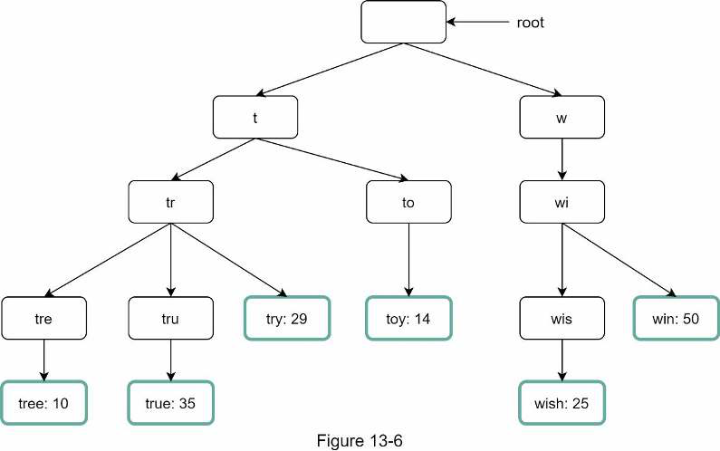

Độ phức tạp thời gian của thuật toán này là tổng thời gian tiêu tốn cho mỗi bước đã nêu ở trên:
$$O(p) + O(c) + O(c \log c)$$

Thuật toán trên rất dễ hiểu. Tuy nhiên, nó quá chậm vì chúng ta cần duyệt toàn bộ cây trie để lấy kết quả top $k$ trong trường hợp xấu nhất (*worst-case scenario*). Dưới đây là hai tối ưu hóa:
1. Giới hạn độ dài tối đa của một tiền tố (*Limit the max length of a prefix*)
2. Lưu đệm (cache) các truy vấn tìm kiếm hàng đầu tại mỗi nút (*Cache top search queries at each node*)

Hãy xem xét từng tối ưu hóa một.

#### Giới hạn độ dài tối đa của một tiền tố (Limit the max length of a prefix)

Người dùng hiếm khi gõ một truy vấn tìm kiếm quá dài vào ô tìm kiếm. Do đó, có thể khẳng định một cách an toàn rằng $p$ là một số nguyên nhỏ, ví dụ 50. Nếu chúng ta giới hạn độ dài của một tiền tố, độ phức tạp thời gian cho bước “Tìm tiền tố” có thể giảm từ $O(p)$ xuống $O(\text{hằng số nhỏ})$, tức là $O(1)$.

#### Lưu đệm các truy vấn tìm kiếm hàng đầu tại mỗi nút (Cache top search queries at each node)

Để tránh phải duyệt toàn bộ cây trie, chúng ta lưu trữ top $k$ truy vấn được sử dụng nhiều nhất tại mỗi nút. Vì 5 đến 10 gợi ý tự động hoàn thành là đủ cho người dùng, $k$ là một số tương đối nhỏ. Trong trường hợp cụ thể của chúng ta, chỉ có top 5 truy vấn tìm kiếm được lưu đệm (*cached*).

Bằng cách lưu đệm top các truy vấn tìm kiếm tại mỗi nút, chúng ta giảm đáng kể độ phức tạp thời gian để truy xuất top 5 truy vấn. Tuy nhiên, thiết kế này đòi hỏi nhiều không gian bộ nhớ để lưu trữ top các truy vấn tại mọi nút. Việc đánh đổi không gian lấy thời gian (*trading space for time*) là hoàn toàn xứng đáng vì thời gian phản hồi nhanh là cực kỳ quan trọng.

Hình 13-8 (Figure 13-8) cho thấy cấu trúc dữ liệu trie đã được cập nhật. Top 5 truy vấn được lưu trữ trên mỗi nút. Ví dụ, nút có tiền tố `"be"` lưu trữ các mục sau: `[best: 35, bet: 29, bee: 20, be: 15, beer: 10]`.

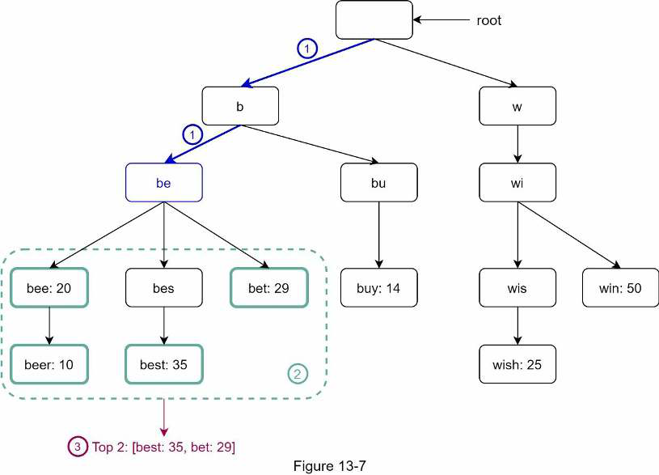

Hãy xem xét lại độ phức tạp thời gian của thuật toán sau khi áp dụng hai tối ưu hóa đó:
1. Tìm nút tiền tố. Độ phức tạp thời gian: $O(1)$.
2. Trả về top $k$. Vì top $k$ truy vấn đã được lưu đệm sẵn, độ phức tạp thời gian cho bước này là $O(1)$.

Vì độ phức tạp thời gian cho mỗi bước đều giảm xuống $O(1)$, thuật toán của chúng ta chỉ mất $O(1)$ để lấy top $k$ truy vấn.

### Dịch vụ thu thập dữ liệu (Data gathering service)

Trong thiết kế trước đây, mỗi khi người dùng gõ một truy vấn tìm kiếm, dữ liệu được cập nhật theo thời gian thực. Cách tiếp cận này không thực tế vì hai lý do sau:
* Người dùng có thể nhập hàng tỷ truy vấn mỗi ngày. Việc cập nhật cây trie trên mỗi truy vấn sẽ làm chậm đáng kể dịch vụ truy vấn.
* Các gợi ý hàng đầu có thể không thay đổi nhiều một khi cây trie đã được xây dựng. Do đó, không cần thiết phải cập nhật cây trie thường xuyên.

Để thiết kế một dịch vụ thu thập dữ liệu có khả năng mở rộng, chúng ta xem xét dữ liệu đến từ đâu và dữ liệu được sử dụng như thế nào. Các ứng dụng thời gian thực như Twitter yêu cầu gợi ý tự động hoàn thành luôn cập nhật mới nhất. Tuy nhiên, gợi ý tự động hoàn thành cho nhiều từ khóa trên Google có thể không thay đổi nhiều hàng ngày.

Bất chấp sự khác biệt trong các trường hợp sử dụng (*use cases*), nền tảng cơ bản cho dịch vụ thu thập dữ liệu vẫn giữ nguyên vì dữ liệu dùng để xây dựng cây trie thường đến từ các dịch vụ phân tích (*analytics*) hoặc ghi nhật ký (*logging*).

Hình 13-9 (Figure 13-9) cho thấy dịch vụ thu thập dữ liệu được thiết kế lại. Mỗi thành phần được xem xét lần lượt.

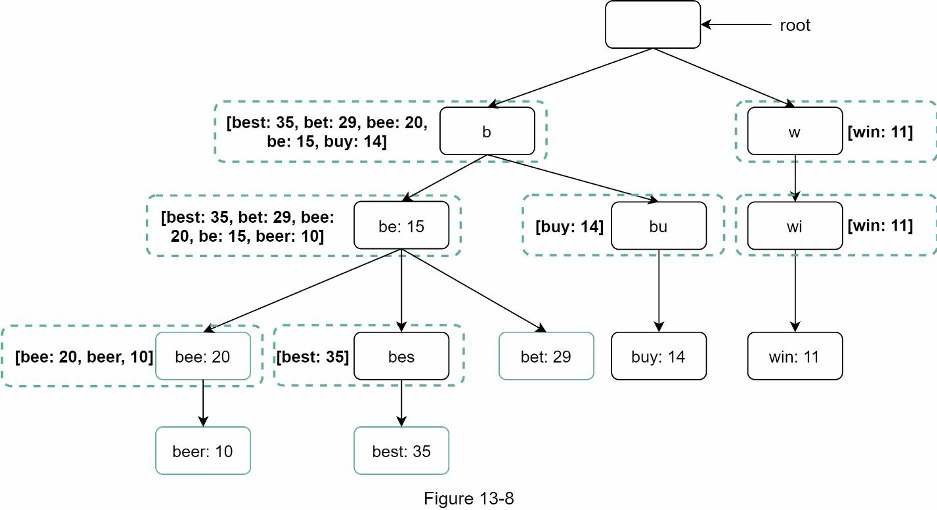

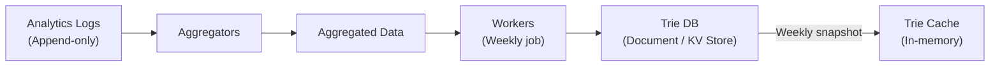

* **Nhật ký phân tích (Analytics Logs):** Lưu trữ dữ liệu thô về các truy vấn tìm kiếm. Nhật ký chỉ cho phép ghi thêm (*append-only*) và không được đánh chỉ mục (*not indexed*). Bảng 13-3 (Table 13-3) minh họa một ví dụ về tệp nhật ký.
* **Bộ tổng hợp (Aggregators):** Kích thước của nhật ký phân tích thường rất lớn, và dữ liệu không ở đúng định dạng cần thiết. Chúng ta cần tổng hợp dữ liệu để hệ thống có thể xử lý dễ dàng. Tùy thuộc vào trường hợp sử dụng, chúng ta có thể tổng hợp dữ liệu theo cách khác nhau. Đối với các ứng dụng thời gian thực như Twitter, chúng ta tổng hợp dữ liệu trong khoảng thời gian ngắn hơn vì kết quả thời gian thực rất quan trọng. Mặt khác, việc tổng hợp dữ liệu ít thường xuyên hơn, chẳng hạn mỗi tuần một lần, có thể đủ tốt cho nhiều trường hợp sử dụng. Trong buổi phỏng vấn, hãy xác nhận xem kết quả thời gian thực có quan trọng hay không. Chúng ta giả định cây trie được xây dựng lại hàng tuần.
* **Dữ liệu đã tổng hợp (Aggregated Data):** Bảng 13-4 (Table 13-4) minh họa một ví dụ về dữ liệu tổng hợp hàng tuần. Trường `time` biểu thị thời điểm bắt đầu của một tuần. Trường `frequency` là tổng số lần xuất hiện của truy vấn tương ứng trong tuần đó.

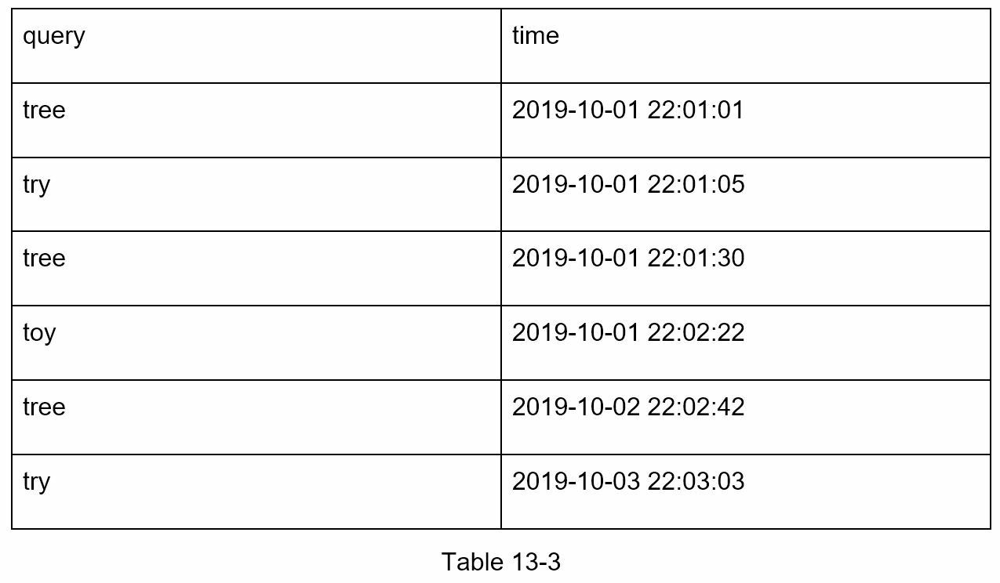

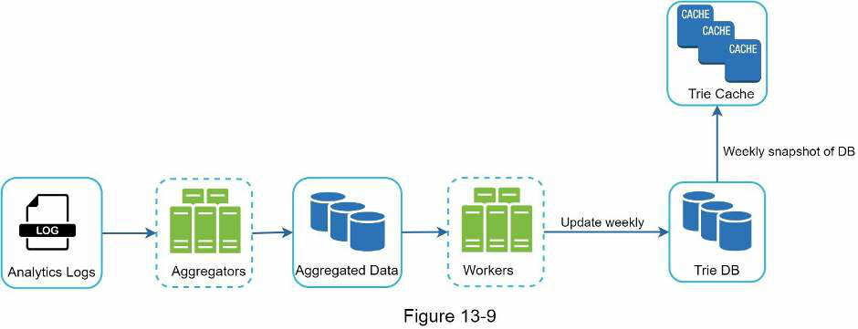

* **Các tiến trình xử lý nền (Workers):** Workers là một tập hợp các máy chủ thực hiện các tác vụ bất đồng bộ (*asynchronous jobs*) theo định kỳ. Chúng xây dựng cấu trúc dữ liệu trie và lưu trữ nó vào Trie DB.
* **Bộ nhớ đệm Trie (Trie Cache):** Trie Cache là một hệ thống cache phân tán giữ cây trie trong bộ nhớ (*in-memory*) để đọc nhanh. Nó lấy ảnh chụp nhanh (*snapshot*) hàng tuần từ DB.
* **Cơ sở dữ liệu Trie (Trie DB):** Trie DB là nơi lưu trữ bền vững (*persistent storage*). Có hai lựa chọn khả dụng để lưu trữ dữ liệu:
  1. **Cơ sở dữ liệu tài liệu (Document store):** Vì một cây trie mới được xây dựng hàng tuần, chúng ta có thể định kỳ chụp ảnh nhanh nó, tuần tự hóa (*serialize*) nó và lưu dữ liệu đã tuần tự hóa vào cơ sở dữ liệu. Các kho lưu trữ tài liệu như MongoDB [4] rất phù hợp cho dữ liệu đã tuần tự hóa.
  2. **Kho lưu trữ khóa-giá trị (Key-value store):** Một cây trie có thể được biểu diễn dưới dạng bảng băm (*hash table*) [4] bằng cách áp dụng logic sau:
     * Mỗi tiền tố trong cây trie được ánh xạ tới một khóa (*key*) trong bảng băm.
     * Dữ liệu trên mỗi nút trie được ánh xạ tới một giá trị (*value*) trong bảng băm.

Hình 13-10 (Figure 13-10) minh họa sự ánh xạ giữa cây trie và bảng băm.

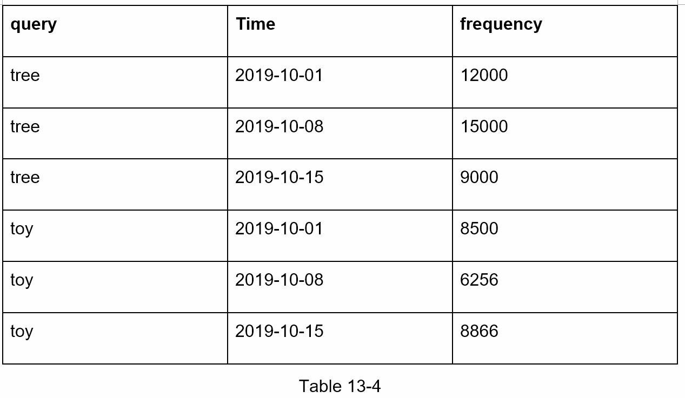

Trong Hình 13-10, mỗi nút trie ở bên trái được ánh xạ tới cặp `<key, value>` ở bên phải. Nếu bạn chưa rõ cách thức hoạt động của kho lưu trữ khóa-giá trị, hãy tham khảo *Chương 6: Thiết kế kho lưu trữ khóa-giá trị* (*Chapter 6: Design a key-value store*).

### Dịch vụ truy vấn (Query service)

Trong thiết kế tổng thể, dịch vụ truy vấn gọi trực tiếp cơ sở dữ liệu để lấy top 5 kết quả. Hình 13-11 (Figure 13-11) cho thấy thiết kế được cải tiến vì thiết kế trước đó không hiệu quả.

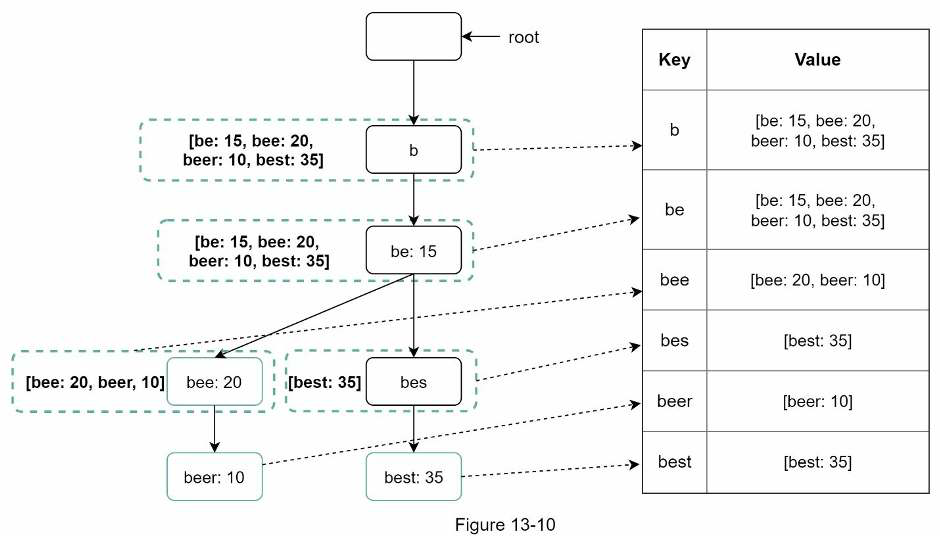

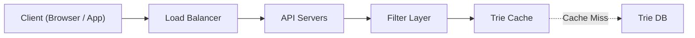

1. Một truy vấn tìm kiếm được gửi đến bộ cân bằng tải (*load balancer*).
2. Bộ cân bằng tải điều hướng yêu cầu đến các máy chủ API (*API servers*).
3. Các máy chủ API lấy dữ liệu trie từ Trie Cache và xây dựng các gợi ý tự động hoàn thành cho client.
4. Trong trường hợp dữ liệu không có trong Trie Cache (*cache miss*), chúng ta nạp lại dữ liệu vào cache từ Trie DB. Bằng cách này, tất cả các yêu cầu tiếp theo cho cùng một tiền tố sẽ được trả về từ cache. Tình trạng cache miss có thể xảy ra khi một máy chủ cache bị hết bộ nhớ hoặc ngoại tuyến.

Dịch vụ truy vấn đòi hỏi tốc độ nhanh như chớp. Chúng ta đề xuất các tối ưu hóa sau:

* **Yêu cầu AJAX (AJAX request):** Đối với các ứng dụng web, trình duyệt thường gửi các yêu cầu AJAX để lấy kết quả tự động hoàn thành. Lợi ích chính của AJAX là việc gửi/nhận yêu cầu/phản hồi không làm tải lại (*refresh*) toàn bộ trang web.
* **Lưu đệm trên trình duyệt (Browser caching):** Đối với nhiều ứng dụng, các gợi ý tìm kiếm tự động hoàn thành có thể không thay đổi nhiều trong một khoảng thời gian ngắn. Do đó, các gợi ý tự động hoàn thành có thể được lưu trong bộ nhớ đệm của trình duyệt (*browser cache*) để cho phép các yêu cầu tiếp theo lấy kết quả trực tiếp từ cache. Công cụ tìm kiếm Google sử dụng cơ chế cache tương tự. Hình 13-12 (Figure 13-12) cho thấy tiêu đề phản hồi (*response header*) khi bạn gõ `"system design interview"` trên công cụ tìm kiếm Google. Như bạn có thể thấy, Google lưu cache kết quả trên trình duyệt trong 1 giờ. Lưu ý: `"private"` trong `cache-control` có nghĩa là kết quả chỉ dành cho một người dùng duy nhất và không được phép lưu cache bởi các bộ nhớ đệm dùng chung (*shared cache*). `"max-age=3600"` có nghĩa là cache có hiệu lực trong 3600 giây, tức là một giờ.

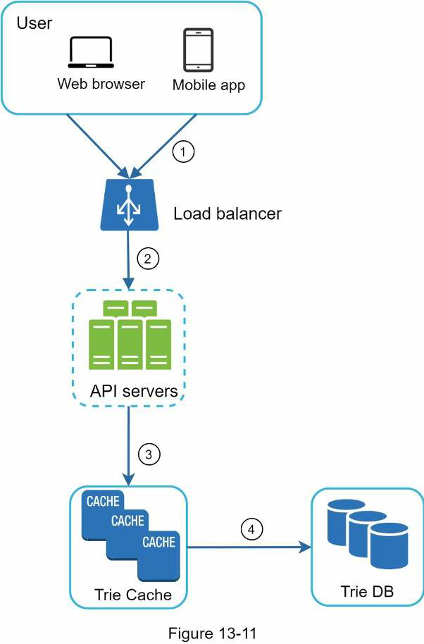

* **Lấy mẫu dữ liệu (Data sampling):** Đối với một hệ thống quy mô lớn, việc ghi nhật ký mọi truy vấn tìm kiếm đòi hỏi rất nhiều năng lực xử lý và không gian lưu trữ. Lấy mẫu dữ liệu (*data sampling*) rất quan trọng. Ví dụ, chỉ 1 trong mỗi $N$ yêu cầu được hệ thống ghi lại vào nhật ký.

> 💡 **Ví dụ bổ sung (không có trong sách):** Nếu hệ thống có 48.000 QPS vào giờ cao điểm và áp dụng tỷ lệ lấy mẫu 1/100 ($N = 100$), lượng log cần ghi nhận chỉ còn 480 truy vấn/giây. Với tập dữ liệu lớn, phân phối tần suất của các từ khóa phổ biến (top queries) vẫn giữ nguyên độ chính xác thống kê rất cao dù chỉ lấy mẫu 1% lưu lượng.

### Các thao tác trên Trie (Trie operations)

Trie là một thành phần cốt lõi của hệ thống tự động hoàn thành. Hãy cùng xem các thao tác trên trie (tạo, cập nhật và xóa) hoạt động như thế nào.

#### Tạo mới (Create)
Trie được tạo bởi các worker sử dụng dữ liệu đã tổng hợp. Nguồn dữ liệu đến từ Analytics Log/DB.

#### Cập nhật (Update)
Có hai cách để cập nhật cây trie:
* **Cách 1:** Cập nhật cây trie hàng tuần. Một khi cây trie mới được tạo, cây trie mới sẽ thay thế cây trie cũ.
* **Cách 2:** Cập nhật trực tiếp từng nút trie riêng lẻ. Chúng ta cố gắng tránh thao tác này vì nó chậm. Tuy nhiên, nếu kích thước của cây trie nhỏ, đây là một giải pháp có thể chấp nhận được. Khi chúng ta cập nhật một nút trie, tất cả các nút tổ tiên (*ancestors*) của nó cho đến tận nút gốc cũng phải được cập nhật theo vì các nút tổ tiên lưu trữ top các truy vấn của các nút con. Hình 13-13 (Figure 13-13) minh họa cách hoạt động của thao tác cập nhật. Ở phía bên trái, truy vấn tìm kiếm `"beer"` có giá trị ban đầu là 10. Ở phía bên phải, nó được cập nhật lên 30. Như bạn có thể thấy, nút đó và các nút tổ tiên của nó đều được cập nhật giá trị của `"beer"` thành 30.

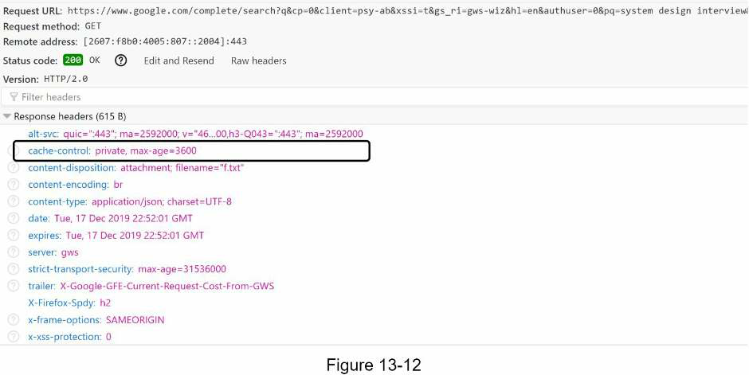

#### Xóa (Delete)
Chúng ta phải loại bỏ các gợi ý tự động hoàn thành mang tính thù hận, bạo lực, khiêu dâm hoặc nguy hiểm. Chúng ta thêm một tầng lọc (**filter layer**, Hình 13-14 / Figure 13-14) ở phía trước Trie Cache để lọc bỏ các gợi ý không mong muốn. Việc có một tầng lọc mang lại sự linh hoạt trong việc loại bỏ kết quả dựa trên các quy tắc lọc khác nhau. Các gợi ý không mong muốn sẽ bị xóa vật lý khỏi cơ sở dữ liệu một cách bất đồng bộ để tập dữ liệu chính xác được sử dụng nhằm xây dựng cây trie trong chu kỳ cập nhật tiếp theo.

### Mở rộng quy mô lưu trữ (Scale the storage)

Bây giờ chúng ta đã phát triển một hệ thống để mang lại các truy vấn tự động hoàn thành cho người dùng, đã đến lúc giải quyết vấn đề mở rộng quy mô khi cây trie phát triển quá lớn để có thể chứa vừa trong một máy chủ.

Vì tiếng Anh là ngôn ngữ duy nhất được hỗ trợ, một cách phân mảnh (*shard*) ngây thơ là dựa trên ký tự đầu tiên. Dưới đây là một số ví dụ:
* Nếu chúng ta cần hai máy chủ để lưu trữ, chúng ta có thể lưu các truy vấn bắt đầu bằng `'a'` đến `'m'` trên máy chủ thứ nhất, và `'n'` đến `'z'` trên máy chủ thứ hai.
* Nếu chúng ta cần ba máy chủ, chúng ta có thể chia các truy vấn thành `'a'` đến `'i'`, `'j'` đến `'r'` và `'s'` đến `'z'`.

Theo logic này, chúng ta có thể chia các truy vấn tối đa lên đến 26 máy chủ vì có 26 chữ cái trong bảng chữ cái tiếng Anh. Hãy gọi việc phân mảnh dựa trên ký tự đầu tiên là **phân mảnh cấp một** (*first level sharding*). Để lưu trữ dữ liệu vượt quá 26 máy chủ, chúng ta có thể phân mảnh ở cấp thứ hai hoặc thậm chí cấp thứ ba. Ví dụ, các truy vấn dữ liệu bắt đầu bằng `'a'` có thể được chia vào 4 máy chủ: `'aa-ag'`, `'ah-an'`, `'ao-au'`, và `'av-az'`.

Thoạt nhìn cách tiếp cận này có vẻ hợp lý, cho đến khi bạn nhận ra rằng có nhiều từ bắt đầu bằng chữ `'c'` hơn rất nhiều so với chữ `'x'`. Điều này tạo ra sự phân bố không đồng đều (*uneven distribution*).

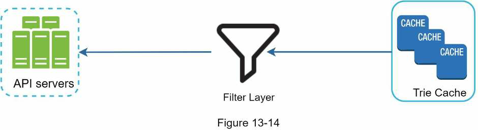

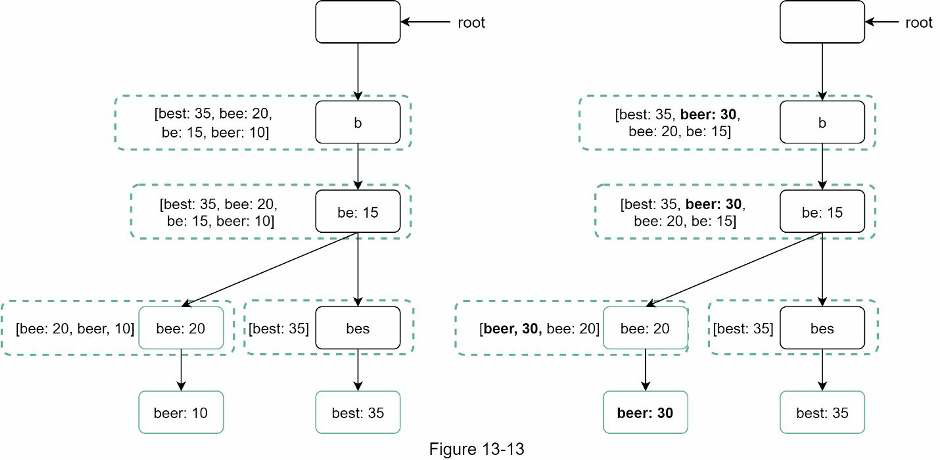

Để giảm thiểu vấn đề mất cân bằng dữ liệu, chúng ta phân tích mẫu phân bố dữ liệu lịch sử (*historical data distribution pattern*) và áp dụng logic phân mảnh thông minh hơn như minh họa trong Hình 13-15 (Figure 13-15). Trình quản lý bản đồ phân mảnh (**shard map manager**) duy trì một cơ sở dữ liệu tra cứu (*lookup database*) để xác định nơi các hàng dữ liệu nên được lưu trữ. Ví dụ, nếu số lượng truy vấn lịch sử cho `'s'` tương đương với tổng số truy vấn cho `'u'`, `'v'`, `'w'`, `'x'`, `'y'` và `'z'` cộng lại, chúng ta có thể duy trì hai shard: một shard cho `'s'` và một shard cho `'u'` đến `'z'`.

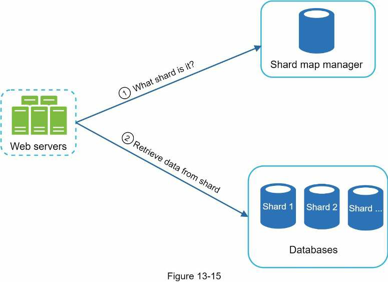

---

## Bước 4 - Tổng kết (Step 4 - Wrap up)

Sau khi bạn hoàn thành phần đi sâu thiết kế, người phỏng vấn có thể hỏi bạn một số câu hỏi mở rộng (*follow-up questions*).

**Người phỏng vấn: Làm thế nào để mở rộng thiết kế của bạn nhằm hỗ trợ đa ngôn ngữ?**
Để hỗ trợ các truy vấn không phải tiếng Anh khác, chúng ta lưu trữ các ký tự **Unicode** trong các nút trie. Nếu bạn chưa quen với Unicode, đây là định nghĩa: *“một tiêu chuẩn mã hóa bao gồm tất cả các ký tự cho mọi hệ thống chữ viết trên thế giới, cả hiện đại và cổ đại”* [5].

**Người phỏng vấn: Điều gì xảy ra nếu các truy vấn tìm kiếm hàng đầu ở một quốc gia khác với các quốc gia khác?**
Trong trường hợp này, chúng ta có thể xây dựng các cây trie khác nhau cho các quốc gia khác nhau. Để cải thiện thời gian phản hồi, chúng ta có thể lưu trữ các cây trie trong mạng phân phối nội dung (**CDNs**).

**Người phỏng vấn: Làm thế nào chúng ta có thể hỗ trợ các truy vấn tìm kiếm theo xu hướng (thời gian thực)?**
Giả sử một sự kiện tin tức nóng hổi xảy ra, một truy vấn tìm kiếm đột nhiên trở nên phổ biến. Thiết kế ban đầu của chúng ta sẽ không hoạt động vì:
* Các worker chạy ngoại tuyến (*offline workers*) chưa được lên lịch để cập nhật cây trie vì tác vụ này được lên lịch chạy hàng tuần.
* Ngay cả khi được lên lịch, việc xây dựng lại cây trie mất quá nhiều thời gian.

Việc xây dựng một hệ thống tự động hoàn thành tìm kiếm theo thời gian thực rất phức tạp và nằm ngoài phạm vi của cuốn sách này, vì vậy chúng tôi chỉ đưa ra một vài ý tưởng:
* Giảm tập dữ liệu làm việc (*working data set*) bằng cách phân mảnh (*sharding*).
* Thay đổi mô hình xếp hạng (*ranking model*) và gán trọng số cao hơn cho các truy vấn tìm kiếm gần đây.
* Dữ liệu có thể đến dưới dạng luồng (*streams*), vì vậy chúng ta không thể tiếp cận toàn bộ dữ liệu cùng một lúc. Dữ liệu luồng (*streaming data*) có nghĩa là dữ liệu được tạo ra liên tục. Việc xử lý luồng đòi hỏi một bộ hệ thống khác: Apache Hadoop MapReduce [6], Apache Spark Streaming [7], Apache Storm [8], Apache Kafka [9], v.v. Vì tất cả các chủ đề đó đòi hỏi kiến thức chuyên môn sâu riêng biệt, chúng ta không đi vào chi tiết ở đây.

Chúc mừng bạn đã đi được đến đây! Bây giờ hãy tự thưởng cho mình một cái vỗ vai. Làm tốt lắm!

---

## Tài liệu tham khảo (Reference materials)

1. The Life of a Typeahead Query: https://www.facebook.com/notes/facebook-engineering/the-life-of-a-typeahead-query/389105248919/
2. How We Built Prefixy: A Scalable Prefix Search Service for Powering Autocomplete: https://medium.com/@prefixyteam/how-we-built-prefixy-a-scalable-prefix-search-service-for-powering-autocomplete-c20f98e2eff1
3. Prefix Hash Tree An Indexing Data Structure over Distributed Hash Tables: https://people.eecs.berkeley.edu/~sylvia/papers/pht.pdf
4. MongoDB wikipedia: https://en.wikipedia.org/wiki/MongoDB
5. Unicode frequently asked questions: https://www.unicode.org/faq/basic_q.html
6. Apache hadoop: https://hadoop.apache.org/
7. Spark streaming: https://spark.apache.org/streaming/
8. Apache storm: https://storm.apache.org/
9. Apache kafka: https://kafka.apache.org/documentation/

---

## Bảng thuật ngữ chương (Chapter Glossary)

| Thuật ngữ (English) | Tiếng Việt | Giải thích ngắn gọn |
| :--- | :--- | :--- |
| Autocomplete / Typeahead | Tự động hoàn thành / Gợi ý khi gõ | Tính năng gợi ý các từ khóa hoàn chỉnh ngay khi người dùng đang nhập vào ô tìm kiếm. |
| Trie (Prefix Tree) | Cây tiền tố (Trie) | Cấu trúc dữ liệu dạng cây dùng để lưu trữ và truy xuất chuỗi theo tiền tố một cách hiệu quả. |
| Prefix | Tiền tố | Phần chuỗi ký tự ở đầu của một từ khóa hoặc truy vấn tìm kiếm. |
| QPS (Queries Per Second) | Số truy vấn mỗi giây | Đơn vị đo lường lưu lượng yêu cầu mà hệ thống phải xử lý trong một giây. |
| DAU (Daily Active Users) | Người dùng hoạt động hàng ngày | Tổng số người dùng duy nhất tương tác với sản phẩm trong một ngày. |
| Back-of-the-envelope estimation | Ước tính sơ bộ | Phương pháp tính toán nhanh quy mô tải, lưu trữ và băng thông trong phỏng vấn thiết kế hệ thống. |
| Data gathering service | Dịch vụ thu thập dữ liệu | Thành phần thu thập và tổng hợp lịch sử các truy vấn tìm kiếm của người dùng. |
| Query service | Dịch vụ truy vấn | Thành phần tiếp nhận tiền tố từ người dùng và trả về top $k$ gợi ý phổ biến nhất. |
| Analytics Logs | Nhật ký phân tích | Nơi lưu trữ dữ liệu thô dạng chỉ ghi thêm (append-only) về các truy vấn tìm kiếm. |
| Aggregators | Bộ tổng hợp | Thành phần xử lý, gom nhóm và tính tổng tần suất truy vấn từ dữ liệu log thô. |
| Trie Cache | Bộ nhớ đệm Trie | Hệ thống cache phân tán lưu giữ cây Trie trong RAM để phục vụ tốc độ đọc cực nhanh. |
| Trie DB | Cơ sở dữ liệu Trie | Kho lưu trữ bền vững (Document store hoặc Key-value store) chứa ảnh chụp cây Trie. |
| Browser caching | Lưu đệm trên trình duyệt | Cơ chế lưu tạm kết quả gợi ý ở trình duyệt người dùng thông qua header `Cache-Control`. |
| Data sampling | Lấy mẫu dữ liệu | Kỹ thuật chỉ ghi nhận một tỷ lệ nhỏ (ví dụ $1/N$) yêu cầu để giảm tải lưu trữ và xử lý. |
| Filter layer | Tầng lọc | Lớp trung gian giúp loại bỏ các gợi ý vi phạm (thù hận, bạo lực, nhạy cảm...) trước khi trả về. |
| Shard map manager | Trình quản lý bản đồ phân mảnh | Thành phần lưu bảng tra cứu giúp ánh xạ tiền tố đến đúng shard dữ liệu nhằm cân bằng tải. |
| Streaming data | Dữ liệu luồng | Dữ liệu được sinh ra liên tục theo thời gian thực, cần các hệ thống như Kafka, Spark Streaming để xử lý. |
