# CHƯƠNG 14: Thiết kế YouTube (CHAPTER 14: DESIGN YOUTUBE)

Trong chương này, bạn được yêu cầu thiết kế YouTube. Giải pháp cho câu hỏi này có thể được áp dụng cho các câu hỏi phỏng vấn khác như thiết kế một nền tảng chia sẻ video tương tự Netflix và Hulu. Hình 14-1 (Figure 14-1) hiển thị trang chủ của YouTube.

YouTube trông có vẻ đơn giản: người sáng tạo nội dung tải video lên và người xem bấm phát. Liệu nó có thực sự đơn giản như vậy không? Không hẳn. Có rất nhiều công nghệ phức tạp ẩn sau sự đơn giản đó. Hãy cùng xem qua một số số liệu thống kê ấn tượng, nhân khẩu học và những sự thật thú vị về YouTube trong năm 2020 [1] [2].

- Tổng số người dùng hoạt động hàng tháng (monthly active users): 2 tỷ.
- Số lượng video được xem mỗi ngày: 5 tỷ.
- 73% người trưởng thành tại Hoa Kỳ sử dụng YouTube.
- 50 triệu nhà sáng tạo nội dung trên YouTube.
- Doanh thu quảng cáo của YouTube đạt 15,1 tỷ USD cho cả năm 2019, tăng 36% so với năm 2018.
- YouTube chiếm 37% tổng lưu lượng truy cập internet di động.
- YouTube hỗ trợ 80 ngôn ngữ khác nhau.

Từ những số liệu thống kê này, chúng ta biết rằng YouTube có quy mô khổng lồ, mang tính toàn cầu và tạo ra rất nhiều tiền.

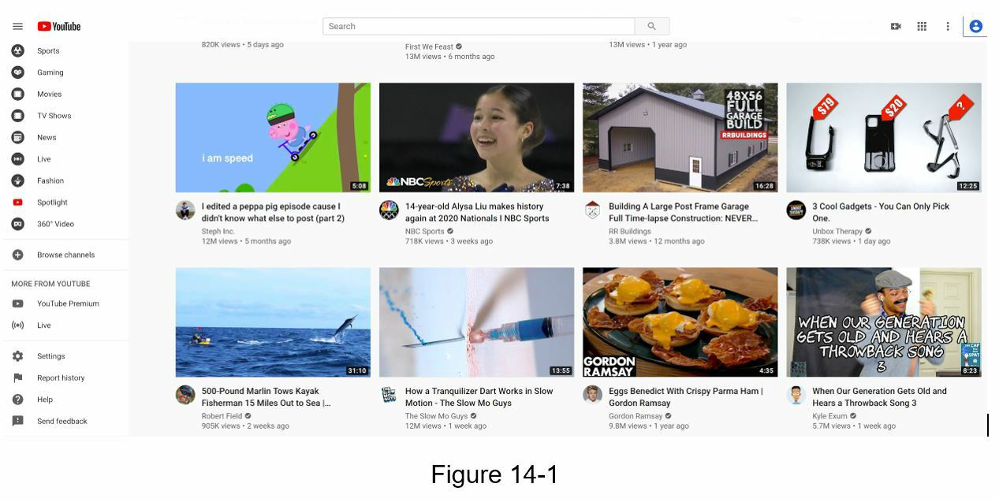

## Bước 1 - Hiểu rõ bài toán và xác định phạm vi thiết kế (Step 1 - Understand the problem and establish design scope)

Như thể hiện trong Hình 14-1 (Figure 14-1), bên cạnh việc xem video, bạn có thể làm nhiều việc khác trên YouTube. Ví dụ: bình luận, chia sẻ hoặc thích video, lưu video vào danh sách phát (playlist), đăng ký kênh, v.v. Không thể thiết kế mọi thứ trong một buổi phỏng vấn kéo dài 45 hoặc 60 phút. Do đó, điều quan trọng là phải đặt câu hỏi để thu hẹp phạm vi.

**Ứng viên (Candidate):** Những tính năng nào là quan trọng?  
**Người phỏng vấn (Interviewer):** Khả năng tải video lên và xem video.

**Ứng viên:** Chúng ta cần hỗ trợ những loại client nào?  
**Người phỏng vấn:** Ứng dụng di động, trình duyệt web và smart TV.

**Ứng viên:** Chúng ta có bao nhiêu người dùng hoạt động hàng ngày (daily active users)?  
**Người phỏng vấn:** 5 triệu.

**Ứng viên:** Thời gian trung bình mỗi ngày người dùng dành cho sản phẩm là bao nhiêu?  
**Người phỏng vấn:** 30 phút.

**Ứng viên:** Chúng ta có cần hỗ trợ người dùng quốc tế không?  
**Người phỏng vấn:** Có, một tỷ lệ lớn người dùng là người dùng quốc tế.

**Ứng viên:** Các độ phân giải video được hỗ trợ là gì?  
**Người phỏng vấn:** Hệ thống chấp nhận hầu hết các độ phân giải và định dạng video.

**Ứng viên:** Có yêu cầu mã hóa (encryption) không?  
**Người phỏng vấn:** Có.

**Ứng viên:** Có yêu cầu nào về kích thước tệp cho video không?  
**Người phỏng vấn:** Nền tảng của chúng ta tập trung vào các video kích thước nhỏ và vừa. Kích thước video tối đa cho phép là 1GB.

**Ứng viên:** Chúng ta có thể tận dụng một số hạ tầng đám mây có sẵn do Amazon, Google hoặc Microsoft cung cấp không?  
**Người phỏng vấn:** Đó là một câu hỏi rất hay. Việc tự xây dựng mọi thứ từ đầu là không thực tế đối với hầu hết các công ty, nên tận dụng một số dịch vụ đám mây có sẵn.

Trong chương này, chúng ta tập trung thiết kế một dịch vụ phát video trực tuyến (video streaming service) với các tính năng sau:

- Khả năng tải video lên nhanh chóng
- Phát video trực tuyến mượt mà
- Khả năng thay đổi chất lượng video
- Chi phí hạ tầng thấp
- Yêu cầu cao về tính sẵn sàng (high availability), khả năng mở rộng (scalability) và độ tin cậy (reliability)
- Các client được hỗ trợ: ứng dụng di động, trình duyệt web và smart TV

### Ước tính sơ bộ (Back of the envelope estimation)

Các ước tính sau đây dựa trên nhiều giả định, vì vậy điều quan trọng là phải trao đổi với người phỏng vấn để đảm bảo họ cùng thống nhất với bạn.

- Giả sử sản phẩm có 5 triệu người dùng hoạt động hàng ngày (DAU).
- Mỗi người dùng xem 5 video mỗi ngày.
- 10% người dùng tải lên 1 video mỗi ngày.
- Giả sử kích thước video trung bình là 300 MB.
- Tổng dung lượng lưu trữ cần thiết mỗi ngày: $5\text{ triệu} \times 10\% \times 300\text{ MB} = 150\text{ TB}$
- Chi phí CDN:
  - Khi CDN đám mây phân phối một video, bạn sẽ bị tính phí cho lượng dữ liệu truyền ra từ CDN.
  - Hãy sử dụng dịch vụ CDN CloudFront của Amazon để ước tính chi phí (Hình 14-2 / Figure 14-2) [3]. Giả sử 100% lưu lượng được phân phối từ Hoa Kỳ. Chi phí trung bình mỗi GB là 0,02 USD. Để đơn giản, chúng ta chỉ tính chi phí phát video trực tuyến.
  - $5\text{ triệu} \times 5\text{ video} \times 0,3\text{ GB} \times 0,02\text{ USD} = 150.000\text{ USD mỗi ngày}$.

Từ ước tính chi phí sơ bộ, chúng ta biết rằng việc phân phối video từ CDN tốn rất nhiều tiền. Mặc dù các nhà cung cấp đám mây sẵn sàng giảm đáng kể chi phí CDN cho các khách hàng lớn, chi phí này vẫn rất đáng kể. Chúng ta sẽ thảo luận các cách để giảm chi phí CDN trong phần đi sâu vào thiết kế.

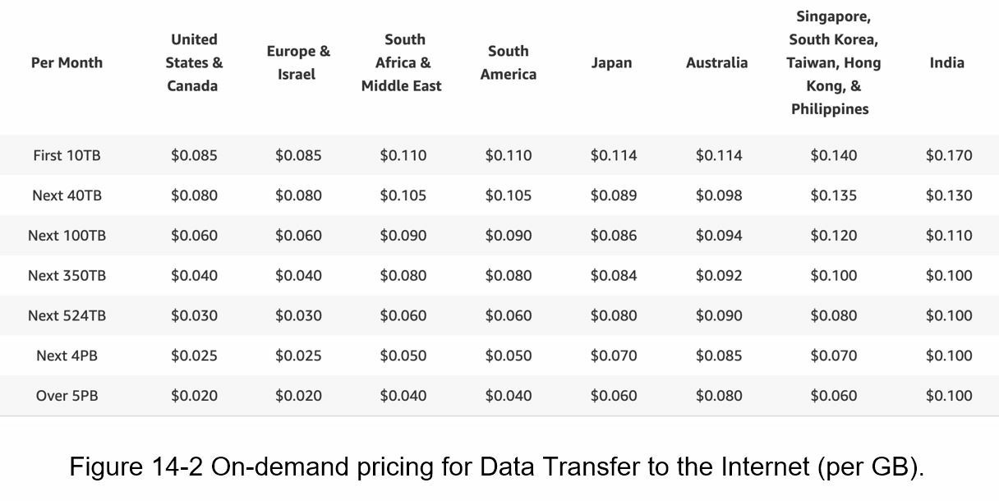

> 💡 **Ví dụ bổ sung (không có trong sách):**  
> Nếu tính thêm băng thông tải xuống (egress bandwidth) trung bình trong ngày: tổng lượng dữ liệu truyền qua CDN mỗi ngày là $5.000.000 \times 5 \times 300\text{ MB} = 7.500\text{ TB/ngày} \approx 7,5\text{ PB/ngày}$. Quy đổi ra băng thông trung bình trên giây: $\frac{7,5 \times 10^{15}\text{ bytes} \times 8\text{ bits}}{86.400\text{ giây}} \approx 694\text{ Gbps}$ — và vào giờ cao điểm (gấp 3–5 lần trung bình), băng thông có thể chạm ngưỡng $2\text{–}3,5\text{ Tbps}$. Đây là lý do tại sao CDN toàn cầu là bắt buộc chứ không thể chỉ dùng một cụm máy chủ gốc (origin server).

## Bước 2 - Đề xuất thiết kế tổng quan và lấy sự đồng thuận (Step 2 - Propose high-level design and get buy-in)

Như đã thảo luận trước đó, người phỏng vấn khuyến khích tận dụng các dịch vụ đám mây có sẵn thay vì xây dựng mọi thứ từ đầu. CDN và lưu trữ đối tượng nhị phân (blob storage) là những dịch vụ đám mây chúng ta sẽ tận dụng. Một số độc giả có thể hỏi tại sao không tự xây dựng mọi thứ? Các lý do được liệt kê dưới đây:

- Phỏng vấn thiết kế hệ thống không phải là việc tự xây dựng mọi thứ từ con số không. Trong khung thời gian giới hạn, việc chọn đúng công nghệ để giải quyết đúng bài toán quan trọng hơn việc giải thích chi tiết cách công nghệ đó hoạt động. Ví dụ, chỉ cần đề cập đến blob storage để lưu trữ video nguồn là đủ cho buổi phỏng vấn. Nói về thiết kế chi tiết cho blob storage có thể là quá mức cần thiết (overkill).
- Việc xây dựng hệ thống blob storage hoặc CDN có khả năng mở rộng cực kỳ phức tạp và tốn kém. Ngay cả những công ty lớn như Netflix hay Facebook cũng không tự xây dựng mọi thứ. Netflix tận dụng các dịch vụ đám mây của Amazon [4], và Facebook sử dụng CDN của Akamai [5].

Ở mức tổng quan, hệ thống bao gồm ba thành phần (Hình 14-3 / Figure 14-3).

- **Client:** Bạn có thể xem YouTube trên máy tính, điện thoại di động và smart TV.
- **CDN:** Các video được lưu trữ trong CDN. Khi bạn nhấn nút phát, video sẽ được phát trực tuyến (stream) từ CDN.
- **API servers:** Mọi thứ khác ngoại trừ việc phát video trực tuyến đều đi qua các máy chủ API. Điều này bao gồm đề xuất bảng tin (feed recommendation), tạo URL tải video lên, cập nhật cơ sở dữ liệu metadata và bộ nhớ đệm (cache), đăng ký người dùng, v.v.

Trong phần hỏi đáp, người phỏng vấn bày tỏ sự quan tâm đến hai luồng:

- Luồng tải video lên (Video uploading flow)
- Luồng phát video trực tuyến (Video streaming flow)

Chúng ta sẽ khám phá thiết kế tổng quan cho từng luồng.

### Luồng tải video lên (Video uploading flow)

Hình 14-4 (Figure 14-4) minh họa thiết kế tổng quan cho quá trình tải video lên.

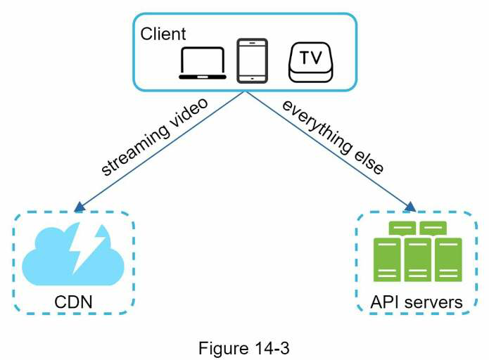

Hệ thống bao gồm các thành phần sau:

- **User (Người dùng):** Người dùng xem YouTube trên các thiết bị như máy tính, điện thoại di động hoặc smart TV.
- **Load balancer (Bộ cân bằng tải):** Bộ cân bằng tải phân phối đều các yêu cầu đến các máy chủ API.
- **API servers (Máy chủ API):** Tất cả các yêu cầu của người dùng đều đi qua máy chủ API ngoại trừ việc phát video trực tuyến.
- **Metadata DB (Cơ sở dữ liệu metadata):** Metadata của video được lưu trữ trong Metadata DB. Cơ sở dữ liệu này được phân mảnh (sharded) và sao chép (replicated) để đáp ứng các yêu cầu về hiệu năng và tính sẵn sàng cao.
- **Metadata cache (Bộ nhớ đệm metadata):** Để có hiệu năng tốt hơn, metadata của video và các đối tượng người dùng được lưu trong bộ nhớ đệm.
- **Original storage (Kho lưu trữ gốc):** Một hệ thống blob storage được sử dụng để lưu trữ các video gốc. Một trích dẫn trên Wikipedia về blob storage cho biết: *"Binary Large Object (BLOB) là một tập hợp dữ liệu nhị phân được lưu trữ như một thực thể đơn lẻ trong hệ quản trị cơ sở dữ liệu"* [6].
- **Transcoding servers (Máy chủ chuyển mã):** Chuyển mã video (video transcoding) còn được gọi là mã hóa video (video encoding). Đây là quá trình chuyển đổi một định dạng video sang các định dạng khác (MPEG, HLS, v.v.), giúp cung cấp các luồng video tốt nhất có thể cho các thiết bị và khả năng băng thông khác nhau.

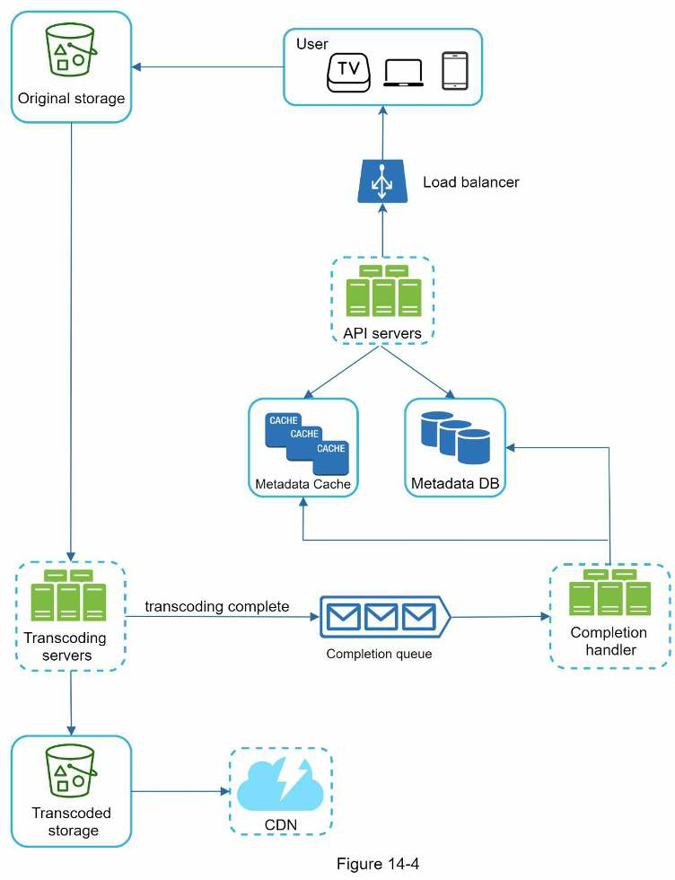

- **Transcoded storage (Kho lưu trữ đã chuyển mã):** Đây là một blob storage dùng để lưu trữ các tệp video đã được chuyển mã.
- **CDN:** Các video được lưu đệm trong CDN. Khi bạn nhấn nút phát, video sẽ được phát trực tuyến từ CDN.
- **Completion queue (Hàng đợi hoàn tất):** Đây là một hàng đợi thông điệp (message queue) lưu trữ thông tin về các sự kiện hoàn tất quá trình chuyển mã video.
- **Completion handler (Trình xử lý hoàn tất):** Bao gồm một danh sách các worker lấy dữ liệu sự kiện từ hàng đợi hoàn tất và cập nhật bộ nhớ đệm metadata cũng như cơ sở dữ liệu.

Bây giờ chúng ta đã hiểu từng thành phần riêng lẻ, hãy cùng xem luồng tải video lên hoạt động như thế nào. Luồng này được chia thành hai tiến trình chạy song song:

a. Tải video thực tế lên.  
b. Cập nhật metadata của video. Metadata chứa thông tin về URL video, kích thước, độ phân giải, định dạng, thông tin người dùng, v.v.

#### Luồng a: tải video thực tế lên (Flow a: upload the actual video)

Hình 14-5 (Figure 14-5) minh họa cách tải video thực tế lên. Phần giải thích được trình bày bên dưới:

1. Video được tải lên kho lưu trữ gốc (original storage).
2. Các máy chủ chuyển mã (transcoding servers) lấy video từ kho lưu trữ gốc và bắt đầu chuyển mã.
3. Sau khi quá trình chuyển mã hoàn tất, hai bước sau được thực hiện song song:  
   3a. Video đã chuyển mã được gửi đến kho lưu trữ đã chuyển mã (transcoded storage).  
   3b. Các sự kiện hoàn tất chuyển mã được đưa vào hàng đợi hoàn tất (completion queue).  
   3a.1. Video đã chuyển mã được phân phối đến CDN.  
   3b.1. Trình xử lý hoàn tất (completion handler) chứa một nhóm các worker liên tục lấy dữ liệu sự kiện từ hàng đợi.

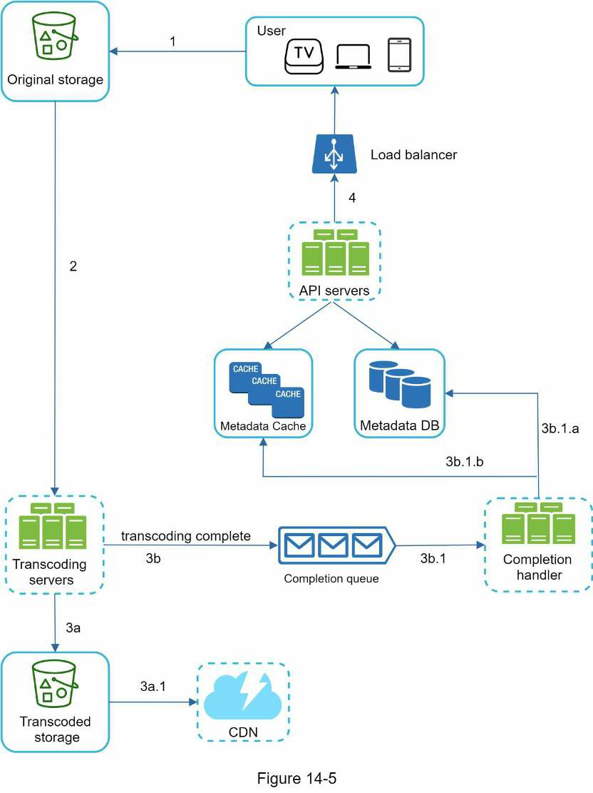

   3b.1.a và 3b.1.b. Trình xử lý hoàn tất cập nhật cơ sở dữ liệu metadata và bộ nhớ đệm khi quá trình chuyển mã video hoàn tất.  
4. Các máy chủ API thông báo cho client rằng video đã được tải lên thành công và sẵn sàng để phát trực tuyến.

#### Luồng b: cập nhật metadata (Flow b: update the metadata)

Trong khi tệp đang được tải lên kho lưu trữ gốc, client đồng thời gửi một yêu cầu để cập nhật metadata của video như minh họa trong Hình 14-6 (Figure 14-6). Yêu cầu này chứa metadata của video, bao gồm tên tệp, kích thước, định dạng, v.v. Các máy chủ API cập nhật bộ nhớ đệm metadata và cơ sở dữ liệu.

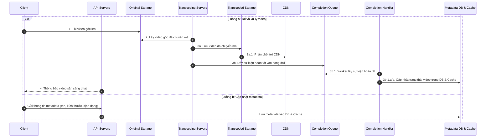

### Luồng phát video trực tuyến (Video streaming flow)

Bất cứ khi nào bạn xem một video trên YouTube, video thường bắt đầu phát ngay lập tức và bạn không phải đợi cho đến khi toàn bộ video được tải xuống. Tải xuống (downloading) có nghĩa là toàn bộ video được sao chép về thiết bị của bạn, trong khi phát trực tuyến (streaming) có nghĩa là thiết bị của bạn liên tục nhận các luồng video từ video nguồn ở xa. Khi bạn xem video trực tuyến, client của bạn tải từng phần nhỏ dữ liệu tại một thời điểm để bạn có thể xem video ngay lập tức và liên tục.

Trước khi thảo luận về luồng phát video trực tuyến, hãy xem xét một khái niệm quan trọng: **giao thức phát trực tuyến (streaming protocol)**. Đây là một cách thức chuẩn hóa để kiểm soát việc truyền dữ liệu cho phát video trực tuyến. Các giao thức phát trực tuyến phổ biến bao gồm:

- **MPEG–DASH:** MPEG là viết tắt của *"Moving Picture Experts Group"* và DASH là viết tắt của *"Dynamic Adaptive Streaming over HTTP"*.
- **Apple HLS:** HLS là viết tắt của *"HTTP Live Streaming"*.
- **Microsoft Smooth Streaming.**
- **Adobe HTTP Dynamic Streaming (HDS).**

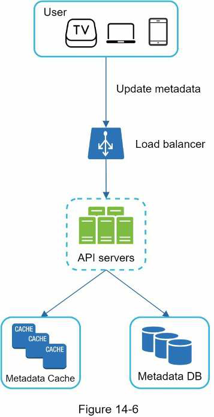

Bạn không cần phải hiểu tường tận hoặc thậm chí ghi nhớ tên các giao thức phát trực tuyến đó vì chúng là các chi tiết cấp thấp đòi hỏi kiến thức chuyên ngành sâu. Điều quan trọng ở đây là hiểu rằng các giao thức phát trực tuyến khác nhau hỗ trợ các chuẩn mã hóa video (video encodings) và trình phát (playback players) khác nhau. Khi thiết kế một dịch vụ phát video trực tuyến, chúng ta phải chọn đúng giao thức để hỗ trợ các trường hợp sử dụng của mình. Để tìm hiểu thêm về các giao thức phát trực tuyến, bạn có thể tham khảo bài viết rất hay này [7].

Video được phát trực tuyến trực tiếp từ CDN. Máy chủ biên (edge server) gần bạn nhất sẽ phân phối video. Do đó, độ trễ là rất thấp. Hình 14-7 (Figure 14-7) minh họa thiết kế tổng quan cho việc phát video trực tuyến.

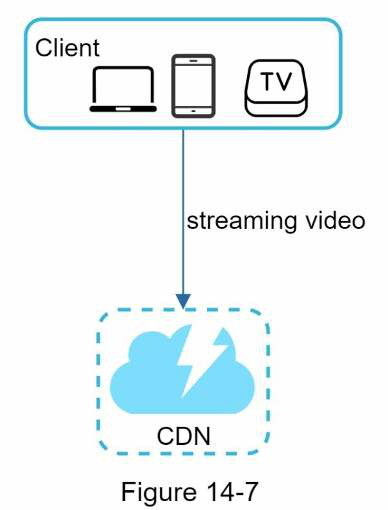

> 📝 **Giải thích thêm (không có trong sách):**  
> Cơ chế cốt lõi của các giao thức hiện đại như **HLS** và **MPEG-DASH** là **Adaptive Bitrate Streaming (ABR)**. Video không được lưu thành một tệp MP4 khổng lồ duy nhất mà được cắt thành các phân đoạn ngắn (segment/chunk) dài 2–6 giây ở nhiều mức chất lượng (360p, 720p, 1080p, 4K), kèm theo một tệp danh sách phát (manifest file như `.m3u8` cho HLS hoặc `.mpd` cho DASH). Trình phát trên client tự động đo băng thông hiện tại và chuyển đổi linh hoạt giữa các mức chất lượng cho từng đoạn tiếp theo mà không gây đứng hình (buffering).

## Bước 3 - Đi sâu vào thiết kế (Step 3 - Design deep dive)

Trong phần thiết kế tổng quan, toàn bộ hệ thống được chia thành hai phần: luồng tải video lên và luồng phát video trực tuyến. Trong phần này, chúng ta sẽ tinh chỉnh cả hai luồng với các tối ưu hóa quan trọng và giới thiệu các cơ chế xử lý lỗi.

### Chuyển mã video (Video transcoding)

Khi bạn quay một video, thiết bị (thường là điện thoại hoặc máy ảnh) sẽ gán cho tệp video một định dạng nhất định. Nếu bạn muốn video phát mượt mà trên các thiết bị khác, video phải được mã hóa sang các tốc độ bit (bitrate) và định dạng tương thích. **Bitrate** là tốc độ xử lý các bit theo thời gian. Bitrate cao hơn thường đồng nghĩa với chất lượng video cao hơn. Các luồng bitrate cao đòi hỏi nhiều năng lực xử lý hơn và tốc độ internet nhanh hơn.

Chuyển mã video rất quan trọng vì các lý do sau:

- Video thô (raw video) tiêu tốn lượng lớn không gian lưu trữ. Một video độ nét cao dài một giờ được quay ở tốc độ 60 khung hình/giây (fps) có thể chiếm tới vài trăm GB dung lượng.
- Nhiều thiết bị và trình duyệt chỉ hỗ trợ một số loại định dạng video nhất định. Do đó, việc mã hóa video sang các định dạng khác nhau là rất quan trọng vì lý do tương thích.
- Để đảm bảo người dùng xem được video chất lượng cao trong khi vẫn duy trì phát lại mượt mà, nên phân phối video độ phân giải cao hơn cho người dùng có băng thông mạng cao và video độ phân giải thấp hơn cho người dùng có băng thông thấp.
- Điều kiện mạng có thể thay đổi, đặc biệt là trên thiết bị di động. Để đảm bảo video được phát liên tục, việc tự động hoặc thủ công chuyển đổi chất lượng video dựa trên điều kiện mạng là điều thiết yếu cho trải nghiệm người dùng mượt mà.

Có rất nhiều định dạng mã hóa; tuy nhiên, hầu hết chúng đều chứa hai phần:

- **Container (Vùng chứa):** Giống như một chiếc giỏ chứa tệp video, âm thanh và metadata. Bạn có thể nhận biết định dạng container qua phần mở rộng tệp, chẳng hạn như `.avi`, `.mov`, hoặc `.mp4`.
- **Codecs (Bộ giải mã):** Đây là các thuật toán nén và giải nén nhằm mục đích giảm kích thước video trong khi vẫn bảo toàn chất lượng video. Các codec video được sử dụng phổ biến nhất là H.264, VP9 và HEVC.

### Mô hình đồ thị có hướng không chu trình (Directed acyclic graph (DAG) model)

Việc chuyển mã một video tốn nhiều tài nguyên tính toán và thời gian. Bên cạnh đó, các nhà sáng tạo nội dung khác nhau có thể có các yêu cầu xử lý video khác nhau. Ví dụ, một số nhà sáng tạo yêu cầu chèn hình mờ (watermark) lên trên video của họ, một số tự cung cấp ảnh thu nhỏ (thumbnail), và một số tải lên video độ nét cao trong khi những người khác thì không.

Để hỗ trợ các quy trình xử lý video (video processing pipelines) khác nhau và duy trì tính song song cao, điều quan trọng là phải thêm một mức độ trừu tượng hóa và cho phép các lập trình viên phía client định nghĩa những tác vụ nào cần thực thi. Ví dụ, công cụ phát video trực tuyến của Facebook sử dụng mô hình lập trình đồ thị có hướng không chu trình (DAG), cho phép định nghĩa các tác vụ theo từng giai đoạn để chúng có thể được thực thi tuần tự hoặc song song [8]. Trong thiết kế của chúng ta, chúng ta áp dụng một mô hình DAG tương tự để đạt được sự linh hoạt và tính song song. Hình 14-8 (Figure 14-8) biểu diễn một DAG cho quá trình chuyển mã video.

Trong Hình 14-8 (Figure 14-8), video gốc được tách thành video, âm thanh (audio) và metadata. Dưới đây là một số tác vụ có thể được áp dụng trên một tệp video:

- **Inspection (Kiểm tra):** Đảm bảo video có chất lượng tốt và không bị lỗi định dạng (malformed).
- **Video encodings (Mã hóa video):** Video được chuyển đổi để hỗ trợ các độ phân giải, codec, bitrate khác nhau, v.v. Hình 14-9 (Figure 14-9) cho thấy một ví dụ về các tệp video đã được mã hóa.
- **Thumbnail (Ảnh thu nhỏ):** Ảnh thu nhỏ có thể được người dùng tải lên hoặc được hệ thống tự động tạo ra.
- **Watermark (Hình mờ):** Một lớp ảnh phủ lên trên video chứa thông tin nhận dạng về video của bạn.

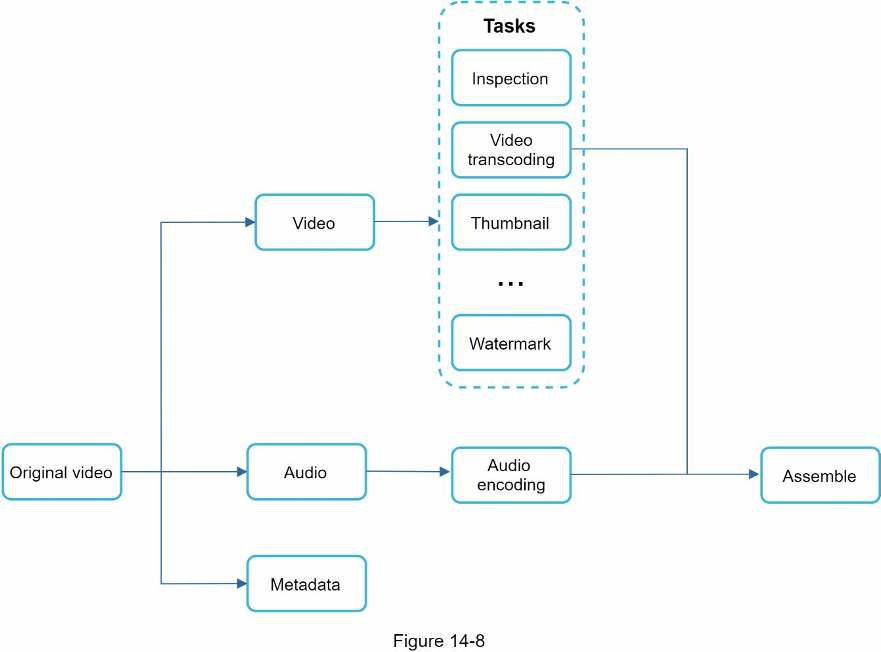

### Kiến trúc chuyển mã video (Video transcoding architecture)

Kiến trúc chuyển mã video được đề xuất tận dụng các dịch vụ đám mây được minh họa trong Hình 14-10 (Figure 14-10).

Kiến trúc này có sáu thành phần chính: **bộ tiền xử lý (preprocessor)**, **bộ lập lịch DAG (DAG scheduler)**, **trình quản lý tài nguyên (resource manager)**, **worker thực thi tác vụ (task workers)**, **bộ nhớ tạm thời (temporary storage)**, và **video đã mã hóa (encoded video)** làm đầu ra. Hãy cùng xem xét kỹ từng thành phần.

#### Bộ tiền xử lý (Preprocessor)

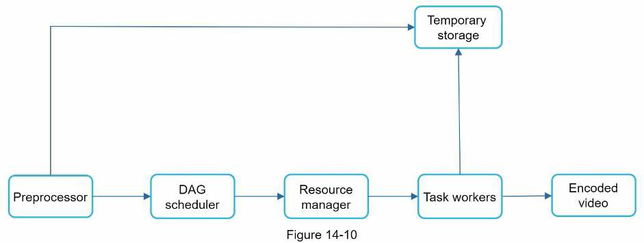

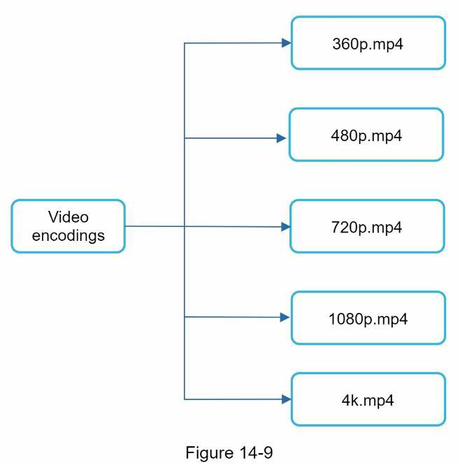

Bộ tiền xử lý (preprocessor) có 4 trách nhiệm:

1. **Tách video (Video splitting):** Luồng video được tách hoặc tiếp tục chia nhỏ thành các phân đoạn căn chỉnh theo Nhóm hình ảnh — **Group of Pictures (GOP)**. GOP là một nhóm/khối các khung hình được sắp xếp theo một thứ tự cụ thể. Mỗi khối là một đơn vị có thể phát độc lập, thường dài vài giây.
2. Một số thiết bị di động hoặc trình duyệt cũ có thể không hỗ trợ tách video. Bộ tiền xử lý sẽ tách video theo căn chỉnh GOP cho các client cũ này.
3. **Tạo DAG (DAG generation):** Bộ xử lý tạo ra DAG dựa trên các tệp cấu hình do lập trình viên phía client viết. Hình 14-12 (Figure 14-12) là một biểu diễn DAG đơn giản hóa có 2 nút và 1 cạnh. Biểu diễn DAG này được tạo ra từ hai tệp cấu hình bên dưới (Hình 14-13 / Figure 14-13).
4. **Lưu đệm dữ liệu (Cache data):** Bộ tiền xử lý đóng vai trò là bộ nhớ đệm cho các video đã phân đoạn. Để tăng độ tin cậy, bộ tiền xử lý lưu trữ các GOP và metadata trong bộ nhớ tạm thời. Nếu quá trình mã hóa video thất bại, hệ thống có thể sử dụng dữ liệu đã lưu trữ bền vững này cho các thao tác thử lại (retry).

#### Bộ lập lịch DAG (DAG scheduler)

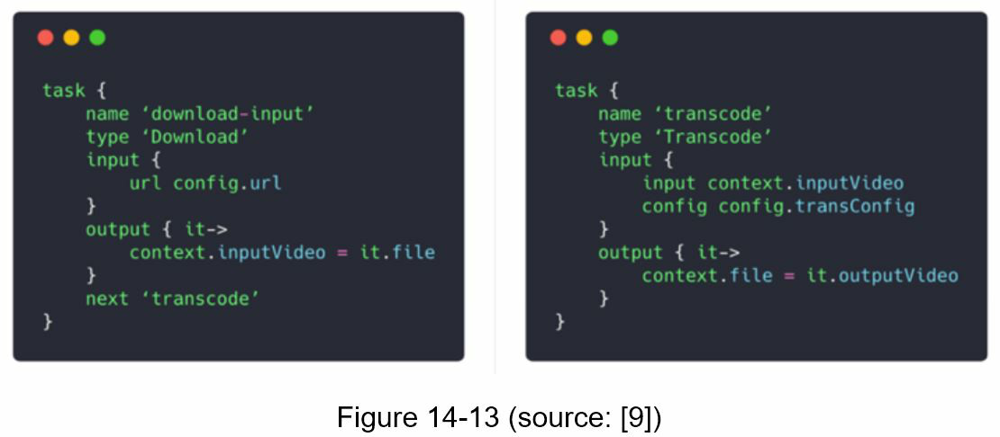

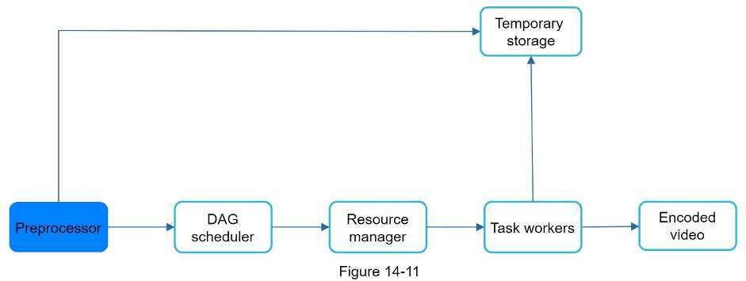

Bộ lập lịch DAG (DAG scheduler) chia một đồ thị DAG thành các giai đoạn (stages) của các tác vụ và đưa chúng vào hàng đợi tác vụ (task queue) trong trình quản lý tài nguyên (resource manager). Hình 14-15 (Figure 14-15) minh họa một ví dụ về cách bộ lập lịch DAG hoạt động.

Như thể hiện trong Hình 14-15 (Figure 14-15), video gốc được chia thành ba giai đoạn (thực chất là ba luồng ở Giai đoạn 1): Giai đoạn 1 gồm video, âm thanh (audio) và metadata. Tệp video tiếp tục được chia thành hai tác vụ ở Giai đoạn 2: mã hóa video (video encoding) và tạo ảnh thu nhỏ (thumbnail). Tệp âm thanh yêu cầu mã hóa âm thanh (audio encoding) như một phần của các tác vụ Giai đoạn 2.

#### Trình quản lý tài nguyên (Resource manager)

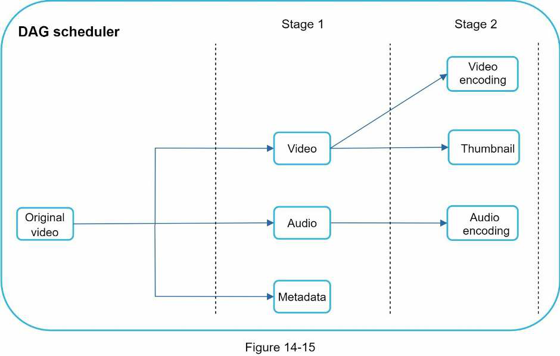

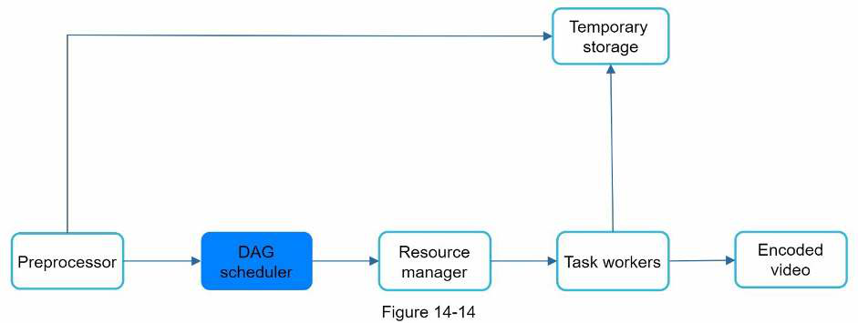

Trình quản lý tài nguyên (resource manager) chịu trách nhiệm quản lý hiệu quả việc phân bổ tài nguyên. Nó chứa 3 hàng đợi và một bộ lập lịch tác vụ (task scheduler) như minh họa trong Hình 14-17 (Figure 14-17).

- **Task queue (Hàng đợi tác vụ):** Đây là một hàng đợi ưu tiên (priority queue) chứa các tác vụ cần được thực thi.
- **Worker queue (Hàng đợi worker):** Đây là một hàng đợi ưu tiên chứa thông tin về mức độ sử dụng tài nguyên (utilization) của các worker.
- **Running queue (Hàng đợi đang chạy):** Chứa thông tin về các tác vụ đang chạy và các worker đang thực thi những tác vụ đó.
- **Task scheduler (Bộ lập lịch tác vụ):** Chọn cặp tác vụ/worker tối ưu và chỉ thị cho worker được chọn thực thi công việc.

Trình quản lý tài nguyên hoạt động như sau:

- Bộ lập lịch tác vụ lấy tác vụ có độ ưu tiên cao nhất từ hàng đợi tác vụ.
- Bộ lập lịch tác vụ lấy worker tối ưu nhất để chạy tác vụ từ hàng đợi worker.
- Bộ lập lịch tác vụ chỉ thị cho worker được chọn chạy tác vụ đó.
- Bộ lập lịch tác vụ ràng buộc thông tin tác vụ/worker và đưa vào hàng đợi đang chạy.
- Bộ lập lịch tác vụ xóa công việc khỏi hàng đợi đang chạy sau khi công việc hoàn tất.

#### Worker thực thi tác vụ (Task workers)

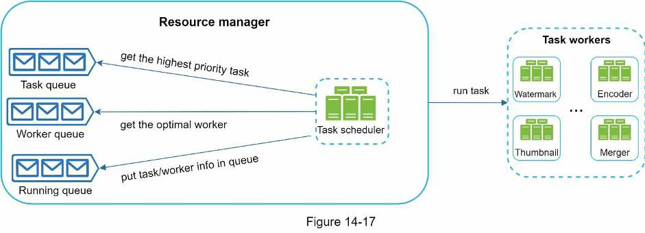

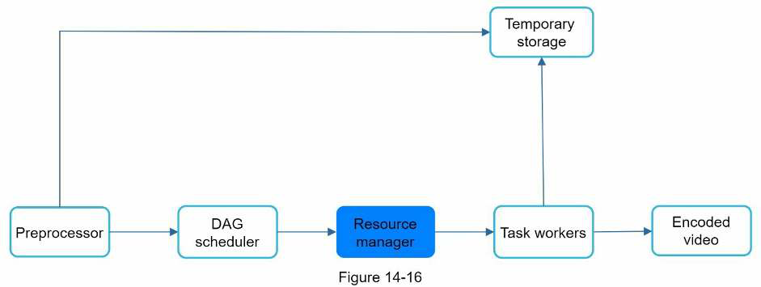

Các worker thực thi tác vụ (task workers) chạy các tác vụ được định nghĩa trong DAG. Các worker khác nhau có thể chạy các tác vụ khác nhau như minh họa trong Hình 14-19 (Figure 14-19).

#### Bộ nhớ tạm thời (Temporary storage)

Nhiều hệ thống lưu trữ được sử dụng tại đây. Việc lựa chọn hệ thống lưu trữ phụ thuộc vào các yếu tố như loại dữ liệu, kích thước dữ liệu, tần suất truy cập, vòng đời dữ liệu, v.v. Ví dụ, metadata thường xuyên được các worker truy cập và kích thước dữ liệu thường nhỏ. Do đó, lưu đệm metadata trong bộ nhớ (in-memory) là một ý tưởng hay. Đối với dữ liệu video hoặc âm thanh, chúng ta đưa chúng vào blob storage. Dữ liệu trong bộ nhớ tạm thời sẽ được giải phóng sau khi quá trình xử lý video tương ứng hoàn tất.

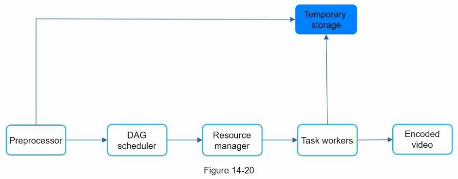

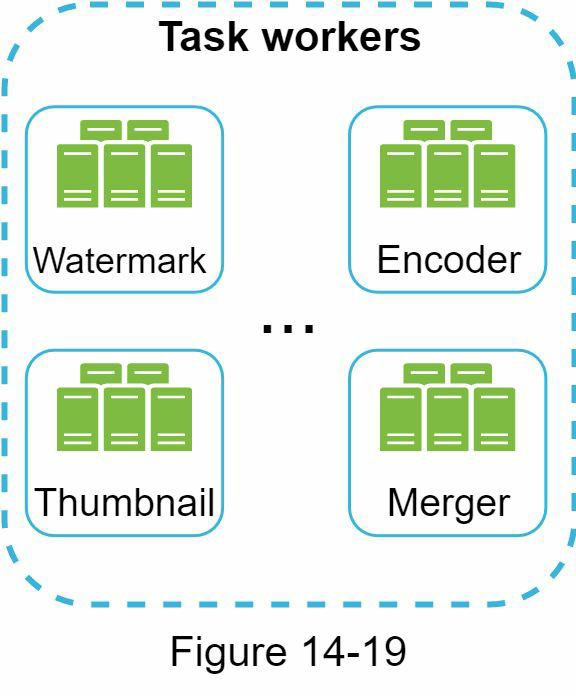

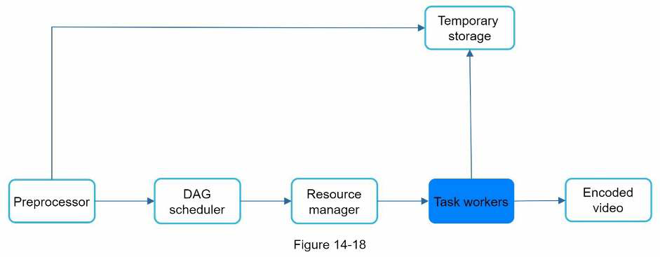

#### Video đã mã hóa (Encoded video)

Video đã mã hóa (encoded video) là đầu ra cuối cùng của quy trình mã hóa (encoding pipeline). Đây là một ví dụ về đầu ra: `funny_720p.mp4`.

### Tối ưu hóa hệ thống (System optimizations)

Tại thời điểm này, bạn đã có sự hiểu biết tốt về luồng tải video lên, luồng phát video trực tuyến và chuyển mã video. Tiếp theo, chúng ta sẽ tinh chỉnh hệ thống với các tối ưu hóa, bao gồm tốc độ, an toàn và tiết kiệm chi phí.

#### Tối ưu hóa tốc độ: tải video lên song song (Speed optimization: parallelize video uploading)

Tải lên toàn bộ video như một đơn vị duy nhất là không hiệu quả. Chúng ta có thể chia video thành các khối nhỏ hơn theo căn chỉnh GOP như minh họa trong Hình 14-22 (Figure 14-22).

Điều này cho phép tiếp tục tải lên nhanh chóng (resumable uploads) khi lần tải lên trước đó bị lỗi. Công việc chia tệp video theo GOP có thể được thực hiện bởi chính client để cải thiện tốc độ tải lên như minh họa trong Hình 14-23 (Figure 14-23).

#### Tối ưu hóa tốc độ: đặt các trung tâm tải lên gần người dùng (Speed optimization: place upload centers close to users)

Một cách khác để cải thiện tốc độ tải lên là thiết lập nhiều trung tâm tải lên (upload centers) trên toàn cầu (Hình 14-24 / Figure 14-24). Người dùng ở Hoa Kỳ có thể tải video lên trung tâm tải lên Bắc Mỹ, và người dùng ở Trung Quốc có thể tải video lên trung tâm tải lên châu Á. Để đạt được điều này, chúng ta sử dụng CDN làm các trung tâm tải lên.

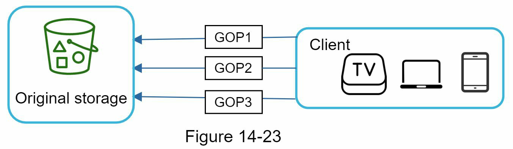

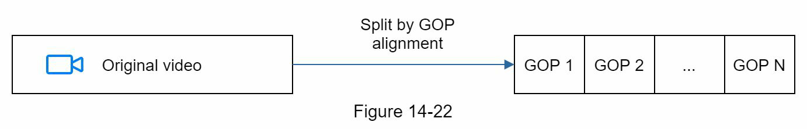

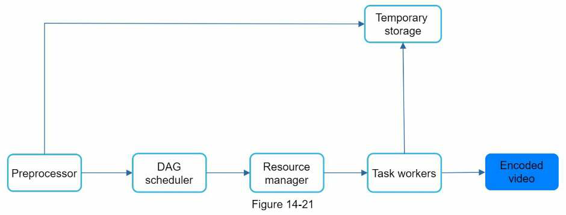

#### Tối ưu hóa tốc độ: xử lý song song ở mọi nơi (Speed optimization: parallelism everywhere)

Đạt được độ trễ thấp đòi hỏi những nỗ lực nghiêm túc. Một tối ưu hóa khác là xây dựng một hệ thống liên kết lỏng lẻo (loosely coupled system) và cho phép tính song song cao.

Thiết kế của chúng ta cần một số sửa đổi để đạt được tính song song cao. Hãy phóng to vào luồng truyền tải video từ kho lưu trữ gốc đến CDN. Luồng này được minh họa trong Hình 14-25 (Figure 14-25), cho thấy đầu ra phụ thuộc vào đầu vào của bước trước đó. Sự phụ thuộc này làm cho việc xử lý song song trở nên khó khăn.

Để làm cho hệ thống liên kết lỏng lẻo hơn, chúng ta giới thiệu các hàng đợi thông điệp (message queues) như minh họa trong Hình 14-26 (Figure 14-26).

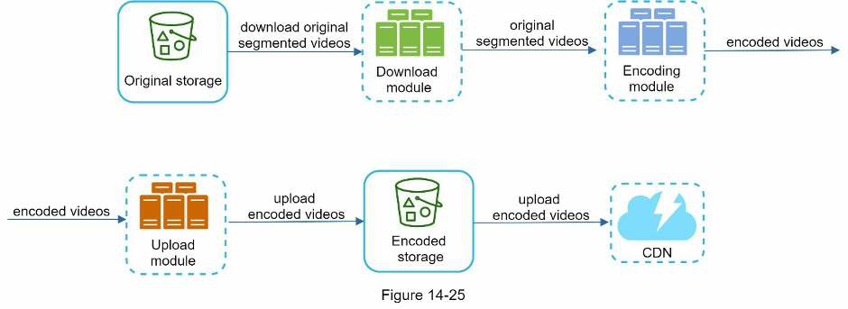

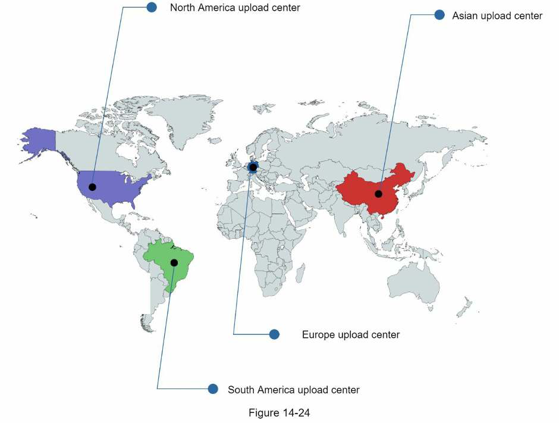

Hãy sử dụng một ví dụ để giải thích cách các hàng đợi thông điệp giúp hệ thống liên kết lỏng lẻo hơn:

- Trước khi giới thiệu hàng đợi thông điệp, mô-đun mã hóa (encoding module) phải đợi đầu ra của mô-đun tải xuống (download module).
- Sau khi giới thiệu hàng đợi thông điệp, mô-đun mã hóa không cần phải đợi đầu ra của mô-đun tải xuống nữa. Nếu có các sự kiện trong hàng đợi thông điệp, mô-đun mã hóa có thể thực thi các công việc đó song song.

#### Tối ưu hóa an toàn: URL tải lên ký sẵn (Safety optimization: pre-signed upload URL)

An toàn là một trong những khía cạnh quan trọng nhất của bất kỳ sản phẩm nào. Để đảm bảo chỉ những người dùng được ủy quyền mới có thể tải video lên đúng vị trí, chúng ta giới thiệu các URL ký sẵn (pre-signed URLs) như minh họa trong Hình 14-27 (Figure 14-27).

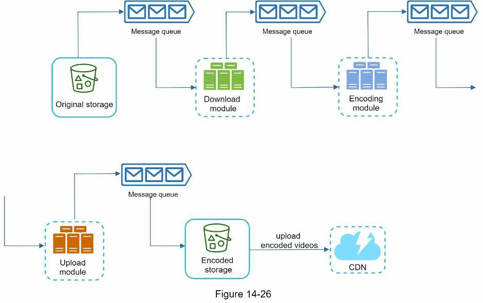

Luồng tải lên được cập nhật như sau:

1. Client gửi một yêu cầu HTTP đến các máy chủ API để lấy pre-signed URL, URL này cấp quyền truy cập vào đối tượng được xác định trong URL. Thuật ngữ *pre-signed URL* được sử dụng khi tải tệp lên Amazon S3. Các nhà cung cấp dịch vụ đám mây khác có thể sử dụng tên gọi khác. Ví dụ, Microsoft Azure blob storage hỗ trợ cùng một tính năng nhưng gọi nó là *"Shared Access Signature"* [10].
2. Các máy chủ API phản hồi bằng một pre-signed URL.
3. Sau khi client nhận được phản hồi, nó tải video lên bằng cách sử dụng pre-signed URL đó.

#### Tối ưu hóa an toàn: bảo vệ video của bạn (Safety optimization: protect your videos)

Nhiều nhà sáng tạo nội dung ngần ngại đăng video trực tuyến vì họ sợ video gốc của mình sẽ bị đánh cắp. Để bảo vệ các video có bản quyền, chúng ta có thể áp dụng một trong ba tùy chọn an toàn sau:

- **Hệ thống quản lý quyền kỹ thuật số (Digital rights management - DRM):** Ba hệ thống DRM lớn là Apple FairPlay, Google Widevine và Microsoft PlayReady.
- **Mã hóa AES (AES encryption):** Bạn có thể mã hóa một video và cấu hình chính sách ủy quyền. Video đã mã hóa sẽ được giải mã khi phát lại. Điều này đảm bảo rằng chỉ những người dùng được ủy quyền mới có thể xem video đã mã hóa.
- **Đóng dấu hình ảnh (Visual watermarking):** Đây là một lớp ảnh phủ lên trên video của bạn chứa thông tin nhận dạng cho video. Nó có thể là logo công ty hoặc tên công ty của bạn.

#### Tối ưu hóa chi phí (Cost-saving optimization)

CDN là một thành phần cốt lõi trong hệ thống của chúng ta. Nó đảm bảo phân phối video nhanh chóng trên quy mô toàn cầu. Tuy nhiên, từ phép tính ước tính sơ bộ, chúng ta biết CDN rất đắt đỏ, đặc biệt là khi kích thước dữ liệu lớn. Làm thế nào chúng ta có thể giảm chi phí?

Các nghiên cứu trước đây chỉ ra rằng các luồng video trên YouTube tuân theo phân phối đuôi dài (long-tail distribution) [11] [12]. Điều này có nghĩa là một số ít video phổ biến được truy cập rất thường xuyên, nhưng rất nhiều video khác có ít hoặc không có người xem. Dựa trên quan sát này, chúng ta triển khai một vài tối ưu hóa:

1. Chỉ phân phối các video phổ biến nhất từ CDN và phân phối các video khác từ các máy chủ lưu trữ video dung lượng lớn của riêng chúng ta (Hình 14-28 / Figure 14-28).

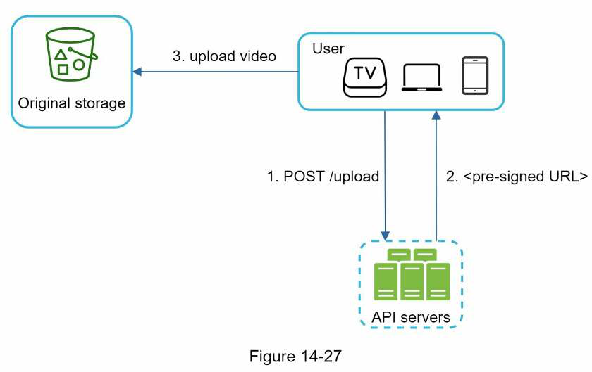

2. Đối với nội dung ít phổ biến hơn, chúng ta có thể không cần lưu trữ nhiều phiên bản video đã mã hóa. Các video ngắn có thể được mã hóa theo yêu cầu (on-demand).
3. Một số video chỉ phổ biến ở một số khu vực nhất định. Không cần thiết phải phân phối những video này đến các khu vực khác.
4. Tự xây dựng CDN của riêng bạn như Netflix và hợp tác với các Nhà cung cấp dịch vụ Internet (ISPs). Xây dựng CDN riêng là một dự án khổng lồ; tuy nhiên, điều này có thể hợp lý đối với các công ty phát trực tuyến lớn. Một ISP có thể là Comcast, AT&T, Verizon hoặc các nhà cung cấp internet khác. Các ISP đặt hạ tầng ở khắp nơi trên thế giới và rất gần người dùng. Bằng cách hợp tác với các ISP, bạn có thể cải thiện trải nghiệm xem và giảm phí băng thông.

Tất cả những tối ưu hóa đó đều dựa trên mức độ phổ biến của nội dung, mẫu truy cập của người dùng, kích thước video, v.v. Điều quan trọng là phải phân tích các mẫu xem lịch sử trước khi thực hiện bất kỳ tối ưu hóa nào. Dưới đây là một số bài viết thú vị về chủ đề này: [12] [13].

### Xử lý lỗi (Error handling)

Đối với một hệ thống quy mô lớn, lỗi hệ thống là điều không thể tránh khỏi. Để xây dựng một hệ thống có khả năng chịu lỗi cao (highly fault-tolerant), chúng ta phải xử lý lỗi một cách khéo léo và khôi phục nhanh chóng. Tồn tại hai loại lỗi:

- **Lỗi có thể khôi phục (Recoverable error):** Đối với các lỗi có thể khôi phục như một phân đoạn video chuyển mã thất bại, ý tưởng chung là thử lại (retry) thao tác đó vài lần. Nếu tác vụ tiếp tục thất bại và hệ thống cho rằng không thể khôi phục được nữa, nó sẽ trả về mã lỗi phù hợp cho client.
- **Lỗi không thể khôi phục (Non-recoverable error):** Đối với các lỗi không thể khôi phục như định dạng video bị hỏng (malformed video format), hệ thống sẽ dừng các tác vụ đang chạy liên quan đến video đó và trả về mã lỗi phù hợp cho client.

Các lỗi điển hình cho từng thành phần hệ thống được bao phủ trong kịch bản xử lý (playbook) sau:

- **Lỗi tải lên (Upload error):** Thử lại vài lần.

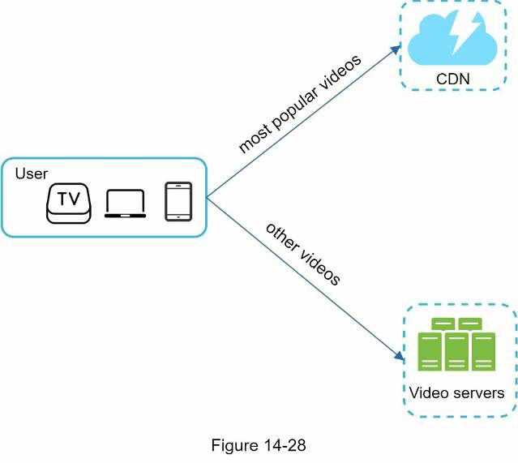

- **Lỗi tách video (Split video error):** Nếu các phiên bản client cũ hơn không thể tách video theo căn chỉnh GOP, toàn bộ video sẽ được chuyển lên máy chủ. Công việc tách video sẽ được thực hiện ở phía máy chủ.
- **Lỗi chuyển mã (Transcoding error):** Thử lại (retry).
- **Lỗi bộ tiền xử lý (Preprocessor error):** Tạo lại sơ đồ DAG.
- **Lỗi bộ lập lịch DAG (DAG scheduler error):** Lập lịch lại (reschedule) một tác vụ.
- **Hàng đợi của trình quản lý tài nguyên bị sập (Resource manager queue down):** Sử dụng bản sao (replica).
- **Worker thực thi tác vụ bị sập (Task worker down):** Thử lại tác vụ trên một worker mới.
- **Máy chủ API bị sập (API server down):** Các máy chủ API là phi trạng thái (stateless) nên các yêu cầu sẽ được định tuyến đến một máy chủ API khác.
- **Máy chủ bộ nhớ đệm metadata bị sập (Metadata cache server down):** Dữ liệu được sao chép nhiều lần. Nếu một nút bị sập, bạn vẫn có thể truy cập các nút khác để lấy dữ liệu. Chúng ta có thể khởi tạo một máy chủ cache mới để thay thế máy chủ đã chết.
- **Máy chủ cơ sở dữ liệu metadata bị sập (Metadata DB server down):**
  - **Master bị sập:** Nếu master bị sập, thăng cấp một trong các slave lên làm master mới.
  - **Slave bị sập:** Nếu một slave bị sập, bạn có thể sử dụng một slave khác cho các thao tác đọc và khởi tạo một máy chủ cơ sở dữ liệu khác để thay thế máy chủ đã chết.

> 💡 **Ví dụ bổ sung (không có trong sách):**  
> Để tránh tình trạng một phân đoạn video bị lỗi gây kẹt hàng đợi vô hạn (poison pill), các worker thường sử dụng cơ chế **Exponential Backoff** (ví dụ: thử lại sau 2 giây, 4 giây, 8 giây) kết hợp với **Dead-Letter Queue (DLQ)**. Sau tối đa 3 lần thử lại thất bại, tác vụ sẽ được đẩy vào DLQ để đội ngũ kỹ thuật kiểm tra và thông báo cho người dùng rằng video bị lỗi, thay vì chặn các video hợp lệ khác trong hàng đợi.

## Bước 4 - Tổng kết (Step 4 - Wrap up)

Trong chương này, chúng ta đã trình bày thiết kế kiến trúc cho các dịch vụ phát video trực tuyến như YouTube. Nếu còn dư thời gian ở cuối buổi phỏng vấn, đây là một vài điểm bổ sung bạn có thể thảo luận:

- **Mở rộng tầng API (Scale the API tier):** Vì các máy chủ API là phi trạng thái (stateless), việc mở rộng tầng API theo chiều ngang (horizontally) rất dễ dàng.
- **Mở rộng cơ sở dữ liệu (Scale the database):** Bạn có thể nói về sao chép cơ sở dữ liệu (database replication) và phân mảnh (sharding).
- **Phát trực tiếp (Live streaming):** Đề cập đến quá trình một video được quay và phát sóng theo thời gian thực. Mặc dù hệ thống của chúng ta không được thiết kế chuyên biệt cho phát trực tiếp, phát trực tiếp và phát không trực tiếp có một số điểm tương đồng: cả hai đều yêu cầu tải lên, mã hóa và phát trực tuyến. Những điểm khác biệt đáng chú ý là:
  - Phát trực tiếp có yêu cầu độ trễ cao hơn (khắt khe hơn), do đó nó có thể cần một giao thức phát trực tuyến khác (ví dụ: WebRTC hoặc RTMP cho đầu vào, Low-Latency HLS/DASH cho đầu ra).
  - Phát trực tiếp có yêu cầu thấp hơn về tính song song vì các khối dữ liệu nhỏ đã được xử lý theo thời gian thực ngay khi vừa quay xong.
  - Phát trực tiếp đòi hỏi bộ quy tắc xử lý lỗi khác. Bất kỳ cách xử lý lỗi nào mất quá nhiều thời gian đều không thể chấp nhận được.
- **Gỡ bỏ video (Video takedowns):** Các video vi phạm bản quyền, khiêu dâm hoặc các hành vi bất hợp pháp khác phải bị xóa. Một số có thể được hệ thống phát hiện trong quá trình tải lên, trong khi những video khác có thể được phát hiện thông qua việc người dùng gắn cờ báo cáo (user flagging).

Chúc mừng bạn đã đi được đến đây! Bây giờ hãy tự thưởng cho mình một cái vỗ vai nhé. Làm tốt lắm!

## Tài liệu tham khảo (Reference materials)

[1] YouTube by the numbers: https://www.omnicoreagency.com/youtube-statistics/  
[2] 2019 YouTube Demographics: https://blog.hubspot.com/marketing/youtube-demographics  
[3] Cloudfront Pricing: https://aws.amazon.com/cloudfront/pricing/  
[4] Netflix on AWS: https://aws.amazon.com/solutions/case-studies/netflix/  
[5] Akamai homepage: https://www.akamai.com/  
[6] Binary large object: https://en.wikipedia.org/wiki/Binary_large_object  
[7] Here’s What You Need to Know About Streaming Protocols: https://www.dacast.com/blog/streaming-protocols/  
[8] SVE: Distributed Video Processing at Facebook Scale: https://www.cs.princeton.edu/~wlloyd/papers/sve-sosp17.pdf  
[9] Weibo video processing architecture (in Chinese): https://www.upyun.com/opentalk/399.html  
[10] Delegate access with a shared access signature: https://docs.microsoft.com/en-us/rest/api/storageservices/delegate-access-with-shared-access-signature  
[11] YouTube scalability talk by early YouTube employee: https://www.youtube.com/watch?v=w5WVu624fY8  
[12] Understanding the characteristics of internet short video sharing: A youtube-based measurement study. https://arxiv.org/pdf/0707.3670.pdf  
[13] Content Popularity for Open Connect: https://netflixtechblog.com/content-popularity-for-open-connect-b86d56f613b  

## Bảng thuật ngữ chương (Chapter Glossary)

| Thuật ngữ (English) | Tiếng Việt | Giải thích ngắn gọn |
| :--- | :--- | :--- |
| Blob storage | Kho lưu trữ đối tượng nhị phân | Hệ thống lưu trữ dữ liệu phi cấu trúc kích thước lớn như video, hình ảnh, âm thanh. |
| Video transcoding / encoding | Chuyển mã / mã hóa video | Quá trình chuyển đổi video sang các định dạng, độ phân giải và bitrate khác nhau để tương thích đa thiết bị. |
| Bitrate | Tốc độ bit | Lượng dữ liệu được xử lý trên mỗi đơn vị thời gian; bitrate cao hơn thường cho chất lượng video tốt hơn. |
| Container | Vùng chứa | Định dạng đóng gói luồng video, âm thanh và metadata lại thành một tệp (ví dụ: `.mp4`, `.mov`, `.avi`). |
| Codec | Bộ mã hóa/giải mã | Thuật toán nén và giải nén dữ liệu video nhằm giảm kích thước tệp mà vẫn giữ chất lượng (ví dụ: H.264, VP9, HEVC). |
| Directed Acyclic Graph (DAG) | Đồ thị có hướng không chu trình | Mô hình biểu diễn các tác vụ xử lý video theo các giai đoạn phụ thuộc nhau, hỗ trợ chạy tuần tự hoặc song song. |
| Group of Pictures (GOP) | Nhóm hình ảnh | Một đoạn khung hình video liên tiếp có thể phát độc lập, dùng để chia nhỏ video khi tải lên và phát trực tuyến. |
| Streaming protocol | Giao thức phát trực tuyến | Chuẩn giao tiếp kiểm soát việc truyền tải từng phần dữ liệu video qua mạng (ví dụ: HLS, MPEG-DASH). |
| Pre-signed URL | URL ký sẵn | Đường dẫn tạm thời có chữ ký xác thực do máy chủ cấp, cho phép client tải tệp trực tiếp lên cloud storage an toàn. |
| Digital Rights Management (DRM) | Quản lý quyền kỹ thuật số | Công nghệ bảo vệ bản quyền video chống sao chép trái phép (như Apple FairPlay, Google Widevine, Microsoft PlayReady). |
| Long-tail distribution | Phân phối đuôi dài | Đặc trưng dữ liệu nơi một số ít video rất phổ biến chiếm phần lớn lượt xem, còn đa số video có ít lượt xem. |
