# CHƯƠNG 15: THIẾT KẾ GOOGLE DRIVE (CHAPTER 15: DESIGN GOOGLE DRIVE)

Trong những năm gần đây, các dịch vụ lưu trữ đám mây (cloud storage services) như Google Drive, Dropbox, Microsoft OneDrive và Apple iCloud đã trở nên vô cùng phổ biến. Trong chương này, bạn được yêu cầu thiết kế Google Drive.

Hãy dành một chút thời gian để tìm hiểu về Google Drive trước khi bắt tay vào thiết kế. Google Drive là một dịch vụ lưu trữ và đồng bộ hóa tệp tin (file storage and synchronization service) giúp bạn lưu trữ tài liệu, hình ảnh, video và các tệp tin khác trên đám mây. Bạn có thể truy cập tệp của mình từ bất kỳ máy tính, điện thoại thông minh và máy tính bảng nào. Bạn cũng có thể dễ dàng chia sẻ những tệp đó với bạn bè, gia đình và đồng nghiệp [1]. Hình 15-1 (Figure 15-1) và Hình 15-2 (Figure 15-2) lần lượt minh họa giao diện của Google Drive trên trình duyệt web và ứng dụng di động.

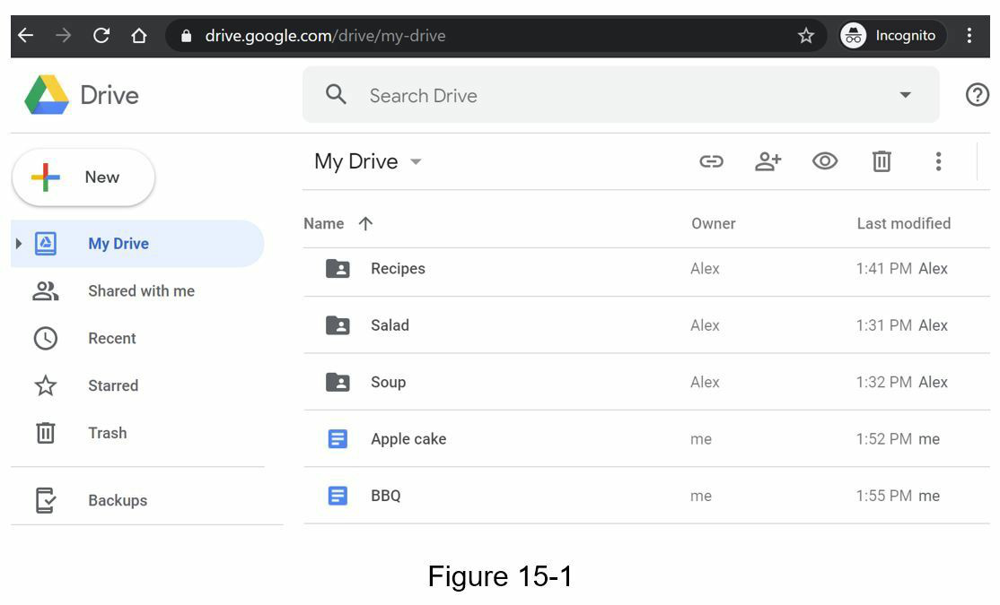

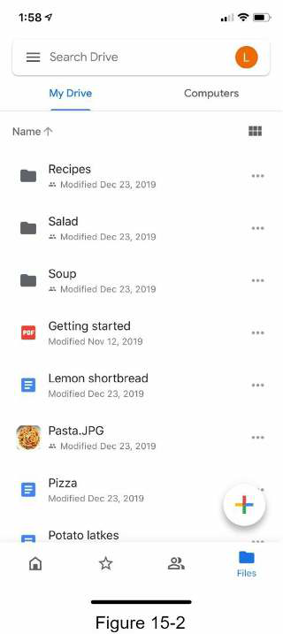

---

## Bước 1 - Hiểu bài toán và xác định phạm vi thiết kế (Step 1 - Understand the problem and establish design scope)

Thiết kế Google Drive là một dự án lớn, vì vậy việc đặt câu hỏi để thu hẹp phạm vi là rất quan trọng.

- **Ứng viên (Candidate):** Những tính năng quan trọng nhất là gì?
- **Người phỏng vấn (Interviewer):** Tải lên (upload) và tải xuống (download) tệp tin, đồng bộ hóa tệp (file sync) và thông báo (notifications).
- **Ứng viên:** Đây là ứng dụng di động, ứng dụng web, hay cả hai?
- **Người phỏng vấn:** Cả hai.
- **Ứng viên:** Những định dạng tệp nào được hỗ trợ?
- **Người phỏng vấn:** Bất kỳ loại tệp nào.
- **Ứng viên:** Các tệp có cần được mã hóa không?
- **Người phỏng vấn:** Có, các tệp trong hệ thống lưu trữ phải được mã hóa.
- **Ứng viên:** Có giới hạn kích thước tệp không?
- **Người phỏng vấn:** Có, các tệp phải có kích thước từ 10 GB trở xuống.
- **Ứng viên:** Sản phẩm có bao nhiêu người dùng?
- **Người phỏng vấn:** 10 triệu người dùng hoạt động hàng ngày (10M DAU - Daily Active Users).

Trong chương này, chúng ta tập trung vào các tính năng sau:
- **Thêm tệp (Add files):** Cách dễ nhất để thêm tệp là kéo và thả tệp vào Google Drive.
- **Tải xuống tệp (Download files).**
- **Đồng bộ hóa tệp trên nhiều thiết bị (Sync files across multiple devices):** Khi một tệp được thêm vào một thiết bị, nó sẽ tự động được đồng bộ sang các thiết bị khác.
- **Xem các phiên bản tệp (See file revisions).**
- **Chia sẻ tệp với bạn bè, gia đình và đồng nghiệp (Share files with your friends, family, and coworkers).**
- **Gửi thông báo (Send a notification)** khi một tệp bị chỉnh sửa, bị xóa hoặc được chia sẻ với bạn.

Các tính năng không được thảo luận trong chương này bao gồm:
- **Chỉnh sửa và cộng tác trên Google Docs (Google doc editing and collaboration):** Google Docs cho phép nhiều người chỉnh sửa cùng một tài liệu đồng thời. Tính năng này nằm ngoài phạm vi thiết kế của chúng ta.

Ngoài việc làm rõ các yêu cầu chức năng, việc hiểu các yêu cầu phi chức năng (non-functional requirements) cũng rất quan trọng:
- **Độ tin cậy (Reliability):** Độ tin cậy cực kỳ quan trọng đối với một hệ thống lưu trữ. Mất dữ liệu là điều không thể chấp nhận được.
- **Tốc độ đồng bộ nhanh (Fast sync speed):** Nếu việc đồng bộ tệp mất quá nhiều thời gian, người dùng sẽ mất kiên nhẫn và từ bỏ sản phẩm.
- **Mức sử dụng băng thông (Bandwidth usage):** Nếu sản phẩm tiêu tốn quá nhiều băng thông mạng không cần thiết, người dùng sẽ không hài lòng, đặc biệt là khi họ đang sử dụng gói dữ liệu di động.
- **Khả năng mở rộng (Scalability):** Hệ thống phải có khả năng xử lý lưu lượng truy cập lớn.
- **Tính sẵn sàng cao (High availability):** Người dùng vẫn có thể sử dụng hệ thống ngay cả khi một số máy chủ bị ngoại tuyến (offline), chạy chậm hoặc gặp lỗi mạng ngoài ý muốn.

### Ước tính sơ bộ (Back of the envelope estimation)

- Giả sử ứng dụng có 50 triệu người dùng đã đăng ký (signed up users) và 10 triệu DAU.
- Mỗi người dùng nhận được 10 GB dung lượng miễn phí.
- Giả sử người dùng tải lên trung bình 2 tệp mỗi ngày. Kích thước tệp trung bình là 500 KB.
- Tỷ lệ đọc/ghi (read to write ratio) là 1:1.
- **Tổng dung lượng được cấp phát (Total space allocated):** $50\text{ triệu} \times 10\text{ GB} = 500\text{ Petabyte}$ ($500\text{ PB}$).
- **QPS cho API tải lên (QPS for upload API):** $10\text{ triệu} \times 2\text{ lượt tải lên} / 24\text{ giờ} / 3600\text{ giây} \approx 240\text{ QPS}$.
- **QPS đỉnh (Peak QPS):** $\text{QPS} \times 2 = 480$.

> 📝 **Giải thích thêm (không có trong sách):**
> Tại sao tỷ lệ đọc/ghi ở đây lại là 1:1 trong khi các mạng xã hội thường có tỷ lệ đọc cao hơn ghi rất nhiều? Với dịch vụ đồng bộ tệp cá nhân như Google Drive, mỗi lần bạn lưu/tải lên một tệp mới từ máy tính A (1 lượt ghi), tệp đó sẽ được đồng bộ xuống máy tính B hoặc điện thoại của bạn (1 hoặc vài lượt đọc), và người dùng ít khi tải lại tệp đã đồng bộ cục bộ trừ khi có thay đổi. Ngoài ra, 500 Petabyte là *dung lượng cấp phát tối đa* (nếu tất cả 50 triệu người dùng đều dùng hết 10 GB miễn phí), còn trên thực tế hệ thống có thể áp dụng kỹ thuật *thin provisioning* (cấp phát mỏng) và *deduplication* (chống trùng lặp dữ liệu) để tiết kiệm chi phí lưu trữ thực tế.

---

## Bước 2 - Đề xuất thiết kế cấp cao và đạt được sự đồng thuận (Step 2 - Propose high-level design and get buy-in)

Thay vì trình bày sơ đồ thiết kế cấp cao ngay từ đầu, chúng ta sẽ sử dụng một cách tiếp cận hơi khác. Chúng ta sẽ bắt đầu với một thứ đơn giản: xây dựng mọi thứ trên một máy chủ duy nhất (single server). Sau đó, dần dần mở rộng quy mô để hỗ trợ hàng triệu người dùng. Bằng cách thực hiện bài tập này, bạn sẽ ôn lại một số chủ đề quan trọng đã được đề cập trong cuốn sách.

Hãy bắt đầu với thiết lập một máy chủ duy nhất như sau:
- Một máy chủ web (web server) để tải lên và tải xuống tệp.
- Một cơ sở dữ liệu (database) để theo dõi siêu dữ liệu (metadata) như dữ liệu người dùng, thông tin đăng nhập, thông tin tệp, v.v.
- Một hệ thống lưu trữ (storage system) để lưu trữ tệp. Chúng ta cấp phát 1 TB dung lượng lưu trữ cho các tệp.

Chúng ta dành vài giờ để thiết lập máy chủ web Apache, cơ sở dữ liệu MySQL và một thư mục gọi là `drive/` làm thư mục gốc để lưu các tệp đã tải lên. Bên dưới thư mục `drive/`, có một danh sách các thư mục, được gọi là không gian tên (**namespaces**). Mỗi namespace chứa toàn bộ các tệp đã tải lên của một người dùng tương ứng. Tên tệp trên máy chủ được giữ nguyên giống như tên tệp gốc. Mỗi tệp hoặc thư mục có thể được định danh duy nhất bằng cách nối namespace với đường dẫn tương đối (relative path).

Hình 15-3 (Figure 15-3) minh họa cấu trúc thư mục `/drive` ở bên trái và chế độ xem mở rộng của nó ở bên phải.

### Các API (APIs)

Các API trông như thế nào? Về cơ bản, chúng ta cần 3 API chính: tải lên một tệp, tải xuống một tệp và lấy danh sách các phiên bản tệp.

#### 1. Tải lên một tệp lên Google Drive (Upload a file to Google Drive)

Hai loại tải lên được hỗ trợ:
- **Tải lên đơn giản (Simple upload):** Sử dụng loại tải lên này khi kích thước tệp nhỏ.
- **Tải lên có thể tiếp tục (Resumable upload):** Sử dụng loại tải lên này khi kích thước tệp lớn và có nguy cơ cao bị gián đoạn mạng.

Dưới đây là ví dụ về API tải lên có thể tiếp tục:

```http
POST https://api.example.com/files/upload?uploadType=resumable
```

Tham số (Params):
- `uploadType=resumable`
- `data`: Tệp cục bộ cần được tải lên.

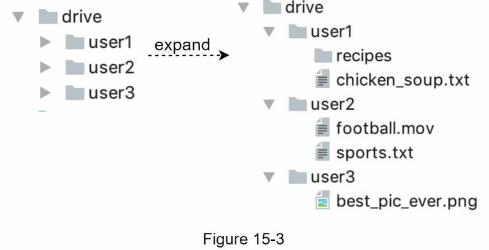

Quá trình tải lên có thể tiếp tục (resumable upload) được thực hiện qua 3 bước sau [2]:
- Gửi yêu cầu ban đầu (initial request) để lấy URL có thể tiếp tục (resumable URL).
- Tải dữ liệu lên và theo dõi trạng thái tải lên.
- Nếu quá trình tải lên bị gián đoạn, tiếp tục tải lên từ điểm đã dừng.

#### 2. Tải xuống một tệp từ Google Drive (Download a file from Google Drive)

API ví dụ:

```http
GET https://api.example.com/files/download
```

Tham số (Params):
- `path`: Đường dẫn tệp cần tải xuống.

Ví dụ tham số:

```json
{
  "path": "/recipes/soup/best_soup.txt"
}
```

#### 3. Lấy các phiên bản của tệp (Get file revisions)

API ví dụ:

```http
GET https://api.example.com/files/list_revisions
```

Tham số (Params):
- `path`: Đường dẫn đến tệp bạn muốn lấy lịch sử phiên bản.
- `limit`: Số lượng phiên bản tối đa cần trả về.

Ví dụ tham số:

```json
{
  "path": "/recipes/soup/best_soup.txt",
  "limit": 20
}
```

Tất cả các API đều yêu cầu xác thực người dùng (user authentication) và sử dụng HTTPS. Secure Sockets Layer (SSL) bảo vệ quá trình truyền dữ liệu giữa máy khách (client) và các máy chủ backend.

> 💡 **Ví dụ bổ sung (không có trong sách):**
> Trong thực tế, giao thức *Resumable Upload* thường sử dụng các header HTTP chuẩn như `Content-Range` và mã trạng thái `308 Resume Incomplete`. Ví dụ:
> 1. Client gửi `POST /files/upload?uploadType=resumable` kèm metadata tệp -> Server trả về `200 OK` với header `Location: https://api.example.com/upload/session_abc123`.
> 2. Client gửi từng phần (chunk) bằng `PUT https://api.example.com/upload/session_abc123` kèm header `Content-Range: bytes 0-4194303/10485760`.
> 3. Nếu mất mạng giữa chừng, khi có mạng lại, client gửi `PUT` với `Content-Range: bytes */10485760` để hỏi server đã nhận tới byte nào. Server trả về `308 Resume Incomplete` kèm `Range: bytes=0-4194303`, và client tiếp tục gửi từ byte `4194304`.

### Rời bỏ mô hình máy chủ đơn lẻ (Move away from single server)

Khi có nhiều tệp được tải lên hơn, cuối cùng bạn sẽ nhận được cảnh báo đầy dung lượng như trong Hình 15-4 (Figure 15-4). Chỉ còn lại 10 MB dung lượng lưu trữ! Đây là tình huống khẩn cấp vì người dùng không thể tải tệp lên được nữa. Giải pháp đầu tiên nảy ra trong đầu là phân mảnh dữ liệu (**shard**), để dữ liệu được lưu trữ trên nhiều máy chủ lưu trữ khác nhau. Hình 15-5 (Figure 15-5) minh họa một ví dụ về sharding dựa trên `user_id`.

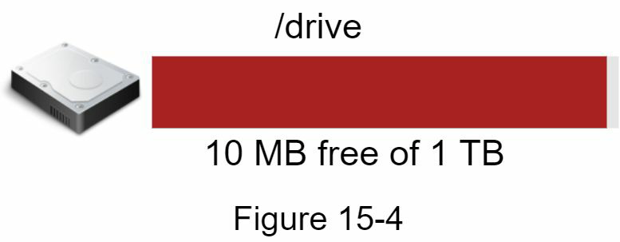

Bạn thức trắng đêm để thiết lập sharding cho cơ sở dữ liệu và giám sát chặt chẽ. Mọi thứ hoạt động trơn tru trở lại. Bạn đã dập tắt được đám cháy, nhưng bạn vẫn lo lắng về nguy cơ mất dữ liệu trong trường hợp máy chủ lưu trữ gặp sự cố. Bạn hỏi thăm xung quanh và người bạn chuyên gia backend tên Frank nói với bạn rằng nhiều công ty hàng đầu như Netflix và Airbnb sử dụng Amazon S3 để lưu trữ. *"Amazon Simple Storage Service (Amazon S3) là một dịch vụ lưu trữ đối tượng (object storage service) cung cấp khả năng mở rộng, tính sẵn sàng dữ liệu, bảo mật và hiệu năng hàng đầu trong ngành"* [3]. Bạn quyết định nghiên cứu xem liệu nó có phù hợp không.

Sau khi đọc nhiều tài liệu, bạn hiểu rõ hệ thống lưu trữ S3 và quyết định lưu tệp trên S3. Amazon S3 hỗ trợ sao chép cùng vùng (**same-region replication**) và liên vùng (**cross-region replication**). Một vùng (**region**) là một khu vực địa lý nơi Amazon Web Services (AWS) có các trung tâm dữ liệu. Như thể hiện trong Hình 15-6 (Figure 15-6), dữ liệu có thể được sao chép trong cùng một vùng (bên trái) và xuyên vùng (bên phải). Các tệp dự phòng được lưu trữ ở nhiều vùng để phòng chống mất dữ liệu và đảm bảo tính sẵn sàng. Một **bucket** giống như một thư mục trong hệ thống tệp tin.

Sau khi đưa tệp lên S3, cuối cùng bạn cũng có thể ngủ một giấc ngon lành mà không lo mất dữ liệu. Để ngăn những vấn đề tương tự xảy ra trong tương lai, bạn quyết định nghiên cứu thêm những khía cạnh có thể cải thiện. Dưới đây là một vài điểm bạn tìm thấy:

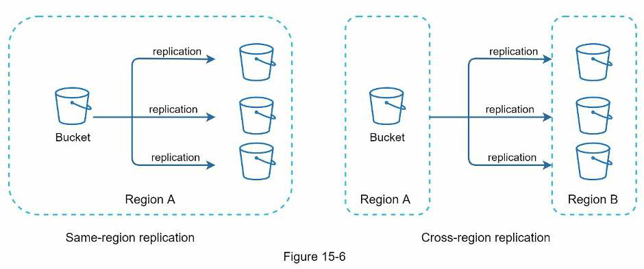

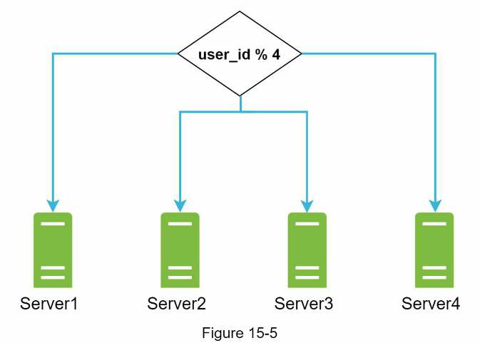

- **Bộ cân bằng tải (Load balancer):** Thêm bộ cân bằng tải để phân phối lưu lượng mạng. Bộ cân bằng tải đảm bảo lưu lượng được phân bổ đồng đều, và nếu một máy chủ web gặp sự cố, nó sẽ điều phối lại lưu lượng.
- **Máy chủ web (Web servers):** Sau khi thêm bộ cân bằng tải, các máy chủ web có thể được thêm/bớt dễ dàng tùy thuộc vào tải lưu lượng.
- **Cơ sở dữ liệu siêu dữ liệu (Metadata database):** Di chuyển cơ sở dữ liệu ra khỏi máy chủ đơn lẻ để tránh điểm lỗi đơn nhất (single point of failure). Đồng thời, thiết lập sao chép dữ liệu (data replication) và phân mảnh (sharding) để đáp ứng yêu cầu về tính sẵn sàng và khả năng mở rộng.
- **Lưu trữ tệp (File storage):** Amazon S3 được sử dụng để lưu trữ tệp. Để đảm bảo tính sẵn sàng và độ bền (durability), các tệp được sao chép ở hai vùng địa lý tách biệt.

Sau khi áp dụng các cải tiến trên, bạn đã tách rời thành công các máy chủ web, cơ sở dữ liệu siêu dữ liệu và hệ thống lưu trữ tệp khỏi một máy chủ duy nhất. Thiết kế cập nhật được thể hiện trong Hình 15-7 (Figure 15-7).

### Xung đột đồng bộ hóa (Sync conflicts)

Đối với một hệ thống lưu trữ lớn như Google Drive, xung đột đồng bộ hóa (sync conflicts) thỉnh thoảng sẽ xảy ra. Khi hai người dùng sửa đổi cùng một tệp hoặc thư mục tại cùng một thời điểm, xung đột sẽ xảy ra. Làm thế nào để chúng ta giải quyết xung đột? Chiến lược của chúng ta là: phiên bản được xử lý đầu tiên sẽ thắng, và phiên bản được xử lý sau sẽ nhận thông báo xung đột. Hình 15-8 (Figure 15-8) minh họa một ví dụ về xung đột đồng bộ hóa.

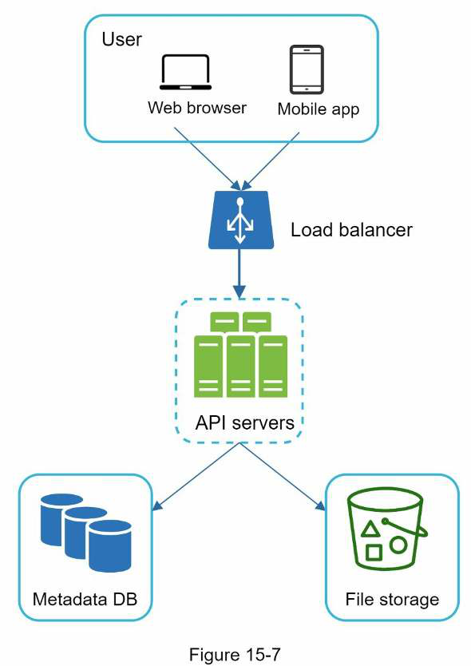

Trong Hình 15-8, người dùng 1 (user 1) và người dùng 2 (user 2) cùng cố gắng cập nhật một tệp tại cùng một thời điểm, nhưng tệp của người dùng 1 được hệ thống xử lý trước. Thao tác cập nhật của người dùng 1 thành công, tuy nhiên người dùng 2 nhận được xung đột đồng bộ. Làm thế nào để giải quyết xung đột cho người dùng 2? Hệ thống của chúng ta hiển thị cả hai bản sao của cùng một tệp: bản sao cục bộ của người dùng 2 và phiên bản mới nhất từ máy chủ (Hình 15-9 / Figure 15-9). Người dùng 2 có tùy chọn gộp (merge) cả hai tệp hoặc ghi đè (override) phiên bản này lên phiên bản kia.

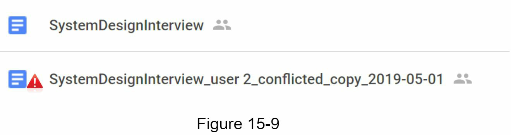

Khi nhiều người dùng chỉnh sửa cùng một tài liệu tại cùng một thời điểm, việc giữ cho tài liệu được đồng bộ là một thách thức lớn. Độc giả quan tâm có thể tham khảo tài liệu [4] [5].

### Thiết kế cấp cao (High-level design)

Hình 15-10 (Figure 15-10) minh họa thiết kế cấp cao được đề xuất. Hãy cùng xem xét từng thành phần của hệ thống.

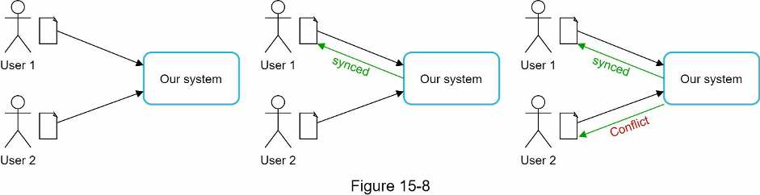

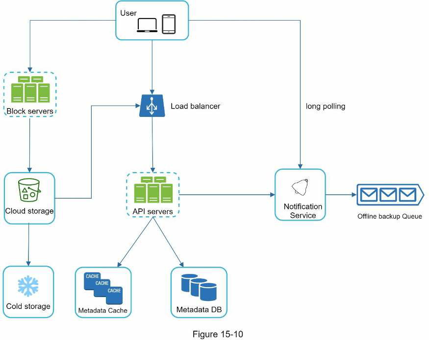

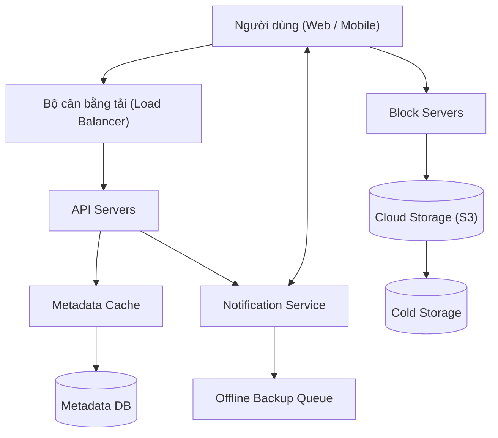

- **Người dùng (User):** Người dùng sử dụng ứng dụng thông qua trình duyệt hoặc ứng dụng di động.
- **Máy chủ khối (Block servers):** Block servers tải các khối dữ liệu (blocks) lên lưu trữ đám mây. Lưu trữ khối (Block storage / block-level storage) là công nghệ lưu trữ tệp dữ liệu trên môi trường đám mây. Một tệp có thể được chia nhỏ thành nhiều khối, mỗi khối có một giá trị băm (hash value) duy nhất được lưu trong cơ sở dữ liệu siêu dữ liệu. Mỗi khối được coi là một đối tượng độc lập và được lưu trong hệ thống lưu trữ (S3). Để tái tạo lại một tệp, các khối được ghép lại theo một thứ tự cụ thể. Về kích thước khối, chúng ta tham khảo Dropbox: hệ thống này đặt kích thước tối đa của một khối là 4 MB [6].
- **Lưu trữ đám mây (Cloud storage):** Một tệp được chia thành các khối nhỏ hơn và lưu trữ trên đám mây.
- **Lưu trữ lạnh (Cold storage):** Cold storage là hệ thống máy tính được thiết kế để lưu trữ dữ liệu không hoạt động (inactive data), tức là các tệp không được truy cập trong một thời gian dài.
- **Bộ cân bằng tải (Load balancer):** Phân phối đều các yêu cầu đến các API servers.
- **Máy chủ API (API servers):** Chịu trách nhiệm cho hầu hết mọi thứ ngoài luồng tải lên tệp. API servers được dùng cho xác thực người dùng, quản lý hồ sơ người dùng, cập nhật siêu dữ liệu tệp, v.v.
- **Cơ sở dữ liệu siêu dữ liệu (Metadata database):** Lưu trữ siêu dữ liệu của người dùng, tệp, khối dữ liệu, phiên bản, v.v. Xin lưu ý rằng bản thân các tệp được lưu trên đám mây và cơ sở dữ liệu siêu dữ liệu chỉ chứa siêu dữ liệu.
- **Bộ nhớ đệm siêu dữ liệu (Metadata cache):** Một số siêu dữ liệu được lưu trong cache để truy xuất nhanh.
- **Dịch vụ thông báo (Notification service):** Là một hệ thống xuất bản/đăng ký (publisher/subscriber system) cho phép truyền dữ liệu từ dịch vụ thông báo đến các máy khách khi có sự kiện nhất định xảy ra. Trong trường hợp cụ thể của chúng ta, dịch vụ thông báo sẽ báo cho các máy khách liên quan khi một tệp được thêm/sửa/xóa ở nơi khác để họ có thể tải về các thay đổi mới nhất.
- **Hàng đợi sao lưu ngoại tuyến (Offline backup queue):** Nếu một máy khách đang ngoại tuyến và không thể kéo các thay đổi tệp mới nhất, hàng đợi sao lưu ngoại tuyến sẽ lưu trữ thông tin để các thay đổi được đồng bộ khi máy khách trực tuyến trở lại.

Chúng ta đã thảo luận thiết kế Google Drive ở mức cấp cao. Một số thành phần khá phức tạp và đáng được xem xét kỹ lưỡng; chúng ta sẽ thảo luận chi tiết trong phần đi sâu thiết kế.

---

## Bước 3 - Đi sâu vào thiết kế (Step 3 - Design deep dive)

Trong phần này, chúng ta sẽ xem xét kỹ các thành phần sau: block servers, cơ sở dữ liệu siêu dữ liệu, luồng tải lên (upload flow), luồng tải xuống (download flow), dịch vụ thông báo (notification service), tiết kiệm dung lượng lưu trữ (save storage space) và xử lý lỗi (failure handling).

### Máy chủ khối (Block servers)

Đối với các tệp lớn được cập nhật thường xuyên, việc gửi toàn bộ tệp trong mỗi lần cập nhật tiêu tốn rất nhiều băng thông. Hai tối ưu hóa được đề xuất để giảm thiểu lượng lưu lượng mạng truyền tải:
- **Đồng bộ hóa phần sai khác (Delta sync):** Khi một tệp bị sửa đổi, chỉ những khối bị thay đổi mới được đồng bộ thay vì toàn bộ tệp, sử dụng thuật toán đồng bộ [7] [8].
- **Nén dữ liệu (Compression):** Áp dụng nén trên các khối có thể giảm đáng kể kích thước dữ liệu. Do đó, các khối được nén bằng các thuật toán nén tùy thuộc vào loại tệp. Ví dụ, `gzip` và `bzip2` được dùng để nén tệp văn bản. Các thuật toán nén khác nhau sẽ cần thiết để nén hình ảnh và video.

Trong hệ thống của chúng ta, các block servers thực hiện phần việc nặng nhọc khi tải tệp lên. Block servers xử lý tệp được gửi từ máy khách bằng cách chia tệp thành các khối, nén từng khối và mã hóa chúng. Thay vì tải toàn bộ tệp lên hệ thống lưu trữ, chỉ những khối bị sửa đổi mới được truyền đi.

Hình 15-11 (Figure 15-11) minh họa cách một block server hoạt động khi một tệp mới được thêm vào:
- Một tệp được chia thành các khối nhỏ hơn.
- Mỗi khối được nén bằng các thuật toán nén.
- Để đảm bảo bảo mật, mỗi khối được mã hóa trước khi gửi lên lưu trữ đám mây.
- Các khối được tải lên lưu trữ đám mây.

Hình 15-12 (Figure 15-12) minh họa cơ chế delta sync, nghĩa là chỉ các khối bị sửa đổi mới được truyền lên lưu trữ đám mây. Các khối được tô sáng "block 2" và "block 5" đại diện cho những khối đã thay đổi. Nhờ sử dụng delta sync, chỉ hai khối này được tải lên lưu trữ đám mây.

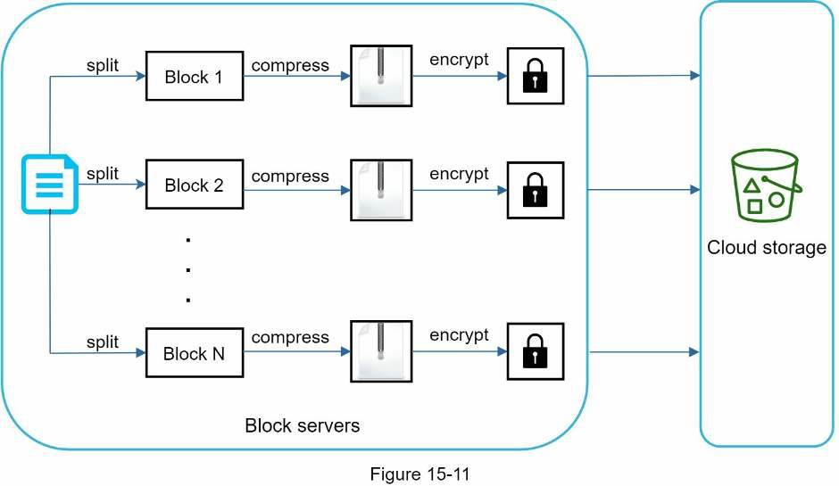

Block servers giúp chúng ta tiết kiệm lưu lượng mạng nhờ cung cấp tính năng delta sync và nén dữ liệu.

> 💡 **Ví dụ bổ sung (không có trong sách):**
> Giả sử bạn có một tệp video hoặc cơ sở dữ liệu cục bộ dung lượng 100 MB (gồm 25 khối, mỗi khối 4 MB). Nếu bạn chỉ sửa một đoạn nhỏ nằm trong khối số 2 và khối số 5, nhờ *delta sync*, máy khách/block server chỉ tính toán giá trị băm (ví dụ SHA-256) của 25 khối, phát hiện chỉ khối 2 và 5 có hash khác với phiên bản trước trên server, nên chỉ gửi đúng 8 MB (chưa tính nén) thay vì phải tải lại toàn bộ 100 MB.

### Yêu cầu tính nhất quán cao (High consistency requirement)

Hệ thống của chúng ta yêu cầu **tính nhất quán mạnh (strong consistency)** theo mặc định. Việc một tệp được hiển thị khác nhau bởi các máy khách khác nhau tại cùng một thời điểm là không thể chấp nhận được. Hệ thống cần đảm bảo tính nhất quán mạnh cho cả tầng bộ nhớ đệm siêu dữ liệu (metadata cache) và tầng cơ sở dữ liệu (database).

Các bộ nhớ đệm trên RAM (memory caches) mặc định áp dụng mô hình nhất quán cuối cùng (**eventual consistency**), nghĩa là các bản sao (replicas) khác nhau có thể có dữ liệu khác nhau. Để đạt được tính nhất quán mạnh, chúng ta phải đảm bảo các điều sau:
- Dữ liệu trong các bản sao cache và máy chủ chính (master) phải nhất quán với nhau.
- Vô hiệu hóa cache khi ghi vào cơ sở dữ liệu (**invalidate caches on database write**) để đảm bảo cache và cơ sở dữ liệu luôn giữ cùng một giá trị.

Việc đạt được tính nhất quán mạnh trong cơ sở dữ liệu quan hệ (relational database) rất dễ dàng vì nó duy trì các tính chất **ACID** (*Atomicity - Tính nguyên tử, Consistency - Tính nhất quán, Isolation - Tính cô lập, Durability - Tính bền vững*) [9]. Tuy nhiên, cơ sở dữ liệu NoSQL mặc định không hỗ trợ các tính chất ACID. Các tính chất ACID phải được tích hợp thủ công bằng lập trình trong logic đồng bộ hóa. Trong thiết kế của chúng ta, chúng ta chọn cơ sở dữ liệu quan hệ vì ACID được hỗ trợ sẵn.

### Cơ sở dữ liệu siêu dữ liệu (Metadata database)

Hình 15-13 (Figure 15-13) thể hiện thiết kế lược đồ cơ sở dữ liệu (database schema design). Xin lưu ý đây là phiên bản đã được đơn giản hóa rất nhiều vì nó chỉ bao gồm các bảng quan trọng nhất và các trường đáng chú ý.

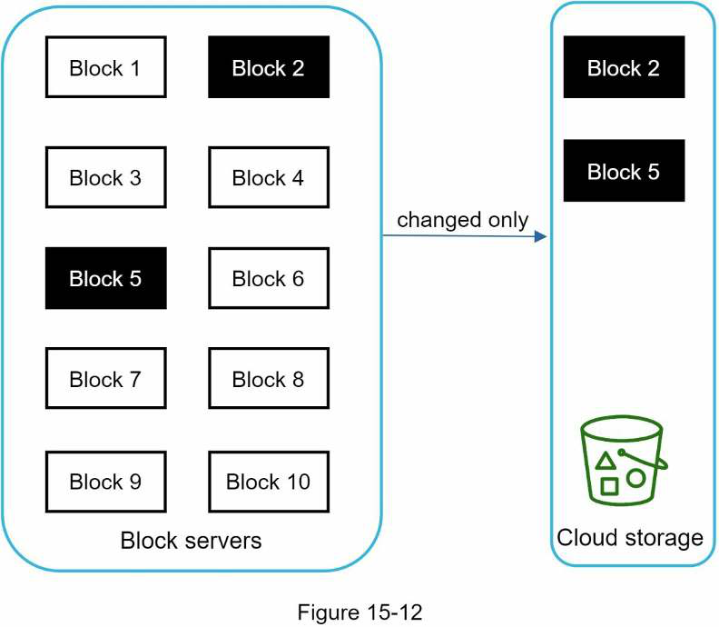

- **User:** Bảng `user` chứa thông tin cơ bản về người dùng như tên đăng nhập (`username`), email, ảnh đại diện (`profile_photo`), v.v.
- **Device:** Bảng `device` lưu trữ thông tin thiết bị. Trường `push_id` được dùng để gửi và nhận thông báo đẩy trên di động (mobile push notifications). Lưu ý rằng một người dùng có thể có nhiều thiết bị.
- **Namespace:** Một `namespace` là thư mục gốc của một người dùng.
- **File:** Bảng `file` lưu trữ mọi thứ liên quan đến phiên bản mới nhất của tệp.
- **File_version:** Bảng này lưu trữ lịch sử phiên bản của một tệp. Các hàng (rows) đã tồn tại chỉ có quyền đọc (read-only) để giữ tính toàn vẹn của lịch sử phiên bản tệp.
- **Block:** Bảng `block` lưu trữ mọi thứ liên quan đến một khối tệp. Một tệp ở bất kỳ phiên bản nào đều có thể được tái tạo bằng cách ghép tất cả các khối theo đúng thứ tự.

### Luồng tải lên (Upload flow)

Hãy thảo luận điều gì xảy ra khi một máy khách tải lên một tệp. Để hiểu rõ hơn luồng hoạt động, chúng ta vẽ sơ đồ tuần tự (sequence diagram) như trong Hình 15-14 (Figure 15-14).

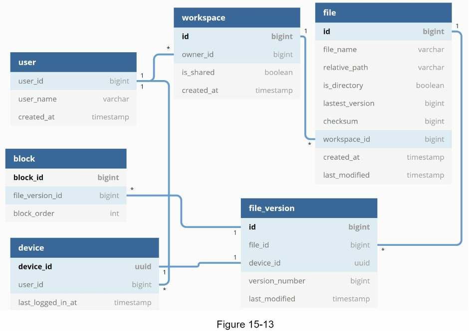

Trong Hình 15-14, hai yêu cầu được gửi song song: thêm siêu dữ liệu tệp và tải tệp lên lưu trữ đám mây. Cả hai yêu cầu đều xuất phát từ máy khách 1 (`client 1`).

- **Thêm siêu dữ liệu tệp (Add file metadata):**
  1. `Client 1` gửi yêu cầu thêm siêu dữ liệu của tệp mới.
  2. Lưu siêu dữ liệu tệp mới vào Metadata DB và đổi trạng thái tải lên tệp thành `"pending"` (đang chờ).
  3. Thông báo cho dịch vụ thông báo (notification service) rằng một tệp mới đang được thêm vào.
  4. Dịch vụ thông báo báo cho các máy khách liên quan (`client 2`) rằng một tệp đang được tải lên.

- **Tải tệp lên lưu trữ đám mây (Upload files to cloud storage):**
  - `2.1` `Client 1` tải nội dung của tệp lên block servers.
  - `2.2` Block servers chia nhỏ tệp thành các khối, nén, mã hóa các khối và tải chúng lên lưu trữ đám mây.
  - `2.3` Khi tệp đã được tải lên xong, lưu trữ đám mây kích hoạt callback hoàn tất tải lên (upload completion callback). Yêu cầu này được gửi đến API servers.
  - `2.4` Trạng thái tệp được đổi thành `"uploaded"` (đã tải lên) trong Metadata DB.
  - `2.5` Thông báo cho dịch vụ thông báo rằng trạng thái tệp đã chuyển sang `"uploaded"`.
  - `2.6` Dịch vụ thông báo báo cho các máy khách liên quan (`client 2`) rằng tệp đã được tải lên hoàn tất.

Khi một tệp được chỉnh sửa, luồng hoạt động cũng tương tự nên chúng ta sẽ không lặp lại.

### Luồng tải xuống (Download flow)

Luồng tải xuống được kích hoạt khi một tệp được thêm hoặc chỉnh sửa ở một nơi khác. Làm thế nào một máy khách biết được nếu một tệp vừa được thêm hoặc chỉnh sửa bởi máy khách khác? Có hai cách để máy khách biết:
- Nếu `client A` đang trực tuyến (online) khi một tệp bị thay đổi bởi máy khách khác, dịch vụ thông báo sẽ báo cho `client A` biết có thay đổi vừa được tạo ra ở đâu đó để nó kéo dữ liệu mới nhất về.

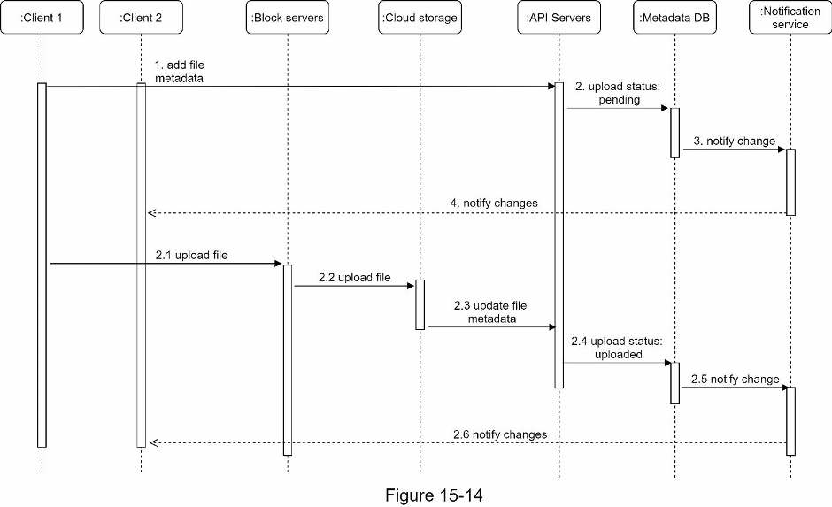

- Nếu `client A` đang ngoại tuyến (offline) khi một tệp bị thay đổi bởi máy khách khác, dữ liệu sẽ được lưu vào cache (hoặc hàng đợi sao lưu ngoại tuyến). Khi máy khách ngoại tuyến trực tuyến trở lại, nó sẽ kéo các thay đổi mới nhất về.

Khi một máy khách biết một tệp đã thay đổi, trước tiên nó yêu cầu siêu dữ liệu thông qua API servers, sau đó tải xuống các khối dữ liệu để tái tạo lại tệp. Hình 15-15 (Figure 15-15) minh họa luồng chi tiết. Lưu ý rằng chỉ các thành phần quan trọng nhất được hiển thị trong sơ đồ do giới hạn không gian.

1. Dịch vụ thông báo báo cho `client 2` rằng một tệp đã bị thay đổi ở nơi khác.
2. Khi `client 2` biết có bản cập nhật mới, nó gửi yêu cầu lấy siêu dữ liệu.
3. API servers gọi Metadata DB để lấy siêu dữ liệu của các thay đổi.
4. Siêu dữ liệu được trả về cho API servers.
5. `Client 2` nhận được siêu dữ liệu.
6. Khi nhận được siêu dữ liệu, máy khách gửi yêu cầu đến block servers để tải xuống các khối.
7. Block servers tải các khối từ lưu trữ đám mây trước.
8. Lưu trữ đám mây trả các khối về cho block servers.
9. `Client 2` tải xuống tất cả các khối mới để tái tạo lại tệp.

### Dịch vụ thông báo (Notification service)

Để duy trì tính nhất quán của tệp, mọi thay đổi đối với một tệp được thực hiện cục bộ cần phải được thông báo cho các máy khách khác nhằm giảm thiểu xung đột. Dịch vụ thông báo (Notification service) được xây dựng cho mục đích này. Ở mức cấp cao, dịch vụ thông báo cho phép truyền dữ liệu đến các máy khách ngay khi sự kiện xảy ra. Dưới đây là một vài lựa chọn:
- **Long polling:** Dropbox sử dụng long polling [10].
- **WebSocket:** WebSocket cung cấp một kết nối liên tục (persistent connection) giữa máy khách và máy chủ. Giao tiếp là hai chiều (bi-directional).

Mặc dù cả hai lựa chọn đều hoạt động tốt, chúng ta chọn **long polling** vì hai lý do sau:
- Giao tiếp cho dịch vụ thông báo không phải là hai chiều. Máy chủ gửi thông tin về các thay đổi tệp đến máy khách, nhưng không có chiều ngược lại.
- WebSocket phù hợp với giao tiếp hai chiều theo thời gian thực như ứng dụng chat. Đối với Google Drive, các thông báo được gửi không thường xuyên và không có sự bùng nổ lưu lượng dữ liệu (burst of data).

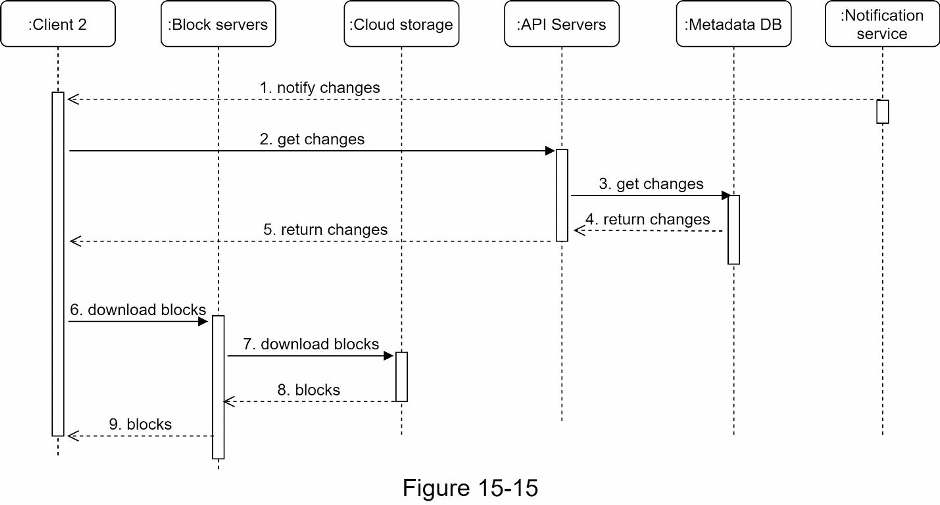

Với long polling, mỗi máy khách thiết lập một kết nối long poll đến dịch vụ thông báo. Nếu phát hiện có thay đổi đối với tệp, máy khách sẽ đóng kết nối long poll. Việc đóng kết nối đồng nghĩa với việc máy khách phải kết nối tới máy chủ siêu dữ liệu để tải về các thay đổi mới nhất. Sau khi nhận được phản hồi hoặc hết thời gian chờ kết nối (connection timeout), máy khách ngay lập tức gửi một yêu cầu mới để giữ cho kết nối luôn mở.

> 📝 **Giải thích thêm (không có trong sách):**
> Trong cơ chế *Long Polling*:
> - Máy khách gửi một HTTP request tới server thông báo. Thay vì trả về ngay lập tức nếu chưa có sự kiện mới, server sẽ "treo" (giữ mở) request đó trong một khoảng thời gian (ví dụ 30–60 giây).
> - Ngay khi có tệp mới được cập nhật từ thiết bị khác, server lập tức trả về phản hồi (HTTP `200 OK`) kèm thông báo thay đổi -> máy khách đóng kết nối cũ, đi tải metadata/file mới, đồng thời mở ngay một long-poll request mới.
> - Nếu hết thời gian chờ (timeout) mà vẫn không có thay đổi nào, server trả về phản hồi rỗng và máy khách lại mở kết nối mới. So với WebSocket, Long Polling tận dụng hạ tầng HTTP chuẩn, dễ đi qua các tường lửa doanh nghiệp và proxy hơn.

### Tiết kiệm dung lượng lưu trữ (Save storage space)

Để hỗ trợ lịch sử phiên bản tệp và đảm bảo độ tin cậy, nhiều phiên bản của cùng một tệp được lưu trữ trên nhiều trung tâm dữ liệu. Dung lượng lưu trữ có thể bị lấp đầy nhanh chóng với việc sao lưu thường xuyên tất cả các phiên bản tệp. Ba kỹ thuật được đề xuất để giảm chi phí lưu trữ:
- **Khử trùng lặp các khối dữ liệu (De-duplicate data blocks):** Loại bỏ các khối dư thừa ở cấp độ tài khoản là một cách dễ dàng để tiết kiệm dung lượng. Hai khối được coi là giống hệt nhau nếu chúng có cùng giá trị băm (hash value).
- **Áp dụng chiến lược sao lưu dữ liệu thông minh (Adopt an intelligent data backup strategy):** Có thể áp dụng hai chiến lược tối ưu hóa sau:
  - *Đặt giới hạn (Set a limit):* Chúng ta có thể đặt giới hạn cho số lượng phiên bản được lưu trữ. Nếu đạt đến giới hạn, phiên bản cũ nhất sẽ bị thay thế bởi phiên bản mới.
  - *Chỉ giữ lại các phiên bản có giá trị (Keep valuable versions only):* Một số tệp có thể bị chỉnh sửa rất thường xuyên. Ví dụ, việc lưu mọi phiên bản đã chỉnh sửa cho một tài liệu bị sửa đổi liên tục có thể khiến tệp được lưu hơn 1000 lần trong một khoảng thời gian ngắn. Để tránh các bản sao không cần thiết, chúng ta có thể giới hạn số lượng phiên bản được lưu. Chúng ta ưu tiên trọng số cao hơn cho các phiên bản gần đây. Việc thử nghiệm (experimentation) sẽ rất hữu ích để tìm ra số lượng phiên bản tối ưu cần lưu.
- **Chuyển dữ liệu ít sử dụng sang lưu trữ lạnh (Moving infrequently used data to cold storage):** Dữ liệu lạnh (cold data) là dữ liệu không hoạt động trong nhiều tháng hoặc nhiều năm. Lưu trữ lạnh như Amazon S3 Glacier [11] rẻ hơn rất nhiều so với S3 thông thường.

### Xử lý lỗi (Failure Handling)

Lỗi có thể xảy ra trong một hệ thống quy mô lớn và chúng ta phải áp dụng các chiến lược thiết kế để giải quyết những lỗi này. Người phỏng vấn có thể quan tâm đến cách bạn xử lý các lỗi hệ thống sau:

- **Lỗi bộ cân bằng tải (Load balancer failure):** Nếu một bộ cân bằng tải gặp sự cố, bộ cân bằng tải dự phòng (secondary) sẽ trở nên chủ động (active) và tiếp nhận lưu lượng. Các bộ cân bằng tải thường giám sát lẫn nhau bằng **heartbeat** — một tín hiệu định kỳ được gửi giữa các bộ cân bằng tải. Một bộ cân bằng tải được coi là gặp sự cố nếu nó không gửi tín hiệu heartbeat trong một khoảng thời gian nhất định.
- **Lỗi máy chủ khối (Block server failure):** Nếu một block server gặp sự cố, các máy chủ khác sẽ tiếp nhận các tác vụ chưa hoàn thành hoặc đang chờ xử lý.
- **Lỗi lưu trữ đám mây (Cloud storage failure):** Các S3 bucket được sao chép nhiều lần ở các vùng khác nhau. Nếu tệp không khả dụng ở một vùng, chúng có thể được lấy từ các vùng khác.
- **Lỗi máy chủ API (API server failure):** Đây là dịch vụ phi trạng thái (stateless service). Nếu một API server gặp sự cố, lưu lượng sẽ được bộ cân bằng tải chuyển hướng sang các API server khác.
- **Lỗi bộ nhớ đệm siêu dữ liệu (Metadata cache failure):** Các máy chủ metadata cache được sao chép nhiều lần. Nếu một nút (node) gặp sự cố, bạn vẫn có thể truy cập các nút khác để lấy dữ liệu. Chúng ta sẽ khởi chạy một máy chủ cache mới để thay thế máy chủ bị lỗi.
- **Lỗi cơ sở dữ liệu siêu dữ liệu (Metadata DB failure):**
  - *Máy chủ chính gặp sự cố (Master down):* Nếu master bị sập, thăng cấp (promote) một trong các máy chủ phụ (slaves) lên làm master mới và khởi chạy một nút slave mới.
  - *Máy chủ phụ gặp sự cố (Slave down):* Nếu một slave bị sập, bạn có thể dùng một slave khác cho các thao tác đọc và đưa một máy chủ cơ sở dữ liệu khác vào thay thế nút bị lỗi.
- **Lỗi dịch vụ thông báo (Notification service failure):** Mỗi người dùng trực tuyến giữ một kết nối long poll với máy chủ thông báo. Do đó, mỗi máy chủ thông báo kết nối với rất nhiều người dùng. Theo bài nói chuyện của Dropbox năm 2012 [6], có hơn 1 triệu kết nối được mở trên mỗi máy. Nếu một máy chủ gặp sự cố, toàn bộ các kết nối long poll bị mất nên các máy khách phải kết nối lại với một máy chủ khác. Mặc dù một máy chủ có thể giữ rất nhiều kết nối mở, nó không thể kết nối lại toàn bộ các kết nối bị mất cùng một lúc. Việc kết nối lại với tất cả các máy khách bị mất là một quá trình tương đối chậm.
- **Lỗi hàng đợi sao lưu ngoại tuyến (Offline backup queue failure):** Các hàng đợi (queues) được sao chép nhiều lần. Nếu một hàng đợi gặp sự cố, các consumer của hàng đợi có thể cần đăng ký lại (re-subscribe) vào hàng đợi dự phòng.

---

## Bước 4 - Tổng kết (Step 4 - Wrap up)

Trong chương này, chúng ta đã đề xuất một thiết kế hệ thống để hỗ trợ Google Drive. Sự kết hợp giữa tính nhất quán mạnh, băng thông mạng thấp và tốc độ đồng bộ nhanh làm cho thiết kế này trở nên thú vị. Thiết kế của chúng ta bao gồm hai luồng: quản lý siêu dữ liệu tệp và đồng bộ hóa tệp. Dịch vụ thông báo là một thành phần quan trọng khác của hệ thống. Nó sử dụng long polling để giữ cho các máy khách luôn cập nhật các thay đổi của tệp.

Giống như bất kỳ câu hỏi phỏng vấn thiết kế hệ thống nào, không có giải pháp hoàn hảo tuyệt đối. Mỗi công ty có những ràng buộc riêng và bạn phải thiết kế một hệ thống phù hợp với các ràng buộc đó. Hiểu rõ sự đánh đổi (tradeoffs) trong thiết kế và lựa chọn công nghệ là điều rất quan trọng. Nếu còn vài phút cuối, bạn có thể thảo luận về các lựa chọn thiết kế khác nhau.

Ví dụ, chúng ta có thể tải tệp trực tiếp từ máy khách lên lưu trữ đám mây thay vì đi qua các block servers. Ưu điểm của cách tiếp cận này là giúp việc tải tệp lên nhanh hơn vì tệp chỉ cần truyền một lần lên lưu trữ đám mây. Trong thiết kế hiện tại của chúng ta, tệp được truyền tới block servers trước, rồi mới tới lưu trữ đám mây. Tuy nhiên, cách tiếp cận mới có một vài nhược điểm:
- Thứ nhất, cùng một logic chia khối (chunking), nén (compression) và mã hóa (encryption) phải được triển khai trên nhiều nền tảng khác nhau (iOS, Android, Web). Điều này rất dễ xảy ra lỗi (error-prone) và đòi hỏi nhiều công sức kỹ thuật. Trong thiết kế của chúng ta, toàn bộ các logic đó được triển khai tập trung tại một nơi: block servers.
- Thứ hai, vì máy khách (client) có thể dễ dàng bị tấn công hoặc thao túng, việc triển khai logic mã hóa ở phía máy khách không phải là lựa chọn lý tưởng.

Một hướng tiến hóa thú vị khác của hệ thống là tách logic trực tuyến/ngoại tuyến (online/offline) sang một dịch vụ riêng biệt. Hãy gọi nó là dịch vụ hiện diện (**presence service**). Bằng cách tách presence service ra khỏi các máy chủ thông báo, chức năng trực tuyến/ngoại tuyến có thể dễ dàng được tích hợp bởi các dịch vụ khác.

Chúc mừng bạn đã đi đến tận đây! Hãy tự thưởng cho mình một cái vỗ vai. Làm tốt lắm!

---

## Tài liệu tham khảo (Reference materials)

[1] Google Drive: https://www.google.com/drive/  
[2] Upload file data: https://developers.google.com/drive/api/v2/manage-uploads  
[3] Amazon S3: https://aws.amazon.com/s3  
[4] Differential Synchronization https://neil.fraser.name/writing/sync/  
[5] Differential Synchronization youtube talk https://www.youtube.com/watch?v=S2Hp_1jqpY8  
[6] How We’ve Scaled Dropbox: https://youtu.be/PE4gwstWhmc  
[7] Tridgell, A., & Mackerras, P. (1996). The rsync algorithm.  
[8] Librsync. (n.d.). Retrieved April 18, 2015, from https://github.com/librsync/librsync  
[9] ACID: https://en.wikipedia.org/wiki/ACID  
[10] Dropbox security white paper: https://www.dropbox.com/static/business/resources/Security_Whitepaper.pdf  
[11] Amazon S3 Glacier: https://aws.amazon.com/glacier/faqs/

---

## Bảng thuật ngữ chương (Chapter Glossary)

| Thuật ngữ (English) | Tiếng Việt | Giải thích ngắn gọn |
| :--- | :--- | :--- |
| Block storage | Lưu trữ khối | Phương thức chia nhỏ tệp thành các khối dữ liệu (ví dụ 4 MB) có mã băm riêng để lưu trữ và đồng bộ hiệu quả. |
| Delta sync | Đồng bộ phần sai khác | Kỹ thuật chỉ truyền tải những khối dữ liệu bị thay đổi thay vì toàn bộ tệp để tiết kiệm băng thông. |
| Namespace | Không gian tên | Thư mục gốc đại diện cho không gian lưu trữ riêng của mỗi người dùng trong hệ thống. |
| Resumable upload | Tải lên có thể tiếp tục | Cơ chế cho phép tiếp tục tải lên phần dữ liệu còn lại nếu kết nối mạng bị gián đoạn giữa chừng. |
| Strong consistency | Tính nhất quán mạnh | Đảm bảo mọi máy khách luôn nhìn thấy cùng một trạng thái dữ liệu mới nhất tại cùng một thời điểm. |
| Eventual consistency | Tính nhất quán cuối cùng | Mô hình nhất quán trong đó các bản sao dữ liệu sẽ dần đồng bộ với nhau sau một khoảng thời gian. |
| Long polling | Thăm dò dài | Kỹ thuật máy khách gửi yêu cầu HTTP và máy chủ giữ kết nối mở cho đến khi có sự kiện mới hoặc hết thời gian chờ. |
| De-duplication | Khử trùng lặp | Kỹ thuật loại bỏ các khối dữ liệu giống hệt nhau (cùng giá trị băm) để tiết kiệm dung lượng lưu trữ. |
| Cold storage | Lưu trữ lạnh | Hệ thống lưu trữ chi phí thấp dành cho dữ liệu ít hoặc không được truy cập trong thời gian dài (ví dụ S3 Glacier). |
| Heartbeat | Tín hiệu nhịp tim | Tín hiệu định kỳ gửi giữa các máy chủ (như Load Balancer) để phát hiện xem nút kia còn hoạt động hay đã hỏng. |
| Presence service | Dịch vụ hiện diện | Dịch vụ chuyên trách theo dõi và cung cấp trạng thái trực tuyến/ngoại tuyến (online/offline) của người dùng. |
| Sync conflict | Xung đột đồng bộ | Tình huống xảy ra khi nhiều người dùng hoặc thiết bị cùng sửa đổi một tệp tại cùng một thời điểm. |
