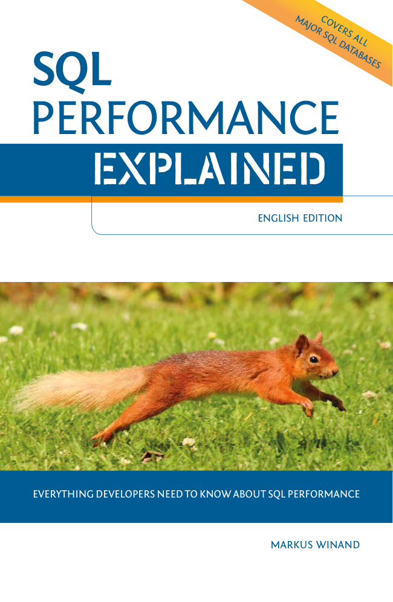

# Lời mở đầu (Front matter)

**Mục lục của phần này**

- [Bìa sách (Cover)](#bìa-sách-cover)
- [Thỏa thuận cấp phép (License Agreement)](#thỏa-thuận-cấp-phép-license-agreement)
- [Thông tin xuất bản và bản quyền (Publisher & Copyright)](#thông-tin-xuất-bản-và-bản-quyền-publisher--copyright)
- [Trang tên sách (SQL Performance Explained)](#trang-tên-sách-sql-performance-explained)
- [Mục lục sách (Contents)](#mục-lục-sách-contents)
- [Lời nói đầu: Lập trình viên cần biết về index (Preface Developers Need to Index)](#lời-nói-đầu-lập-trình-viên-cần-biết-về-index-preface-developers-need-to-index)
- [Bảng thuật ngữ (Glossary)](#bảng-thuật-ngữ-glossary)

---

## Bìa sách (Cover)



Nội dung chữ trên bìa (dịch):

| Chữ gốc trên bìa | Nghĩa tiếng Việt |
|---|---|
| SQL PERFORMANCE EXPLAINED | Giải thích về hiệu năng SQL (tên sách) |
| ENGLISH EDITION | Ấn bản tiếng Anh |
| MARKUS WINAND | Tác giả: Markus Winand |
| EVERYTHING DEVELOPERS NEED TO KNOW ABOUT SQL PERFORMANCE | Mọi điều lập trình viên cần biết về hiệu năng SQL |
| COVERS ALL MAJOR SQL DATABASES | Bao quát tất cả các hệ cơ sở dữ liệu SQL lớn |

*(Trang 2 của bản PDF là trang trống.)*

---

## Thỏa thuận cấp phép (License Agreement)

Cuốn ebook này được cấp phép chỉ để bạn đọc cho riêng mình. Không được bán lại hoặc tặng cuốn ebook này cho người khác. Nếu bạn muốn chia sẻ cuốn sách với người khác, vui lòng mua thêm một bản cho mỗi người. Nếu bạn đang đọc cuốn sách này mà không phải là người đã mua nó, hoặc nó không được mua để dành riêng cho bạn sử dụng, vui lòng quay lại

http://SQL-Performance-Explained.com/

và mua một bản của riêng bạn. Cảm ơn bạn đã tôn trọng công sức lao động của tác giả.

Bản sao này được cấp phép cho:
*(tên và email người được cấp phép — đã lược bỏ thông tin cá nhân)*

---

## Thông tin xuất bản và bản quyền (Publisher & Copyright)

**Nhà xuất bản (Publisher):**
Markus Winand
Maderspergerstasse 1-3/9/11
1160 Wien
AUSTRIA (Áo)
<office@winand.at>

Copyright © 2012 Markus Winand

Bảo lưu mọi quyền. Không phần nào của ấn phẩm này được phép sao chép, lưu trữ hoặc truyền tải dưới bất kỳ hình thức hay phương tiện nào — điện tử, cơ học, photocopy, ghi âm/ghi hình hay cách khác — khi chưa có sự đồng ý trước của nhà xuất bản.

Nhiều tên gọi mà các nhà sản xuất và người bán dùng để phân biệt sản phẩm của họ là nhãn hiệu đã đăng ký. Ở bất kỳ chỗ nào những tên gọi như vậy xuất hiện trong sách này và chúng tôi biết có khiếu nại về nhãn hiệu, các tên đó đã được in toàn bộ bằng chữ hoa hoặc viết hoa chữ cái đầu.

Mặc dù mọi biện pháp phòng ngừa đã được thực hiện trong quá trình chuẩn bị cuốn sách này, nhà xuất bản và tác giả không chịu trách nhiệm về các lỗi và thiếu sót, hay về thiệt hại phát sinh từ việc sử dụng thông tin có trong sách.

Cuốn sách chỉ phản ánh quan điểm của tác giả. Các nhà cung cấp cơ sở dữ liệu được nhắc tới trong sách không hề tài trợ tài chính cho công trình này, cũng không kiểm duyệt nội dung.

In ấn: DGS - Druck- u. Graphikservice GmbH — Wien — Austria

| Vai trò | Người thực hiện |
|---|---|
| Thiết kế bìa (Cover design) | tomasio.design — Mag. Thomas Weninger — Wien — Austria |
| Ảnh bìa (Cover photo) | Brian Arnold — Turriff — UK |
| Biên tập bản thảo (Copy editor) | Nathan Ingvalson — Graz — Austria |

Ngày phát hành bản này: 2014-08-26

---

## Trang tên sách (SQL Performance Explained)

**SQL Performance Explained** (Giải thích về hiệu năng SQL)

*Everything developers need to know about SQL performance* — Mọi điều lập trình viên cần biết về hiệu năng SQL

Markus Winand

Vienna, Austria (Viên, Áo)

---

## Mục lục sách (Contents)

Dưới đây là mục lục gốc của sách, được dịch đầy đủ. Số trang ở cột phải là **số trang in trong sách gốc** (không phải số trang PDF; trang PDF = trang sách + 10 đối với phần thân sách). Tên gốc tiếng Anh được giữ trong ngoặc.

| Mục | Trang |
|---|---|
| Lời nói đầu (Preface) | vi |
| **1. Giải phẫu một index (Anatomy of an Index)** | **1** |
| &nbsp;&nbsp;&nbsp;&nbsp;Các nút lá của index (The Index Leaf Nodes) | 2 |
| &nbsp;&nbsp;&nbsp;&nbsp;Cây tìm kiếm (B-Tree) (The Search Tree (B-Tree)) | 4 |
| &nbsp;&nbsp;&nbsp;&nbsp;Index chậm, phần I (Slow Indexes, Part I) | 6 |
| **2. Mệnh đề Where (The Where Clause)** | **9** |
| &nbsp;&nbsp;&nbsp;&nbsp;Toán tử so sánh bằng (The Equality Operator) | 9 |
| &nbsp;&nbsp;&nbsp;&nbsp;&nbsp;&nbsp;&nbsp;&nbsp;Khóa chính (Primary Keys) | 10 |
| &nbsp;&nbsp;&nbsp;&nbsp;&nbsp;&nbsp;&nbsp;&nbsp;Index ghép nhiều cột (Concatenated Indexes) | 12 |
| &nbsp;&nbsp;&nbsp;&nbsp;&nbsp;&nbsp;&nbsp;&nbsp;Index chậm, phần II (Slow Indexes, Part II) | 18 |
| &nbsp;&nbsp;&nbsp;&nbsp;Hàm (Functions) | 24 |
| &nbsp;&nbsp;&nbsp;&nbsp;&nbsp;&nbsp;&nbsp;&nbsp;Tìm kiếm không phân biệt hoa thường bằng UPPER hoặc LOWER (Case-Insensitive Search Using UPPER or LOWER) | 24 |
| &nbsp;&nbsp;&nbsp;&nbsp;&nbsp;&nbsp;&nbsp;&nbsp;Hàm do người dùng định nghĩa (User-Defined Functions) | 29 |
| &nbsp;&nbsp;&nbsp;&nbsp;&nbsp;&nbsp;&nbsp;&nbsp;Tạo quá nhiều index (Over-Indexing) | 31 |
| &nbsp;&nbsp;&nbsp;&nbsp;Truy vấn có tham số (Parameterized Queries) | 32 |
| &nbsp;&nbsp;&nbsp;&nbsp;Tìm kiếm theo khoảng (Searching for Ranges) | 39 |
| &nbsp;&nbsp;&nbsp;&nbsp;&nbsp;&nbsp;&nbsp;&nbsp;Lớn hơn, nhỏ hơn và BETWEEN (Greater, Less and BETWEEN) | 39 |
| &nbsp;&nbsp;&nbsp;&nbsp;&nbsp;&nbsp;&nbsp;&nbsp;Đánh index cho bộ lọc LIKE (Indexing LIKE Filters) | 45 |
| &nbsp;&nbsp;&nbsp;&nbsp;&nbsp;&nbsp;&nbsp;&nbsp;Gộp index (Index Merge) | 49 |
| &nbsp;&nbsp;&nbsp;&nbsp;Index một phần (Partial Indexes) | 51 |
| &nbsp;&nbsp;&nbsp;&nbsp;NULL trong cơ sở dữ liệu Oracle (NULL in the Oracle Database) | 53 |
| &nbsp;&nbsp;&nbsp;&nbsp;&nbsp;&nbsp;&nbsp;&nbsp;Đánh index cho NULL (Indexing NULL) | 54 |
| &nbsp;&nbsp;&nbsp;&nbsp;&nbsp;&nbsp;&nbsp;&nbsp;Ràng buộc NOT NULL (NOT NULL Constraints) | 56 |
| &nbsp;&nbsp;&nbsp;&nbsp;&nbsp;&nbsp;&nbsp;&nbsp;Giả lập index một phần (Emulating Partial Indexes) | 60 |
| &nbsp;&nbsp;&nbsp;&nbsp;Điều kiện bị "che khuất" (Obfuscated Conditions) | 62 |
| &nbsp;&nbsp;&nbsp;&nbsp;&nbsp;&nbsp;&nbsp;&nbsp;Kiểu ngày tháng (Date Types) | 62 |
| &nbsp;&nbsp;&nbsp;&nbsp;&nbsp;&nbsp;&nbsp;&nbsp;Chuỗi chứa số (Numeric Strings) | 68 |
| &nbsp;&nbsp;&nbsp;&nbsp;&nbsp;&nbsp;&nbsp;&nbsp;Kết hợp các cột (Combining Columns) | 70 |
| &nbsp;&nbsp;&nbsp;&nbsp;&nbsp;&nbsp;&nbsp;&nbsp;Logic "thông minh" (Smart Logic) | 72 |
| &nbsp;&nbsp;&nbsp;&nbsp;&nbsp;&nbsp;&nbsp;&nbsp;Phép toán (Math) | 77 |
| **3. Hiệu năng và khả năng mở rộng (Performance and Scalability)** | **79** |
| &nbsp;&nbsp;&nbsp;&nbsp;Ảnh hưởng của khối lượng dữ liệu tới hiệu năng (Performance Impacts of Data Volume) | 80 |
| &nbsp;&nbsp;&nbsp;&nbsp;Ảnh hưởng của tải hệ thống tới hiệu năng (Performance Impacts of System Load) | 85 |
| &nbsp;&nbsp;&nbsp;&nbsp;Thời gian phản hồi và thông lượng (Response Time and Throughput) | 87 |
| **4. Phép nối bảng (The Join Operation)** | **91** |
| &nbsp;&nbsp;&nbsp;&nbsp;Vòng lặp lồng nhau (Nested Loops) | 92 |
| &nbsp;&nbsp;&nbsp;&nbsp;Nối băm (Hash Join) | 101 |
| &nbsp;&nbsp;&nbsp;&nbsp;Sắp xếp rồi trộn (Sort Merge) | 109 |
| **5. Gom cụm dữ liệu (Clustering Data)** | **111** |
| &nbsp;&nbsp;&nbsp;&nbsp;Cố ý sử dụng vị từ lọc trên index (Index Filter Predicates Used Intentionally) | 112 |
| &nbsp;&nbsp;&nbsp;&nbsp;Quét chỉ trên index (Index-Only Scan) | 116 |
| &nbsp;&nbsp;&nbsp;&nbsp;Bảng tổ chức theo index (Index-Organized Tables) | 122 |
| **6. Sắp xếp và gom nhóm (Sorting and Grouping)** | **129** |
| &nbsp;&nbsp;&nbsp;&nbsp;Đánh index cho Order By (Indexing Order By) | 130 |
| &nbsp;&nbsp;&nbsp;&nbsp;Đánh index với ASC, DESC và NULLS FIRST/LAST (Indexing ASC, DESC and NULLS FIRST/LAST) | 134 |
| &nbsp;&nbsp;&nbsp;&nbsp;Đánh index cho Group By (Indexing Group By) | 139 |
| **7. Kết quả từng phần (Partial Results)** | **143** |
| &nbsp;&nbsp;&nbsp;&nbsp;Truy vấn N dòng đầu tiên (Querying Top-N Rows) | 143 |
| &nbsp;&nbsp;&nbsp;&nbsp;Phân trang kết quả (Paging Through Results) | 147 |
| &nbsp;&nbsp;&nbsp;&nbsp;Dùng hàm cửa sổ để phân trang (Using Window Functions for Pagination) | 156 |
| **8. Sửa đổi dữ liệu (Modifying Data)** | **159** |
| &nbsp;&nbsp;&nbsp;&nbsp;Thêm dữ liệu (Insert) | 159 |
| &nbsp;&nbsp;&nbsp;&nbsp;Xóa dữ liệu (Delete) | 162 |
| &nbsp;&nbsp;&nbsp;&nbsp;Cập nhật dữ liệu (Update) | 163 |
| **A. Kế hoạch thực thi (Execution Plans)** | **165** |
| &nbsp;&nbsp;&nbsp;&nbsp;Cơ sở dữ liệu Oracle (Oracle Database) | 166 |
| &nbsp;&nbsp;&nbsp;&nbsp;PostgreSQL | 172 |
| &nbsp;&nbsp;&nbsp;&nbsp;SQL Server | 180 |
| &nbsp;&nbsp;&nbsp;&nbsp;MySQL | 188 |
| Chỉ mục tra cứu (Index) | 193 |

> 📝 **Giải thích thêm (không có trong sách):** Trong sách, từ "Index" có hai nghĩa: (1) **index của cơ sở dữ liệu** — cấu trúc dữ liệu giúp tìm dòng nhanh, là chủ đề chính của cuốn sách; và (2) **"Index" ở cuối mục lục** — phần chỉ mục tra cứu từ khóa của cuốn sách in (giống phần "Tra cứu" ở cuối sách giáo khoa). Trong bản dịch này, nghĩa (1) được giữ nguyên là "index", nghĩa (2) được dịch là "chỉ mục tra cứu".

---

## Lời nói đầu: Lập trình viên cần biết về index (Preface Developers Need to Index)

Vấn đề hiệu năng SQL đã có từ khi chính SQL ra đời — thậm chí có người còn nói rằng bản chất SQL vốn đã chậm. Mặc dù điều này có thể đúng vào những ngày đầu của SQL, ngày nay nó chắc chắn không còn đúng nữa. Thế nhưng các vấn đề hiệu năng SQL vẫn còn rất phổ biến. Vì sao lại như vậy?

Ngôn ngữ SQL có lẽ là ngôn ngữ lập trình thế hệ thứ tư (*fourth-generation programming language – 4GL*) thành công nhất. Lợi ích chính của nó là khả năng tách biệt "cái gì" (*what*) và "làm thế nào" (*how*). Một câu lệnh SQL là một mô tả thẳng thắn về **thứ cần lấy**, mà không kèm chỉ dẫn nào về **cách lấy** nó. Hãy xem ví dụ sau:

```sql
SELECT date_of_birth
  FROM employees
 WHERE last_name = 'WINAND'
```

Câu truy vấn SQL này đọc lên giống như một câu tiếng Anh giải thích dữ liệu được yêu cầu ("chọn ngày sinh từ bảng nhân viên, nơi họ là 'WINAND'"). Viết câu lệnh SQL nói chung không đòi hỏi bất kỳ hiểu biết nào về cách hoạt động bên trong của cơ sở dữ liệu hay của hệ thống lưu trữ (như ổ đĩa, file, v.v.). Không cần phải bảo cơ sở dữ liệu mở file nào hay tìm các dòng được yêu cầu bằng cách nào. Nhiều lập trình viên có hàng năm kinh nghiệm với SQL mà vẫn biết rất ít về quá trình xử lý diễn ra bên trong cơ sở dữ liệu.

Sự tách biệt mối quan tâm (*separation of concerns*) — cần cái gì so với lấy nó bằng cách nào — hoạt động hiệu quả đáng kinh ngạc trong SQL, nhưng nó vẫn chưa hoàn hảo. Lớp trừu tượng (*abstraction*) này chạm tới giới hạn của nó khi đụng đến chuyện hiệu năng: theo định nghĩa, người viết câu lệnh SQL không cần quan tâm cơ sở dữ liệu thực thi câu lệnh đó như thế nào. Do đó, người viết cũng không phải chịu trách nhiệm cho việc thực thi chậm. Tuy nhiên, kinh nghiệm thực tế lại chứng minh điều ngược lại: người viết phải biết một chút về cơ sở dữ liệu để phòng tránh các vấn đề hiệu năng.

Hóa ra, thứ duy nhất mà lập trình viên cần học là **cách đánh index** (*how to index*). Việc đánh index cho cơ sở dữ liệu (*database indexing*) thực chất là một công việc của **phát triển phần mềm** (*development task*). Đó là bởi vì thông tin quan trọng nhất để đánh index đúng cách không phải là cấu hình hệ thống lưu trữ hay cách thiết lập phần cứng. Thông tin quan trọng nhất để đánh index là **ứng dụng truy vấn dữ liệu như thế nào**. Kiến thức này — về đường truy cập (*access path*) — không dễ tiếp cận đối với các quản trị viên cơ sở dữ liệu (*database administrators – DBA*) hay các chuyên gia tư vấn bên ngoài. Họ cần khá nhiều thời gian để thu thập thông tin này thông qua việc "dịch ngược" (*reverse engineering*) ứng dụng; trong khi đó, đội phát triển thì vốn dĩ đã có sẵn thông tin ấy.

> 📝 **Giải thích thêm (không có trong sách):** **Index** (chỉ mục) trong cơ sở dữ liệu giống như phần tra cứu ở cuối một cuốn sách dày: thay vì lật từng trang để tìm chữ "B-tree", bạn mở phần tra cứu (đã sắp xếp theo vần), tìm ra số trang rồi lật thẳng tới đó. Cơ sở dữ liệu cũng vậy: không có index, nó phải đọc toàn bộ bảng — gọi là **full table scan** (quét toàn bảng); có index phù hợp, nó chỉ cần đi theo cấu trúc index tới đúng những dòng cần lấy. **Access path** (đường truy cập) là "con đường" mà cơ sở dữ liệu chọn để lấy dữ liệu: quét toàn bảng, dùng index nào, theo thứ tự nào... Chỉ người viết ứng dụng mới biết chính xác câu truy vấn nào chạy thường xuyên, lọc theo cột nào, sắp xếp theo cột nào — đó là lý do tác giả cho rằng đánh index là việc của lập trình viên.

> 💡 **Ví dụ bổ sung (không có trong sách):** Giả sử bảng `employees` có 1.000.000 dòng với dữ liệu mẫu:
>
> | employee_id | first_name | last_name | date_of_birth |
> |---|---|---|---|
> | 1 | MARKUS | WINAND | 1977-01-01 |
> | 2 | ANNA | SMITH | 1985-06-12 |
> | 3 | JOHN | DOE | 1990-03-30 |
> | ... | ... | ... | ... |
>
> Với câu truy vấn trong sách (`WHERE last_name = 'WINAND'`), nếu **không có** index trên `last_name`, cơ sở dữ liệu buộc phải đọc cả 1.000.000 dòng để kiểm tra điều kiện. Lập trình viên — người biết câu truy vấn này được gọi rất thường xuyên — có thể tạo index:
>
> ```sql
> CREATE INDEX emp_last_name ON employees (last_name);
> ```
>
> Câu lệnh này có cú pháp giống nhau trên Oracle, PostgreSQL, SQL Server, MySQL và DB2. Sau khi có index, cơ sở dữ liệu có thể duyệt cây B-tree để tìm ngay các mục có `last_name = 'WINAND'`, rồi chỉ đọc vài dòng tương ứng trong bảng. Bạn có thể kiểm tra bằng execution plan (kế hoạch thực thi — bản mô tả cách cơ sở dữ liệu sẽ chạy câu lệnh), ví dụ `EXPLAIN SELECT ...` trên PostgreSQL/MySQL hoặc `EXPLAIN PLAN FOR SELECT ...` trên Oracle: plan sẽ chuyển từ quét toàn bảng (`Seq Scan` / `TABLE ACCESS FULL` / `ALL`) sang truy cập qua index (`Index Scan` / `INDEX RANGE SCAN` / `ref`). Các chi tiết này được giải thích đầy đủ ở các chương sau và Phụ lục A.

Cuốn sách này bao quát mọi điều lập trình viên cần biết về index — và không gì hơn. Nói chính xác hơn, cuốn sách chỉ đề cập đến loại index quan trọng nhất: **index B-tree** (*B-tree index*).

Index B-tree hoạt động gần như giống hệt nhau trên nhiều hệ cơ sở dữ liệu. Sách chỉ dùng thuật ngữ của cơ sở dữ liệu Oracle®, nhưng các nguyên lý cũng áp dụng cho những hệ cơ sở dữ liệu khác. Các ghi chú bên lề (*side notes*) cung cấp thông tin liên quan cho MySQL, PostgreSQL và SQL Server®.

> 📝 **Giải thích thêm (không có trong sách):** B-tree (cây cân bằng) là cấu trúc index mặc định trong hầu hết các hệ quản trị: `CREATE INDEX` không chỉ định gì thêm sẽ tạo index B-tree trên Oracle, PostgreSQL (kiểu `btree`), MySQL/InnoDB và DB2; SQL Server cũng dùng cấu trúc B-tree cho cả clustered và nonclustered index. Các loại index khác (bitmap của Oracle, GIN/GiST/BRIN/hash của PostgreSQL, full-text, columnstore của SQL Server...) nằm ngoài phạm vi cuốn sách. Lưu ý: dù sách nói các ghi chú bên lề dành cho MySQL, PostgreSQL và SQL Server, ở một số chỗ trong sách cũng có ghi chú dành cho DB2.

Cấu trúc của cuốn sách được thiết kế riêng cho lập trình viên; hầu hết các chương tương ứng với một phần cụ thể của câu lệnh SQL.

**CHƯƠNG 1 – Giải phẫu một index (CHAPTER 1 - Anatomy of an Index)**

Chương đầu tiên là chương duy nhất không nói cụ thể về SQL; nó nói về cấu trúc nền tảng của một index. Hiểu cấu trúc index là điều thiết yếu để theo kịp các chương sau — đừng bỏ qua chương này!

Mặc dù chương này khá ngắn — chỉ khoảng tám trang — nhưng sau khi đọc xong, bạn sẽ hiểu được hiện tượng "index chậm" (*slow indexes*).

**CHƯƠNG 2 – Mệnh đề Where (CHAPTER 2 - The Where Clause)**

Đây là lúc chúng ta dốc toàn lực (*pull out all the stops* — nguyên văn là "kéo hết mọi nút stop", thành ngữ từ đàn ống, nghĩa là dùng mọi thứ mình có). Chương này giải thích mọi khía cạnh của mệnh đề `where`, từ những phép tra cứu rất đơn giản trên một cột cho tới các mệnh đề phức tạp cho khoảng giá trị (*ranges*) và những trường hợp đặc biệt như `LIKE`.

Chương này là phần thân chính của cuốn sách. Một khi đã học được các kỹ thuật này, bạn sẽ viết được SQL nhanh hơn nhiều.

**CHƯƠNG 3 – Hiệu năng và khả năng mở rộng (CHAPTER 3 - Performance and Scalability)**

Chương này là một đoạn "rẽ ngang" nhỏ, bàn về việc đo lường hiệu năng và khả năng mở rộng (*scalability*) của cơ sở dữ liệu. Bạn sẽ thấy vì sao thêm phần cứng không phải là giải pháp tốt nhất cho các truy vấn chậm.

**CHƯƠNG 4 – Phép nối bảng (CHAPTER 4 - The Join Operation)**

Quay lại với SQL: tại đây bạn sẽ tìm thấy lời giải thích về cách dùng index để thực hiện phép nối bảng (*join*) nhanh chóng.

**CHƯƠNG 5 – Gom cụm dữ liệu (CHAPTER 5 - Clustering Data)**

Bạn đã bao giờ tự hỏi liệu có khác biệt gì giữa việc chọn một cột duy nhất và chọn tất cả các cột không? Câu trả lời nằm ở đây — kèm theo một mẹo để đạt hiệu năng còn tốt hơn nữa.

**CHƯƠNG 6 – Sắp xếp và gom nhóm (CHAPTER 6 - Sorting and Grouping)**

Ngay cả `order by` và `group by` cũng có thể sử dụng index.

**CHƯƠNG 7 – Kết quả từng phần (CHAPTER 7 - Partial Results)**

Chương này giải thích cách tận dụng kiểu thực thi "theo đường ống" (*pipelined execution* — kết quả được trả ra dần dần ngay khi có, không cần chờ xử lý xong toàn bộ) nếu bạn không cần toàn bộ tập kết quả.

**CHƯƠNG 8 – Insert, Delete và Update (CHAPTER 8 - Insert, Delete and Update)**

Index ảnh hưởng thế nào tới hiệu năng ghi dữ liệu? Index không miễn phí — hãy dùng chúng một cách khôn ngoan!

> 📝 **Giải thích thêm (không có trong sách):** Trong mục lục, chương 8 có tên "Modifying Data" (Sửa đổi dữ liệu), còn ở đây tác giả gọi nó là "Insert, Delete and Update" — đó là cùng một chương, gồm ba mục Insert, Delete và Update.

**PHỤ LỤC A – Kế hoạch thực thi (APPENDIX A - Execution Plans)**

Hỏi cơ sở dữ liệu xem nó thực thi một câu lệnh như thế nào.

> 💡 **Ví dụ bổ sung (không có trong sách):** Cách "hỏi" cơ sở dữ liệu về execution plan trên từng hệ (chi tiết ở Phụ lục A):
>
> ```sql
> -- Oracle
> EXPLAIN PLAN FOR
> SELECT date_of_birth FROM employees WHERE last_name = 'WINAND';
> SELECT * FROM TABLE(dbms_xplan.display);
>
> -- PostgreSQL
> EXPLAIN SELECT date_of_birth FROM employees WHERE last_name = 'WINAND';
>
> -- MySQL
> EXPLAIN SELECT date_of_birth FROM employees WHERE last_name = 'WINAND';
>
> -- SQL Server (hiển thị plan dạng text thay vì thực thi)
> SET SHOWPLAN_TEXT ON;
> GO
> SELECT date_of_birth FROM employees WHERE last_name = 'WINAND';
> GO
> SET SHOWPLAN_TEXT OFF;
> GO
> ```
>
> Mỗi chương của sách sẽ dựa vào các plan như vậy để cho thấy index có được dùng hay không, và dùng như thế nào.

---

## Bảng thuật ngữ (Glossary)

| Thuật ngữ tiếng Anh | Nghĩa tiếng Việt | Giải thích ngắn |
|---|---|---|
| Index | Chỉ mục (giữ nguyên "index") | Cấu trúc dữ liệu riêng biệt giúp cơ sở dữ liệu tìm dòng nhanh mà không phải đọc cả bảng |
| B-tree index | Index cây B (cây cân bằng) | Loại index phổ biến và quan trọng nhất, chủ đề duy nhất của sách |
| Fourth-generation programming language (4GL) | Ngôn ngữ lập trình thế hệ thứ tư | Ngôn ngữ khai báo, mô tả "cần gì" thay vì "làm thế nào" |
| Separation of concerns | Tách biệt mối quan tâm | Tách "cần cái gì" khỏi "lấy bằng cách nào" |
| Abstraction | Lớp trừu tượng | Che giấu chi tiết xử lý bên trong khỏi người dùng |
| Access path | Đường truy cập | Cách cơ sở dữ liệu lấy dữ liệu (quét bảng, dùng index nào...) |
| Database administrator (DBA) | Quản trị viên cơ sở dữ liệu | Người vận hành, quản trị hệ cơ sở dữ liệu |
| Reverse engineering | Dịch ngược / phân tích ngược | Tìm hiểu cách ứng dụng hoạt động từ bên ngoài, khi không có sẵn kiến thức thiết kế |
| Side notes | Ghi chú bên lề | Các hộp ghi chú dành riêng cho MySQL, PostgreSQL, SQL Server... |
| Slow indexes | Index chậm | Hiện tượng truy vấn vẫn chậm dù có dùng index (giải thích ở Chương 1) |
| Where clause | Mệnh đề Where | Phần lọc dữ liệu của câu lệnh SQL |
| Scalability | Khả năng mở rộng | Khả năng hệ thống duy trì hiệu năng khi dữ liệu/tải tăng |
| Join | Phép nối bảng | Kết hợp dữ liệu từ nhiều bảng |
| Pipelined execution | Thực thi theo đường ống | Trả kết quả dần ngay khi có, không chờ xử lý hết toàn bộ |
| Execution plan | Kế hoạch thực thi | Bản mô tả các bước cơ sở dữ liệu dùng để thực thi câu lệnh |
| Full table scan | Quét toàn bảng | Đọc mọi dòng của bảng để tìm dòng thỏa điều kiện |
