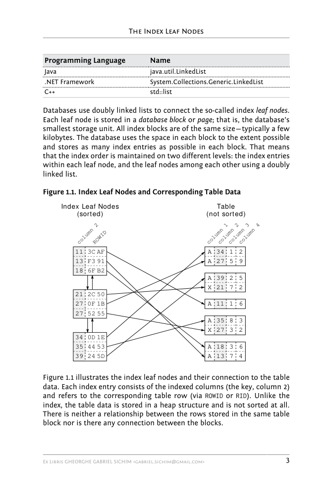
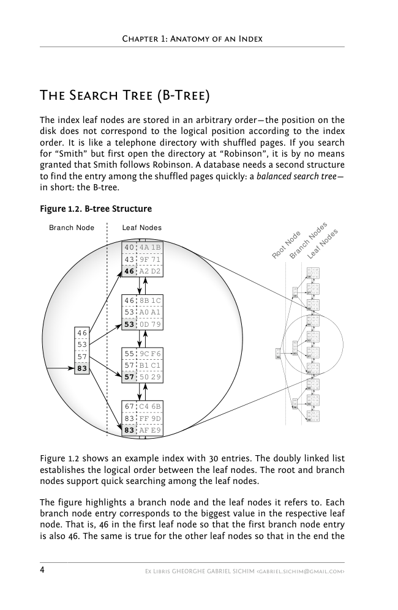
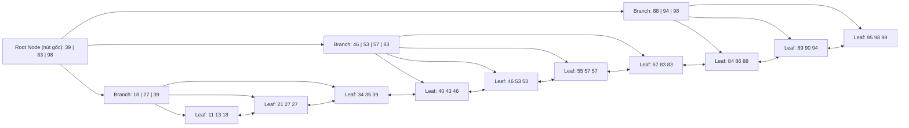
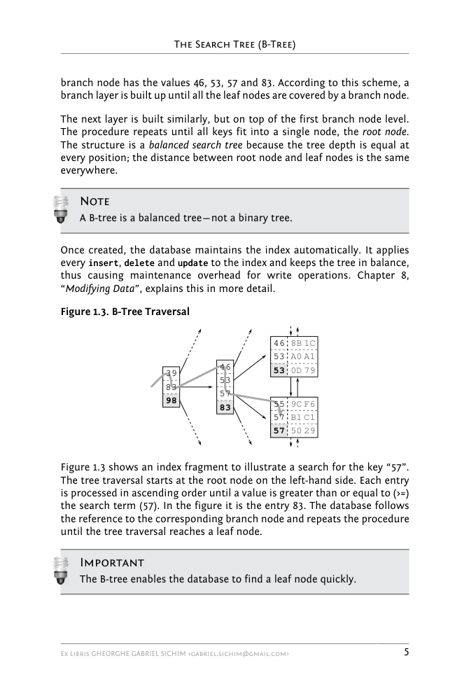
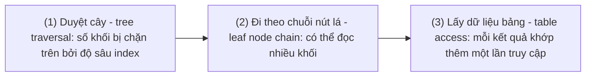

# Chương 1: Giải phẫu một Index (Chapter 1 – Anatomy of an Index)

## Mục lục

- [Chương 1: Giải phẫu một Index (Anatomy of an Index)](#chương-1-giải-phẫu-một-index-chapter-1--anatomy-of-an-index)
  - [Các nút lá của Index (The Index Leaf Nodes)](#các-nút-lá-của-index-the-index-leaf-nodes)
  - [Cây tìm kiếm (B-Tree) (The Search Tree (B-Tree))](#cây-tìm-kiếm-b-tree-the-search-tree-b-tree)
  - [Index chậm, Phần I (Slow Indexes, Part I)](#index-chậm-phần-i-slow-indexes-part-i)
  - [Bảng thuật ngữ (Glossary)](#bảng-thuật-ngữ-glossary)

---

“Index làm cho truy vấn chạy nhanh” (*An index makes the query fast*) là lời giải thích cơ bản nhất về index mà tôi từng thấy. Dù câu này mô tả rất tốt khía cạnh quan trọng nhất của một index, nhưng — thật không may — nó chưa đủ cho cuốn sách này. Chương này mô tả cấu trúc của index theo cách ít hời hợt hơn, nhưng cũng không đi quá sâu vào chi tiết. Nó chỉ cung cấp vừa đủ hiểu biết để bạn nắm được các khía cạnh hiệu năng SQL được bàn đến xuyên suốt cuốn sách.

Một index (*chỉ mục*) là một cấu trúc riêng biệt trong cơ sở dữ liệu, được tạo ra bằng câu lệnh `create index`. Nó cần không gian đĩa riêng và chứa một **bản sao** của dữ liệu bảng được đánh index. Điều đó có nghĩa là index hoàn toàn là dữ liệu dư thừa (*pure redundancy*). Việc tạo index không làm thay đổi dữ liệu của bảng; nó chỉ tạo ra một cấu trúc dữ liệu mới **tham chiếu tới** bảng. Rốt cuộc, một index trong cơ sở dữ liệu rất giống phần chỉ mục ở cuối một cuốn sách: nó chiếm chỗ riêng, nó rất dư thừa (lặp lại các từ khóa vốn đã có trong sách), và nó trỏ tới thông tin thực sự được lưu ở một nơi khác.

> 📝 **Giải thích thêm (không có trong sách):** Hình dung phần “Index” ở cuối một cuốn giáo trình: mục “B-tree … trang 4, 5, 6”. Bản thân dòng đó không chứa nội dung giảng giải về B-tree; nó chỉ là bản sao từ khóa “B-tree” + số trang để bạn lật tới. Index trong cơ sở dữ liệu cũng vậy: nó chứa bản sao giá trị cột (ví dụ `last_name`) + “địa chỉ” của dòng trong bảng. Vì là bản sao, nếu bạn xóa index đi thì dữ liệu không mất gì — chỉ là truy vấn có thể chậm hơn.

> **Clustered Index (Clustered Indexes)**
>
> SQL Server và MySQL (khi dùng InnoDB) hiểu khái niệm “index” theo nghĩa rộng hơn. Hai hệ này gọi những bảng **chỉ gồm duy nhất cấu trúc index** là *clustered index* (index cụm). Trong cơ sở dữ liệu Oracle, các bảng như vậy được gọi là *Index-Organized Table* (IOT – bảng tổ chức theo index).
>
> Chương 5, “Gom cụm dữ liệu” (*Clustering Data*), mô tả chúng chi tiết hơn và giải thích ưu, nhược điểm của chúng.

Tìm kiếm trong một index của cơ sở dữ liệu giống như tra cứu trong một cuốn danh bạ điện thoại in giấy. Ý tưởng then chốt là mọi mục đều được sắp xếp theo một **thứ tự xác định rõ ràng**. Tìm dữ liệu trong một tập dữ liệu đã sắp xếp thì nhanh và dễ, vì chính thứ tự sắp xếp quyết định vị trí của từng mục.

Tuy nhiên, một index trong cơ sở dữ liệu phức tạp hơn danh bạ in, vì nó **liên tục thay đổi**. Cập nhật một cuốn danh bạ in cho mỗi thay đổi là điều không thể, vì một lý do đơn giản: giữa các mục đã có không còn chỗ trống để chèn mục mới. Danh bạ in né vấn đề này bằng cách chỉ xử lý dồn các cập nhật tích lũy vào lần in kế tiếp. Một cơ sở dữ liệu SQL không thể đợi lâu như vậy. Nó phải xử lý các câu lệnh `insert`, `delete` và `update` **ngay lập tức**, đồng thời giữ đúng thứ tự của index mà không phải di chuyển một lượng lớn dữ liệu.

Cơ sở dữ liệu kết hợp hai cấu trúc dữ liệu để giải quyết thách thức này: một **danh sách liên kết đôi** (*doubly linked list*) và một **cây tìm kiếm** (*search tree*). Hai cấu trúc này giải thích phần lớn các đặc tính hiệu năng của cơ sở dữ liệu.

> 💡 **Ví dụ bổ sung (không có trong sách):** Giả sử có bảng `employees` và ta tạo index cho cột `last_name` (cú pháp này chạy được trên Oracle, PostgreSQL, SQL Server, MySQL, DB2):
>
> ```sql
> CREATE TABLE employees (
>    employee_id   NUMERIC       NOT NULL,
>    first_name    VARCHAR(100)  NOT NULL,
>    last_name     VARCHAR(100)  NOT NULL,
>    date_of_birth DATE          NOT NULL,
>    CONSTRAINT employees_pk PRIMARY KEY (employee_id)
> );
>
> CREATE INDEX emp_last_name ON employees (last_name);
> ```
>
> Sau lệnh `CREATE INDEX`, dữ liệu trong `employees` không hề bị sắp xếp lại (trừ khi bảng là clustered index/IOT). Cơ sở dữ liệu tạo thêm một cấu trúc mới chứa các cặp (`last_name`, địa chỉ dòng) được sắp theo `last_name`. Mỗi lần bạn `INSERT` một nhân viên mới, cơ sở dữ liệu phải ghi vào **cả** bảng **lẫn** index — đó là cái giá của sự dư thừa (Chương 8 sẽ bàn kỹ).

## Các nút lá của Index (The Index Leaf Nodes)

Mục đích chính của một index là cung cấp một **biểu diễn có thứ tự** của dữ liệu được đánh index. Tuy nhiên, không thể lưu dữ liệu một cách tuần tự (liền kề nhau theo đúng thứ tự trên bộ nhớ), vì khi đó một câu lệnh `insert` sẽ phải dời tất cả các mục đứng sau để lấy chỗ cho mục mới. Việc di chuyển lượng lớn dữ liệu rất tốn thời gian, nên câu lệnh `insert` sẽ cực kỳ chậm. Lời giải cho vấn đề này là thiết lập một **thứ tự logic** (*logical order*) độc lập với **thứ tự vật lý** (*physical order*) trong bộ nhớ.

Thứ tự logic được thiết lập thông qua một danh sách liên kết đôi. Mỗi nút (*node*) có liên kết (con trỏ) tới hai mục lân cận, rất giống một sợi xích. Các nút mới được chèn vào giữa hai nút sẵn có bằng cách cập nhật liên kết của hai nút đó sao cho chúng trỏ tới nút mới. Vị trí vật lý của nút mới không quan trọng, vì danh sách liên kết đôi đã duy trì thứ tự logic.

Cấu trúc dữ liệu này được gọi là danh sách liên kết **đôi** vì mỗi nút tham chiếu tới cả nút đứng trước lẫn nút đứng sau nó. Nhờ vậy, cơ sở dữ liệu có thể đọc index theo chiều xuôi hoặc chiều ngược tùy nhu cầu. Như thế, ta có thể chèn mục mới mà không phải di chuyển lượng lớn dữ liệu — chỉ cần thay đổi vài con trỏ.

> 📝 **Giải thích thêm (không có trong sách):** Minh họa việc chèn nút `C` vào giữa `B` và `D` trong danh sách liên kết đôi. Trước khi chèn:
>
> ```text
> [A] <-> [B] <-> [D] <-> [E]
> ```
>
> Nút `C` có thể nằm ở **bất kỳ đâu** trong bộ nhớ (ví dụ ở cuối vùng nhớ). Chỉ cần sửa 4 con trỏ: `B.next = C`, `C.prev = B`, `C.next = D`, `D.prev = C`. Sau khi chèn:
>
> ```text
> [A] <-> [B] <-> [C] <-> [D] <-> [E]     (thứ tự logic)
> ```
>
> Không có phần tử nào (`D`, `E`, …) bị dời chỗ — khác hẳn với mảng (array), nơi bạn phải dời toàn bộ phần đuôi sang phải một ô.

Danh sách liên kết đôi cũng được dùng làm cấu trúc tập hợp (*collection*, hay *container*) trong nhiều ngôn ngữ lập trình.

| Ngôn ngữ lập trình (Programming Language) | Tên (Name) |
|---|---|
| Java | `java.util.LinkedList` |
| .NET Framework | `System.Collections.Generic.LinkedList` |
| C++ | `std::list` |

Cơ sở dữ liệu dùng danh sách liên kết đôi để nối các **nút lá của index** (*index leaf nodes*) lại với nhau. Mỗi nút lá được lưu trong một **khối dữ liệu** (*database block*) hay **trang** (*page*); đó là đơn vị lưu trữ nhỏ nhất của cơ sở dữ liệu. Tất cả các khối index đều có cùng kích thước — thường là vài kilobyte. Cơ sở dữ liệu tận dụng tối đa không gian trong mỗi khối và lưu càng nhiều mục index (*index entry*) càng tốt trong mỗi khối. Điều đó có nghĩa là thứ tự của index được duy trì ở **hai cấp độ khác nhau**: thứ tự giữa các mục index **bên trong** mỗi nút lá, và thứ tự **giữa các nút lá với nhau** nhờ danh sách liên kết đôi.

> 📝 **Giải thích thêm (không có trong sách):** Kích thước khối mặc định ở một số hệ: Oracle thường 8 KB (`DB_BLOCK_SIZE`), PostgreSQL 8 KB, SQL Server 8 KB (page), MySQL InnoDB 16 KB (`innodb_page_size`), DB2 mặc định 4 KB (có thể 8/16/32 KB). Với một cột số nguyên 4 byte cộng địa chỉ dòng (~6–10 byte) và phần quản lý mỗi mục, một khối 8 KB có thể chứa vài trăm mục index.

**Hình 1.1 – Các nút lá của Index và dữ liệu bảng tương ứng (Figure 1.1 – Index Leaf Nodes and Corresponding Table Data)**



*Vẽ lại hình (ASCII):* bên trái là các **nút lá của index (đã sắp xếp)** — *Index Leaf Nodes (sorted)*, mỗi mục gồm hai phần: giá trị `column 2` (cột 2) và `ROWID`. Bên phải là **bảng (không sắp xếp)** — *Table (not sorted)*, gồm các cột `column 1`, `column 2`, `column 3`, `column 4`. Ba nút lá nối với nhau bằng mũi tên hai chiều (danh sách liên kết đôi). Mỗi mục index có mũi tên trỏ tới dòng tương ứng trong bảng.

```text
 Index Leaf Nodes (sorted)                       Table (not sorted)
 (Các nút lá – đã sắp xếp)                       (Bảng – không sắp xếp)
  column 2 | ROWID                               column1 | column2 | column3 | column4
 +----+-------+                                 +---+----+---+---+
 | 11 | 3C AF | ---> (trỏ tới dòng A|11|1|6) \  | A | 34 | 1 | 2 |   khối bảng 1
 | 13 | F3 91 | ---> (dòng A|13|7|4)          \ | A | 27 | 5 | 9 |
 | 18 | 6F B2 | ---> (dòng A|18|3|6)            +---+----+---+---+
 +----+-------+                                 | A | 39 | 2 | 5 |   khối bảng 2
       ^ |                                      | X | 21 | 7 | 2 |
       | v                                      +---+----+---+---+
 +----+-------+                                 | A | 11 | 1 | 6 |   khối bảng 3
 | 21 | 2C 50 | ---> (dòng X|21|7|2)            +---+----+---+---+
 | 27 | 0F 1B | ---> (dòng A|27|5|9)            | A | 35 | 8 | 3 |   khối bảng 4
 | 27 | 52 55 | ---> (dòng X|27|3|2)            | X | 27 | 3 | 2 |
 +----+-------+                                 +---+----+---+---+
       ^ |                                      | A | 18 | 3 | 6 |   khối bảng 5
       | v                                      | A | 13 | 7 | 4 |
 +----+-------+                                 +---+----+---+---+
 | 34 | 0D 1E | ---> (dòng A|34|1|2)
 | 35 | 44 53 | ---> (dòng A|35|8|3)
 | 39 | 24 5D | ---> (dòng A|39|2|5)
 +----+-------+
```

Bảng ánh xạ tương ứng giữa mục index và dòng trong bảng (đọc từ các mũi tên trong hình):

| Nút lá | Khóa (`column 2`) | `ROWID` | Dòng trong bảng (`column 1`, `column 2`, `column 3`, `column 4`) |
|---|---|---|---|
| 1 | 11 | 3C AF | A, 11, 1, 6 |
| 1 | 13 | F3 91 | A, 13, 7, 4 |
| 1 | 18 | 6F B2 | A, 18, 3, 6 |
| 2 | 21 | 2C 50 | X, 21, 7, 2 |
| 2 | 27 | 0F 1B | A, 27, 5, 9 |
| 2 | 27 | 52 55 | X, 27, 3, 2 |
| 3 | 34 | 0D 1E | A, 34, 1, 2 |
| 3 | 35 | 44 53 | A, 35, 8, 3 |
| 3 | 39 | 24 5D | A, 39, 2, 5 |

Hình 1.1 minh họa các nút lá của index và mối liên hệ của chúng với dữ liệu bảng. Mỗi mục index gồm các cột được đánh index (khóa – *key*, ở đây là `column 2`) và tham chiếu tới dòng tương ứng trong bảng (thông qua `ROWID` hoặc `RID` – *row identifier*, mã định danh dòng). Khác với index, dữ liệu bảng được lưu trong một cấu trúc **heap** (*đống* – lưu không theo thứ tự) và hoàn toàn không được sắp xếp. Không có mối quan hệ nào giữa các dòng được lưu trong cùng một khối của bảng, cũng như không có liên kết nào giữa các khối với nhau.

> 💡 **Ví dụ bổ sung (không có trong sách):** Hãy để ý trong Hình 1.1: ba mục liên tiếp trong nút lá đầu tiên (11, 13, 18) trỏ tới **hai khối bảng khác nhau** (khối 3 và khối 5); ba mục trong nút lá thứ ba (34, 35, 39) trỏ tới **ba khối khác nhau**. Nghĩa là đọc 3 mục index liền nhau (rẻ, cùng một khối index) có thể dẫn tới phải đọc 3 khối bảng khác nhau (đắt). Đây chính là “nguyên liệu” thứ hai gây ra index chậm được nói tới trong mục “Index chậm, Phần I” bên dưới.
>
> Bạn có thể tự “nhìn thấy” địa chỉ dòng ở một số hệ:
>
> ```sql
> -- Oracle: ROWID
> SELECT ROWID, last_name FROM employees WHERE last_name = 'WINAND';
>
> -- PostgreSQL: ctid = (số trang, vị trí trong trang)
> SELECT ctid, last_name FROM employees WHERE last_name = 'WINAND';
> ```
>
> Trong PostgreSQL, `ctid` có dạng `(42,7)`: dòng thứ 7 trong trang số 42 của heap. Đó chính là thứ mà mục index lưu để trỏ về bảng.

## Cây tìm kiếm (B-Tree) (The Search Tree (B-Tree))

Các nút lá của index được lưu theo một thứ tự tùy ý — vị trí trên đĩa không tương ứng với vị trí logic theo thứ tự của index. Nó giống như một cuốn danh bạ điện thoại có các trang bị xáo trộn. Nếu bạn tìm “Smith” nhưng lần đầu lật danh bạ ra trang “Robinson”, thì hoàn toàn không có gì bảo đảm rằng trang Smith nằm ngay sau trang Robinson. Cơ sở dữ liệu cần một cấu trúc thứ hai để nhanh chóng tìm ra mục cần tìm giữa các trang bị xáo trộn đó: một **cây tìm kiếm cân bằng** (*balanced search tree*) — gọi tắt là **B-tree**.

**Hình 1.2 – Cấu trúc B-tree (Figure 1.2 – B-tree Structure)**



*Mô tả hình:* Bên phải là hình thu nhỏ của **toàn bộ** index gồm ba cột/tầng, có nhãn: *Root Node* (nút gốc), *Branch Nodes* (các nút nhánh), *Leaf Nodes* (các nút lá). Một vòng tròn khoanh một phần của cây và được phóng to ở bên trái. Phần phóng to có hai vùng, ngăn bởi đường chấm: *Branch Node* (một nút nhánh) bên trái và *Leaf Nodes* (các nút lá) bên phải. Nút nhánh chứa 46, 53, 57, **83**; mỗi giá trị có mũi tên trỏ tới một nút lá. Bốn nút lá nối nhau bằng mũi tên hai chiều (danh sách liên kết đôi); mỗi mục lá gồm khóa và ROWID (chữ màu xám), mục cuối cùng (lớn nhất) của mỗi nút lá được tô đậm.

*Vẽ lại phần phóng to (ASCII):*

```text
   Branch Node        |           Leaf Nodes
   (nút nhánh)        |           (các nút lá)
                      |
                      |      +----+-------+
                 +----------->| 40 | 4A 1B |
                 |    |      | 43 | 9F 71 |
                 |    |      | 46 | A2 D2 |   <- lớn nhất = 46
                 |    |      +----+-------+
   +----+        |    |             ^ |
   | 46 |--------+    |             | v
   | 53 |-------------------->+----+-------+
   | 57 |-------+     |      | 46 | 8B 1C |
-->| 83 |---+   |     |      | 53 | A0 A1 |
   +----+   |   |     |      | 53 | 0D 79 |   <- lớn nhất = 53
            |   |     |      +----+-------+
            |   |     |             ^ |
            |   |     |             | v
            |   +--------------->+----+-------+
            |         |      | 55 | 9C F6 |
            |         |      | 57 | B1 C1 |
            |         |      | 57 | 50 29 |   <- lớn nhất = 57
            |         |      +----+-------+
            |         |             ^ |
            |         |             | v
            +------------------->+----+-------+
                      |      | 67 | C4 6B |
                      |      | 83 | FF 9D |
                      |      | 83 | AF E9 |   <- lớn nhất = 83
                      |      +----+-------+
```

*Vẽ lại toàn bộ cây (30 mục, độ sâu 3) bằng mermaid* — dựa trên dữ liệu của hình thu nhỏ bên phải:



Dữ liệu đầy đủ của các nút lá trong hình thu nhỏ (khóa | ROWID):

| Nút lá | Mục 1 | Mục 2 | Mục 3 | Nút nhánh cha |
|---|---|---|---|---|
| 1 | 11 \| 3C AF | 13 \| F3 91 | 18 \| 6F B2 | 18, 27, 39 |
| 2 | 21 \| 2C 50 | 27 \| 0F 1B | 27 \| 52 55 | 18, 27, 39 |
| 3 | 34 \| 0D 1E | 35 \| 44 53 | 39 \| 24 5D | 18, 27, 39 |
| 4 | 40 \| 4A 1B | 43 \| 9F 71 | 46 \| A2 D2 | 46, 53, 57, 83 |
| 5 | 46 \| 8B 1C | 53 \| A0 A1 | 53 \| 0D 79 | 46, 53, 57, 83 |
| 6 | 55 \| 9C F6 | 57 \| B1 C1 | 57 \| 50 29 | 46, 53, 57, 83 |
| 7 | 67 \| C4 6B | 83 \| FF 9D | 83 \| AF E9 | 46, 53, 57, 83 |
| 8 | 84 \| 80 64 | 86 \| 4C 2F | 88 \| 06 5B | 88, 94, 98 |
| 9 | 89 \| 6A 3E | 90 \| 7D 9A | 94 \| 36 D4 | 88, 94, 98 |
| 10 | 95 \| EA 37 | 98 \| 5E B2 | 98 \| D8 4F | 88, 94, 98 |

Nút gốc: 39, 83, 98.

Hình 1.2 cho thấy một index ví dụ với 30 mục. Danh sách liên kết đôi thiết lập thứ tự logic giữa các nút lá. Nút gốc (*root node*) và các nút nhánh (*branch node*) hỗ trợ việc tìm kiếm nhanh giữa các nút lá.

Hình làm nổi bật một nút nhánh và các nút lá mà nó trỏ tới. Mỗi mục trong nút nhánh tương ứng với **giá trị lớn nhất** trong nút lá mà nó trỏ tới. Cụ thể, giá trị lớn nhất trong nút lá đầu tiên là 46, nên mục đầu tiên của nút nhánh cũng là 46. Điều tương tự đúng với các nút lá còn lại, nên cuối cùng nút nhánh có các giá trị 46, 53, 57 và 83. Theo cách này, một tầng nhánh (*branch layer*) được dựng lên cho tới khi mọi nút lá đều được một nút nhánh bao phủ.

Tầng tiếp theo được dựng tương tự, nhưng nằm trên tầng nút nhánh thứ nhất. Quy trình lặp lại cho tới khi tất cả các khóa vừa trong một nút duy nhất — đó là **nút gốc** (*root node*). Cấu trúc này là một **cây tìm kiếm cân bằng** vì độ sâu của cây (*tree depth*) là như nhau ở mọi vị trí; khoảng cách giữa nút gốc và các nút lá ở đâu cũng bằng nhau.

> **Ghi chú (Note)**
>
> B-tree là một cây **cân bằng** (*balanced tree*) — **không phải** cây nhị phân (*binary tree*).

> 📝 **Giải thích thêm (không có trong sách):** Chữ “B” trong B-tree thường được hiểu là *balanced* (cân bằng) chứ không phải *binary* (nhị phân). Cây nhị phân chỉ có tối đa 2 nhánh con mỗi nút; nút của B-tree trong cơ sở dữ liệu có thể có **hàng trăm** nhánh con (bằng số mục chứa vừa trong một khối). Chính vì vậy cây rất “thấp và rộng”. Nói chính xác, đa số cơ sở dữ liệu cài đặt biến thể **B+-tree**: dữ liệu (khóa + ROWID) chỉ nằm ở tầng lá, và các nút lá được nối với nhau — đúng như cấu trúc mô tả trong chương này.

Một khi đã được tạo, index được cơ sở dữ liệu **tự động bảo trì**. Cơ sở dữ liệu áp dụng mọi câu lệnh `insert`, `delete` và `update` vào index và giữ cho cây luôn cân bằng, do đó gây ra **chi phí bảo trì** (*maintenance overhead*) cho các thao tác ghi. Chương 8, “Sửa đổi dữ liệu” (*Modifying Data*), sẽ giải thích chi tiết hơn về điều này.

**Hình 1.3 – Duyệt B-Tree (Figure 1.3 – B-Tree Traversal)**



*Mô tả hình:* Một mảnh (*fragment*) của index. Bên trái là nút gốc gồm 39, 83, **98**; ở giữa là nút nhánh 46, 53, 57, **83**; bên phải là hai nút lá (46 | 8B 1C, 53 | A0 A1, **53** | 0D 79) và (55 | 9C F6, 57 | B1 C1, **57** | 50 29) nối với nhau bằng mũi tên hai chiều. Các mũi tên nét đứt chỉ ra những phần khác của cây không được vẽ. Một đường màu xám dày thể hiện **đường đi của phép duyệt**: đi vào nút gốc, dừng ở mục 83, đi sang nút nhánh, dừng ở mục 57, rồi đi xuống nút lá chứa 55, 57, 57.

*Vẽ lại hình (ASCII), đường duyệt được đánh dấu bằng `==>`:*

```text
                         ...                       +----+-------+
                          ^                        | 46 | 8B 1C |
                          :                        | 53 | A0 A1 |
     Root (gốc)           :   Branch (nhánh)        | 53 | 0D 79 |
     +----+              +----+                   +----+-------+
     | 39 |              | 46 |                         ^ |
 ==> | 83 | ===========> | 53 |                         | v
     | 98 |              | 57 | ===============> +----+-------+
     +----+              | 83 |                  | 55 | 9C F6 |
       :                 +----+                  | 57 | B1 C1 |  <== tìm thấy 57
       v                   :                     | 57 | 50 29 |
      ...                  v                     +----+-------+
                          ...
```

Hình 1.3 cho thấy một mảnh của index để minh họa việc tìm kiếm khóa “57”. Phép duyệt cây (*tree traversal*) bắt đầu từ nút gốc ở phía bên trái. Các mục được xét lần lượt theo thứ tự tăng dần cho tới khi gặp một giá trị **lớn hơn hoặc bằng** (`>=`) từ khóa tìm kiếm (57). Trong hình, đó là mục 83. Cơ sở dữ liệu đi theo tham chiếu tới nút nhánh tương ứng và lặp lại quy trình cho tới khi phép duyệt cây chạm tới một nút lá.

> **Quan trọng (Important)**
>
> B-tree giúp cơ sở dữ liệu tìm ra một nút lá một cách nhanh chóng.

> 💡 **Ví dụ bổ sung (không có trong sách):** Hãy tự duyệt cây trong Hình 1.2 để tìm khóa **90**:
>
> 1. **Nút gốc** (39, 83, 98): 39 < 90, 83 < 90, 98 ≥ 90 → đi theo mục **98** xuống nút nhánh thứ ba.
> 2. **Nút nhánh** (88, 94, 98): 88 < 90, 94 ≥ 90 → đi theo mục **94** xuống nút lá thứ 9.
> 3. **Nút lá** (89, 90, 94): tìm thấy `90 | 7D 9A`. ROWID `7D 9A` cho biết dòng nằm ở đâu trong bảng.
>
> Chỉ cần đọc **3 khối** (gốc → nhánh → lá), dù index có 30 hay 30 triệu mục thì số khối đọc trong bước này cũng chỉ bằng độ sâu của cây. Với khóa **27**: gốc → mục 39 → nhánh (18, 27, 39) → mục 27 → nút lá 2 (21, 27, 27). Vì có hai mục 27, cơ sở dữ liệu còn phải xem tiếp nút lá kế bên — điều này dẫn ta tới mục tiếp theo.

Phép duyệt cây là một thao tác cực kỳ hiệu quả — hiệu quả đến mức tôi gọi nó là **sức mạnh thứ nhất của việc đánh index** (*the first power of indexing*). Nó hoạt động gần như tức thì — ngay cả trên một tập dữ liệu khổng lồ. Điều đó trước hết là nhờ **sự cân bằng của cây**, cho phép truy cập mọi phần tử với cùng một số bước, và thứ hai là nhờ **độ sâu của cây tăng theo hàm logarit** (*logarithmic growth*). Nghĩa là độ sâu của cây tăng rất chậm so với số lượng nút lá. Các index thực tế với hàng triệu bản ghi có độ sâu cây là bốn hoặc năm. Độ sâu sáu thì hầu như hiếm khi thấy. Hộp “Khả năng mở rộng theo logarit” (*Logarithmic Scalability*) bên dưới mô tả điều này chi tiết hơn.

> 📝 **Giải thích thêm (không có trong sách) — Đối chiếu với PostgreSQL hiện đại (PG 10–17): Cấu trúc B-Tree (`nbtree`) theo thuật toán Lehman & Yao và cuộc cách mạng ở PostgreSQL 12, 13, 14+**
>
> Khi cuốn sách này ra đời (năm 2012, thời điểm **PostgreSQL 9.1 / 9.2**), cài đặt B-Tree của PostgreSQL (`nbtree` — dựa trên thuật toán **Lehman & Yao High-Concurrency B-Tree**, bổ sung con trỏ `right-link` và khóa `high key` ở mỗi trang để đọc/tách trang đồng thời mà không cần khóa toàn bộ cây) vẫn mang ba nhược điểm lớn khi xử lý các khóa trùng lặp (*duplicate keys*) và cập nhật MVCC:
> 1. Các mục index có cùng giá trị khóa được lưu theo thứ tự ngẫu nhiên, mỗi dòng chiếm một `IndexTuple` riêng biệt (lặp lại giá trị khóa hàng nghìn lần).
> 2. Ở các nút nhánh (*branch/internal pages*), PostgreSQL lưu toàn bộ các cột của index ngay cả khi chỉ cần cột đầu tiên là đủ để phân nhánh.
> 3. Khi một dòng trong bảng bị `UPDATE`, mô hình MVCC của PostgreSQL tạo một phiên bản dòng mới (*new heap tuple*) và phải chèn thêm mục index mới vào B-Tree (trừ khi thỏa mãn điều kiện **HOT — Heap-Only Tuple**). Các mục index cũ trỏ tới tuple đã chết (*dead tuples*) tích tụ làm tách trang (*page split*) và phình to index (*index bloat*).
>
> Từ **PostgreSQL 12 đến PostgreSQL 14+**, kiến trúc `nbtree` đã được đại tu toàn diện qua ba cột mốc lịch sử:
>
> | Phiên bản | Tính năng đột phá trong `nbtree` | Cơ chế hoạt động & Tác động thực tế |
> |---|---|---|
> | **PostgreSQL 12** | **Sắp xếp khóa trùng theo `ctid` & Cắt hậu tố (*Suffix Truncation*)** | • Mọi mục index có cùng giá trị khóa được sắp xếp định sẵn theo địa chỉ vật lý `ctid` tăng dần. Nhờ đó, mỗi mục index thực chất là **duy nhất** $(key, ctid)$, triệt tiêu hiện tượng tách trang 50/50 lãng phí khi chèn hàng loạt giá trị trùng và giúp gom cụm lần đọc heap.<br>• **Suffix Truncation**: Khi tách nút lá của index nhiều cột `(a, b, c)`, nút nhánh cha chỉ lưu các cột tiền tố tối thiểu đủ để phân biệt hai nút lá (ví dụ chỉ lưu `(a)` thay vì `(a, b, c)`), giúp nút nhánh chứa được nhiều con trỏ hơn (*fan-out* cao hơn) và giảm độ sâu của cây! |
> | **PostgreSQL 13** | **Khử trùng lặp B-Tree (*B-Tree Deduplication*)** | • Khi nhiều dòng có cùng giá trị khóa (ví dụ cột `status`, `subsidiary_id`, khóa ngoại), thay vì lưu $N$ mục `(key, ctid)` lặp lại, PostgreSQL 13+ nén chúng thành một **Posting List Tuple** duy nhất dạng: `key -> [ctid_1, ctid_2, ..., ctid_n]`.<br>• Mỗi `ctid` tiếp theo chỉ tốn đúng **6 byte** (không tốn thêm 16 byte header `IndexTupleData` + kích thước khóa lặp lại). Kết quả: giảm **50%–75% dung lượng index** trên đĩa và trong `shared_buffers`! |
> | **PostgreSQL 14** | **Dọn rác từ dưới lên (*Bottom-Up Index Deletion*)** | • Trước khi tách một trang lá sắp đầy do các lệnh `UPDATE` (không đủ điều kiện HOT vì sửa cột có index khác), PostgreSQL 14+ chủ động kiểm tra bảng heap ngay lập tức để xóa các mục index trỏ tới *dead tuples* của các phiên bản giao dịch cũ.<br>• Ngăn chặn hoàn toàn việc tách trang không cần thiết và giữ kích thước B-Tree ổn định ngay cả khi `autovacuum` chưa kịp chạy! |
>
> *Minh họa trực quan sự khác biệt trong nút lá B-Tree giữa PostgreSQL 9.x–12 và PostgreSQL 13+ (Deduplication):*
>
> ```text
> Trước PostgreSQL 13 (mỗi dòng lặp lại cả Header 8B + Key + CTID 6B, căn chỉnh 8-byte):
> +-----------------------------------------------------------------------+
> | Leaf Page                                                             |
> | [Hdr|Key='ACTIVE'|ctid=(1,2)] [Hdr|Key='ACTIVE'|ctid=(1,9)] [Hdr|...] |
> +-----------------------------------------------------------------------+
>
> Từ PostgreSQL 13+ (B-Tree Deduplication — gộp thành Posting List Tuple):
> +-----------------------------------------------------------------------+
> | Leaf Page                                                             |
> | [Hdr | Key='ACTIVE' | Posting List: (1,2), (1,9), (4,3), (8,1), ... ] |
> +-----------------------------------------------------------------------+
> ```

> 💡 **Ví dụ bổ sung (không có trong sách) — Thực hành trên PostgreSQL: Kiểm chứng B-Tree Deduplication (PG 13+) bằng `pageinspect`**
>
> Bạn có thể tự kiểm chứng cơ chế nén Posting List của PostgreSQL 13+ bằng cách tạo một bảng có cột độ chọn lọc thấp (`subsidiary_id`), bật/tắt tham số lưu trữ `deduplicate_items` và so sánh kích thước thực tế lẫn cấu trúc trang lá:
>
> ```sql
> CREATE EXTENSION IF NOT EXISTS pageinspect;
>
> CREATE TABLE emp_btree_demo (
>     employee_id   INT GENERATED ALWAYS AS IDENTITY PRIMARY KEY,
>     subsidiary_id INT NOT NULL,
>     status        VARCHAR(20) NOT NULL
> );
>
> -- Chèn 100.000 dòng nhưng chỉ có 10 công ty con và 3 trạng thái
> INSERT INTO emp_btree_demo (subsidiary_id, status)
> SELECT (g % 10) + 1,
>        (ARRAY['ACTIVE', 'ON_LEAVE', 'TERMINATED'])[(g % 3) + 1]
>   FROM generate_series(1, 100000) AS g;
>
> -- 1. Index kiểu cũ (tắt deduplication — mô phỏng hành vi PG 12 trở về trước)
> CREATE INDEX idx_status_no_dedup ON emp_btree_demo (status)
>   WITH (deduplicate_items = off);
>
> -- 2. Index mặc định trên PostgreSQL 13–17 (bật deduplication)
> CREATE INDEX idx_status_dedup ON emp_btree_demo (status)
>   WITH (deduplicate_items = on);
>
> -- So sánh kích thước hai index
> SELECT indexrelname AS index_name,
>        pg_size_pretty(pg_relation_size(indexrelid)) AS index_size,
>        (bt_metap(indexrelname)).level AS tree_level
>   FROM pg_stat_user_indexes
>  WHERE relname = 'emp_btree_demo';
> ```
>
> Kết quả thực tế trên PostgreSQL 16/17:
>
> ```text
>       index_name      | index_size | tree_level
> ----------------------+------------+------------
>  idx_status_no_dedup  | 3088 kB    |          2
>  idx_status_dedup     | 728 kB     |          1
> ```
>
> Index có Deduplication nhỏ hơn **hơn 4 lần** (`728 kB` so với `3088 kB`) và độ sâu cây giảm từ `level = 2` (3 tầng) xuống `level = 1` (2 tầng)! Khi soi vào trang lá đầu tiên bằng `bt_page_items`:
>
> ```sql
> SELECT itemoffset, itemlen, htid, tids[1:5] AS first_5_ctids, array_length(tids, 1) AS num_ctids
>   FROM bt_page_items('idx_status_dedup', 1)
>  LIMIT 4;
> ```
>
> ```text
>  itemoffset | itemlen |  htid   |            first_5_ctids             | num_ctids
> ------------+---------+---------+--------------------------------------+-----------
>           1 |      16 | (376,2) |                                      |      NULL  -- High Key của trang
>           2 |    2456 | (0,3)   | {"(0,3)","(0,6)","(0,9)","(0,12)",…} |       406  -- 1 Posting Tuple chứa 406 ctid!
>           3 |    2456 | (6,93)  | {"(6,93)","(6,96)","(6,99)",…}       |       406
>           4 |    2456 | (13,26) | {"(13,26)","(13,29)","(13,32)",…}    |       406
> ```

## Index chậm, Phần I (Slow Indexes, Part I)

Bất chấp sự hiệu quả của phép duyệt cây, vẫn có những trường hợp mà việc tra cứu bằng index (*index lookup*) không chạy nhanh như mong đợi. Sự mâu thuẫn này từ lâu đã nuôi dưỡng huyền thoại về “index bị thoái hóa” (*degenerated index*). Huyền thoại đó tuyên bố rằng xây dựng lại index (*index rebuild*) là giải pháp thần kỳ. Lý do thực sự khiến những câu lệnh tầm thường vẫn có thể chạy chậm — ngay cả khi có dùng index — có thể được giải thích dựa trên các mục trước.

**Nguyên liệu thứ nhất** cho một lần tra cứu index chậm là **chuỗi nút lá** (*leaf node chain*). Hãy xét lại việc tìm “57” trong Hình 1.3. Rõ ràng có hai mục khớp trong index. Nói chính xác hơn thì *ít nhất* có hai mục như vậy: nút lá kế tiếp có thể còn chứa thêm các mục “57” nữa. Cơ sở dữ liệu **phải đọc nút lá kế tiếp** để xem còn mục nào khớp hay không. Điều đó có nghĩa là một lần tra cứu index không chỉ cần thực hiện phép duyệt cây, mà còn cần **đi theo chuỗi nút lá**.

**Nguyên liệu thứ hai** cho một lần tra cứu index chậm là **truy cập bảng** (*accessing the table*). Ngay cả một nút lá duy nhất cũng có thể chứa rất nhiều kết quả khớp (*hit*) — thường là hàng trăm. Dữ liệu bảng tương ứng thường nằm rải rác trên nhiều khối của bảng (xem Hình 1.1, “Các nút lá của Index và dữ liệu bảng tương ứng”). Điều đó có nghĩa là với **mỗi** kết quả khớp lại có thêm một lần truy cập bảng.

Một lần tra cứu index cần **ba bước**: (1) duyệt cây; (2) đi theo chuỗi nút lá; (3) lấy dữ liệu từ bảng. Phép duyệt cây là bước **duy nhất** có giới hạn trên cho số khối phải truy cập — chính là độ sâu của index. Hai bước còn lại có thể phải truy cập rất nhiều khối — chúng là nguyên nhân gây ra một lần tra cứu index chậm.



> **Khả năng mở rộng theo logarit (Logarithmic Scalability)**
>
> Trong toán học, logarit của một số theo một cơ số cho trước là lũy thừa hay số mũ mà cơ số phải được nâng lên để tạo ra số đó [Wikipedia¹].
>
> Trong một cây tìm kiếm, **cơ số** tương ứng với số mục trên mỗi nút nhánh, còn **số mũ** tương ứng với độ sâu của cây. Index ví dụ trong Hình 1.2 chứa tối đa bốn mục mỗi nút và có độ sâu cây là ba. Điều đó có nghĩa là index có thể chứa tối đa 64 (4³) mục. Nếu nó tăng thêm một tầng, nó đã có thể chứa 256 mục (4⁴). Mỗi lần thêm một tầng, số mục index tối đa tăng gấp bốn lần. Logarit là phép đảo ngược của hàm này. Do đó, độ sâu của cây là log₄(số-mục-index) — *log4(number-of-index-entries)*.
>
> Sự tăng trưởng theo logarit cho phép index ví dụ tìm kiếm trong một triệu bản ghi chỉ với mười tầng cây, nhưng một index thực tế còn hiệu quả hơn nhiều. Yếu tố chính ảnh hưởng tới độ sâu cây, và do đó ảnh hưởng tới hiệu năng tra cứu, là **số mục trong mỗi nút của cây**. Nói theo ngôn ngữ toán học, con số này tương ứng với cơ số của logarit. Cơ số càng lớn, cây càng nông, phép duyệt càng nhanh.
>
> | Độ sâu cây (Tree Depth) | Số mục index (Index Entries) |
> |---:|---:|
> | 3 | 64 |
> | 4 | 256 |
> | 5 | 1,024 |
> | 6 | 4,096 |
> | 7 | 16,384 |
> | 8 | 65,536 |
> | 9 | 262,144 |
> | 10 | 1,048,576 |
>
> Các cơ sở dữ liệu khai thác ý tưởng này tới mức tối đa và nhét càng nhiều mục càng tốt vào mỗi nút — thường là hàng trăm. Điều đó có nghĩa là mỗi tầng index mới hỗ trợ số mục nhiều hơn gấp một trăm lần.
>
> ¹ http://en.wikipedia.org/wiki/Logarithm

> 💡 **Ví dụ bổ sung (không có trong sách):** So sánh cơ số 4 (index ví dụ) với cơ số 300 (gần với index thực tế, khi mỗi khối 8 KB chứa khoảng 300 mục):
>
> | Độ sâu | Cơ số 4 (4ⁿ) | Cơ số 300 (300ⁿ) |
> |---:|---:|---:|
> | 1 | 4 | 300 |
> | 2 | 16 | 90,000 |
> | 3 | 64 | 27,000,000 |
> | 4 | 256 | 8,100,000,000 |
>
> Với cơ số 300, chỉ 4 tầng đã đủ cho 8,1 tỷ mục. Đó là lý do tác giả nói index thực tế với hàng triệu bản ghi chỉ sâu 4–5 tầng. Bạn có thể xem độ sâu thật của index:
>
> ```sql
> -- Oracle: BLEVEL = số tầng nhánh (độ sâu = BLEVEL + 1)
> SELECT index_name, blevel, leaf_blocks
>   FROM user_indexes
>  WHERE table_name = 'EMPLOYEES';
>
> -- PostgreSQL (cần extension pageinspect): level của nút gốc
> CREATE EXTENSION IF NOT EXISTS pageinspect;
> SELECT level FROM bt_metap('emp_last_name');
> ```

Nguồn gốc của huyền thoại “index chậm” là niềm tin sai lầm rằng một lần tra cứu index **chỉ** duyệt cây, từ đó nảy ra ý nghĩ rằng một index chậm hẳn phải do cây bị “hỏng” (*broken*) hoặc “mất cân bằng” (*unbalanced*). Sự thật là bạn hoàn toàn có thể hỏi đa số cơ sở dữ liệu xem chúng sử dụng index như thế nào. Cơ sở dữ liệu Oracle khá “nói nhiều” về mặt này và có ba thao tác (*operation*) riêng biệt mô tả một lần tra cứu index cơ bản:

**`INDEX UNIQUE SCAN`**
: Thao tác `INDEX UNIQUE SCAN` chỉ thực hiện phép duyệt cây. Cơ sở dữ liệu Oracle dùng thao tác này nếu một ràng buộc duy nhất (*unique constraint*) bảo đảm rằng tiêu chí tìm kiếm sẽ khớp với không quá một mục.

**`INDEX RANGE SCAN`**
: Thao tác `INDEX RANGE SCAN` thực hiện phép duyệt cây **và** đi theo chuỗi nút lá để tìm tất cả các mục khớp. Đây là thao tác dự phòng (*fallback*) khi có khả năng nhiều mục cùng khớp với tiêu chí tìm kiếm.

**`TABLE ACCESS BY INDEX ROWID`**
: Thao tác `TABLE ACCESS BY INDEX ROWID` lấy dòng dữ liệu từ bảng. Thao tác này (thường) được thực hiện cho **mỗi** bản ghi khớp từ một thao tác quét index (*index scan*) đứng trước nó.

Điểm quan trọng là một `INDEX RANGE SCAN` có khả năng đọc một phần lớn của index. Nếu với mỗi dòng lại có thêm một lần truy cập bảng, thì truy vấn có thể trở nên chậm **ngay cả khi có dùng index**.

> 📝 **Giải thích thêm (không có trong sách):** Ánh xạ ba thao tác của Oracle sang ba bước tra cứu index ở trên:
>
> | Thao tác Oracle | Bước (1) duyệt cây | Bước (2) chuỗi nút lá | Bước (3) truy cập bảng |
> |---|---|---|---|
> | `INDEX UNIQUE SCAN` | ✔ | – | – |
> | `INDEX RANGE SCAN` | ✔ | ✔ | – |
> | `TABLE ACCESS BY INDEX ROWID` | – | – | ✔ |
>
> Tên gọi tương đương ở các hệ khác (gần đúng): PostgreSQL dùng `Index Scan` (gộp cả quét index lẫn đọc heap), `Index Only Scan` (không cần đọc bảng), `Bitmap Index Scan` + `Bitmap Heap Scan`; SQL Server dùng `Index Seek` (duyệt cây + quét dải) và `Key Lookup`/`RID Lookup` (truy cập bảng); MySQL `EXPLAIN` hiển thị cột `type` là `const`/`eq_ref` (khớp duy nhất) hoặc `ref`/`range` (quét dải).

> 💡 **Ví dụ bổ sung (không có trong sách):** Dùng bảng `employees` (giả sử 1.000.000 dòng) với index `emp_last_name` trên `last_name` như ở đầu chương. Xét hai truy vấn trên Oracle:
>
> ```sql
> -- Truy vấn A: tìm theo khóa chính
> SELECT * FROM employees WHERE employee_id = 123;
>
> -- Truy vấn B: tìm theo họ
> SELECT * FROM employees WHERE last_name = 'NGUYEN';
> ```
>
> - **Truy vấn A** dùng index `employees_pk` (duy nhất) → `INDEX UNIQUE SCAN` (chỉ duyệt cây, khoảng 3–4 khối) + một lần `TABLE ACCESS BY INDEX ROWID`. Luôn nhanh, bất kể bảng to cỡ nào.
> - **Truy vấn B** dùng `emp_last_name` (không duy nhất) → `INDEX RANGE SCAN` + `TABLE ACCESS BY INDEX ROWID`. Nếu có 40.000 người họ “NGUYEN”, cơ sở dữ liệu phải đi qua hàng trăm nút lá **và** có thể thực hiện tới 40.000 lần đọc khối bảng nằm rải rác. Truy vấn có thể mất vài giây dù “có dùng index”, và việc rebuild index **không giúp được gì**, vì cây vốn luôn cân bằng — thứ tốn kém là bước (2) và (3).
>
> Plan của truy vấn B có dạng (minh họa):
>
> ```text
> ---------------------------------------------------------------
> | Id | Operation                   | Name          | Rows  |
> ---------------------------------------------------------------
> |  0 | SELECT STATEMENT            |               | 40000 |
> |  1 |  TABLE ACCESS BY INDEX ROWID| EMPLOYEES     | 40000 |
> |* 2 |   INDEX RANGE SCAN          | EMP_LAST_NAME | 40000 |
> ---------------------------------------------------------------
> ```

> 📝 **Giải thích thêm (không có trong sách) — Đối chiếu với PostgreSQL hiện đại (PG 10–17): Toàn cảnh 6 loại Index trong PostgreSQL (vượt xa B-Tree truyền thống)**
>
> Xuyên suốt cuốn sách, Markus Winand tập trung vào **B-Tree** vì đó là cấu trúc index phổ quát nhất trên mọi hệ quản trị cơ sở dữ liệu quan hệ. Tuy nhiên, một trong những thế mạnh kiến trúc vĩ đại nhất của PostgreSQL là giao diện **Index Access Method (AM) khả mở** — cho phép cung cấp tới **6 loại index tích hợp sẵn** (cùng các index mở rộng như `bloom`, `hnsw`/`ivfflat` của `pgvector`).
>
> Đặc biệt, nhiều loại index từng bị hạn chế nặng nề ở thời PostgreSQL 9.1 (năm 2012) nay đã trưởng thành vượt bậc từ **PostgreSQL 10 đến 17**:
> - **Hash Index**: Thời PostgreSQL 9.x, Hash Index **không được ghi WAL** (*not WAL-logged*, nghĩa là nếu DB sập thì hỏng index, không dùng được với Streaming Replication) nên luôn bị khuyên tránh xa. Từ **PostgreSQL 10+**, Hash Index đã được **WAL-logged an toàn 100%**, chỉ lưu mã băm 4-byte (32-bit) trong các bucket thay vì lưu toàn bộ giá trị cột như B-Tree!
> - **BRIN (Block Range Index)**: Ra mắt ở **PostgreSQL 9.5**, bổ sung `autosummarize` ở **PostgreSQL 10**, và đại tu ở **PostgreSQL 14+** với hai lớp toán tử mới: **`minmax-multi`** (lưu nhiều khoảng min/max trong một dải block cho dữ liệu hơi xáo trộn) và **`bloom`** (dùng bộ lọc Bloom cho phép tìm kiếm `=` trên dữ liệu phân tán trong dải block).
>
> **Bảng đối chiếu khi nào chọn loại Index nào trong PostgreSQL hiện đại (PG 10–17):**
>
> | Loại Index | Cấu trúc cốt lõi | Toán tử hỗ trợ | Kích thước tương đối | Khi nào nên chọn trong thực tế? |
> |---|---|---|---|---|
> | **B-Tree** *(mặc định)* | Cây cân bằng Lehman & Yao (`nbtree`), có Deduplication (PG 13+) | `=`, `<`, `<=`, `>`, `>=`, `BETWEEN`, `IN`, `IS NULL`, `LIKE 'abc%'`, `ORDER BY` | Trung bình (15%–30% bảng) | Mặc định cho 90% trường hợp: khóa chính, khóa ngoại, cột số/chuỗi/ngày tháng cần cả tìm chính xác, quét khoảng lẫn sắp xếp. |
> | **Hash** *(WAL-logged từ PG 10+)* | Bảng băm động chia bucket, chỉ lưu mã băm 32-bit (4 byte) và `ctid` | **Chỉ duy nhất `=`** | **Rất nhỏ** với cột dài (nhỏ hơn B-Tree 40%–70% trên URL/UUID/SHA256) | Tra cứu điểm (`=`) trên chuỗi rất dài (URL, token, mã hash, email dài) mà không bao giờ cần `ORDER BY` hay `<`, `>`. Duyệt O(1) không phụ thuộc độ sâu cây. |
> | **GIN** *(Generalized Inverted Index)* | Chỉ mục đảo: mỗi phần tử (*element/lexeme/trigram*) trỏ tới danh sách `ctid` (nén Varbyte) | `@>`, `<@`, `?`, `?&`, `?|`, `@@` (FTS), `LIKE`/`ILIKE '%abc%'` (với `pg_trgm`) | Lớn (tùy số phần tử trong mỗi dòng; có `fastupdate` buffer) | Dữ liệu đa giá trị trong 1 ô: **`JSONB`**, mảng (`ARRAY`), **Full-Text Search** (`tsvector`), hoặc tìm chuỗi con bất kỳ `%abc%` với `pg_trgm`. |
> | **GiST** *(Generalized Search Tree)* | Cây tìm kiếm tổng quát cho các hình học/khoảng chồng lấp nhau | `&&` (giao nhau), `@>`, `<@`, `<->` (KNN khoảng cách gần nhất) | Trung bình – Lớn | Kiểu khoảng (**Range / Multirange PG 14+**: `tstzrange`, `int4range`), **ràng buộc loại trừ (`EXCLUDE USING gist`)** chống trùng lịch đặt phòng, tọa độ địa lý **PostGIS**. |
> | **SP-GiST** *(Space-Partitioned GiST)* | Cây phân hoạch không gian không chồng lấp (Trie / Radix tree, Quadtree, k-d tree) | `=`, `^@` (`starts_with`), `<->`, các toán tử `inet` (`<<`, `>>`) | Nhỏ – Trung bình | Dữ liệu có tiền tố lặp lại cao hoặc phân hoạch không gian tự nhiên: địa chỉ IP (`inet`/`cidr`), chuỗi có chung prefix dài, điểm 2D phân bố lệch. |
> | **BRIN** *(Block Range Index — PG 9.5+, `bloom` / `minmax-multi` PG 14+)* | Lưu tóm tắt (`min`/`max` hoặc `bloom` filter) cho mỗi cụm $N$ trang liên tiếp (`pages_per_range`, mặc định 128 trang = 1 MB) | `=`, `<`, `<=`, `>`, `>=` (với `minmax` / `minmax-multi`); `=` (với `bloom`) | **Siêu nhỏ** (nhỏ hơn B-Tree **500–1000 lần**, chỉ vài chục KB cho bảng trăm GB!) | Bảng **IoT / Audit Log / Time-Series / Giao dịch lớn** mà dữ liệu được ghi nối đuôi (*append-only*) theo thứ tự thời gian `created_at` tương quan chặt với vị trí vật lý. |

> 💡 **Ví dụ bổ sung (không có trong sách) — Thực hành trên PostgreSQL: So sánh B-Tree vs. BRIN vs. Hash Index trên bảng Time-Series / Log**
>
> Giả sử ta có bảng `api_access_logs` lưu 1.000.000 bản ghi log theo thứ tự thời gian `created_at`, kèm theo cột đường dẫn `request_url` dài:
>
> ```sql
> CREATE TABLE api_access_logs (
>     log_id      BIGINT GENERATED ALWAYS AS IDENTITY,
>     created_at  TIMESTAMPTZ NOT NULL,
>     request_url TEXT        NOT NULL,
>     status_code SMALLINT    NOT NULL
> );
>
> -- Chèn 1.000.000 dòng tăng dần theo thời gian (mô phỏng bảng append-only)
> INSERT INTO api_access_logs (created_at, request_url, status_code)
> SELECT TIMESTAMPTZ '2025-01-01 00:00:00+00' + (g * INTERVAL '1 second'),
>        'https://api.example.com/v2/organizations/' || (g % 5000) || '/webhooks/deliveries/' || md5(g::text),
>        200
>   FROM generate_series(1, 1000000) AS g;
>
> -- 1. Tạo B-Tree truyền thống trên created_at vs. BRIN Index (mặc định 128 trang/range)
> CREATE INDEX idx_logs_created_btree ON api_access_logs USING btree (created_at);
> CREATE INDEX idx_logs_created_brin  ON api_access_logs USING brin (created_at)
>   WITH (pages_per_range = 32, autosummarize = on);
>
> -- 2. Tạo B-Tree vs. Hash Index trên cột chuỗi dài request_url
> CREATE INDEX idx_logs_url_btree ON api_access_logs USING btree (request_url);
> CREATE INDEX idx_logs_url_hash  ON api_access_logs USING hash (request_url);
>
> ANALYZE api_access_logs;
>
> -- Kiểm tra dung lượng của 4 index:
> SELECT indexrelname AS index_name,
>        pg_size_pretty(pg_relation_size(indexrelid)) AS index_size
>   FROM pg_stat_user_indexes
>  WHERE relname = 'api_access_logs'
>  ORDER BY pg_relation_size(indexrelid) DESC;
> ```
>
> Kết quả so sánh dung lượng trên PostgreSQL 16/17:
>
> ```text
>        index_name       | index_size
> ------------------------+------------
>  idx_logs_url_btree     | 112 MB      -- Lưu toàn bộ chuỗi URL dài ~95 ký tự vào nút lá & nhánh
>  idx_logs_url_hash      | 32 MB       -- Chỉ lưu mã băm 4-byte! Nhỏ hơn 3.5 lần so với B-Tree
>  idx_logs_created_btree | 21 MB       -- Lưu 1.000.000 mục (8-byte timestamp + 6-byte ctid)
>  idx_logs_created_brin  | 48 kB       -- Chỉ lưu min/max cho mỗi 32 trang! Nhỏ hơn B-Tree ~450 lần!
> ```
>
> Khi chạy `EXPLAIN (ANALYZE, BUFFERS)` cho truy vấn lọc theo khoảng thời gian 1 giờ (3.600 dòng) bằng **BRIN Index**:
>
> ```sql
> EXPLAIN (ANALYZE, BUFFERS)
> SELECT count(*)
>   FROM api_access_logs
>  WHERE created_at >= TIMESTAMPTZ '2025-01-05 10:00:00+00'
>    AND created_at <  TIMESTAMPTZ '2025-01-05 11:00:00+00';
> ```
>
> ```text
>  Aggregate  (cost=1452.10..1452.11 rows=1 width=8) (actual time=1.842..1.843 rows=1 loops=1)
>    Buffers: shared hit=98
>    ->  Bitmap Heap Scan on api_access_logs  (cost=18.55..1443.10 rows=3600 width=0) (actual time=0.195..1.410 rows=3600 loops=1)
>          Recheck Cond: ((created_at >= '2025-01-05 10:00:00+00') AND (created_at < '2025-01-05 11:00:00+00'))
>          Rows Removed by Index Recheck: 1120
>          Heap Blocks: lossy=96
>          Buffers: shared hit=98
>          ->  Bitmap Index Scan on idx_logs_created_brin  (cost=0.00..17.65 rows=4800 width=0) (actual time=0.048..0.049 rows=960 loops=1)
>                Index Cond: ((created_at >= '2025-01-05 10:00:00+00') AND (created_at < '2025-01-05 11:00:00+00'))
>                Buffers: shared hit=2
>  Planning Time: 0.115 ms
>  Execution Time: 1.885 ms
> ```
>
> **Phân tích Execution Plan của BRIN:**
> - BRIN là một **lossy index** (*chỉ mục tổn hao*): nó không trỏ tới từng dòng (`ctid`) mà trả về một bitmap các **trang (blocks)** có khoảng `[min, max]` giao với điều kiện tìm kiếm (`Heap Blocks: lossy=96`).
> - PostgreSQL chỉ cần đọc **2 trang BRIN** (`Buffers: shared hit=2`) và **96 trang bảng** (`Buffers: shared hit=98` tổng cộng, trên tổng số ~18.500 trang của bảng), sau đó lọc lại bằng `Recheck Cond` (`Rows Removed by Index Recheck: 1120`) để lấy đúng 3.600 dòng trong **1,88 ms** với chi phí lưu trữ chỉ **48 KB**!

## Bảng thuật ngữ (Glossary)

| Thuật ngữ (English) | Nghĩa tiếng Việt | Giải thích ngắn |
|---|---|---|
| Index | Chỉ mục | Cấu trúc dữ liệu riêng, dư thừa, chứa bản sao cột được đánh index và trỏ về bảng để tìm nhanh. |
| Redundancy | Sự dư thừa | Dữ liệu được lưu lặp lại ở nhiều nơi; index là dữ liệu dư thừa thuần túy. |
| Clustered index | Index cụm | (SQL Server, MySQL/InnoDB) Bảng chỉ gồm cấu trúc index. |
| Index-Organized Table (IOT) | Bảng tổ chức theo index | Tên gọi của clustered index trong Oracle. |
| Doubly linked list | Danh sách liên kết đôi | Mỗi nút trỏ tới nút trước và nút sau; cho phép chèn mà không dời dữ liệu và đọc xuôi/ngược. |
| Logical order / Physical order | Thứ tự logic / thứ tự vật lý | Thứ tự theo con trỏ so với thứ tự lưu thực tế trên đĩa/bộ nhớ. |
| Leaf node | Nút lá | Nút ở tầng thấp nhất của index, chứa các mục index (khóa + ROWID). |
| Index entry | Mục index | Một phần tử trong index: giá trị khóa và tham chiếu tới dòng của bảng. |
| Database block / page | Khối / trang | Đơn vị lưu trữ nhỏ nhất của cơ sở dữ liệu, thường vài KB. |
| ROWID / RID | Mã định danh dòng | Địa chỉ vật lý của một dòng trong bảng. |
| Heap | Đống (heap) | Cách lưu bảng không theo thứ tự nào. |
| Search tree | Cây tìm kiếm | Cấu trúc giúp tìm nhanh nút lá giữa các trang bị xáo trộn. |
| B-tree (balanced search tree) | Cây tìm kiếm cân bằng | Cây có độ sâu như nhau ở mọi vị trí; không phải cây nhị phân. |
| Root node | Nút gốc | Nút trên cùng của B-tree. |
| Branch node | Nút nhánh | Nút trung gian; mỗi mục là giá trị lớn nhất của nút con tương ứng. |
| Tree depth | Độ sâu cây | Khoảng cách từ nút gốc tới nút lá; tăng theo hàm logarit của số mục. |
| Tree traversal | Duyệt cây | Đi từ gốc qua các nhánh xuống lá để tìm nút lá cần tìm; “sức mạnh thứ nhất của index”. |
| Maintenance overhead | Chi phí bảo trì | Công sức thêm để cập nhật index mỗi khi `insert`/`delete`/`update`. |
| Logarithmic scalability | Khả năng mở rộng theo logarit | Mỗi tầng mới nhân số mục tối đa lên bằng số mục mỗi nút. |
| Leaf node chain | Chuỗi nút lá | Việc đi tiếp sang các nút lá kế bên để tìm thêm mục khớp. |
| Index lookup | Tra cứu bằng index | Gồm 3 bước: duyệt cây, đi theo chuỗi nút lá, lấy dữ liệu bảng. |
| Degenerated index | Index bị thoái hóa | Huyền thoại sai lầm cho rằng index chậm do cây hỏng/mất cân bằng. |
| Index rebuild | Xây dựng lại index | “Phương thuốc thần kỳ” trong huyền thoại; không giải quyết nguyên nhân thật. |
| Unique constraint | Ràng buộc duy nhất | Bảo đảm không có hai dòng trùng giá trị khóa. |
| INDEX UNIQUE SCAN | (giữ nguyên) | Thao tác Oracle: chỉ duyệt cây. |
| INDEX RANGE SCAN | (giữ nguyên) | Thao tác Oracle: duyệt cây + đi theo chuỗi nút lá. |
| TABLE ACCESS BY INDEX ROWID | (giữ nguyên) | Thao tác Oracle: lấy dòng từ bảng theo ROWID. |
| Execution plan | Kế hoạch thực thi | Mô tả các thao tác cơ sở dữ liệu dùng để chạy câu lệnh (xem Phụ lục A). |
