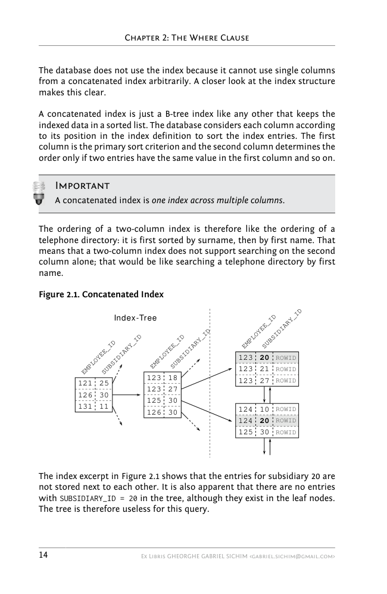

# Chương 2: Mệnh đề WHERE (Chapter 2 – The Where Clause) — Phần 1

> Nguồn: *SQL Performance Explained* – Markus Winand, trang PDF 19–41.
> Phần này gồm: phần mở đầu chương 2, mục “Toán tử bằng” (The Equality Operator) và mục “Hàm” (Functions).

## Mục lục

- [Chương 2: Mệnh đề WHERE (Chapter 2 – The Where Clause)](#chương-2-mệnh-đề-where-chapter-2--the-where-clause--phần-1)
  - [Toán tử bằng (The Equality Operator)](#toán-tử-bằng-the-equality-operator)
    - [Khóa chính (Primary Keys)](#khóa-chính-primary-keys)
    - [Index ghép nhiều cột (Concatenated Indexes)](#index-ghép-nhiều-cột-concatenated-indexes)
    - [Index chậm, phần II (Slow Indexes, Part II)](#index-chậm-phần-ii-slow-indexes-part-ii)
  - [Hàm (Functions)](#hàm-functions)
    - [Tìm kiếm không phân biệt hoa thường bằng UPPER hoặc LOWER (Case-Insensitive Search Using UPPER or LOWER)](#tìm-kiếm-không-phân-biệt-hoa-thường-bằng-upper-hoặc-lower-case-insensitive-search-using-upper-or-lower)
    - [Hàm do người dùng định nghĩa (User-Defined Functions)](#hàm-do-người-dùng-định-nghĩa-user-defined-functions)
    - [Đánh index quá mức (Over-Indexing)](#đánh-index-quá-mức-over-indexing)
  - [Bảng thuật ngữ (Glossary)](#bảng-thuật-ngữ-glossary)

---

Chương trước đã mô tả cấu trúc của index và giải thích nguyên nhân khiến index hoạt động kém hiệu quả. Ở bước tiếp theo, chúng ta sẽ học cách phát hiện và tránh những vấn đề đó ngay trong các câu lệnh SQL. Chúng ta bắt đầu bằng việc xem xét mệnh đề `where`.

Mệnh đề `where` định nghĩa **điều kiện tìm kiếm** (*search condition*) của một câu lệnh SQL, và do đó nó rơi đúng vào “lãnh địa” chức năng cốt lõi của index: tìm dữ liệu thật nhanh. Mặc dù mệnh đề `where` có ảnh hưởng rất lớn đến hiệu năng, nó lại thường được viết một cách cẩu thả, khiến cơ sở dữ liệu phải quét qua một phần lớn của index. Kết quả là: một mệnh đề `where` viết tồi chính là “nguyên liệu” đầu tiên tạo nên một câu truy vấn chậm.

Chương này giải thích các toán tử khác nhau ảnh hưởng thế nào đến việc sử dụng index, và làm sao để đảm bảo một index có thể dùng được cho càng nhiều câu truy vấn càng tốt. Phần cuối chương trình bày các phản mẫu (*anti-pattern*) phổ biến và đưa ra các giải pháp thay thế cho hiệu năng tốt hơn.

> 📝 **Giải thích thêm (không có trong sách):** Nhắc lại nhanh từ Chương 1: một lần tra cứu index (*index lookup*) gồm ba bước: (1) **duyệt cây** (*tree traversal*) từ gốc xuống lá — rất nhanh, chi phí tăng theo logarit kích thước bảng; (2) **đi theo chuỗi nút lá** (*following the leaf node chain*) để lấy tất cả các mục khớp; (3) **truy cập bảng** (*table access*) cho từng ROWID tìm được. Bước (2) và (3) mới là nơi có thể khiến index “chậm”. Toàn bộ chương này xoay quanh việc viết mệnh đề `where` sao cho bước (2) và (3) càng ít việc càng tốt.

## Toán tử bằng (The Equality Operator)

Toán tử bằng (`=`) vừa là toán tử SQL tầm thường nhất, vừa là toán tử được dùng thường xuyên nhất. Thế nhưng những sai lầm khi đánh index làm ảnh hưởng đến hiệu năng vẫn còn rất phổ biến, và những mệnh đề `where` kết hợp nhiều điều kiện là đặc biệt dễ “dính” lỗi.

Mục này chỉ ra cách kiểm chứng xem index có được sử dụng hay không, và giải thích cách **index ghép nhiều cột** (*concatenated index*) có thể tối ưu các điều kiện kết hợp. Để dễ hiểu hơn, chúng ta sẽ phân tích một câu truy vấn chậm để thấy tác động thực tế của những nguyên nhân đã được giải thích trong Chương 1.

### Khóa chính (Primary Keys)

Chúng ta bắt đầu với mệnh đề `where` đơn giản nhất nhưng cũng phổ biến nhất: tra cứu theo **khóa chính** (*primary key*). Trong toàn bộ các ví dụ của chương này, chúng ta dùng bảng `EMPLOYEES` được định nghĩa như sau:

```sql
CREATE TABLE employees (
   employee_id   NUMBER         NOT NULL,
   first_name    VARCHAR2(1000) NOT NULL,
   last_name     VARCHAR2(1000) NOT NULL,
   date_of_birth DATE           NOT NULL,
   phone_number  VARCHAR2(1000) NOT NULL,
   CONSTRAINT employees_pk PRIMARY KEY (employee_id)
);
```

Cơ sở dữ liệu tự động tạo một index cho khóa chính. Điều đó có nghĩa là đã có một index trên cột `EMPLOYEE_ID`, mặc dù không hề có câu lệnh `create index` nào.

Câu truy vấn sau dùng khóa chính để lấy tên của một nhân viên:

```sql
SELECT first_name, last_name 
  FROM employees 
 WHERE employee_id = 123
```

Mệnh đề `where` này không thể khớp với nhiều dòng, vì ràng buộc khóa chính đảm bảo các giá trị `EMPLOYEE_ID` là duy nhất. Cơ sở dữ liệu không cần đi theo các **nút lá** (*leaf node*) của index — chỉ cần duyệt cây index là đủ. Chúng ta có thể dùng cái gọi là **kế hoạch thực thi** (*execution plan*) để kiểm chứng:

```text
---------------------------------------------------------------
|Id |Operation                   | Name         | Rows | Cost |
---------------------------------------------------------------
| 0 |SELECT STATEMENT            |              |    1 |    2 |
| 1 | TABLE ACCESS BY INDEX ROWID| EMPLOYEES    |    1 |    2 |
|*2 |  INDEX UNIQUE SCAN         | EMPLOYEES_PK |    1 |    1 |
---------------------------------------------------------------

Predicate Information (identified by operation id):
---------------------------------------------------
   2 - access("EMPLOYEE_ID"=123)
```

Execution plan của Oracle cho thấy một thao tác `INDEX UNIQUE SCAN` — thao tác *chỉ* duyệt cây index. Nó tận dụng triệt để khả năng mở rộng theo logarit của index để tìm ra mục cần tìm rất nhanh — gần như không phụ thuộc vào kích thước bảng.

> **Mẹo (Tip)**
>
> Execution plan (đôi khi còn gọi là *explain plan* hoặc *query plan*) cho thấy các bước mà cơ sở dữ liệu thực hiện để chạy một câu lệnh SQL. Phụ lục A ở trang 165 giải thích cách lấy và đọc execution plan với các cơ sở dữ liệu khác.

Sau khi truy cập index, cơ sở dữ liệu phải làm thêm một bước nữa để lấy dữ liệu được yêu cầu (`FIRST_NAME`, `LAST_NAME`) từ vùng lưu trữ bảng: đó là thao tác `TABLE ACCESS BY INDEX ROWID`. Thao tác này có thể trở thành **nút thắt cổ chai hiệu năng** (*performance bottleneck*) — như đã giải thích trong “Index chậm, phần I” (*Slow Indexes, Part I*) — nhưng khi đi cùng `INDEX UNIQUE SCAN` thì không có rủi ro đó. Thao tác `INDEX UNIQUE SCAN` không thể trả về nhiều hơn một mục, nên nó không thể kích hoạt nhiều hơn một lần truy cập bảng. Điều đó có nghĩa là các “nguyên liệu” của một câu truy vấn chậm không hề có mặt khi dùng `INDEX UNIQUE SCAN`.

> **Khóa chính không có unique index (Primary Keys without Unique Index)**
>
> Khóa chính không nhất thiết phải có một **index duy nhất** (*unique index*) — bạn cũng có thể dùng một index không duy nhất (*non-unique index*). Trong trường hợp đó, cơ sở dữ liệu Oracle không dùng `INDEX UNIQUE SCAN` mà dùng thao tác `INDEX RANGE SCAN`. Tuy vậy, ràng buộc vẫn duy trì tính duy nhất của khóa, nên lần tra cứu index vẫn trả về tối đa một mục.
>
> Một trong những lý do để dùng index không duy nhất cho khóa chính là **ràng buộc trì hoãn được** (*deferrable constraint*). Khác với ràng buộc thông thường — được kiểm tra trong lúc thực thi câu lệnh — cơ sở dữ liệu hoãn việc kiểm tra ràng buộc trì hoãn cho đến khi giao dịch được commit. Ràng buộc trì hoãn là cần thiết khi chèn dữ liệu vào các bảng có **phụ thuộc vòng** (*circular dependencies*).

> 💡 **Ví dụ bổ sung (không có trong sách):** Xem execution plan của cùng câu truy vấn trên ở các hệ quản trị khác.
>
> - **PostgreSQL** (`EXPLAIN SELECT first_name, last_name FROM employees WHERE employee_id = 123;`):
>   ```text
>   Index Scan using employees_pk on employees  (cost=0.29..8.30 rows=1 width=...)
>     Index Cond: (employee_id = 123)
>   ```
>   PostgreSQL không tách riêng “unique scan” và “table access”: thao tác `Index Scan` bao gồm cả duyệt index lẫn đọc dòng từ bảng (heap).
> - **SQL Server**: bảng có khóa chính mặc định là *clustered index*, nên plan thường chỉ có `Clustered Index Seek` — dữ liệu dòng nằm ngay trong nút lá, không cần bước tra bảng riêng.
> - **MySQL/InnoDB** (`EXPLAIN`): cột `type` hiển thị `const`, `key` = `PRIMARY` — nghĩa là tra cứu tối đa một dòng qua khóa chính (InnoDB cũng lưu dòng trong clustered index của khóa chính).
>
> Ví dụ về ràng buộc trì hoãn (Oracle/PostgreSQL) với phụ thuộc vòng:
> ```sql
> CREATE TABLE departments (
>   dept_id    NUMBER PRIMARY KEY,
>   manager_id NUMBER NOT NULL
> );
> CREATE TABLE staff (
>   staff_id NUMBER PRIMARY KEY,
>   dept_id  NUMBER NOT NULL REFERENCES departments
> );
> ALTER TABLE departments ADD CONSTRAINT dept_mgr_fk
>   FOREIGN KEY (manager_id) REFERENCES staff
>   DEFERRABLE INITIALLY DEFERRED;
> -- Trong cùng một giao dịch: chèn phòng ban trước (manager chưa tồn tại),
> -- rồi chèn nhân viên; ràng buộc chỉ được kiểm tra lúc COMMIT.
> ```
> Với khóa chính khai báo `DEFERRABLE`, Oracle bắt buộc dùng index không duy nhất, vì trong lúc giao dịch còn mở, bảng có thể tạm thời chứa giá trị trùng.

### Index ghép nhiều cột (Concatenated Indexes)

Mặc dù cơ sở dữ liệu tự động tạo index cho khóa chính, vẫn còn chỗ để tinh chỉnh thủ công nếu khóa gồm nhiều cột. Trong trường hợp đó, cơ sở dữ liệu tạo một index trên tất cả các cột của khóa chính — gọi là **index ghép** (*concatenated index*, còn được gọi là *multi-column index*, *composite index* hay *combined index* – index nhiều cột / index tổ hợp). Lưu ý rằng **thứ tự các cột** trong một index ghép có ảnh hưởng rất lớn đến khả năng sử dụng của nó, nên phải được chọn một cách cẩn thận.

Để minh họa, giả sử có một vụ sáp nhập công ty. Nhân viên của công ty kia được thêm vào bảng `EMPLOYEES` của chúng ta, khiến bảng lớn gấp mười lần. Chỉ có một vấn đề: `EMPLOYEE_ID` không còn duy nhất trên cả hai công ty. Chúng ta cần mở rộng khóa chính bằng một định danh bổ sung — ví dụ: mã công ty con (*subsidiary ID*). Như vậy khóa chính mới có hai cột: `EMPLOYEE_ID` như trước và `SUBSIDIARY_ID` để thiết lập lại tính duy nhất.

Index cho khóa chính mới vì thế được định nghĩa như sau:

```sql
CREATE UNIQUE INDEX employee_pk 
    ON employees (employee_id, subsidiary_id);
```

Một truy vấn tìm một nhân viên cụ thể phải tính đến toàn bộ khóa chính — nghĩa là cột `SUBSIDIARY_ID` cũng phải được dùng:

```sql
SELECT first_name, last_name
  FROM employees
 WHERE employee_id   = 123
   AND subsidiary_id = 30;
```

```text
---------------------------------------------------------------
|Id |Operation                   | Name         | Rows | Cost |
---------------------------------------------------------------
| 0 |SELECT STATEMENT            |              |    1 |    2 |
| 1 | TABLE ACCESS BY INDEX ROWID| EMPLOYEES    |    1 |    2 |
|*2 |  INDEX UNIQUE SCAN         | EMPLOYEES_PK |    1 |    1 |
---------------------------------------------------------------

Predicate Information (identified by operation id):
---------------------------------------------------
   2 - access("EMPLOYEE_ID"=123 AND "SUBSIDIARY_ID"=30)
```

Bất cứ khi nào một truy vấn dùng *đầy đủ* khóa chính, cơ sở dữ liệu có thể dùng `INDEX UNIQUE SCAN` — bất kể index có bao nhiêu cột. Nhưng điều gì xảy ra khi chỉ dùng *một* trong các cột của khóa, ví dụ khi tìm tất cả nhân viên của một công ty con?

```sql
SELECT first_name, last_name
  FROM employees
 WHERE subsidiary_id = 20;
```

```text
----------------------------------------------------
| Id | Operation         | Name      | Rows | Cost |
----------------------------------------------------
|  0 | SELECT STATEMENT  |           |  106 |  478 |
|* 1 |  TABLE ACCESS FULL| EMPLOYEES |  106 |  478 |
----------------------------------------------------

Predicate Information (identified by operation id):
---------------------------------------------------
   1 - filter("SUBSIDIARY_ID"=20)
```

Execution plan cho thấy cơ sở dữ liệu *không* dùng index. Thay vào đó, nó thực hiện **quét toàn bộ bảng** (`FULL TABLE SCAN`). Kết quả là cơ sở dữ liệu đọc toàn bộ bảng và kiểm tra từng dòng so với mệnh đề `where`. Thời gian thực thi tăng theo kích thước bảng: nếu bảng lớn gấp mười, `FULL TABLE SCAN` mất thời gian gấp mười. Điều nguy hiểm của thao tác này là nó thường đủ nhanh trong môi trường phát triển nhỏ, nhưng lại gây ra vấn đề hiệu năng nghiêm trọng trên môi trường production (môi trường chạy thật).

> **Quét toàn bộ bảng (Full Table Scan)**
>
> Thao tác `TABLE ACCESS FULL`, còn được gọi là *full table scan* (quét toàn bảng), dù sao đi nữa vẫn có thể là thao tác hiệu quả nhất trong một số trường hợp, đặc biệt là khi cần lấy một phần lớn của bảng.
>
> Một phần lý do là vì chi phí phụ trội (*overhead*) của chính việc tra cứu index, điều không xảy ra với thao tác `TABLE ACCESS FULL`. Nhưng lý do chính là vì một lần tra cứu index đọc *từng khối một* (*one block after the other*), do cơ sở dữ liệu không biết khối tiếp theo cần đọc là khối nào cho đến khi khối hiện tại đã được xử lý xong. Còn `FULL TABLE SCAN` dù sao cũng phải lấy toàn bộ bảng, nên cơ sở dữ liệu có thể đọc từng mảng lớn mỗi lần (**đọc nhiều khối** – *multi block read*). Mặc dù cơ sở dữ liệu đọc nhiều dữ liệu hơn, nó có thể cần thực hiện ít thao tác đọc hơn.

Cơ sở dữ liệu không dùng index vì nó không thể sử dụng tùy ý từng cột riêng lẻ trong một index ghép. Xem kỹ cấu trúc index sẽ thấy rõ điều này.

Index ghép cũng chỉ là một B-tree index như bao index khác, lưu dữ liệu được đánh index trong một danh sách đã sắp xếp. Cơ sở dữ liệu xét từng cột theo vị trí của nó trong định nghĩa index để sắp xếp các mục index. Cột đầu tiên là tiêu chí sắp xếp chính, và cột thứ hai chỉ quyết định thứ tự khi hai mục có cùng giá trị ở cột đầu tiên, và cứ thế tiếp tục.

> **Quan trọng (Important)**
>
> Index ghép là *một index duy nhất trải trên nhiều cột* (*one index across multiple columns*).

Vì vậy, thứ tự sắp xếp của một index hai cột giống như thứ tự của một cuốn danh bạ điện thoại: đầu tiên được sắp theo họ, rồi đến tên. Điều đó có nghĩa là một index hai cột không hỗ trợ việc tìm kiếm chỉ theo cột thứ hai; làm vậy chẳng khác gì tra danh bạ điện thoại theo tên (mà không biết họ).

**Hình 2.1 – Index ghép nhiều cột (Figure 2.1 – Concatenated Index)**



Vẽ lại hình (ASCII):

```text
                Index-Tree (cây index)                  ¦        Nút lá (leaf nodes)
                                                        ¦
  EMPLOYEE_ID|SUBSIDIARY_ID   EMPLOYEE_ID|SUBSIDIARY_ID ¦   EMPLOYEE_ID|SUBSIDIARY_ID
                                                        ¦
      ┌─────┬────┐ ↗ ...         ┌─────┬────┐  ↗ ...    ¦   ┌─────┬────┬───────┐
      │ 121 │ 25 │               │ 123 │ 18 │ ────────────▶│ 123 │ 20 │ ROWID │  ◀ (tô đậm)
      ├─────┼────┤               ├─────┼────┤           ¦   │ 123 │ 21 │ ROWID │
      │ 126 │ 30 │ ────────────▶ │ 123 │ 27 │           ¦   │ 123 │ 27 │ ROWID │
      ├─────┼────┤               ├─────┼────┤           ¦   └─────┴────┴───────┘
      │ 131 │ 11 │               │ 125 │ 30 │ ───┐      ¦          ↕  (liên kết đôi)
      └─────┴────┘ ↘ ...         ├─────┼────┤    │      ¦   ┌─────┬────┬───────┐
                                 │ 126 │ 30 │    └─────────▶│ 124 │ 10 │ ROWID │
                                 └─────┴────┘  ↘ ...    ¦   │ 124 │ 20 │ ROWID │  ◀ (tô đậm)
                                                        ¦   │ 125 │ 30 │ ROWID │
                                                        ¦   └─────┴────┴───────┘
                                                        ¦          ↕
```

Mô tả hình: Bên trái đường gạch đứt là **cây index** (*Index-Tree*) gồm nút gốc (`121|25`, `126|30`, `131|11`) và một nút nhánh (`123|18`, `123|27`, `125|30`, `126|30`); mỗi mục có hai cột `EMPLOYEE_ID` và `SUBSIDIARY_ID`. Bên phải là hai nút lá, mỗi mục gồm `EMPLOYEE_ID`, `SUBSIDIARY_ID` và `ROWID`. Hai mục có `SUBSIDIARY_ID = 20` (`123|20` và `124|20`) được tô đậm: chúng nằm ở hai nút lá khác nhau, xen giữa là các mục của công ty con khác. Các mũi tên chấm biểu thị những phần khác của cây không được vẽ.

Phần trích index trong Hình 2.1 cho thấy các mục của công ty con 20 *không* được lưu cạnh nhau. Cũng dễ thấy rằng trong cây không có mục nào với `SUBSIDIARY_ID = 20`, mặc dù chúng có tồn tại trong các nút lá. Do đó cây index là vô dụng cho câu truy vấn này.

> **Mẹo (Tip)**
>
> Hình dung trực quan một index giúp hiểu được index đó hỗ trợ những câu truy vấn nào. Bạn có thể truy vấn cơ sở dữ liệu để lấy các mục theo thứ tự của index (cú pháp SQL:2008, xem trang 144 để biết các giải pháp riêng của từng hãng dùng `LIMIT`, `TOP` hoặc `ROWNUM`):
>
> ```sql
> SELECT <INDEX COLUMN LIST> 
>   FROM <TABLE>  
>  ORDER BY <INDEX COLUMN LIST>
>  FETCH FIRST 100 ROWS ONLY;
> ```
>
> Nếu bạn đặt định nghĩa index và tên bảng vào câu truy vấn này, bạn sẽ có được một mẫu trích từ index. Hãy tự hỏi: các dòng cần tìm có được gom lại ở một chỗ tập trung không? Nếu không, cây index không thể giúp tìm ra chỗ đó.

> 💡 **Ví dụ bổ sung (không có trong sách):** Áp dụng mẹo trên cho index `(employee_id, subsidiary_id)`:
> ```sql
> -- Oracle 12c+, PostgreSQL, DB2, SQL Server 2012+ (cần OFFSET 0 ROWS trước FETCH)
> SELECT employee_id, subsidiary_id
>   FROM employees
>  ORDER BY employee_id, subsidiary_id
>  FETCH FIRST 100 ROWS ONLY;
> -- MySQL / PostgreSQL: ... ORDER BY employee_id, subsidiary_id LIMIT 100;
> ```
> Kết quả có thể trông như sau:
>
> | EMPLOYEE_ID | SUBSIDIARY_ID |
> |---|---|
> | 1 | 10 |
> | 1 | 20 |
> | 1 | 30 |
> | 2 | 10 |
> | 2 | 20 |
> | ... | ... |
>
> Các dòng `SUBSIDIARY_ID = 20` rải rác cách nhau đều đặn suốt index → không “gom cụm” → cây index không giúp được truy vấn `WHERE subsidiary_id = 20`. Ngược lại, các dòng `EMPLOYEE_ID = 2` nằm liền nhau → index giúp được truy vấn `WHERE employee_id = 2`.

Tất nhiên, chúng ta có thể thêm một index khác trên `SUBSIDIARY_ID` để tăng tốc truy vấn. Tuy nhiên có một giải pháp tốt hơn — ít nhất là nếu ta giả định rằng việc tìm kiếm chỉ theo `EMPLOYEE_ID` là không có ý nghĩa.

Chúng ta có thể tận dụng thực tế rằng cột đầu tiên của index *luôn luôn* dùng được để tìm kiếm. Lại giống như danh bạ điện thoại: bạn không cần biết tên để tra theo họ. Mẹo là đảo ngược thứ tự cột của index để `SUBSIDIARY_ID` nằm ở vị trí đầu tiên:

```sql
CREATE UNIQUE INDEX EMPLOYEES_PK 
    ON EMPLOYEES (SUBSIDIARY_ID, EMPLOYEE_ID);
```

Hai cột gộp lại vẫn là duy nhất, nên các truy vấn dùng đầy đủ khóa chính vẫn có thể dùng `INDEX UNIQUE SCAN`, nhưng trình tự các mục index thì hoàn toàn khác. `SUBSIDIARY_ID` đã trở thành tiêu chí sắp xếp chính. Điều đó có nghĩa là tất cả các mục của một công ty con nằm liên tiếp nhau trong index, nên cơ sở dữ liệu có thể dùng B-tree để tìm ra vị trí của chúng.

> **Quan trọng (Important)**
>
> Điều cần cân nhắc quan trọng nhất khi định nghĩa một index ghép là chọn thứ tự cột sao cho index có thể được dùng thường xuyên nhất có thể.

Execution plan xác nhận rằng cơ sở dữ liệu dùng index đã được “đảo ngược”. Riêng `SUBSIDIARY_ID` thì không còn duy nhất nữa, nên cơ sở dữ liệu phải đi theo các nút lá để tìm tất cả các mục khớp: vì vậy nó dùng thao tác `INDEX RANGE SCAN` (quét một khoảng index).

```text
--------------------------------------------------------------
|Id |Operation                   | Name        | Rows | Cost |
--------------------------------------------------------------
| 0 |SELECT STATEMENT            |             |  106 |   75 |
| 1 | TABLE ACCESS BY INDEX ROWID| EMPLOYEES   |  106 |   75 |
|*2 |  INDEX RANGE SCAN          | EMPLOYEE_PK |  106 |    2 |
--------------------------------------------------------------

Predicate Information (identified by operation id):
---------------------------------------------------
   2 - access("SUBSIDIARY_ID"=20)
```

Nói chung, cơ sở dữ liệu có thể dùng một index ghép khi tìm kiếm bằng các **cột dẫn đầu** (*leading columns* – các cột ngoài cùng bên trái). Một index ba cột có thể được dùng khi tìm theo cột thứ nhất, khi tìm theo hai cột đầu cùng nhau, và khi tìm theo tất cả các cột.

Mặc dù giải pháp hai index cũng cho hiệu năng `select` rất tốt, giải pháp một index vẫn đáng chọn hơn. Nó không chỉ tiết kiệm dung lượng lưu trữ, mà còn tiết kiệm chi phí bảo trì cho index thứ hai. Bảng càng có ít index thì hiệu năng `insert`, `delete` và `update` càng tốt.

Để định nghĩa một index tối ưu, bạn phải hiểu nhiều hơn là chỉ cách index hoạt động — bạn còn phải biết ứng dụng truy vấn dữ liệu như thế nào. Nghĩa là bạn phải biết những tổ hợp cột nào xuất hiện trong mệnh đề `where`.

Vì vậy, việc định nghĩa một index tối ưu là rất khó đối với các chuyên gia tư vấn bên ngoài, vì họ không có cái nhìn tổng quan về các **đường truy cập** (*access path*) của ứng dụng. Chuyên gia tư vấn thường chỉ có thể xem xét một câu truy vấn. Họ không khai thác được lợi ích bổ sung mà index có thể mang lại cho các truy vấn khác. Người quản trị cơ sở dữ liệu (DBA) cũng ở vị trí tương tự: họ có thể biết lược đồ (*schema*) cơ sở dữ liệu nhưng không có hiểu biết sâu về các đường truy cập.

Nơi duy nhất mà kiến thức kỹ thuật về cơ sở dữ liệu gặp gỡ kiến thức nghiệp vụ của lĩnh vực kinh doanh chính là bộ phận phát triển. Lập trình viên có “cảm giác” về dữ liệu và biết các đường truy cập. Họ có thể đánh index đúng cách để đạt lợi ích tốt nhất cho toàn bộ ứng dụng mà không tốn nhiều công sức.

> 💡 **Ví dụ bổ sung (không có trong sách):** Quy tắc “cột dẫn đầu” (*leftmost prefix*) với index ba cột.
>
> Giả sử có bảng đơn hàng và index:
> ```sql
> CREATE INDEX orders_idx ON orders (shop_id, customer_id, order_date);
> ```
>
> | Điều kiện `WHERE` | Index có dùng được để duyệt cây (access) không? | Vì sao |
> |---|---|---|
> | `shop_id = 5` | Có | Dùng cột thứ nhất |
> | `shop_id = 5 AND customer_id = 42` | Có | Dùng hai cột đầu |
> | `shop_id = 5 AND customer_id = 42 AND order_date = DATE '2024-01-01'` | Có (đầy đủ) | Dùng cả ba cột |
> | `customer_id = 42` | Không (thường là full scan) | Thiếu cột dẫn đầu `shop_id` – giống tra danh bạ theo tên |
> | `customer_id = 42 AND order_date = ...` | Không | Vẫn thiếu cột dẫn đầu |
> | `shop_id = 5 AND order_date = ...` | Một phần | Chỉ `shop_id` dùng để duyệt cây; `order_date` chỉ được lọc trong khoảng lá đã tìm được |
>
> Lưu ý: Oracle (và MySQL 8.0.13+) có thao tác *index skip scan* có thể dùng index khi thiếu cột đầu nếu cột đầu có rất ít giá trị khác nhau; PostgreSQL 18 cũng bổ sung skip scan cho B-tree. Nhưng đó là ngoại lệ, không nên dựa vào khi thiết kế index.

### Index chậm, phần II (Slow Indexes, Part II)

Mục trước đã giải thích cách thu thêm lợi ích từ một index có sẵn bằng cách thay đổi thứ tự cột, nhưng ví dụ chỉ xét hai câu lệnh SQL. Tuy nhiên, việc thay đổi một index có thể ảnh hưởng đến *mọi* truy vấn trên bảng được đánh index. Mục này giải thích cách cơ sở dữ liệu chọn index và minh họa các tác dụng phụ có thể xảy ra khi thay đổi index hiện có.

Index `EMPLOYEE_PK` đã được điều chỉnh giúp cải thiện hiệu năng của tất cả các truy vấn chỉ tìm theo công ty con. Tuy nhiên, nó có thể dùng được cho *mọi* truy vấn tìm theo `SUBSIDIARY_ID` — bất kể có thêm tiêu chí tìm kiếm nào khác hay không. Điều đó có nghĩa là index này trở nên dùng được cho những truy vấn trước đây vốn dùng một index khác với một phần khác của mệnh đề `where`. Trong trường hợp đó, nếu có nhiều đường truy cập khả dĩ, việc chọn ra đường tốt nhất là nhiệm vụ của **bộ tối ưu hóa** (*optimizer*).

> **Bộ tối ưu hóa truy vấn (The Query Optimizer)**
>
> Bộ tối ưu hóa truy vấn (*query optimizer*), hay bộ lập kế hoạch truy vấn (*query planner*), là thành phần của cơ sở dữ liệu biến một câu lệnh SQL thành một execution plan. Quá trình này còn được gọi là **biên dịch** (*compiling*) hoặc **phân tích cú pháp** (*parsing*). Có hai loại optimizer khác nhau.
>
> **Bộ tối ưu hóa dựa trên chi phí** (*Cost-based optimizer* – CBO) sinh ra nhiều biến thể execution plan và tính một giá trị chi phí (*cost*) cho mỗi plan. Việc tính chi phí dựa trên các thao tác được dùng và số dòng ước tính. Cuối cùng, giá trị chi phí đóng vai trò thước đo để chọn ra execution plan “tốt nhất”.
>
> **Bộ tối ưu hóa dựa trên luật** (*Rule-based optimizer* – RBO) sinh execution plan bằng một bộ luật được cài cứng (*hard-coded*). Optimizer dựa trên luật kém linh hoạt hơn và ngày nay hiếm khi được dùng.

Thay đổi một index cũng có thể gây ra những tác dụng phụ khó chịu. Trong ví dụ của chúng ta, ứng dụng danh bạ điện thoại nội bộ đã trở nên rất chậm kể từ sau vụ sáp nhập. Phân tích ban đầu xác định câu truy vấn sau là nguyên nhân gây chậm:

```sql
SELECT first_name, last_name, subsidiary_id, phone_number
  FROM employees
 WHERE last_name  = 'WINAND'
   AND subsidiary_id = 30;
```

Execution plan là:

**Ví dụ 2.1 – Execution plan với index khóa chính đã sửa đổi (Example 2.1 – Execution Plan with Revised Primary Key Index)**

```text
---------------------------------------------------------------
|Id |Operation                   | Name         | Rows | Cost |
---------------------------------------------------------------
| 0 |SELECT STATEMENT            |              |    1 |   30 |
|*1 | TABLE ACCESS BY INDEX ROWID| EMPLOYEES    |    1 |   30 |
|*2 |  INDEX RANGE SCAN          | EMPLOYEES_PK |   40 |    2 |
---------------------------------------------------------------

Predicate Information (identified by operation id):
---------------------------------------------------
  1 - filter("LAST_NAME"='WINAND')
  2 - access("SUBSIDIARY_ID"=30)
```

Execution plan dùng một index và có tổng chi phí là 30. Đến đây thì mọi thứ có vẻ ổn. Tuy nhiên, điều đáng ngờ là nó dùng đúng cái index mà chúng ta vừa thay đổi — chừng đó đã đủ lý do để nghi rằng việc sửa index gây ra vấn đề hiệu năng, nhất là khi nhớ lại định nghĩa index cũ — nó bắt đầu bằng cột `EMPLOYEE_ID`, cột hoàn toàn không có mặt trong mệnh đề `where`. Trước đây câu truy vấn này không thể dùng index đó.

Để phân tích sâu hơn, sẽ rất hay nếu so sánh execution plan trước và sau khi thay đổi. Để có execution plan ban đầu, chúng ta có thể triển khai lại định nghĩa index cũ, tuy nhiên hầu hết các cơ sở dữ liệu đều cung cấp một cách đơn giản hơn để ngăn việc dùng một index cho một truy vấn cụ thể. Ví dụ sau dùng một **gợi ý cho optimizer** (*optimizer hint*) của Oracle cho mục đích đó.

```sql
SELECT /*+ NO_INDEX(EMPLOYEES EMPLOYEE_PK) */ 
       first_name, last_name, subsidiary_id, phone_number
  FROM employees
 WHERE last_name  = 'WINAND'
   AND subsidiary_id = 30;
```

Execution plan được cho là đã dùng trước khi thay đổi index thì hoàn toàn không dùng index:

```text
----------------------------------------------------
| Id | Operation         | Name      | Rows | Cost |
----------------------------------------------------
|  0 | SELECT STATEMENT  |           |    1 |  477 |
|* 1 |  TABLE ACCESS FULL| EMPLOYEES |    1 |  477 |
----------------------------------------------------

Predicate Information (identified by operation id):
---------------------------------------------------
   1 - filter("LAST_NAME"='WINAND' AND "SUBSIDIARY_ID"=30)
```

Mặc dù `TABLE ACCESS FULL` phải đọc và xử lý toàn bộ bảng, trong trường hợp này nó dường như lại nhanh hơn việc dùng index. Điều đó đặc biệt bất thường vì câu truy vấn chỉ khớp đúng một dòng. Dùng index để tìm một dòng duy nhất lẽ ra phải nhanh hơn nhiều so với quét toàn bảng, nhưng ở đây thì không. Index có vẻ chậm.

Trong những trường hợp như vậy, tốt nhất là đi qua từng bước của execution plan có vấn đề. Bước đầu tiên là `INDEX RANGE SCAN` trên index `EMPLOYEES_PK`. Index đó không bao gồm cột `LAST_NAME` — `INDEX RANGE SCAN` chỉ có thể xét bộ lọc `SUBSIDIARY_ID`; cơ sở dữ liệu Oracle cho thấy điều này trong vùng “Predicate Information” (thông tin vị từ) — mục “2” của execution plan. Ở đó bạn có thể thấy những điều kiện được áp dụng cho từng thao tác.

> **Mẹo (Tip)**
>
> Phụ lục A, “Execution Plans” (Kế hoạch thực thi), giải thích cách tìm “Predicate Information” với các cơ sở dữ liệu khác.

Thao tác `INDEX RANGE SCAN` có mã thao tác ID 2 (Ví dụ 2.1 ở trang 19) chỉ áp dụng bộ lọc `SUBSIDIARY_ID=30`. Nghĩa là nó duyệt cây index để tìm mục đầu tiên có `SUBSIDIARY_ID` 30. Tiếp đó nó đi theo chuỗi nút lá để tìm tất cả các mục khác của công ty con đó. Kết quả của `INDEX RANGE SCAN` là một danh sách các ROWID thỏa điều kiện `SUBSIDIARY_ID`: tùy theo quy mô công ty con, có thể chỉ có vài ROWID, hoặc có thể có tới hàng trăm.

Bước tiếp theo là thao tác `TABLE ACCESS BY INDEX ROWID`. Nó dùng các ROWID từ bước trước để lấy các dòng — tất cả các cột — từ bảng. Khi đã có cột `LAST_NAME`, cơ sở dữ liệu mới có thể đánh giá phần còn lại của mệnh đề `where`. Nghĩa là cơ sở dữ liệu phải lấy *tất cả* các dòng có `SUBSIDIARY_ID=30` rồi mới áp dụng được bộ lọc `LAST_NAME`.

Thời gian phản hồi (*response time*) của câu lệnh không phụ thuộc vào kích thước tập kết quả mà phụ thuộc vào số nhân viên trong công ty con cụ thể đó. Nếu công ty con chỉ có vài người, `INDEX RANGE SCAN` cho hiệu năng tốt hơn. Tuy nhiên với một công ty con rất lớn, `TABLE ACCESS FULL` có thể nhanh hơn vì nó có thể đọc những phần lớn của bảng trong một lần (xem “Quét toàn bộ bảng” – *Full Table Scan* ở trang 13).

Câu truy vấn chậm vì lần tra cứu index trả về rất nhiều ROWID — mỗi ROWID cho một nhân viên của công ty gốc — và cơ sở dữ liệu phải lấy từng dòng một. Đây là sự kết hợp hoàn hảo của hai “nguyên liệu” khiến một index chậm: cơ sở dữ liệu đọc một khoảng index rộng *và* phải lấy nhiều dòng riêng lẻ.

Việc chọn execution plan tốt nhất còn phụ thuộc vào **phân bố dữ liệu** (*data distribution*) của bảng, nên optimizer dùng các **thống kê** (*statistics*) về nội dung của cơ sở dữ liệu. Trong ví dụ của chúng ta, optimizer dùng một **biểu đồ tần suất** (*histogram*) chứa sự phân bố nhân viên theo các công ty con. Điều này cho phép optimizer ước tính số dòng trả về từ lần tra cứu index — kết quả đó được dùng để tính chi phí.

> **Thống kê (Statistics)**
>
> Một optimizer dựa trên chi phí sử dụng thống kê về bảng, cột và index. Phần lớn thống kê được thu thập ở mức cột: số giá trị khác nhau (*number of distinct values*), giá trị nhỏ nhất và lớn nhất (khoảng dữ liệu – *data range*), số lần xuất hiện `NULL` và histogram của cột (phân bố dữ liệu). Giá trị thống kê quan trọng nhất của một bảng là kích thước của nó (tính theo số dòng và số khối – *blocks*).
>
> Các thống kê quan trọng nhất của index là độ sâu cây (*tree depth*), số nút lá, số khóa khác nhau (*distinct keys*) và **clustering factor** (hệ số gom cụm – xem Chương 5, “Gom cụm dữ liệu” – *Clustering Data*).
>
> Optimizer dùng các giá trị này để ước tính **độ chọn lọc** (*selectivity*) của các vị từ (*predicate*) trong mệnh đề `where`.

Nếu không có thống kê — chẳng hạn vì chúng đã bị xóa — optimizer dùng các giá trị mặc định. Thống kê mặc định của cơ sở dữ liệu Oracle giả định một index nhỏ với độ chọn lọc trung bình. Chúng dẫn đến ước tính rằng `INDEX RANGE SCAN` sẽ trả về 40 dòng. Execution plan hiển thị ước tính này trong cột `Rows` (một lần nữa, xem Ví dụ 2.1 ở trang 19). Rõ ràng đây là một ước tính thấp hơn thực tế rất nhiều, vì có tới 1000 nhân viên làm việc cho công ty con này.

Nếu chúng ta cung cấp thống kê chính xác, optimizer sẽ làm tốt hơn. Execution plan sau cho thấy ước tính mới: 1000 dòng cho `INDEX RANGE SCAN`. Do đó nó tính ra chi phí cao hơn cho bước truy cập bảng tiếp theo.

```text
---------------------------------------------------------------
|Id |Operation                   | Name         | Rows | Cost |
---------------------------------------------------------------
| 0 |SELECT STATEMENT            |              |    1 |  680 |
|*1 | TABLE ACCESS BY INDEX ROWID| EMPLOYEES    |    1 |  680 |
|*2 |  INDEX RANGE SCAN          | EMPLOYEES_PK | 1000 |    4 |
---------------------------------------------------------------

Predicate Information (identified by operation id):
---------------------------------------------------
  1 - filter("LAST_NAME"='WINAND')
  2 - access("SUBSIDIARY_ID"=30)
```

Chi phí 680 thậm chí còn cao hơn chi phí của execution plan dùng `FULL TABLE SCAN` (477, xem trang 20). Vì vậy optimizer sẽ tự động ưu tiên `FULL TABLE SCAN`.

Ví dụ về index chậm này không nên che lấp sự thật rằng đánh index đúng cách mới là giải pháp tốt nhất. Tất nhiên, tìm theo họ được hỗ trợ tốt nhất bởi một index trên `LAST_NAME`:

```sql
CREATE INDEX emp_name ON employees (last_name);
```

Với index mới, optimizer tính ra chi phí là 3:

**Ví dụ 2.2 – Execution plan với index chuyên dụng (Example 2.2 – Execution Plan with Dedicated Index)**

```text
--------------------------------------------------------------
| Id | Operation                   | Name      | Rows | Cost |
--------------------------------------------------------------
|  0 | SELECT STATEMENT            |           |    1 |    3 |
|* 1 |  TABLE ACCESS BY INDEX ROWID| EMPLOYEES |    1 |    3 |
|* 2 |   INDEX RANGE SCAN          | EMP_NAME  |    1 |    1 |
--------------------------------------------------------------

Predicate Information (identified by operation id):
---------------------------------------------------
   1 - filter("SUBSIDIARY_ID"=30)
   2 - access("LAST_NAME"='WINAND')
```

Theo ước tính của optimizer, lần truy cập index chỉ trả về một dòng. Do đó cơ sở dữ liệu chỉ phải lấy đúng dòng đó từ bảng: chắc chắn nhanh hơn một `FULL TABLE SCAN`. Một index được định nghĩa đúng cách vẫn tốt hơn lần quét toàn bảng ban đầu.

Hai execution plan trong Ví dụ 2.1 (trang 19) và Ví dụ 2.2 gần như giống hệt nhau. Cơ sở dữ liệu thực hiện cùng các thao tác và optimizer tính ra các giá trị chi phí tương tự, vậy mà plan thứ hai chạy tốt hơn nhiều. Hiệu quả của một `INDEX RANGE SCAN` có thể dao động trong một phạm vi rất rộng — đặc biệt khi theo sau nó là một lần truy cập bảng. Dùng index không tự động có nghĩa là câu lệnh được thực thi theo cách tốt nhất có thể.

> 💡 **Ví dụ bổ sung (không có trong sách):** Ước lượng “bằng tay” vì sao index `EMPLOYEES_PK` chậm còn `EMP_NAME` nhanh.
>
> Giả sử bảng có 10.000 nhân viên, công ty con 30 có 1.000 người, chỉ 1 người họ `WINAND`. Mỗi lần đọc một khối ngẫu nhiên tốn ~5 ms trên ổ đĩa quay.
>
> | Plan | Số mục index đọc | Số lần truy cập bảng (đọc khối ngẫu nhiên) | Ước lượng thời gian |
> |---|---|---|---|
> | `INDEX RANGE SCAN` trên `EMPLOYEES_PK` (`SUBSIDIARY_ID=30`) rồi lọc `LAST_NAME` | ~1.000 | tối đa ~1.000 | ~5 giây (trường hợp xấu) |
> | `TABLE ACCESS FULL` | 0 | đọc tuần tự toàn bảng, nhiều khối mỗi lần (*multi block read*) | nhanh hơn đáng kể |
> | `INDEX RANGE SCAN` trên `EMP_NAME` (`LAST_NAME='WINAND'`) rồi lọc `SUBSIDIARY_ID` | 1 | 1 | vài ms |
>
> Ba plan đều trả về cùng 1 dòng, nhưng khối lượng công việc khác nhau hàng nghìn lần. Đây chính là ý của tác giả: nhìn thấy chữ `INDEX RANGE SCAN` trong plan chưa nói lên điều gì; phải xem điều kiện `access` có thu hẹp khoảng quét đủ hẹp hay không.
>
> Trên PostgreSQL bạn có thể quan sát điều này bằng `EXPLAIN (ANALYZE, BUFFERS)`: dòng `Rows Removed by Filter: 999` dưới nút `Index Scan` là dấu hiệu rõ ràng của một bộ lọc áp dụng *sau* khi đã đọc dòng từ bảng. Để cập nhật thống kê: Oracle dùng `DBMS_STATS.GATHER_TABLE_STATS`, PostgreSQL dùng `ANALYZE employees;`, SQL Server dùng `UPDATE STATISTICS employees;`, MySQL dùng `ANALYZE TABLE employees;`.

> 📝 **Giải thích thêm (không có trong sách) — Đối chiếu với PostgreSQL hiện đại (PG 10–17): Thống kê đa cột `CREATE STATISTICS` giải quyết triệt để bài toán ước lượng sai số dòng**
>
> Trong mục này và mục *“Thống kê của Oracle cho index dựa trên hàm”* bên dưới, tác giả nhắc tới **Extended Statistics** (*thống kê mở rộng*) của Oracle 11g. Vào năm 2012 (thời điểm **PostgreSQL 9.1 / 9.2**), PostgreSQL chỉ thu thập thống kê (trong bảng hệ thống `pg_statistic` / view `pg_stats`) cho **từng cột riêng lẻ hoàn toàn độc lập với nhau**.
>
> **Hệ lụy nghiêm trọng trên PostgreSQL 9.x:**
> Khi câu truy vấn kết hợp nhiều điều kiện bằng toán tử `AND`, ví dụ:
> ```sql
> WHERE subsidiary_id = 30 AND department_id = 300
> ```
> Bộ tối ưu hóa (Planner) của PostgreSQL 9.x giả định hai cột **độc lập thống kê** và áp dụng công thức xác suất nhân:
> $$\text{Selectivity}(A \land B) = \text{Selectivity}(A) \times \text{Selectivity}(B)$$
> Trong thực tế nghiệp vụ, các cột thường **tương quan chặt với nhau** (*correlated columns* — ví dụ phòng ban `300` chỉ thuộc về công ty con `30`, hoặc `city = 'Hà Nội'` luôn đi kèm `country = 'VN'`). Phép nhân xác suất khiến PostgreSQL ước tính số dòng thấp hơn thực tế hàng chục đến hàng trăm lần (ví dụ ước tính `rows=10` trong khi thực tế `actual rows=5000`). Hậu quả là Planner:
> - Chọn nhầm `Index Scan` trên một index kém chọn lọc thay vì `Seq Scan` hoặc `BitmapAnd`;
> - Nguy hiểm hơn, ở các phép `JOIN` phía trên, thấy `rows=10` nên chọn `Nested Loop` thay vì `Hash Join`, làm truy vấn treo hàng phút!
>
> **Cách mạng Extended Statistics trong PostgreSQL 10, 12 và 14+:**
> PostgreSQL đã bổ sung câu lệnh chuẩn **`CREATE STATISTICS`** để dạy cho Planner biết mối quan hệ giữa nhiều cột và biểu thức:
>
> | Phiên bản | Loại thống kê mở rộng (`CREATE STATISTICS`) | Ý nghĩa & Bài toán giải quyết |
> |---|---|---|
> | **PostgreSQL 10** | **`dependencies`** *(Phụ thuộc hàm)* | Phát hiện phụ thuộc một chiều $A \Rightarrow B$ (ví dụ biết `department_id` thì suy ra `subsidiary_id`, hoặc biết `zip_code` suy ra `city`). Ngăn Planner nhân trùng xác suất cho các điều kiện `=`. |
> | **PostgreSQL 10** | **`ndistinct`** *(Số tổ hợp phân biệt)* | Ghi nhận số lượng cặp giá trị `(A, B)` phân biệt thực tế để ước tính chính xác số nhóm cho `GROUP BY a, b` và `DISTINCT a, b`. |
> | **PostgreSQL 12** | **`mcv`** *(Most Common Values đa cột)* | Lưu trực tiếp danh sách các tổ hợp giá trị `(A, B)` xuất hiện nhiều nhất cùng tần suất thực tế. Giải quyết cả phụ thuộc không đồng nhất, điều kiện `=`, `<>`, `<`, `>`, `OR`, `IS NULL` giữa nhiều cột! |
> | **PostgreSQL 14** | **Thống kê trên biểu thức** *(Expressions)* | Cho phép thu thập histogram/MCV đơn lẻ và tương quan đa cột ngay trên các biểu thức hàm như `UPPER(last_name)`, `date_trunc('month', created_at)` mà không bắt buộc phải tạo index trước! |

> 💡 **Ví dụ bổ sung (không có trong sách) — Thực hành trên PostgreSQL: So sánh `EXPLAIN (ANALYZE, BUFFERS)` trước và sau khi có `CREATE STATISTICS` (PG 12–17)**
>
> Hãy dựng một kịch bản thực tế trên PostgreSQL 16/17: bảng `employees_stats_demo` có 100.000 nhân viên, trong đó cột `subsidiary_id` và `dept_id` phụ thuộc chặt vào nhau (mỗi công ty con có các mã phòng ban riêng), và có hai index đơn lẻ trên hai cột:
>
> ```sql
> CREATE TABLE employees_stats_demo (
>     employee_id   INT GENERATED ALWAYS AS IDENTITY PRIMARY KEY,
>     subsidiary_id INT  NOT NULL,
>     dept_id       INT  NOT NULL,
>     status        TEXT NOT NULL,
>     last_name     TEXT NOT NULL
> );
>
> -- Chèn 100.000 dòng: subsidiary_id (1..20) quyết định hoàn toàn dải dept_id,
> -- riêng subsidiary_id = 30 và dept_id = 300 chiếm đúng 5.000 dòng!
> INSERT INTO employees_stats_demo (subsidiary_id, dept_id, status, last_name)
> SELECT CASE WHEN g <= 5000 THEN 30 ELSE (g % 20) + 1 END,
>        CASE WHEN g <= 5000 THEN 300 ELSE ((g % 20) + 1) * 10 END,
>        CASE WHEN g % 100 = 0 THEN 'PROBATION' ELSE 'ACTIVE' END,
>        'EMP_' || g
>   FROM generate_series(1, 100000) AS g;
>
> CREATE INDEX idx_emp_sub_status ON employees_stats_demo (subsidiary_id, dept_id);
> CREATE INDEX idx_emp_status     ON employees_stats_demo (status);
> ANALYZE employees_stats_demo;
> ```
>
> **1. Trước khi tạo `CREATE STATISTICS` (hành vi giống PostgreSQL 9.x):**
>
> ```sql
> EXPLAIN (ANALYZE, BUFFERS)
> SELECT *
>   FROM employees_stats_demo
>  WHERE subsidiary_id = 30
>    AND dept_id = 300
>    AND status = 'PROBATION';
> ```
>
> ```text
>  Index Scan using idx_emp_sub_status on employees_stats_demo
>    (cost=0.29..22.45 rows=2 width=32) (actual time=0.041..3.812 rows=50 loops=1)
>    Index Cond: ((subsidiary_id = 30) AND (dept_id = 300))
>    Filter: (status = 'PROBATION')
>    Rows Removed by Filter: 4950
>    Buffers: shared hit=512
> ```
>
> *Phân tích lỗi của Planner:* Vì `subsidiary_id = 30` chiếm 5% (0,05) và `dept_id = 300` chiếm 5% (0,05), Planner nhân $0{,}05 \times 0{,}05 = 0{,}0025$ (tức 250 dòng thay vì 5.000 dòng thực tế!). Cộng thêm `status = 'PROBATION'` (1%), nó ước tính chỉ còn `rows=2`! Vì tưởng `idx_emp_sub_status` chỉ trả về 250 dòng (nhỏ hơn 1.000 dòng của `status = 'PROBATION'`), nó chọn quét `idx_emp_sub_status` và phải đọc bảng rồi vứt bỏ tới **4.950 dòng** (`Rows Removed by Filter: 4950`, tốn 512 buffers)!
>
> **2. Sau khi tạo `CREATE STATISTICS` (PostgreSQL 12–17):**
>
> ```sql
> CREATE STATISTICS stts_emp_sub_dept (dependencies, ndistinct, mcv)
>     ON subsidiary_id, dept_id
>   FROM employees_stats_demo;
>
> ANALYZE employees_stats_demo;
>
> EXPLAIN (ANALYZE, BUFFERS)
> SELECT *
>   FROM employees_stats_demo
>  WHERE subsidiary_id = 30
>    AND dept_id = 300
>    AND status = 'PROBATION';
> ```
>
> ```text
>  Bitmap Heap Scan on employees_stats_demo
>    (cost=16.80..185.20 rows=50 width=32) (actual time=0.215..0.340 rows=50 loops=1)
>    Recheck Cond: ((status = 'PROBATION') AND (subsidiary_id = 30) AND (dept_id = 300))
>    Heap Blocks: exact=45
>    Buffers: shared hit=54
>    ->  BitmapAnd  (cost=16.80..16.80 rows=50 width=0) (actual time=0.198..0.199 rows=0 loops=1)
>          Buffers: shared hit=9
>          ->  Bitmap Index Scan on idx_emp_status  (cost=0.00..11.25 rows=1000 width=0) (actual time=0.082..0.082 rows=1000 loops=1)
>                Index Cond: (status = 'PROBATION')
>                Buffers: shared hit=4
>          ->  Bitmap Index Scan on idx_emp_sub_status  (cost=0.00..5.30 rows=5000 width=0) (actual time=0.105..0.105 rows=5000 loops=1)
>                Index Cond: ((subsidiary_id = 30) AND (dept_id = 300))
>                Buffers: shared hit=5
> ```
>
> *Kết quả:* Nhờ thống kê `dependencies` và `mcv`, Planner biết chính xác tổ hợp `(subsidiary_id = 30, dept_id = 300)` có **5.000 dòng** (chứ không phải 250 dòng), ước tính đầu ra đạt độ chính xác tuyệt đối (`rows=50` so với `actual rows=50`), và lập tức chuyển sang kết hợp `BitmapAnd` hoặc ưu tiên index có độ chọn lọc cao hơn, giảm số khối đọc từ **512 buffers xuống còn 54 buffers** (nhanh hơn hơn 10 lần)!

## Hàm (Functions)

Index trên `LAST_NAME` đã cải thiện hiệu năng đáng kể, nhưng nó đòi hỏi bạn phải tìm kiếm với đúng kiểu chữ (hoa/thường) như dữ liệu được lưu trong cơ sở dữ liệu. Mục này giải thích cách gỡ bỏ hạn chế đó mà không làm giảm hiệu năng.

> **Ghi chú (Note)**
>
> MySQL 5.6 không hỗ trợ đánh index theo hàm (*function-based indexing*) như mô tả dưới đây. Như một giải pháp thay thế, các **cột ảo** (*virtual columns*) đã được lên kế hoạch cho MySQL 6.0 nhưng chỉ mới được đưa vào MariaDB 5.2.

> 📝 **Giải thích thêm (không có trong sách):** Thông tin trên đúng vào thời điểm sách được viết. Hiện nay: MySQL 5.7 đã có *generated columns* (cột sinh tự động, `VIRTUAL` hoặc `STORED`) và có thể đánh index trên chúng; MySQL 8.0.13+ hỗ trợ trực tiếp *functional key parts*, ví dụ `CREATE INDEX emp_up_name ON employees ((UPPER(last_name)));` (chú ý cặp ngoặc đôi bắt buộc).

### Tìm kiếm không phân biệt hoa thường bằng UPPER hoặc LOWER (Case-Insensitive Search Using UPPER or LOWER)

Bỏ qua chữ hoa/thường trong mệnh đề `where` là việc rất đơn giản. Ví dụ, bạn có thể chuyển cả hai vế của phép so sánh thành toàn chữ in hoa:

```sql
SELECT first_name, last_name, phone_number
  FROM employees
 WHERE UPPER(last_name) = UPPER('winand');
```

Bất kể từ khóa tìm kiếm hay cột `LAST_NAME` được viết hoa thường thế nào, hàm `UPPER` sẽ làm chúng khớp nhau như mong muốn.

> **Ghi chú (Note)**
>
> Một cách khác để so khớp không phân biệt hoa thường là dùng một **collation** (quy tắc đối chiếu/sắp xếp ký tự) khác. Các collation mặc định của SQL Server và MySQL không phân biệt chữ hoa và chữ thường — mặc định chúng đã là *case-insensitive* (không phân biệt hoa thường).

Logic của câu truy vấn này hoàn toàn hợp lý, nhưng execution plan thì không:

```text
----------------------------------------------------
| Id | Operation         | Name      | Rows | Cost |
----------------------------------------------------
|  0 | SELECT STATEMENT  |           |   10 |  477 |
|* 1 |  TABLE ACCESS FULL| EMPLOYEES |   10 |  477 |
----------------------------------------------------

Predicate Information (identified by operation id):
---------------------------------------------------
   1 - filter(UPPER("LAST_NAME")='WINAND')
```

Người bạn cũ của chúng ta — quét toàn bảng — đã quay trở lại. Mặc dù có index trên `LAST_NAME`, nó không dùng được — vì việc tìm kiếm không phải trên `LAST_NAME` mà trên `UPPER(LAST_NAME)`. Dưới góc nhìn của cơ sở dữ liệu, đó là một thứ hoàn toàn khác.

Đây là cái bẫy mà ai trong chúng ta cũng có thể rơi vào. Chúng ta nhận ra ngay mối quan hệ giữa `LAST_NAME` và `UPPER(LAST_NAME)` và trông đợi cơ sở dữ liệu cũng “thấy” điều đó. Trên thực tế, góc nhìn của optimizer giống thế này hơn:

```sql
SELECT first_name, last_name, phone_number
  FROM employees
 WHERE BLACKBOX(...) = 'WINAND';
```

Hàm `UPPER` chỉ là một “hộp đen”. Các tham số của hàm không liên quan, vì không có mối quan hệ tổng quát nào giữa tham số của hàm và kết quả của nó.

> **Mẹo (Tip)**
>
> Hãy thay tên hàm bằng `BLACKBOX` để hiểu góc nhìn của optimizer.

> **Tính toán lúc biên dịch (Compile Time Evaluation)**
>
> Optimizer có thể tính biểu thức ở vế phải trong lúc “biên dịch” (*compile time*) vì nó đã có đủ mọi tham số đầu vào. Vì vậy execution plan của Oracle (phần “Predicate Information”) chỉ hiển thị dạng chữ in hoa của từ khóa tìm kiếm (`'WINAND'`). Hành vi này rất giống một trình biên dịch tính sẵn các biểu thức hằng ngay lúc biên dịch.

Để hỗ trợ câu truy vấn đó, chúng ta cần một index bao phủ đúng biểu thức tìm kiếm thực tế. Nghĩa là chúng ta không cần index trên `LAST_NAME` mà cần index trên `UPPER(LAST_NAME)`:

```sql
CREATE INDEX emp_up_name 
    ON employees (UPPER(last_name));
```

Một index mà định nghĩa của nó chứa hàm hoặc biểu thức được gọi là **index dựa trên hàm** (*function-based index* – FBI). Thay vì chép trực tiếp dữ liệu cột vào index, index dựa trên hàm áp dụng hàm trước rồi đưa kết quả vào index. Kết quả là index lưu các họ dưới dạng toàn chữ in hoa.

Cơ sở dữ liệu có thể dùng một index dựa trên hàm nếu *đúng chính xác* biểu thức trong định nghĩa index xuất hiện trong câu lệnh SQL — như trong ví dụ trên. Execution plan xác nhận điều này:

```text
--------------------------------------------------------------
|Id |Operation                   | Name        | Rows | Cost |
--------------------------------------------------------------
| 0 |SELECT STATEMENT            |             |  100 |   41 |
| 1 | TABLE ACCESS BY INDEX ROWID| EMPLOYEES   |  100 |   41 |
|*2 |  INDEX RANGE SCAN          | EMP_UP_NAME |   40 |    1 |
--------------------------------------------------------------

Predicate Information (identified by operation id):
---------------------------------------------------
  2 - access(UPPER("LAST_NAME")='WINAND')
```

Đây là một `INDEX RANGE SCAN` bình thường như đã mô tả trong Chương 1. Cơ sở dữ liệu duyệt B-tree và đi theo chuỗi nút lá. Không có thao tác hay từ khóa riêng nào dành cho index dựa trên hàm.

> **Cảnh báo (Warning)**
>
> Đôi khi các công cụ ORM dùng `UPPER` và `LOWER` mà lập trình viên không hề hay biết. Ví dụ, Hibernate chèn ngầm một hàm `LOWER` cho các tìm kiếm không phân biệt hoa thường.

Execution plan này vẫn chưa giống như plan ở mục trước (khi không có `UPPER`); ước tính số dòng quá cao. Điều đặc biệt lạ là optimizer dự kiến lấy từ bảng *nhiều* dòng hơn số dòng mà `INDEX RANGE SCAN` trả về ngay từ đầu. Làm sao nó có thể lấy 100 dòng từ bảng nếu bước quét index trước đó chỉ trả về 40 dòng? Câu trả lời là: không thể. Những ước tính mâu thuẫn như vậy thường báo hiệu vấn đề với thống kê. Trong trường hợp cụ thể này, đó là vì cơ sở dữ liệu Oracle không cập nhật thống kê của bảng khi tạo một index mới (xem thêm “Thống kê của Oracle cho index dựa trên hàm” – *Oracle Statistics for Function-Based Indexes* ở trang 28).

Sau khi cập nhật thống kê, optimizer tính ra các ước tính chính xác hơn:

```text
--------------------------------------------------------------
|Id |Operation                   | Name        | Rows | Cost |
--------------------------------------------------------------
| 0 |SELECT STATEMENT            |             |    1 |    3 |
| 1 | TABLE ACCESS BY INDEX ROWID| EMPLOYEES   |    1 |    3 |
|*2 |  INDEX RANGE SCAN          | EMP_UP_NAME |    1 |    1 |
--------------------------------------------------------------

Predicate Information (identified by operation id):
---------------------------------------------------
  2 - access(UPPER("LAST_NAME")='WINAND')
```

> **Ghi chú (Note)**
>
> Cái gọi là **thống kê mở rộng** (*extended statistics*) trên biểu thức và nhóm cột (*column groups*) được giới thiệu từ phiên bản Oracle 11g.

Mặc dù thống kê được cập nhật không cải thiện hiệu năng thực thi trong trường hợp này — dù sao index cũng đã được dùng đúng — việc kiểm tra các ước tính của optimizer luôn là một ý hay. Số dòng được xử lý ở mỗi thao tác (**ước tính cardinality** – *cardinality estimate*) là một con số đặc biệt quan trọng, và nó cũng được hiển thị trong execution plan của SQL Server và PostgreSQL.

> **Mẹo (Tip)**
>
> Phụ lục A, “Execution Plans”, mô tả các ước tính số dòng trong execution plan của SQL Server và PostgreSQL.

SQL Server không hỗ trợ index dựa trên hàm như mô tả, nhưng nó cung cấp **cột tính toán** (*computed columns*) có thể dùng thay thế. Để tận dụng, trước tiên bạn phải thêm một cột tính toán vào bảng, sau đó mới đánh index cho nó:

```sql
ALTER TABLE employees ADD last_name_up AS UPPER(last_name);
CREATE INDEX emp_up_name ON employees (last_name_up);
```

SQL Server có thể dùng index này bất cứ khi nào biểu thức được đánh index xuất hiện trong câu lệnh. Bạn không cần viết lại truy vấn để dùng cột tính toán.

> **Thống kê của Oracle cho index dựa trên hàm (Oracle Statistics for Function-Based Indexes)**
>
> Cơ sở dữ liệu Oracle lưu thông tin về số giá trị khác nhau của cột như một phần của thống kê bảng. Những con số này được dùng lại nếu một cột thuộc nhiều index.
>
> Thống kê cho một index dựa trên hàm (FBI) cũng được giữ ở mức bảng dưới dạng **cột ảo** (*virtual columns*). Mặc dù cơ sở dữ liệu Oracle tự động thu thập thống kê index cho các index mới (kể từ phiên bản 10g), nó không cập nhật thống kê của bảng. Vì lý do này, tài liệu Oracle khuyến nghị cập nhật thống kê bảng sau khi tạo một index dựa trên hàm:
>
> > *After creating a function-based index, collect statistics on both the index and its base table using the DBMS_STATS package. Such statistics will enable Oracle Database to correctly decide when to use the index.*
> >
> > (Sau khi tạo một index dựa trên hàm, hãy thu thập thống kê cho cả index lẫn bảng gốc của nó bằng gói `DBMS_STATS`. Những thống kê đó sẽ giúp Oracle Database quyết định đúng khi nào nên dùng index.)
> >
> > — *Oracle Database SQL Language Reference*
>
> Khuyến nghị cá nhân của tôi (tác giả) còn đi xa hơn: sau *mỗi* lần thay đổi index, hãy cập nhật thống kê cho bảng gốc và tất cả các index của nó. Tuy nhiên, điều đó cũng có thể dẫn đến những tác dụng phụ không mong muốn. Hãy phối hợp hoạt động này với người quản trị cơ sở dữ liệu (DBA) và sao lưu thống kê ban đầu.

> 💡 **Ví dụ bổ sung (không có trong sách):** Tìm kiếm không phân biệt hoa thường trên từng hệ quản trị.
>
> Dữ liệu mẫu bảng `employees`:
>
> | employee_id | last_name |
> |---|---|
> | 1 | Winand |
> | 2 | WINAND |
> | 3 | winand |
> | 4 | Nguyen |
>
> ```sql
> -- Oracle / PostgreSQL / DB2: index dựa trên hàm
> CREATE INDEX emp_up_name ON employees (UPPER(last_name));
> -- (sau đó trên Oracle:)
> -- EXEC DBMS_STATS.GATHER_TABLE_STATS(USER, 'EMPLOYEES', cascade => TRUE);
>
> -- MySQL 8.0.13+: functional key part (ngoặc đôi bắt buộc)
> CREATE INDEX emp_up_name ON employees ((UPPER(last_name)));
>
> -- SQL Server: cột tính toán + index
> ALTER TABLE employees ADD last_name_up AS UPPER(last_name);
> CREATE INDEX emp_up_name ON employees (last_name_up);
>
> -- Truy vấn (giống nhau trên mọi DB):
> SELECT employee_id, last_name
>   FROM employees
>  WHERE UPPER(last_name) = UPPER('winand');   -- trả về các dòng 1, 2, 3
> ```
>
> Lưu ý quan trọng: điều kiện `WHERE LOWER(last_name) = 'winand'` sẽ **không** dùng được index `UPPER(last_name)` — biểu thức phải khớp chính xác. Trên PostgreSQL còn có thể dùng kiểu `citext` hoặc *nondeterministic collation* (PostgreSQL 12+); trên MySQL/SQL Server, collation mặc định (ví dụ `utf8mb4_0900_ai_ci`, `SQL_Latin1_General_CP1_CI_AS`) vốn đã không phân biệt hoa thường nên index thường trên `last_name` dùng được trực tiếp cho `WHERE last_name = 'winand'`.

> 📝 **Giải thích thêm (không có trong sách) — Đối chiếu với PostgreSQL hiện đại (PG 10–17): Expression Index, Cột sinh `GENERATED ALWAYS AS ... STORED` (PG 12+), ICU Collation (PG 12+) và `pg_trgm`**
>
> Trong mục này, sách trình bày hai khái niệm tách biệt: **Function-Based Index (FBI)** của Oracle/PostgreSQL và **Computed Columns** của SQL Server, đồng thời lưu ý rằng cần thu thập thống kê cho biểu thức hàm. Từ **PostgreSQL 12 đến 17**, hệ sinh thái PostgreSQL đã tiến hóa mạnh mẽ ở cả ba phương diện:
>
> **1. Đối chiếu Expression Index vs. Cột sinh lưu trữ (`GENERATED ALWAYS AS ... STORED` — PostgreSQL 12+):**
> - **Expression Index** (có từ rất sớm trong PostgreSQL):
>   ```sql
>   CREATE INDEX emp_up_name ON employees (UPPER(last_name));
>   ```
>   *Ưu điểm:* Không làm phình bảng gốc (`heap`), chỉ lưu giá trị đã tính toán trong trang lá B-Tree; khi chạy `ANALYZE employees;`, PostgreSQL **tự động thu thập một bộ thống kê riêng (MCV, histogram, `ndistinct`) cho từng biểu thức index** (bạn có thể xem trong `SELECT * FROM pg_stats WHERE tablename = 'employees_..._idx';`). Hơn nữa, từ **PostgreSQL 14+**, bạn thậm chí có thể thu thập thống kê trực tiếp trên biểu thức chưa có index hoặc kết hợp biểu thức với cột khác bằng:
>   ```sql
>   CREATE STATISTICS stts_emp_upper_sub ON UPPER(last_name), subsidiary_id FROM employees;
>   ```
> - **Cột sinh (`GENERATED ALWAYS AS (...) STORED` — ra mắt ở PostgreSQL 12+)**:
>   ```sql
>   ALTER TABLE employees
>     ADD COLUMN last_name_upper TEXT GENERATED ALWAYS AS (UPPER(last_name)) STORED;
>   CREATE INDEX emp_up_name_gen ON employees (last_name_upper);
>   ```
>   *Khác biệt quan trọng với SQL Server:* Trên PostgreSQL 12–17, cột sinh là `STORED` (tốn thêm dung lượng trong bảng heap) và bộ tối ưu hóa của PostgreSQL **không tự động viết lại** vị từ `WHERE UPPER(last_name) = 'WINAND'` sang dùng index của cột `last_name_upper` — câu truy vấn phải viết trực tiếp `WHERE last_name_upper = 'WINAND'`! Do đó, trên PostgreSQL:
>   - Hãy dùng **Expression Index** khi chỉ cần tăng tốc điều kiện `WHERE UPPER(last_name) = ...` hoặc `ORDER BY UPPER(last_name)` mà không muốn tốn thêm dung lượng bảng heap.
>   - Hãy dùng **Cột sinh `GENERATED ALWAYS AS ... STORED` (PG 12+)** khi biểu thức tính toán phức tạp (như trích xuất trường từ `JSONB`, ghép chuỗi chuẩn hóa, tính `tsvector` cho Full-Text Search) được đọc lặp đi lặp lại trong `SELECT` và bạn muốn tránh tính lại CPU mỗi lần đọc dòng.
>
> **2. Bốn chiến lược tìm kiếm chuỗi không phân biệt hoa thường trên PostgreSQL hiện đại:**
> Ngoài `UPPER(last_name)` như trong sách, PostgreSQL hiện đại cung cấp 4 giải pháp chuyên biệt tùy theo bài toán so sánh bằng (`=`) hay tìm chuỗi con (`ILIKE '%abc%'`):
>
> | Giải pháp trên PostgreSQL | Cú pháp Index & Truy vấn | Hỗ trợ `=` / `<` / `ORDER BY`? | Hỗ trợ `ILIKE '%abc%'` (chuỗi con ở giữa)? | Ưu & Nhược điểm thực tế |
> |---|---|---|---|---|
> | **1. Expression Index** *(Mọi phiên bản)* | `CREATE INDEX ON emp (LOWER(last_name));`<br>`WHERE LOWER(last_name) = LOWER($1)` | ✔ Rất nhanh (B-Tree) | ✘ Không (chỉ hỗ trợ prefix `'abc%'` với `text_pattern_ops`) | Chuẩn mực, nhanh nhất, hỗ trợ B-Tree Deduplication (PG 13+), nhưng ứng dụng/ORM phải bọc `LOWER(...)` nhất quán. |
> | **2. Extension `citext`** *(Case-Insensitive Text)* | `CREATE EXTENSION citext;`<br>Đổi kiểu cột sang `CITEXT` | ✔ Tự động với `WHERE last_name = $1` | ✘ Không (vẫn quét bảng nếu có `%` ở đầu) | Không cần sửa SQL (`=` tự động không phân biệt hoa thường), nhưng thực chất gọi `lower()` bên dưới và không linh hoạt với quy tắc bỏ dấu tiếng Việt. |
> | **3. ICU Nondeterministic Collation** *(PostgreSQL 12+)* | `CREATE COLLATION ci_ai (provider = icu, locale = 'und-u-ks-level1', deterministic = false);`<br>Khai báo cột `TEXT COLLATE ci_ai` | ✔ Tự động bỏ qua cả hoa/thường (`ks-level2`) lẫn **bỏ dấu tiếng Việt** (`ks-level1`)! | ✘ Không hỗ trợ `LIKE` / `ILIKE` trực tiếp (tới PG 17) | Tính năng chuẩn SQL hiện đại từ **PG 12+**: cho phép `WHERE last_name = 'nguyen'` khớp luôn `'Nguyễn'`, `'NGUYỄN'` qua B-Tree Index! Lưu ý: không dùng được B-Tree Deduplication trên collation không tất định. |
> | **4. GIN + `pg_trgm`** *(Trigram Index)* | `CREATE EXTENSION pg_trgm;`<br>`CREATE INDEX ON emp USING gin (last_name gin_trgm_ops);` | ✘ Không dùng cho `ORDER BY` thông thường | ✔ **Tăng tốc cả `ILIKE '%winand%'`, `LIKE '%abc%'` và Regex `~*`!** | Vũ khí tối thượng khi người dùng tìm một phần tên bất kỳ (`ILIKE '%win%'`) mà mọi B-Tree Index trong sách đều bó tay! |

> 💡 **Ví dụ bổ sung (không có trong sách) — Thực hành trên PostgreSQL: So sánh ICU Collation (PG 12+) và GIN Trigram (`pg_trgm`) cho tìm kiếm không phân biệt hoa thường**
>
> **Kịch bản A — Tìm chính xác không phân biệt hoa thường (và không phân biệt dấu) bằng ICU Collation trên PostgreSQL 12+:**
>
> ```sql
> -- Tạo collation ICU không phân biệt hoa thường (Strength Level 2: Case-Insensitive, Accent-Sensitive)
> CREATE COLLATION IF NOT EXISTS case_insensitive (
>     provider = icu,
>     locale = 'und-u-ks-level2',
>     deterministic = false
> );
>
> CREATE TABLE employees_icu_demo (
>     employee_id INT GENERATED ALWAYS AS IDENTITY PRIMARY KEY,
>     last_name   TEXT COLLATE case_insensitive NOT NULL
> );
>
> INSERT INTO employees_icu_demo (last_name)
> VALUES ('Winand'), ('WINAND'), ('winand'), ('Nguyen');
>
> CREATE INDEX idx_emp_icu_lastname ON employees_icu_demo (last_name);
>
> -- Truy vấn tự nhiên bằng toán tử '=' mà KHÔNG cần bọc UPPER() hay LOWER()!
> EXPLAIN (ANALYZE, BUFFERS)
> SELECT employee_id, last_name
>   FROM employees_icu_demo
>  WHERE last_name = 'winand';
> ```
>
> Kết quả: Trả về đủ cả 3 dòng `'Winand'`, `'WINAND'`, `'winand'` thông qua `Index Scan using idx_emp_icu_lastname`!
>
> **Kịch bản B — Tìm kiếm chuỗi con không phân biệt hoa thường (`ILIKE '%winand%'`) bằng `pg_trgm` GIN Index:**
>
> ```sql
> CREATE EXTENSION IF NOT EXISTS pg_trgm;
>
> -- Tạo GIN Trigram Index trên cột last_name của bảng 100.000 dòng
> CREATE INDEX idx_emp_lastname_trgm
>     ON employees_stats_demo USING gin (last_name gin_trgm_ops);
>
> EXPLAIN (ANALYZE, BUFFERS)
> SELECT employee_id, last_name
>   FROM employees_stats_demo
>  WHERE last_name ILIKE '%emp_9999%';
> ```
>
> ```text
>  Bitmap Heap Scan on employees_stats_demo
>    (cost=20.09..56.24 rows=10 width=32) (actual time=0.094..0.112 rows=11 loops=1)
>    Recheck Cond: (last_name ~~* '%emp_9999%'::text)
>    Heap Blocks: exact=2
>    Buffers: shared hit=9
>    ->  Bitmap Index Scan on idx_emp_lastname_trgm
>          (cost=0.00..20.09 rows=10 width=0) (actual time=0.081..0.081 rows=11 loops=1)
>          Index Cond: (last_name ~~* '%emp_9999%'::text)
>          Buffers: shared hit=7
>  Planning Time: 0.140 ms
>  Execution Time: 0.135 ms
> ```
>
> Thay vì quét toàn bộ 100.000 dòng (`Seq Scan`) vì dấu `%` ở đầu làm vô hiệu hóa B-Tree, `pg_trgm` tách chuỗi tìm kiếm thành các bộ 3 ký tự (*trigrams*: `'emp'`, `'mp_'`, `'p_9'`, `'999'`) và tra chỉ mục đảo GIN chỉ trong **0,135 ms** với **9 buffers**!

### Hàm do người dùng định nghĩa (User-Defined Functions)

Đánh index dựa trên hàm là một cách tiếp cận rất tổng quát. Ngoài các hàm như `UPPER`, bạn còn có thể đánh index cho các biểu thức như `A + B` và thậm chí dùng **hàm do người dùng định nghĩa** (*user-defined function*) trong định nghĩa index.

Có một ngoại lệ quan trọng. Ví dụ, không thể tham chiếu đến thời điểm hiện tại trong định nghĩa index, dù là trực tiếp hay gián tiếp, như trong ví dụ sau.

```sql
CREATE FUNCTION get_age(date_of_birth DATE) 
RETURN NUMBER
AS
BEGIN
  RETURN 
    TRUNC(MONTHS_BETWEEN(SYSDATE, date_of_birth)/12);
END;
/
```

Hàm `GET_AGE` dùng ngày hiện tại (`SYSDATE`) để tính tuổi dựa trên ngày sinh được truyền vào. Bạn có thể dùng hàm này ở mọi phần của câu truy vấn SQL, ví dụ trong mệnh đề `select` và `where`:

```sql
SELECT first_name, last_name, get_age(date_of_birth)
  FROM employees
 WHERE get_age(date_of_birth) = 42;
```

Câu truy vấn liệt kê tất cả nhân viên 42 tuổi. Dùng index dựa trên hàm là ý tưởng hiển nhiên để tối ưu truy vấn này, nhưng bạn không thể dùng hàm `GET_AGE` trong định nghĩa index vì nó không **tất định** (*deterministic*). Nghĩa là kết quả của lời gọi hàm không được quyết định hoàn toàn bởi các tham số của nó. Chỉ những hàm luôn trả về cùng một kết quả với cùng tham số — tức là các hàm tất định — mới có thể được đánh index.

Lý do đằng sau hạn chế này rất đơn giản. Khi chèn một dòng mới, cơ sở dữ liệu gọi hàm và lưu kết quả vào index, và kết quả nằm yên ở đó, không thay đổi. Không có tiến trình định kỳ nào cập nhật index. Cơ sở dữ liệu chỉ cập nhật tuổi được đánh index khi ngày sinh bị thay đổi bởi một câu lệnh `update`. Sau sinh nhật kế tiếp, tuổi được lưu trong index sẽ sai.

Ngoài việc phải thực sự tất định, PostgreSQL và cơ sở dữ liệu Oracle còn yêu cầu hàm phải được *khai báo* là tất định khi dùng trong index, nên bạn phải dùng từ khóa `DETERMINISTIC` (Oracle) hoặc `IMMUTABLE` (PostgreSQL).

> **Thận trọng (Caution)**
>
> PostgreSQL và cơ sở dữ liệu Oracle tin vào khai báo `DETERMINISTIC` hoặc `IMMUTABLE` — nghĩa là chúng tin lập trình viên.
>
> Bạn có thể khai báo hàm `GET_AGE` là tất định và dùng nó trong định nghĩa index. Bất kể khai báo thế nào, nó sẽ không hoạt động như mong muốn, vì tuổi được lưu trong index sẽ không tăng lên theo năm tháng; nhân viên sẽ không già đi — ít nhất là không già đi trong index.

Các ví dụ khác về những hàm không thể “đánh index” là các hàm sinh số ngẫu nhiên và các hàm phụ thuộc vào biến môi trường.

> **Hãy suy nghĩ (Think about it)**
>
> Làm thế nào bạn vẫn có thể dùng index để tối ưu một truy vấn tìm tất cả nhân viên 42 tuổi?

> 💡 **Ví dụ bổ sung (không có trong sách):** Một lời giải gợi ý cho câu hỏi “Hãy suy nghĩ” ở trên (sách không đưa lời giải tại đây).
>
> Ý tưởng: thay vì áp hàm lên cột (`get_age(date_of_birth)`), hãy chuyển điều kiện thành một **khoảng ngày sinh** trên chính cột gốc, rồi đánh index bình thường cho `date_of_birth`. “42 tuổi hôm nay” nghĩa là ngày sinh nằm trong khoảng (hôm nay − 43 năm, hôm nay − 42 năm].
>
> ```sql
> -- Oracle
> CREATE INDEX emp_dob ON employees (date_of_birth);
>
> SELECT first_name, last_name, get_age(date_of_birth)
>   FROM employees
>  WHERE date_of_birth >  ADD_MONTHS(TRUNC(SYSDATE), -43*12)
>    AND date_of_birth <= ADD_MONTHS(TRUNC(SYSDATE), -42*12);
>
> -- PostgreSQL
> SELECT first_name, last_name
>   FROM employees
>  WHERE date_of_birth >  CURRENT_DATE - INTERVAL '43 years'
>    AND date_of_birth <= CURRENT_DATE - INTERVAL '42 years';
> ```
>
> Vế phải chỉ chứa `SYSDATE`/`CURRENT_DATE` và hằng số nên được tính một lần lúc thực thi; cột `date_of_birth` đứng “trần” bên trái → optimizer dùng được `INDEX RANGE SCAN` trên `emp_dob`. Kết quả luôn đúng theo thời gian vì index chỉ lưu ngày sinh (dữ liệu gốc, không đổi), còn “tuổi” được suy ra lúc truy vấn. (Cần cẩn thận với ngày 29/2 khi so sánh biên; logic `ADD_MONTHS` của Oracle xử lý ngày cuối tháng theo cách riêng.)
>
> Ví dụ khai báo hàm tất định *hợp lệ* trong PostgreSQL:
> ```sql
> CREATE FUNCTION full_name(fn text, ln text) RETURNS text
>   LANGUAGE sql IMMUTABLE
>   AS $$ SELECT upper(ln) || ', ' || upper(fn) $$;
> CREATE INDEX emp_full_name ON employees (full_name(first_name, last_name));
> ```
> Hàm này chỉ phụ thuộc vào tham số, nên đánh index là an toàn.

### Đánh index quá mức (Over-Indexing)

Nếu khái niệm index dựa trên hàm còn mới mẻ với bạn, có thể bạn sẽ bị cám dỗ đánh index cho mọi thứ, nhưng thực ra đó là việc *cuối cùng* bạn nên làm. Lý do là mỗi index đều gây ra chi phí bảo trì liên tục. Index dựa trên hàm đặc biệt phiền phức vì chúng khiến việc tạo ra các **index dư thừa** (*redundant index*) trở nên rất dễ dàng.

Tìm kiếm không phân biệt hoa thường ở trên cũng có thể được cài đặt bằng hàm `LOWER`:

```sql
SELECT first_name, last_name, phone_number
  FROM employees
 WHERE LOWER(last_name) = LOWER('winand');
```

Một index duy nhất không thể hỗ trợ cả hai cách bỏ qua hoa thường. Tất nhiên chúng ta có thể tạo index thứ hai trên `LOWER(last_name)` cho truy vấn này, nhưng như vậy có nghĩa là cơ sở dữ liệu phải bảo trì hai index cho mỗi câu lệnh `insert`, `update` và `delete` (xem thêm Chương 8, “Sửa đổi dữ liệu” – *Modifying Data*). Để một index là đủ, bạn nên dùng nhất quán cùng một hàm trong toàn bộ ứng dụng.

> **Mẹo (Tip)**
>
> Hãy thống nhất đường truy cập để một index có thể được nhiều truy vấn dùng chung.

> **Mẹo (Tip)**
>
> Luôn hướng tới việc đánh index cho dữ liệu gốc, vì đó thường là thông tin hữu ích nhất mà bạn có thể đưa vào một index.

> 💡 **Ví dụ bổ sung (không có trong sách):** Phát hiện index dư thừa do dùng hàm không nhất quán.
>
> Giả sử qua thời gian, nhiều lập trình viên khác nhau đã tạo:
> ```sql
> CREATE INDEX emp_name     ON employees (last_name);
> CREATE INDEX emp_up_name  ON employees (UPPER(last_name));
> CREATE INDEX emp_low_name ON employees (LOWER(last_name));
> ```
> Mỗi lệnh `INSERT` vào `employees` giờ phải cập nhật bảng + 3 index (cộng thêm index khóa chính). Cách khắc phục:
> 1. Thống nhất trong toàn bộ code (kể cả cấu hình ORM như Hibernate) chỉ dùng `UPPER(last_name)` cho tìm kiếm không phân biệt hoa thường.
> 2. Xóa `emp_low_name`.
> 3. Cân nhắc giữ `emp_name` nếu có truy vấn cần so khớp chính xác hoặc sắp xếp theo `last_name` gốc — dữ liệu gốc thường hữu ích nhất. Nếu không có truy vấn nào như vậy, có thể xóa nốt.
>
> Trên PostgreSQL, có thể kiểm tra index nào không bao giờ được dùng qua `SELECT indexrelname, idx_scan FROM pg_stat_user_indexes WHERE relname = 'employees';` (`idx_scan = 0` là ứng viên để xóa); Oracle có `ALTER INDEX ... MONITORING USAGE` / `V$INDEX_USAGE_INFO` (12.2+); SQL Server có `sys.dm_db_index_usage_stats`.

## Bảng thuật ngữ (Glossary)

| Thuật ngữ (English) | Nghĩa tiếng Việt | Giải thích ngắn |
|---|---|---|
| where clause | mệnh đề WHERE | Phần định nghĩa điều kiện tìm kiếm của câu lệnh SQL |
| search condition | điều kiện tìm kiếm | Biểu thức quyết định dòng nào được chọn |
| anti-pattern | phản mẫu | Cách viết phổ biến nhưng gây hại cho hiệu năng |
| equality operator | toán tử bằng | Toán tử `=` |
| primary key | khóa chính | Cột/tập cột định danh duy nhất mỗi dòng; DB tự tạo index cho nó |
| index | chỉ mục | Cấu trúc dữ liệu đã sắp xếp giúp tìm dòng nhanh |
| B-tree | cây B (cây cân bằng) | Cấu trúc cây cân bằng dùng cho hầu hết index |
| leaf node | nút lá | Tầng thấp nhất của B-tree, chứa các mục index và ROWID, liên kết thành chuỗi |
| execution plan / explain plan / query plan | kế hoạch thực thi | Các bước DB thực hiện để chạy một câu lệnh SQL |
| INDEX UNIQUE SCAN | quét index duy nhất | Thao tác Oracle chỉ duyệt cây index, trả về tối đa một mục |
| INDEX RANGE SCAN | quét khoảng index | Duyệt cây rồi đi theo chuỗi nút lá để lấy mọi mục khớp |
| TABLE ACCESS BY INDEX ROWID | truy cập bảng theo ROWID | Lấy dòng từ bảng dựa trên ROWID tìm được trong index |
| TABLE ACCESS FULL / full table scan | quét toàn bảng | Đọc và kiểm tra toàn bộ bảng |
| multi block read | đọc nhiều khối | Đọc nhiều khối dữ liệu trong một thao tác I/O khi quét toàn bảng |
| ROWID | định danh vật lý của dòng | Địa chỉ vật lý của một dòng trong bảng (Oracle) |
| performance bottleneck | nút thắt cổ chai hiệu năng | Điểm giới hạn tốc độ của toàn bộ quá trình |
| unique / non-unique index | index duy nhất / không duy nhất | Index có/không ràng buộc mỗi khóa xuất hiện một lần |
| deferrable constraint | ràng buộc trì hoãn được | Ràng buộc chỉ kiểm tra khi commit giao dịch |
| circular dependencies | phụ thuộc vòng | Các bảng tham chiếu lẫn nhau qua khóa ngoại |
| concatenated / multi-column / composite / combined index | index ghép / nhiều cột / tổ hợp | Một index trải trên nhiều cột |
| leading (leftmost) columns | cột dẫn đầu (ngoài cùng trái) | Các cột đầu tiên trong định nghĩa index ghép; chỉ chúng dùng được để duyệt cây |
| access path | đường truy cập | Cách ứng dụng/DB truy cập dữ liệu (cột nào, điều kiện nào) |
| query optimizer / query planner | bộ tối ưu hóa / bộ lập kế hoạch truy vấn | Thành phần biến SQL thành execution plan |
| compiling / parsing | biên dịch / phân tích cú pháp | Quá trình tạo execution plan |
| cost-based optimizer (CBO) | optimizer dựa trên chi phí | Sinh nhiều plan, chọn plan có chi phí thấp nhất |
| rule-based optimizer (RBO) | optimizer dựa trên luật | Sinh plan theo bộ luật cài cứng; ngày nay hiếm dùng |
| cost | chi phí | Giá trị ước lượng do optimizer tính để so sánh các plan |
| optimizer hint | gợi ý cho optimizer | Chỉ thị nhúng trong SQL (ví dụ `/*+ NO_INDEX(...) */`) để tác động lên plan |
| Predicate Information | thông tin vị từ | Phần execution plan Oracle cho biết điều kiện `access`/`filter` của từng thao tác |
| access predicate / filter predicate | vị từ truy cập / vị từ lọc | `access`: dùng để định vị khoảng index; `filter`: lọc sau khi đọc |
| response time | thời gian phản hồi | Thời gian để câu lệnh trả kết quả |
| statistics | thống kê | Thông tin về bảng/cột/index optimizer dùng để ước tính |
| histogram | biểu đồ tần suất | Thống kê về phân bố giá trị của một cột |
| data distribution | phân bố dữ liệu | Cách các giá trị phân bố trong bảng |
| number of distinct values | số giá trị khác nhau | Thống kê cấp cột |
| tree depth | độ sâu cây | Số tầng của B-tree |
| clustering factor | hệ số gom cụm | Mức độ thứ tự dòng trong bảng khớp với thứ tự index (Chương 5) |
| selectivity | độ chọn lọc | Tỷ lệ dòng thỏa một điều kiện |
| cardinality estimate | ước tính cardinality | Số dòng ước tính mỗi thao tác xử lý (cột `Rows`) |
| extended statistics | thống kê mở rộng | Thống kê Oracle 11g+ trên biểu thức và nhóm cột |
| collation | quy tắc đối chiếu | Quy tắc so sánh/sắp xếp ký tự, có thể không phân biệt hoa thường |
| case-insensitive | không phân biệt hoa thường | Coi `A` và `a` là như nhau |
| compile time evaluation | tính toán lúc biên dịch | Optimizer tính sẵn biểu thức hằng như `UPPER('winand')` |
| function-based index (FBI) | index dựa trên hàm | Index lưu kết quả của hàm/biểu thức thay vì giá trị cột gốc |
| computed column | cột tính toán | Cột SQL Server được định nghĩa bằng biểu thức; có thể đánh index |
| virtual column / generated column | cột ảo / cột sinh | Cột được tính từ biểu thức (Oracle, MySQL 5.7+, MariaDB) |
| ORM | ánh xạ đối tượng–quan hệ | Công cụ như Hibernate sinh SQL tự động |
| user-defined function | hàm do người dùng định nghĩa | Hàm tự viết (PL/SQL, PL/pgSQL…) |
| deterministic | tất định | Cùng tham số luôn cho cùng kết quả; điều kiện để đánh index |
| DETERMINISTIC / IMMUTABLE | (từ khóa) | Khai báo hàm tất định trong Oracle / PostgreSQL |
| over-indexing | đánh index quá mức | Tạo quá nhiều index, gây chi phí bảo trì |
| redundant index | index dư thừa | Index trùng lặp chức năng với index khác |
| maintenance overhead | chi phí bảo trì | Công việc DB phải làm để cập nhật index khi `insert`/`update`/`delete` |
