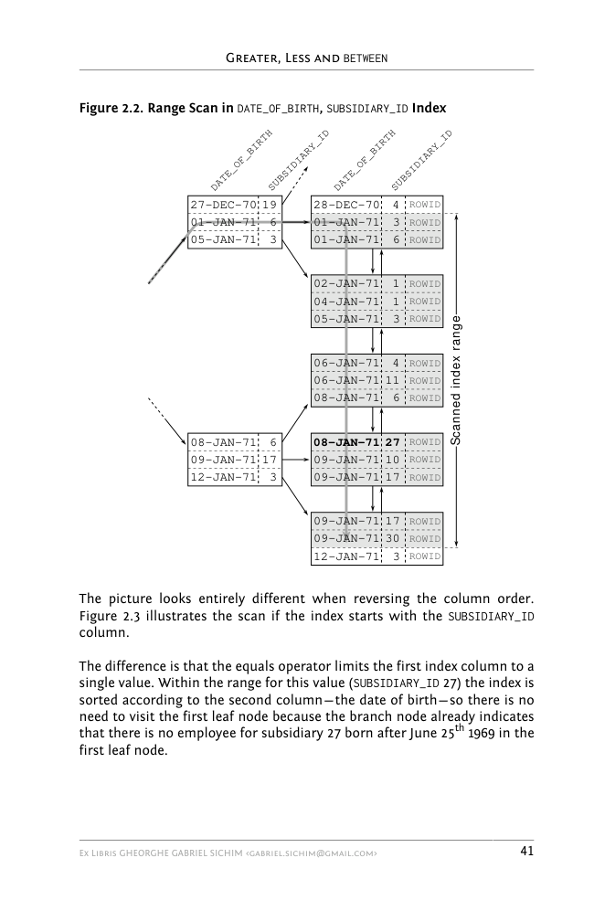
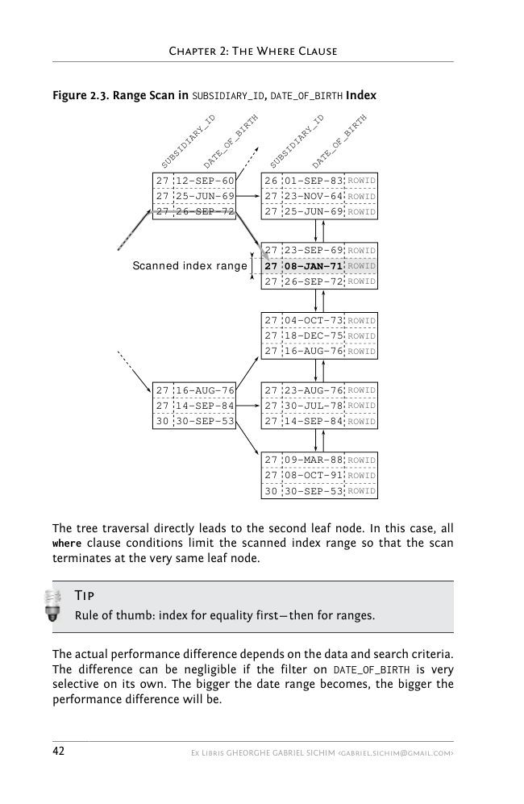
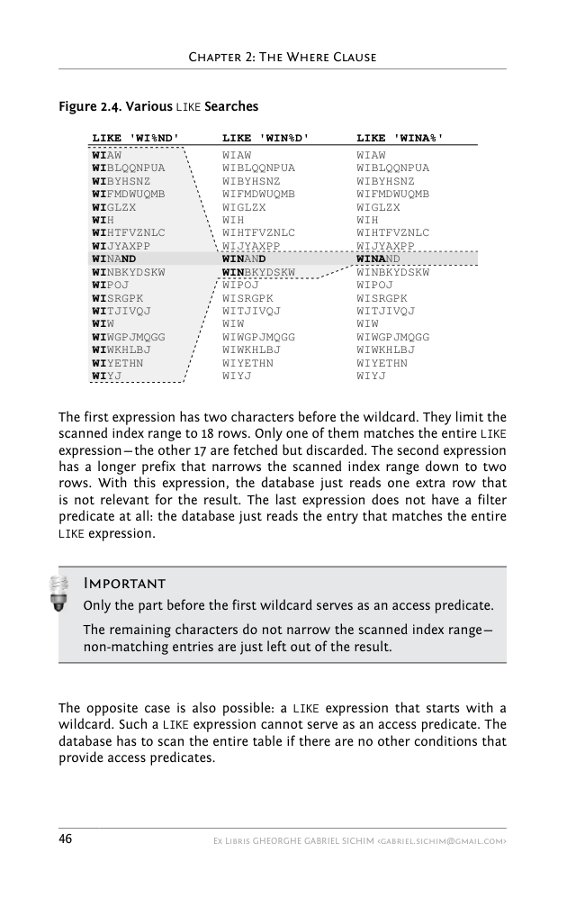

# Chương 2: Mệnh đề WHERE (Chapter 2 – The Where Clause) — Phần 2

> Phần này tiếp nối Phần 1 của Chương 2 (trang PDF 42–62), gồm các mục: truy vấn tham số hóa, tìm kiếm theo khoảng (lớn hơn/nhỏ hơn/BETWEEN, index cho bộ lọc LIKE, gộp index) và index một phần.

## Mục lục

- [Truy vấn tham số hóa (Parameterized Queries)](#truy-vấn-tham-số-hóa-parameterized-queries)
  - [Cursor Sharing và tự động tham số hóa (Cursor Sharing and Auto Parameterization)](#cursor-sharing-và-tự-động-tham-số-hóa-cursor-sharing-and-auto-parameterization)
- [Tìm kiếm theo khoảng (Searching for Ranges)](#tìm-kiếm-theo-khoảng-searching-for-ranges)
  - [Lớn hơn, nhỏ hơn và BETWEEN (Greater, Less and BETWEEN)](#lớn-hơn-nhỏ-hơn-và-between-greater-less-and-between)
  - [Đánh index cho bộ lọc LIKE (Indexing LIKE Filters)](#đánh-index-cho-bộ-lọc-like-indexing-like-filters)
  - [Gộp index (Index Merge)](#gộp-index-index-merge)
- [Index một phần (Partial Indexes)](#index-một-phần-partial-indexes)
- [Bảng thuật ngữ (Glossary)](#bảng-thuật-ngữ-glossary)

---

## Truy vấn tham số hóa (Parameterized Queries)

Mục này bàn về một chủ đề mà hầu hết sách giáo khoa SQL đều bỏ qua: **truy vấn tham số hóa** (*parameterized queries*) và **bind parameter** (*tham số ràng buộc*).

**Bind parameter** — còn được gọi là *tham số động* (*dynamic parameters*) hay *biến ràng buộc* (*bind variables*) — là một cách khác để truyền dữ liệu vào database. Thay vì viết trực tiếp giá trị vào câu lệnh SQL, bạn chỉ đặt một **ký hiệu giữ chỗ** (*placeholder*) như `?`, `:name` hoặc `@name`, rồi cung cấp giá trị thật thông qua một lời gọi API riêng.

Viết giá trị trực tiếp vào các câu lệnh tùy hứng (*ad-hoc statements* — những câu lệnh gõ tay, chạy một lần) thì chẳng có gì sai cả; tuy nhiên, trong chương trình, có hai lý do chính đáng để dùng bind parameter:

**Bảo mật (Security)**
: Biến ràng buộc là cách tốt nhất để ngăn chặn **SQL injection**¹ (*tấn công chèn mã SQL*).

**Hiệu năng (Performance)**
: Những database có **bộ nhớ đệm execution plan** (*execution plan cache*) như SQL Server và Oracle có thể **tái sử dụng** một execution plan (*kế hoạch thực thi* — bản "lộ trình" mà database chọn để chạy câu lệnh) khi thực thi cùng một câu lệnh nhiều lần. Điều này tiết kiệm công sức dựng lại execution plan, nhưng chỉ có tác dụng nếu câu lệnh SQL **giống hệt nhau**. Nếu bạn đưa các giá trị khác nhau vào câu lệnh SQL, database sẽ coi đó là một câu lệnh khác và tạo lại execution plan.

: Khi dùng bind parameter, bạn không viết giá trị thật mà chèn placeholder vào câu lệnh SQL. Nhờ đó câu lệnh không thay đổi khi được thực thi với các giá trị khác nhau.

> ¹ http://en.wikipedia.org/wiki/SQL_injection

> 💡 **Ví dụ bổ sung (không có trong sách):** Minh họa SQL injection. Giả sử ứng dụng ghép chuỗi như sau:
>
> ```java
> String sql = "SELECT * FROM users WHERE name = '" + userInput + "'";
> ```
>
> Nếu người dùng nhập `x' OR '1'='1`, câu lệnh thực sự gửi đến database là:
>
> ```sql
> SELECT * FROM users WHERE name = 'x' OR '1'='1'
> ```
>
> Điều kiện luôn đúng → trả về **toàn bộ** người dùng. Với bind parameter (`WHERE name = ?`), chuỗi `x' OR '1'='1` chỉ được coi là **một giá trị** để so sánh, không bao giờ trở thành một phần cú pháp SQL — nên không thể "chèn" mã được.

> 📝 **Giải thích thêm (không có trong sách):** Về chuyện "câu lệnh giống hệt nhau": Oracle tính một giá trị băm (hash) trên **toàn bộ văn bản** câu SQL để tìm trong shared pool. Vì vậy `... WHERE subsidiary_id = 20` và `... WHERE subsidiary_id = 30` là hai câu lệnh khác nhau (hai lần *hard parse*), còn `... WHERE subsidiary_id = :id` chỉ là một câu lệnh dùng chung cho mọi giá trị. Thậm chí khác nhau một khoảng trắng hay chữ hoa/thường cũng tạo ra câu lệnh "khác" trong Oracle. SQL Server cũng tương tự với plan cache của nó. PostgreSQL và MySQL thì không có plan cache dùng chung giữa các phiên theo cách đó; PostgreSQL chỉ cache plan cho *prepared statement* trong phạm vi một phiên (session).

Dĩ nhiên vẫn có những ngoại lệ, ví dụ khi **khối lượng dữ liệu bị ảnh hưởng phụ thuộc vào giá trị thật**:

```text
99 rows selected.
```

```sql
SELECT first_name, last_name
  FROM employees
 WHERE subsidiary_id = 20;
```

```text
---------------------------------------------------------------
|Id | Operation                   | Name        | Rows | Cost |
---------------------------------------------------------------
| 0 | SELECT STATEMENT            |             |   99 |   70 |
| 1 |  TABLE ACCESS BY INDEX ROWID| EMPLOYEES   |   99 |   70 |
|*2 |   INDEX RANGE SCAN          | EMPLOYEE_PK |   99 |    2 |
---------------------------------------------------------------

Predicate Information (identified by operation id):
---------------------------------------------------
   2 - access("SUBSIDIARY_ID"=20)
```

Tra cứu bằng index (*index lookup*) cho hiệu năng tốt nhất với các chi nhánh (*subsidiary*) nhỏ, nhưng một `TABLE ACCESS FULL` (đọc toàn bộ bảng) có thể nhanh hơn index với các chi nhánh lớn:

```text
1000 rows selected.
```

```sql
SELECT first_name, last_name
  FROM employees
 WHERE subsidiary_id = 30;
```

```text
----------------------------------------------------
| Id | Operation         | Name      | Rows | Cost |
----------------------------------------------------
|  0 | SELECT STATEMENT  |           | 1000 |  478 |
|* 1 |  TABLE ACCESS FULL| EMPLOYEES | 1000 |  478 |
----------------------------------------------------

Predicate Information (identified by operation id):
---------------------------------------------------
   1 - filter("SUBSIDIARY_ID"=30)
```

Trong trường hợp này, **histogram** (*biểu đồ tần suất* — thống kê về sự phân bố giá trị trong cột) trên cột `SUBSIDIARY_ID` đã làm đúng nhiệm vụ của nó. Optimizer (*bộ tối ưu hóa truy vấn* — thành phần của database quyết định chọn execution plan nào) dùng histogram để xác định **tần suất** xuất hiện của mã chi nhánh được nêu trong câu SQL. Kết quả là nó đưa ra hai ước lượng số dòng (*row count estimate*) khác nhau cho hai truy vấn.

Do đó, bước tính chi phí (*cost calculation*) tiếp theo cũng cho ra hai giá trị chi phí khác nhau. Khi optimizer chọn execution plan cuối cùng, nó lấy plan có **giá trị chi phí thấp nhất**. Với chi nhánh nhỏ hơn, đó là plan dùng index.

Chi phí của thao tác `TABLE ACCESS BY INDEX ROWID` **rất nhạy cảm** với ước lượng số dòng. Chọn số dòng gấp mười lần sẽ làm chi phí tăng lên đúng theo hệ số đó. Khi ấy, tổng chi phí dùng index thậm chí còn cao hơn một full table scan (*quét toàn bộ bảng*). Vì vậy, với chi nhánh lớn hơn, optimizer sẽ chọn execution plan còn lại.

Khi dùng bind parameter, optimizer **không có giá trị cụ thể** nào để xác định tần suất. Nó đành giả định dữ liệu **phân bố đều** (*equal distribution*) và luôn nhận được cùng một ước lượng số dòng và cùng giá trị chi phí. Rốt cuộc, nó sẽ luôn chọn **cùng một** execution plan.

> **Mẹo (Tip)**
>
> Histogram của cột hữu ích nhất khi các giá trị **không phân bố đều**.
>
> Với các cột phân bố đều, thường chỉ cần chia số giá trị khác nhau (*distinct values*) cho số dòng của bảng là đủ. Cách này vẫn dùng được khi có bind parameter.

> 📝 **Giải thích thêm (không có trong sách):** Câu trong sách là "divide the number of distinct values by the number of rows". Ý chính: với dữ liệu phân bố đều, optimizer chỉ cần hai con số thống kê — số dòng và số giá trị khác nhau (NDV) — để ước lượng. Cụ thể, số dòng ước lượng cho một giá trị bất kỳ là `số dòng / số giá trị khác nhau` (độ chọn lọc = 1/NDV). Ví dụ: bảng 10.000 dòng, cột có 50 giá trị khác nhau phân bố đều → mỗi giá trị khoảng 10.000 / 50 = 200 dòng. Ước lượng này không cần biết giá trị cụ thể nên vẫn đúng với bind parameter. Trong Oracle, xem `NUM_DISTINCT` trong `USER_TAB_COL_STATISTICS`; trong PostgreSQL, xem `n_distinct` trong view `pg_stats`.

Nếu ta so sánh optimizer với một **trình biên dịch** (*compiler*), thì bind variable giống như **biến** trong chương trình, còn nếu bạn viết giá trị trực tiếp vào câu lệnh thì chúng giống **hằng số** hơn. Database có thể dùng các giá trị trong câu SQL trong lúc tối ưu hóa, giống như compiler có thể tính sẵn các biểu thức hằng trong lúc biên dịch. Nói đơn giản, bind parameter **không hiển thị** với optimizer, cũng như giá trị lúc chạy (*runtime*) của biến không được compiler biết trước.

Từ góc nhìn này, có vẻ hơi nghịch lý khi bind parameter lại có thể cải thiện hiệu năng, trong khi *không* dùng bind parameter giúp optimizer luôn chọn được execution plan tốt nhất. Nhưng câu hỏi là: **với cái giá nào?** Việc sinh ra và đánh giá mọi biến thể execution plan là một khối lượng công việc khổng lồ, chẳng đáng chút nào nếu cuối cùng bạn vẫn nhận được cùng một kết quả.

> **Mẹo (Tip)**
>
> Không dùng bind parameter cũng giống như **biên dịch lại chương trình mỗi lần chạy**.

Việc quyết định dựng một execution plan **chuyên biệt** (*specialized*) hay **tổng quát** (*generic*) đặt database vào thế **tiến thoái lưỡng nan**. Hoặc là bỏ công đánh giá mọi biến thể plan có thể có cho mỗi lần thực thi để luôn có execution plan tốt nhất, hoặc là tiết kiệm chi phí tối ưu hóa và dùng execution plan đã cache bất cứ khi nào có thể — chấp nhận rủi ro dùng một execution plan chưa tối ưu. Cái khó là database không thể biết chu trình tối ưu hóa đầy đủ có cho ra execution plan khác hay không nếu không thực sự chạy hết chu trình tối ưu hóa đó. Các nhà cung cấp database cố giải quyết thế khó này bằng các phương pháp **heuristic** (*kinh nghiệm/phỏng đoán*) — nhưng thành công rất hạn chế.

Là lập trình viên, bạn có thể **chủ động** dùng bind parameter để giúp giải quyết thế khó này. Tức là: bạn nên **luôn dùng bind parameter, trừ những giá trị cần phải ảnh hưởng đến execution plan**.

Các mã trạng thái phân bố không đều như "todo" (cần làm) và "done" (đã xong) là một ví dụ điển hình. Số bản ghi "done" thường nhiều hơn số bản ghi "todo" cả một bậc độ lớn (gấp hàng chục lần). Khi đó, dùng index chỉ có ý nghĩa khi tìm các bản ghi "todo". **Partitioning** (*phân vùng* — tức là chia bảng và index ra nhiều vùng lưu trữ) là một ví dụ khác: giá trị thật có thể quyết định những phân vùng nào cần được quét. Hiệu năng của truy vấn `LIKE` cũng có thể bị ảnh hưởng bởi bind parameter, như ta sẽ thấy ở mục tiếp theo.

> **Mẹo (Tip)**
>
> Trên thực tế, chỉ có **rất ít** trường hợp mà giá trị thật ảnh hưởng đến execution plan. Vì vậy, khi phân vân, bạn nên dùng bind parameter — ít nhất là để ngăn SQL injection.

> 💡 **Ví dụ bổ sung (không có trong sách):** Bảng `tasks` có 1.000.000 dòng, trong đó 990.000 dòng `status = 'done'` và 10.000 dòng `status = 'todo'`; có index trên `status`.
>
> ```sql
> -- Nên viết literal: giá trị này ảnh hưởng đến plan
> SELECT * FROM tasks WHERE status = 'todo' AND assignee_id = ?;
> ```
>
> - Với `'todo'` (1% dữ liệu), optimizer nhờ histogram biết chỉ ~10.000 dòng → dùng `INDEX RANGE SCAN` trên `status`.
> - Nếu viết `status = ?` và truyền `'done'` vào lần đầu, plan có thể bị "đóng băng" theo full table scan, rồi các lần sau truyền `'todo'` vẫn dùng plan đó (hoặc ngược lại).
>
> Vì `status` chỉ có vài giá trị cố định, viết literal không làm phình plan cache (chỉ thêm vài câu lệnh khác nhau), còn `assignee_id` thì vẫn dùng bind parameter.
>
> Lưu ý về các phiên bản mới: Oracle 11g+ có **Adaptive Cursor Sharing** (có thể tạo nhiều plan cho cùng một câu lệnh có bind tùy theo giá trị), Oracle cũng có *bind peeking* (nhìn trộm giá trị bind ở lần parse đầu tiên); SQL Server có *parameter sniffing* và từ SQL Server 2022 có *Parameter Sensitive Plan optimization*; PostgreSQL với prepared statement sẽ dùng *custom plan* 5 lần đầu rồi mới cân nhắc chuyển sang *generic plan* (điều khiển bằng `plan_cache_mode` từ PostgreSQL 12). Đây chính là những "phương pháp heuristic" mà tác giả nhắc đến.

Các đoạn mã sau cho thấy cách dùng bind parameter trong nhiều ngôn ngữ lập trình khác nhau.

### C#

Không dùng bind parameter:

```csharp
int subsidiary_id;
SqlCommand cmd = new SqlCommand(
                   "select first_name, last_name"
                 + "  from employees"
                 + " where subsidiary_id = " + subsidiary_id
                 , connection);
```

Dùng bind parameter:

```csharp
int subsidiary_id;
SqlCommand cmd =
       new SqlCommand(
                      "select first_name, last_name"
                    + "  from employees"
                    + " where subsidiary_id = @subsidiary_id
                    , connection);
cmd.Parameters.AddWithValue("@subsidiary_id", subsidiary_id);
```

Xem thêm: tài liệu về lớp `SqlParameterCollection`.

> 📝 **Giải thích thêm (không có trong sách):** Đoạn mã gốc trong sách thiếu dấu nháy kép đóng sau `@subsidiary_id` (đã chép nguyên văn). Khi viết thật, dòng đó phải là `+ " where subsidiary_id = @subsidiary_id"`.

### Java

Không dùng bind parameter:

```java
int subsidiary_id;
Statement command = connection.createStatement(
                    "select first_name, last_name"
                  + "  from employees"
                  + " where subsidiary_id = " + subsidiary_id
                  );
```

Dùng bind parameter:

```java
int subsidiary_id;
PreparedStatement command = connection.prepareStatement(
                    "select first_name, last_name"
                  + "  from employees"
                  + " where subsidiary_id = ?"
                  );
command.setInt(1, subsidiary_id);
```

Xem thêm: tài liệu về lớp `PreparedStatement`.

### Perl

Không dùng bind parameter:

```perl
my $subsidiary_id;
my $sth = $dbh->prepare(
                  "select first_name, last_name"
                . "  from employees"
                . " where subsidiary_id = $subsidiary_id"
                );
$sth->execute();
```

Dùng bind parameter:

```perl
my $subsidiary_id;
my $sth = $dbh->prepare(
                  "select first_name, last_name"
                . "  from employees"
                . " where subsidiary_id = ?"
                );
$sth->execute($subsidiary_id);
```

Xem: *Programming the Perl DBI*.

### PHP

Dùng MySQL, không dùng bind parameter:

```php
$mysqli->query("select first_name, last_name"
             . "  from employees"
             . " where subsidiary_id = " . $subsidiary_id);
```

Dùng bind parameter:

```php
if ($stmt = $mysqli->prepare("select first_name, last_name"
                           . "  from employees"
                           . " where subsidiary_id = ?"))
{
   $stmt->bind_param("i", $subsidiary_id);
   $stmt->execute();
} else {
  /* handle SQL error */
}
```

(Chú thích trong code: `/* handle SQL error */` = "xử lý lỗi SQL".)

Xem thêm: tài liệu lớp `mysqli_stmt::bind_param` và mục "Prepared statements and stored procedures" (Câu lệnh chuẩn bị sẵn và thủ tục lưu trữ) trong tài liệu PDO.

### Ruby

Không dùng bind parameter:

```ruby
dbh.execute("select first_name, last_name"
          + "  from employees"
          + " where subsidiary_id = #{subsidiary_id}");
```

Dùng bind parameter:

```ruby
dbh.prepare("select first_name, last_name"
          + "  from employees"
          + " where subsidiary_id = ?");
dbh.execute(subsidiary_id);
```

Xem thêm: "Quoting, Placeholders, and Parameter Binding" (Trích dẫn, placeholder và ràng buộc tham số) trong *Ruby DBI Tutorial*.

> 📝 **Giải thích thêm (không có trong sách):** Trong bản trích PDF, ký tự nội suy chuỗi của Ruby bị đọc thành `2{subsidiary_id}`; cú pháp đúng của Ruby là `#{subsidiary_id}` (chèn giá trị biến vào chuỗi) — đó chính là cách ghép giá trị trực tiếp vào câu SQL, tức là *không* dùng bind parameter.

Dấu chấm hỏi (`?`) là **ký tự placeholder duy nhất** mà chuẩn SQL định nghĩa. Dấu chấm hỏi là **tham số theo vị trí** (*positional parameters*). Nghĩa là các dấu chấm hỏi được đánh số từ trái sang phải. Để gán giá trị cho một dấu chấm hỏi cụ thể, bạn phải chỉ ra số thứ tự của nó. Tuy nhiên điều này có thể rất bất tiện, vì việc đánh số sẽ thay đổi khi thêm hoặc bớt placeholder. Nhiều database cung cấp phần mở rộng riêng (*proprietary extension*) cho **tham số có tên** (*named parameters*) để giải quyết vấn đề này — ví dụ dùng ký hiệu "a còng" (`@name`) hoặc dấu hai chấm (`:name`).

> **Lưu ý (Note)**
>
> Bind parameter **không thể thay đổi cấu trúc** của một câu lệnh SQL.
>
> Nghĩa là bạn không thể dùng bind parameter cho tên bảng hay tên cột. Các bind parameter sau đây **không hoạt động**:
>
> ```java
> String sql = prepare("SELECT * FROM ? WHERE ?");
> sql.execute('employees', 'employee_id = 1');
> ```
>
> Nếu bạn cần thay đổi cấu trúc câu lệnh SQL lúc chạy, hãy dùng **SQL động** (*dynamic SQL*).

> 💡 **Ví dụ bổ sung (không có trong sách):** Trường hợp hay gặp là sắp xếp theo cột do người dùng chọn (`ORDER BY ?`). Bind parameter không làm được việc này (trong nhiều database, `ORDER BY ?` hoặc bị lỗi, hoặc chỉ sắp xếp theo một *hằng số* — tức là không sắp xếp gì cả). Cách an toàn là dựng SQL động nhưng chỉ cho phép tên cột trong một **danh sách trắng** (*whitelist*):
>
> ```java
> Map<String, String> allowed = Map.of("name", "last_name", "dob", "date_of_birth");
> String col = allowed.getOrDefault(userChoice, "last_name"); // không bao giờ dùng trực tiếp userChoice
> PreparedStatement ps = connection.prepareStatement(
>     "SELECT first_name, last_name FROM employees WHERE subsidiary_id = ? ORDER BY " + col);
> ps.setInt(1, subsidiaryId);
> ```
>
> Giá trị dữ liệu (`subsidiary_id`) vẫn đi qua bind parameter, chỉ phần cấu trúc (tên cột) mới được ghép chuỗi — và chỉ từ các giá trị đã kiểm soát.

### Cursor Sharing và tự động tham số hóa (Cursor Sharing and Auto Parameterization)

Optimizer và câu truy vấn SQL càng phức tạp thì việc cache execution plan càng trở nên quan trọng. SQL Server và Oracle có các tính năng **tự động thay thế** các giá trị literal (*giá trị viết thẳng*) trong chuỗi SQL bằng bind parameter. Các tính năng này được gọi là `CURSOR_SHARING` (Oracle) hoặc **forced parameterization** (*tham số hóa cưỡng bức*, SQL Server).

Cả hai tính năng đều là **giải pháp chữa cháy** (*workaround*) cho các ứng dụng hoàn toàn không dùng bind parameter. Bật các tính năng này sẽ **ngăn lập trình viên cố ý dùng giá trị literal** (tức là phá hỏng chính chiến lược "dùng literal cho những giá trị cần ảnh hưởng đến plan" đã nói ở trên).

> 💡 **Ví dụ bổ sung (không có trong sách):** Cách bật các tính năng này:
>
> ```sql
> -- Oracle: thay literal bằng bind do hệ thống sinh ra (:"SYS_B_0", ...)
> ALTER SESSION SET cursor_sharing = FORCE;   -- mặc định là EXACT
>
> -- SQL Server: bật forced parameterization cho cả database
> ALTER DATABASE CURRENT SET PARAMETERIZATION FORCED;  -- mặc định là SIMPLE
> ```
>
> Sau khi bật `cursor_sharing = FORCE`, câu `WHERE status = 'todo'` trong ví dụ trước sẽ bị Oracle viết lại thành `WHERE status = :"SYS_B_0"` — và optimizer mất đi lợi thế nhìn thấy giá trị `'todo'` khi bạn cố tình viết literal. Vì vậy chỉ nên coi đây là biện pháp tạm thời cho ứng dụng cũ không sửa được mã.

> 📝 **Giải thích thêm (không có trong sách) — Đối chiếu với PostgreSQL hiện đại (PG 10–17): Cơ chế Custom Plan vs. Generic Plan, `plan_cache_mode` (PG 12+), `pg_prepared_statements` (PG 14+) và `EXPLAIN (GENERIC_PLAN)` (PG 16+):**
>
> - **Trong sách (năm 2012 — thời PostgreSQL 9.1/9.2):** PostgreSQL không có bộ nhớ đệm kế hoạch thực thi dùng chung toàn cục (*global shared plan cache*) như Oracle hay SQL Server, mà chỉ lưu kế hoạch thực thi cho từng **Prepared Statement** trong phạm vi từng phiên kết nối (*session-local*). Bắt đầu từ PostgreSQL 9.2, planner áp dụng thuật toán heuristic "5 lần đầu": trong **5 lần thực thi đầu tiên** (`EXECUTE`), PostgreSQL luôn sinh **Custom Plan** (kế hoạch chuyên biệt có nhìn thấy giá trị tham số thực tế `$1, $2` để tra cứu histogram/MCV). Từ **lần thực thi thứ 6 trở đi**, PostgreSQL tính thêm một **Generic Plan** (kế hoạch tổng quát không phụ thuộc giá trị tham số, giả định dữ liệu phân bố đều) và so sánh chi phí ước lượng (*estimated cost*) của Generic Plan với chi phí trung bình của 5 Custom Plan trước đó. Nếu Generic Plan không đắt hơn, PostgreSQL sẽ "khóa" sang dùng Generic Plan cho tất cả các lần chạy tiếp theo trong phiên đó để tiết kiệm CPU lập kế hoạch.
> - **Vấn đề thực tế trên Production ("Cú rơi vực ở lần chạy thứ 6"):** Nếu bảng có dữ liệu bị lệch (*skewed data*) — ví dụ `subsidiary_id = 30` chiếm 90% bảng còn các chi nhánh khác chỉ chiếm 0,01% — và 5 lần chạy đầu của ứng dụng tình cờ rơi vào `subsidiary_id = 30` (hoặc chi phí ước lượng trung bình của Custom Plan cao hơn ước lượng phân bố đều của Generic Plan), thì đến lần chạy thứ 6 PostgreSQL sẽ khóa cứng sang Generic Plan. Ngược lại, nếu Generic Plan chọn `Index Scan` nhưng lần chạy thứ 7 truyền vào giá trị chiếm 90% bảng, câu truy vấn sẽ tụt hiệu năng đột ngột từ vài mili-giây xuống hàng chục giây!
> - **Những cải tiến đột phá trong PostgreSQL hiện đại (PG 10 → 17):**
>   1. **Tham số `plan_cache_mode` (ra mắt từ PostgreSQL 12+):** Cho phép lập trình viên và DBA kiểm soát trực tiếp hành vi chọn plan của Prepared Statement (có thể đặt ở cấp session, transaction bằng `SET LOCAL`, hoặc gắn vào function/role) với 3 giá trị:
>      - `auto` (mặc định): Giữ nguyên quy tắc 5 lần đầu Custom Plan, từ lần thứ 6 so sánh với Generic Plan.
>      - `force_custom_plan`: **Bắt buộc luôn tạo Custom Plan** dựa trên giá trị tham số thực tế ở mọi lần chạy. Giải quyết dứt điểm lỗi tụt hiệu năng ở lần chạy thứ 6 trên dữ liệu bị lệch (*skewed data*), truy vấn `LIKE $1`, hoặc bảng phân vùng phức tạp.
>      - `force_generic_plan`: **Bỏ qua 5 lần chạy thử**, lập tức dùng và cache Generic Plan ngay từ lần đầu tiên. Cực kỳ hữu ích cho các câu truy vấn OLTP đơn giản (tra cứu theo khóa chính `WHERE id = $1` hoặc cột phân bố đều) có thời gian lập kế hoạch (*planning time*) lớn hơn cả thời gian thực thi (*execution time*).
>   2. **Giám sát qua view `pg_prepared_statements` (từ PostgreSQL 14+):** PostgreSQL 14 bổ sung hai cột cực kỳ giá trị là **`generic_plans`** và **`custom_plans`** vào view hệ thống `pg_prepared_statements`. Nhờ đó bạn biết chính xác trên thực tế mỗi prepared statement trong session đã chạy bằng Custom Plan bao nhiêu lần và chuyển sang Generic Plan bao nhiêu lần, thay vì phải đoán mò!
>   3. **Cú pháp `EXPLAIN (GENERIC_PLAN)` (ra mắt từ PostgreSQL 16+):** Trước PostgreSQL 16, muốn xem Generic Plan của một câu truy vấn có `$1, $2`, bạn phải tạo `PREPARE`, 설정 `plan_cache_mode = force_generic_plan` rồi chạy `EXPLAIN EXECUTE`. Từ **PostgreSQL 16+**, bạn chỉ cần gõ trực tiếp `EXPLAIN (GENERIC_PLAN) SELECT ... WHERE col = $1;` để kiểm tra ngay kế hoạch thực thi tổng quát mà không cần `PREPARE` hay truyền giá trị!

> 💡 **Ví dụ bổ sung (không có trong sách) — Thực hành trên PostgreSQL: Kiểm chứng `plan_cache_mode`, `EXPLAIN (GENERIC_PLAN)` và `pg_prepared_statements` trên dữ liệu lệch:**
>
> ```sql
> -- Tạo bảng đơn hàng với dữ liệu bị lệch mạnh (skewed data):
> -- tenant_id = 1 có 990.000 dòng (99%), các tenant từ 2..1001 mỗi tenant chỉ có 10 dòng
> CREATE TABLE tenant_orders (
>     order_id   BIGSERIAL PRIMARY KEY,
>     tenant_id  INT NOT NULL,
>     amount     NUMERIC(10,2) NOT NULL,
>     created_at TIMESTAMPTZ NOT NULL DEFAULT now()
> );
>
> INSERT INTO tenant_orders (tenant_id, amount)
> SELECT CASE WHEN g <= 990000 THEN 1 ELSE 2 + (g % 1000) END,
>        (random() * 1000)::numeric(10,2)
>   FROM generate_series(1, 1000000) AS g;
>
> CREATE INDEX idx_tenant_orders_tenant ON tenant_orders (tenant_id);
> ANALYZE tenant_orders;
>
> -- 1. Dùng tính năng mới của PostgreSQL 16+: Xem ngay Generic Plan với $1
> EXPLAIN (GENERIC_PLAN)
> SELECT count(*), sum(amount) FROM tenant_orders WHERE tenant_id = $1;
> ```
>
> Kết quả `EXPLAIN (GENERIC_PLAN)` trên PostgreSQL 16+:
>
> ```text
>                                      QUERY PLAN
> ------------------------------------------------------------------------------------
>  Aggregate  (cost=35.56..35.57 rows=1 width=40)
>    ->  Index Scan using idx_tenant_orders_tenant on tenant_orders  (cost=0.42..30.58 rows=999 width=6)
>          Index Cond: (tenant_id = $1)
> ```
>
> Lưu ý `rows=999`: Vì không biết giá trị `$1`, Generic Plan lấy tổng số dòng chia cho số giá trị phân biệt (`1.000.000 / 1.001 ≈ 999 dòng`) và chọn `Index Scan`. Nếu ứng dụng truyền `$1 = 1` (990.000 dòng) vào Generic Plan này, nó sẽ phải đọc ngẫu nhiên casi toàn bộ bảng qua index thay vì dùng `Parallel Seq Scan`!
>
> ```sql
> -- 2. Khắc phục bằng plan_cache_mode (PostgreSQL 12+) và kiểm tra bằng pg_prepared_statements (PG 14+)
> PREPARE q_tenant(int) AS
>   SELECT count(*), sum(amount) FROM tenant_orders WHERE tenant_id = $1;
>
> -- Ép luôn dùng Custom Plan để planner luôn nhìn thấy giá trị $1 thực tế
> SET plan_cache_mode = force_custom_plan;
>
> EXPLAIN (ANALYZE, BUFFERS) EXECUTE q_tenant(1);   -- Chọn Parallel Seq Scan (đọc 990.000 dòng cực nhanh)
> EXPLAIN (ANALYZE, BUFFERS) EXECUTE q_tenant(42);  -- Chọn Index Scan (chỉ đọc đúng 10 dòng, 0.05 ms)
>
> -- Kiểm tra thống kê số lần dùng Custom Plan vs Generic Plan (PostgreSQL 14+)
> SELECT name, statement, generic_plans, custom_plans
>   FROM pg_prepared_statements
>  WHERE name = 'q_tenant';
> ```
>
> Kết quả từ `pg_prepared_statements`:
>
> ```text
>    name   |                            statement                             | generic_plans | custom_plans
> ----------+------------------------------------------------------------------+---------------+--------------
>  q_tenant | PREPARE q_tenant(int) AS SELECT count(*), sum(amount) FROM ...   |             0 |            2
> ```

---

## Tìm kiếm theo khoảng (Searching for Ranges)

Các toán tử bất đẳng thức như `<`, `>` và `between` cũng có thể dùng index giống như toán tử bằng (`=`) đã giải thích ở trên. Ngay cả bộ lọc `LIKE` — trong một số điều kiện nhất định — cũng có thể dùng index giống như các điều kiện khoảng (*range conditions*).

Tuy nhiên, việc dùng các phép toán này **giới hạn sự lựa chọn thứ tự cột** trong index nhiều cột (*multi-column index* / *concatenated index*). Giới hạn này thậm chí có thể loại bỏ **mọi** phương án đánh index tối ưu — có những truy vấn mà bạn đơn giản là **không thể** định nghĩa được một thứ tự cột "đúng" nào cả.

### Lớn hơn, nhỏ hơn và BETWEEN (Greater, Less and BETWEEN)

Rủi ro hiệu năng lớn nhất của một `INDEX RANGE SCAN` (*quét một khoảng của index*) là bước **duyệt các leaf node** (*leaf node traversal* — đi dọc theo chuỗi các nút lá của B-tree). Vì vậy, **quy tắc vàng** của việc đánh index là giữ cho khoảng index bị quét (*scanned index range*) **càng nhỏ càng tốt**. Bạn có thể kiểm tra điều đó bằng cách tự hỏi: *lần quét index bắt đầu ở đâu và kết thúc ở đâu?*

Câu hỏi này dễ trả lời nếu câu lệnh SQL nêu rõ điều kiện bắt đầu và điều kiện dừng:

```sql
SELECT first_name, last_name, date_of_birth
  FROM employees
 WHERE date_of_birth >= TO_DATE(?, 'YYYY-MM-DD')
   AND date_of_birth <= TO_DATE(?, 'YYYY-MM-DD')
```

Một index trên `DATE_OF_BIRTH` chỉ bị quét trong khoảng đã chỉ định. Lần quét bắt đầu ở ngày thứ nhất và kết thúc ở ngày thứ hai. Ta không thể thu hẹp khoảng index bị quét hơn được nữa.

Điều kiện bắt đầu và dừng sẽ kém rõ ràng hơn khi có thêm một cột thứ hai tham gia:

```sql
SELECT first_name, last_name, date_of_birth
  FROM employees
 WHERE date_of_birth >= TO_DATE(?, 'YYYY-MM-DD')
   AND date_of_birth <= TO_DATE(?, 'YYYY-MM-DD')
   AND subsidiary_id  = ?
```

Tất nhiên một index lý tưởng phải bao gồm cả hai cột, nhưng câu hỏi là: **theo thứ tự nào?**

Các hình sau cho thấy ảnh hưởng của thứ tự cột lên khoảng index bị quét. Trong minh họa này, ta tìm mọi nhân viên của chi nhánh 27 sinh trong khoảng từ ngày 1 đến ngày 9 tháng 1 năm 1971.

Hình 2.2 minh họa một phần của index trên `DATE_OF_BIRTH` và `SUBSIDIARY_ID` — theo đúng thứ tự đó. Database sẽ bắt đầu đi theo chuỗi leaf node từ đâu, hay nói cách khác: **bước duyệt cây (*tree traversal*) sẽ kết thúc ở đâu?**

Index được sắp xếp trước tiên theo ngày sinh. Chỉ khi hai nhân viên sinh cùng một ngày thì `SUBSIDIARY_ID` mới được dùng để sắp xếp các bản ghi đó. Nhưng truy vấn lại bao phủ **một khoảng ngày**. Do đó, thứ tự của `SUBSIDIARY_ID` **vô dụng** trong lúc duyệt cây. Điều này trở nên hiển nhiên khi bạn nhận ra rằng trong các branch node (*nút nhánh*) **không hề có** mục nào cho chi nhánh 27 — mặc dù trong các leaf node thì có một mục. Vì thế, bộ lọc trên `DATE_OF_BIRTH` là **điều kiện duy nhất** giới hạn khoảng index bị quét. Lần quét bắt đầu ở mục đầu tiên khớp với khoảng ngày và kết thúc ở mục cuối cùng — tức là cả năm leaf node được vẽ trong Hình 2.2.

**Hình 2.2 – Quét theo khoảng trên index (DATE_OF_BIRTH, SUBSIDIARY_ID) (Figure 2.2 – Range Scan in DATE_OF_BIRTH, SUBSIDIARY_ID Index)**



Vẽ lại hình (bên trái là các branch node, bên phải là các leaf node; mỗi dòng gồm `DATE_OF_BIRTH | SUBSIDIARY_ID | ROWID`; các leaf node được tô xám là phần thuộc **khoảng index bị quét** — *Scanned index range*):

```text
 Branch node                 Leaf node (DATE_OF_BIRTH | SUBSIDIARY_ID | ROWID)
 (DATE_OF_BIRTH | SUBS_ID)

                             +------------------------+
 +----------------+   ┌────► | 28-DEC-70 |  4 | ROWID |
 | 27-DEC-70 | 19 |   │      | 01-JAN-71 |  3 | ROWID | ◄─┐ BẮT ĐẦU quét   ┐
 | 01-JAN-71 |  6 | ──┘      | 01-JAN-71 |  6 | ROWID |   │                │
 | 05-JAN-71 |  3 | ──┐      +------------------------+                    │
 +----------------+   │      | 02-JAN-71 |  1 | ROWID |                    │
                      └────► | 04-JAN-71 |  1 | ROWID |                    │
                             | 05-JAN-71 |  3 | ROWID |                    │ Khoảng
                             +------------------------+                    │ index
                      ┌────► | 06-JAN-71 |  4 | ROWID |                    │ bị quét
                      │      | 06-JAN-71 | 11 | ROWID |                    │ (Scanned
 +----------------+   │      | 08-JAN-71 |  6 | ROWID |                    │ index
 | 08-JAN-71 |  6 | ──┘      +------------------------+                    │ range)
 | 09-JAN-71 | 17 | ───────► | 08-JAN-71 | 27 | ROWID | ◄── dòng cần tìm   │
 | 12-JAN-71 |  3 | ──┐      | 09-JAN-71 | 10 | ROWID |                    │
 +----------------+   │      | 09-JAN-71 | 17 | ROWID |                    │
                      │      +------------------------+                    │
                      └────► | 09-JAN-71 | 17 | ROWID |                    │
                             | 09-JAN-71 | 30 | ROWID | ◄── KẾT THÚC quét  ┘
                             | 12-JAN-71 |  3 | ROWID |
                             +------------------------+
```

Mô tả: Mũi tên đậm màu xám trong hình gốc đi từ branch node (mục `01-JAN-71 | 6`) xuống leaf node đầu tiên, rồi chạy dọc xuống qua **cả năm leaf node** cho đến mục `09-JAN-71 | 30`. Chỉ có một dòng thực sự thỏa mãn điều kiện (`08-JAN-71 | 27`, in đậm), nhưng database phải đọc toàn bộ phần dữ liệu từ `01-JAN-71` đến `09-JAN-71`, vì `SUBSIDIARY_ID = 27` không giúp gì cho việc xác định điểm bắt đầu/kết thúc. Lưu ý: không branch node nào chứa giá trị 27 ở cột `SUBSIDIARY_ID`.

Bức tranh trở nên hoàn toàn khác khi **đảo ngược thứ tự cột**. Hình 2.3 minh họa lần quét khi index bắt đầu bằng cột `SUBSIDIARY_ID`.

Điểm khác biệt là toán tử bằng giới hạn cột index đầu tiên về **một giá trị duy nhất**. Bên trong khoảng dành cho giá trị này (`SUBSIDIARY_ID` 27), index được sắp xếp theo cột thứ hai — ngày sinh — nên không cần ghé thăm leaf node đầu tiên, vì branch node đã cho biết rằng trong leaf node đầu tiên không có nhân viên nào của chi nhánh 27 sinh sau ngày 25 tháng 6 năm 1969.

**Hình 2.3 – Quét theo khoảng trên index (SUBSIDIARY_ID, DATE_OF_BIRTH) (Figure 2.3 – Range Scan in SUBSIDIARY_ID, DATE_OF_BIRTH Index)**



Vẽ lại hình (mỗi dòng gồm `SUBSIDIARY_ID | DATE_OF_BIRTH | ROWID`):

```text
 Branch node                 Leaf node (SUBSIDIARY_ID | DATE_OF_BIRTH | ROWID)
 (SUBS_ID | DATE_OF_BIRTH)

 +----------------+          +------------------------+
 | 27 | 12-SEP-60 | ───────► | 26 | 01-SEP-83 | ROWID |   (không cần đọc)
 | 27 | 25-JUN-69 | ──┐      | 27 | 23-NOV-64 | ROWID |
 | 27 | 26-SEP-72 | ─┐│      | 27 | 25-JUN-69 | ROWID |
 +----------------+  │└────► +------------------------+
                     │       | 27 | 23-SEP-69 | ROWID |
                     │       | 27 | 08-JAN-71 | ROWID | ◄── Khoảng index bị quét
                     │       | 27 | 26-SEP-72 | ROWID |     (Scanned index range):
                     │       +------------------------+     chỉ đúng 1 mục
                     └─────► | 27 | 04-OCT-73 | ROWID |
                             | 27 | 18-DEC-75 | ROWID |
 +----------------+          | 27 | 16-AUG-76 | ROWID |
 | 27 | 16-AUG-76 | ───────► +------------------------+
 | 27 | 14-SEP-84 | ───────► | 27 | 23-AUG-76 | ROWID |
 | 30 | 30-SEP-53 | ──┐      | 27 | 30-JUL-78 | ROWID |
 +----------------+   │      | 27 | 14-SEP-84 | ROWID |
                      │      +------------------------+
                      └────► | 27 | 09-MAR-88 | ROWID |
                             | 27 | 08-OCT-91 | ROWID |
                             | 30 | 30-SEP-53 | ROWID |
                             +------------------------+
```

Mô tả: Mũi tên đậm đi từ branch node (mục `27 | 26-SEP-72`) thẳng xuống **leaf node thứ hai**. Khoảng index bị quét chỉ gồm đúng mục `27 | 08-JAN-71` (in đậm) — lần quét bắt đầu và kết thúc trong cùng một leaf node.

Bước duyệt cây dẫn thẳng đến leaf node thứ hai. Trong trường hợp này, **mọi** điều kiện trong mệnh đề `where` đều giới hạn khoảng index bị quét, nên lần quét kết thúc ngay tại chính leaf node đó.

> **Mẹo (Tip)**
>
> Quy tắc kinh nghiệm: **đánh index cho điều kiện bằng trước — rồi mới đến điều kiện khoảng.**
>
> (*Rule of thumb: index for equality first—then for ranges.*)

Mức chênh lệch hiệu năng thực tế phụ thuộc vào dữ liệu và tiêu chí tìm kiếm. Chênh lệch có thể không đáng kể nếu bản thân bộ lọc trên `DATE_OF_BIRTH` đã rất chọn lọc (*selective*). Khoảng ngày càng lớn thì chênh lệch hiệu năng càng lớn.

Với ví dụ này, ta cũng có thể **bác bỏ huyền thoại** rằng cột chọn lọc nhất phải đặt ở vị trí ngoài cùng bên trái của index. Nếu nhìn vào các hình và chỉ xét độ chọn lọc của cột đầu tiên, ta thấy cả hai điều kiện đều khớp **13 bản ghi**. Điều này đúng bất kể ta chỉ lọc theo `DATE_OF_BIRTH` hay chỉ lọc theo `SUBSIDIARY_ID`. Ở đây độ chọn lọc chẳng có ích gì, nhưng một thứ tự cột vẫn tốt hơn thứ tự kia.

Để tối ưu hiệu năng, điều rất quan trọng là phải **biết khoảng index bị quét**. Với hầu hết các database, bạn thậm chí có thể thấy điều này ngay trong execution plan — chỉ cần biết phải nhìn vào đâu. Execution plan sau đây từ Oracle cho thấy một cách rõ ràng rằng index `EMP_TEST` bắt đầu bằng cột `DATE_OF_BIRTH`.

```text
--------------------------------------------------------------
|Id | Operation                    | Name      | Rows | Cost |
--------------------------------------------------------------
| 0 | SELECT STATEMENT             |           |    1 |    4 |
|*1 |  FILTER                      |           |      |      |
| 2 |   TABLE ACCESS BY INDEX ROWID| EMPLOYEES |    1 |    4 |
|*3 |    INDEX RANGE SCAN          | EMP_TEST  |    2 |    2 |
--------------------------------------------------------------

Predicate Information (identified by operation id):
---------------------------------------------------
1 - filter(:END_DT >= :START_DT)
3 - access(DATE_OF_BIRTH >= :START_DT
       AND DATE_OF_BIRTH <= :END_DT)
    filter(SUBSIDIARY_ID  = :SUBS_ID)
```

Phần thông tin vị từ (*predicate information*) của `INDEX RANGE SCAN` đưa ra gợi ý then chốt. Nó phân loại các điều kiện của mệnh đề `where` thành **access predicate** (*vị từ truy cập*) hoặc **filter predicate** (*vị từ lọc*). Đây là cách database cho ta biết nó sử dụng từng điều kiện như thế nào.

> **Lưu ý (Note)**
>
> Execution plan đã được rút gọn cho dễ hiểu. Phụ lục ở trang 170 giải thích chi tiết phần "Predicate Information" trong execution plan của Oracle.

Các điều kiện trên cột `DATE_OF_BIRTH` là những điều kiện **duy nhất** được liệt kê là access predicate; chúng giới hạn khoảng index bị quét. Do đó `DATE_OF_BIRTH` là cột đầu tiên trong index `EMP_TEST`. Cột `SUBSIDIARY_ID` chỉ được dùng làm bộ lọc (*filter*).

> **Quan trọng (Important)**
>
> **Access predicate** là các điều kiện bắt đầu và dừng của một lần tra cứu index. Chúng xác định khoảng index bị quét.
>
> **Index filter predicate** (*vị từ lọc trên index*) chỉ được áp dụng trong lúc duyệt leaf node. Chúng **không** thu hẹp khoảng index bị quét.

Phụ lục A giải thích cách nhận biết access predicate trong các database khác.

> 📝 **Giải thích thêm (không có trong sách):** Dòng `1 - filter(:END_DT >= :START_DT)` ở thao tác `FILTER` là một "chốt chặn" Oracle tự thêm vào: nếu ngày kết thúc nhỏ hơn ngày bắt đầu thì khoảng ngày rỗng, và Oracle sẽ không thực hiện các bước con (không chạm vào index) nữa. Trong PostgreSQL, sự phân biệt access/filter thể hiện qua `Index Cond:` (tương đương access, nhưng lưu ý PostgreSQL có thể ghi cả điều kiện chỉ được dùng như filter trên index vào `Index Cond`) và `Filter:` (lọc sau khi đọc bảng); trong SQL Server là `Seek Predicates` (access) và `Predicate` (filter); trong MySQL, `EXPLAIN` cho thấy cột `key_len` — số byte của index được dùng làm access, giúp suy ra cột nào thực sự tham gia giới hạn khoảng quét.

Database có thể dùng **tất cả** các điều kiện làm access predicate nếu ta đảo ngược định nghĩa index:

```text
---------------------------------------------------------------
| Id | Operation                    | Name      | Rows | Cost |
---------------------------------------------------------------
|  0 | SELECT STATEMENT             |           |    1 |    3 |
|* 1 |  FILTER                      |           |      |      |
|  2 |   TABLE ACCESS BY INDEX ROWID| EMPLOYEES |    1 |    3 |
|* 3 |    INDEX RANGE SCAN          | EMP_TEST2 |    1 |    2 |
---------------------------------------------------------------

Predicate Information (identified by operation id):
---------------------------------------------------
1 - filter(:END_DT >= :START_DT)
3 - access(SUBSIDIARY_ID  = :SUBS_ID
       AND DATE_OF_BIRTH >= :START_DT
       AND DATE_OF_BIRTH <= :END_T)
```

> 📝 **Giải thích thêm (không có trong sách):** `:END_T` ở dòng cuối là nguyên văn trong sách (có lẽ là lỗi gõ của `:END_DT`). Hai index trong ví dụ có thể được tạo như sau:
>
> ```sql
> CREATE INDEX emp_test  ON employees (date_of_birth, subsidiary_id);
> CREATE INDEX emp_test2 ON employees (subsidiary_id, date_of_birth);
> ```

Cuối cùng là toán tử `between`. Nó cho phép bạn chỉ định cận trên và cận dưới trong **một điều kiện duy nhất**:

```sql
DATE_OF_BIRTH BETWEEN '01-JAN-71'
                  AND '10-JAN-71'
```

Lưu ý rằng `between` **luôn bao gồm** các giá trị biên được chỉ định, giống như dùng toán tử nhỏ hơn hoặc bằng (`<=`) và lớn hơn hoặc bằng (`>=`):

```sql
    DATE_OF_BIRTH >= '01-JAN-71'
AND DATE_OF_BIRTH <= '10-JAN-71'
```

> 💡 **Ví dụ bổ sung (không có trong sách):** Bài toán: bảng `orders(order_id, customer_id, status, order_date, amount)` với 10 triệu dòng. Truy vấn thường gặp nhất:
>
> ```sql
> SELECT order_id, amount
>   FROM orders
>  WHERE customer_id = ?
>    AND order_date BETWEEN ? AND ?;
> ```
>
> | Phương án index | Access predicate | Filter predicate | Nhận xét |
> |---|---|---|---|
> | `(order_date, customer_id)` | `order_date BETWEEN ...` | `customer_id = ?` | Quét **mọi** đơn hàng của **mọi** khách trong khoảng ngày; nếu khoảng là 1 năm thì có thể là hàng triệu mục index, chỉ để lấy vài chục dòng. |
> | `(customer_id, order_date)` | `customer_id = ?` **và** `order_date BETWEEN ...` | (không có) | Nhảy thẳng đến khách hàng đó, rồi chỉ đọc đúng đoạn ngày cần thiết. Tốt nhất. |
>
> Đây chính là quy tắc "bằng trước, khoảng sau". Lưu ý thêm một cái bẫy với kiểu `DATE`/`TIMESTAMP` có phần giờ: `order_date BETWEEN '2024-01-01' AND '2024-01-31'` sẽ **bỏ sót** các đơn hàng trong ngày 31/1 sau 00:00:00, vì `BETWEEN` bao gồm biên nhưng biên trên chính là thời điểm nửa đêm. Cách an toàn là dùng khoảng nửa mở: `order_date >= DATE '2024-01-01' AND order_date < DATE '2024-02-01'` — vẫn dùng index y như cũ.
>
> Ngoài ra, nếu có thêm điều kiện khoảng thứ hai (ví dụ `amount > 1000`), chỉ một điều kiện khoảng có thể làm access predicate "trọn vẹn" sau các cột bằng; điều kiện khoảng còn lại (nếu có trong index) chỉ là filter predicate trên index — đây là lý do tác giả nói có những truy vấn không có thứ tự cột "đúng".


### Đánh index cho bộ lọc LIKE (Indexing LIKE Filters)

Toán tử `LIKE` của SQL rất hay gây ra những hành vi hiệu năng bất ngờ, bởi vì một số chuỗi tìm kiếm (*search term*) cản trở việc dùng index hiệu quả. Nghĩa là có những chuỗi tìm kiếm có thể được index rất tốt, nhưng có những chuỗi khác thì không. **Vị trí của ký tự đại diện** (*wildcard*) mới là thứ tạo nên toàn bộ sự khác biệt.

Ví dụ sau dùng ký tự đại diện `%` ở **giữa** chuỗi tìm kiếm:

```sql
SELECT first_name, last_name, date_of_birth
  FROM employees
 WHERE UPPER(last_name) LIKE 'WIN%D'
```

```text
---------------------------------------------------------------
|Id | Operation                   | Name        | Rows | Cost |
---------------------------------------------------------------
| 0 | SELECT STATEMENT            |             |    1 |    4 |
| 1 |  TABLE ACCESS BY INDEX ROWID| EMPLOYEES   |    1 |    4 |
|*2 |   INDEX RANGE SCAN          | EMP_UP_NAME |    1 |    2 |
---------------------------------------------------------------
```

Bộ lọc `LIKE` chỉ có thể dùng **các ký tự đứng trước ký tự đại diện đầu tiên** trong lúc duyệt cây. Các ký tự còn lại chỉ là filter predicate, không thu hẹp khoảng index bị quét. Do đó, một biểu thức `LIKE` đơn lẻ có thể chứa **hai loại vị từ**: (1) phần trước ký tự đại diện đầu tiên đóng vai trò access predicate; (2) các ký tự còn lại đóng vai trò filter predicate.

> **Cẩn thận (Caution)**
>
> Với PostgreSQL, có thể bạn phải chỉ định một **operator class** (*lớp toán tử*, ví dụ `varchar_pattern_ops`) để dùng biểu thức `LIKE` làm access predicate. Xem mục "Operator Classes and Operator Families" (Lớp toán tử và họ toán tử) trong tài liệu PostgreSQL để biết thêm chi tiết.

> 📝 **Giải thích thêm (không có trong sách):** Trong PostgreSQL, nếu database dùng collation khác `C` (ví dụ `en_US.UTF-8`), index B-tree thông thường được sắp xếp theo quy tắc ngôn ngữ nên không dùng được cho `LIKE 'abc%'`. Khi đó cần tạo index với operator class dành cho so khớp mẫu:
>
> ```sql
> -- PostgreSQL
> CREATE INDEX emp_up_name_like ON employees (UPPER(last_name) varchar_pattern_ops);
> -- (dùng text_pattern_ops nếu cột kiểu text)
> ```
>
> Lúc đó `EXPLAIN` sẽ cho thấy kiểu `Index Cond: ((upper(last_name) ~>=~ 'WIN') AND (upper(last_name) ~<~ 'WIO'))` và `Filter: (upper(last_name) ~~ 'WIN%D')` — tức là phần tiền tố `WIN` được chuyển thành một khoảng (access), còn toàn bộ mẫu `WIN%D` được kiểm tra như một bộ lọc.

Tiền tố (*prefix*) trước ký tự đại diện đầu tiên càng chọn lọc thì khoảng index bị quét càng nhỏ. Điều đó, đến lượt nó, làm cho việc tra cứu index nhanh hơn. Hình 2.4 minh họa mối quan hệ này bằng ba biểu thức `LIKE` khác nhau. Cả ba đều chọn ra **cùng một dòng**, nhưng khoảng index bị quét — và do đó hiệu năng — thì rất khác nhau.

**Hình 2.4 – Các kiểu tìm kiếm LIKE khác nhau (Figure 2.4 – Various LIKE Searches)**



Vẽ lại hình: ba cột là cùng một danh sách giá trị đã sắp xếp trong index (một đoạn của index trên `UPPER(last_name)`); ký hiệu `█` đánh dấu những mục nằm trong **khoảng index bị quét** của từng biểu thức; dòng `WINAND` là dòng duy nhất khớp với cả ba biểu thức.

| # | `LIKE 'WI%ND'` | `LIKE 'WIN%D'` | `LIKE 'WINA%'` |
|---|---|---|---|
| 1 | █ **WI**AW | WIAW | WIAW |
| 2 | █ **WI**BLQQNPUA | WIBLQQNPUA | WIBLQQNPUA |
| 3 | █ **WI**BYHSNZ | WIBYHSNZ | WIBYHSNZ |
| 4 | █ **WI**FMDWUQMB | WIFMDWUQMB | WIFMDWUQMB |
| 5 | █ **WI**GLZX | WIGLZX | WIGLZX |
| 6 | █ **WI**H | WIH | WIH |
| 7 | █ **WI**HTFVZNLC | WIHTFVZNLC | WIHTFVZNLC |
| 8 | █ **WI**JYAXPP | WIJYAXPP | WIJYAXPP |
| 9 | █ **WI**NA**ND** ✔ | █ **WIN**AN**D** ✔ | █ **WINA**ND ✔ |
| 10 | █ **WI**NBKYDSKW | █ **WIN**BKYDSKW | WINBKYDSKW |
| 11 | █ **WI**POJ | WIPOJ | WIPOJ |
| 12 | █ **WI**SRGPK | WISRGPK | WISRGPK |
| 13 | █ **WI**TJIVQJ | WITJIVQJ | WITJIVQJ |
| 14 | █ **WI**W | WIW | WIW |
| 15 | █ **WI**WGPJMQGG | WIWGPJMQGG | WIWGPJMQGG |
| 16 | █ **WI**WKHLBJ | WIWKHLBJ | WIWKHLBJ |
| 17 | █ **WI**YETHN | WIYETHN | WIYETHN |
| 18 | █ **WI**YJ | WIYJ | WIYJ |
| | **18 mục bị quét** | **2 mục bị quét** | **1 mục bị quét** |

Mô tả: Trong hình gốc, phần chữ in đậm là phần tiền tố được dùng làm access predicate; vùng tô xám (bao bằng nét đứt) là khoảng index bị quét — rộng toàn bộ 18 dòng với `'WI%ND'`, chỉ 2 dòng (`WINAND`, `WINBKYDSKW`) với `'WIN%D'`, và chỉ 1 dòng (`WINAND`) với `'WINA%'`.

Biểu thức thứ nhất có **hai ký tự** trước ký tự đại diện. Chúng giới hạn khoảng index bị quét còn **18 dòng**. Chỉ một trong số đó khớp với toàn bộ biểu thức `LIKE` — 17 dòng còn lại bị đọc lên rồi bị loại bỏ. Biểu thức thứ hai có tiền tố dài hơn, thu hẹp khoảng index bị quét xuống còn **hai dòng**. Với biểu thức này, database chỉ đọc thêm một dòng không liên quan đến kết quả. Biểu thức cuối cùng **hoàn toàn không có** filter predicate: database chỉ đọc đúng mục khớp với toàn bộ biểu thức `LIKE`.

> **Quan trọng (Important)**
>
> **Chỉ phần đứng trước ký tự đại diện đầu tiên** mới đóng vai trò access predicate.
>
> Các ký tự còn lại không thu hẹp khoảng index bị quét — những mục không khớp chỉ đơn giản bị loại khỏi kết quả.

Trường hợp ngược lại cũng có thể xảy ra: một biểu thức `LIKE` **bắt đầu bằng** ký tự đại diện. Biểu thức `LIKE` như vậy **không thể** làm access predicate. Database phải quét toàn bộ bảng nếu không có điều kiện nào khác cung cấp access predicate.

> **Mẹo (Tip)**
>
> Tránh các biểu thức `LIKE` có **ký tự đại diện ở đầu** (ví dụ `'%TERM'`).

Vị trí của các ký tự đại diện ảnh hưởng đến việc dùng index — ít nhất là **về lý thuyết**. Trong thực tế, optimizer tạo ra một execution plan **tổng quát** khi chuỗi tìm kiếm được truyền qua bind parameter. Khi đó, optimizer phải **đoán** xem phần lớn các lần thực thi có ký tự đại diện ở đầu hay không.

Hầu hết các database đơn giản là giả định rằng **không có** ký tự đại diện ở đầu khi tối ưu hóa một điều kiện `LIKE` có bind parameter, nhưng giả định này sai nếu biểu thức `LIKE` được dùng để **tìm kiếm toàn văn** (*full-text search* — tìm một từ ở bất kỳ vị trí nào trong văn bản). Đáng tiếc là không có cách trực tiếp nào để đánh dấu một điều kiện `LIKE` là tìm kiếm toàn văn. Hộp "Gắn nhãn biểu thức LIKE toàn văn" bên dưới cho thấy một nỗ lực **không thành công**. Chỉ định chuỗi tìm kiếm mà không dùng bind parameter là giải pháp hiển nhiên nhất, nhưng điều đó làm tăng chi phí tối ưu hóa và mở ra lỗ hổng SQL injection. Một giải pháp hiệu quả mà vẫn an toàn và khả chuyển (*portable* — chạy được trên nhiều database) là **cố ý làm rối** (*obfuscate*) điều kiện `LIKE`. Mục "Kết hợp các cột" (*Combining Columns*) ở trang 70 giải thích chi tiết điều này.

> **Gắn nhãn biểu thức LIKE toàn văn (Labeling Full-Text LIKE Expressions)**
>
> Khi dùng toán tử `LIKE` cho tìm kiếm toàn văn, ta có thể tách các ký tự đại diện ra khỏi chuỗi tìm kiếm:
>
> ```sql
> WHERE text_column LIKE '%' || ? || '%'
> ```
>
> Các ký tự đại diện được viết trực tiếp vào câu lệnh SQL, nhưng ta dùng bind parameter cho chuỗi tìm kiếm. Biểu thức `LIKE` cuối cùng được chính database dựng lên bằng toán tử nối chuỗi `||` (Oracle, PostgreSQL). Mặc dù dùng bind parameter, biểu thức `LIKE` cuối cùng **luôn luôn** bắt đầu bằng ký tự đại diện. Đáng tiếc là các database **không nhận ra** điều đó.

Với PostgreSQL, vấn đề lại khác, vì PostgreSQL **giả định có** ký tự đại diện ở đầu khi dùng bind parameter cho biểu thức `LIKE`. PostgreSQL đơn giản là không dùng index trong trường hợp đó. Cách duy nhất để có truy cập bằng index cho một biểu thức `LIKE` là làm cho chuỗi tìm kiếm thật sự **hiển thị với optimizer**. Nếu bạn không dùng bind parameter mà đưa chuỗi tìm kiếm trực tiếp vào câu lệnh SQL, bạn **phải** có các biện pháp phòng ngừa khác chống tấn công SQL injection!

> 📝 **Giải thích thêm (không có trong sách):** Ở các phiên bản PostgreSQL hiện đại, hành vi này phụ thuộc vào việc plan là *custom* hay *generic*: với prepared statement, PostgreSQL thường lập *custom plan* (có nhìn thấy giá trị thật) trong những lần thực thi đầu, nên `LIKE $1` với giá trị `'WIN%'` vẫn có thể dùng index; chỉ khi chuyển sang *generic plan* (không biết giá trị) thì index mới không thể dùng cho `LIKE`. Có thể ép hành vi bằng `SET plan_cache_mode = force_custom_plan;` (PostgreSQL 12+).

Ngay cả khi database tối ưu hóa execution plan cho trường hợp có ký tự đại diện ở đầu, hiệu năng vẫn có thể không đủ. Khi đó, bạn có thể dùng một phần khác của mệnh đề `where` để truy cập dữ liệu hiệu quả — xem thêm mục "Cố ý dùng index filter predicate" (*Index Filter Predicates Used Intentionally*) ở trang 112. Nếu không có đường truy cập nào khác, bạn có thể dùng một trong các giải pháp **index toàn văn** (*full-text index*) độc quyền sau đây.

> **MySQL**
>
> MySQL cung cấp các từ khóa `match` và `against` để tìm kiếm toàn văn. Bắt đầu từ MySQL 5.6, bạn cũng có thể tạo full-text index cho bảng InnoDB — trước đó điều này chỉ làm được với bảng MyISAM. Xem "Full-Text Search Functions" (Các hàm tìm kiếm toàn văn) trong tài liệu MySQL.

> **Oracle Database**
>
> Oracle cung cấp từ khóa `contains`. Xem "Oracle Text Application Developer's Guide" (Hướng dẫn cho nhà phát triển ứng dụng Oracle Text).

> **PostgreSQL**
>
> PostgreSQL cung cấp toán tử `@@` để thực hiện tìm kiếm toàn văn. Xem "Full Text Search" trong tài liệu PostgreSQL.
>
> Một lựa chọn khác là dùng extension **WildSpeed**² để tối ưu trực tiếp các biểu thức `LIKE`. Extension này lưu văn bản dưới **mọi phép xoay vòng** (*rotation*) có thể, để mỗi ký tự đều có một lần đứng ở đầu. Nghĩa là văn bản được index không chỉ lưu một lần mà lưu **bấy nhiêu lần bằng số ký tự** trong chuỗi — vì thế nó tốn rất nhiều dung lượng.

> **SQL Server**
>
> SQL Server cung cấp từ khóa `contains`. Xem "Full-Text Search" trong tài liệu SQL Server.

> ² http://www.sai.msu.su/~megera/wiki/wildspeed

> **Hãy suy nghĩ (Think about it)**
>
> Làm thế nào để index một tìm kiếm `LIKE` chỉ có **một** ký tự đại diện ở **đầu** chuỗi tìm kiếm (`'%TERM'`)?

> 💡 **Ví dụ bổ sung (không có trong sách):** Cú pháp tham khảo cho các giải pháp toàn văn nêu trên (bảng `articles(id, body)`):
>
> ```sql
> -- MySQL 5.6+ (InnoDB)
> CREATE FULLTEXT INDEX articles_ft ON articles (body);
> SELECT id FROM articles WHERE MATCH(body) AGAINST ('index' IN NATURAL LANGUAGE MODE);
>
> -- PostgreSQL: full-text search với GIN index
> CREATE INDEX articles_fts ON articles USING GIN (to_tsvector('english', body));
> SELECT id FROM articles WHERE to_tsvector('english', body) @@ to_tsquery('english', 'index');
>
> -- PostgreSQL: extension pg_trgm (giải pháp phổ biến hiện nay thay cho WildSpeed),
> -- cho phép LIKE '%TERM%' dùng index
> CREATE EXTENSION pg_trgm;
> CREATE INDEX articles_trgm ON articles USING GIN (body gin_trgm_ops);
> SELECT id FROM articles WHERE body LIKE '%index%';
>
> -- Oracle Text
> CREATE INDEX articles_ctx ON articles (body) INDEXTYPE IS CTXSYS.CONTEXT;
> SELECT id FROM articles WHERE CONTAINS(body, 'index') > 0;
>
> -- SQL Server (cần có full-text catalog và full-text index trên bảng)
> SELECT id FROM articles WHERE CONTAINS(body, 'index');
> ```
>
> **Gợi ý cho câu hỏi "Hãy suy nghĩ"** (chỉ là một hướng, sách không đưa đáp án ở đây): `'%TERM'` nghĩa là "kết thúc bằng TERM". Nếu đảo ngược chuỗi, nó trở thành "bắt đầu bằng MRET". Do đó có thể tạo function-based index trên `REVERSE(cột)` và viết `WHERE REVERSE(cột) LIKE 'MRET%'` (ví dụ Oracle: `CREATE INDEX t_rev ON t (REVERSE(col))` — lưu ý hàm `REVERSE` trong Oracle không được tài liệu hóa chính thức; PostgreSQL có hàm `reverse()` và có thể dùng expression index kèm `text_pattern_ops`).

### Gộp index (Index Merge)

Đây là một trong những câu hỏi phổ biến nhất về đánh index: tạo **một index cho mỗi cột** tốt hơn, hay tạo **một index duy nhất cho tất cả các cột** của mệnh đề `where`? Trong hầu hết các trường hợp, câu trả lời rất đơn giản: **một index nhiều cột thì tốt hơn**.

Tuy nhiên, có những truy vấn mà một index duy nhất không thể làm việc hoàn hảo, dù bạn định nghĩa index thế nào đi nữa; ví dụ, các truy vấn có **hai hay nhiều điều kiện khoảng độc lập** như ví dụ sau:

```sql
SELECT first_name, last_name, date_of_birth
  FROM employees
 WHERE UPPER(last_name) < ?
   AND date_of_birth    < ?
```

Không thể định nghĩa một index B-tree nào hỗ trợ truy vấn này mà **không có** filter predicate. Để hiểu tại sao, bạn chỉ cần nhớ rằng một index là một **danh sách liên kết** (*linked list*).

Nếu bạn định nghĩa index là `UPPER(LAST_NAME), DATE_OF_BIRTH` (theo thứ tự đó), danh sách bắt đầu từ A và kết thúc ở Z. Ngày sinh chỉ được xét đến khi có hai nhân viên trùng tên. Nếu bạn định nghĩa index theo chiều ngược lại, nó sẽ bắt đầu từ những nhân viên lớn tuổi nhất và kết thúc ở những nhân viên trẻ nhất. Trong trường hợp đó, tên chỉ có ảnh hưởng nhỏ đến thứ tự sắp xếp.

Dù bạn có xoay vần định nghĩa index thế nào, các mục luôn được xếp dọc theo **một chuỗi**. Ở một đầu là các mục nhỏ, ở đầu kia là các mục lớn. Vì vậy, một index chỉ có thể hỗ trợ **một** điều kiện khoảng làm access predicate. Hỗ trợ hai điều kiện khoảng độc lập đòi hỏi một **trục thứ hai**, chẳng hạn như một **bàn cờ vua**. Khi đó truy vấn trên sẽ khớp với mọi ô ở một góc của bàn cờ, nhưng index không giống bàn cờ — nó giống một **sợi xích**. Không có góc nào cả.

> 📝 **Giải thích thêm (không có trong sách):** Hình dung bằng ASCII:
>
> ```text
> Bàn cờ (2 trục) – điều kiện name < 'M' AND dob < 1980 là một "góc":
>
>              dob →  1950  1960  1970 | 1980  1990
>   name  A           [x]   [x]   [x]  |  .     .
>    ↓    F           [x]   [x]   [x]  |  .     .
>         K           [x]   [x]   [x]  |  .     .
>         ------------------------------+-----------
>         P            .     .     .   |  .     .
>         Z            .     .     .   |  .     .
>
> Index (1 trục, một sợi xích) theo (name, dob):
>   A/1950 - A/1960 - A/1970 - A/1980 - A/1990 - F/1950 - ... - K/1990 | P/1950 ...
>   └────────── access: name < 'M' (quét liên tục) ──────────────────┘
>   các mục A/1980, A/1990, ... bị đọc rồi loại → dob < 1980 chỉ là filter
> ```

Tất nhiên bạn có thể chấp nhận filter predicate và vẫn dùng một index nhiều cột. Dù sao thì đó cũng là giải pháp tốt nhất trong nhiều trường hợp. Khi đó, định nghĩa index nên đặt **cột chọn lọc hơn lên trước** để nó có thể được dùng với access predicate. Đó có thể chính là **nguồn gốc** của huyền thoại "cột chọn lọc nhất đặt trước", nhưng quy tắc này chỉ đúng khi bạn **không thể tránh** filter predicate.

Phương án còn lại là dùng **hai index riêng biệt**, mỗi index cho một cột. Khi đó database phải quét cả hai index trước, rồi kết hợp các kết quả. Riêng việc tra cứu index hai lần đã tốn nhiều công sức hơn vì database phải duyệt hai cây index. Thêm vào đó, database cần rất nhiều bộ nhớ và thời gian CPU để kết hợp các kết quả trung gian.

> **Lưu ý (Note)**
>
> **Quét một index nhanh hơn quét hai index.**

Các database dùng hai phương pháp để kết hợp index. Thứ nhất là **index join** (*kết nối index*). Chương 4, "Phép kết nối" (*The Join Operation*), giải thích chi tiết các thuật toán liên quan. Cách tiếp cận thứ hai tận dụng chức năng đến từ thế giới **kho dữ liệu** (*data warehouse*).

Data warehouse là **"mẹ đẻ" của mọi truy vấn ad-hoc**. Chỉ cần vài cú nhấp chuột là có thể kết hợp các điều kiện tùy ý thành câu truy vấn bạn muốn. Không thể đoán trước những tổ hợp cột nào có thể xuất hiện trong mệnh đề `where`, và điều đó khiến việc đánh index như đã giải thích cho đến giờ gần như bất khả thi.

Các data warehouse dùng một loại index chuyên dụng để giải quyết vấn đề đó: cái gọi là **bitmap index** (*index dạng bản đồ bit*). Ưu điểm của bitmap index là chúng có thể được **kết hợp với nhau khá dễ dàng**. Nghĩa là bạn có được hiệu năng khá tốt khi đánh index từng cột riêng lẻ. Ngược lại, nếu bạn biết trước câu truy vấn để có thể tạo một index B-tree nhiều cột "may đo" cho nó, thì index đó vẫn sẽ nhanh hơn việc kết hợp nhiều bitmap index.

Điểm yếu lớn nhất, xa hơn hẳn mọi điểm yếu khác, của bitmap index là khả năng mở rộng (*scalability*) **tệ đến mức nực cười** đối với `insert`, `update` và `delete`. Các thao tác ghi đồng thời (*concurrent write*) gần như là không thể. Điều đó không thành vấn đề trong data warehouse, vì các tiến trình nạp dữ liệu (*load process*) được lên lịch chạy lần lượt cái này sau cái kia. Trong các ứng dụng trực tuyến (*online application*), bitmap index hầu như vô dụng.

> **Quan trọng (Important)**
>
> Bitmap index **gần như không thể dùng được** cho **xử lý giao dịch trực tuyến** (*online transaction processing* — OLTP).

Nhiều sản phẩm database cung cấp một **giải pháp lai** giữa B-tree và bitmap index. Khi không có đường truy cập nào tốt hơn, chúng chuyển đổi kết quả của nhiều lần quét B-tree thành các cấu trúc bitmap **trong bộ nhớ** (*in-memory*). Những cấu trúc này có thể được kết hợp hiệu quả. Các cấu trúc bitmap không được lưu trữ lâu dài mà bị hủy sau khi câu lệnh thực thi xong, nhờ đó tránh được vấn đề khả năng mở rộng ghi kém. Nhược điểm là nó cần rất nhiều bộ nhớ và thời gian CPU. Rốt cuộc thì phương pháp này là **hành động tuyệt vọng của optimizer**.

> 📝 **Giải thích thêm (không có trong sách):** Giải pháp lai này xuất hiện trong execution plan dưới các tên:
>
> | Database | Tên thao tác trong plan |
> |---|---|
> | Oracle | `BITMAP CONVERSION FROM ROWIDS`, `BITMAP AND` / `BITMAP OR`, `BITMAP CONVERSION TO ROWIDS` |
> | PostgreSQL | `Bitmap Index Scan` → `BitmapAnd` / `BitmapOr` → `Bitmap Heap Scan` |
> | MySQL | `type = index_merge`, `Extra: Using intersect(...)` / `Using union(...)` / `Using sort_union(...)` |
> | SQL Server | Không có bitmap trong bộ nhớ theo kiểu này; dùng *index intersection* (join hai index, thường là `Hash Match` hoặc `Merge Join` trên khóa) — chính là "index join" |

> 💡 **Ví dụ bổ sung (không có trong sách):** Bảng `employees` có 2 index riêng lẻ: `emp_name (UPPER(last_name))` và `emp_dob (date_of_birth)`. Trong PostgreSQL:
>
> ```sql
> EXPLAIN SELECT first_name, last_name, date_of_birth
>           FROM employees
>          WHERE UPPER(last_name) < 'B' AND date_of_birth < DATE '1960-01-01';
> ```
>
> Plan có thể có dạng:
>
> ```text
> Bitmap Heap Scan on employees
>   Recheck Cond: ((upper(last_name) < 'B') AND (date_of_birth < '1960-01-01'))
>   ->  BitmapAnd
>         ->  Bitmap Index Scan on emp_name
>               Index Cond: (upper(last_name) < 'B')
>         ->  Bitmap Index Scan on emp_dob
>               Index Cond: (date_of_birth < '1960-01-01')
> ```
>
> Cả hai điều kiện đều là "access" trên index riêng của chúng, nhưng phải duyệt **hai** cây và tốn bộ nhớ cho `BitmapAnd`. Nếu thay bằng một index `(UPPER(last_name), date_of_birth)` thì chỉ cần **một** lần quét: `last_name < 'B'` là access predicate, `date_of_birth` là filter predicate ngay trên index — thường nhanh hơn, đúng như ghi chú "Quét một index nhanh hơn quét hai index" (tùy độ chọn lọc của từng điều kiện).

> 📝 **Giải thích thêm (không có trong sách) — Đối chiếu với PostgreSQL hiện đại (PG 10–17): Giải quyết bài toán "Hai điều kiện khoảng" bằng `Range Types` (`daterange`, `tstzrange`), `Multirange` (PG 14+) và `GiST Index`:**
>
> - **Hạn chế của B-Tree được nêu trong sách:** Như tác giả đã phân tích rất sắc sảo bằng hình ảnh "bàn cờ 2 chiều vs. sợi xích 1 chiều", một B-Tree index nhiều cột chỉ hỗ trợ **tối đa một** điều kiện khoảng làm *access predicate*. Bài toán kinh điển khiến B-Tree bó tay trong thực tế là **tìm kiếm trên khoảng hiệu lực** (ví dụ: tìm khuyến mãi/hợp đồng đang có hiệu lực tại thời điểm `$1`: `WHERE start_date <= $1 AND end_date >= $1`, hoặc tìm các đặt phòng giao nhau với khoảng `[$1, $2]`: `WHERE check_in < $2 AND check_out > $1`). Với B-Tree trên `(start_date, end_date)`, truy vấn phải quét toàn bộ mọi bản ghi có `start_date <= $1` từ quá khứ xa xưa rồi lọc bỏ bằng filter predicate `end_date >= $1`.
> - **"Vũ khí hạng nặng" của PostgreSQL hiện đại — `Range Types`, `Multirange` và `GiST Index`:**
>   1. **Kiểu dữ liệu khoảng gốc (*Range Types* — ra mắt từ PostgreSQL 9.2 và hoàn thiện mạnh mẽ qua PG 10–17):** Thay vì tách thành 2 cột rời rạc `start_date` và `end_date`, PostgreSQL cung cấp các kiểu khoảng tích hợp sẵn: `int4range`, `int8range`, `numrange`, `tsrange`, `tstzrange` (khoảng `timestamptz`), và `daterange`. Một giá trị duy nhất biểu diễn cả biên dưới, biên trên và tính đóng/mở của hai đầu (ví dụ `[2025-01-01, 2025-02-01)` là bao gồm đầu, không bao gồm cuối).
>   2. **Kiểu đa khoảng (*Multirange Types* — ra mắt từ PostgreSQL 14+):** Mỗi kiểu range đều tự động có một kiểu multirange tương ứng (`int4multirange`, `int8multirange`, `nummultirange`, `tsmultirange`, `tstzmultirange`, `datemultirange`), cho phép lưu và tính toán hợp/giao/trừ của **nhiều khoảng rời nhau** ngay trong một cột duy nhất (ví dụ: các khung giờ rảnh của bác sĩ trong ngày sau khi trừ đi các ca đã đặt lịch)!
>   3. **Index 2 chiều bằng `GiST` (*Generalized Search Tree*) và `SP-GiST`:** Khi đánh index `USING GIST (valid_period)` trên cột kiểu range, PostgreSQL xây dựng cây phân hoạch không gian (tương tự R-Tree) lưu trữ các hộp bao (*bounding boxes*) của cả biên đầu lẫn biên cuối. Nhờ đó, toán tử **chứa điểm/khoảng (`@>`)** và **giao nhau (`&&`)** giới hạn **đồng thời cả hai đầu của khoảng** ngay trong lúc duyệt cây (`Index Cond` thực sự trên 2 chiều, tương đương "góc bàn cờ" mà tác giả mơ ước!).
>   4. **Ràng buộc chống chồng lấn (`EXCLUDE USING GIST`) với `btree_gist`:** Kết hợp extension `btree_gist` (hỗ trợ toán tử `=` cho các kiểu vô hướng như `INT`, `UUID`, `TEXT` trong GiST index) với toán tử `&&` trên range, PostgreSQL cho phép khai báo ràng buộc toàn vẹn cấp database: *"Không cho phép một phòng (`room_id WITH =`) có hai đặt phòng trùng thời gian (`booking_period WITH &&`)"* — điều mà B-Tree `UNIQUE` hoàn toàn bất lực!

> 💡 **Ví dụ bổ sung (không có trong sách) — Thực hành trên PostgreSQL: So sánh B-Tree `(start_time, end_time)` với `tstzrange` + `GiST Index` và `EXCLUDE USING GIST`:**
>
> ```sql
> -- Cần extension btree_gist để kết hợp cột thường (=) và cột khoảng (&&) trong một GiST index
> CREATE EXTENSION IF NOT EXISTS btree_gist;
>
> -- Tạo bảng đặt phòng sử dụng kiểu tstzrange và ràng buộc chống trùng lịch cấp DB
> CREATE TABLE room_bookings (
>     booking_id     BIGSERIAL PRIMARY KEY,
>     room_id        INT NOT NULL,
>     guest_name     TEXT NOT NULL,
>     booking_period TSTZRANGE NOT NULL,
>     -- Ràng buộc EXCLUDE tự động tạo một GiST index trên (room_id, booking_period)
>     CONSTRAINT no_overlapping_bookings
>         EXCLUDE USING GIST (room_id WITH =, booking_period WITH &&)
> );
>
> -- Nạp dữ liệu mẫu: 1.000 phòng, mỗi phòng 500 lượt đặt không chồng lấn trong 2 năm qua (500.000 dòng)
> INSERT INTO room_bookings (room_id, guest_name, booking_period)
> SELECT r AS room_id,
>        'Guest_' || s,
>        tstzrange(
>            TIMESTAMPTZ '2023-01-01 14:00:00+07' + (s * 2) * INTERVAL '1 day',
>            TIMESTAMPTZ '2023-01-01 12:00:00+07' + (s * 2 + 1) * INTERVAL '1 day',
>            '[)'
>        )
>   FROM generate_series(1, 1000) AS r
>   CROSS JOIN generate_series(1, 500) AS s;
>
> ANALYZE room_bookings;
>
> -- Truy vấn 1: Tìm xem phòng 42 có ai đang ở tại thời điểm '2024-06-15 10:00:00+07' không (toán tử @>)
> EXPLAIN (ANALYZE, BUFFERS)
> SELECT booking_id, guest_name, booking_period
>   FROM room_bookings
>  WHERE room_id = 42
>    AND booking_period @> TIMESTAMPTZ '2024-06-15 10:00:00+07';
> ```
>
> Kế hoạch thực thi thực tế với `GiST Index`:
>
> ```text
>                                                               QUERY PLAN
> ---------------------------------------------------------------------------------------------------------------------------------------
>  Index Scan using no_overlapping_bookings on room_bookings  (cost=0.28..8.30 rows=1 width=49) (actual time=0.041..0.043 rows=1 loops=1)
>    Index Cond: ((room_id = 42) AND (booking_period @> '2024-06-15 10:00:00+07'::timestamp with time zone))
>    Buffers: shared hit=4
>  Planning Time: 0.115 ms
>  Execution Time: 0.062 ms
> ```
>
> Chỉ mất **4 trang bộ nhớ (`shared hit=4`) và `0.062 ms`** vì GiST index thu hẹp đồng thời cả `room_id = 42` lẫn biên dưới và biên trên của `booking_period`! Nếu dùng B-Tree truyền thống trên `(room_id, check_in, check_out)` với điều kiện `check_in <= '2024-06-15' AND check_out >= '2024-06-15'`, B-Tree sẽ phải đọc toàn bộ hàng trăm lượt đặt phòng của phòng 42 từ đầu năm 2023 đến tháng 6/2024.
>
> ```sql
> -- Truy vấn 2 (PostgreSQL 14+ Multirange): Tìm các khoảng thời gian TRỐNG của phòng 42 trong tuần lễ
> -- bằng cách lấy khoảng cả tuần trừ đi (-) hợp của các khoảng đã đặt (range_agg -> tstzmultirange)
> SELECT tstzmultirange(tstzrange('2024-06-10 00:00+07', '2024-06-17 00:00+07', '[)'))
>      - COALESCE(range_agg(booking_period), '{}'::tstzmultirange) AS free_periods
>   FROM room_bookings
>  WHERE room_id = 42
>    AND booking_period && tstzrange('2024-06-10 00:00+07', '2024-06-17 00:00+07', '[)');
> ```

---

## Index một phần (Partial Indexes)

Cho đến giờ ta mới chỉ bàn về việc nên thêm **những cột nào** vào index. Với **partial index** (*index một phần* — PostgreSQL) hay **filtered index** (*index có lọc* — SQL Server), bạn còn có thể chỉ định **những dòng nào** được đưa vào index.

> **Cẩn thận (Caution)**
>
> Oracle có một cách tiếp cận **độc đáo** đối với partial index. Mục tiếp theo sẽ giải thích nó, dựa trên nền tảng của mục này.

Partial index hữu ích cho những điều kiện `where` thường dùng có chứa **giá trị hằng** — như mã trạng thái trong ví dụ sau:

```sql
SELECT message
  FROM messages
 WHERE processed = 'N'
   AND receiver  = ?
```

Những truy vấn như thế này rất phổ biến trong các **hệ thống hàng đợi** (*queuing systems*). Truy vấn lấy tất cả các tin nhắn **chưa xử lý** của một người nhận cụ thể. Những tin nhắn đã xử lý rồi thì hiếm khi cần đến. Nếu cần, chúng thường được truy cập bằng một tiêu chí cụ thể hơn, như primary key (*khóa chính*).

Ta có thể tối ưu truy vấn này bằng một index hai cột. Nếu chỉ xét riêng truy vấn này, thứ tự cột **không quan trọng** vì không có điều kiện khoảng nào.

```sql
CREATE INDEX messages_todo
          ON messages (receiver, processed)
```

Index này làm tròn nhiệm vụ, nhưng nó chứa rất nhiều dòng **không bao giờ được tìm đến**, cụ thể là tất cả những tin nhắn đã được xử lý. Nhờ khả năng mở rộng theo **hàm logarit** (*logarithmic scalability* — độ sâu cây B-tree chỉ tăng rất chậm khi dữ liệu tăng), index vẫn làm cho truy vấn rất nhanh, dù nó lãng phí nhiều dung lượng đĩa.

Với partial index, bạn có thể giới hạn index chỉ chứa các tin nhắn chưa xử lý. Cú pháp cho việc này đơn giản đến ngạc nhiên: **một mệnh đề `where`**.

```sql
CREATE INDEX messages_todo
          ON messages (receiver)
       WHERE processed = 'N'
```

Index chỉ chứa những dòng thỏa mãn mệnh đề `where`. Trong trường hợp cụ thể này, ta thậm chí có thể **bỏ cột `PROCESSED`** đi, vì dù sao nó cũng luôn là `'N'`. Nghĩa là index giảm kích thước theo **hai chiều**: theo **chiều dọc**, vì nó chứa ít dòng hơn; theo **chiều ngang**, nhờ bỏ đi một cột.

Vì vậy index này **rất nhỏ**. Với một hàng đợi, điều đó thậm chí có nghĩa là kích thước index **giữ nguyên** dù bảng tăng trưởng không giới hạn. Index không chứa mọi tin nhắn, chỉ chứa những tin nhắn chưa xử lý.

Mệnh đề `where` của partial index có thể phức tạp tùy ý. Giới hạn cơ bản duy nhất liên quan đến hàm: bạn chỉ có thể dùng các **hàm tất định** (*deterministic functions* — hàm luôn trả về cùng kết quả với cùng đầu vào), giống như ở mọi chỗ khác trong định nghĩa index. Tuy nhiên, SQL Server có quy tắc chặt chẽ hơn: **không cho phép** hàm, cũng không cho phép toán tử `OR` trong vị từ của index (*index predicate*).

Database có thể dùng partial index **bất cứ khi nào** mệnh đề `where` đó xuất hiện trong truy vấn.

> **Hãy suy nghĩ (Think about it)**
>
> Index nhỏ nhất có thể có cho truy vấn sau có điểm gì đặc biệt?
>
> ```sql
> SELECT message
>   FROM messages
>  WHERE processed = 'N';
> ```

> 💡 **Ví dụ bổ sung (không có trong sách):** Bài toán: bảng `messages` có 50 triệu dòng, chỉ khoảng 2.000 dòng `processed = 'N'` tại mọi thời điểm (các worker xử lý liên tục).
>
> | Phương án | Số mục trong index | Ghi chú |
> |---|---|---|
> | `ON messages (receiver, processed)` | 50.000.000 | Nhanh, nhưng tốn dung lượng và mỗi `UPDATE processed='Y'` phải sửa index (xóa mục cũ, chèn mục mới). |
> | `ON messages (receiver) WHERE processed = 'N'` | ~2.000 | Rất nhỏ, gần như luôn nằm trọn trong bộ nhớ; khi tin nhắn được xử lý, mục index chỉ đơn giản bị xóa khỏi index. |
>
> Cú pháp trên chạy được trong **PostgreSQL** và **SQL Server** (filtered index, SQL Server 2008+; cột `processed` nên có kiểu như `CHAR(1)`). Lưu ý trong SQL Server, nếu truy vấn dùng bind parameter cho điều kiện lọc (`WHERE processed = @p`), optimizer thường **không** chọn filtered index vì plan phải đúng cho mọi giá trị của `@p` — một ví dụ nữa về việc "dùng literal cho giá trị cần ảnh hưởng đến plan" ở mục Parameterized Queries. Trong PostgreSQL cũng vậy: điều kiện trong truy vấn phải suy ra được (*imply*) điều kiện `WHERE` của index thì planner mới dùng partial index.
>
> **MySQL** (kể cả 8.x) không hỗ trợ partial index theo nghĩa này (MySQL có "prefix index" — index một phần đầu của chuỗi — là khái niệm khác). **Oracle** không có cú pháp `CREATE INDEX ... WHERE`; cách tiếp cận riêng của Oracle được trình bày ở mục tiếp theo của sách.

> 📝 **Giải thích thêm (không có trong sách) — Đối chiếu với PostgreSQL hiện đại (PG 10–17): Partial Index nâng cao kết hợp `UNIQUE`, `INCLUDE` (PG 11+) và tối ưu hóa `HOT Update`:**
>
> Trong PostgreSQL hiện đại, **Partial Index** không chỉ là công cụ tiết kiệm dung lượng đĩa như sách mô tả, mà còn là một trụ cột thiết kế kiến trúc hiệu năng cao nhờ 3 khả năng kết hợp sau:
>
> 1. **Partial Unique Index (`CREATE UNIQUE INDEX ... WHERE ...`):** Cho phép áp đặt ràng buộc duy nhất có điều kiện (*conditional uniqueness*). Ví dụ: mỗi khách hàng chỉ được phép có **một** giỏ hàng đang mở (`WHERE status = 'ACTIVE'`), hoặc hỗ trợ xóa mềm (*soft delete*) mà vẫn cho phép đăng ký lại cùng email (`CREATE UNIQUE INDEX ON users (email) WHERE deleted_at IS NULL`).
> 2. **Partial Covering Index kết hợp mệnh đề `INCLUDE` (ra mắt từ PostgreSQL 11+):** Trong hệ thống hàng đợi tác vụ (*job queue*), bạn có thể tạo một Partial Index chỉ đánh trên các dòng `WHERE status = 'PENDING'`, sắp xếp theo `(priority DESC, created_at ASC)` và đính kèm các cột payload cần lấy vào `INCLUDE (job_id, payload)`. Nhờ đó, index vừa cực nhỏ (chỉ chứa vài nghìn tác vụ đang chờ thay vì hàng trăm triệu tác vụ lịch sử), vừa hỗ trợ **`Index Only Scan`** và trả kết quả đã sắp xếp sẵn mà không cần `Sort`!
> 3. **Kích hoạt cơ chế `HOT Update` (*Heap-Only Tuple* — có từ PG 8.3 và được tối ưu sâu hơn ở PG 16+):** Trong PostgreSQL, mỗi lệnh `UPDATE` tạo ra một phiên bản dòng mới (*tuple mới*). Nếu bất kỳ cột nào nằm trong bất kỳ index nào của bảng bị thay đổi, PostgreSQL bình thường phải chèn thêm mục index mới cho **tất cả** các index trên bảng (gây khuếch đại ghi — *write amplification*). Tuy nhiên, với một Partial Index có điều kiện `WHERE status = 'PENDING'`, một khi dòng đã chuyển sang `status = 'DONE'`, mọi lệnh `UPDATE` về sau trên dòng `'DONE'` đó (ví dụ cập nhật `archived_at`, `audit_note`, hoặc chiar cả cột `receiver`) **đều nằm ngoài phạm vi mệnh đề `WHERE` của Partial Index**. Do đó PostgreSQL hoàn toàn không cần chạm vào Partial Index và có thể thực hiện **HOT Update** ngay trong cùng trang bảng (*heap page*) nếu cột bị sửa không nằm trong index nào khác!

> 💡 **Ví dụ bổ sung (không có trong sách) — Thực hành trên PostgreSQL: Thiết kế bảng hàng đợi tác vụ với Partial Unique + Covering Index (`INCLUDE`) và `FOR UPDATE SKIP LOCKED`:**
>
> ```sql
> CREATE TABLE job_queue (
>     job_id       BIGSERIAL PRIMARY KEY,
>     idempotency_key TEXT NOT NULL,
>     queue_name   TEXT NOT NULL,
>     status       TEXT NOT NULL DEFAULT 'PENDING', -- 'PENDING', 'PROCESSING', 'DONE', 'FAILED'
>     priority     SMALLINT NOT NULL DEFAULT 0,
>     created_at   TIMESTAMPTZ NOT NULL DEFAULT now(),
>     payload      JSONB NOT NULL
> );
>
> -- 1. Partial Unique Index: Đảm bảo không có 2 job đang chờ/đang chạy có cùng idempotency_key
> CREATE UNIQUE INDEX idx_job_queue_active_idem
>     ON job_queue (idempotency_key)
>  WHERE status IN ('PENDING', 'PROCESSING');
>
> -- 2. Partial Covering Index (PG 11+ INCLUDE): Chỉ đánh index cho các job 'PENDING'
> CREATE INDEX idx_job_queue_pending_fetch
>     ON job_queue (queue_name, priority DESC, created_at ASC)
>     INCLUDE (job_id)
>  WHERE status = 'PENDING';
>
> -- Nạp 500.000 job đã hoàn thành ('DONE') và chỉ 100 job đang chờ ('PENDING')
> INSERT INTO job_queue (idempotency_key, queue_name, status, priority, payload)
> SELECT 'key_' || g,
>        'email_outbox',
>        CASE WHEN g <= 499900 THEN 'DONE' ELSE 'PENDING' END,
>        (g % 5),
>        jsonb_build_object('user_id', g)
>   FROM generate_series(1, 500000) AS g;
>
> VACUUM ANALYZE job_queue;
>
> -- Kiểm tra kích thước bảng so với kích thước Partial Index:
> -- Bảng job_queue nặng ~55 MB, nhưng idx_job_queue_pending_fetch chỉ nặng đúng 16 KB (2 pages)!
> SELECT pg_size_pretty(pg_relation_size('job_queue')) AS table_size,
>        pg_size_pretty(pg_relation_size('idx_job_queue_pending_fetch')) AS partial_idx_size;
>
> -- Truy vấn lấy batch 10 job tiếp theo để xử lý (tận dụng Index Only Scan trên Partial Index 16 KB):
> EXPLAIN (ANALYZE, BUFFERS)
> SELECT job_id, priority, created_at
>   FROM job_queue
>  WHERE queue_name = 'email_outbox'
>    AND status = 'PENDING'
>  ORDER BY priority DESC, created_at ASC
>  LIMIT 10;
> ```
>
> Kế hoạch thực thi thực tế trên PostgreSQL:
>
> ```text
>                                                                       QUERY PLAN
> -------------------------------------------------------------------------------------------------------------------------------------------------------
>  Limit  (cost=0.14..0.52 rows=10 width=18) (actual time=0.014..0.017 rows=10 loops=1)
>    ->  Index Only Scan using idx_job_queue_pending_fetch on job_queue  (cost=0.14..3.92 rows=100 width=18) (actual time=0.013..0.015 rows=10 loops=1)
>          Index Cond: (queue_name = 'email_outbox'::text)
>          Heap Fetches: 0
>          Buffers: shared hit=2
>  Planning Time: 0.142 ms
>  Execution Time: 0.031 ms
> ```

---

## Bảng thuật ngữ (Glossary)

| Thuật ngữ tiếng Anh | Nghĩa tiếng Việt | Giải thích ngắn |
|---|---|---|
| Parameterized query | Truy vấn tham số hóa | Câu SQL dùng placeholder thay cho giá trị, giá trị được truyền riêng qua API. |
| Bind parameter / bind variable / dynamic parameter | Tham số ràng buộc / biến ràng buộc / tham số động | Placeholder (`?`, `:name`, `@name`) được gán giá trị khi thực thi. |
| Placeholder | Ký hiệu giữ chỗ | Ký hiệu đứng thay cho giá trị trong câu SQL. |
| Positional parameter | Tham số theo vị trí | Tham số `?`, được đánh số từ trái sang phải. |
| Named parameter | Tham số có tên | Tham số dạng `:name` hoặc `@name` (phần mở rộng riêng của từng DB). |
| SQL injection | Tấn công chèn mã SQL | Kẻ tấn công chèn mã SQL qua dữ liệu đầu vào bị ghép chuỗi vào câu lệnh. |
| Execution plan cache | Bộ nhớ đệm kế hoạch thực thi | Nơi database lưu các execution plan để tái sử dụng (Oracle, SQL Server). |
| Histogram | Biểu đồ tần suất | Thống kê về phân bố giá trị trong cột, giúp optimizer ước lượng số dòng. |
| Row count estimate | Ước lượng số dòng | Số dòng mà optimizer dự đoán một bước sẽ trả về. |
| Cost | Chi phí | Giá trị optimizer tính ra để so sánh các plan; plan có chi phí thấp nhất được chọn. |
| Uniform / equal distribution | Phân bố đều | Mọi giá trị xuất hiện với tần suất xấp xỉ nhau. |
| Distinct values | Số giá trị khác nhau | Số giá trị phân biệt trong một cột (NDV). |
| Specialized / generic execution plan | Plan chuyên biệt / plan tổng quát | Plan tối ưu cho một giá trị cụ thể / plan dùng chung cho mọi giá trị. |
| Heuristic | Phương pháp kinh nghiệm | Cách giải gần đúng dựa trên quy tắc kinh nghiệm. |
| Partitioning | Phân vùng | Chia bảng và index ra nhiều vùng lưu trữ. |
| Dynamic SQL | SQL động | Câu SQL được dựng (thay đổi cấu trúc) lúc chạy. |
| Cursor sharing (Oracle) / forced parameterization (SQL Server) | Chia sẻ cursor / tham số hóa cưỡng bức | Tính năng tự động thay literal bằng bind parameter. |
| Literal | Giá trị viết thẳng | Giá trị cụ thể viết trực tiếp trong câu SQL. |
| Range condition | Điều kiện khoảng | Điều kiện dùng `<`, `>`, `<=`, `>=`, `BETWEEN`, `LIKE 'abc%'`. |
| INDEX RANGE SCAN | Quét khoảng index | Thao tác duyệt cây rồi đi dọc chuỗi leaf node trong một khoảng. |
| Leaf node traversal | Duyệt nút lá | Đi dọc danh sách liên kết các leaf node của B-tree. |
| Tree traversal | Duyệt cây | Đi từ root qua branch node xuống leaf node để tìm điểm bắt đầu. |
| Branch node | Nút nhánh | Nút trung gian của B-tree, dùng để định hướng xuống leaf node. |
| Scanned index range | Khoảng index bị quét | Đoạn index nằm giữa điều kiện bắt đầu và điều kiện dừng. |
| Selectivity / selective | Độ chọn lọc / có tính chọn lọc | Mức độ một điều kiện thu hẹp số dòng; càng ít dòng khớp càng chọn lọc. |
| Access predicate | Vị từ truy cập | Điều kiện dùng làm điểm bắt đầu/dừng của lần quét index. |
| (Index) filter predicate | Vị từ lọc (trên index) | Điều kiện chỉ được kiểm tra khi duyệt leaf node, không thu hẹp khoảng quét. |
| Predicate information | Thông tin vị từ | Phần trong plan Oracle cho biết điều kiện nào là access, điều kiện nào là filter. |
| Wildcard | Ký tự đại diện | `%` (nhiều ký tự) và `_` (một ký tự) trong `LIKE`. |
| Prefix | Tiền tố | Phần chuỗi đứng trước ký tự đại diện đầu tiên. |
| Operator class (PostgreSQL) | Lớp toán tử | Quy định cách index so sánh giá trị, ví dụ `varchar_pattern_ops` cho `LIKE`. |
| Full-text search / full-text index | Tìm kiếm toàn văn / index toàn văn | Tìm từ ở bất kỳ vị trí nào trong văn bản, có index chuyên dụng. |
| Obfuscate | Làm rối | Cố ý viết điều kiện sao cho optimizer không dùng index. |
| Index merge | Gộp index | Kết hợp kết quả của nhiều index cho cùng một truy vấn. |
| Index join | Kết nối index | Kết hợp hai index bằng thuật toán join. |
| Linked list | Danh sách liên kết | Cấu trúc nối các phần tử theo một chuỗi; leaf node của index là một danh sách liên kết. |
| Data warehouse | Kho dữ liệu | Hệ thống phân tích dữ liệu, nhiều truy vấn ad-hoc, nạp dữ liệu theo lô. |
| Ad-hoc query | Truy vấn tùy hứng | Truy vấn không biết trước, được tạo theo nhu cầu tức thời. |
| Bitmap index | Index bitmap | Index dùng chuỗi bit cho mỗi giá trị; dễ kết hợp nhưng ghi đồng thời rất kém. |
| OLTP (Online Transaction Processing) | Xử lý giao dịch trực tuyến | Hệ thống có nhiều giao dịch nhỏ, ghi đồng thời. |
| Partial index (PostgreSQL) / filtered index (SQL Server) | Index một phần / index có lọc | Index chỉ chứa các dòng thỏa mãn một mệnh đề `WHERE`. |
| Queuing system | Hệ thống hàng đợi | Hệ thống xử lý các mục (tin nhắn, tác vụ) theo trạng thái chờ/đã xử lý. |
| Logarithmic scalability | Khả năng mở rộng logarit | Chi phí tra cứu tăng theo log của kích thước dữ liệu (độ sâu cây). |
| Deterministic function | Hàm tất định | Hàm luôn trả về cùng kết quả cho cùng đầu vào. |
