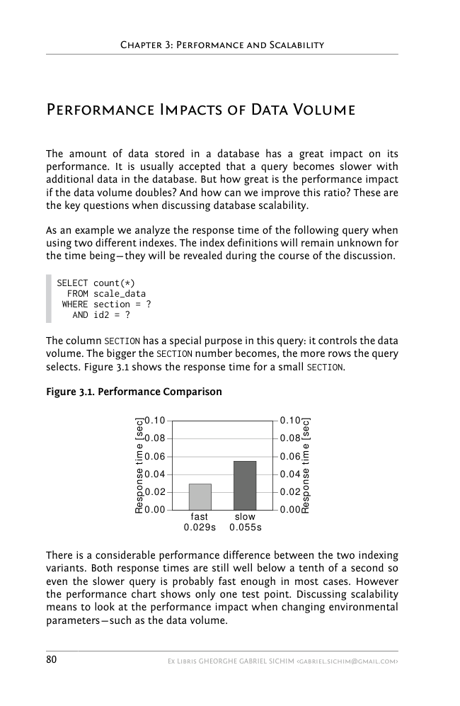
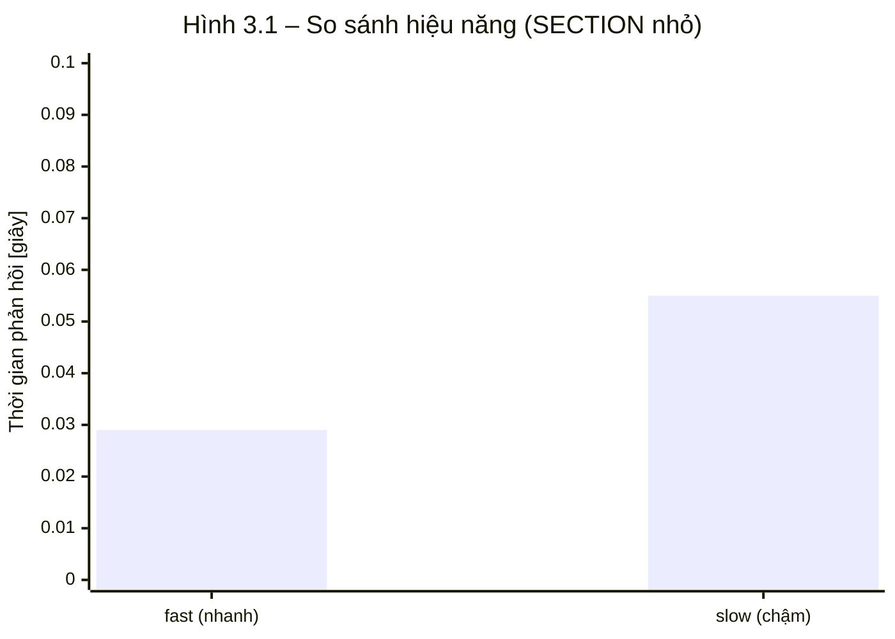
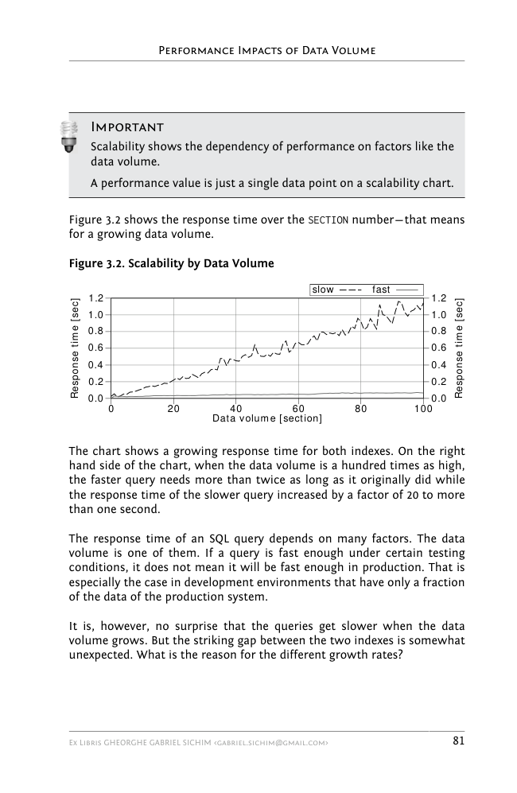
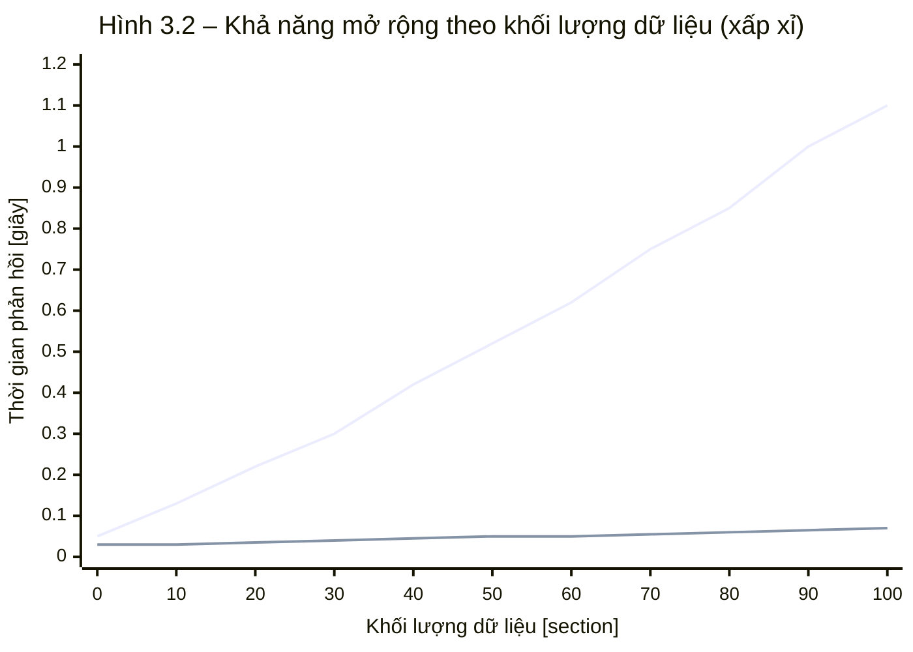
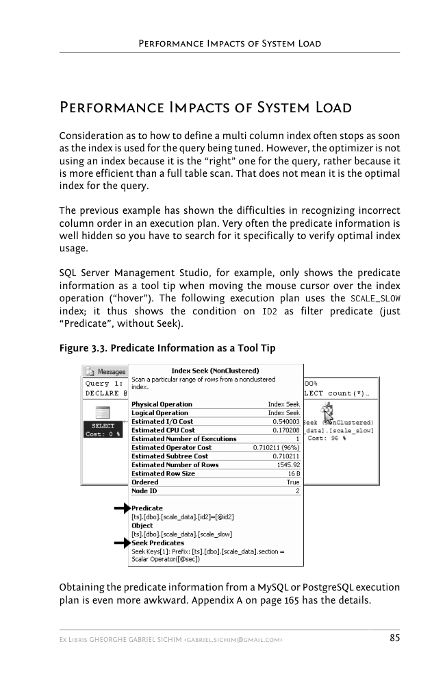
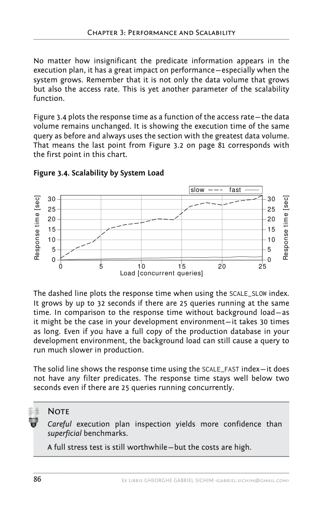
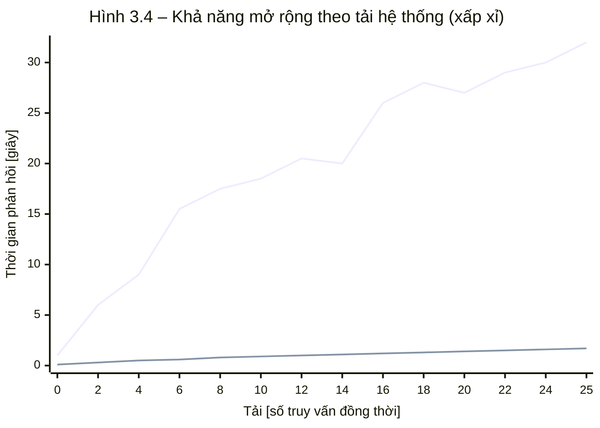
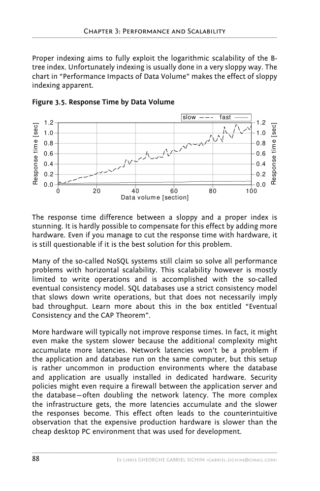
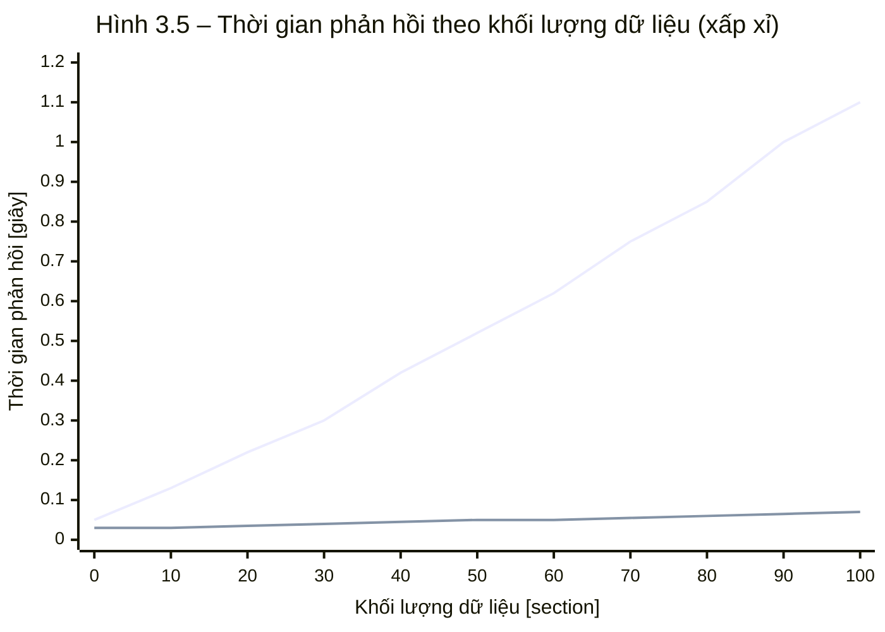

# Chương 3: Hiệu năng và Khả năng mở rộng (Chapter 3 – Performance and Scalability)

**Mục lục**

- [Chương 3: Hiệu năng và Khả năng mở rộng (Chapter 3 – Performance and Scalability)](#chương-3-hiệu-năng-và-khả-năng-mở-rộng-chapter-3--performance-and-scalability)
  - [Ảnh hưởng của khối lượng dữ liệu tới hiệu năng (Performance Impacts of Data Volume)](#ảnh-hưởng-của-khối-lượng-dữ-liệu-tới-hiệu-năng-performance-impacts-of-data-volume)
  - [Ảnh hưởng của tải hệ thống tới hiệu năng (Performance Impacts of System Load)](#ảnh-hưởng-của-tải-hệ-thống-tới-hiệu-năng-performance-impacts-of-system-load)
  - [Thời gian phản hồi và Thông lượng (Response Time and Throughput)](#thời-gian-phản-hồi-và-thông-lượng-response-time-and-throughput)
  - [Bảng thuật ngữ (Glossary)](#bảng-thuật-ngữ-glossary)

---

Chương này nói về **hiệu năng** (*performance*) và **khả năng mở rộng** (*scalability*) của cơ sở dữ liệu.

Trong bối cảnh này, tác giả dùng định nghĩa sau cho khái niệm scalability:

> *Scalability is the ability of a system, network, or process, to handle a growing amount of work in a capable manner or its ability to be enlarged to accommodate that growth.*
>
> Khả năng mở rộng là khả năng của một hệ thống, một mạng hay một quy trình **xử lý được một khối lượng công việc ngày càng tăng một cách hiệu quả**, **hoặc** khả năng **được mở rộng (nâng cấp) để đáp ứng sự tăng trưởng đó**.
>
> — Wikipedia¹

Bạn có thể thấy rằng thực ra ở đây có **hai** định nghĩa. Định nghĩa thứ nhất nói về *ảnh hưởng của tải ngày càng tăng lên một hệ thống*; định nghĩa thứ hai nói về *việc làm cho hệ thống lớn lên để gánh được nhiều tải hơn*.

Định nghĩa thứ hai được ưa chuộng hơn rất nhiều so với định nghĩa thứ nhất. Hễ ai đó nhắc đến scalability thì gần như lúc nào họ cũng đang nói về việc dùng thêm phần cứng. **Scale-up** (mở rộng theo chiều dọc – nâng cấp một máy cho mạnh hơn) và **scale-out** (mở rộng theo chiều ngang – thêm nhiều máy) là các từ khóa tương ứng, và gần đây chúng còn được bổ sung bằng những từ thời thượng (*buzzword*) mới như **web-scale**.

Nói một cách tổng quát, scalability là chuyện **ảnh hưởng của những thay đổi trong môi trường lên hiệu năng**. Phần cứng chỉ là *một* tham số môi trường có thể thay đổi. Chương này còn đề cập tới những tham số khác như **khối lượng dữ liệu** (*data volume*) và **tải hệ thống** (*system load*).

¹ http://en.wikipedia.org/wiki/Scalability

> 📝 **Giải thích thêm (không có trong sách):** Hãy hình dung scalability như một **hàm số**: `hiệu_năng = f(khối lượng dữ liệu, tải hệ thống, phần cứng, ...)`. Đo hiệu năng một lần chỉ cho bạn **một điểm** trên đồ thị của hàm này. Còn hỏi về scalability là hỏi: "khi một biến đầu vào thay đổi (ví dụ dữ liệu tăng gấp đôi) thì đầu ra thay đổi thế nào?". Chương này sẽ lần lượt "vặn" từng biến: trước hết là khối lượng dữ liệu, sau đó là tải hệ thống, cuối cùng là phần cứng.

---

## Ảnh hưởng của khối lượng dữ liệu tới hiệu năng (Performance Impacts of Data Volume)

Lượng dữ liệu lưu trong cơ sở dữ liệu có ảnh hưởng rất lớn tới hiệu năng của nó. Người ta thường chấp nhận như một lẽ đương nhiên rằng một câu truy vấn sẽ chậm đi khi có thêm dữ liệu trong cơ sở dữ liệu. Nhưng **khi khối lượng dữ liệu tăng gấp đôi thì hiệu năng bị ảnh hưởng nhiều đến mức nào?** Và **làm sao cải thiện được tỷ lệ này?** Đó chính là những câu hỏi then chốt khi bàn về khả năng mở rộng của cơ sở dữ liệu.

Để làm ví dụ, chúng ta sẽ phân tích **thời gian phản hồi** (*response time*) của câu truy vấn dưới đây khi dùng hai index khác nhau. Định nghĩa của hai index này tạm thời được giữ bí mật — chúng sẽ được tiết lộ dần trong quá trình thảo luận.

```sql
SELECT count(*)
  FROM scale_data
 WHERE section = ?
   AND id2 = ?
```

Cột `SECTION` có một vai trò đặc biệt trong câu truy vấn này: nó **điều khiển khối lượng dữ liệu**. Số `SECTION` càng lớn thì câu truy vấn càng chọn ra nhiều dòng. Hình 3.1 cho thấy thời gian phản hồi với một `SECTION` nhỏ.

**Hình 3.1 – So sánh hiệu năng (Figure 3.1 – Performance Comparison)**



Vẽ lại hình (biểu đồ cột; trục tung ở cả hai bên: "Response time [sec]" = *Thời gian phản hồi [giây]*, thang từ 0.00 đến 0.10):



| Biến thể index | Nhãn trong hình | Thời gian phản hồi |
|---|---|---|
| Index "nhanh" | fast | 0.029 s |
| Index "chậm" | slow | 0.055 s |

Mô tả: hình gồm hai cột. Cột màu xám nhạt bên trái mang nhãn **fast** (nhanh) với giá trị **0.029s**; cột màu xám đậm bên phải mang nhãn **slow** (chậm) với giá trị **0.055s** — gần gấp đôi cột bên trái. Cả hai cột đều nằm thấp hơn rất nhiều so với vạch 0.10 giây.

Có một sự khác biệt hiệu năng đáng kể giữa hai phương án đánh index. Tuy vậy, cả hai thời gian phản hồi đều vẫn thấp hơn hẳn một phần mười giây, nên ngay cả câu truy vấn chậm hơn có lẽ cũng đủ nhanh trong hầu hết các trường hợp. Thế nhưng biểu đồ hiệu năng này chỉ cho thấy **một điểm đo duy nhất**. Bàn về scalability nghĩa là phải xem xét ảnh hưởng tới hiệu năng khi **thay đổi các tham số môi trường** — chẳng hạn như khối lượng dữ liệu.

> ⚠️ **Quan trọng (Important)**
>
> Scalability cho thấy **sự phụ thuộc của hiệu năng vào các yếu tố** như khối lượng dữ liệu.
>
> Một giá trị hiệu năng chỉ là **một điểm dữ liệu duy nhất** trên biểu đồ scalability.

Hình 3.2 thể hiện thời gian phản hồi theo số `SECTION` — tức là theo khối lượng dữ liệu tăng dần.

**Hình 3.2 – Khả năng mở rộng theo khối lượng dữ liệu (Figure 3.2 – Scalability by Data Volume)**



Vẽ lại hình (giá trị xấp xỉ, đọc từ đồ thị; trục hoành "Data volume [section]" = *Khối lượng dữ liệu [section]* từ 0 đến 100; trục tung "Response time [sec]" = *Thời gian phản hồi [giây]* từ 0.0 đến 1.2; chú giải: "slow" = đường nét đứt, "fast" = đường liền):



```text
Thời gian phản hồi [giây]
 1.2 |                                              /\ /\/
 1.0 |                                        /\/\/  \/
 0.8 |                              _/\/\-/\/
 0.6 |                    /\/-/\--/\/                     slow (nét đứt) ---
 0.4 |           __/\/\-/                                 fast (liền)    ___
 0.2 |     __/--/
 0.0 |__/________________________________________________  <- fast gần như nằm sát đáy
     0        20        40        60        80       100
                   Khối lượng dữ liệu [section]
```

Mô tả: đường nét đứt (**slow**) bắt đầu ở khoảng 0.05 giây và tăng gần như tuyến tính (có dao động lởm chởm) lên tới khoảng 1.1–1.2 giây ở section 100. Đường liền (**fast**) gần như nằm sát trục hoành, chỉ nhích nhẹ từ khoảng 0.03 giây lên khoảng 0.07 giây.

Biểu đồ cho thấy thời gian phản hồi tăng lên với **cả hai** index. Ở phía bên phải biểu đồ, khi khối lượng dữ liệu cao gấp **một trăm lần**, câu truy vấn nhanh hơn cần thời gian **hơn gấp đôi** so với ban đầu, trong khi thời gian phản hồi của câu truy vấn chậm hơn tăng lên **gấp 20 lần**, tới hơn một giây.

Thời gian phản hồi của một câu truy vấn SQL phụ thuộc vào nhiều yếu tố. Khối lượng dữ liệu là một trong số đó. Một câu truy vấn đủ nhanh trong những điều kiện kiểm thử nhất định **không có nghĩa** là nó sẽ đủ nhanh trên môi trường production (môi trường vận hành thật). Điều này đặc biệt đúng với các môi trường phát triển (*development environment*) vốn chỉ có một phần nhỏ dữ liệu so với hệ thống production.

Dĩ nhiên, chẳng có gì ngạc nhiên khi các câu truy vấn chậm đi lúc khối lượng dữ liệu tăng lên. Nhưng **khoảng cách chênh lệch nổi bật giữa hai index** thì có phần bất ngờ. Lý do nào dẫn tới tốc độ tăng khác nhau như vậy?

Lẽ ra có thể dễ dàng tìm ra lý do bằng cách so sánh hai **execution plan** (kế hoạch thực thi – bản mô tả các bước mà cơ sở dữ liệu chọn để thực hiện câu lệnh):

```text
------------------------------------------------------
| Id | Operation         | Name       | Rows  | Cost |
------------------------------------------------------
|  0 | SELECT STATEMENT  |            |     1 |  972 |
|  1 |  SORT AGGREGATE   |            |     1 |      |
|* 2 |   INDEX RANGE SCAN| SCALE_SLOW |  3000 |  972 |
------------------------------------------------------
```

```text
------------------------------------------------------
| Id   Operation         | Name       | Rows  | Cost |
------------------------------------------------------
|  0 | SELECT STATEMENT  |            |     1 |   13 |
|  1 |  SORT AGGREGATE   |            |     1 |      |
|* 2 |   INDEX RANGE SCAN| SCALE_FAST |  3000 |   13 |
------------------------------------------------------
```

Hai execution plan gần như giống hệt nhau — chúng chỉ dùng hai index khác nhau. Dù giá trị cost (chi phí ước tính của optimizer) có phản ánh sự chênh lệch tốc độ, nhưng **lý do** thì lại không hiện ra trong execution plan.

Có vẻ như chúng ta đang gặp phải một "trải nghiệm index chậm" (*slow index experience*): câu truy vấn chậm **mặc dù** nó có dùng index. Tuy nhiên, chúng ta không còn tin vào huyền thoại "index bị hỏng" (*broken index*) nữa. Thay vào đó, hãy nhớ lại **hai thành phần** khiến một lần tra cứu index (*index lookup*) bị chậm: (1) **truy cập bảng** (*table access*), và (2) **quét một khoảng index rộng** (*scanning a wide index range*).

Không execution plan nào có thao tác `TABLE ACCESS BY INDEX ROWID`, vậy thì hẳn là một execution plan phải quét một khoảng index rộng hơn plan kia. Vậy execution plan thể hiện khoảng index được quét ở đâu? Dĩ nhiên là ở phần **thông tin predicate** (*predicate information*)!

> 💡 **Mẹo (Tip)**
>
> Hãy chú ý tới **thông tin predicate** (*predicate information*).

Thông tin predicate hoàn toàn **không phải** là một chi tiết thừa có thể lược bỏ như cách đã làm ở trên. Một execution plan không có thông tin predicate là một execution plan **không đầy đủ**. Điều đó có nghĩa là bạn không thể thấy được lý do của sự chênh lệch hiệu năng trong các plan ở trên. Nếu nhìn vào execution plan đầy đủ, chúng ta sẽ thấy sự khác biệt.

```text
------------------------------------------------------
| Id | Operation         | Name       | Rows  | Cost |
------------------------------------------------------
|  0 | SELECT STATEMENT  |            |     1 |  972 |
|  1 |  SORT AGGREGATE   |            |     1 |      |
|* 2 |   INDEX RANGE SCAN| SCALE_SLOW |  3000 |  972 |
------------------------------------------------------

Predicate Information (identified by operation id):
   2 - access("SECTION"=TO_NUMBER(:A))
       filter("ID2"=TO_NUMBER(:B))
```

```text
------------------------------------------------------
| Id   Operation         | Name       | Rows  | Cost |
------------------------------------------------------
|  0 | SELECT STATEMENT  |            |     1 |   13 |
|  1 |  SORT AGGREGATE   |            |     1 |      |
|* 2 |   INDEX RANGE SCAN| SCALE_FAST |  3000 |   13 |
------------------------------------------------------

Predicate Information (identified by operation id):
   2 - access("SECTION"=TO_NUMBER(:A) AND "ID2"=TO_NUMBER(:B))
```

> 📌 **Ghi chú (Note)**
>
> Execution plan đã được đơn giản hóa cho dễ nhìn. Phụ lục ở trang 170 giải thích chi tiết phần "Predicate Information" trong execution plan của Oracle.

Giờ thì sự khác biệt đã rõ ràng: khi dùng index `SCALE_SLOW`, **chỉ có** điều kiện trên `SECTION` là **access predicate** (predicate truy cập – điều kiện dùng để xác định điểm bắt đầu và điểm kết thúc của đoạn index cần quét). Cơ sở dữ liệu đọc **tất cả** các dòng thuộc section đó rồi loại bỏ những dòng không khớp với **filter predicate** (predicate lọc – điều kiện chỉ được kiểm tra trên các dòng đã đọc, không thu hẹp được đoạn quét) trên `ID2`. Thời gian phản hồi tăng theo **số dòng trong section**. Với index `SCALE_FAST`, cơ sở dữ liệu dùng **tất cả** các điều kiện làm access predicate. Thời gian phản hồi tăng theo **số dòng được chọn ra** (số dòng thực sự thỏa mãn truy vấn).

> ⚠️ **Quan trọng (Important)**
>
> Filter predicate giống như **những quả bom chưa nổ**. Chúng có thể phát nổ bất cứ lúc nào.

> 📝 **Giải thích thêm (không có trong sách):** Câu ví von "bom chưa nổ" ý nói: lúc dữ liệu còn ít (như ở môi trường dev), một filter predicate chẳng gây hại gì — đoạn index phải quét ngắn nên vẫn nhanh. Nhưng chi phí của nó tỷ lệ với **số dòng bị đọc rồi vứt đi**, chứ không phải số dòng kết quả. Khi dữ liệu lớn lên, số dòng bị đọc oan tăng theo, và một ngày đẹp trời câu truy vấn "đang chạy tốt" bỗng trở nên chậm khủng khiếp mà không ai sửa gì cả.

Mảnh ghép cuối cùng còn thiếu trong câu đố của chúng ta là định nghĩa của các index. Liệu chúng ta có thể **dựng lại định nghĩa index từ execution plan** không?

Định nghĩa của index `SCALE_SLOW` (bản gốc in nhầm là "SACLE_SLOW") phải **bắt đầu bằng cột `SECTION`** — nếu không thì điều kiện trên cột này đã không thể được dùng làm access predicate. Điều kiện trên `ID2` không phải là access predicate — vậy nên `ID2` không thể đứng **ngay sau** `SECTION` trong định nghĩa index. Điều đó có nghĩa là index `SCALE_SLOW` phải có **tối thiểu ba cột**, trong đó `SECTION` là cột đầu tiên và `ID2` **không phải** cột thứ hai. Và đó chính xác là định nghĩa index được dùng cho thử nghiệm này:

```sql
CREATE INDEX scale_slow ON scale_data (section, id1, id2);
```

Cơ sở dữ liệu không thể dùng `ID2` làm access predicate vì cột `ID1` đang chiếm vị trí thứ hai.

Định nghĩa của index `SCALE_FAST` phải có các cột `SECTION` và `ID2` ở **hai vị trí đầu tiên**, vì cả hai đều được dùng làm access predicate. Tuy nhiên, chúng ta **không thể** nói gì về thứ tự giữa hai cột này. Index được dùng cho thử nghiệm bắt đầu bằng cột `SECTION` và có thêm cột `ID1` ở vị trí thứ ba:

```sql
CREATE INDEX scale_fast ON scale_data (section, id2, id1);
```

Cột `ID1` được thêm vào **chỉ để** index này có cùng kích thước với `SCALE_SLOW` — nếu không, bạn có thể có ấn tượng rằng chính kích thước index mới là nguyên nhân gây ra sự khác biệt.

> 💡 **Ví dụ bổ sung (không có trong sách):** Hãy thử tưởng tượng dữ liệu cụ thể để thấy vì sao `SCALE_SLOW` phải quét nhiều hơn.
>
> Giả sử section 7 có 6 dòng như sau (đã sắp xếp theo thứ tự của từng index):
>
> | Thứ tự trong `scale_slow (section, id1, id2)` | | Thứ tự trong `scale_fast (section, id2, id1)` |
> |---|---|---|
> | (7, **1**, 30) | | (7, **10**, 2) |
> | (7, **2**, 10) | | (7, **10**, 5) |
> | (7, **3**, 20) | | (7, **20**, 3) |
> | (7, **4**, 30) | | (7, **30**, 1) |
> | (7, **5**, 10) | | (7, **30**, 4) |
> | (7, **6**, 30) | | (7, **30**, 6) |
>
> Truy vấn: `WHERE section = 7 AND id2 = 10`.
>
> - Với `scale_slow`: trong section 7, các giá trị `id2 = 10` nằm **rải rác** (dòng thứ 2 và thứ 5) vì index được sắp xếp theo `id1` trước. Cơ sở dữ liệu buộc phải quét **cả 6 dòng** của section 7 và lọc lại `id2 = 10` → access chỉ trên `section`, `id2` thành filter.
> - Với `scale_fast`: các dòng `id2 = 10` nằm **liền kề nhau** ngay đầu đoạn. Cơ sở dữ liệu nhảy thẳng tới `(7, 10, …)` và chỉ đọc đúng 2 dòng → cả hai điều kiện đều là access predicate.
>
> Nếu section 7 có 1 triệu dòng mà chỉ 100 dòng có `id2 = 10`, thì `scale_slow` đọc 1 triệu mục index, còn `scale_fast` chỉ đọc khoảng 100 mục. Đó chính là khoảng cách giữa hai đường trong Hình 3.2.

> 💡 **Ví dụ bổ sung (không có trong sách):** Cách thấy hiện tượng tương tự trên **PostgreSQL** (ví dụ minh họa, số liệu thực tế sẽ khác):
>
> ```sql
> CREATE TABLE scale_data (section INT, id1 INT, id2 INT, junk CHAR(200));
> CREATE INDEX scale_slow ON scale_data (section, id1, id2);
>
> EXPLAIN (ANALYZE, BUFFERS)
> SELECT count(*) FROM scale_data WHERE section = 7 AND id2 = 10;
> ```
>
> Trong output, một nút `Index Only Scan using scale_slow` (hoặc `Index Scan`) sẽ có dạng:
>
> ```text
> Index Cond: ((section = 7) AND (id2 = 10))
> ```
>
> Lưu ý: PostgreSQL có thể đưa `id2 = 10` vào `Index Cond` dù về bản chất nó chỉ được dùng như điều kiện lọc **bên trong** index (không thu hẹp được đoạn quét), vì vậy trên PostgreSQL cần so sánh thêm số buffer đọc (`Buffers: shared hit=...`) giữa hai index để thấy khác biệt. (Từ PostgreSQL 18, B-tree có "skip scan" có thể giúp phần nào trong một số trường hợp, nhưng thứ tự cột đúng vẫn là cách giải quyết căn bản.) Trên **Oracle** thì như sách cho thấy, `DBMS_XPLAN` tách rõ `access(...)` và `filter(...)`.

---

## Ảnh hưởng của tải hệ thống tới hiệu năng (Performance Impacts of System Load)

Việc cân nhắc nên định nghĩa một **index nhiều cột** (*multi column index*, còn gọi là concatenated index) như thế nào thường dừng lại ngay khi index đó **được dùng** cho câu truy vấn đang được tối ưu. Tuy nhiên, optimizer (bộ tối ưu hóa truy vấn) dùng một index **không phải** vì nó là index "đúng" cho câu truy vấn, mà vì nó **hiệu quả hơn một full table scan** (quét toàn bộ bảng). Điều đó không có nghĩa nó là index **tối ưu** cho câu truy vấn.

Ví dụ trước đã cho thấy sự khó khăn trong việc nhận ra **thứ tự cột sai** trong một execution plan. Rất thường xuyên, thông tin predicate bị giấu kỹ đến mức bạn phải chủ động đi tìm nó thì mới xác minh được rằng index đang được dùng một cách tối ưu.

Chẳng hạn, **SQL Server Management Studio** chỉ hiển thị thông tin predicate dưới dạng **tool tip** (khung chú thích nổi) khi bạn di chuột qua thao tác index ("hover"). Execution plan sau đây dùng index `SCALE_SLOW`; do đó nó hiển thị điều kiện trên `ID2` dưới dạng filter predicate (chỉ ghi "Predicate", không có chữ Seek).

**Hình 3.3 – Thông tin predicate dưới dạng tool tip (Figure 3.3 – Predicate Information as a Tool Tip)**



Vẽ lại hình: đây là ảnh chụp màn hình graphical execution plan của SQL Server Management Studio. Phía sau là cửa sổ kế hoạch với tab "Messages", dòng "Query 1: ...", "DECLARE @...", biểu tượng `SELECT` (Cost: 0 %) và thao tác `Index Seek (NonClustered) [scale_data].[scale_slow]` (Cost: 96 %), có dòng "...LECT count(*)...". Con trỏ chuột đang trỏ vào thao tác Index Seek, làm hiện ra tool tip với nội dung sau:

| Mục trong tool tip (nguyên văn) | Nghĩa | Giá trị |
|---|---|---|
| **Index Seek (NonClustered)** | Tiêu đề: tìm kiếm trên index (không phải clustered) | — |
| *Scan a particular range of rows from a nonclustered index.* | Quét một khoảng dòng cụ thể từ một nonclustered index | — |
| Physical Operation | Thao tác vật lý | Index Seek |
| Logical Operation | Thao tác logic | Index Seek |
| Estimated I/O Cost | Chi phí I/O ước tính | 0.540003 |
| Estimated CPU Cost | Chi phí CPU ước tính | 0.170208 |
| Estimated Number of Executions | Số lần thực thi ước tính | 1 |
| Estimated Operator Cost | Chi phí thao tác ước tính | 0.710211 (96%) |
| Estimated Subtree Cost | Chi phí cây con ước tính | 0.710211 |
| Estimated Number of Rows | Số dòng ước tính | 1545.92 |
| Estimated Row Size | Kích thước dòng ước tính | 16 B |
| Ordered | Có thứ tự | True |
| Node ID | Mã nút | 2 |
| ➡ **Predicate** | Predicate (lọc) | `[ts].[dbo].[scale_data].[id2]=[@id2]` |
| **Object** | Đối tượng | `[ts].[dbo].[scale_data].[scale_slow]` |
| ➡ **Seek Predicates** | Predicate dùng để seek (truy cập) | `Seek Keys[1]: Prefix: [ts].[dbo].[scale_data].section = Scalar Operator([@sec])` |

Hai mũi tên đen trong hình chỉ vào hai mục **Predicate** và **Seek Predicates**: điều kiện `id2 = @id2` chỉ là "Predicate" (tức filter predicate), còn chỉ có `section = @sec` nằm trong "Seek Predicates" (tức access predicate).

```text
┌──────────────────────────── Index Seek (NonClustered) ────────────────────┐
│ Scan a particular range of rows from a nonclustered index.               │
│ ...                                                                      │
│ ➡ Predicate                                                              │
│   [ts].[dbo].[scale_data].[id2]=[@id2]          <-- filter predicate     │
│   Object                                                                 │
│   [ts].[dbo].[scale_data].[scale_slow]                                   │
│ ➡ Seek Predicates                                                        │
│   Seek Keys[1]: Prefix: [ts].[dbo].[scale_data].section =                │
│   Scalar Operator([@sec])                       <-- access predicate     │
└──────────────────────────────────────────────────────────────────────────┘
```

Lấy thông tin predicate từ execution plan của MySQL hay PostgreSQL thậm chí còn **khó khăn hơn**. Phụ lục A ở trang 165 có thông tin chi tiết.

> 📝 **Giải thích thêm (không có trong sách):** Bảng đối chiếu nhanh cách nhận diện access/filter predicate ở các hệ quản trị (theo các phiên bản hiện nay):
>
> | DB | Access predicate | Filter predicate (trên index) |
> |---|---|---|
> | Oracle (`DBMS_XPLAN`) | `access(...)` | `filter(...)` cùng dòng Id với INDEX RANGE SCAN |
> | SQL Server | `Seek Predicates` | `Predicate` trên thao tác Index Seek |
> | PostgreSQL | `Index Cond` (cần xét thứ tự cột để biết phần nào thực sự giới hạn đoạn quét) | `Index Cond` phần không thuộc tiền tố cột / `Filter` (sau khi đọc bảng) |
> | MySQL | cột `key_len` cho biết bao nhiêu byte (bao nhiêu cột) của index được dùng để truy cập | `Using index condition` (ICP) / `Using where` |
>
> Trong SQL Server, bạn cũng có thể xem bản XML của plan (`SET SHOWPLAN_XML ON` hoặc chuột phải → *Show Execution Plan XML*) để thấy các phần tử `<SeekPredicates>` và `<Predicate>` mà không cần hover chuột.

Dù thông tin predicate trông có vẻ tầm thường trong execution plan, nó có ảnh hưởng rất lớn tới hiệu năng — đặc biệt khi hệ thống lớn lên. Hãy nhớ rằng không chỉ khối lượng dữ liệu tăng lên mà **tần suất truy cập** (*access rate*) cũng tăng. Đây lại là một tham số nữa của "hàm scalability".

Hình 3.4 vẽ thời gian phản hồi như một hàm của tần suất truy cập — khối lượng dữ liệu giữ nguyên. Hình thể hiện thời gian thực thi của cùng câu truy vấn như trước và luôn dùng section có **khối lượng dữ liệu lớn nhất**. Nghĩa là điểm cuối cùng trong Hình 3.2 ở trang 81 tương ứng với điểm đầu tiên trong biểu đồ này.

**Hình 3.4 – Khả năng mở rộng theo tải hệ thống (Figure 3.4 – Scalability by System Load)**



Vẽ lại hình (giá trị xấp xỉ đọc từ đồ thị; trục hoành "Load [concurrent queries]" = *Tải [số truy vấn chạy đồng thời]* từ 0 đến 25; trục tung "Response time [sec]" = *Thời gian phản hồi [giây]* từ 0 đến 30; chú giải: "slow" = nét đứt, "fast" = nét liền):



```text
Thời gian phản hồi [giây]
 30 |                                              ___--'
 25 |                               _.--''--.__--''
 20 |                 .--''--..__.-'
 15 |            _.-''                                  slow (nét đứt) ---
 10 |       _.-''                                       fast (liền)    ___
  5 |  _.-''
  0 |'______________________________________________________ <- fast: < 2 giây
    0         5         10        15        20        25
                 Tải [số truy vấn chạy đồng thời]
```

Mô tả: đường nét đứt (**slow**) xuất phát từ khoảng 1 giây khi không có tải, tăng dốc lên khoảng 15 giây ở mức 6 truy vấn đồng thời, khoảng 20 giây ở mức 12–14, rồi lên khoảng 30–32 giây ở mức 25 truy vấn đồng thời. Đường liền (**fast**) gần như nằm sát đáy, luôn dưới 2 giây.

Đường nét đứt biểu diễn thời gian phản hồi khi dùng index `SCALE_SLOW`. Nó tăng lên tới **32 giây** nếu có 25 truy vấn chạy cùng lúc. So với thời gian phản hồi khi không có tải nền (*background load*) — như tình huống có thể xảy ra ở môi trường phát triển của bạn — nó mất **gấp 30 lần** thời gian. Ngay cả khi bạn có một bản sao đầy đủ của cơ sở dữ liệu production trong môi trường phát triển, tải nền vẫn có thể khiến một câu truy vấn chạy chậm hơn rất nhiều trên production.

Đường liền thể hiện thời gian phản hồi khi dùng index `SCALE_FAST` — nó **không có filter predicate nào**. Thời gian phản hồi luôn ở mức thấp hơn hẳn hai giây, ngay cả khi có 25 truy vấn chạy đồng thời.

> 📌 **Ghi chú (Note)**
>
> Kiểm tra execution plan một cách **cẩn thận** mang lại nhiều sự tin cậy hơn những bài benchmark (đo hiệu năng) **hời hợt**.
>
> Một bài stress test (kiểm thử chịu tải) đầy đủ vẫn rất đáng làm — nhưng chi phí thì cao.

> 📝 **Giải thích thêm (không có trong sách):** Vì sao filter predicate lại "khuếch đại" ảnh hưởng của tải? Với `SCALE_SLOW`, mỗi truy vấn phải đọc rất nhiều block index (cả section). Khi 25 truy vấn chạy đồng thời, chúng **tranh giành** cùng một lượng tài nguyên có hạn (CPU, buffer cache, I/O đĩa, latch). Truy vấn nào càng tiêu thụ nhiều tài nguyên thì càng bị ảnh hưởng nặng khi tài nguyên trở nên khan hiếm. `SCALE_FAST` chỉ đọc vài block cho mỗi truy vấn, nên dù có 25 truy vấn cùng chạy, tổng nhu cầu vẫn nằm trong khả năng của hệ thống.

> 💡 **Ví dụ bổ sung (không có trong sách):** Một phép tính "trên giấy" (số liệu giả định) để thấy tác dụng của việc đọc ít block:
>
> | | Block index đọc mỗi truy vấn | 25 truy vấn đồng thời → tổng block |
> |---|---|---|
> | `SCALE_SLOW` (quét cả section) | ~10 000 | ~250 000 |
> | `SCALE_FAST` (chỉ đọc dòng khớp) | ~10 | ~250 |
>
> Nếu hệ thống xử lý được, giả sử, 20 000 lần đọc block mỗi giây, thì 250 000 lần đọc cần ~12 giây chỉ riêng cho I/O, trong khi 250 lần đọc chỉ mất vài phần trăm giây. Đây chính là lý do một "lỗi nhỏ" về thứ tự cột có thể không thấy được khi chạy thử một mình, nhưng lại làm sập hệ thống khi có tải thật.

Ở giai đoạn phát triển, những thời gian phản hồi đáng ngờ thường bị xem nhẹ. Điều này phần lớn là do chúng ta kỳ vọng "phần cứng production mạnh hơn" sẽ mang lại hiệu năng tốt hơn. Nhưng thường thì sự thật lại **ngược lại**, vì hạ tầng production phức tạp hơn và tích lũy những độ trễ (*latency*) không xuất hiện trong môi trường phát triển. Ngay cả khi kiểm thử trên một hạ tầng tương đương production, tải nền vẫn có thể gây ra các thời gian phản hồi khác nhau. Trong mục tiếp theo, chúng ta sẽ thấy rằng nói chung, **kỳ vọng phản hồi nhanh hơn từ "phần cứng lớn hơn" là không hợp lý**.

---

## Thời gian phản hồi và Thông lượng (Response Time and Throughput)

Phần cứng lớn hơn **không phải lúc nào cũng nhanh hơn** — nhưng thường nó có thể **gánh được nhiều tải hơn**. Phần cứng lớn hơn giống một **đường cao tốc rộng hơn** chứ không giống một **chiếc xe nhanh hơn**: bạn không thể chạy nhanh hơn — à, đúng hơn là bạn không được phép chạy nhanh hơn — chỉ vì đường có nhiều làn hơn. Đó là lý do vì sao thêm phần cứng **không tự động** cải thiện được những câu truy vấn SQL chậm.

> 📝 **Giải thích thêm (không có trong sách):** Hai khái niệm cần phân biệt rõ:
>
> - **Thời gian phản hồi** (*response time*): **một** yêu cầu mất bao lâu để hoàn thành (ví dụ: 0.5 giây/truy vấn). Tương ứng với **tốc độ của một chiếc xe**.
> - **Thông lượng** (*throughput*): hệ thống hoàn thành được **bao nhiêu** yêu cầu trong một đơn vị thời gian (ví dụ: 2 000 truy vấn/giây). Tương ứng với **số xe đi qua trạm thu phí mỗi giờ** — tăng được bằng cách mở thêm làn đường.
>
> Thêm CPU, thêm server chủ yếu làm tăng throughput; còn muốn giảm response time của *một* câu truy vấn thì phải giảm khối lượng công việc mà câu truy vấn đó cần làm — và index chính là công cụ để làm điều đó.

Chúng ta không còn ở thập niên 1990 nữa. Hồi đó, sức mạnh tính toán của CPU đơn nhân (*single core*) tăng lên rất nhanh. Hầu hết các vấn đề về thời gian phản hồi biến mất trên phần cứng mới hơn — chỉ nhờ CPU được cải tiến. Giống như các mẫu xe mới **luôn chạy nhanh gấp đôi** mẫu cũ — năm nào cũng vậy!

Tuy nhiên, sức mạnh của CPU đơn nhân đã **chạm tường** trong những năm đầu tiên của thế kỷ 21. Gần như không còn cải thiện nào trên trục này nữa. Để tiếp tục chế tạo những CPU ngày càng mạnh hơn, các nhà sản xuất phải chuyển sang chiến lược **đa nhân** (*multi-core*). Mặc dù cách này cho phép nhiều tác vụ chạy đồng thời, nó **không cải thiện hiệu năng nếu chỉ có một tác vụ**. Hiệu năng có nhiều hơn một chiều (*Performance has more than just one dimension*).

**Mở rộng theo chiều ngang** (*scaling horizontally* – thêm nhiều server) cũng có những giới hạn tương tự. Dù nhiều server hơn có thể xử lý được nhiều yêu cầu hơn, chúng **không cải thiện thời gian phản hồi của một câu truy vấn cụ thể**. Để việc tìm kiếm nhanh hơn, bạn cần một **cây tìm kiếm hiệu quả** (*efficient search tree*) — ngay cả trong các hệ thống phi quan hệ như **CouchDB** và **MongoDB**.

> ⚠️ **Quan trọng (Important)**
>
> **Đánh index đúng cách** (*proper indexing*) là cách tốt nhất để giảm thời gian phản hồi của truy vấn — trong cả các cơ sở dữ liệu SQL quan hệ lẫn các hệ thống phi quan hệ.

> 📝 **Giải thích thêm (không có trong sách) — Đối chiếu với PostgreSQL hiện đại (PG 10–17): Truy vấn song song (*Parallel Query*) và Biên dịch JIT (*Just-In-Time Compilation*)**
>
> Khi cuốn sách này ra đời vào năm 2012 (thời điểm **PostgreSQL 9.1 / 9.2**), nhận định *"đa nhân không cải thiện hiệu năng nếu chỉ có một tác vụ"* là đúng tuyệt đối trên PostgreSQL: mỗi kết nối client chỉ được phục vụ bởi **một tiến trình backend duy nhất** (*single backend process*) chạy trên **1 nhân CPU duy nhất**, bất kể máy chủ có 32 hay 64 nhân CPU.
>
> Tuy nhiên, từ **PostgreSQL 9.6 đến PostgreSQL 17**, kiến trúc thực thi của Postgres đã trải qua hai cuộc cách mạng lớn nhằm tận dụng phần cứng đa nhân hiện đại cho cả một truy vấn đơn lẻ:
>
> **1. Kiến trúc Truy vấn song song (*Parallel Query* — từ PostgreSQL 9.6 → 17):**
>
> Thay vì chỉ dùng 1 nhân CPU, bộ tối ưu hóa (*Query Planner*) của PostgreSQL hiện đại có thể tạo một nút thu thập **`Gather`** (hoặc **`Gather Merge`** nếu cần giữ thứ tự sắp xếp) làm tiến trình trưởng (*leader process*), đồng thời khởi chạy nhiều tiến trình phụ trợ (**Background Workers**) cùng chia nhau xử lý dữ liệu qua bộ nhớ dùng chung động (*Dynamic Shared Memory — DSM*):
> - **PostgreSQL 9.6**: Giới thiệu nền tảng *Parallel Query* với **`Parallel Seq Scan`** (quét bảng tuần tự song song), *Parallel Hash Join* (sơ khai) và *Parallel Aggregate* (`Partial Aggregate` → `Gather` → `Finalize Aggregate`).
> - **PostgreSQL 10**: Bổ sung **`Parallel B-Tree Index Scan`**, **`Parallel Index-Only Scan`**, **`Parallel Bitmap Heap Scan`** và *Parallel Merge Join*.
> - **PostgreSQL 11**: Đột phá với **`Parallel Hash Join`** dùng bảng băm chia sẻ (*Shared Hash Table*), **`Parallel Append`** (quét song song nhiều phân vùng `PARTITION`), và đặc biệt là **xây dựng chỉ mục song song (`Parallel CREATE INDEX`)** cho B-Tree (điều khiển bởi tham số `max_parallel_maintenance_workers`, mặc định = `2`, giúp giảm thời gian tạo index trên bảng lớn đi 2–4 lần).
> - **PostgreSQL 14–17**: Tối ưu hóa việc nạp trước khối dữ liệu (*prefetching*), hỗ trợ `Parallelize` cho `RETURN QUERY` trong PL/pgSQL (PG 14), và cải thiện thông lượng truyền tuple qua hàng đợi bộ nhớ dùng chung (*shared memory queues*).
>
> **Các tham số cấu hình Parallel Query quan trọng trong `postgresql.conf`:**
> - `max_parallel_workers_per_gather` (mặc định `2`): Số lượng worker tối đa được cấp cho **một** nút `Gather` / `Gather Merge` (cộng với 1 tiến trình leader là tối đa 3 nhân CPU cùng xử lý một nhánh truy vấn).
> - `max_parallel_workers` (mặc định `8`): Tổng số tiến trình parallel worker tối đa trên **toàn cụm database** tại một thời điểm.
> - `min_parallel_table_scan_size` (mặc định `8MB`) và `min_parallel_index_scan_size` (mặc định `512kB`): Kích thước tối thiểu của bảng hoặc chỉ mục để Planner bắt đầu cân nhắc kế hoạch song song.
> - `parallel_setup_cost` (mặc định `1000.0`) và `parallel_tuple_cost` (mặc định `0.1`): Chi phí ước lượng để khởi tạo tiến trình worker và chi phí truyền mỗi dòng dữ liệu từ worker về leader qua bộ nhớ chia sẻ.
>
> **Tại sao quy luật của Markus Winand vẫn giữ nguyên giá trị cốt lõi?**
> Dù *Parallel Query* giúp giảm **thời gian phản hồi (*response time*)** của một câu truy vấn nặng khi hệ thống đang rảnh rỗi (dư nhân CPU), nó **không làm giảm tổng khối lượng công việc I/O và CPU** — thậm chí còn làm **tăng tổng CPU tiêu thụ** do chi phí khởi tạo worker và truyền dữ liệu qua `parallel_tuple_cost`.
> - Nếu hệ thống đang chịu tải cao với 25–100 truy vấn chạy đồng thời (như trong **Hình 3.4**), tất cả các nhân CPU đều đã bận hoặc `max_parallel_workers` đã chạm trần (trong `EXPLAIN (ANALYZE)` bạn sẽ thấy `Workers Planned: 2`, nhưng `Workers Launched: 0`).
> - Khi đó, câu truy vấn dùng index sai (`scale_slow`) dù có bật Parallel Query vẫn sẽ làm nghẽn toàn bộ băng thông RAM/I/O và kéo sập thông lượng (*throughput*) của hệ thống. **Đánh index đúng cách (`scale_fast`) mới là giải pháp duy nhất giảm tổng lượng block phải đọc từ hàng trăm nghìn xuống chỉ còn vài block!**
>
> ---
>
> **2. Biên dịch JIT (*Just-In-Time Compilation* dựa trên LLVM — từ PostgreSQL 11+):**
>
> - **Cơ chế hoạt động**: Từ **PostgreSQL 11**, Postgres tích hợp trình biên dịch **LLVM JIT** (mặc định `jit = on`). Khi một câu truy vấn có tổng chi phí ước lượng (*estimated cost*) vượt ngưỡng `jit_above_cost` (mặc định `100000`), vượt `jit_inline_above_cost` (`500000`) và `jit_optimize_above_cost` (`500000`), PostgreSQL sẽ biên dịch động các bước giải mã dòng dữ liệu (*tuple deforming* — tách các cột từ cấu trúc vật lý `HeapTuple`) và tính toán biểu thức (`WHERE`, `SUM`, `AVG`...) thành mã máy gốc (*native machine code*) ngay lúc chạy thay vì dùng bộ thông dịch biểu thức tuần tự.
> - **Khi nào JIT có lợi**: Với các truy vấn phân tích **OLAP / Data Warehouse** phải quét và tính toán trên hàng chục triệu dòng (tốn nhiều CPU lặp đi lặp lại), JIT giúp tăng tốc độ thực thi từ **20% đến 40%**.
> - **Bẫy hiệu năng thực tế trên hệ thống OLTP (*The JIT Trap*)**: Trên môi trường giao dịch OLTP, đôi khi một câu truy vấn có chi phí ước lượng trên lý thuyết vượt quá `100000` (ví dụ do bảng lớn, thống kê lệch nhẹ, dùng index cẩu thả như `scale_slow`, hoặc do `random_page_cost = 4.0` đẩy cost lên cao), nhưng thực tế dữ liệu đã nằm sẵn trong RAM và truy vấn chỉ mất **5–10 ms** để lấy kết quả. Lúc này, vì cost > `jit_above_cost`, PostgreSQL kích hoạt LLVM để biên dịch mã máy mất tới **80–250 ms**! Trong `EXPLAIN (ANALYZE)`, bạn sẽ thấy phần `JIT:` ở cuối kế hoạch chiếm tới 90% tổng `Execution Time`. Trên các hệ thống thuần OLTP, các DBA giàu kinh nghiệm thường đặt **`jit = off`** ở mức toàn cục (hoặc tăng `jit_above_cost = 500000`) và chỉ bật `SET local jit = on;` cho các phiên chạy báo cáo phân tích nặng.

> 💡 **Ví dụ bổ sung (không có trong sách) — Thực hành trên PostgreSQL hiện đại: So sánh Parallel Scan, Bẫy JIT và Index tối ưu**
>
> Bạn có thể chạy trực tiếp kịch bản dưới đây trên **PostgreSQL 12–17** để quan sát cách `Parallel Index Only Scan` và `JIT` xuất hiện trong `EXPLAIN (ANALYZE, BUFFERS)`:
>
> ```sql
> -- Tạo bảng mô phỏng scale_data với 2 triệu dòng (100 sections, mỗi section 20.000 dòng)
> CREATE TABLE scale_data (
>     section INT NOT NULL,
>     id1     INT NOT NULL,
>     id2     INT NOT NULL,
>     junk    CHAR(100) DEFAULT 'x'
> );
>
> INSERT INTO scale_data (section, id1, id2)
> SELECT (g % 100) + 1,
>        (g % 1000) + 1,
>        (g % 500) + 1
>   FROM generate_series(1, 2000000) AS g;
>
> -- Từ PostgreSQL 11+, hai lệnh CREATE INDEX này tự động chạy song song (Parallel CREATE INDEX)!
> CREATE INDEX scale_slow ON scale_data (section, id1, id2);
> CREATE INDEX scale_fast ON scale_data (section, id2, id1);
>
> VACUUM ANALYZE scale_data;
> ```
>
> **Trường hợp 1: Quét rộng hoặc tổng hợp dữ liệu lớn — PostgreSQL kích hoạt `Parallel Query` và `JIT`**
>
> ```sql
> -- Hạ nhẹ ngưỡng để quan sát Parallel Index-Only Scan trên tập dữ liệu thử nghiệm
> SET min_parallel_index_scan_size = '64kB';
> SET parallel_setup_cost = 10;
>
> EXPLAIN (ANALYZE, BUFFERS)
> SELECT count(*)
>   FROM scale_data
>  WHERE section BETWEEN 1 AND 40
>    AND id2 = 10;
> ```
>
> Kế hoạch thực thi trên PostgreSQL 16/17 khi chỉ có `scale_slow` (hoặc khi quét dải rộng):
>
> ```text
> Finalize Aggregate  (cost=115420.45..115420.46 rows=1 width=8) (actual time=68.412..71.205 ms rows=1 loops=1)
>   Buffers: shared hit=3140
>   ->  Gather  (cost=115420.23..115420.44 rows=2 width=8) (actual time=68.190..71.192 ms rows=3 loops=1)
>         Workers Planned: 2
>         Workers Launched: 2
>         Buffers: shared hit=3140
>         ->  Partial Aggregate  (cost=115410.23..115410.24 rows=1 width=8) (actual time=29.814..29.815 ms rows=1 loops=3)
>               Buffers: shared hit=3140
>               ->  Parallel Index Only Scan using scale_slow on scale_data  (cost=0.43..115390.10 rows=8000 width=0) (actual time=0.082..28.110 ms rows=533 loops=3)
>                     Index Cond: ((section >= 1) AND (section <= 40) AND (id2 = 10))
>                     Heap Fetches: 0
>                     Buffers: shared hit=3140
> Planning Time: 0.215 ms
> JIT:
>   Functions: 8
>   Options: Inlining false, Optimization false, Expressions true, Deforming true
>   Timing: Generation 0.850 ms, Inlining 0.000 ms, Optimization 0.420 ms, Emission 38.120 ms, Total 39.390 ms
> Execution Time: 71.890 ms
> ```
>
> **Phân tích kế hoạch thực thi:**
> 1. **`Parallel Index Only Scan` + `Gather`**: 3 tiến trình (1 leader + 2 workers, thể hiện qua `loops=3`) cùng chia nhau đọc **3.140 trang bộ nhớ đệm (`shared hit=3140`)** của index `scale_slow` vì điều kiện `id2 = 10` bị kẹt sau cột `id1`.
> 2. **Bẫy `JIT` hiện rõ**: Vì tổng cost ước lượng (`115420.46`) vượt ngưỡng mặc định `jit_above_cost = 100000`, trình biên dịch JIT được kích hoạt và ngốn mất **39.390 ms** (hơn một nửa tổng thời gian chạy 71.890 ms) chỉ để sinh mã máy (`Emission 38.120 ms`)!
>
> **Trường hợp 2: Dùng đúng thứ tự cột với `scale_fast (section, id2, id1)` cho truy vấn điểm `section = 7 AND id2 = 10`**
>
> ```sql
> EXPLAIN (ANALYZE, BUFFERS)
> SELECT count(*)
>   FROM scale_data
>  WHERE section = 7
>    AND id2 = 10;
> ```
>
> ```text
> Aggregate  (cost=4.85..4.86 rows=1 width=8) (actual time=0.031..0.032 ms rows=1 loops=1)
>   Buffers: shared hit=4
>   ->  Index Only Scan using scale_fast on scale_data  (cost=0.43..4.75 rows=40 width=0) (actual time=0.019..0.025 ms rows=40 loops=1)
>         Index Cond: ((section = 7) AND (id2 = 10))
>         Heap Fetches: 0
>         Buffers: shared hit=4
> Planning Time: 0.095 ms
> Execution Time: 0.052 ms
> ```
>
> Khi có `scale_fast`, PostgreSQL chỉ đọc đúng **4 trang buffer (`shared hit=4`)** trong **0.052 ms** trên 1 nhân CPU duy nhất — không cần tốn tài nguyên khởi chạy Parallel Workers và cũng không dính chi phí biên dịch JIT.

Đánh index đúng cách nhằm mục tiêu khai thác triệt để **khả năng mở rộng theo hàm logarit** (*logarithmic scalability*) của index B-tree. Đáng tiếc là việc đánh index thường được làm một cách **rất cẩu thả** (*sloppy*). Biểu đồ trong mục "Ảnh hưởng của khối lượng dữ liệu tới hiệu năng" (*Performance Impacts of Data Volume*) cho thấy rõ hậu quả của việc đánh index cẩu thả.

**Hình 3.5 – Thời gian phản hồi theo khối lượng dữ liệu (Figure 3.5 – Response Time by Data Volume)**



Vẽ lại hình (đây là cùng biểu đồ với Hình 3.2; giá trị xấp xỉ; trục hoành "Data volume [section]" = *Khối lượng dữ liệu [section]* từ 0 đến 100; trục tung "Response time [sec]" = *Thời gian phản hồi [giây]* từ 0.0 đến 1.2; "slow" = nét đứt, "fast" = nét liền):



Mô tả: giống Hình 3.2 — đường **slow** (index cẩu thả, có filter predicate) tăng gần như tuyến tính từ ~0.05 giây lên ~1.1–1.2 giây khi khối lượng dữ liệu tăng từ section 0 đến 100; đường **fast** (index đúng, chỉ có access predicate) gần như nằm ngang sát đáy, dưới 0.1 giây.

Sự chênh lệch thời gian phản hồi giữa một index cẩu thả và một index đúng cách là **đáng kinh ngạc**. Gần như không thể bù đắp hiệu ứng này bằng cách thêm phần cứng. Ngay cả khi bạn xoay xở cắt giảm được thời gian phản hồi bằng phần cứng, thì vẫn rất đáng ngờ liệu đó có phải là giải pháp tốt nhất cho vấn đề này hay không.

> 💡 **Ví dụ bổ sung (không có trong sách):** So sánh "nâng cấp phần cứng" và "sửa index" cho câu truy vấn ở trên tại section 100 (số liệu giả định, dựa trên hình):
>
> | Phương án | Thời gian phản hồi | Chi phí |
> |---|---|---|
> | Giữ nguyên `scale_slow` | ~1.1 giây | 0 |
> | Giữ `scale_slow`, mua server với CPU/đĩa nhanh hơn 2 lần (giả sử tuyệt đối lý tưởng) | ~0.55 giây | rất đắt |
> | Đổi thứ tự cột: `scale_fast (section, id2, id1)` | ~0.07 giây | một câu `CREATE INDEX` |
>
> Hơn nữa, với `scale_slow`, khi dữ liệu tiếp tục tăng, thời gian phản hồi sẽ lại tăng tuyến tính và "ăn hết" phần lợi ích phần cứng; còn với `scale_fast`, thời gian phản hồi tăng theo số dòng kết quả, cộng thêm phần tìm kiếm trên cây B-tree chỉ tăng theo logarit.

Nhiều hệ thống được gọi là **NoSQL** vẫn tuyên bố giải quyết được mọi vấn đề hiệu năng bằng **khả năng mở rộng theo chiều ngang** (*horizontal scalability*). Tuy nhiên, khả năng mở rộng này phần lớn **chỉ giới hạn ở các thao tác ghi** và đạt được nhờ cái gọi là **mô hình nhất quán cuối cùng** (*eventual consistency model*). Các cơ sở dữ liệu SQL dùng **mô hình nhất quán chặt chẽ** (*strict consistency model*) làm chậm các thao tác ghi, nhưng điều đó không nhất thiết có nghĩa là throughput kém. Bạn có thể tìm hiểu thêm trong hộp có tiêu đề "Nhất quán cuối cùng và định lý CAP" (*Eventual Consistency and the CAP Theorem*).

Thêm phần cứng thường **không** cải thiện thời gian phản hồi. Thực tế, nó thậm chí còn có thể làm hệ thống **chậm hơn**, vì độ phức tạp tăng thêm có thể tích lũy thêm nhiều độ trễ. **Độ trễ mạng** (*network latency*) sẽ không phải vấn đề nếu ứng dụng và cơ sở dữ liệu chạy trên cùng một máy tính, nhưng cách bố trí này khá hiếm gặp trong môi trường production, nơi cơ sở dữ liệu và ứng dụng thường được cài trên phần cứng riêng biệt. Các chính sách bảo mật thậm chí có thể yêu cầu đặt một **tường lửa** (*firewall*) giữa application server và cơ sở dữ liệu — thường làm **độ trễ mạng tăng gấp đôi**. Hạ tầng càng phức tạp thì độ trễ tích lũy càng nhiều và phản hồi càng chậm. Hiệu ứng này thường dẫn tới một quan sát **trái với trực giác**: phần cứng production đắt tiền lại chậm hơn môi trường máy tính để bàn rẻ tiền được dùng để phát triển.

> 💡 **Ví dụ bổ sung (không có trong sách):** Độ trễ mạng nhân lên theo số lượt gọi (round trip). Giả sử một trang web thực hiện 200 câu truy vấn nhỏ (kiểu "N+1 query"):
>
> | Môi trường | Độ trễ mỗi round trip | Tổng độ trễ mạng cho 200 truy vấn |
> |---|---|---|
> | Laptop dev (ứng dụng + DB cùng máy) | ~0.05 ms | ~10 ms |
> | Production, DB ở server riêng | ~0.5 ms | ~100 ms |
> | Production, có firewall ở giữa | ~1 ms | ~200 ms |
>
> Dù server production mạnh hơn laptop rất nhiều, trang web vẫn có thể phản hồi chậm hơn — đúng như tác giả mô tả.

> 📦 **Nhất quán cuối cùng và định lý CAP (Eventual Consistency and the CAP Theorem)**
>
> Duy trì **tính nhất quán chặt chẽ** (*strict consistency*) trong một hệ thống phân tán đòi hỏi phải **điều phối đồng bộ** (*synchronous coordination*) mọi thao tác ghi giữa các nút (*node*). Nguyên tắc này có hai tác dụng phụ khó chịu: (1) nó **thêm độ trễ** và làm tăng thời gian phản hồi; (2) nó **làm giảm tính sẵn sàng** (*availability*) tổng thể, vì nhiều thành viên phải cùng sẵn sàng **cùng một lúc** thì mới hoàn tất được một thao tác ghi.
>
> Người ta thường nhầm lẫn một **cơ sở dữ liệu SQL phân tán** (*distributed SQL database*) với các **cụm máy tính** (*computer cluster*) dùng hệ thống lưu trữ chung (*shared storage*) hoặc **sao chép master-slave** (*master-slave replication*). Thực tế, một cơ sở dữ liệu phân tán giống hơn với một **cửa hàng trực tuyến (web shop) được tích hợp với một hệ thống ERP** — thường là hai sản phẩm khác nhau của hai nhà cung cấp khác nhau. Sự nhất quán giữa hai hệ thống vẫn là một mục tiêu đáng mong muốn, thường đạt được bằng giao thức **commit hai pha** (*two-phase commit – 2PC*). Giao thức này thiết lập các **giao dịch toàn cục** (*global transaction*) mang lại hành vi "**được ăn cả, ngã về không**" (*all-or-nothing*) quen thuộc trên nhiều cơ sở dữ liệu. Chỉ có thể hoàn tất một giao dịch toàn cục nếu **tất cả** các thành viên tham gia đều sẵn sàng. Do đó nó làm giảm tính sẵn sàng tổng thể.
>
> Hệ thống phân tán càng có nhiều nút thì tính nhất quán chặt chẽ càng trở nên phiền toái. Duy trì nhất quán chặt chẽ gần như là **không thể** nếu hệ thống có nhiều hơn vài nút. Ngược lại, **từ bỏ** nhất quán chặt chẽ sẽ giải quyết được vấn đề sẵn sàng và loại bỏ được thời gian phản hồi tăng thêm. Ý tưởng cơ bản là **thiết lập lại sự nhất quán toàn cục sau khi** đã hoàn tất thao tác ghi trên một tập con các nút. Cách tiếp cận này chỉ để lại một vấn đề chưa được giải quyết: **không thể ngăn chặn xung đột** nếu hai nút chấp nhận những thay đổi mâu thuẫn nhau. Tính nhất quán *cuối cùng* đạt được bằng cách **xử lý** xung đột, chứ không phải bằng cách **ngăn chặn** chúng. Trong ngữ cảnh đó, nhất quán có nghĩa là mọi nút đều có **cùng dữ liệu** — đó không nhất thiết là dữ liệu **đúng** hay **tốt nhất**.
>
> **Định lý CAP của Brewer** (*Brewer's CAP Theorem*) mô tả mối quan hệ phụ thuộc chung giữa **Tính nhất quán** (*Consistency*), **Tính sẵn sàng** (*Availability*) và **Khả năng chịu phân vùng mạng** (*Partition tolerance*).

> 📝 **Giải thích thêm (không có trong sách):** Phát biểu thường gặp của định lý CAP: khi xảy ra **phân vùng mạng** (một số nút không liên lạc được với nhau), hệ thống phân tán buộc phải chọn **hoặc** giữ tính nhất quán (từ chối một số yêu cầu cho tới khi mạng hồi phục) **hoặc** giữ tính sẵn sàng (vẫn phục vụ yêu cầu nhưng có thể trả về/chấp nhận dữ liệu không nhất quán). Ví dụ minh họa xung đột trong mô hình nhất quán cuối cùng: hai nút A và B cùng nhận lệnh cập nhật số dư của một tài khoản trong lúc mất kết nối; khi kết nối lại, hệ thống phải dùng một quy tắc (ví dụ "lần ghi sau cùng thắng" – *last write wins*) để hợp nhất. Kết quả là A và B lại có cùng dữ liệu (nhất quán), nhưng một trong hai cập nhật có thể đã bị mất — đúng như sách nói, "không nhất thiết là dữ liệu đúng".

Một độ trễ rất quan trọng khác là **thời gian tìm kiếm của đĩa** (*disk seek time*). Ổ đĩa cứng quay (*spinning hard disk drive – HDD*) cần một khoảng thời gian khá dài để đưa các bộ phận cơ khí vào vị trí sao cho có thể đọc được dữ liệu được yêu cầu — thường là **vài mili giây**. Độ trễ này xảy ra **bốn lần** khi duyệt một B-tree bốn tầng — tổng cộng: **vài chục mili giây**. Dù đó là "nửa thiên thu" đối với máy tính, nó vẫn còn thấp hơn nhiều so với ngưỡng cảm nhận của chúng ta… **khi chỉ xảy ra một lần**. Tuy nhiên, rất dễ để kích hoạt **hàng trăm, thậm chí hàng nghìn** lần seek đĩa chỉ với một câu lệnh SQL, đặc biệt là khi kết hợp nhiều bảng bằng thao tác **join**. Mặc dù **bộ nhớ đệm** (*caching*) làm giảm vấn đề này một cách đáng kể và những công nghệ mới như **SSD** giảm thời gian seek đi **một bậc độ lớn** (khoảng 10 lần), các phép join nói chung vẫn bị nghi ngờ là chậm. Vì vậy chương tiếp theo sẽ giải thích cách dùng index để join bảng một cách hiệu quả.

> 📦 **Ổ cứng thể rắn (SSD) và bộ nhớ đệm (Solid State Disks (SSD) and Caching)**
>
> **Ổ cứng thể rắn** (*Solid State Disk – SSD*) là một công nghệ lưu trữ dung lượng lớn **không có bộ phận chuyển động**. Thời gian seek điển hình của SSD **nhanh hơn một bậc độ lớn** so với HDD. SSD bắt đầu có mặt trong lưu trữ doanh nghiệp vào khoảng năm 2010, nhưng do **giá thành cao** và **tuổi thọ hạn chế**, chúng chưa được dùng phổ biến cho cơ sở dữ liệu.
>
> Tuy nhiên, các cơ sở dữ liệu có **lưu đệm** (*cache*) những dữ liệu được truy cập thường xuyên trong **bộ nhớ chính** (*main memory*). Điều này đặc biệt hữu ích đối với dữ liệu cần dùng trong **mọi** lần truy cập index — ví dụ như các **nút gốc** (*root node*) của index. Cơ sở dữ liệu có thể lưu đệm **toàn bộ** các index được dùng thường xuyên, khiến một lần tra cứu index không gây ra **một lần seek đĩa nào**.

> 📝 **Giải thích thêm (không có trong sách):** Nhận định "SSD chưa được dùng phổ biến cho cơ sở dữ liệu" phản ánh thời điểm sách ra đời (2012). Ngày nay SSD (đặc biệt là NVMe) đã trở thành lựa chọn mặc định cho hầu hết máy chủ cơ sở dữ liệu và dịch vụ cloud (ví dụ Amazon RDS gp3/io2, Azure Premium SSD). Tuy vậy, kết luận của tác giả vẫn đúng: mỗi lần đọc trên SSD vẫn tốn khoảng 0.1 ms — chậm hơn nhiều so với đọc từ RAM — nên một câu truy vấn gây ra hàng nghìn lần đọc ngẫu nhiên vẫn có thể chậm, và việc giảm số block phải đọc nhờ index đúng vẫn là quan trọng nhất.

> 💡 **Ví dụ bổ sung (không có trong sách):** Phép tính độ trễ seek đĩa cho một nested loops join (số liệu điển hình, giả định không có cache):
>
> - Tra cứu một B-tree 4 tầng trên HDD: 4 × ~5 ms = ~20 ms.
> - Join 500 dòng của bảng ngoài với bảng trong qua index (mỗi dòng một lần tra cứu index + một lần đọc bảng): 500 × (4 + 1) × 5 ms ≈ **12.5 giây**.
> - Cùng phép join đó trên SSD (~0.1 ms/lần đọc): 500 × 5 × 0.1 ms ≈ **0.25 giây**.
> - Nếu các tầng gốc và nhánh của index đã nằm trong cache (rất thường gặp), chỉ còn lá index + bảng phải đọc từ đĩa: 500 × 2 × 5 ms ≈ 5 giây trên HDD.
>
> Một lần tra cứu thì không ai nhận ra, nhưng nhân với hàng trăm/hàng nghìn lần trong một join thì trở thành vấn đề — đó là lý do chương 4 dành riêng cho chủ đề join.

> 📝 **Giải thích thêm (không có trong sách) — Đối chiếu với PostgreSQL hiện đại (PG 10–17): Mô hình chi phí I/O (`random_page_cost`, `effective_io_concurrency`) và Streaming I/O (PG 17)**
>
> Sự chuyển dịch từ ổ cứng cơ học (HDD) thời năm 2012 sang ổ cứng thể rắn (SSD/NVMe) hiện nay có tác động trực tiếp đến cách bộ tối ưu hóa (*Query Planner*) của PostgreSQL quyết định chọn `Index Scan`, `Bitmap Heap Scan` hay `Seq Scan`:
>
> **1. Tại sao mặc định `random_page_cost = 4.0` khiến PostgreSQL "ngại" dùng Index trên SSD?**
> - Trong PostgreSQL, mọi chi phí (*cost*) đều được quy đổi theo đơn vị chuẩn là **`seq_page_cost = 1.0`** (chi phí đọc tuần tự 1 trang 8 KB từ đĩa).
> - Tham số **`random_page_cost`** có giá trị mặc định lịch sử là **`4.0`** — được thiết kế từ thập niên 1990–2000 cho ổ đĩa quay cơ học (HDD), nơi một lần đọc ngẫu nhiên (*random seek* để nhảy từ leaf node của B-Tree sang trang bảng Heap) tốn thời gian gấp 4 lần (thậm chí 10–40 lần nếu chưa có bộ nhớ đệm OS) so với đọc tuần tự.
> - Trên ổ **SSD / NVMe hiện đại** hoặc ổ đĩa mạng trên Cloud (AWS EBS gp3/io2, GCP Persistent Disk SSD), không còn đầu đọc cơ học nữa: độ trễ đọc ngẫu nhiên một trang 8 KB gần như tương đương với đọc tuần tự. Nếu bạn vẫn để mặc định `random_page_cost = 4.0`, PostgreSQL sẽ **ước tính quá cao (phạt nặng gấp 4 lần)** chi phí của `Index Scan` (đặc biệt khi hệ số tương quan vật lý *correlation* thấp) và vội vàng chuyển sang `Seq Scan` hoặc `Bitmap Heap Scan` ngay cả khi truy vấn chỉ lấy vài phần trăm dữ liệu!
> - **Khuyến nghị thực tiễn trên PostgreSQL 10–17 dùng SSD/NVMe**: Luôn hạ **`random_page_cost = 1.1`** (hoặc `1.1` – `1.2` trên Cloud EBS), kết hợp cấu hình **`effective_cache_size`** bằng khoảng `50% – 75%` tổng RAM của máy chủ để Planner biết xác suất cao các trang index và heap đã nằm sẵn trong `shared_buffers` hoặc OS Page Cache. (Bạn cũng có thể đặt riêng cho từng tablespace: `ALTER TABLESPACE fast_ssd SET (random_page_cost = 1.1);`).
>
> **2. `effective_io_concurrency` và khả năng xử lý I/O song song của SSD:**
> - Tham số **`effective_io_concurrency`** (mặc định là `1` trên các bản Postgres cũ, cho biết số yêu cầu I/O đồng thời mà hệ thống đĩa có thể phục vụ song song thông qua lời gọi hệ thống `posix_fadvise` để nạp trước — *prefetch* — các trang dữ liệu).
> - Một ổ HDD cơ học chỉ có 1 đầu đọc nên `effective_io_concurrency = 1..2` là hợp lý. Nhưng một ổ NVMe SSD hiện đại có nhiều kênh điều khiển flash song song, xử lý hàng trăm hàng đợi I/O cùng lúc. Trên SSD/NVMe, việc tăng **`effective_io_concurrency = 200`** (và `maintenance_io_concurrency = 100` từ **PostgreSQL 13+**) giúp `Bitmap Heap Scan` và tiến trình `VACUUM` / khôi phục WAL phát lệnh đọc trước hàng loạt block từ đĩa một cách hiệu quả.
>
> **3. Quan sát I/O (`pg_stat_io` — PG 16) và Kiến trúc Streaming I/O / Vectored I/O (PostgreSQL 17):**
> - **PostgreSQL 13+** bổ sung thông tin sử dụng bộ nhớ đệm của chính giai đoạn lập kế hoạch (`Planning: Buffers: shared hit=...`) và theo dõi WAL (`WAL: records=... bytes=...`) ngay trong `EXPLAIN (ANALYZE, BUFFERS)`.
> - **PostgreSQL 16** giới thiệu bảng hệ thống **`pg_stat_io`**, phân tách chi tiết từng thao tác `reads`, `writes`, `extends`, `hits`, `evictions`, `fsyncs` theo từng loại tiến trình (`backend_type`) và ngữ cảnh (`io_context`: normal, vacuum, bulkread, bulkwrite).
> - **PostgreSQL 17** đánh dấu bước ngoặt kiến trúc lưu trữ với giao diện **Streaming I/O (`read_stream`) và Vectored I/O (`preadv` / `pwritev`)**:
>   - Trước PG 17, ngay cả khi thực hiện `Seq Scan` hay `ANALYZE`, PostgreSQL thường đọc từng trang 8 KB rời rạc qua từng lời gọi hệ thống (`pread`).
>   - Từ **PostgreSQL 17**, hệ thống sử dụng bộ đệm đọc theo luồng (*Streaming Read API*) kết hợp tham số **`io_combine_limit`** (mặc định `128kB` — gộp tối đa 16 trang 8 KB liền kề vào **một** lời gọi hệ thống `preadv` duy nhất), đồng thời áp dụng cho cả `Sequential Scan`, `ANALYZE`, `pg_prewarm` và quá trình đọc các trang lá B-Tree liên tiếp trong `Index Scan`. Đây là nền tảng trực tiếp cho kiến trúc **Asynchronous I/O (AIO)** trên PostgreSQL hiện đại.

> 💡 **Ví dụ bổ sung (không có trong sách) — Thực hành trên PostgreSQL hiện đại: Tác động của `random_page_cost` tới quyết định chọn Index Scan**
>
> Giả sử trên bảng `scale_data` (2 triệu dòng, chiếm khoảng `38.000` trang 8 KB trên đĩa), ta truy vấn các dòng thỏa điều kiện chọn lọc khoảng 1,5% dữ liệu nhưng nằm rải rác trên nhiều trang vật lý:
>
> ```sql
> -- 1. Giữ nguyên mặc định lịch sử từ thời HDD (random_page_cost = 4.0)
> SET random_page_cost = 4.0;
>
> EXPLAIN (ANALYZE, BUFFERS)
> SELECT section, id1, junk
>   FROM scale_data
>  WHERE id2 BETWEEN 1 AND 8;
> ```
>
> Nếu có một index phụ `CREATE INDEX idx_scale_id2 ON scale_data (id2);`, với `random_page_cost = 4.0`, Planner tính thấy việc nhảy ngẫu nhiên vào bảng Heap đắt gấp 4 lần đọc tuần tự nên từ bỏ `Index Scan` và chọn `Seq Scan` (hoặc `Bitmap Heap Scan` quét rộng):
>
> ```text
> Seq Scan on scale_data  (cost=0.00..68450.00 rows=32000 width=113) (actual time=0.035..142.610 ms rows=32000 loops=1)
>   Filter: ((id2 >= 1) AND (id2 <= 8))
>   Rows Removed by Filter: 1968000
>   Buffers: shared hit=38462
> Planning Time: 0.140 ms
> Execution Time: 145.120 ms
> ```
>
> Bây giờ, chỉ cần điều chỉnh `random_page_cost` phản ánh đúng ổ cứng SSD hiện đại:
>
> ```sql
> -- 2. Cấu hình chuẩn cho ổ cứng SSD / NVMe hiện đại
> SET random_page_cost = 1.1;
> SET effective_io_concurrency = 200;
>
> EXPLAIN (ANALYZE, BUFFERS)
> SELECT section, id1, junk
>   FROM scale_data
>  WHERE id2 BETWEEN 1 AND 8;
> ```
>
> ```text
> Index Scan using idx_scale_id2 on scale_data  (cost=0.43..39120.80 rows=32000 width=113) (actual time=0.028..18.430 ms rows=32000 loops=1)
>   Index Cond: ((id2 >= 1) AND (id2 <= 8))
>   Buffers: shared hit=32115
> Planning Time: 0.135 ms
> Execution Time: 20.105 ms
> ```
>
> Nhờ hạ `random_page_cost = 1.1`, chi phí ước lượng của `Index Scan` giảm từ hơn `128.000` xuống còn `39120.80` (thấp hơn `68450.00` của `Seq Scan`), giúp PostgreSQL tự tin chọn `Index Scan`, loại bỏ hoàn toàn bước lọc 1,96 triệu dòng thừa (`Rows Removed by Filter`) và giảm thời gian thực thi từ **145 ms xuống còn 20 ms** (nhanh gấp 7 lần)!

---

## Bảng thuật ngữ (Glossary)

| Thuật ngữ (English) | Nghĩa tiếng Việt | Giải thích ngắn |
|---|---|---|
| Scalability | Khả năng mở rộng | Sự phụ thuộc của hiệu năng vào các yếu tố môi trường (khối lượng dữ liệu, tải, phần cứng) / khả năng tăng quy mô hệ thống để đáp ứng tải |
| Performance | Hiệu năng | Mức độ nhanh/hiệu quả của hệ thống; một giá trị hiệu năng là một điểm trên biểu đồ scalability |
| Scale-up | Mở rộng theo chiều dọc | Nâng cấp một máy cho mạnh hơn |
| Scale-out / Horizontal scaling | Mở rộng theo chiều ngang | Thêm nhiều máy/server |
| Web-scale | (từ thời thượng) | Khẩu hiệu tiếp thị về khả năng mở rộng ở quy mô web |
| Data volume | Khối lượng dữ liệu | Lượng dữ liệu lưu trong DB / được truy vấn xử lý |
| System load | Tải hệ thống | Mức độ bận của hệ thống, ví dụ số truy vấn chạy đồng thời |
| Access rate | Tần suất truy cập | Số lượng truy cập trong một đơn vị thời gian |
| Background load | Tải nền | Các công việc khác đang chạy đồng thời trên hệ thống |
| Response time | Thời gian phản hồi | Thời gian để hoàn tất một yêu cầu/truy vấn |
| Throughput | Thông lượng | Số yêu cầu hệ thống xử lý được trong một đơn vị thời gian |
| Latency | Độ trễ | Thời gian chờ không làm việc hữu ích (mạng, đĩa…) |
| Network latency | Độ trễ mạng | Thời gian truyền yêu cầu/kết quả qua mạng |
| Disk seek time | Thời gian tìm kiếm của đĩa | Thời gian HDD định vị đầu đọc tới dữ liệu (vài ms) |
| Execution plan | Kế hoạch thực thi | Các bước DB chọn để thực hiện câu lệnh SQL |
| Predicate information | Thông tin predicate | Phần của execution plan cho biết điều kiện nào là access, điều kiện nào là filter |
| Access predicate | Predicate truy cập | Điều kiện xác định điểm bắt đầu/kết thúc của đoạn index được quét |
| Filter predicate | Predicate lọc | Điều kiện chỉ dùng để loại bỏ dòng sau khi đã đọc, không thu hẹp đoạn quét |
| Seek Predicates / Predicate (SQL Server) | — | Tên tương ứng của access / filter predicate trong SQL Server |
| Index range scan | Quét một khoảng index | Đọc một đoạn liên tiếp trên các leaf node của index |
| Multi column index / Concatenated index | Index nhiều cột | Index được định nghĩa trên nhiều cột; thứ tự cột quyết định predicate nào là access |
| Optimizer | Bộ tối ưu hóa truy vấn | Thành phần chọn execution plan; chọn index vì rẻ hơn full table scan, không phải vì nó tối ưu |
| Full table scan | Quét toàn bộ bảng | Đọc hết mọi dòng của bảng |
| Benchmark | Đo hiệu năng | Phép đo hiệu năng trong điều kiện xác định |
| Stress test | Kiểm thử chịu tải | Kiểm thử với tải cao để quan sát hành vi hệ thống |
| Logarithmic scalability | Khả năng mở rộng theo logarit | Chi phí tìm kiếm trên B-tree tăng rất chậm (theo log) khi dữ liệu tăng |
| Sloppy indexing | Đánh index cẩu thả | Index "dùng được" nhưng thứ tự cột không tối ưu, gây filter predicate |
| Single core / Multi-core | Đơn nhân / Đa nhân | Kiến trúc CPU; đa nhân tăng throughput, không tăng tốc một tác vụ đơn lẻ |
| NoSQL | Hệ thống NoSQL | Các hệ thống dữ liệu phi quan hệ (CouchDB, MongoDB…) |
| Eventual consistency | Nhất quán cuối cùng | Mọi nút sẽ có cùng dữ liệu sau một thời gian, xung đột được xử lý thay vì ngăn chặn |
| Strict consistency | Nhất quán chặt chẽ | Mọi thao tác ghi được điều phối đồng bộ giữa các nút |
| Two-phase commit (2PC) | Commit hai pha | Giao thức tạo giao dịch toàn cục "all-or-nothing" trên nhiều DB |
| Global transaction | Giao dịch toàn cục | Giao dịch trải trên nhiều cơ sở dữ liệu |
| Master-slave replication | Sao chép master-slave | Một nút chính ghi, các nút phụ nhận bản sao |
| CAP Theorem | Định lý CAP | Quan hệ giữa Consistency, Availability, Partition tolerance (Brewer) |
| Availability | Tính sẵn sàng | Khả năng hệ thống phục vụ được yêu cầu |
| Partition tolerance | Khả năng chịu phân vùng mạng | Hệ thống vẫn hoạt động khi mạng giữa các nút bị chia cắt |
| HDD | Ổ đĩa cứng quay | Ổ đĩa có bộ phận cơ khí, seek mất vài ms |
| SSD | Ổ cứng thể rắn | Không có bộ phận chuyển động, seek nhanh hơn HDD một bậc độ lớn |
| Caching | Lưu đệm | Giữ dữ liệu hay dùng trong bộ nhớ chính để tránh đọc đĩa |
| Root node | Nút gốc | Nút trên cùng của B-tree, cần cho mọi lần tra cứu index |
| Join | Phép nối bảng | Kết hợp dữ liệu từ nhiều bảng; có thể gây hàng nghìn lần seek đĩa |
