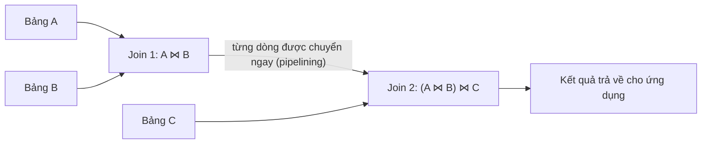
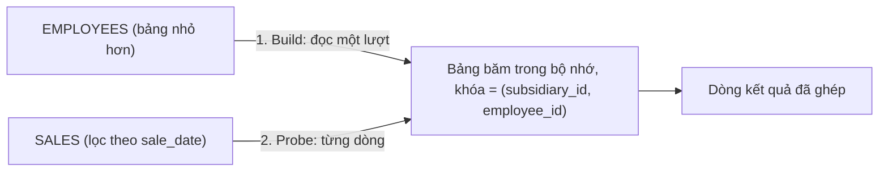

# Chương 4: Phép join (Chapter 4 – The Join Operation)

> Nguồn: *SQL Performance Explained* – Markus Winand, Chương 4 (trang PDF 101–120).
> Bản chuyển thể tiếng Việt. Các phần đánh dấu "💡 Ví dụ bổ sung" hoặc "📝 Giải thích thêm" là phần được thêm vào, **không có trong sách gốc**.

## Mục lục

- [Chương 4: Phép join (Chapter 4 – The Join Operation)](#chương-4-phép-join-chapter-4--the-join-operation)
  - [Hộp ghi chú: Pipelining kết quả trung gian (Pipelining Intermediate Results)](#hộp-ghi-chú-pipelining-kết-quả-trung-gian-pipelining-intermediate-results)
- [Nested Loops – Vòng lặp lồng nhau (Nested Loops)](#nested-loops--vòng-lặp-lồng-nhau-nested-loops)
  - [Bật ghi log SQL (Enabling SQL Logging)](#hộp-ghi-chú-bật-ghi-log-sql-enabling-sql-logging)
  - [Tự kiểm soát join trong ORM lúc runtime](#tự-kiểm-soát-join-trong-orm-lúc-runtime)
- [Hash Join – Join bằng bảng băm (Hash Join)](#hash-join--join-bằng-bảng-băm-hash-join)
  - [Giảm kích thước bảng băm](#giảm-kích-thước-bảng-băm)
  - [Chọn bớt cột khi dùng ORM (partial objects)](#chọn-bớt-cột-khi-dùng-orm-partial-objects)
- [Sort Merge – Sắp xếp rồi trộn (Sort Merge)](#sort-merge--sắp-xếp-rồi-trộn-sort-merge)
- [Bảng thuật ngữ (Glossary)](#bảng-thuật-ngữ-glossary)

---

> *Một câu truy vấn SQL bước vào quán bar và thấy hai cái bàn (table).*
> *Nó tiến lại gần và hỏi: "Cho tôi join cùng được không?"*
> —Nguồn: Không rõ
>
> (*An SQL query walks into a bar and sees two tables. He walks up to them and asks 'Can I join you?'* — chơi chữ: "table" vừa là "cái bàn" vừa là "bảng"; "join you" vừa là "ngồi cùng bạn" vừa là "phép join".)

Phép **join** (*join operation*) biến đổi dữ liệu từ một mô hình **đã chuẩn hóa** (*normalized model*) sang dạng **phi chuẩn hóa** (*denormalized form*) phù hợp với một mục đích xử lý cụ thể. Nói cách khác: dữ liệu được lưu tách ra nhiều bảng cho gọn gàng, không trùng lặp; khi cần dùng, ta "ghép" chúng lại thành một kết quả phẳng.

Phép join đặc biệt **nhạy cảm với độ trễ tìm kiếm của đĩa** (*disk seek latency*) vì nó phải kết hợp các mảnh dữ liệu nằm rải rác ở nhiều nơi. Một lần nữa, **đánh index đúng cách** là giải pháp tốt nhất để giảm thời gian phản hồi (*response time*). Tuy nhiên, index nào là "đúng" lại phụ thuộc vào việc câu truy vấn dùng **thuật toán join nào** trong ba thuật toán join phổ biến.

Dù vậy, có một điểm chung cho mọi thuật toán join: **chúng chỉ xử lý hai bảng mỗi lần**. Một câu truy vấn SQL có nhiều bảng hơn sẽ phải thực hiện qua nhiều bước: trước hết tạo ra một **tập kết quả trung gian** (*intermediate result set*) bằng cách join hai bảng, sau đó join kết quả này với bảng tiếp theo, và cứ thế tiếp tục.

Mặc dù **thứ tự join** (*join order*) không ảnh hưởng đến kết quả cuối cùng, nó vẫn ảnh hưởng đến hiệu năng. Vì vậy **optimizer** (bộ tối ưu truy vấn – thành phần của database quyết định cách thực thi câu lệnh) sẽ đánh giá **tất cả các hoán vị thứ tự join** có thể có và chọn ra cái tốt nhất. Điều đó có nghĩa là: chỉ riêng việc *tối ưu* một câu lệnh phức tạp thôi cũng có thể trở thành vấn đề hiệu năng. Càng nhiều bảng cần join, càng nhiều biến thể **execution plan** (kế hoạch thực thi) phải đánh giá — nói theo ngôn ngữ toán học: **n!** (tăng theo giai thừa). Tuy nhiên, đây sẽ không phải là vấn đề nếu bạn dùng **bind parameter** (tham số ràng buộc – dùng dấu `?` hay `:name` thay cho giá trị cụ thể, để database tái sử dụng execution plan đã tối ưu).

> **Quan trọng (Important)**
>
> Câu lệnh càng phức tạp thì việc dùng bind parameter càng quan trọng.
>
> Không dùng bind parameter cũng giống như biên dịch lại chương trình mỗi lần chạy.

> 📝 **Giải thích thêm (không có trong sách):** Để thấy n! tăng nhanh thế nào: 3 bảng → 3! = 6 thứ tự join; 5 bảng → 120; 8 bảng → 40.320; 10 bảng → 3.628.800. Vì thế các optimizer thực tế đều có giới hạn: PostgreSQL chuyển sang thuật toán di truyền GEQO khi số bảng ≥ `geqo_threshold` (mặc định 12) và chỉ thử hoán vị đầy đủ trong phạm vi `join_collapse_limit`/`from_collapse_limit` (mặc định 8); Oracle có tham số ẩn giới hạn số hoán vị được thử. Khi dùng bind parameter, câu lệnh có cùng chuỗi SQL nên database chỉ phải tối ưu **một lần** rồi lưu plan vào bộ nhớ đệm (Oracle: *shared pool/library cache*; SQL Server: *plan cache*; PostgreSQL: *prepared statement*), các lần sau dùng lại — chi phí n! chỉ phải trả một lần.

> 💡 **Ví dụ bổ sung (không có trong sách):** Cùng một truy vấn nhưng viết theo hai cách:
>
> ```sql
> -- Không dùng bind parameter: mỗi giá trị khác nhau là một chuỗi SQL khác nhau
> -- → database phải phân tích và tối ưu lại từ đầu mỗi lần
> SELECT * FROM sales s JOIN employees e ON (s.subsidiary_id = e.subsidiary_id AND s.employee_id = e.employee_id)
>  WHERE e.last_name = 'WINAND';
> SELECT * FROM sales s JOIN employees e ON (s.subsidiary_id = e.subsidiary_id AND s.employee_id = e.employee_id)
>  WHERE e.last_name = 'SMITH';
>
> -- Dùng bind parameter: cùng một chuỗi SQL → tối ưu một lần, dùng lại plan
> SELECT * FROM sales s JOIN employees e ON (s.subsidiary_id = e.subsidiary_id AND s.employee_id = e.employee_id)
>  WHERE e.last_name = ?;
> ```

### Hộp ghi chú: Pipelining kết quả trung gian (Pipelining Intermediate Results)

> **Pipelining kết quả trung gian (Pipelining Intermediate Results)**
>
> Mặc dù khái niệm "kết quả trung gian" giải thích thuật toán rất rõ ràng, điều đó không có nghĩa là database bắt buộc phải **hiện thực hóa** (*materialize*) nó — tức là lưu trữ toàn bộ kết quả trung gian của phép join thứ nhất rồi mới bắt đầu phép join tiếp theo. Thay vào đó, các database dùng **pipelining** (xử lý theo dây chuyền) để giảm lượng bộ nhớ sử dụng. Nghĩa là: mỗi dòng của kết quả trung gian được **chuyển ngay lập tức** sang phép join kế tiếp — nhờ vậy không cần lưu trữ cả tập kết quả trung gian.

> 📝 **Giải thích thêm (không có trong sách):** Hãy hình dung một dây chuyền lắp ráp: công nhân thứ nhất làm xong một sản phẩm là chuyển ngay cho công nhân thứ hai, chứ không đợi làm xong cả nghìn sản phẩm rồi mới chuyển cả lô. Với truy vấn `A JOIN B JOIN C`, mỗi khi phép join `A⋈B` sinh ra một dòng, dòng đó được đưa thẳng vào phép join với `C`. Nhờ vậy, ứng dụng có thể nhận được những dòng đầu tiên rất sớm. Lưu ý là không phải thao tác nào cũng pipeline được hoàn toàn: ví dụ bước xây bảng băm của hash join hay một thao tác sort phải đọc hết dữ liệu đầu vào trước khi trả ra dòng đầu tiên (Chương 6 và 7 của sách bàn kỹ hơn về điều này).



## Nested Loops – Vòng lặp lồng nhau (Nested Loops)

**Nested loops join** (join vòng lặp lồng nhau) là thuật toán join cơ bản nhất. Nó hoạt động giống như dùng hai truy vấn lồng nhau: truy vấn **bên ngoài** (*outer*) hay còn gọi là truy vấn **dẫn dắt** (*driving query*) lấy kết quả từ một bảng, và một truy vấn thứ hai được chạy **cho từng dòng** của truy vấn dẫn dắt để lấy dữ liệu tương ứng từ bảng còn lại.

> 📝 **Giải thích thêm (không có trong sách):** Viết dưới dạng mã giả, nested loops join trông như sau:
>
> ```text
> for each row e in (SELECT ... FROM employees WHERE UPPER(last_name) LIKE 'WIN%'):   -- vòng ngoài (driving)
>     for each row s in (SELECT ... FROM sales
>                         WHERE subsidiary_id = e.subsidiary_id
>                           AND employee_id   = e.employee_id):                       -- vòng trong (inner)
>         output (e, s)
> ```
>
> Nếu vòng ngoài trả về N dòng thì truy vấn bên trong được thực hiện N lần — mỗi lần là một lần duyệt B-tree (nếu có index phù hợp).

Thực ra, bạn hoàn toàn có thể tự cài đặt thuật toán nested loops bằng cách dùng các "**nested selects**" (các câu select lồng nhau, gửi từ ứng dụng). Tuy nhiên đó là một cách làm phiền phức, vì **độ trễ mạng** (*network latency*) cộng thêm vào độ trễ đĩa — khiến tổng thời gian phản hồi còn tệ hơn nữa. "Nested selects" vẫn còn rất phổ biến vì rất dễ vô tình cài đặt chúng mà không hề hay biết. Các công cụ **ánh xạ đối tượng – quan hệ** (*object-relational mapping*, **ORM**) đặc biệt "hữu ích" ở khoản này… đến mức mà cái gọi là **vấn đề N+1 selects** (*N+1 selects problem*) đã trở nên "nổi tiếng" một cách đáng buồn trong giới lập trình.

Các ví dụ dưới đây cho thấy những phép join kiểu "nested select vô tình" này, được sinh ra bởi các công cụ ORM khác nhau. Các ví dụ tìm những nhân viên có họ (*last name*) bắt đầu bằng `'WIN'` và lấy tất cả các bản ghi `SALES` (doanh số bán hàng) của những nhân viên này.

Các ORM **không sinh ra câu lệnh SQL join** — thay vào đó, chúng truy vấn bảng `SALES` bằng các nested select. Hiện tượng này được gọi là "**vấn đề N+1 selects**" hay ngắn gọn là "**vấn đề N+1**" (*N+1 problem*), vì nó thực thi tổng cộng N+1 câu select nếu truy vấn dẫn dắt trả về N dòng.

> 📝 **Giải thích thêm (không có trong sách):** Trong suốt chương, sách dùng hai bảng mẫu (giống các chương trước): `EMPLOYEES` có khóa chính gồm hai cột (`EMPLOYEE_ID`, `SUBSIDIARY_ID`) cùng các cột `LAST_NAME`, `FIRST_NAME`, `DATE_OF_BIRTH`…; và `SALES` gồm `SALE_ID`, `EMPLOYEE_ID`, `SUBSIDIARY_ID`, `SALE_DATE`, `EUR_VALUE`… (một số ví dụ còn có cột `JUNK` – một cột "rác" lớn dùng để minh họa). `SALES` tham chiếu tới `EMPLOYEES` qua cặp cột (`SUBSIDIARY_ID`, `EMPLOYEE_ID`) — đây chính là **join predicate** (điều kiện join).

#### Java

Ví dụ JPA dùng interface `CriteriaBuilder`.

```java
CriteriaBuilder queryBuilder = em.getCriteriaBuilder();
CriteriaQuery<Employees>
   query = queryBuilder.createQuery(Employees.class);
Root<Employees> r = query.from(Employees.class);
query.where(
  queryBuilder.like(
    queryBuilder.upper(r.get(Employees_.lastName)),
    "WIN%"
  )
);
List<Employees> emp = em.createQuery(query).getResultList();
for (Employees e: emp) {
  // process Employee
  for (Sales s: e.getSales()) {
    // process sale for Employee
  }
}
```

(Chú thích trong code: `// process Employee` = xử lý nhân viên; `// process sale for Employee` = xử lý từng bản ghi bán hàng của nhân viên đó.)

Hibernate JPA 3.6.0 sinh ra N+1 câu select:

```sql
select employees0_.subsidiary_id as subsidiary1_0_
       -- MORE COLUMNS
  from employees employees0_
 where upper(employees0_.last_name) like ?

  select sales0_.subsidiary_id as subsidiary4_0_1_
         -- MORE COLUMNS
    from sales sales0_
   where sales0_.subsidiary_id=?
     and sales0_.employee_id=?

  select sales0_.subsidiary_id as subsidiary4_0_1_
         -- MORE COLUMNS
    from sales sales0_
   where sales0_.subsidiary_id=?
     and sales0_.employee_id=?
```

(`-- MORE COLUMNS` = còn nhiều cột khác, được lược bớt cho gọn. Câu select đầu tiên là truy vấn dẫn dắt; các câu select thụt vào được lặp lại cho mỗi nhân viên tìm được.)

#### Perl

Ví dụ sau minh họa framework `DBIx::Class` của Perl:

```perl
my @employees =
   $schema->resultset('Employees')
          ->search({'UPPER(last_name)' => {-like=>'WIN%'}});
foreach my $employee (@employees) {
   # process Employee
   foreach my $sale ($employee->sales) {
      # process Sale for Employee
   }
}
```

(Trong bản PDF, ký hiệu chú thích bị trích thành chữ "G"; ở đây khôi phục lại là dấu chú thích `#` của Perl. `# process Employee` = xử lý nhân viên; `# process Sale for Employee` = xử lý bản ghi bán hàng của nhân viên.)

`DBIx::Class` 0.08192 sinh ra N+1 câu select:

```sql
SELECT me.employee_id, me.subsidiary_id
     , me.last_name, me.first_name, me.date_of_birth
  FROM employees me
 WHERE ( UPPER(last_name) LIKE ? )

   SELECT me.sale_id, me.employee_id, me.subsidiary_id
        , me.sale_date, me.eur_value
     FROM sales me
    WHERE ( ( me.employee_id = ?
      AND me.subsidiary_id = ? ) )

   SELECT me.sale_id, me.employee_id, me.subsidiary_id
        , me.sale_date, me.eur_value
     FROM sales me
    WHERE ( ( me.employee_id = ?
      AND me.subsidiary_id = ? ) )
```

#### PHP

Ví dụ Doctrine dùng interface query builder:

```php
$qb = $em->createQueryBuilder();
$qb->select('e')
   ->from('Employees', 'e')
   ->where("upper(e.last_name) like :last_name")
   ->setParameter('last_name', 'WIN%');
$r = $qb->getQuery()->getResult();
foreach ($r as $row) {
   // process Employee
   foreach ($row->getSales() as $sale) {
      // process Sale for Employee
   }
}
```

Doctrine 2.0.5 sinh ra N+1 câu select:

```sql
SELECT e0_.employee_id AS employee_id0 -- MORE COLUMNS
  FROM employees e0_
 WHERE UPPER(e0_.last_name) LIKE ?

   SELECT t0.sale_id AS SALE_ID1 -- MORE COLUMNS
     FROM sales t0
    WHERE t0.subsidiary_id = ?
      AND t0.employee_id = ?

   SELECT t0.sale_id AS SALE_ID1 -- MORE COLUMNS
     FROM sales t0
    WHERE t0.subsidiary_id = ?
      AND t0.employee_id = ?
```

### Hộp ghi chú: Bật ghi log SQL (Enabling SQL Logging)

> **Bật ghi log SQL (Enabling SQL Logging)**
>
> Hãy bật ghi log SQL trong quá trình phát triển và xem lại các câu lệnh SQL được sinh ra.
>
> **DBIx::Class**
>
> Chạy `export DBIC_TRACE=1` trong shell của bạn.
>
> **Doctrine**
>
> Chỉ có thể bật ở mức mã nguồn — đừng quên tắt nó đi khi lên môi trường production. Hãy cân nhắc tự xây dựng một logger có thể cấu hình được.
>
> ```php
> $logger = new \Doctrine\DBAL\Logging\EchoSqlLogger;
> $config->setSQLLogger($logger);
> ```
>
> **Hibernate (native)**
>
> `<property name="show_sql">true</property>` trong `App.config` hoặc `hibernate.cfg.xml`
>
> **JPA**
>
> Trong `persistence.xml`, nhưng tùy thuộc vào JPA provider:
>
> ```xml
> <property name="eclipselink.logging.level" value="FINE"/>
> <property name="hibernate.show_sql" value="TRUE"/>
> <property name="openjpa.Log" value="SQL=TRACE"/>
> ```
>
> Hầu hết các ORM cũng cung cấp cách bật ghi log SQL bằng lập trình (*programmatic way*). Cách đó tiềm ẩn rủi ro vô tình triển khai luôn thiết lập này lên production.

> 📝 **Giải thích thêm (không có trong sách):** Với các phiên bản mới hơn, cách bật log có thay đổi, ví dụ: Spring Boot/Hibernate 5–6 dùng `spring.jpa.show-sql=true` hoặc `logging.level.org.hibernate.SQL=DEBUG`; Doctrine DBAL 3+ đã bỏ `EchoSqlLogger` và chuyển sang cơ chế middleware/PSR-3 logger. Ngoài ra, có thể bật log ngay ở phía database, độc lập với ORM: PostgreSQL `log_statement = 'all'` hoặc `log_min_duration_statement`; MySQL `general_log = ON`; SQL Server dùng Extended Events. Dấu hiệu nhận biết N+1 trong log: cùng một câu `SELECT ... FROM sales WHERE ... = ?` lặp đi lặp lại hàng chục, hàng trăm lần liên tiếp chỉ khác giá trị tham số.

Mặc dù cách làm "nested selects" là một **anti-pattern** (mẫu hình xấu, nên tránh), nó vẫn giải thích nested loops join khá rõ. Database thực hiện phép join **y hệt** cách các công cụ ORM ở trên làm. Vì vậy, đánh index cho một nested loops join cũng giống như đánh index cho các câu select được trình bày ở trên. Đó là một **index dựa trên hàm** (*function-based index*) trên bảng `EMPLOYEES` và một **index ghép** (*concatenated index*) cho các join predicate trên bảng `SALES`:

```sql
CREATE INDEX emp_up_name ON employees (UPPER(last_name));
CREATE INDEX sales_emp ON sales (subsidiary_id, employee_id);
```

Một SQL join vẫn hiệu quả hơn cách nested selects — dù nó thực hiện **cùng những lần tra index** — vì nó tránh được rất nhiều lượt giao tiếp qua mạng. Nó thậm chí còn nhanh hơn ngay cả khi tổng lượng dữ liệu truyền đi lớn hơn (do các thuộc tính của nhân viên bị lặp lại cho mỗi bản ghi bán hàng). Đó là vì **hai chiều kích của hiệu năng**: **thời gian phản hồi** (*response time*) và **thông lượng** (*throughput* – lượng công việc/dữ liệu xử lý được trong một đơn vị thời gian); trong mạng máy tính, ta gọi chúng là **độ trễ** (*latency*) và **băng thông** (*bandwidth*). Băng thông chỉ có ảnh hưởng nhỏ đến thời gian phản hồi, nhưng độ trễ thì có ảnh hưởng rất lớn. Điều đó có nghĩa là **số lượt khứ hồi tới database** (*database round trips*) quan trọng đối với thời gian phản hồi hơn là lượng dữ liệu được truyền.

> **Mẹo (Tip)**
>
> Hãy thực hiện join trong database.

> 💡 **Ví dụ bổ sung (không có trong sách):** Tính nhẩm chi phí. Giả sử độ trễ mạng mỗi lượt khứ hồi là 0,5 ms, tìm được N = 200 nhân viên họ "WIN…", mỗi lần tra index trên `SALES` mất 0,2 ms trong database.
>
> | Cách làm | Số lượt khứ hồi | Thời gian do độ trễ mạng | Thời gian tra index trong DB | Tổng (xấp xỉ) |
> |---|---|---|---|---|
> | N+1 selects từ ORM | 1 + 200 = 201 | 201 × 0,5 = 100,5 ms | 200 × 0,2 = 40 ms | ~140 ms |
> | Một câu SQL join | 1 (cộng vài lượt fetch nếu kết quả lớn) | ~0,5 ms | 40 ms | ~41 ms |
>
> Cả hai cách đều làm **cùng số lần tra index** (thuật toán nested loops giống nhau), nhưng câu SQL join tiết kiệm gần như toàn bộ chi phí độ trễ mạng. Dữ liệu nhân viên bị lặp lại trong mỗi dòng kết quả của join làm tăng số byte truyền đi, nhưng như sách nói, băng thông ít ảnh hưởng tới thời gian phản hồi hơn độ trễ.

### Tự kiểm soát join trong ORM lúc runtime

Hầu hết các công cụ ORM đều có cách nào đó để tạo ra SQL join. Chế độ gọi là **eager fetching** (nạp sớm/nạp háo hức) có lẽ là quan trọng nhất. Nó thường được cấu hình ở **mức thuộc tính** (*property level*) trong ánh xạ thực thể (*entity mappings*) — ví dụ cho thuộc tính `employees` trong lớp `Sales`. Khi đó công cụ ORM sẽ **luôn luôn** join bảng `EMPLOYEES` mỗi khi truy cập bảng `SALES`. Cấu hình eager fetching trong ánh xạ thực thể chỉ hợp lý nếu bạn **luôn luôn** cần thông tin chi tiết của nhân viên đi kèm với dữ liệu bán hàng.

Eager fetching sẽ **phản tác dụng** nếu bạn không cần các bản ghi con mỗi lần truy cập đối tượng cha. Với một ứng dụng danh bạ điện thoại, việc nạp các bản ghi `SALES` khi hiển thị thông tin nhân viên là vô nghĩa. Bạn có thể cần dữ liệu bán hàng liên quan trong những trường hợp khác — nhưng không phải lúc nào cũng cần. **Một cấu hình tĩnh không phải là giải pháp.**

Để đạt hiệu năng tối ưu, bạn cần **toàn quyền kiểm soát các phép join**. Các ví dụ sau cho thấy cách đạt được sự linh hoạt lớn nhất bằng cách kiểm soát hành vi join **lúc runtime** (khi chương trình đang chạy).

> 📝 **Giải thích thêm (không có trong sách):** Tiêu đề tiểu mục "Tự kiểm soát join trong ORM lúc runtime" do người dịch thêm vào cho dễ theo dõi; trong sách, phần này là các đoạn văn liền mạch thuộc mục Nested Loops.

#### Java

Interface `CriteriaBuilder` của JPA cung cấp phương thức `Root<>.fetch()` để kiểm soát join. Nó cho phép bạn chỉ định **khi nào** và **bằng cách nào** join các đối tượng được tham chiếu vào truy vấn chính. Trong ví dụ này, ta dùng **left join** để lấy tất cả nhân viên, kể cả khi một số người không có bản ghi bán hàng nào.

> **Cảnh báo (Warning)**
>
> JPA và Hibernate trả về nhân viên **cho mỗi bản ghi bán hàng**.
>
> Nghĩa là một nhân viên có 30 bản ghi bán hàng sẽ xuất hiện 30 lần. Dù điều này rất khó chịu, đó lại là **hành vi được đặc tả** (EJB 3.0 persistency, đoạn 4.4.5.3 "Fetch Joins"). Bạn có thể tự loại bỏ trùng lặp quan hệ cha bằng tay, hoặc dùng hàm `distinct()` như trong ví dụ.

```java
CriteriaBuilder qb = em.getCriteriaBuilder();
CriteriaQuery<Employees> q = qb.createQuery(Employees.class);
Root<Employees> r = q.from(Employees.class);
q.where(queryBuilder.like(
    queryBuilder.upper(r.get(Employees_.lastName)),
    "WIN%")
);
r.fetch("sales", JoinType.LEFT);
// needed to avoid duplication of Employee records
query.distinct(true);
List<Employees> emp = em.createQuery(query).getResultList();
```

(Chú thích trong code: `// needed to avoid duplication of Employee records` = cần thiết để tránh trùng lặp các bản ghi Employee.)

Hibernate 3.6.0 sinh ra câu lệnh SQL sau:

```sql
select distinct
       employees0_.subsidiary_id as subsidiary1_0_0_
     , employees0_.employee_id as employee2_0_0_
       -- MORE COLUMNS
     , sales1_.sale_id as sale1_0__
  from employees employees0_
  left outer join sales sales1_
          on employees0_.subsidiary_id=sales1_.subsidiary_id
         and employees0_.employee_id=sales1_.employee_id
 where upper(employees0_.last_name) like ?
```

Câu truy vấn có left join như mong đợi, nhưng lại có thêm một từ khóa `distinct` không cần thiết. Đáng tiếc là JPA không cung cấp lời gọi API riêng để lọc các bản ghi cha trùng lặp mà không đồng thời loại trùng lặp luôn các bản ghi con. Từ khóa `distinct` trong câu truy vấn SQL là một **dấu hiệu đáng báo động**, vì hầu hết các database sẽ thực sự lọc các bản ghi trùng lặp (tốn công sort hoặc hash). Chỉ một số ít database nhận ra rằng trong trường hợp này, các khóa chính vốn đã đảm bảo tính duy nhất rồi.

API Hibernate gốc (*native*) giải quyết vấn đề này ở **phía client** bằng một **result set transformer** (bộ biến đổi tập kết quả):

```java
Criteria c = session.createCriteria(Employees.class);
c.add(Restrictions.ilike("lastName", 'Win%'));
c.setFetchMode("sales", FetchMode.JOIN);
c.setResultTransformer(Criteria.DISTINCT_ROOT_ENTITY);
List<Employees> result = c.list();
```

Nó sinh ra câu truy vấn sau:

```sql
select this_.subsidiary_id as subsidiary1_0_1_
     , this_.employee_id as employee2_0_1_
       -- MORE this_ columns on employees
     , sales2_.sale_id as sale1_3_
       -- MORE sales2_ columns on sales
  from employees this_
  left outer join sales sales2_
          on this_.subsidiary_id=sales2_.subsidiary_id
         and this_.employee_id=sales2_.employee_id
 where lower(this_.last_name) like ?
```

(`-- MORE this_ columns on employees` = thêm các cột khác của `this_` trên bảng employees; `-- MORE sales2_ columns on sales` = thêm các cột khác của `sales2_` trên bảng sales.)

Phương pháp này tạo ra câu SQL "sạch", không có mệnh đề nào ngoài ý muốn. Lưu ý rằng Hibernate dùng `lower()` cho các truy vấn không phân biệt hoa thường — một chi tiết quan trọng đối với việc đánh **function-based index** (index `UPPER(last_name)` ở trên sẽ **không** dùng được cho điều kiện `lower(last_name) like ?`; bạn cần index trên `LOWER(last_name)`).

> 📝 **Giải thích thêm (không có trong sách):** Ở các phiên bản mới, API `Criteria` cũ của Hibernate đã bị loại bỏ (deprecated từ 5.2, xóa ở 6.0). Trong JPQL/HQL hiện đại, cách thông dụng là `select distinct e from Employees e left join fetch e.sales where upper(e.lastName) like :n`. Từ Hibernate 6, việc khử trùng lặp thực thể gốc khi `join fetch` được làm tự động trong bộ nhớ, và `distinct` trong HQL **không còn** được chuyển xuống SQL nữa (ở Hibernate 5.2.2+ có thể đạt điều tương tự bằng hint `hibernate.query.passDistinctThrough=false`). Ngoài ra còn có `@EntityGraph`/`@NamedEntityGraph` (JPA 2.1+) để chọn quan hệ cần fetch theo từng truy vấn lúc runtime.

#### Perl

Ví dụ sau dùng framework `DBIx::Class` của Perl:

```perl
my @employees =
   $schema->resultset('Employees')
          ->search({ 'UPPER(last_name)' => {-like => 'WIN%'}
                   , {prefetch => ['sales']}
                   });
```

`DBIx::Class` 0.08192 sinh ra câu lệnh SQL sau:

```sql
SELECT me.employee_id, me.subsidiary_id, me.last_name
       -- MORE COLUMNS
  FROM employees me
  LEFT JOIN sales sales
         ON (sales.employee_id   = me.employee_id
        AND  sales.subsidiary_id = me.subsidiary_id)
 WHERE ( UPPER(last_name) LIKE ? )
 ORDER BY sales.employee_id, sales.subsidiary_id
```

Hãy để ý mệnh đề `order by` — nó **không hề được ứng dụng yêu cầu**. Database phải sắp xếp tập kết quả theo đó, và việc này có thể mất kha khá thời gian.

#### PHP

Ví dụ sau dùng framework Doctrine của PHP:

```php
$qb = $em->createQueryBuilder();
$qb->select('e,s')
   ->from('Employees', 'e')
   ->leftJoin('e.sales', 's')
   ->where("upper(e.last_name) like :last_name")
   ->setParameter('last_name', 'WIN%');
$r = $qb->getQuery()->getResult();
```

Doctrine 2.0.5 sinh ra câu lệnh SQL sau:

```sql
SELECT e0_.employee_id AS employee_id0
       -- MORE COLUMNS
  FROM employees e0_
  LEFT JOIN sales s1_
         ON e0_.subsidiary_id = s1_.subsidiary_id
        AND e0_.employee_id = s1_.employee_id
 WHERE UPPER(e0_.last_name) LIKE ?
```

Execution plan cho thấy operation `NESTED LOOPS OUTER`:

```text
---------------------------------------------------------------
|Id |Operation                    | Name        | Rows | Cost |
---------------------------------------------------------------
| 0 |SELECT STATEMENT             |             |  822 |   38 |
| 1 | NESTED LOOPS OUTER          |             |  822 |   38 |
| 2 |  TABLE ACCESS BY INDEX ROWID| EMPLOYEES   |    1 |    4 |
|*3 |   INDEX RANGE SCAN          | EMP_UP_NAME |    1 |      |
| 4 |  TABLE ACCESS BY INDEX ROWID| SALES       |  821 |   34 |
|*5 |   INDEX RANGE SCAN          | SALES_EMP   |   31 |      |
---------------------------------------------------------------

Predicate Information (identified by operation id):
---------------------------------------------------
  3 - access(UPPER("LAST_NAME") LIKE 'WIN%')
      filter(UPPER("LAST_NAME") LIKE 'WIN%')
  5 - access("E0_"."SUBSIDIARY_ID"="S1_"."SUBSIDIARY_ID"(+)
        AND  "E0_"."EMPLOYEE_ID"  ="S1_"."EMPLOYEE_ID"(+))
```

Database lấy kết quả từ bảng `EMPLOYEES` thông qua index `EMP_UP_NAME` trước, rồi sau đó, với mỗi nhân viên, lấy các bản ghi tương ứng từ bảng `SALES`.

> 📝 **Giải thích thêm (không có trong sách):** Cách đọc plan này (Oracle):
>
> - Id 1 `NESTED LOOPS OUTER` có hai con: con thứ nhất (Id 2–3) là **vòng ngoài/driving**, con thứ hai (Id 4–5) là **vòng trong**, được thực hiện một lần cho mỗi dòng của vòng ngoài.
> - Id 3: `INDEX RANGE SCAN` trên `EMP_UP_NAME` dùng `UPPER("LAST_NAME") LIKE 'WIN%'` làm **access predicate** (điều kiện giới hạn phạm vi quét index); dòng `filter` lặp lại là do `LIKE` — Oracle vẫn kiểm tra lại điều kiện trên từng mục index.
> - Id 5: `INDEX RANGE SCAN` trên `SALES_EMP` dùng cả hai cột join làm access predicate. Ký hiệu `(+)` là cú pháp outer join kiểu cũ của Oracle, đánh dấu phía bảng "có thể không có dòng khớp" (ở đây là `SALES`).
> - Ước tính: 1 nhân viên, mỗi nhân viên ~821 bản ghi bán hàng → 822 dòng tổng cộng (1 + 821, cột Rows ở dòng 0–1).

> **Mẹo (Tip)**
>
> Hãy hiểu rõ ORM của bạn và nắm quyền kiểm soát các phép join.

Nested loops join cho hiệu năng tốt nếu truy vấn dẫn dắt trả về **một tập kết quả nhỏ**. Nếu không, optimizer có thể chọn một thuật toán join hoàn toàn khác — như **hash join** được mô tả ở mục tiếp theo — nhưng điều này **chỉ có thể xảy ra nếu ứng dụng dùng một phép join** để nói cho database biết nó thực sự cần dữ liệu gì. (Với nested selects từ ORM, database chỉ nhìn thấy từng câu select riêng lẻ nên không thể chọn thuật toán nào khác.)

> 💡 **Ví dụ bổ sung (không có trong sách):** Bài toán: dữ liệu mẫu
>
> | Bảng | Số dòng | Index có sẵn |
> |---|---|---|
> | `employees` | 10.000 | PK (`employee_id`, `subsidiary_id`) |
> | `sales` | 1.000.000 | PK (`sale_id`) |
>
> Câu truy vấn:
>
> ```sql
> SELECT e.last_name, s.sale_date, s.eur_value
>   FROM employees e
>   JOIN sales s ON (s.subsidiary_id = e.subsidiary_id
>                AND s.employee_id   = e.employee_id)
>  WHERE UPPER(e.last_name) LIKE 'WIN%';
> ```
>
> - **Chưa có index nào phù hợp:** vòng ngoài phải full scan `employees` (vì không có index trên `UPPER(last_name)`), và tệ hơn, với mỗi nhân viên tìm được, vòng trong phải full scan `sales` — 1 triệu dòng × số nhân viên. Optimizer gần như chắc chắn sẽ bỏ nested loops và chọn hash join.
> - **Tạo hai index như sách:** `emp_up_name` (function-based) cho vòng ngoài, `sales_emp (subsidiary_id, employee_id)` cho vòng trong. Giả sử chỉ có 1–2 nhân viên khớp: vòng ngoài là một `INDEX RANGE SCAN` ngắn, mỗi vòng trong là một lần duyệt B-tree + đọc vài trăm dòng `sales`. Đây là trường hợp lý tưởng cho nested loops.
> - **Thứ tự cột trong `sales_emp` không quan trọng** ở đây vì cả hai cột đều được so sánh bằng (`=`); nhưng index chỉ có `employee_id` cũng chạy được (kém chọn lọc hơn một chút), còn index chỉ có `subsidiary_id` thì rất kém (mỗi chi nhánh có hàng nghìn nhân viên).
> - **Lưu ý về phía nào được index:** với nested loops, index cho join predicate chỉ có ích ở **bảng phía trong**. Index trên `employees(subsidiary_id, employee_id)` (tức là PK) không giúp gì cho thứ tự join này — nhưng sẽ có ích nếu optimizer đảo thứ tự join (driving = `sales`). Đây là điểm khác biệt với hash join ở mục sau.
>
> Trên PostgreSQL, câu lệnh tương đương là `CREATE INDEX emp_up_name ON employees (UPPER(last_name));` (gọi là *expression index*); để `LIKE 'WIN%'` dùng được B-tree khi collation không phải "C", cần thêm operator class: `CREATE INDEX emp_up_name ON employees (UPPER(last_name) text_pattern_ops);`. Trên MySQL 8.0.13+ có *functional key part*: `CREATE INDEX emp_up_name ON employees ((UPPER(last_name)));`. Trên SQL Server, cần tạo cột tính toán (*computed column*) `last_name_up AS UPPER(last_name)` rồi đánh index cột đó.

> 📝 **Giải thích thêm (không có trong sách) — Đối chiếu với PostgreSQL hiện đại (PG 10–17): Đột phá #1 — Node `Memoize` cho `Nested Loop Join` (PostgreSQL 14+)**
>
> Thời điểm sách viết (2012, **PostgreSQL 9.1**), điểm yếu chí tử của `Nested Loop Join` là: nếu bảng bên ngoài (*outer/driving table*, ví dụ `sales` có 1.000.000 dòng) có rất nhiều dòng mang **cùng một giá trị khóa nối lặp đi lặp lại** (ví dụ chỉ xoay quanh 1.000 nhân viên trong bảng `employees`), thì `Nested Loop` truyền thống vẫn ngây thơ thực hiện việc duyệt cây B-Tree của bảng trong (`employees`) đủ **1.000.000 lần**! (Trước PG 14, nút `Materialize` chỉ đệm được kết quả cố định của nhánh trong khi không có tham số truyền từ ngoài vào, hoàn toàn bất lực trước *parameterized index scan*).
>
> Từ **PostgreSQL 14+**, bộ tối ưu hóa (*Query Planner*) đã bổ sung một cải tiến đột phá cho phép nối vòng lặp lồng nhau: **Node `Memoize`** (điều khiển bởi tham số `enable_memoize = on` mặc định):
> - **Cơ chế hoạt động**: Khi thực hiện `Nested Loop Join` có truyền tham số (*parameterized nested loop*), Planner tự động bọc nhánh quét chỉ mục bên trong bằng một nút **`Memoize`**. Nút này duy trì một **bộ nhớ đệm bảng băm cục bộ (*in-memory hash cache*)** trong vùng nhớ `work_mem * hash_mem_multiplier` với cơ chế loại bỏ **LRU** (*Least Recently Used*).
> - **Tra cứu $O(1)$ cho các khóa lặp lại**: Với mỗi dòng từ bảng ngoài (`sales`), trước khi chạm vào B-Tree index của bảng trong (`employees`), PostgreSQL kiểm tra khóa nối (`Cache Key: s.subsidiary_id, s.employee_id`) trong bộ đệm `Memoize`:
>   - Nếu **trúng bộ đệm (`Cache Hit`)**: Trả về ngay lập tức dòng `employees` đã lưu trong RAM mà **không tốn bất kỳ thao tác duyệt B-Tree hay đọc buffer nào**!
>   - Nếu **trượt bộ đệm (`Cache Miss`)**: Mới thực hiện `Index Scan` trên bảng `employees`, sau đó lưu kết quả vào bảng băm `Memoize` để phục vụ các dòng tiếp theo.
> - **Lợi thế kết hợp hoàn hảo**: Nhờ `Memoize`, khi bảng ngoài có độ lặp khóa cao (*low cardinality of join keys*), `Nested Loop Join` chỉ phải duyệt B-Tree đúng **1.000 lần** (thay vì 1.000.000 lần), đạt tốc độ tổng thể ngang ngửa hoặc vượt cả `Hash Join`, trong khi vẫn giữ nguyên ưu thế **pipelining (trả về những dòng đầu tiên tức thì cho `LIMIT`)** và không phải quét toàn bộ bảng `employees` nếu chỉ một tập con nhân viên xuất hiện trong `sales`!
> - **Mở rộng trong PostgreSQL 15–17**: PostgreSQL 15 và 16 tiếp tục mở rộng `Memoize` cho cả phép nối nửa (`SEMI JOIN` / `EXISTS`), phép nối phản (`ANTI JOIN` / `NOT EXISTS`), truy vấn con `LATERAL`, và định giá chính xác hơn tỷ lệ `Cache Hit` khi đầu vào phía ngoài đã có thứ tự cục bộ.

> 💡 **Ví dụ bổ sung (không có trong sách) — Thực hành trên PostgreSQL hiện đại: So sánh `Nested Loop` truyền thống và `Nested Loop + Memoize` (PG 14+)**
>
> Giả sử ta nối 50.000 bản ghi `sales` gần đây với bảng `employees` (nhưng 50.000 giao dịch này chỉ thuộc về 500 nhân viên bán hàng):
>
> ```sql
> -- 1. Tắt Memoize để mô phỏng hành vi PostgreSQL cũ (PG 9.1 – PG 13)
> SET enable_memoize = off;
> SET enable_hashjoin = off;
> SET enable_mergejoin = off;
>
> EXPLAIN (ANALYZE, BUFFERS)
> SELECT s.sale_id, s.eur_value, e.last_name
>   FROM sales s
>   JOIN employees e
>     ON s.subsidiary_id = e.subsidiary_id
>    AND s.employee_id   = e.employee_id
>  WHERE s.sale_date >= CURRENT_DATE - INTERVAL '1 month';
> ```
>
> Kế hoạch thực thi khi **không có `Memoize`**: nhánh trong (`Index Scan` trên `employees_pkey`) bị gọi lặp lại đủ **50.000 lần (`loops=50000`)**, gây ra tới **150.850 lần đọc trang bộ nhớ đệm (`shared hit=150850`)**:
>
> ```text
> Nested Loop  (cost=0.72..48210.45 rows=50000 width=28) (actual time=0.042..84.510 ms rows=50000 loops=1)
>   Buffers: shared hit=150850
>   ->  Index Scan using sales_date on sales s  (cost=0.43..1850.20 rows=50000 width=20) (actual time=0.025..7.410 ms rows=50000 loops=1)
>         Index Cond: (sale_date >= (CURRENT_DATE - '1 mon'::interval))
>         Buffers: shared hit=850
>   ->  Index Scan using employees_pkey on employees e  (cost=0.29..0.93 rows=1 width=16) (actual time=0.001..0.001 ms rows=1 loops=50000)
>         Index Cond: ((subsidiary_id = s.subsidiary_id) AND (employee_id = s.employee_id))
>         Buffers: shared hit=150000
> Execution Time: 87.320 ms
> ```
>
> Bây giờ, bật lại mặc định của **PostgreSQL 14–17 (`SET enable_memoize = on;`)**:
>
> ```sql
> -- 2. Bật Memoize (mặc định trên PostgreSQL 14–17)
> RESET ALL;
>
> EXPLAIN (ANALYZE, BUFFERS)
> SELECT s.sale_id, s.eur_value, e.last_name
>   FROM sales s
>   JOIN employees e
>     ON s.subsidiary_id = e.subsidiary_id
>    AND s.employee_id   = e.employee_id
>  WHERE s.sale_date >= CURRENT_DATE - INTERVAL '1 month';
> ```
>
> ```text
> Nested Loop  (cost=0.73..3912.60 rows=50000 width=28) (actual time=0.048..14.120 ms rows=50000 loops=1)
>   Buffers: shared hit=2350
>   ->  Index Scan using sales_date on sales s  (cost=0.43..1850.20 rows=50000 width=20) (actual time=0.024..6.890 ms rows=50000 loops=1)
>         Index Cond: (sale_date >= (CURRENT_DATE - '1 mon'::interval))
>         Buffers: shared hit=850
>   ->  Memoize  (cost=0.30..0.34 rows=1 width=16) (actual time=0.000..0.000 ms rows=1 loops=50000)
>         Cache Key: s.subsidiary_id, s.employee_id
>         Cache Mode: logical
>         Hits: 49500  Misses: 500  Evictions: 0  Overflows: 0  Memory Usage: 58kB
>         Buffers: shared hit=1500
>         ->  Index Scan using employees_pkey on employees e  (cost=0.29..0.33 rows=1 width=16) (actual time=0.002..0.002 ms rows=1 loops=500)
>               Index Cond: ((subsidiary_id = s.subsidiary_id) AND (employee_id = s.employee_id))
>               Buffers: shared hit=1500
> Execution Time: 16.450 ms
> ```
>
> **Hãy nhìn vào dòng thống kê của `Memoize`:**
> - Trong 50.000 lần vòng lặp ngoài chạy (`loops=50000`), `Memoize` trúng bộ đệm tới **49.500 lần (`Hits: 49500`)** và chỉ trượt **500 lần (`Misses: 500`)**, chỉ tốn đúng **58 kB RAM (`Memory Usage: 58kB`)**!
> - Nhờ đó, nút `Index Scan using employees_pkey` bên dưới chỉ phải thực thi đúng **500 lần (`loops=500`)**, giảm số lần đọc buffer của nhánh trong từ **150.000 xuống còn 1.500 (giảm 99%)**, rút ngắn thời gian chạy từ **87.3 ms xuống 16.4 ms**!

## Hash Join – Join bằng bảng băm (Hash Join)

Thuật toán **hash join** nhắm vào điểm yếu của nested loops join: **rất nhiều lần duyệt B-tree** (*B-tree traversal*) khi thực thi truy vấn bên trong. Thay vào đó, nó nạp các **bản ghi ứng viên** (*candidate records*) từ một phía của phép join vào một **bảng băm** (*hash table*) — cấu trúc có thể được **dò** (*probe*) rất nhanh cho từng dòng từ phía bên kia của phép join. Tinh chỉnh (*tuning*) một hash join đòi hỏi một cách tiếp cận đánh index **hoàn toàn khác** so với nested loops join. Ngoài ra, ta còn có thể cải thiện hiệu năng hash join bằng cách **chọn ít cột hơn** — một thách thức đối với hầu hết các công cụ ORM.

Chiến lược đánh index cho hash join rất khác vì **không cần đánh index các cột join**. Chỉ những index cho các **điều kiện `where` độc lập** (*independent where predicates*) mới cải thiện được hiệu năng hash join.

> **Mẹo (Tip)**
>
> Hãy đánh index cho các điều kiện `where` độc lập để cải thiện hiệu năng hash join.

> 📝 **Giải thích thêm (không có trong sách):** Hash join diễn ra theo hai pha:
>
> 1. **Pha xây (build phase):** đọc bảng nhỏ hơn (sau khi áp dụng các điều kiện lọc riêng của nó), với mỗi dòng tính hàm băm trên các cột join, rồi đặt dòng đó vào "ngăn" (*bucket*) tương ứng trong bảng băm trên bộ nhớ.
> 2. **Pha dò (probe phase):** đọc bảng còn lại từng dòng một, tính hàm băm trên cột join, nhảy thẳng tới bucket tương ứng và so khớp — mỗi lần dò tốn chi phí gần như hằng số, không cần duyệt cây B-tree.
>
> *(Sơ đồ minh họa bổ sung ngay bên dưới.)*



Hãy xem ví dụ sau. Nó chọn tất cả các bản ghi bán hàng trong sáu tháng vừa qua kèm theo thông tin chi tiết của nhân viên tương ứng:

```sql
SELECT *
  FROM sales s
  JOIN employees e ON (s.subsidiary_id = e.subsidiary_id
                  AND  s.employee_id   = e.employee_id  )
 WHERE s.sale_date > trunc(sysdate) - INTERVAL '6' MONTH
```

Bộ lọc trên `SALE_DATE` là mệnh đề `where` độc lập duy nhất — nghĩa là nó chỉ tham chiếu tới **một bảng** và **không thuộc** các join predicate.

```text
--------------------------------------------------------------
| Id | Operation          | Name      | Rows  | Bytes | Cost |
--------------------------------------------------------------
|  0 | SELECT STATEMENT   |           | 49244 |    59M| 12049|
|* 1 |  HASH JOIN         |           | 49244 |    59M| 12049|
|  2 |   TABLE ACCESS FULL| EMPLOYEES | 10000 |     9M|   478|
|* 3 |   TABLE ACCESS FULL| SALES     | 49244 |    10M| 10521|
--------------------------------------------------------------

Predicate Information (identified by operation id):
---------------------------------------------------
   1 - access("S"."SUBSIDIARY_ID"="E"."SUBSIDIARY_ID"
          AND "S"."EMPLOYEE_ID"  ="E"."EMPLOYEE_ID")
   3 - filter("S"."SALE_DATE">TRUNC(SYSDATE@!)
                           -INTERVAL'+00-06' YEAR(2) TO MONTH)
```

Bước thực thi đầu tiên là một **full table scan** (quét toàn bộ bảng) để nạp tất cả nhân viên vào một bảng băm (plan id 2). Bảng băm dùng các join predicate làm **khóa**. Ở bước tiếp theo, database thực hiện một full table scan nữa trên bảng `SALES` và loại bỏ tất cả các bản ghi bán hàng không thỏa điều kiện trên `SALE_DATE` (plan id 3). Với các bản ghi `SALES` còn lại, database truy cập bảng băm để lấy thông tin chi tiết của nhân viên tương ứng.

Mục đích duy nhất của bảng băm là đóng vai trò một **cấu trúc tạm thời trong bộ nhớ** để tránh phải truy cập bảng `EMPLOYEE` nhiều lần. Bảng băm được nạp ngay từ đầu **trong một lượt** (*in one shot*), vì vậy không cần index để lấy từng bản ghi riêng lẻ một cách hiệu quả. Phần predicate information xác nhận rằng **không có một bộ lọc nào** được áp dụng trên bảng `EMPLOYEES` (plan id 2). Câu truy vấn không có điều kiện độc lập nào trên bảng này.

> **Quan trọng (Important)**
>
> Đánh index cho các join predicate **không** cải thiện hiệu năng hash join.

Điều đó không có nghĩa là không thể đánh index cho một hash join. **Các điều kiện độc lập có thể được đánh index.** Đây là những điều kiện được áp dụng trong một trong hai thao tác truy cập bảng. Trong ví dụ trên, đó là bộ lọc trên `SALE_DATE`.

```sql
CREATE INDEX sales_date ON sales (sale_date);
```

Execution plan sau đây dùng index này. Tuy vậy, nó vẫn dùng full table scan cho bảng `EMPLOYEES` vì câu truy vấn không có điều kiện `where` độc lập nào trên `EMPLOYEES`.

```text
--------------------------------------------------------------
| Id | Operation                    | Name      | Bytes| Cost|
--------------------------------------------------------------
|  0 | SELECT STATEMENT             |           |   59M| 3252|
|* 1 |  HASH JOIN                   |           |   59M| 3252|
|  2 |   TABLE ACCESS FULL          | EMPLOYEES |    9M|  478|
|  3 |   TABLE ACCESS BY INDEX ROWID| SALES     |   10M| 1724|
|* 4 |    INDEX RANGE SCAN          | SALES_DATE|      |     |
--------------------------------------------------------------

Predicate Information (identified by operation id):
---------------------------------------------------
   1 - access("S"."SUBSIDIARY_ID"="E"."SUBSIDIARY_ID"
          AND "S"."EMPLOYEE_ID"  ="E"."EMPLOYEE_ID"  )
   4 - access("S"."SALE_DATE" > TRUNC(SYSDATE@!)
                           -INTERVAL'+00-06' YEAR(2) TO MONTH)
```

> 📝 **Giải thích thêm (không có trong sách):** So sánh hai plan: điều kiện trên `SALE_DATE` chuyển từ `filter` (plan trước, Id 3 – phải đọc cả bảng rồi mới lọc) thành `access` (plan này, Id 4 – dùng index để chỉ đọc đúng phạm vi ngày cần). Cost tổng giảm từ 12049 xuống 3252. Ký hiệu `SYSDATE@!` là cách Oracle hiển thị `SYSDATE` trong plan; `INTERVAL'+00-06' YEAR(2) TO MONTH` là dạng chuẩn hóa của `INTERVAL '6' MONTH` (0 năm 6 tháng).

Đánh index cho hash join — trái ngược với nested loops join — có tính **đối xứng** (*symmetric*). Nghĩa là thứ tự join không ảnh hưởng đến việc đánh index. Index `SALES_DATE` vẫn có thể được dùng để nạp bảng băm nếu thứ tự join bị đảo ngược.

> **Lưu ý (Note)**
>
> Đánh index cho hash join không phụ thuộc vào thứ tự join.

### Giảm kích thước bảng băm

> 📝 **Giải thích thêm (không có trong sách):** Tiêu đề tiểu mục này do người dịch thêm vào cho dễ theo dõi; trong sách là các đoạn văn liền mạch thuộc mục Hash Join.

Một cách tiếp cận khá khác để tối ưu hiệu năng hash join là **giảm thiểu kích thước bảng băm**. Phương pháp này hiệu quả vì một hash join tối ưu chỉ có thể đạt được nếu **toàn bộ bảng băm vừa trong bộ nhớ**. Vì vậy optimizer sẽ tự động dùng **phía nhỏ hơn** của phép join để làm bảng băm. Execution plan của Oracle hiển thị lượng bộ nhớ ước tính cần dùng ở cột "**Bytes**". Trong execution plan ở trên, bảng `EMPLOYEES` cần chín megabyte và vì thế là bảng nhỏ hơn.

> 📝 **Giải thích thêm (không có trong sách):** Khi bảng băm không vừa bộ nhớ làm việc (Oracle: `PGA_AGGREGATE_TARGET`/`hash_area_size`; PostgreSQL: `work_mem` × `hash_mem_multiplier`; SQL Server: memory grant), database phải chia dữ liệu thành nhiều phần (*partition/batch*) và ghi tạm ra đĩa (Oracle gọi là *one-pass/multi-pass*, PostgreSQL hiển thị `Batches: 4` trong `EXPLAIN ANALYZE`, SQL Server báo cảnh báo *hash spill* vào tempdb). Khi đó hiệu năng giảm mạnh vì có thêm I/O đĩa.

Cũng có thể giảm kích thước bảng băm bằng cách **thay đổi câu truy vấn SQL**, chẳng hạn bằng cách thêm các điều kiện phụ để database nạp ít bản ghi ứng viên hơn vào bảng băm. Tiếp tục ví dụ ở trên, điều đó có nghĩa là thêm một bộ lọc trên thuộc tính `DEPARTMENT` để chỉ xét **nhân viên bán hàng**. Cách này cải thiện hiệu năng hash join **ngay cả khi không có index trên thuộc tính `DEPARTMENT`**, vì database không cần lưu vào bảng băm những nhân viên không thể có bản ghi bán hàng. Khi làm như vậy, bạn phải đảm bảo rằng **không có bản ghi `SALES` nào** của những nhân viên không làm việc trong bộ phận tương ứng. Hãy dùng **ràng buộc** (*constraint*) để bảo vệ các giả định của bạn.

> 💡 **Ví dụ bổ sung (không có trong sách):** Giả sử bảng `employees` có cột `department` và chỉ 1.000 trong 10.000 nhân viên thuộc bộ phận `'SALES'`.
>
> ```sql
> SELECT *
>   FROM sales s
>   JOIN employees e ON (s.subsidiary_id = e.subsidiary_id
>                   AND  s.employee_id   = e.employee_id  )
>  WHERE s.sale_date > trunc(sysdate) - INTERVAL '6' MONTH
>    AND e.department = 'SALES';
> ```
>
> Lúc này `e.department = 'SALES'` là một điều kiện độc lập trên `EMPLOYEES`: dù vẫn full scan `EMPLOYEES` (không có index), Oracle sẽ áp dụng nó như `filter` ở bước nạp bảng băm → bảng băm chỉ chứa ~1.000 dòng thay vì 10.000 (nhỏ hơn khoảng 10 lần). Kết quả **chỉ đúng** nếu mọi bản ghi `SALES` đều thuộc về nhân viên bộ phận bán hàng. Một cách "bảo vệ giả định" bằng constraint (ví dụ trên PostgreSQL/Oracle/SQL Server):
>
> ```sql
> -- Thêm cột department vào sales (luôn bằng 'SALES') và khóa ngoại ghép tham chiếu tới employees
> ALTER TABLE employees ADD CONSTRAINT emp_dept_uq UNIQUE (subsidiary_id, employee_id, department);
> ALTER TABLE sales ADD department VARCHAR(20) DEFAULT 'SALES' NOT NULL
>       CHECK (department = 'SALES');
> ALTER TABLE sales ADD CONSTRAINT sales_emp_dept_fk
>       FOREIGN KEY (subsidiary_id, employee_id, department)
>       REFERENCES employees (subsidiary_id, employee_id, department);
> ```
>
> Với khóa ngoại này, database sẽ từ chối mọi bản ghi `SALES` gán cho nhân viên không thuộc bộ phận `'SALES'`, nên bộ lọc thêm vào không bao giờ làm mất dữ liệu.

Khi giảm thiểu kích thước bảng băm, yếu tố quan trọng **không phải là số dòng** mà là **dung lượng bộ nhớ chiếm dụng** (*memory footprint*). Thực tế, cũng có thể giảm kích thước bảng băm bằng cách **chọn ít cột hơn** — chỉ những thuộc tính bạn thực sự cần:

```sql
SELECT s.sale_date, s.eur_value
     , e.last_name, e.first_name
  FROM sales s
  JOIN employees e ON (s.subsidiary_id = e.subsidiary_id
                  AND  s.employee_id   = e.employee_id  )
 WHERE s.sale_date > trunc(sysdate) - INTERVAL '6' MONTH
```

Phương pháp này hiếm khi gây ra lỗi, vì nếu lỡ bỏ sai cột thì nhiều khả năng bạn sẽ nhanh chóng nhận được thông báo lỗi. Tuy vậy, nó có thể cắt giảm kích thước bảng băm đáng kể — trong trường hợp cụ thể này, từ **9 megabyte xuống còn 234 kilobyte — giảm 97%**.

```text
--------------------------------------------------------------
| Id | Operation                    | Name      | Bytes| Cost|
--------------------------------------------------------------
|  0 | SELECT STATEMENT             |           | 2067K| 2202|
|* 1 |  HASH JOIN                   |           | 2067K| 2202|
|  2 |   TABLE ACCESS FULL          | EMPLOYEES |  234K|  478|
|  3 |   TABLE ACCESS BY INDEX ROWID| SALES     |  913K| 1724|
|* 4 |    INDEX RANGE SCAN          | SALES_DATE|      |  133|
--------------------------------------------------------------
```

> **Mẹo (Tip)**
>
> Hãy chọn ít cột hơn để cải thiện hiệu năng hash join.

> 📝 **Giải thích thêm (không có trong sách):** Lưu ý trong plan trên, cột Cost của `TABLE ACCESS FULL EMPLOYEES` vẫn là 478 — việc đọc bảng không rẻ hơn (vẫn phải đọc hết các block của bảng), nhưng **bảng băm** nhỏ hơn nhiều, nên khả năng vừa bộ nhớ cao hơn và tổng cost giảm từ 3252 xuống 2202. Bảng băm chỉ cần chứa các cột join (`subsidiary_id`, `employee_id`) cộng các cột được chọn (`last_name`, `first_name`). Trên PostgreSQL, bạn có thể thấy hiệu ứng này trực tiếp bằng `EXPLAIN (ANALYZE)`, ở node `Hash` có dòng dạng `Buckets: 16384  Batches: 1  Memory Usage: 600kB`.

### Chọn bớt cột khi dùng ORM (partial objects)

> 📝 **Giải thích thêm (không có trong sách):** Tiêu đề tiểu mục này do người dịch thêm vào; trong sách là phần tiếp nối của mục Hash Join.

Dù thoạt nhìn, việc bỏ bớt vài cột khỏi một câu lệnh SQL có vẻ đơn giản, nó lại là một **thách thức thực sự** khi dùng công cụ ORM. Sự hỗ trợ cho cái gọi là **đối tượng một phần** (*partial objects*) rất hạn chế. Các ví dụ sau cho thấy một số khả năng.

#### Java

JPA định nghĩa `FetchType.LAZY` trong annotation `@Basic`. Nó có thể được áp dụng ở mức thuộc tính:

```java
@Column(name="junk")
@Basic(fetch=FetchType.LAZY)
private String junk;
```

Các JPA provider có quyền bỏ qua nó:

> *Chiến lược LAZY là một gợi ý (hint) cho runtime của persistence provider rằng dữ liệu nên được nạp một cách lười biếng (lazily) khi nó được truy cập lần đầu. Phần cài đặt được phép nạp sớm (eagerly) dữ liệu mà gợi ý chiến lược LAZY đã được chỉ định.*
>
> (*The LAZY strategy is a hint to the persistence provider runtime that data should be fetched lazily when it is first accessed. The implementation is permitted to eagerly fetch data for which the LAZY strategy hint has been specified.*)
>
> —EJB 3.0 JPA, đoạn 9.1.18

Hibernate 3.6 cài đặt việc nạp lười thuộc tính (*lazy property fetching*) thông qua **bytecode instrumentation lúc biên dịch** (*compile time bytecode instrumentation*). Quá trình instrumentation thêm mã bổ sung vào các lớp đã biên dịch, để các thuộc tính `LAZY` không bị nạp cho đến khi được truy cập. Cách tiếp cận này hoàn toàn **trong suốt** đối với ứng dụng, nhưng nó mở ra cánh cửa cho một **chiều kích mới của vấn đề N+1**: một câu select cho **mỗi bản ghi và mỗi thuộc tính**. Điều này đặc biệt nguy hiểm vì JPA không cung cấp cách kiểm soát lúc runtime để nạp sớm khi cần.

Ngôn ngữ truy vấn gốc của Hibernate là **HQL** giải quyết vấn đề này bằng mệnh đề `FETCH ALL PROPERTIES`:

```sql
select s from Sales s FETCH ALL PROPERTIES
 inner join fetch s.employee e FETCH ALL PROPERTIES
 where s.saleDate >:dt
```

Mệnh đề `FETCH ALL PROPERTIES` buộc Hibernate nạp sớm toàn bộ thực thể — ngay cả khi dùng mã đã được instrument và annotation `LAZY`.

Một lựa chọn khác để chỉ nạp các cột được chọn là dùng **đối tượng truyền dữ liệu** (*data transport objects*, **DTO**) thay cho thực thể (*entity*). Phương pháp này hoạt động giống nhau trong HQL và JPQL, tức là bạn khởi tạo một đối tượng ngay trong câu truy vấn:

```sql
select new SalesHeadDTO(s.saleDate , s.eurValue
                       ,e.firstName, e.lastName)
  from Sales s
  join s.employee e
 where s.saleDate > :dt
```

Câu truy vấn chỉ chọn những dữ liệu được yêu cầu và trả về một đối tượng `SalesHeadDTO` — một đối tượng Java đơn giản (**POJO** – *Plain Old Java Object*), không phải một entity.

> 📝 **Giải thích thêm (không có trong sách):** Ở Java hiện đại, ngoài `select new ...DTO(...)`, còn có: *Spring Data JPA projections* (interface-based hoặc class-based projections, ví dụ `interface SalesHead { LocalDate getSaleDate(); BigDecimal getEurValue(); }`), Java `record` làm DTO (JPA/Hibernate 6 hỗ trợ tốt), và `Tuple` trong Criteria API (`cb.createTupleQuery()` + `multiselect(...)`). Cả ba đều sinh ra câu SQL chỉ chứa các cột cần thiết — giúp bảng băm nhỏ hơn đúng như sách khuyến nghị.

#### Perl

Framework `DBIx::Class` không hoạt động như một **entity manager**, vì vậy tính kế thừa không gây ra vấn đề **aliasing**¹ (hiện tượng nhiều tham chiếu cùng trỏ đến một vùng dữ liệu, sửa ở chỗ này ảnh hưởng chỗ kia). Cookbook (tài liệu hướng dẫn công thức) của nó ủng hộ cách tiếp cận này. Định nghĩa schema sau đây định nghĩa lớp `Sales` ở **hai cấp**:

```perl
package UseTheIndexLuke::Schema::Result::SalesHead;
use base qw/DBIx::Class::Core/;
__PACKAGE__->table('sales');
__PACKAGE__->add_columns(qw/sale_id employee_id subsidiary_id
                            sale_date eur_value/);
__PACKAGE__->set_primary_key(qw/sale_id/);
__PACKAGE__->belongs_to('employee', 'Employees',
           {'foreign.employee_id'   => 'self.employee_id'
           ,'foreign.subsidiary_id' => 'self.subsidiary_id'});

package UseTheIndexLuke::Schema::Result::Sales;
use base qw/UseTheIndexLuke::Schema::Result::SalesHead/;
__PACKAGE__->table('sales');
__PACKAGE__->add_columns(qw/junk/);
```

Lớp `Sales` được dẫn xuất từ lớp `SalesHead` và bổ sung thuộc tính còn thiếu (`junk`). Bạn có thể dùng cả hai lớp tùy theo nhu cầu. Xin lưu ý rằng việc thiết lập bảng (`table('sales')`) cũng bắt buộc phải có trong lớp dẫn xuất.

Bạn có thể lấy toàn bộ thông tin nhân viên qua `prefetch`, hoặc chỉ lấy một số cột được chọn như dưới đây:

```perl
my @sales =
   $schema->resultset('SalesHead')
          ->search($cond
                  ,{      join => 'employee'
                   ,'+columns' => ['employee.first_name'
                                  ,'employee.last_name']
                   }
                  );
```

Không thể chỉ nạp một số cột được chọn từ **bảng gốc** (*root table*) — trong trường hợp này là `SalesHead`.

> ¹ Chú thích chân trang của sách: http://en.wikipedia.org/wiki/Aliasing_%28computing%29

`DBIx::Class` 0.08192 sinh ra câu SQL sau. Nó lấy tất cả các cột từ bảng `SALES` (theo định nghĩa `SalesHead`) và các thuộc tính được chọn từ `EMPLOYEES`:

```sql
SELECT me.sale_id,
       me.employee_id,
       me.subsidiary_id,
       me.sale_date,
       me.eur_value,
       employee.first_name,
       employee.last_name
  FROM sales me
  JOIN employees employee
        ON( employee.employee_id   = me.employee_id
       AND  employee.subsidiary_id = me.subsidiary_id)
 WHERE(sale_date > ?)
```

#### PHP

Phiên bản 2 của framework Doctrine hỗ trợ chọn thuộc tính lúc runtime. Tài liệu nói rằng các đối tượng được nạp một phần có thể hoạt động **kỳ quặc**, và yêu cầu dùng từ khóa `partial` để xác nhận rằng bạn chấp nhận rủi ro. Hơn nữa, bạn phải chọn **tường minh** các cột khóa chính:

```php
$qb = $em->createQueryBuilder();
$qb->select('partial s.{sale_id, sale_date, eur_value},'
          . 'partial e.{employee_id, subsidiary_id, '
                     . 'first_name , last_name}')
   ->from('Sales', 's')
   ->join('s.employee', 'e')
   ->where("s.sale_date > :dt")
   ->setParameter('dt', $dt, Type::DATETIME);
```

Câu SQL được sinh ra chứa các cột được yêu cầu, và thêm một lần nữa các cột `SUBSIDIARY_ID` và `EMPLOYEE_ID` từ bảng `SALES`.

```sql
SELECT s0_.sale_id       AS sale_id0,
       s0_.sale_date     AS sale_date1,
       s0_.eur_value     AS eur_value2,
       e1_.employee_id   AS employee_id3,
       e1_.subsidiary_id AS subsidiary_id4,
       e1_.first_name    AS first_name5,
       e1_.last_name     AS last_name6,
       s0_.subsidiary_id AS subsidiary_id7,
       s0_.employee_id   AS employee_id8
  FROM sales s0_
 INNER JOIN employees e1_
         ON s0_.subsidiary_id = e1_.subsidiary_id
        AND s0_.employee_id   = e1_.employee_id
 WHERE s0_.sale_date > ?
```

Các đối tượng trả về tương thích với các đối tượng được nạp đầy đủ, nhưng các cột bị thiếu vẫn **chưa được khởi tạo**. Truy cập chúng **không gây ra exception** (nên rất dễ vô tình dùng phải giá trị rỗng mà không hay biết).

> **Cảnh báo (Warning)**
>
> MySQL hoàn toàn không hỗ trợ hash join (feature request #59025).

> 📝 **Giải thích thêm (không có trong sách):** Cảnh báo trên đúng vào thời điểm sách được viết (2012). Từ **MySQL 8.0.18** (2019), MySQL đã hỗ trợ hash join cho các equi-join không có index phù hợp; từ 8.0.20, hash join thay thế hẳn thuật toán *Block Nested-Loop (BNL)* cũ và áp dụng cả cho outer join/semi-join. Trong `EXPLAIN FORMAT=TREE` sẽ thấy dòng `-> Inner hash join (...)`. MariaDB cũng có biến thể "Block Nested Loop Hash" (BNLH) qua `join_cache_level`. Về Doctrine: từ Doctrine ORM 3.0, cú pháp `partial` bị hạn chế (chỉ còn dùng được ở một số trường hợp); cách khuyến nghị để chọn bớt cột là `SELECT NEW SalesHeadDTO(...)` tương tự JPQL.

> 💡 **Ví dụ bổ sung (không có trong sách):** Bài toán: chọn index cho truy vấn sau trên PostgreSQL, biết `sales` có 10 triệu dòng, `employees` 10.000 dòng, và 6 tháng gần nhất chiếm ~5% số dòng `sales`.
>
> ```sql
> SELECT s.sale_date, s.eur_value, e.last_name, e.first_name
>   FROM sales s
>   JOIN employees e ON (s.subsidiary_id = e.subsidiary_id
>                   AND  s.employee_id   = e.employee_id)
>  WHERE s.sale_date > current_date - INTERVAL '6 months';
> ```
>
> - ~500.000 dòng `sales` thỏa điều kiện → nested loops sẽ cần ~500.000 lần duyệt B-tree vào `employees`, quá đắt. Optimizer chọn **hash join**, bảng băm xây từ `employees` (bảng nhỏ).
> - Index trên các cột join (`sales(subsidiary_id, employee_id)`) **vô ích** cho plan này.
> - Index nên tạo: `CREATE INDEX sales_date ON sales (sale_date);` — điều kiện độc lập duy nhất. Từ PostgreSQL 11 có thể tạo *covering index* để tránh luôn việc đọc bảng `sales`: `CREATE INDEX sales_date_cov ON sales (sale_date) INCLUDE (subsidiary_id, employee_id, eur_value);` → plan có thể là `Index Only Scan` cho phía probe. (SQL Server cũng hỗ trợ `INCLUDE`; Oracle/MySQL thì đưa các cột đó vào cuối khóa index.)
> - Plan mong đợi (dạng rút gọn):
>
> ```text
> Hash Join
>   Hash Cond: ((s.subsidiary_id = e.subsidiary_id) AND (s.employee_id = e.employee_id))
>   ->  Index Only Scan using sales_date_cov on sales s
>         Index Cond: (sale_date > (CURRENT_DATE - '6 mons'::interval))
>   ->  Hash
>         ->  Seq Scan on employees e
> ```
>
> Lưu ý trong PostgreSQL, bảng được băm là con nằm dưới node `Hash` (ở đây là `employees`), khác với Oracle nơi bảng băm là con **đầu tiên** của `HASH JOIN`.

> 📝 **Giải thích thêm (không có trong sách) — Đối chiếu với PostgreSQL hiện đại (PG 10–17): Đột phá #2 — `Parallel Hash Join` với Bảng băm chia sẻ (*Shared Hash Table* — PG 11+) và `hash_mem_multiplier` (PG 13+)**
>
> Khi cuốn sách ra đời (2012, **PostgreSQL 9.1**), toàn bộ quá trình xây dựng bảng băm (*Build phase*) và dò bảng băm (*Probe phase*) của `Hash Join` chỉ chạy đơn luồng trên 1 nhân CPU. Ngay cả khi **PostgreSQL 9.6 và 10** bước đầu giới thiệu *Parallel Query*, cơ chế `Hash Join` trong kế hoạch song song lúc đó vẫn còn một hạn chế rất lớn: **mỗi tiến trình worker phải tự quét lại toàn bộ bảng trong và tự xây dựng một bản sao bảng băm riêng biệt (*Private Hash Table*) trong vùng nhớ `work_mem` của riêng nó**! Nếu có 4 workers và bảng băm nặng 64 MB, hệ thống phải tốn 4 lần công CPU để xây 4 bảng băm giống hệt nhau (tổng 256 MB RAM).
>
> Từ **PostgreSQL 11+**, kiến trúc **`Parallel Hash Join`** (*Parallel Shared Hash Join*, điều khiển bởi `enable_parallel_hash = on` mặc định) đã giải quyết triệt để bài toán này:
> - **Bảng băm chia sẻ trong bộ nhớ dùng chung động (*Shared Hash Table in DSM*)**: Tất cả các tiến trình Parallel Worker cùng tham gia vào **cả hai pha**:
>   1. **Pha Build song song (`Parallel Hash`)**: Thay vì mỗi worker tự đọc lại bảng trong, các worker dùng `Parallel Seq Scan` (hoặc `Parallel Index Scan`) **chia nhau** đọc bảng `employees` và cùng nạp dữ liệu vào **một bảng băm chung duy nhất** đặt trong *Dynamic Shared Memory (DSM)*.
>   2. **Pha Probe song song (`Parallel Hash Join`)**: Sau khi rào chắn đồng bộ (*barrier synchronization*) báo hiệu bảng băm chung đã xây xong, tất cả các worker lập tức chia nhau quét bảng lớn `sales` và dò trực tiếp trên bảng băm chung đó mà không cần khóa (*lock-free probing*)!
>   3. **Tràn đĩa song song (*Parallel Multi-Batch Spill*)**: Ngay cả khi bảng băm quá lớn không vừa RAM và phải chia thành nhiều lô ghi tạm ra đĩa (`Batches > 1`), các worker cũng phối hợp chia sẻ các tập tin lô tạm (*shared temp files*) một cách nhịp nhàng.
> - **Tham số `hash_mem_multiplier` (PostgreSQL 13+)**:
>   - Như sách đã nhấn mạnh ở mục *"Giảm kích thước bảng băm"*, `Hash Join` chỉ đạt tốc độ tối đa khi toàn bộ bảng băm nằm gọn trong RAM (`Batches: 1`).
>   - Từ **PostgreSQL 13**, Postgres bổ sung tham số **`hash_mem_multiplier`** (mặc định là `1.0` ở PG 13–14, và được **nâng mặc định lên `2.0` từ PostgreSQL 15+**). Tham số này cho phép các thao tác dựa trên bảng băm (`Hash Join`, `HashAggregate`, `Memoize`) được phép cấp phát bộ nhớ tối đa bằng **`work_mem * hash_mem_multiplier`** (tức là gấp đôi `work_mem` mặc định ở PG 15–17) mà không cần phải tăng `work_mem` cho các thao tác `Sort` hay `BitmapHeapScan`, giúp giảm thiểu đáng kể nguy cơ tràn bảng băm ra đĩa (`Batches > 1`)!

> 💡 **Ví dụ bổ sung (không có trong sách) — Thực hành trên PostgreSQL hiện đại: Đọc kế hoạch `Parallel Hash Join` (Shared Hash Table) và kiểm soát `Batches`**
>
> Trên **PostgreSQL 11–17**, khi nối bảng `sales` lớn (10 triệu dòng) với bảng `employees` (100.000 dòng), bạn sẽ thấy sự xuất hiện của cặp nút **`Parallel Hash Join`** đi kèm **`Parallel Hash`**:
>
> ```sql
> -- Đảm bảo work_mem và hash_mem_multiplier đủ chứa bảng băm trong 1 Batch
> SET work_mem = '16MB';
> SET hash_mem_multiplier = 2.0; -- Cho phép bảng băm dùng tối đa 32MB
>
> EXPLAIN (ANALYZE, BUFFERS)
> SELECT s.subsidiary_id, count(*), sum(s.eur_value)
>   FROM sales s
>   JOIN employees e
>     ON s.subsidiary_id = e.subsidiary_id
>    AND s.employee_id   = e.employee_id
>  WHERE s.sale_date >= CURRENT_DATE - INTERVAL '6 months'
>    AND e.department = 'SALES'
>  GROUP BY s.subsidiary_id;
> ```
>
> Kế hoạch thực thi thực tế trên PostgreSQL 16/17:
>
> ```text
> Finalize GroupAggregate  (cost=48520.10..48525.40 rows=20 width=40) (actual time=42.180..42.310 ms rows=20 loops=1)
>   Group Key: s.subsidiary_id
>   Buffers: shared hit=18420
>   ->  Gather Merge  (cost=48520.10..48524.80 rows=40 width=40) (actual time=42.115..42.260 ms rows=60 loops=1)
>         Workers Planned: 2
>         Workers Launched: 2
>         Buffers: shared hit=18420
>         ->  Sort  (cost=47520.08..47520.13 rows=20 width=40) (actual time=38.410..38.415 ms rows=20 loops=3)
>               Sort Key: s.subsidiary_id
>               Sort Method: quicksort  Memory: 26kB
>               Buffers: shared hit=18420
>               ->  Partial HashAggregate  (cost=47519.40..47519.65 rows=20 width=40) (actual time=38.350..38.365 ms rows=20 loops=3)
>                     Group Key: s.subsidiary_id
>                     Batches: 1  Memory Usage: 24kB
>                     Buffers: shared hit=18420
>                     ->  Parallel Hash Join  (cost=2410.00..46120.50 rows=186500 width=14) (actual time=8.120..26.840 ms rows=166667 loops=3)
>                           Hash Cond: ((s.subsidiary_id = e.subsidiary_id) AND (s.employee_id = e.employee_id))
>                           Buffers: shared hit=18420
>                           ->  Parallel Index Only Scan using sales_date_cov on sales s  (cost=0.43..39850.20 rows=208333 width=18) (actual time=0.052..11.230 ms rows=166667 loops=3)
>                                 Index Cond: (sale_date >= (CURRENT_DATE - '6 mons'::interval))
>                                 Heap Fetches: 0
>                                 Buffers: shared hit=16220
>                           ->  Parallel Hash  (cost=2150.00..2150.00 rows=20800 width=8) (actual time=7.910..7.912 ms rows=16667 loops=3)
>                                 Buckets: 65536  Batches: 1  Memory Usage: 2656kB
>                                 Buffers: shared hit=2200
>                                 ->  Parallel Seq Scan on employees e  (cost=0.00..2150.00 rows=20800 width=8) (actual time=0.018..4.110 ms rows=16667 loops=3)
>                                       Filter: ((department)::text = 'SALES'::text)
>                                       Rows Removed by Filter: 16666
>                                       Buffers: shared hit=2200
> Execution Time: 42.850 ms
> ```
>
> **Cách đọc các chỉ số quan trọng trong kế hoạch trên:**
> 1. **`Parallel Hash` + `Parallel Seq Scan on employees` (`loops=3`)**: Cả 3 tiến trình (1 leader + 2 workers) chia nhau quét bảng `employees` (mỗi tiến trình chỉ đọc trung bình `16.667` dòng trên tổng số `50.000` nhân viên thuộc phòng `'SALES'`) và cùng đóng góp vào **một bảng băm chia sẻ duy nhất** có kích thước **`Memory Usage: 2656kB`** (65.536 buckets).
> 2. **`Batches: 1`**: Khẳng định 100% bảng băm nằm gọn trong bộ nhớ chia sẻ (không phát sinh bất kỳ thao tác ghi tạm `temp read/written` nào xuống đĩa). Nếu bạn thấy `Batches: 8` hoặc `Batches: 16` kèm theo `Buffers: ..., temp read=... written=...`, hãy áp dụng ngay hai mẹo của chương này (chọn bớt cột trong `SELECT` + lọc sớm điều kiện `WHERE`) hoặc tăng `work_mem` / `hash_mem_multiplier`!

## Sort Merge – Sắp xếp rồi trộn (Sort Merge)

**Sort-merge join** (join sắp xếp – trộn) kết hợp hai danh sách đã được sắp xếp giống như **một chiếc khóa kéo** (*zipper*): hai hàng răng khớp dần vào nhau từ đầu đến cuối. **Cả hai phía** của phép join đều phải được sắp xếp theo các join predicate.

> 📝 **Giải thích thêm (không có trong sách):** Minh họa "khóa kéo" với hai danh sách đã sắp xếp theo khóa join:
>
> ```text
> EMPLOYEES (đã sort theo khóa)      SALES (đã sort theo khóa)
>   (1,10) ANNA         ─────────►     (1,10) sale#7
>                       ─────────►     (1,10) sale#12
>   (1,11) BEN          ─── (không có dòng khớp, bỏ qua – hoặc giữ lại nếu là outer join)
>   (1,12) CHI          ─────────►     (1,12) sale#3
>                                      (1,13) sale#9   ◄── (không có nhân viên khớp)
>   (2,10) DUNG         ─────────►     (2,10) sale#5
> ```
>
> Thuật toán dùng hai "con trỏ", mỗi con trỏ đi trên một danh sách: so sánh khóa ở hai con trỏ; nếu bằng nhau thì xuất ra cặp ghép; nếu khóa bên nào nhỏ hơn thì tiến con trỏ bên đó. Mỗi danh sách chỉ được duyệt **một lượt** từ đầu đến cuối.

Một sort-merge join cần **cùng những index như hash join**, tức là index cho các **điều kiện độc lập** để đọc tất cả các bản ghi ứng viên trong một lượt. **Đánh index cho các join predicate là vô ích.** Cho đến đây thì mọi thứ y hệt như hash join. Tuy nhiên, có một khía cạnh **chỉ riêng sort-merge join mới có**: **tính đối xứng tuyệt đối** (*absolute symmetry*). Thứ tự join không tạo ra bất kỳ khác biệt nào — **kể cả về hiệu năng**. Tính chất này rất hữu ích cho **outer join**. Với các thuật toán khác, hướng của outer join (trái hay phải) **quy định luôn** thứ tự join — nhưng với sort-merge join thì không. Sort-merge join thậm chí có thể thực hiện **đồng thời** left outer join và right outer join — cái gọi là **full outer join**.

Mặc dù sort-merge join hoạt động rất tốt **một khi đầu vào đã được sắp xếp**, nó hiếm khi được dùng vì **sắp xếp cả hai phía rất tốn kém**. Ngược lại, hash join chỉ cần tiền xử lý **một phía**.

Sức mạnh của sort-merge join bộc lộ khi **đầu vào đã được sắp xếp sẵn**. Điều này có thể đạt được bằng cách khai thác **thứ tự của index** để tránh hoàn toàn các thao tác sắp xếp. Chương 6, "Sắp xếp và nhóm" (*Sorting and Grouping*), giải thích chi tiết khái niệm này. Dù vậy, trong nhiều trường hợp, thuật toán hash join vẫn **vượt trội hơn**.

> 💡 **Ví dụ bổ sung (không có trong sách):** Full outer join — "ai có nhân viên mà không có doanh số, doanh số nào không có nhân viên":
>
> ```sql
> SELECT e.employee_id, e.last_name, s.sale_id, s.eur_value
>   FROM employees e
>   FULL OUTER JOIN sales s
>     ON (s.subsidiary_id = e.subsidiary_id
>     AND s.employee_id   = e.employee_id);
> ```
>
> - Với nested loops, chỉ có thể làm outer join theo một hướng: bảng "được giữ lại toàn bộ" phải là vòng ngoài. Full outer join không làm trực tiếp được.
> - Sort-merge join giải quyết tự nhiên: khi "kéo khóa", dòng nào ở một bên không có dòng khớp bên kia thì vẫn được xuất ra kèm `NULL`. Trên PostgreSQL, bạn có thể thấy `Merge Full Join` trong plan (PostgreSQL cũng hỗ trợ `Hash Full Join`; Oracle từ 11g có `HASH JOIN FULL OUTER`).
> - Nếu cả hai bảng đều có index B-tree trên khóa join — ví dụ PK `employees(subsidiary_id, employee_id)` và `sales_emp (subsidiary_id, employee_id)` — database có thể đọc mỗi bảng theo **thứ tự index** và bỏ qua bước sort (PostgreSQL: `Merge Join` với hai con là `Index Scan`, không có node `Sort`). Đây chính là trường hợp "đầu vào đã được sắp xếp" mà sách nói tới, và là trường hợp duy nhất index trên cột join có ích cho sort-merge (để tránh sort chứ không phải để tra cứu).
>
> Lưu ý: MySQL (kể cả 8.x) không có sort-merge join và cũng không hỗ trợ cú pháp `FULL OUTER JOIN` (phải giả lập bằng `LEFT JOIN ... UNION ... RIGHT JOIN`).

> 📝 **Giải thích thêm (không có trong sách):** Tóm tắt so sánh ba thuật toán join theo nội dung của chương:
>
> | Tiêu chí | Nested Loops | Hash Join | Sort Merge |
> |---|---|---|---|
> | Khi nào tốt | Truy vấn dẫn dắt trả về ít dòng | Lượng dữ liệu lớn, equi-join | Đầu vào đã sắp xếp sẵn (theo index); full outer join |
> | Index cho join predicate | **Cần** (ở bảng phía trong) | Vô ích | Vô ích (trừ khi để tránh sort) |
> | Index cho điều kiện `where` độc lập | Có ích | Có ích (cách duy nhất để index) | Có ích |
> | Ảnh hưởng của thứ tự join tới việc đánh index | Có (không đối xứng) | Không (đối xứng) | Không (đối xứng tuyệt đối, cả về hiệu năng) |
> | Tiền xử lý | Không | Xây bảng băm cho **một** phía | Sắp xếp **cả hai** phía |
> | Giảm bớt cột được chọn | Ít tác dụng | Giảm kích thước bảng băm, rất có tác dụng | Giảm lượng dữ liệu cần sort |

> 📝 **Giải thích thêm (không có trong sách) — Đối chiếu với PostgreSQL hiện đại (PG 10–17): Đột phá #3 — `Incremental Sort` hỗ trợ `Merge Join` (PG 13+), `Partitionwise Join` (PG 11+) và `Join Removal`**
>
> Bên cạnh `Memoize` (cho `Nested Loop`) và `Parallel Shared Hash Join` (cho `Hash Join`), **PostgreSQL 11–17** còn mang đến 3 tối ưu hóa chiến lược làm thay đổi đáng kể cách thực thi `Sort-Merge Join` và các phép nối trên bảng lớn:
>
> **1. `Incremental Sort` (Sắp xếp tăng dần — từ PostgreSQL 13+) tiếp sức cho `Merge Join`:**
> - **Hạn chế thời 2012 (PG 9.1)**: Để dùng `Merge Join` trên khóa nối ghép `(subsidiary_id, employee_id)` mà không phải sắp xếp lại toàn bộ bảng (`Full Sort`), bạn bắt buộc phải có index khớp **đầy đủ** cả hai cột `(subsidiary_id, employee_id)`. Nếu bảng chỉ có index trên cột đầu `(subsidiary_id)`, PostgreSQL cũ coi như dữ liệu chưa được sắp xếp và phải thực hiện `Sort` toàn bộ tập dữ liệu từ đầu (rất tốn bộ nhớ và chặn đứng *pipelining*).
> - **Từ PostgreSQL 13+ (`enable_incremental_sort = on`)**: Planner nhận biết được luồng dữ liệu từ index `(subsidiary_id)` **đã có sẵn thứ tự theo tiền tố `subsidiary_id`** (*Pre-sorted Key*). Thay vì gom hết hàng triệu dòng lại để sort một lần, nút **`Incremental Sort`** đọc từng nhóm nhỏ có cùng `subsidiary_id` và chỉ thực hiện `quicksort` trong bộ nhớ trên cột thứ hai (`employee_id`) cho từng nhóm vài chục/vài trăm dòng đó!
> - **Lợi ích thực tế**: Giúp `Merge Join` có thể tận dụng các chỉ mục tiền tố (*prefix indexes*), tiêu thụ cực ít RAM (vài chục kB thay vì hàng trăm MB) và **trả về dòng đầu tiên ngay lập tức theo kiểu dây chuyền (*pipelined*)** — cực kỳ lợi hại cho các truy vấn `JOIN ... ORDER BY ... LIMIT`.
>
> **2. `Partitionwise Join` (Phép nối theo từng phân vùng — từ PostgreSQL 11+):**
> - Khi hai bảng lớn (ví dụ `sales` và `employees`, hoặc `orders` và `order_items`) cùng được phân vùng khai báo (*Declarative Partitioning*) theo khóa nối (chẳng hạn theo `subsidiary_id` hoặc theo tháng), việc nối trực tiếp toàn bộ hai bảng khổng lồ sẽ tạo ra bảng băm quá lớn gây tràn đĩa (`Batches > 1`).
> - Từ **PostgreSQL 11+** (khi bật **`enable_partitionwise_join = on`**), và được nâng cấp mạnh mẽ trong **PostgreSQL 13+** (hỗ trợ khớp tự động ngay cả khi ranh giới các phân vùng giữa hai bảng không giống hệt nhau), Planner sẽ **chia để trị**: biến một phép nối khổng lồ `sales ⋈ employees` thành nhiều phép nối nhỏ độc lập giữa từng cặp phân vùng tương ứng (`sales_sub1 ⋈ employees_sub1`, `sales_sub2 ⋈ employees_sub2`...).
> - Mỗi phép nối con xử lý lượng dữ liệu nhỏ hơn hàng chục lần, giúp bảng băm nằm gọn trong bộ nhớ đệm CPU / `work_mem` và có thể chạy song song qua nút `Parallel Append`!
>
> **3. `Join Removal` (Tự động loại bỏ phép nối thừa — hoàn thiện qua PostgreSQL 10–17):**
> - Ở phần đầu chương, tác giả cảnh báo việc cấu hình *eager fetching* tĩnh trong ORM thường sinh ra các câu lệnh `LEFT JOIN` thừa thãi ngay cả khi ứng dụng không cần dùng tới dữ liệu của bảng được nối (ví dụ: câu truy vấn đếm tổng số dòng `SELECT count(*) FROM sales s LEFT JOIN employees e ...` để phân trang, hoặc khi dùng DTO chỉ lấy các cột của bảng `sales`).
> - Trong **PostgreSQL hiện đại**, nếu câu truy vấn dùng `LEFT JOIN` tới bảng `employees` thông qua cặp cột có ràng buộc duy nhất (`PRIMARY KEY` hoặc `UNIQUE INDEX` trên `(subsidiary_id, employee_id)`), và mệnh đề `SELECT` / `WHERE` không trích xuất cột nào từ `employees`, bộ tối ưu hóa của PostgreSQL sẽ **tự động cắt bỏ hoàn toàn bảng `employees` và phép `LEFT JOIN` khỏi kế hoạch thực thi (*Join Removal*)**! (Từ **PostgreSQL 14–17**, cơ chế này còn được mở rộng để loại bỏ các phép nối và nhóm thừa trên cả bảng phân vùng và các view phức tạp).

> 💡 **Ví dụ bổ sung (không có trong sách) — Thực hành trên PostgreSQL hiện đại: Quan sát `Incremental Sort + Merge Join` và `Join Removal`**
>
> **1. Minh họa `Incremental Sort` phục vụ `Merge Join` (PostgreSQL 13–17):**
>
> Giả sử bảng `sales` chỉ có index trên cột `subsidiary_id` (`CREATE INDEX idx_sales_sub ON sales (subsidiary_id);`), nhưng ta thực hiện `Merge Join` với `employees` trên cả cặp `(subsidiary_id, employee_id)` và lấy 50 dòng đầu:
>
> ```sql
> EXPLAIN (ANALYZE, BUFFERS)
> SELECT e.subsidiary_id, e.employee_id, e.last_name, s.eur_value
>   FROM employees e
>   JOIN sales s
>     ON e.subsidiary_id = s.subsidiary_id
>    AND e.employee_id   = s.employee_id
>  ORDER BY e.subsidiary_id, e.employee_id
>  LIMIT 50;
> ```
>
> Kế hoạch thực thi trên PostgreSQL 16/17:
>
> ```text
> Limit  (cost=1.42..18.90 rows=50 width=28) (actual time=0.065..0.210 ms rows=50 loops=1)
>   Buffers: shared hit=18
>   ->  Merge Join  (cost=1.42..34850.20 rows=99800 width=28) (actual time=0.064..0.202 ms rows=50 loops=1)
>         Merge Cond: ((e.subsidiary_id = s.subsidiary_id) AND (e.employee_id = s.employee_id))
>         Buffers: shared hit=18
>         ->  Index Scan using employees_pkey on employees e  (cost=0.29..412.50 rows=10000 width=16) (actual time=0.015..0.022 ms rows=12 loops=1)
>               Buffers: shared hit=4
>         ->  Incremental Sort  (cost=1.13..29810.40 rows=100000 width=20) (actual time=0.045..0.145 ms rows=50 loops=1)
>               Sort Key: s.subsidiary_id, s.employee_id
>               Presorted Key: s.subsidiary_id
>               Full-sort Groups: 1  Sort Method: quicksort  Average Memory: 28kB  Peak Memory: 28kB
>               Buffers: shared hit=14
>               ->  Index Scan using idx_sales_sub on sales s  (cost=0.42..18420.00 rows=100000 width=20) (actual time=0.018..0.075 ms rows=120 loops=1)
>                     Buffers: shared hit=14
> Execution Time: 0.245 ms
> ```
>
> Nhờ **`Incremental Sort`** (`Presorted Key: s.subsidiary_id`), PostgreSQL chỉ cần đọc 120 dòng của chi nhánh đầu tiên từ `idx_sales_sub`, sắp xếp nhẹ nhàng trên cột `employee_id` chỉ với **28 kB bộ nhớ (`Peak Memory: 28kB`)**, trộn khớp đủ 50 dòng qua `Merge Join` và dừng ngay lập tức trong **0.245 ms**!
>
> **2. Minh họa `Join Removal` — Tự động khử `LEFT JOIN` thừa do ORM hoặc View sinh ra:**
>
> ```sql
> -- Truy vấn đếm số lượng hoặc chỉ lấy cột của sales dù có LEFT JOIN tới khóa chính của employees
> EXPLAIN (ANALYZE, BUFFERS)
> SELECT s.sale_id, s.sale_date, s.eur_value
>   FROM sales s
>   LEFT JOIN employees e
>     ON s.subsidiary_id = e.subsidiary_id
>    AND s.employee_id   = e.employee_id
>  WHERE s.sale_date >= CURRENT_DATE - INTERVAL '7 days';
> ```
>
> ```text
> Index Scan using sales_date on sales s  (cost=0.43..215.80 rows=4800 width=20) (actual time=0.022..1.140 ms rows=4800 loops=1)
>   Index Cond: (sale_date >= (CURRENT_DATE - '7 days'::interval))
>   Buffers: shared hit=42
> Execution Time: 1.380 ms
> ```
>
> Bảng `employees` và phép `LEFT JOIN` đã **biến mất hoàn toàn** khỏi kế hoạch thực thi! Vì `(subsidiary_id, employee_id)` là khóa chính (`UNIQUE`) của `employees`, PostgreSQL chứng minh được về mặt toán học rằng mỗi dòng `sales` chỉ khớp tối đa 1 dòng `employees` (không làm nhân bản số dòng của `sales`), và vì không có cột nào của `employees` được dùng trong `SELECT` hay `WHERE`, việc đọc bảng `employees` là vô nghĩa.

---

## Bảng thuật ngữ (Glossary)

| Thuật ngữ (English) | Nghĩa tiếng Việt | Giải thích ngắn |
|---|---|---|
| Join operation | Phép join | Ghép dữ liệu từ hai bảng dựa trên điều kiện join. |
| Normalized / Denormalized | Đã chuẩn hóa / Phi chuẩn hóa | Dữ liệu tách nhiều bảng không trùng lặp / dữ liệu gộp phẳng, có lặp lại. |
| Join order | Thứ tự join | Thứ tự các bảng được join từng cặp; không đổi kết quả nhưng ảnh hưởng hiệu năng. |
| Intermediate result set | Tập kết quả trung gian | Kết quả của phép join hai bảng đầu, làm đầu vào cho phép join tiếp theo. |
| Pipelining | Xử lý dây chuyền | Chuyển từng dòng kết quả trung gian ngay sang bước sau thay vì lưu toàn bộ. |
| Materialize | Hiện thực hóa | Lưu trữ toàn bộ kết quả trung gian (trong bộ nhớ hoặc đĩa). |
| Optimizer | Bộ tối ưu truy vấn | Thành phần chọn execution plan tốt nhất, bao gồm thứ tự và thuật toán join. |
| Bind parameter | Tham số ràng buộc | Dấu giữ chỗ (`?`, `:name`) thay giá trị cụ thể, giúp tái sử dụng plan. |
| Nested loops join | Join vòng lặp lồng nhau | Với mỗi dòng của truy vấn dẫn dắt, chạy truy vấn bên trong để tìm dòng khớp. |
| Driving query / outer query | Truy vấn dẫn dắt / bên ngoài | Vòng lặp ngoài của nested loops. |
| N+1 selects problem | Vấn đề N+1 select | ORM chạy 1 truy vấn chính + N truy vấn con thay vì một câu join. |
| ORM (Object-relational mapping) | Ánh xạ đối tượng – quan hệ | Công cụ ánh xạ bảng thành đối tượng (Hibernate, Doctrine, DBIx::Class…). |
| Eager fetching | Nạp sớm | ORM tự động join và nạp đối tượng liên quan cùng lúc. |
| Lazy fetching | Nạp lười | Chỉ nạp dữ liệu khi được truy cập lần đầu. |
| Function-based index | Index dựa trên hàm | Index trên biểu thức, ví dụ `UPPER(last_name)`. |
| Concatenated index | Index ghép | Index trên nhiều cột. |
| Response time / Throughput | Thời gian phản hồi / Thông lượng | Hai chiều kích của hiệu năng. |
| Latency / Bandwidth | Độ trễ / Băng thông | Tương ứng của response time / throughput trong mạng máy tính. |
| Round trip | Lượt khứ hồi | Một lần gửi yêu cầu tới database và nhận phản hồi. |
| Result set transformer | Bộ biến đổi tập kết quả | Cơ chế Hibernate xử lý kết quả ở phía client (ví dụ khử trùng lặp thực thể gốc). |
| Hash join | Join bằng bảng băm | Nạp một phía vào bảng băm rồi dò bằng từng dòng của phía kia. |
| Hash table | Bảng băm | Cấu trúc trong bộ nhớ cho phép tra cứu theo khóa gần như tức thì. |
| Probe | Dò | Tra cứu bảng băm bằng giá trị khóa join của một dòng. |
| Candidate records | Bản ghi ứng viên | Những dòng có thể tham gia kết quả sau khi áp điều kiện lọc. |
| Independent where predicate | Điều kiện `where` độc lập | Điều kiện chỉ tham chiếu một bảng, không thuộc join predicate. |
| Join predicate | Điều kiện join | Điều kiện nối hai bảng, ví dụ `s.employee_id = e.employee_id`. |
| Full table scan | Quét toàn bộ bảng | Đọc tất cả các dòng của bảng (`TABLE ACCESS FULL`). |
| Index range scan | Quét phạm vi index | Duyệt một đoạn liên tục của chuỗi leaf node trong index. |
| Memory footprint | Dung lượng bộ nhớ chiếm dụng | Lượng bộ nhớ cần thiết, ví dụ cho bảng băm (cột Bytes trong plan Oracle). |
| Constraint | Ràng buộc | Quy tắc do database đảm bảo (khóa ngoại, check…), dùng để bảo vệ giả định. |
| Partial objects | Đối tượng một phần | Thực thể ORM chỉ được nạp một số thuộc tính. |
| Bytecode instrumentation | Can thiệp bytecode | Thêm mã vào lớp đã biên dịch (Hibernate dùng để nạp lười thuộc tính). |
| DTO (Data transport object) | Đối tượng truyền dữ liệu | Đối tượng đơn giản chỉ chứa dữ liệu cần thiết, không phải entity. |
| POJO | Đối tượng Java thuần | *Plain Old Java Object* — lớp Java bình thường. |
| Aliasing | Bí danh hóa (trùng tham chiếu) | Nhiều tham chiếu trỏ tới cùng một dữ liệu. |
| Sort-merge join | Join sắp xếp – trộn | Sắp xếp hai phía theo khóa join rồi trộn như khóa kéo. |
| Absolute symmetry | Đối xứng tuyệt đối | Thứ tự join không ảnh hưởng gì, kể cả hiệu năng (đặc trưng của sort-merge). |
| Outer join / Full outer join | Join ngoài / Join ngoài đầy đủ | Giữ cả dòng không khớp của một phía / của cả hai phía. |
