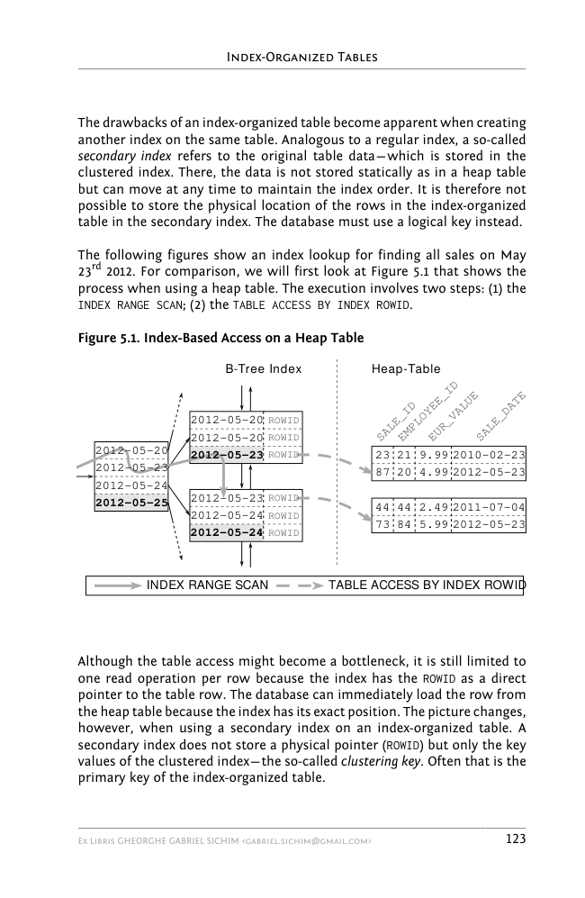
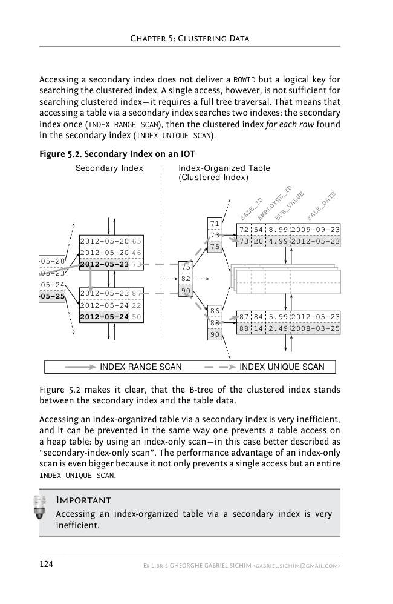

# Chương 5: Gom cụm dữ liệu – Sức mạnh thứ hai của index (Chapter 5 – Clustering Data)

> *Nguồn: "SQL Performance Explained" – Markus Winand, Chương 5 (trang PDF 121–138). Bản chuyển thể tiếng Việt; các phần đánh dấu 💡/📝 là phần bổ sung, không có trong sách gốc.*

## Mục lục

- [Chương 5: Gom cụm dữ liệu (Clustering Data)](#chương-5-gom-cụm-dữ-liệu--sức-mạnh-thứ-hai-của-index-chapter-5--clustering-data)
  - [Mở đầu: Sức mạnh thứ hai của index (The Second Power of Indexing)](#mở-đầu-sức-mạnh-thứ-hai-của-index-the-second-power-of-indexing)
  - [Cố ý sử dụng index filter predicate (Index Filter Predicates Used Intentionally)](#cố-ý-sử-dụng-index-filter-predicate-index-filter-predicates-used-intentionally)
  - [Index-only scan – Quét chỉ trên index (Index-Only Scan)](#index-only-scan--quét-chỉ-trên-index-index-only-scan)
  - [Bảng tổ chức theo index (Index-Organized Tables)](#bảng-tổ-chức-theo-index-index-organized-tables)
  - [Bảng thuật ngữ (Glossary)](#bảng-thuật-ngữ-glossary)

---

### Mở đầu: Sức mạnh thứ hai của index (The Second Power of Indexing)

Thuật ngữ **cluster** (cụm) được dùng trong rất nhiều lĩnh vực. Ví dụ, một *cụm sao* (*star cluster*) là một nhóm các ngôi sao. Còn một *cụm máy tính* (*computer cluster*) lại là một nhóm máy tính phối hợp chặt chẽ với nhau — hoặc để giải một bài toán phức tạp (*cụm tính toán hiệu năng cao – high-performance computing cluster*), hoặc để tăng tính sẵn sàng (*cụm chuyển đổi dự phòng – failover cluster*). Nói chung, "cluster" là những thứ có liên quan với nhau và xuất hiện cùng nhau.

Trong lĩnh vực máy tính còn có thêm một loại cluster nữa — một loại thường bị hiểu sai: **cụm dữ liệu** (*data cluster*). **Gom cụm dữ liệu** (*clustering data*) nghĩa là lưu những dữ liệu thường được truy cập liên tiếp nhau ở gần nhau, để việc truy cập chúng cần ít thao tác IO (đọc/ghi đĩa) hơn. Data cluster rất quan trọng trong việc tinh chỉnh (*tuning*) cơ sở dữ liệu. Mặt khác, computer cluster cũng rất phổ biến trong bối cảnh cơ sở dữ liệu — vì thế thuật ngữ *cluster* trở nên rất mơ hồ. Câu nói "Hãy dùng một cluster để cải thiện hiệu năng cơ sở dữ liệu" chỉ là một ví dụ: nó có thể ám chỉ một cụm máy tính, nhưng cũng có thể là một cụm dữ liệu. **Trong chương này, "cluster" nói chung là chỉ data cluster (cụm dữ liệu).**

Cụm dữ liệu đơn giản nhất trong một cơ sở dữ liệu SQL chính là **dòng** (*row*). Cơ sở dữ liệu lưu tất cả các cột của một dòng trong cùng một khối dữ liệu (*database block*) nếu có thể. Có ngoại lệ khi một dòng không vừa trong một block — ví dụ khi có các kiểu dữ liệu LOB (*Large Object*, như `BLOB`, `CLOB`).

> **Column Stores (Cơ sở dữ liệu lưu theo cột)**
>
> Cơ sở dữ liệu hướng cột (*column oriented databases*), hay *column-store*, tổ chức bảng theo từng cột. Mô hình này có lợi khi truy cập nhiều dòng nhưng chỉ vài cột — một kiểu truy cập rất phổ biến trong kho dữ liệu (*data warehouse*, OLAP – xử lý phân tích trực tuyến).

> 📝 **Giải thích thêm (không có trong sách):** Hãy hình dung bảng `sales(sale_id, employee_id, eur_value, sale_date)`. Một CSDL **lưu theo dòng** (*row store* – Oracle, PostgreSQL, SQL Server, MySQL/InnoDB mặc định) đặt cả 4 giá trị của một đơn hàng cạnh nhau trong một block: `[23|21|9.99|2010-02-23] [87|20|4.99|2012-05-23] ...`. Một **column store** (ví dụ ClickHouse, Amazon Redshift, Vertica, hay SQL Server *columnstore index*, Oracle *In-Memory Column Store*) lại đặt tất cả giá trị của cột `eur_value` cạnh nhau: `[9.99|4.99|2.49|5.99|...]`. Với câu `SELECT SUM(eur_value) FROM sales`, column store chỉ cần đọc đúng một "cột" dữ liệu — tức là dữ liệu cần dùng đã được "gom cụm" theo cột.

Index cho phép ta gom cụm dữ liệu. Nền tảng của điều này đã được giải thích trong Chương 1, "Giải phẫu một index" (*Anatomy of an Index*): các **leaf node** (nút lá – tầng thấp nhất của index B-tree, nơi chứa các mục index) lưu các cột được index theo thứ tự, nên những giá trị giống nhau được lưu cạnh nhau. Điều đó có nghĩa là **index tạo ra các cụm dòng có giá trị tương tự nhau**. Khả năng gom cụm dữ liệu này quan trọng đến mức tác giả gọi nó là **sức mạnh thứ hai của index** (*the second power of indexing*).

> 📝 **Giải thích thêm (không có trong sách):** "Sức mạnh thứ nhất" của index (được trình bày ở các chương trước) là khả năng **tìm kiếm nhanh** nhờ duyệt cây B-tree (*tree traversal*) để thu hẹp phạm vi quét. "Sức mạnh thứ hai" là khả năng **gom cụm**: vì dữ liệu trong index đã được sắp xếp, những mục cần đọc cùng lúc thường nằm trong cùng một hoặc vài leaf node, nên đọc rất ít block.

Các mục tiếp theo giải thích cách dùng index để gom cụm dữ liệu và cải thiện hiệu năng truy vấn.

---

## Cố ý sử dụng index filter predicate (Index Filter Predicates Used Intentionally)

Rất thường xuyên, sự xuất hiện của **index filter predicate** (*vị từ lọc trên index* — điều kiện được kiểm tra trong lúc duyệt các leaf node nhưng **không** giúp thu hẹp phạm vi quét) là dấu hiệu của việc dùng index không đúng cách, do thứ tự cột sai trong một **index ghép** (*concatenated index* – index gồm nhiều cột). Tuy vậy, index filter predicate cũng có thể được dùng vì một lý do chính đáng — không phải để cải thiện hiệu năng của **index range scan** (quét một khoảng trên index), mà để **gom những dữ liệu được truy cập liên tiếp lại gần nhau**.

> 📝 **Giải thích thêm (không có trong sách):** Nhắc lại hai loại vị từ (*predicate*) trong một lần truy cập index:
> - **Access predicate** (*vị từ truy cập*): điều kiện xác định **điểm bắt đầu và điểm kết thúc** của đoạn leaf node cần quét — nó *thu hẹp* phạm vi quét.
> - **Index filter predicate** (*vị từ lọc trên index*): điều kiện chỉ được áp dụng **trong lúc** đi dọc chuỗi leaf node; nó không thu hẹp đoạn cần quét, nhưng loại bỏ sớm những mục không thỏa mãn, **trước khi** phải truy cập bảng.
> - **Table level filter predicate** (*vị từ lọc ở mức bảng*): điều kiện trên cột không có trong index, chỉ kiểm tra được **sau khi** đã đọc dòng từ bảng.

Các vị từ trong mệnh đề `where` không thể đóng vai trò access predicate là những ứng viên tốt cho kỹ thuật này:

```sql
SELECT first_name, last_name, subsidiary_id, phone_number
  FROM employees
 WHERE subsidiary_id = ?
   AND UPPER(last_name) LIKE '%INA%';
```

Hãy nhớ rằng các biểu thức `LIKE` có **ký tự đại diện ở đầu** (*leading wildcard*, như `'%INA%'`) không thể sử dụng cây index (*index tree*). Điều đó có nghĩa là việc index cột `LAST_NAME` không thu hẹp được phạm vi index cần quét — bất kể bạn index `LAST_NAME` hay `UPPER(last_name)`. Vì thế, điều kiện này **không** phải ứng viên tốt để index (theo nghĩa làm access predicate).

Tuy nhiên, điều kiện trên `SUBSIDIARY_ID` lại rất phù hợp để index. Ta thậm chí không cần thêm index mới, vì `SUBSIDIARY_ID` đã là cột đứng đầu trong index của **khóa chính** (*primary key*).

> 📝 **Giải thích thêm (không có trong sách):** Trong suốt cuốn sách, bảng `EMPLOYEES` có khóa chính ghép `(EMPLOYEE_ID, SUBSIDIARY_ID)` ở các chương đầu, rồi được đổi thứ tự thành `(SUBSIDIARY_ID, EMPLOYEE_ID)` để phục vụ truy vấn theo chi nhánh. Index khóa chính tên là `EMPLOYEE_PK`. Vì `SUBSIDIARY_ID` là cột đầu, điều kiện `subsidiary_id = ?` dùng được làm access predicate.

Kế hoạch thực thi (*execution plan* — bản kế hoạch mà **optimizer**, bộ tối ưu truy vấn, chọn để chạy câu lệnh) trong Oracle như sau:

```text
--------------------------------------------------------------
|Id | Operation                   | Name       | Rows | Cost |
--------------------------------------------------------------
| 0 | SELECT STATEMENT            |            |   17 |  230 |
|*1 |  TABLE ACCESS BY INDEX ROWID| EMPLOYEES  |   17 |  230 |
|*2 |   INDEX RANGE SCAN          | EMPLOYEE_PK|  333 |    2 |
--------------------------------------------------------------

Predicate Information (identified by operation id):
---------------------------------------------------
   1 - filter(UPPER("LAST_NAME") LIKE '%INA%')
   2 - access("SUBSIDIARY_ID"=TO_NUMBER(:A))
```

Trong execution plan ở trên, giá trị chi phí (*cost*) **tăng gấp hàng trăm lần** từ thao tác `INDEX RANGE SCAN` (cost 2) sang thao tác `TABLE ACCESS BY INDEX ROWID` ngay sau đó (cost 230). Nói cách khác: **việc truy cập bảng gây ra phần lớn công việc**. Đây thực ra là một mẫu hình phổ biến và bản thân nó không phải là vấn đề. Tuy nhiên, nó là yếu tố đóng góp lớn nhất vào tổng thời gian thực thi của truy vấn này.

Việc truy cập bảng **không nhất thiết** là nút thắt cổ chai (*bottleneck*) nếu các dòng cần truy cập được lưu trong **một block duy nhất** của bảng, vì khi đó cơ sở dữ liệu có thể lấy tất cả các dòng chỉ bằng một thao tác đọc. Ngược lại, nếu chính những dòng đó lại **nằm rải rác trên nhiều block khác nhau**, việc truy cập bảng có thể trở thành một vấn đề hiệu năng nghiêm trọng, vì cơ sở dữ liệu phải lấy rất nhiều block mới thu được tất cả các dòng. Điều đó có nghĩa là hiệu năng phụ thuộc vào **sự phân bố vật lý** của các dòng được truy cập — nói cách khác: nó phụ thuộc vào **mức độ gom cụm của các dòng** (*clustering of rows*).

> **Ghi chú (Note)**
>
> Mức độ tương quan giữa thứ tự của index và thứ tự của bảng là một thước đo hiệu năng — được gọi là **index clustering factor** (*hệ số gom cụm của index*).

Thực tế, ta **có thể** cải thiện hiệu năng truy vấn bằng cách **sắp xếp lại các dòng trong bảng** sao cho chúng tương ứng với thứ tự của index. Tuy nhiên, phương pháp này hiếm khi áp dụng được, vì bạn chỉ có thể lưu các dòng của bảng theo **một trình tự duy nhất**. Điều đó có nghĩa là bạn chỉ có thể tối ưu bảng cho **một index** mà thôi. Ngay cả khi bạn chọn được một index duy nhất mà bạn muốn tối ưu bảng theo nó, đây vẫn là một việc khó, vì hầu hết các cơ sở dữ liệu chỉ cung cấp những công cụ rất thô sơ cho việc này. Rốt cuộc, cái gọi là **sắp xếp trình tự dòng** (*row sequencing*) là một cách tiếp cận khá thiếu thực tế.

> **The Index Clustering Factor (Hệ số gom cụm của index)**
>
> Index clustering factor là một thước đo **gián tiếp** về xác suất hai mục index liền kề nhau trỏ tới **cùng một block** của bảng. Optimizer tính đến xác suất này khi tính giá trị cost của thao tác `TABLE ACCESS BY INDEX ROWID`.

> 📝 **Giải thích thêm (không có trong sách):** Trong Oracle, clustering factor được tính đại ý như sau: đi lần lượt các mục index theo thứ tự; mỗi lần ROWID của mục hiện tại trỏ sang một block **khác** với block của mục trước đó thì cộng thêm 1. Kết quả nằm trong khoảng:
> - **gần bằng số block của bảng** → tốt (các dòng liền nhau trong index cũng nằm liền nhau trong bảng);
> - **gần bằng số dòng của bảng** → tệ (gần như mỗi mục index lại nhảy sang một block khác).
>
> Bạn có thể xem giá trị này bằng:
> ```sql
> -- Oracle
> SELECT index_name, clustering_factor, num_rows, leaf_blocks
>   FROM user_indexes
>  WHERE table_name = 'EMPLOYEES';
> ```
> Trong PostgreSQL, khái niệm tương tự là cột `correlation` trong view `pg_stats` (giá trị từ -1 đến 1; càng gần ±1 thì thứ tự vật lý càng khớp với thứ tự cột).

Đây chính là chỗ **sức mạnh thứ hai của index — gom cụm dữ liệu** — phát huy tác dụng. Bạn có thể thêm nhiều cột vào một index để chúng **tự động** được lưu theo một thứ tự xác định rõ ràng. Điều đó biến index thành một công cụ gom cụm dữ liệu mạnh mẽ mà lại đơn giản.

Để áp dụng ý tưởng này cho truy vấn ở trên, ta phải mở rộng index để bao gồm **tất cả các cột trong mệnh đề `where`** — kể cả khi chúng không thu hẹp phạm vi index cần quét:

```sql
CREATE INDEX empsubupnam ON employees
       (subsidiary_id, UPPER(last_name));
```

Cột `SUBSIDIARY_ID` là cột đầu tiên của index nên nó có thể được dùng làm access predicate. Biểu thức `UPPER(last_name)` bao phủ bộ lọc `LIKE` dưới dạng index filter predicate. Việc index dạng chữ hoa giúp tiết kiệm vài chu kỳ CPU khi thực thi (không phải tính `UPPER` cho từng mục), nhưng một index thẳng trên `LAST_NAME` cũng sẽ hoạt động được. Bạn sẽ thấy thêm về điều này ở mục tiếp theo.

```text
--------------------------------------------------------------
|Id | Operation                   | Name       | Rows | Cost |
--------------------------------------------------------------
| 0 | SELECT STATEMENT            |            |   17 |   20 |
| 1 |  TABLE ACCESS BY INDEX ROWID| EMPLOYEES  |   17 |   20 |
|*2 |   INDEX RANGE SCAN          | EMPSUBUPNAM|   17 |    3 |
--------------------------------------------------------------

Predicate Information (identified by operation id):
---------------------------------------------------
   2 - access("SUBSIDIARY_ID"=TO_NUMBER(:A))
       filter(UPPER("LAST_NAME") LIKE '%INA%')
```

Execution plan mới cho thấy **đúng những thao tác như trước**. Dù vậy, giá trị cost đã giảm đáng kể (từ 230 xuống 20). Trong phần thông tin vị từ (*predicate information*), ta thấy bộ lọc `LIKE` đã được áp dụng ngay trong lúc `INDEX RANGE SCAN`. Những dòng không thỏa mãn bộ lọc `LIKE` bị loại bỏ ngay lập tức. Thao tác truy cập bảng không còn bất kỳ filter predicate nào nữa (để ý dấu `*` ở Id 1 đã biến mất). Điều đó có nghĩa là nó **không nạp những dòng không thỏa mãn mệnh đề `where`**.

Sự khác biệt giữa hai execution plan thể hiện rõ ở cột "Rows". Theo ước tính của optimizer, cuối cùng truy vấn khớp với 17 bản ghi. Thế nhưng index scan trong execution plan thứ nhất lại trả về 333 dòng. Cơ sở dữ liệu sau đó phải nạp 333 dòng này từ bảng để áp dụng bộ lọc `LIKE`, rút kết quả xuống còn 17 dòng. Trong execution plan thứ hai, việc truy cập index ngay từ đầu đã không trả về những dòng đó, nên cơ sở dữ liệu chỉ cần thực hiện thao tác `TABLE ACCESS BY INDEX ROWID` **17 lần**.

Bạn cũng nên để ý rằng cost của thao tác `INDEX RANGE SCAN` tăng từ 2 lên 3, vì cột bổ sung làm index lớn hơn. Xét đến lợi ích hiệu năng đạt được, đây là một sự đánh đổi chấp nhận được.

> ⚠️ **Cảnh báo (Warning)**
>
> Đừng tạo một index mới **chỉ** để phục vụ filter predicate. Thay vào đó, hãy **mở rộng một index sẵn có** để giữ chi phí bảo trì ở mức thấp. Với một số cơ sở dữ liệu, bạn thậm chí có thể thêm vào index của khóa chính những cột không thuộc khóa chính.

> 📝 **Giải thích thêm (không có trong sách):** "Thêm vào index của khóa chính những cột không thuộc khóa chính" — ví dụ:
> - **SQL Server**, **PostgreSQL 11+**: dùng mệnh đề `INCLUDE` trong ràng buộc khóa chính/unique, ví dụ PostgreSQL: `ALTER TABLE employees ADD CONSTRAINT employees_pk PRIMARY KEY (subsidiary_id, employee_id) INCLUDE (last_name);`
> - **Oracle**: ràng buộc khóa chính có thể dùng một index **không unique** có nhiều cột hơn, chỉ cần các cột khóa nằm ở đầu: `ALTER TABLE employees ADD CONSTRAINT employees_pk PRIMARY KEY (subsidiary_id, employee_id) USING INDEX (CREATE INDEX employees_pk ON employees (subsidiary_id, employee_id, UPPER(last_name)));`

Ví dụ đơn giản này dường như xác nhận "kinh nghiệm dân gian" rằng hãy index **mọi cột** trong mệnh đề `where`. Tuy nhiên, "sự khôn ngoan" này bỏ qua tầm quan trọng của **thứ tự cột** — thứ quyết định điều kiện nào có thể được dùng làm access predicate, và do đó ảnh hưởng rất lớn tới hiệu năng. Vì vậy, quyết định về thứ tự cột **không bao giờ** được phó mặc cho may rủi.

Kích thước index cũng tăng theo số cột — đặc biệt khi thêm các cột văn bản. Dĩ nhiên, hiệu năng không thể tốt hơn với một index lớn hơn, mặc dù **khả năng mở rộng theo logarit** (*logarithmic scalability* — độ sâu cây B-tree chỉ tăng theo log của số mục) hạn chế đáng kể mức ảnh hưởng. Bạn **tuyệt đối không nên** thêm mọi cột được nhắc đến trong mệnh đề `where` vào index, mà chỉ nên dùng index filter predicate **một cách có chủ đích** để giảm khối lượng dữ liệu ở một bước thực thi sớm hơn.

> 💡 **Ví dụ bổ sung (không có trong sách):** Giả sử chi nhánh `subsidiary_id = 30` có 333 nhân viên, nằm rải rác trên khoảng 300 block khác nhau của bảng `employees` (nhân viên các chi nhánh được tuyển xen kẽ theo thời gian nên dòng của họ chèn xen kẽ nhau). Chỉ 17 người có họ chứa "INA" (ví dụ `KARINA`, `MARINA`, `CHINA`...).
>
> | Phương án index | Số mục index đọc | Số lần truy cập bảng | Ước tính số block đọc |
> |---|---|---|---|
> | `EMPLOYEE_PK (subsidiary_id, employee_id)` | 333 | 333 | ~2 (index) + ~300 (bảng) |
> | `EMPSUBUPNAM (subsidiary_id, UPPER(last_name))` | 333 (vẫn quét hết, nhưng lọc ngay trong index) | 17 | ~3 (index) + ~17 (bảng) |
>
> Lưu ý: số mục index phải duyệt **không giảm** (vì `LIKE '%INA%'` không thu hẹp phạm vi), nhưng 333 mục này nằm gọn trong vài leaf node liền nhau — tức là đã được **gom cụm** — nên đọc rất rẻ. Phần đắt (truy cập bảng) giảm từ 333 xuống 17.
>
> Cách tương tự trong **PostgreSQL** (expression index):
> ```sql
> CREATE INDEX empsubupnam ON employees (subsidiary_id, UPPER(last_name));
> EXPLAIN SELECT first_name, last_name, subsidiary_id, phone_number
>           FROM employees
>          WHERE subsidiary_id = 30
>            AND UPPER(last_name) LIKE '%INA%';
> -- Index Scan using empsubupnam on employees
> --   Index Cond: (subsidiary_id = 30)
> --   Filter: (upper((last_name)::text) ~~ '%INA%'::text)
> ```
> Lưu ý về PostgreSQL: với *Index Scan* thông thường, điều kiện không dùng được làm `Index Cond` sẽ hiện ở dòng `Filter` và được kiểm tra **sau khi** đã lấy dòng từ heap (bảng) — tức là PostgreSQL không "lọc sớm trong index" như Oracle ở trường hợp này; chỉ khi plan là *Index Only Scan* thì điều kiện mới được kiểm tra trên dữ liệu lấy từ index. Vì vậy, lợi ích "lọc sớm trong index" phụ thuộc vào cách từng hệ quản trị cài đặt — hãy luôn kiểm tra execution plan thực tế. Trong **MySQL 8.0.13+**, có thể tạo *functional key part*: `CREATE INDEX empsubupnam ON employees (subsidiary_id, (UPPER(last_name)));` và tính năng *Index Condition Pushdown* (hiện "Using index condition" trong `EXPLAIN`) sẽ áp dụng bộ lọc ngay trên index.

> 📝 **Giải thích thêm (không có trong sách) — Đối chiếu với PostgreSQL hiện đại (PG 10–17) về Index Filter Predicate:**
>
> Trong cuốn sách (viết năm 2012 trên nền Oracle), tác giả cho thấy chỉ cần thêm `UPPER(last_name)` vào index B-Tree là cơ sở dữ liệu tự động kiểm tra `UPPER(last_name) LIKE '%INA%'` ngay tại tầng lá của index trước khi đọc bảng. Tuy nhiên, kiến trúc **Index Access Method (AM)** của PostgreSQL có sự phân tách nghiêm ngặt hơn mà kỹ sư thiết kế CSDL cần nắm rõ:
>
> 1. **Trong `Index Scan` truyền thống của PostgreSQL:** Tầng B-Tree chỉ tự đánh giá các vị từ nằm trong `Index Cond:` (tức các phép toán thuộc *B-Tree operator class* như `=`, `<`, `<=`, `>`, `>=`, `BETWEEN`, hoặc `LIKE 'ABC%'` với `C` collation / `text_pattern_ops`). Biểu thức `UPPER(last_name) LIKE '%INA%'` (có ký tự đại diện `%` ở đầu) **không** phải là toán tử B-Tree, nên PostgreSQL đẩy nó lên tầng Executor thành `Filter:`. Với `Index Scan` thường, Executor sẽ đọc dòng từ Heap (bảng) trước rồi mới chạy `Filter:`, nghĩa là **không** tiết kiệm được thao tác đọc bảng nếu chỉ dùng `Index Scan` thường!
> 2. **Làm thế nào để PostgreSQL lọc sớm ngay trên Index mà không đọc bảng?** Trong PostgreSQL hiện đại (PG 11–17), bạn có hai cách chuẩn xác:
>    - **Cách 1 — Biến truy vấn thành `Index Only Scan` bằng mệnh đề `INCLUDE` (PostgreSQL 11+):** Khi index chứa đủ các cột của câu truy vấn — ví dụ `CREATE INDEX empsub_cov_idx ON employees (subsidiary_id, UPPER(last_name)) INCLUDE (first_name, last_name, phone_number)` — và các trang dữ liệu đã được đánh dấu *all-visible* trong Visibility Map, PostgreSQL sẽ chọn **`Index Only Scan`**. Khi đó, `Filter: (upper(last_name) ~~ '%INA%')` được kiểm tra **trực tiếp trên tuple của index**, hoàn toàn không đọc bảng (`Heap Fetches: 0`).
>    - **Cách 2 — Dùng Trigram Index (`pg_trgm` kết hợp GIN hoặc GiST) hoặc `btree_gin`:** Với tìm kiếm chuỗi con `LIKE '%INA%'` hoặc `ILIKE '%ina%'`, PostgreSQL hỗ trợ extension chuẩn `pg_trgm`. Bạn có thể tạo index kết hợp `CREATE INDEX emp_sub_trgm_idx ON employees USING gin (subsidiary_id, last_name gin_trgm_ops);` (cần `CREATE EXTENSION pg_trgm; CREATE EXTENSION btree_gin;`). Lúc này cả `subsidiary_id = 30` lẫn `UPPER(last_name) LIKE '%INA%'` đều biến thành **Access Predicate** (`Bitmap Index Scan`), chỉ đọc đúng các block bảng chứa 17 dòng khớp!

---

## Index-only scan – Quét chỉ trên index (Index-Only Scan)

**Index-only scan** (*quét chỉ trên index* — thực thi truy vấn mà hoàn toàn không cần đọc bảng) là một trong những phương pháp tinh chỉnh mạnh nhất. Nó không chỉ tránh việc truy cập bảng để đánh giá mệnh đề `where`, mà còn tránh truy cập bảng **hoàn toàn** nếu cơ sở dữ liệu tìm thấy được các cột cần `select` ngay trong chính index.

Để **bao phủ** (*cover*) toàn bộ một truy vấn, index phải chứa **tất cả các cột** xuất hiện trong câu lệnh SQL — đặc biệt là cả các cột trong mệnh đề `select`, như ví dụ sau:

```sql
CREATE INDEX sales_sub_eur
    ON sales
     ( subsidiary_id, eur_value );
```

```sql
SELECT SUM(eur_value)
  FROM sales
 WHERE subsidiary_id = ?;
```

Dĩ nhiên, việc index cho mệnh đề `where` được ưu tiên hơn các mệnh đề khác. Vì vậy cột `SUBSIDIARY_ID` được đặt ở vị trí đầu tiên để nó đủ điều kiện làm access predicate.

Execution plan cho thấy index scan **không có** thao tác truy cập bảng theo sau (`TABLE ACCESS BY INDEX ROWID`).

```text
----------------------------------------------------------
| Id  | Operation         | Name          |  Rows | Cost |
----------------------------------------------------------
|   0 | SELECT STATEMENT  |               |     1 |  104 |
|   1 |  SORT AGGREGATE   |               |     1 |      |
|*  2 |   INDEX RANGE SCAN| SALES_SUB_EUR | 40388 |  104 |
----------------------------------------------------------

Predicate Information (identified by operation id):
---------------------------------------------------
   2 - access("SUBSIDIARY_ID"=TO_NUMBER(:A))
```

Index này bao phủ toàn bộ truy vấn nên nó còn được gọi là **covering index** (*index bao phủ*).

> **Ghi chú (Note)**
>
> Nếu một index giúp tránh được việc truy cập bảng thì nó còn được gọi là *covering index*. Tuy nhiên thuật ngữ này dễ gây hiểu lầm, vì nghe như thể đó là một **thuộc tính của index**. Cụm từ *index-only scan* mới gợi ý đúng rằng đây là một **thao tác trong execution plan** (cùng một index có thể bao phủ truy vấn này nhưng không bao phủ truy vấn khác).

Index có một bản sao của cột `EUR_VALUE`, nên cơ sở dữ liệu có thể dùng giá trị lưu trong index. Không cần truy cập bảng, vì index đã có đủ mọi thông tin để đáp ứng truy vấn.

Index-only scan có thể cải thiện hiệu năng **một cách khổng lồ**. Hãy nhìn vào ước tính số dòng trong execution plan: optimizer dự kiến phải tổng hợp (*aggregate*) hơn 40.000 dòng. Điều đó có nghĩa là index-only scan tránh được 40.000 lần đọc bảng — **nếu** mỗi dòng nằm ở một block khác nhau của bảng. Nếu index có **clustering factor tốt** — tức là nếu các dòng tương ứng được gom cụm tốt trong một vài block của bảng — thì lợi ích có thể thấp hơn đáng kể.

Bên cạnh clustering factor, **số dòng được chọn** cũng giới hạn lợi ích hiệu năng tiềm năng của index-only scan. Ví dụ, nếu bạn chỉ chọn một dòng duy nhất, bạn chỉ tiết kiệm được đúng một lần truy cập bảng. Xét rằng việc duyệt cây (*tree traversal*) cũng cần đọc vài block, lần truy cập bảng tiết kiệm được đó có thể trở nên không đáng kể.

> ❗ **Quan trọng (Important)**
>
> Lợi ích hiệu năng của index-only scan phụ thuộc vào **số dòng được truy cập** và **index clustering factor**.

Index-only scan là một chiến lược index **hung hãn** (*aggressive*). Đừng thiết kế một index cho index-only scan chỉ vì "nghi là sẽ cần", vì nó tốn bộ nhớ một cách không cần thiết và làm tăng công sức bảo trì cho các câu lệnh `update`. Xem Chương 8, "Sửa đổi dữ liệu" (*Modifying Data*). Trong thực tế, trước hết bạn nên index **mà không tính đến mệnh đề `select`**, và chỉ mở rộng index khi thật sự cần.

> 💡 **Ví dụ bổ sung (không có trong sách):** So sánh hai index trên bảng `sales` (giả sử 1 triệu dòng, chi nhánh 7 có 40.000 dòng rải đều theo thời gian trên ~40.000 block khác nhau):
>
> | Index | Truy vấn `SELECT SUM(eur_value) FROM sales WHERE subsidiary_id = 7` | Số block ước tính |
> |---|---|---|
> | `(subsidiary_id)` | INDEX RANGE SCAN + 40.000 lần TABLE ACCESS BY INDEX ROWID | ~100 (index) + tới ~40.000 (bảng) |
> | `(subsidiary_id, eur_value)` | Chỉ INDEX RANGE SCAN (index-only scan) | ~100 (index) |
>
> Trong **PostgreSQL** (9.2+), plan sẽ hiện:
> ```text
> Aggregate
>   ->  Index Only Scan using sales_sub_eur on sales
>         Index Cond: (subsidiary_id = 7)
>         Heap Fetches: 0
> ```
> `Heap Fetches: 0` cho biết không phải đọc bảng lần nào — điều này phụ thuộc vào *visibility map*: nếu bảng mới bị cập nhật nhiều mà chưa `VACUUM`, PostgreSQL vẫn phải kiểm tra heap cho các trang chưa được đánh dấu "all-visible". Trong **MySQL** (InnoDB), cột `Extra` của `EXPLAIN` hiện `Using index`. Trong **SQL Server**, plan hiện *Index Seek* mà không có *Key Lookup*/*RID Lookup*.
>
> Từ **PostgreSQL 11+** và **SQL Server 2005+**, bạn có thể viết gọn hơn: `CREATE INDEX sales_sub_eur ON sales (subsidiary_id) INCLUDE (eur_value);` — `eur_value` chỉ nằm ở leaf node, không tham gia vào thứ tự sắp xếp.

> 📝 **Giải thích thêm (không có trong sách) — Đối chiếu với PostgreSQL hiện đại (PG 10–17): Cơ chế `Visibility Map (VM)` và `Heap Fetches` trong `Index Only Scan`:**
>
> Tại sao trong Oracle hay SQL Server, một khi đã có Covering Index thì truy vấn luôn chỉ đọc index, còn trong PostgreSQL khi xem `EXPLAIN (ANALYZE, BUFFERS)` của một `Index Only Scan`, đôi khi bạn lại thấy `Heap Fetches: 15420` (vẫn phải đọc bảng hàng chục nghìn lần)?
>
> Nguyên nhân nằm ở kiến trúc **MVCC (Multi-Version Concurrency Control)** đặc trưng của PostgreSQL:
> - **Index trong PostgreSQL không lưu thông tin giao dịch:** Mỗi dòng vật lý (*tuple*) trong bảng heap có các trường header `xmin` (ID giao dịch tạo dòng) và `xmax` (ID giao dịch xóa/cập nhật dòng) để xác định xem phiên làm việc hiện tại có "nhìn thấy" dòng đó hay không. Tuy nhiên, các mục trong B-Tree index **không hề lưu `xmin`/`xmax`**.
> - **Vai trò của Visibility Map (VM):** Để không phải nhảy xuống bảng heap kiểm tra `xmin`/`xmax` cho từng mục index (việc sẽ biến `Index Only Scan` thành `Index Scan` thường), PostgreSQL (từ bản 9.2, cải tiến lớn ở 9.6+) duy trì một tệp phụ cực nhỏ gắn với mỗi bảng gọi là **Visibility Map (`_vm`)**. Trong PostgreSQL hiện đại (9.6–17), mỗi trang bảng 8 KB chỉ chiếm đúng **2 bit** trong Visibility Map:
>   1. **Bit 1 (`all-visible`):** Bằng `1` nếu **mọi** dòng trong trang 8 KB đó đều đã được commit từ lâu và hiển thị hợp lệ với mọi giao dịch hiện tại và tương lai (không có dòng nào đang chờ commit hoặc vừa bị xóa dở dang).
>   2. **Bit 2 (`all-frozen` — từ PG 9.6+):** Bằng `1` nếu mọi dòng trong trang đó đã được "đóng băng" (*frozen*), giúp `VACUUM` chống tràn ID giao dịch (*anti-wraparound*) bỏ qua hoàn toàn trang này.
> - **Khi nào `Heap Fetches` tăng vọt?**
>   - Khi một câu lệnh `INSERT`, `UPDATE` hoặc `DELETE` chạm vào một trang 8 KB của bảng heap, PostgreSQL lập tức **xóa bit `all-visible` của trang đó về `0`**.
>   - Tiến trình duy nhất có quyền bật lại bit `all-visible` lên `1` là **`VACUUM`** (hoặc **`AUTOVACUUM`**).
>   - Do đó, khi chạy `Index Only Scan`, với mỗi mục đọc được từ index (chứa con trỏ vật lý `ctid = (block_number, offset)`), PostgreSQL tra cứu bit `all-visible` của `block_number` trong Visibility Map (nằm sẵn trên RAM vì rất nhỏ — một bảng 8 GB chỉ có VM khoảng 256 KB!):
>     - Nếu bit = `1`: PostgreSQL lấy luôn dữ liệu từ index và trả về kết quả (**không đọc bảng**).
>     - Nếu bit = `0`: PostgreSQL **bắt buộc phải đọc trang 8 KB đó từ bảng heap** để kiểm tra `xmin`/`xmax`, và cộng thêm 1 vào chỉ số **`Heap Fetches`**!
> - **Cách tinh chỉnh trên PostgreSQL hiện đại (PG 10–17) cho bảng ghi/cập nhật nhiều:**
>   Mặc định, `autovacuum_vacuum_scale_factor = 0.2` (20% số dòng của bảng phải thay đổi thì `autovacuum` mới chạy). Với bảng `sales` có 50 triệu dòng, phải đợi tới 10 triệu dòng bị sửa/thêm mới thì `autovacuum` mới kích hoạt — trong suốt thời gian đó, hàng triệu dòng mới nằm trên các trang có bit VM = `0`, khiến `Index Only Scan` bị suy thoái nặng nề vì `Heap Fetches` cao. Giải pháp chuẩn production trên PostgreSQL là **hạ `autovacuum_vacuum_scale_factor` riêng cho bảng đó** (hoặc dùng `autovacuum_vacuum_insert_scale_factor` từ **PostgreSQL 13+** cho các bảng chỉ chuyên `INSERT` như bảng log/giao dịch):
>   ```sql
>   -- Tinh chỉnh cho bảng OLTP thường xuyên INSERT/UPDATE (PostgreSQL 13+)
>   ALTER TABLE sales SET (
>       autovacuum_vacuum_scale_factor = 0.01,        -- Chạy VACUUM khi 1% bảng thay đổi (thay vì 20%)
>       autovacuum_vacuum_insert_scale_factor = 0.005 -- PG 13+: Chạy VACUUM cập nhật VM ngay khi thêm mới 0.5% dòng!
>   );
>   ```

> 💡 **Ví dụ bổ sung (không có trong sách) — Thực hành trên PostgreSQL: Quan sát `Heap Fetches` trước và sau khi `VACUUM`:**
>
> ```sql
> -- 1. Tạo bảng và Covering Index với INCLUDE (PostgreSQL 11+)
> CREATE INDEX sales_sub_eur_inc ON sales (subsidiary_id) INCLUDE (eur_value);
>
> -- 2. Giả sử vừa cập nhật hoặc chèn mới hàng loạt đơn hàng cho chi nhánh 7
> UPDATE sales SET eur_value = eur_value + 0.01 WHERE subsidiary_id = 7;
>
> -- 3. Chạy truy vấn ngay lập tức (khi AUTOVACUUM chưa kịp chạy):
> EXPLAIN (ANALYZE, BUFFERS)
> SELECT SUM(eur_value) FROM sales WHERE subsidiary_id = 7;
> ```
> Kết quả `EXPLAIN (ANALYZE, BUFFERS)` khi Visibility Map chưa được cập nhật:
> ```text
> Aggregate  (cost=1420.45..1420.46 rows=1 width=32) (actual time=18.412..18.413 rows=1 loops=1)
>   Buffers: shared hit=15532
>   ->  Index Only Scan using sales_sub_eur_inc on sales  (cost=0.43..1319.48 rows=40388 width=6) (actual time=0.042..14.890 rows=40388 loops=1)
>         Index Cond: (subsidiary_id = 7)
>         Heap Fetches: 15420
>         Buffers: shared hit=15532
> Planning Time: 0.115 ms
> Execution Time: 18.450 ms
> ```
> Hãy chú ý hai con số: **`Heap Fetches: 15420`** và **`Buffers: shared hit=15532`**! Dù kế hoạch thực thi mang tên `Index Only Scan`, PostgreSQL vẫn phải nhảy xuống đọc bảng 15.420 lần vì các trang vừa bị `UPDATE` chưa được đánh dấu *all-visible*.
>
> Bây giờ, chạy `VACUUM sales;` để cập nhật Visibility Map rồi chạy lại đúng câu truy vấn đó:
> ```sql
> VACUUM sales;
>
> EXPLAIN (ANALYZE, BUFFERS)
> SELECT SUM(eur_value) FROM sales WHERE subsidiary_id = 7;
> ```
> ```text
> Aggregate  (cost=680.45..680.46 rows=1 width=32) (actual time=2.104..2.105 rows=1 loops=1)
>   Buffers: shared hit=112
>   ->  Index Only Scan using sales_sub_eur_inc on sales  (cost=0.43..579.48 rows=40388 width=6) (actual time=0.018..1.210 rows=40388 loops=1)
>         Index Cond: (subsidiary_id = 7)
>         Heap Fetches: 0
>         Buffers: shared hit=112
> Planning Time: 0.082 ms
> Execution Time: 2.135 ms
> ```
> Khi **`Heap Fetches: 0`**, số lượng buffer phải đọc giảm từ **15.532 trang xuống chỉ còn 112 trang** (giảm hơn 138 lần I/O!) và thời gian thực thi giảm từ **18,45 ms xuống 2,13 ms**. Đây là lý do khi đọc `EXPLAIN (ANALYZE, BUFFERS)` của `Index Only Scan` trên PostgreSQL, bạn **luôn phải kiểm tra dòng `Heap Fetches:`** chứ không chỉ nhìn tên node `Index Only Scan`.

Index-only scan cũng có thể gây ra những **bất ngờ khó chịu**, ví dụ nếu ta giới hạn truy vấn chỉ lấy doanh số gần đây:

```sql
SELECT SUM(eur_value)
  FROM sales
 WHERE subsidiary_id = ?
   AND sale_date > ?;
```

Nếu không nhìn vào execution plan, người ta có thể nghĩ truy vấn sẽ chạy nhanh hơn vì nó chọn ít dòng hơn. Tuy nhiên, mệnh đề `where` giờ tham chiếu tới một cột **không có trong index**, nên cơ sở dữ liệu buộc phải truy cập bảng để nạp cột này.

```text
--------------------------------------------------------------
|Id | Operation                    | Name      | Rows  |Cost |
--------------------------------------------------------------
| 0 | SELECT STATEMENT             |           |     1 | 371 |
| 1 |  SORT AGGREGATE              |           |     1 |     |
|*2 |   TABLE ACCESS BY INDEX ROWID| SALES     |  2019 | 371 |
|*3 |    INDEX RANGE SCAN          | SALES_DATE| 10541 |  30 |
--------------------------------------------------------------

Predicate Information (identified by operation id):
---------------------------------------------------
   2 - filter("SUBSIDIARY_ID"=TO_NUMBER(:A))
   3 - access("SALE_DATE">:B)
```

Việc truy cập bảng làm **tăng thời gian phản hồi** (*response time*) mặc dù truy vấn chọn ít dòng hơn (cost từ 104 lên 371). Yếu tố quyết định **không phải** truy vấn trả về bao nhiêu dòng, mà là cơ sở dữ liệu phải **kiểm tra bao nhiêu dòng** để tìm ra chúng.

> ⚠️ **Cảnh báo (Warning)**
>
> Mở rộng mệnh đề `where` có thể gây ra hành vi hiệu năng "phi logic". Hãy kiểm tra execution plan trước khi mở rộng truy vấn.

Nếu một index không còn dùng được cho index-only scan nữa, optimizer sẽ chọn execution plan **tốt nhất tiếp theo**. Điều đó có nghĩa là optimizer có thể chọn một execution plan hoàn toàn khác, hoặc như ở trên, một execution plan tương tự nhưng dùng index khác. Trong trường hợp này, nó dùng một index trên `SALE_DATE` — một index còn sót lại từ chương trước.

Từ góc nhìn của optimizer, index này có **hai ưu điểm** so với `SALES_SUB_EUR`:

1. **Optimizer tin rằng bộ lọc trên `SALE_DATE` có độ chọn lọc (*selectivity*) cao hơn** bộ lọc trên `SUBSIDIARY_ID`. Bạn có thể thấy điều đó ở cột "Rows" tương ứng của hai execution plan gần nhất (khoảng 10.000 so với 40.000). Tuy nhiên, những ước tính này **hoàn toàn tùy tiện**, vì truy vấn dùng **bind parameter** (*tham số ràng buộc* — dấu `?`/`:B` mà giá trị thật chỉ được truyền vào lúc chạy, nên optimizer không biết giá trị cụ thể). Chẳng hạn, điều kiện `SALE_DATE` có thể chọn **toàn bộ bảng** nếu truyền vào ngày của đơn hàng đầu tiên.

2. **Index `SALES_DATE` có clustering factor tốt hơn.** Đây là một lý do xác đáng, vì bảng `SALES` chỉ tăng trưởng theo trình tự thời gian. Các dòng mới luôn được nối vào cuối bảng, miễn là không có dòng nào bị xóa. Do đó thứ tự của bảng tương ứng với thứ tự của index, vì cả hai đều xấp xỉ được sắp xếp theo thời gian — index có clustering factor tốt.

Khi dùng một index có clustering factor tốt, các dòng được chọn trong bảng nằm gần nhau, nên cơ sở dữ liệu chỉ cần đọc vài block của bảng để lấy tất cả các dòng. Khi dùng index này, truy vấn có thể đã **đủ nhanh mà không cần index-only scan**. Trong trường hợp đó, ta nên **gỡ bỏ** các cột không cần thiết khỏi index kia (`EUR_VALUE` khỏi `SALES_SUB_EUR`).

> **Ghi chú (Note)**
>
> Một số index **tự động** có clustering factor tốt, nên lợi ích hiệu năng của index-only scan với chúng là rất nhỏ.

Trong ví dụ cụ thể này, đã có một **sự trùng hợp may mắn**. Bộ lọc mới trên `SALE_DATE` không chỉ ngăn cản index-only scan mà đồng thời còn **mở ra một đường truy cập (*access path*) mới**. Nhờ vậy optimizer đã có thể hạn chế tác động hiệu năng của thay đổi này. Tuy nhiên, cũng có thể làm mất index-only scan bằng cách thêm cột vào **các mệnh đề khác**. Và việc thêm một cột vào mệnh đề `select` thì **không bao giờ** có thể mở ra một đường truy cập mới để hạn chế tác động của việc mất index-only scan.

> 💡 **Mẹo (Tip)**
>
> **Hãy bảo trì các index-only scan của bạn.**
>
> Thêm chú thích (*comment*) nhắc nhở về index-only scan và dẫn tới trang này để ai cũng có thể đọc về nó.

> 💡 **Ví dụ bổ sung (không có trong sách):** Một cách "bảo trì" index-only scan ngay trong mã nguồn:
> ```sql
> -- LƯU Ý HIỆU NĂNG: truy vấn này chạy bằng INDEX-ONLY SCAN trên SALES_SUB_EUR
> -- (subsidiary_id, eur_value). Nếu thêm cột vào SELECT/WHERE/ORDER BY,
> -- hãy kiểm tra lại execution plan hoặc bổ sung cột vào index.
> -- Xem: SQL Performance Explained, Chương 5 – Index-Only Scan.
> SELECT SUM(eur_value)
>   FROM sales
>  WHERE subsidiary_id = ?;
> ```
> Giả sử sau này có người sửa thành `SELECT SUM(eur_value), MAX(sale_date) ...` — chỉ thêm một cột vào `select`, không đổi `where`. Không có access path mới nào xuất hiện; plan sẽ quay về `INDEX RANGE SCAN` trên `SALES_SUB_EUR` + 40.000 lần `TABLE ACCESS BY INDEX ROWID` (hoặc thậm chí full table scan). Lời chú thích ở trên giúp người sửa nhận ra ngay rủi ro.

Index dựa trên hàm (*function-based index*) cũng có thể gây bất ngờ khó chịu khi kết hợp với index-only scan. Một index trên `UPPER(last_name)` **không thể** dùng cho index-only scan khi `select` cột `LAST_NAME` (vì index chỉ chứa giá trị đã chuyển chữ hoa, không thể khôi phục giá trị gốc "Winand" từ "WINAND"). Ở mục trước, lẽ ra ta nên index chính cột `LAST_NAME` để hỗ trợ bộ lọc `LIKE` **và** cho phép dùng nó cho index-only scan khi `select` cột `LAST_NAME`.

> 💡 **Mẹo (Tip)**
>
> Hãy luôn ưu tiên index **dữ liệu gốc**, vì đó thường là thông tin hữu ích nhất mà bạn có thể đưa vào một index.
>
> Tránh index dựa trên hàm cho những biểu thức **không thể** được dùng làm access predicate.

Các truy vấn tổng hợp (*aggregating queries*) như truy vấn ở trên là ứng viên tốt cho index-only scan. Chúng truy vấn nhiều dòng nhưng chỉ vài cột, nên một index "mảnh" là đủ để hỗ trợ index-only scan. Bạn truy vấn càng nhiều cột thì càng phải thêm nhiều cột vào index để hỗ trợ index-only scan. Vì vậy, là một lập trình viên, bạn chỉ nên `select` những cột mình thực sự cần.

> 💡 **Mẹo (Tip)**
>
> Tránh `select *` và chỉ lấy những cột bạn cần.

Ngoài việc index nhiều cột tốn rất nhiều không gian, bạn còn có thể chạm tới **giới hạn của cơ sở dữ liệu**. Hầu hết các cơ sở dữ liệu áp đặt những giới hạn khá cứng nhắc về **số cột trên mỗi index** và **tổng kích thước của một mục index**. Điều đó có nghĩa là bạn không thể index một số lượng cột tùy ý, cũng không thể index những cột dài tùy ý. Phần tổng quan dưới đây liệt kê những giới hạn quan trọng nhất. Dù vậy, vẫn có những index bao phủ **toàn bộ một bảng**, như ta sẽ thấy ở mục tiếp theo.

> 🤔 **Hãy suy nghĩ (Think about it)**
>
> Những truy vấn không `select` bất kỳ cột nào của bảng thường được thực thi bằng index-only scan.
>
> Bạn có nghĩ ra một ví dụ có ý nghĩa không?

> 📝 **Giải thích thêm (không có trong sách):** Gợi ý cho câu hỏi trên (sách không đưa ra đáp án ở đây): ví dụ điển hình là `SELECT COUNT(*) FROM sales WHERE subsidiary_id = ?` — truy vấn chỉ đếm, không cần giá trị cột nào, nên chỉ cần đếm số mục trong index trên `subsidiary_id`. Một ví dụ khác là truy vấn kiểm tra tồn tại: `SELECT 1 FROM employees WHERE subsidiary_id = ? AND employee_id = ?`, hoặc một subquery `EXISTS (SELECT 1 FROM ... WHERE ...)` — chỉ cần biết có mục index khớp hay không.

**Giới hạn index của từng cơ sở dữ liệu:**

> **MySQL**
>
> MySQL 5.6 với InnoDB giới hạn mỗi cột riêng lẻ ở **767 byte** và tổng tất cả các cột ở **3072 byte**. Index của MyISAM bị giới hạn ở **16 cột** và độ dài khóa tối đa là **1000 byte**.
>
> MySQL có một tính năng độc đáo gọi là **"prefix indexing"** (*index tiền tố*, đôi khi còn gọi là "partial indexing"). Nó có nghĩa là chỉ index **vài ký tự đầu tiên** của một cột — vì thế nó **không liên quan gì** tới *partial index* (index một phần) được mô tả ở Chương 2. Nếu bạn index một cột vượt quá độ dài cột cho phép (767 byte với InnoDB), MySQL tự động cắt ngắn cột cho phù hợp. Đây là lý do câu lệnh `create index` vẫn **thành công** kèm cảnh báo "Specified key was too long; max key length is 767 bytes" nếu bạn vượt giới hạn. Điều đó có nghĩa là index không còn chứa bản sao đầy đủ của cột nữa, và vì thế ít hữu ích cho index-only scan (tương tự một function-based index).
>
> Bạn có thể dùng prefix indexing của MySQL **một cách tường minh** để tránh vượt giới hạn tổng độ dài khóa nếu gặp thông báo lỗi "Specified key was too long; max key length is [1000/3072] bytes." Ví dụ sau chỉ index mười ký tự đầu tiên của cột `LAST_NAME`.
>
> ```sql
> CREATE INDEX .. ON employees (last_name(10));
> ```

> 📝 **Giải thích thêm (không có trong sách):** Từ **MySQL 5.7.7** trở đi (và mặc định trong **MySQL 8.0**), với định dạng dòng `DYNAMIC`/`COMPRESSED` và `innodb_large_prefix` (đã được bỏ, luôn bật), giới hạn mỗi cột index của InnoDB tăng lên **3072 byte**. Ngoài ra, ở MySQL 8 với chế độ strict, việc vượt giới hạn thường gây **lỗi** thay vì tự cắt ngắn kèm cảnh báo. Lưu ý thêm: với bảng mã `utf8mb4` (tối đa 4 byte/ký tự), 767 byte chỉ tương đương 191 ký tự — đây là lý do nhiều framework cũ đặt `VARCHAR(191)`.

> **Oracle Database**
>
> Độ dài khóa index tối đa phụ thuộc vào **kích thước block** và các **tham số lưu trữ** của index (75% kích thước block trừ đi một ít chi phí quản lý). Một index B-tree bị giới hạn ở **32 cột**.
>
> Khi dùng Oracle 11g với mọi thiết lập mặc định (block 8k), độ dài khóa index tối đa là **6398 byte**. Vượt giới hạn này gây ra thông báo lỗi "ORA-01450: maximum key length (6398) exceeded."

> **PostgreSQL**
>
> PostgreSQL hỗ trợ index-only scan **từ phiên bản 9.2**.
>
> Độ dài khóa của index B-tree bị giới hạn ở **2713 byte** (gán cứng, xấp xỉ `BLCKSZ/3`). Thông báo lỗi tương ứng "index row size ... exceeds btree maximum, 2713" chỉ xuất hiện khi thực thi một câu `insert` hoặc `update` vượt giới hạn (không phải lúc tạo index). Index B-tree có thể chứa tối đa **32 cột**.

> 📝 **Giải thích thêm (không có trong sách):** Ở các phiên bản PostgreSQL mới (B-tree phiên bản 4, từ PostgreSQL 12), con số giới hạn hiển thị trong thông báo lỗi là **2704 byte** (với block 8 kB) thay vì 2713, nhưng ý nghĩa vẫn vậy: xấp xỉ một phần ba trang. Giới hạn 32 cột (`INDEX_MAX_KEYS`) bao gồm cả các cột `INCLUDE`.

> **SQL Server**
>
> SQL Server giới hạn độ dài khóa ở **900 byte** và **16 cột khóa**.
>
> Tuy vậy, SQL Server có một tính năng cho phép bạn thêm những cột **dài tùy ý** vào index chỉ với mục đích hỗ trợ index-only scan. Để làm được điều đó, SQL Server phân biệt giữa **cột khóa** (*key columns*) và **cột không phải khóa** (*nonkey columns*).
>
> Cột khóa là các cột index như đã bàn từ đầu tới giờ. Cột không phải khóa là những cột bổ sung **chỉ được lưu ở các leaf node** của index. Cột không phải khóa có thể dài tùy ý nhưng **không thể** dùng làm access predicate (*seek predicate*).
>
> Cột không phải khóa được định nghĩa bằng từ khóa `include` của lệnh `create index`:
>
> ```sql
>  CREATE INDEX empsubupnam
>      ON employees
>        (subsidiary_id, last_name)
> INCLUDE(phone_number, first_name);
> ```

> 📝 **Giải thích thêm (không có trong sách):** Từ **SQL Server 2016**, giới hạn độ dài khóa của index **nonclustered** được nâng lên **1700 byte** (clustered index vẫn 900 byte), và số cột khóa tối đa vẫn là 16 (riêng cột `INCLUDE` có thể tới 1023). Cú pháp `INCLUDE` cũng có trong **PostgreSQL 11+** (`CREATE INDEX ... (subsidiary_id, last_name) INCLUDE (phone_number, first_name);`) và **IBM Db2 LUW** (chỉ cho unique index). Oracle và MySQL không có `INCLUDE`; ở đó bạn phải thêm cột vào cuối danh sách cột khóa.

> 💡 **Ví dụ bổ sung (không có trong sách):** Index `empsubupnam` ở trên của SQL Server bao phủ trọn vẹn câu truy vấn đầu chương (với điều kiện viết lại không dùng `UPPER`, giả sử collation không phân biệt hoa thường — mặc định của SQL Server):
> ```sql
> SELECT first_name, last_name, subsidiary_id, phone_number
>   FROM employees
>  WHERE subsidiary_id = ?
>    AND last_name LIKE '%INA%';
> ```
> - `subsidiary_id = ?` → *Seek Predicate* (access predicate).
> - `last_name LIKE '%INA%'` → *Predicate* (index filter predicate) trên cột khóa thứ hai.
> - `first_name`, `phone_number` → lấy từ phần `INCLUDE` ở leaf node.
>
> Kết quả: plan chỉ có một *Index Seek* trên `empsubupnam`, không có *Key Lookup* — một index-only scan. Đây chính là minh họa cho Tip "hãy index dữ liệu gốc": nhờ index `last_name` thay vì `UPPER(last_name)`, cột này vừa dùng để lọc vừa dùng để trả kết quả.

> 📝 **Giải thích thêm (không có trong sách) — Đối chiếu với PostgreSQL hiện đại (PG 10–17): Covering Index với mệnh đề `INCLUDE` (PG 11+) & Suffix Truncation (PG 12+):**
>
> Đây là **một trong những thay đổi kiến trúc lớn nhất** của PostgreSQL kể từ khi cuốn sách xuất bản năm 2012:
> - **Thời điểm sách viết (2012 — PostgreSQL 9.1/9.2):** PostgreSQL hoàn toàn **không có mệnh đề `INCLUDE`** (sách chỉ nhắc tính năng này ở mục SQL Server). Muốn đạt *Index-Only Scan* cho câu `SELECT first_name, phone_number FROM employees WHERE subsidiary_id = ? AND last_name = ?`, lập trình viên PostgreSQL 9.2 buộc phải nhét cả 4 cột vào làm cột khóa B-Tree: `CREATE INDEX ON employees (subsidiary_id, last_name, phone_number, first_name)`.
> - **Từ PostgreSQL 11+ (ra mắt tháng 10/2018):** PostgreSQL chính thức hỗ trợ cú pháp **`INCLUDE` (Covering Index)** cho cả lệnh `CREATE [UNIQUE] INDEX` lẫn ràng buộc `PRIMARY KEY` / `UNIQUE`:
>   ```sql
>   CREATE INDEX empsubupnam_inc ON employees (subsidiary_id, last_name)
>   INCLUDE (phone_number, first_name);
>   ```
> - **Sự khác biệt sâu sắc ở tầng lưu trữ B-Tree của PostgreSQL (đặc biệt từ PG 12+ với B-Tree v4 & Suffix Truncation):**
>   Nhiều người lầm tưởng `(a, b) INCLUDE (c, d)` chỉ khác `(a, b, c, d)` về mặt ngữ nghĩa. Thực tế, ở tầng trang đĩa 8 KB của PostgreSQL, chúng khác nhau ở **4 điểm sống còn**:
>   1. **Loại bỏ hoàn toàn cột `INCLUDE` khỏi các trang nhánh và trang gốc (*Internal/Root Pages*):**
>      Trong B-Tree của PostgreSQL 11+, các cột trong `INCLUDE` (*non-key payload attributes*) **chỉ được lưu ở các trang lá (*leaf pages*)**. Khi tách trang lá (*leaf page split*) và đẩy khóa phân cách (*pivot tuple*) lên trang nhánh (*internal page*), PostgreSQL **cắt bỏ hoàn toàn (truncate) mọi cột `INCLUDE`**. Hơn nữa, từ **PostgreSQL 12+**, cơ chế **Suffix Truncation** còn thông minh hơn: ngay cả giữa các cột khóa `(a, b)`, nếu chỉ cần cột `a` đã đủ để phân biệt trang lá bên trái và trang lá bên phải, PostgreSQL cắt bỏ luôn cả cột `b` khỏi trang nhánh! Kết quả là các trang nhánh cực kỳ nhỏ gọn, *fan-out* (số nhánh con trên một trang 8 KB) tăng gấp nhiều lần, giúp toàn bộ các tầng trên của cây B-Tree luôn nằm gọn trong `shared_buffers` (RAM).
>   2. **Bảo toàn tính duy nhất (`UNIQUE` / `PRIMARY KEY`) trên tập cột khóa nhỏ:**
>      Với index ghép truyền thống `(email, user_id, full_name)`, ràng buộc `UNIQUE` sẽ kiểm tra tính duy nhất trên **cả tổ hợp 3 cột** (cho phép 2 dòng trùng `email` nếu khác `user_id` — sai nghiệp vụ!). Với PostgreSQL 11+, bạn viết:
>      ```sql
>      CREATE UNIQUE INDEX users_email_cov_uq
>          ON users (email) INCLUDE (user_id, full_name);
>      ```
>      PostgreSQL đảm bảo **`email` là duy nhất**, đồng thời đính kèm `user_id` và `full_name` ở trang lá để các truy vấn xác thực đăng nhập (`SELECT user_id, full_name FROM users WHERE email = $1`) chạy bằng `Index Only Scan` 100% không cần chạm vào bảng!
>   3. **Lưu được cả các kiểu dữ liệu không có toán tử so sánh B-Tree (*non-sortable data types*):**
>      Một cột muốn đứng trong phần khóa B-Tree bắt buộc phải có *default B-Tree operator class* (biết so sánh `<`, `=`, `>`). Các kiểu dữ liệu như `json` (khác `jsonb`), hình học (`point`, `box`, `polygon`), hoặc `xml` không có B-Tree operator class nên không thể đưa vào index ghép truyền thống. Nhưng vì cột trong `INCLUDE` không bao giờ tham gia so sánh thứ tự, bạn hoàn toàn có thể đưa cột `point` hoặc `json` vào `INCLUDE (...)` để phục vụ `Index Only Scan`!
>   4. **Kết hợp với B-Tree Deduplication (PostgreSQL 13+):**
>      Từ PostgreSQL 13+, khi nhiều dòng có cùng giá trị khóa (và cùng giá trị `INCLUDE` nếu có), PostgreSQL nén chúng thành một *posting list* duy nhất (chỉ lưu khóa 1 lần kèm mảng các con trỏ `ctid`), giảm 40%–70% dung lượng index. Lưu ý: nếu bạn nhét các cột có giá trị luôn khác nhau vào `INCLUDE`, các index tuple ở trang lá sẽ không giống hệt nhau nên không gộp *posting list* ở trang lá được, nhưng các trang nhánh vẫn được hưởng lợi trọn vẹn từ *Suffix Truncation*.

> 💡 **Ví dụ bổ sung (không có trong sách) — Thực hành trên PostgreSQL: So sánh Covering Index dùng `INCLUDE` (PG 11+) với Index ghép truyền thống:**
>
> ```sql
> -- Tình huống thực tế: Bảng users cần đảm bảo email là duy nhất (UNIQUE),
> -- đồng thời API kiểm tra phiên đăng nhập gọi liên tục câu truy vấn:
> -- SELECT user_id, full_name, status FROM users WHERE email = $1;
>
> -- Giải pháp chuẩn trên PostgreSQL 11–17:
> CREATE UNIQUE INDEX idx_users_email_lookup
>     ON users (email)
>     INCLUDE (user_id, full_name, status);
>
> VACUUM ANALYZE users;
>
> EXPLAIN (ANALYZE, BUFFERS)
> SELECT user_id, full_name, status
>   FROM users
>  WHERE email = 'markus@use-the-index-luke.com';
> ```
> Kế hoạch thực thi trên PostgreSQL 16/17:
> ```text
> Index Only Scan using idx_users_email_lookup on users  (cost=0.42..4.44 rows=1 width=42) (actual time=0.019..0.020 rows=1 loops=1)
>   Index Cond: (email = 'markus@use-the-index-luke.com'::text)
>   Heap Fetches: 0
>   Buffers: shared hit=3
> Planning Time: 0.065 ms
> Execution Time: 0.036 ms
> ```
> Chỉ tốn đúng **3 trang buffer** (1 trang gốc + 1 trang nhánh + 1 trang lá của index, `Heap Fetches: 0`), vừa thực thi ràng buộc `UNIQUE (email)`, vừa trả ngay `user_id, full_name, status` trong **0,036 ms** mà không cần đọc bảng `users`.

---

## Bảng tổ chức theo index (Index-Organized Tables)

Index-only scan thực thi một câu lệnh SQL chỉ bằng **dữ liệu dư thừa** (bản sao) lưu trong index. Dữ liệu gốc trong **heap table** (*bảng heap* — kiểu bảng thông thường, nơi các dòng được lưu không theo thứ tự nào) không cần đến. Nếu ta đẩy ý tưởng đó lên một tầm cao hơn và đưa **tất cả các cột** vào index, có lẽ bạn sẽ thắc mắc: vậy cần heap table để làm gì nữa?

Quả thực, một số cơ sở dữ liệu có thể dùng một index làm **nơi lưu trữ chính của bảng**. Oracle gọi khái niệm này là **index-organized table** (IOT – *bảng tổ chức theo index*), các cơ sở dữ liệu khác dùng thuật ngữ **clustered index** (*index cụm*). Trong mục này, cả hai thuật ngữ đều được dùng, tùy theo lúc cần nhấn mạnh đặc điểm của bảng hay của index.

Như vậy, một index-organized table là **một index B-tree không có heap table**. Điều này mang lại hai lợi ích: (1) tiết kiệm được không gian của cấu trúc heap; (2) mọi lần truy cập vào một clustered index đều **tự động là index-only scan**. Cả hai lợi ích nghe rất hứa hẹn, nhưng trong thực tế lại **khó đạt được**.

Nhược điểm của index-organized table lộ rõ khi tạo **một index khác** trên cùng bảng đó. Tương tự như một index thông thường, cái gọi là **secondary index** (*index phụ / index thứ cấp*) trỏ tới dữ liệu gốc của bảng — vốn được lưu trong clustered index. Ở đó, dữ liệu **không được lưu cố định** như trong heap table, mà có thể **di chuyển bất cứ lúc nào** để duy trì thứ tự của index. Vì vậy, không thể lưu **vị trí vật lý** của các dòng trong index-organized table vào secondary index. Cơ sở dữ liệu phải dùng một **khóa logic** (*logical key*) thay thế.

Các hình sau minh họa một lần tra cứu index để tìm tất cả các đơn hàng (*sales*) vào ngày 23 tháng 5 năm 2012. Để so sánh, trước hết ta xem Hình 5.1, cho thấy quá trình khi dùng một heap table. Việc thực thi gồm hai bước: (1) `INDEX RANGE SCAN`; (2) `TABLE ACCESS BY INDEX ROWID`.

**Hình 5.1 – Truy cập dựa trên index vào một heap table (Figure 5.1 – Index-Based Access on a Heap Table)**



Vẽ lại bằng ASCII:

```text
           B-Tree Index (index B-tree)            ¦        Heap-Table (bảng heap)
                                                  ¦
                      ┌─────────────────────┐     ¦     SALE_ID EMPLOYEE_ID EUR_VALUE SALE_DATE
  Nút nhánh           │ 2012-05-20  ROWID   │     ¦    ┌────┬────┬──────┬────────────┐
 ┌────────────┐   ┌──▶│ 2012-05-20  ROWID   │     ¦    │ 23 │ 21 │ 9.99 │ 2010-02-23 │
 │ 2012-05-20 │───┘   │[2012-05-23] ROWID ─ ─ ─ ─ ─ ─ ▶│ 87 │ 20 │ 4.99 │ 2012-05-23 │  (block 1)
═▶ 2012-05-23 │       └─────────┬───────────┘     ¦    └────┴────┴──────┴────────────┘
 │ 2012-05-24 │                 │ (đi tiếp sang   ¦
 │[2012-05-25]│───┐             ▼  leaf kế bên)   ¦    ┌────┬────┬──────┬────────────┐
 └────────────┘   │   ┌─────────────────────┐     ¦    │ 44 │ 44 │ 2.49 │ 2011-07-04 │
                  └──▶│ 2012-05-23  ROWID ─ ─ ─ ─ ─ ─ ▶│ 73 │ 84 │ 5.99 │ 2012-05-23 │  (block 2)
                      │ 2012-05-24  ROWID   │     ¦    └────┴────┴──────┴────────────┘
                      │[2012-05-24] ROWID   │     ¦
                      └─────────────────────┘     ¦

  ━━━▶ INDEX RANGE SCAN            ─ ─ ▶ TABLE ACCESS BY INDEX ROWID
```

*Mô tả hình:* Bên trái là **index B-tree** trên cột `SALE_DATE`. Nút nhánh (*branch node*) chứa các giá trị `2012-05-20`, `2012-05-23`, `2012-05-24`, `2012-05-25` (giá trị lớn nhất của mỗi leaf node con). Hai leaf node bên dưới chứa các cặp (ngày, `ROWID`): leaf thứ nhất `2012-05-20`, `2012-05-20`, `2012-05-23`; leaf thứ hai `2012-05-23`, `2012-05-24`, `2012-05-24`. Mũi tên liền nét (**INDEX RANGE SCAN**) đi từ gốc xuống leaf thứ nhất, tìm thấy mục `2012-05-23` đầu tiên, rồi đi tiếp sang leaf thứ hai để lấy mục `2012-05-23` thứ hai. Từ mỗi mục khớp, mũi tên nét đứt (**TABLE ACCESS BY INDEX ROWID**) nhảy **trực tiếp** sang bảng heap bên phải nhờ `ROWID`. Bảng heap có các cột `SALE_ID`, `EMPLOYEE_ID`, `EUR_VALUE`, `SALE_DATE`, gồm hai block: block 1 chứa dòng (23, 21, 9.99, 2010-02-23) và (87, 20, 4.99, **2012-05-23**); block 2 chứa (44, 44, 2.49, 2011-07-04) và (73, 84, 5.99, **2012-05-23**). Lưu ý các dòng trong heap **không có thứ tự** theo ngày.

Mặc dù việc truy cập bảng có thể trở thành nút thắt cổ chai, nó vẫn được giới hạn ở **một thao tác đọc cho mỗi dòng**, vì index có `ROWID` làm **con trỏ trực tiếp** tới dòng trong bảng. Cơ sở dữ liệu có thể nạp dòng từ heap table ngay lập tức vì index có vị trí chính xác của nó. Tuy nhiên, bức tranh thay đổi khi dùng một secondary index trên một index-organized table. Secondary index **không lưu con trỏ vật lý** (`ROWID`) mà chỉ lưu các giá trị khóa của clustered index — cái gọi là **clustering key** (*khóa cụm*). Thường thì đó là khóa chính của index-organized table.

Truy cập một secondary index không trả về `ROWID` mà trả về một khóa logic để tìm kiếm trong clustered index. Tuy nhiên, một lần truy cập đơn lẻ là không đủ để tìm kiếm trong clustered index — nó đòi hỏi **một lần duyệt cây đầy đủ** (*full tree traversal*). Điều đó có nghĩa là truy cập một bảng qua secondary index phải tìm kiếm trên **hai index**: secondary index một lần (`INDEX RANGE SCAN`), rồi clustered index **cho từng dòng** tìm được trong secondary index (`INDEX UNIQUE SCAN`).

**Hình 5.2 – Secondary index trên một IOT (Figure 5.2 – Secondary Index on an IOT)**



Vẽ lại bằng ASCII:

```text
   Secondary Index (index phụ)       ¦   Index-Organized Table (Clustered Index)
                                     ¦   (bảng tổ chức theo index / index cụm)
                                     ¦
                                     ¦                        SALE_ID EMPLOYEE_ID EUR_VALUE SALE_DATE
                                     ¦           ┌────┐      ┌────┬────┬──────┬────────────┐
            ┌──────────────────┐     ¦       ┌──▶│ 71 │      │ 72 │ 54 │ 8.99 │ 2009-09-23 │
 ┌──────┐   │ 2012-05-20 │ 65  │     ¦       │   │ 73 │─ ─ ─▶│ 73 │ 20 │ 4.99 │ 2012-05-23 │
 │-05-20│──▶│ 2012-05-20 │ 46  │     ¦       │   │ 75 │      └────┴────┴──────┴────────────┘
═▶-05-23│   │[2012-05-23]│ 73 ─ ─ ─ ─ ▶┌────┐│   └────┘
 │-05-24│   └──────┬───────────┘     ¦ │ 75 │┘                 (... các leaf node khác ...)
 │-05-25│──┐       ▼                 ¦ │ 82 │
 └──────┘  │ ┌──────────────────┐    ¦ │ 90 │┐   ┌────┐      ┌────┬────┬──────┬────────────┐
           └▶│ 2012-05-23 │ 87 ─ ─ ─ ─ ▶└────┘│   │ 86 │      │ 87 │ 84 │ 5.99 │ 2012-05-23 │
             │ 2012-05-24 │ 22  │    ¦       └──▶│ 88 │─ ─ ─▶│ 88 │ 14 │ 2.49 │ 2008-03-25 │
             │[2012-05-24]│ 50  │    ¦           │ 90 │      └────┴────┴──────┴────────────┘
             └──────────────────┘    ¦           └────┘

  ━━━▶ INDEX RANGE SCAN            ─ ─ ▶ INDEX UNIQUE SCAN
```

*Mô tả hình:* Bên trái là **secondary index** trên `SALE_DATE`. Nút nhánh (bị cắt bớt, chỉ thấy `-05-20`, `-05-23`, `-05-24`, `-05-25`) trỏ xuống hai leaf node. Mỗi mục trong leaf **không chứa ROWID** mà chứa giá trị **clustering key** `SALE_ID`: leaf thứ nhất `2012-05-20 | 65`, `2012-05-20 | 46`, `2012-05-23 | 73`; leaf thứ hai `2012-05-23 | 87`, `2012-05-24 | 22`, `2012-05-24 | 50`. Mũi tên liền nét (**INDEX RANGE SCAN**) tìm các mục ngày `2012-05-23`, thu được hai khóa: `73` và `87`.

Bên phải là **index-organized table (clustered index)** — bản thân nó là một cây B-tree trên `SALE_ID`. Với mỗi khóa thu được, cơ sở dữ liệu phải thực hiện một **INDEX UNIQUE SCAN** (mũi tên nét đứt): bắt đầu từ nút gốc (chứa `75`, `82`, `90`), đi xuống nút nhánh (`71`, `73`, `75` cho khóa 73; `86`, `88`, `90` cho khóa 87), rồi tới leaf node chứa **toàn bộ dòng dữ liệu** với các cột `SALE_ID`, `EMPLOYEE_ID`, `EUR_VALUE`, `SALE_DATE`: leaf trên chứa (72, 54, 8.99, 2009-09-23) và (**73**, 20, 4.99, 2012-05-23); leaf dưới chứa (**87**, 84, 5.99, 2012-05-23) và (88, 14, 2.49, 2008-03-25). Ở giữa là các leaf node khác (được vẽ chồng mờ). Leaf node của IOT được sắp theo `SALE_ID`, liên kết với nhau bằng mũi tên hai chiều.

Hình 5.2 cho thấy rõ rằng **cây B-tree của clustered index đứng chen giữa** secondary index và dữ liệu của bảng.

Truy cập một index-organized table qua secondary index là **rất kém hiệu quả**, và có thể tránh được theo đúng cách người ta tránh truy cập bảng trên heap table: bằng **index-only scan** — trong trường hợp này nên gọi chính xác hơn là **"secondary-index-only scan"** (*quét chỉ trên index phụ*). Lợi ích hiệu năng của index-only scan ở đây còn **lớn hơn nữa**, vì nó không chỉ tránh một lần truy cập đơn lẻ mà tránh **cả một `INDEX UNIQUE SCAN`** (một lần duyệt cây đầy đủ).

> ❗ **Quan trọng (Important)**
>
> Truy cập một index-organized table qua secondary index là **rất kém hiệu quả**.

> 📝 **Giải thích thêm (không có trong sách):** Hãy đếm số block cần đọc cho ví dụ trong hình, giả sử mỗi cây có độ sâu 3:
> - **Heap table (Hình 5.1):** duyệt index 3 block + đọc leaf kế tiếp 1 block + 2 lần truy cập bảng × 1 block = **~6 block**.
> - **IOT (Hình 5.2):** duyệt secondary index 3 block + 1 leaf kế tiếp + 2 lần `INDEX UNIQUE SCAN` × 3 block = **~10 block**.
>
> Với 1.000 dòng khớp, chênh lệch thành khoảng 1.000 so với 3.000 lần đọc block (dĩ nhiên các block gốc/nhánh thường đã nằm sẵn trong bộ nhớ đệm, nhưng vẫn tốn CPU và latch để duyệt cây). Trong SQL Server, thao tác này hiện là **Key Lookup** (trước đây gọi là *Bookmark Lookup*), trong MySQL/InnoDB nó diễn ra ngầm mỗi khi secondary index không bao phủ truy vấn.

Qua ví dụ này, ta cũng thấy rằng cơ sở dữ liệu **khai thác mọi sự dư thừa** mà chúng có. Hãy nhớ rằng secondary index lưu clustering key cho mỗi mục index. Vì vậy, ta có thể truy vấn clustering key từ secondary index **mà không cần truy cập index-organized table**:

```sql
SELECT sale_id
  FROM sales_iot
 WHERE sale_date = ?;
```

```text
-------------------------------------------------
| Id | Operation        | Name           | Cost |
-------------------------------------------------
|  0 | SELECT STATEMENT |                |    4 |
|* 1 |  INDEX RANGE SCAN| SALES_IOT_DATE |    4 |
-------------------------------------------------

Predicate Information (identified by operation id):
---------------------------------------------------
   1 - access("SALE_DATE"=:DT)
```

Bảng `SALES_IOT` là một index-organized table dùng `SALE_ID` làm clustering key. Mặc dù index `SALE_IOT_DATE` chỉ được tạo trên cột `SALE_DATE`, nó vẫn có một bản sao của clustering key `SALE_ID`, nên có thể đáp ứng truy vấn **chỉ bằng secondary index**.

Khi `select` các cột khác, cơ sở dữ liệu phải chạy một `INDEX UNIQUE SCAN` trên clustered index **cho mỗi dòng**:

```sql
SELECT eur_value
  FROM sales_iot
 WHERE sale_date = ?;
```

```text
---------------------------------------------------
| Id  | Operation         | Name           | Cost |
---------------------------------------------------
|   0 | SELECT STATEMENT  |                |   13 |
|*  1 |  INDEX UNIQUE SCAN| SALES_IOT_PK   |   13 |
|*  2 |   INDEX RANGE SCAN| SALES_IOT_DATE |    4 |
---------------------------------------------------

Predicate Information (identified by operation id):
---------------------------------------------------
   1 - access("SALE_DATE"=:DT)
   2 - access("SALE_DATE"=:DT)
```

> 📝 **Giải thích thêm (không có trong sách):** Cost tăng từ 4 lên 13 chỉ vì phải lấy thêm một cột không có trong secondary index. Lưu ý: tên index trong văn bản sách là `SALE_IOT_DATE` nhưng trong execution plan là `SALES_IOT_DATE` — có lẽ là lỗi đánh máy của sách gốc; hai tên này chỉ cùng một index. Trong Oracle, secondary index trên IOT thực ra lưu cả khóa chính **và** một "physical guess" (đoán vị trí vật lý) — nếu dự đoán còn đúng, Oracle có thể đọc thẳng block mà không cần duyệt cây; nếu dòng đã bị dời đi (*stale guess*), Oracle mới phải dùng khóa chính để duyệt cây như mô tả trong sách.

Rốt cuộc, index-organized table và clustered index **không hữu ích như thoạt nhìn**. Những cải thiện hiệu năng trên clustered index dễ dàng bị mất đi khi dùng secondary index. Clustering key thường **dài hơn** `ROWID`, nên secondary index sẽ lớn hơn so với khi nằm trên heap table, thường xóa sạch phần tiết kiệm có được nhờ bỏ đi heap table. Sức mạnh của index-organized table và clustered index phần lớn chỉ giới hạn ở những bảng **không cần index thứ hai**. Heap table có ưu điểm là cung cấp một **bản gốc cố định** (*stationary master copy*) có thể dễ dàng được tham chiếu tới.

> ❗ **Quan trọng (Important)**
>
> Bảng chỉ có **một index** thì nên được hiện thực bằng clustered index hoặc index-organized table.
>
> Bảng có **nhiều index hơn** thường có lợi khi dùng heap table. Bạn vẫn có thể dùng index-only scan để tránh truy cập bảng. Điều này cho bạn hiệu năng `select` của một clustered index mà không làm chậm các index khác.

Mức độ hỗ trợ index-organized table và clustered index của các cơ sở dữ liệu **rất không đồng nhất**. Phần tổng quan ở trang tiếp theo giải thích những điểm đặc thù quan trọng nhất.

> **Why Secondary Indexes have no ROWID (Vì sao secondary index không có ROWID)**
>
> Một con trỏ trực tiếp tới dòng của bảng cũng là điều đáng mong muốn đối với secondary index. Nhưng điều đó chỉ khả thi nếu dòng của bảng **nằm ở vị trí lưu trữ cố định**. Đáng tiếc, điều đó là không thể nếu dòng là một phần của một cấu trúc index luôn được giữ theo thứ tự. Việc duy trì thứ tự index đòi hỏi thỉnh thoảng phải **di chuyển các dòng**. Điều này đúng ngay cả với những thao tác **không động tới bản thân dòng đó**. Ví dụ, một câu lệnh `insert` có thể **tách** (*split*) một leaf node để có chỗ cho mục mới. Điều đó có nghĩa là một số mục bị chuyển sang một block dữ liệu mới ở một vị trí khác.
>
> Ngược lại, heap table không giữ các dòng theo bất kỳ thứ tự nào. Cơ sở dữ liệu lưu các mục mới vào bất cứ đâu nó tìm thấy đủ chỗ trống. Một khi đã được ghi, dữ liệu **không di chuyển** trong heap table.

**Đặc thù của từng cơ sở dữ liệu:**

> **MySQL**
>
> Engine MyISAM chỉ dùng heap table, còn engine InnoDB **luôn** dùng clustered index. Điều đó có nghĩa là bạn không trực tiếp có quyền lựa chọn (lựa chọn duy nhất là chọn engine).

> **Oracle Database**
>
> Oracle mặc định dùng heap table. Index-organized table có thể được tạo bằng mệnh đề `ORGANIZATION INDEX`:
>
> ```sql
> CREATE TABLE (
>    id    NUMBER NOT NULL PRIMARY KEY,
>    [...]
> ) ORGANIZATION INDEX;
> ```
>
> Oracle **luôn** dùng khóa chính làm clustering key.

> **PostgreSQL**
>
> PostgreSQL **chỉ** dùng heap table.
>
> Tuy nhiên, bạn có thể dùng mệnh đề `CLUSTER` để sắp xếp nội dung của heap table cho khớp với một index.

> **SQL Server**
>
> Mặc định, SQL Server dùng clustered index (index-organized table) với khóa chính làm clustering key. Tuy vậy, bạn có thể dùng **cột bất kỳ** làm clustering key — kể cả các cột không unique.
>
> Để tạo một heap table, bạn phải dùng mệnh đề `NONCLUSTERED` trong định nghĩa khóa chính:
>
> ```sql
> CREATE TABLE (
>    id    NUMBER NOT NULL,
>    [...]
>    CONSTRAINT pk PRIMARY KEY NONCLUSTERED (id)
> );
> ```
>
> Xóa (*drop*) một clustered index sẽ biến bảng thành heap table.
>
> Hành vi mặc định của SQL Server thường gây ra vấn đề hiệu năng khi dùng secondary index.

> 📝 **Giải thích thêm (không có trong sách):**
> - **MySQL/InnoDB:** clustering key là khóa chính; nếu không có khóa chính, InnoDB dùng index `UNIQUE NOT NULL` đầu tiên; nếu cũng không có, nó tự tạo một cột ẩn `DB_ROW_ID` 6 byte. Mọi secondary index đều chứa ngầm các cột khóa chính — vì vậy khóa chính dài (ví dụ UUID dạng `CHAR(36)`) làm phình **mọi** secondary index.
> - **PostgreSQL:** lệnh `CLUSTER` chỉ sắp xếp **một lần**: `CLUSTER sales USING sales_date;` — các dòng chèn/cập nhật sau đó không được giữ theo thứ tự, và trong lúc chạy `CLUSTER` bảng bị khóa `ACCESS EXCLUSIVE`. Đây chính là kiểu "row sequencing" thô sơ mà sách nhắc tới ở đầu chương.
> - **SQL Server:** trong cú pháp thật, kiểu `NUMBER` của ví dụ trên phải thay bằng `INT`/`BIGINT`/`NUMERIC` (sách dùng `NUMBER` để giữ ví dụ đồng nhất với Oracle). Có thể chọn clustering key khác khóa chính: `CREATE CLUSTERED INDEX sales_date_cx ON sales (sale_date);` — khi clustering key không unique, SQL Server thêm ngầm một *uniquifier* 4 byte cho các giá trị trùng.
> - **Db2** (không được sách nhắc ở đây): không có IOT thật sự, nhưng có *clustering index* (`CREATE INDEX ... CLUSTER`) để cố gắng chèn dòng mới gần các dòng có khóa tương tự, cùng lệnh `REORG` để sắp lại bảng.

> 💡 **Ví dụ bổ sung (không có trong sách):** **Bài toán:** Bảng tra cứu tỷ giá `exchange_rates(currency_code CHAR(3), rate_date DATE, rate NUMBER)` với khóa chính `(currency_code, rate_date)`, chỉ được truy vấn theo kiểu:
> ```sql
> SELECT rate
>   FROM exchange_rates
>  WHERE currency_code = 'USD'
>    AND rate_date BETWEEN DATE '2012-05-01' AND DATE '2012-05-31';
> ```
> Bảng này **chỉ có một index** (khóa chính) → ứng viên lý tưởng cho IOT (Oracle):
> ```sql
> CREATE TABLE exchange_rates (
>    currency_code CHAR(3) NOT NULL,
>    rate_date     DATE    NOT NULL,
>    rate          NUMBER  NOT NULL,
>    CONSTRAINT exchange_rates_pk PRIMARY KEY (currency_code, rate_date)
> ) ORGANIZATION INDEX;
> ```
> Truy vấn trên chỉ cần một `INDEX RANGE SCAN` trên `EXCHANGE_RATES_PK`: 31 dòng của tháng 5 nằm liền nhau trong một hai leaf node, không có heap table phải đọc, cũng không tốn chỗ lưu heap.
>
> **Ngược lại**, bảng `sales` cần index trên `sale_date`, `employee_id`, `subsidiary_id`... Nếu biến nó thành IOT, mọi truy vấn qua các secondary index đó sẽ phải trả thêm một `INDEX UNIQUE SCAN` cho mỗi dòng (Hình 5.2). Khi đó heap table + index-only scan có chủ đích (như `SALES_SUB_EUR`) thường là lựa chọn tốt hơn — đúng như hộp "Quan trọng" ở trên.

> 📝 **Giải thích thêm (không có trong sách) — Đối chiếu với PostgreSQL hiện đại (PG 10–17): Tại sao PostgreSQL luôn dùng Heap Table, công cụ gom cụm vật lý `pg_repack`, `pg_stats.correlation` và `BRIN Index`:**
>
> 1. **Tại sao PostgreSQL (kể cả đến bản 17/18) không có Index-Organized Table (IOT) tích hợp sẵn?**
>    Trong PostgreSQL, mọi bảng thông thường đều là **Heap Table**, và mọi index (kể cả `PRIMARY KEY`) đều là **Secondary Index** trỏ trực tiếp tới vị trí vật lý `ctid` (6 byte: 4 byte số hiệu block + 2 byte vị trí offset trong block) của dòng trong Heap. Thiết kế này mang lại hai lợi thế rất lớn:
>    - **Không bao giờ có chi phí "Double Tree Traversal" như Hình 5.2:** Mọi index trong PostgreSQL đều bình đẳng và trỏ thẳng vào trang 8 KB của Heap chỉ bằng 1 bước đọc.
>    - **Cơ chế HOT (*Heap-Only Tuple* — có từ PG 8.3 và liên tục được tối ưu):** Khi bạn `UPDATE` một cột không nằm trong bất kỳ index nào, và trang 8 KB hiện tại vẫn còn chỗ trống, PostgreSQL ghi phiên bản mới của dòng vào **ngay cùng trang 8 KB đó**, nối một mắt xích (*HOT chain*) từ dòng cũ sang dòng mới mà **hoàn toàn không phải sửa hay thêm mục nào vào bất kỳ Index nào trên bảng**!
> 2. **Kiểm tra độ gom cụm vật lý trong PostgreSQL qua `pg_stats.correlation`:**
>    Khác với Oracle đếm số lần nhảy block (`clustering_factor`), bộ thu thập thống kê `ANALYZE` của PostgreSQL tính hệ số tương quan thống kê Pearson giữa thứ tự vật lý của dòng (`ctid`) và giá trị logic của cột, lưu trong cột **`correlation`** của view **`pg_stats`** (nhận giá trị từ `-1.0` đến `+1.0`):
>    - `correlation` gần **`+1.0` hoặc `-1.0`**: Dữ liệu trên đĩa của bảng được sắp xếp vật lý gần như trùng khớp với thứ tự cột đó (tương đương *clustering factor* cực tốt). Bộ tối ưu hóa của PostgreSQL sẽ nội suy chi phí đọc ngẫu nhiên (`random_page_cost`) về gần bằng chi phí đọc tuần tự (`seq_page_cost`), và rất ưu tiên dùng `Index Scan`.
>    - `correlation` gần **`0.0`**: Dữ liệu nằm rải rác ngẫu nhiên trên khắp các trang bảng (tương đương *clustering factor* rất tệ). Nếu truy vấn chọn nhiều dòng, PostgreSQL sẽ tránh `Index Scan` thường và chuyển sang **`Bitmap Index Scan` + `Bitmap Heap Scan`** (gom tất cả `ctid` từ index, sắp xếp lại theo thứ tự số hiệu trang vật lý rồi mới đọc bảng tuần tự một mạch, không bao giờ đọc lại cùng một trang 2 lần!).
> 3. **Gom cụm vật lý bảng trên Production: Lệnh `CLUSTER` vs. `pg_repack`:**
>    - Lệnh tích hợp sẵn `CLUSTER sales USING sales_sub_eur;` viết lại bảng `sales` theo đúng thứ tự của index `sales_sub_eur` (đưa `correlation` của `subsidiary_id` lên `1.0`). Tuy nhiên, `CLUSTER` đòi hỏi khóa độc quyền **`ACCESS EXCLUSIVE LOCK`** — chặn đứng mọi câu lệnh `SELECT`, `INSERT`, `UPDATE`, `DELETE` của ứng dụng trong suốt thời gian viết lại bảng (có thể mất hàng chục phút với bảng lớn).
>    - Trên môi trường Production hiện đại, các DBA PostgreSQL sử dụng công cụ mã nguồn mở chuẩn **`pg_repack`**:
>      ```bash
>      # Sắp xếp lại vật lý bảng sales theo thứ tự index hoàn toàn ONLINE (không khóa bảng!)
>      pg_repack --dbname=app_db --table=sales --index=sales_sub_eur
>      # Hoặc sắp xếp theo biểu thức cột bất kỳ:
>      pg_repack --dbname=app_db --table=sales --order-by="subsidiary_id, sale_date"
>      ```
>      `pg_repack` tạo một bảng tạm được sắp xếp theo index ở chế độ nền, dùng trigger ghi nhận các thay đổi phát sinh trong lúc copy, áp dụng phần chênh lệch và chỉ xin khóa độc quyền trong **vài mili-giây cuối cùng** để tráo đổi con trỏ tệp vật lý (`relfilenode`).
> 4. **Vũ khí bí mật khi dữ liệu đã gom cụm tốt (`correlation ≈ 1.0`): `BRIN Index` (PostgreSQL 9.5+, nâng cấp mạnh ở PG 14+):**
>    Khi một cột có `correlation ≈ 1.0` (như cột `sale_date` trên bảng `sales` chỉ chèn nối tiếp theo thời gian, hoặc bảng vừa được gom cụm bằng `pg_repack`), thay vì tạo một B-Tree index nặng hàng chục Gigabyte lưu từng dòng, PostgreSQL cung cấp **BRIN (*Block Range Index*)**:
>    - BRIN không lưu từng dòng, mà chỉ lưu giá trị **`min` và `max`** của mỗi dải trang liên tiếp (mặc định `pages_per_range = 128` trang = 1 MB dữ liệu).
>    - Từ **PostgreSQL 14+**, BRIN bổ sung thêm hai operator class cực mạnh: **`minmax-multi`** (cho phép lưu nhiều khoảng min/max trên mỗi dải trang, chịu đựng được việc dữ liệu bị xáo trộn cục bộ do `UPDATE`/`DELETE` mà không làm hỏng hiệu năng BRIN) và **`bloom`** (dùng bộ lọc Bloom cho các cột tìm kiếm bằng dấu `=` như `UUID` hoặc mã đơn hàng).
>    - Kích thước của BRIN index thường **nhỏ hơn B-Tree từ 500 đến 2.000 lần** (ví dụ B-Tree 20 GB thì BRIN chỉ khoảng 15 MB!), giảm gần như bằng 0 chi phí ghi `INSERT` mà vẫn loại bỏ 99% các trang không liên quan khi quét theo khoảng thời gian.

> 💡 **Ví dụ bổ sung (không có trong sách) — Thực hành trên PostgreSQL: Kiểm tra `pg_stats.correlation` và đối chiếu B-Tree với BRIN Index:**
>
> ```sql
> -- 1. Kiểm tra hệ số tương quan vật lý (correlation) của các cột trong bảng sales
> ANALYZE sales;
>
> SELECT attname AS column_name,
>        correlation
>   FROM pg_stats
>  WHERE tablename = 'sales'
>    AND attname IN ('sale_date', 'subsidiary_id', 'eur_value');
> ```
> Kết quả:
> ```text
>   column_name  | correlation
> ---------------+-------------
>  sale_date     |    0.998412   <-- Gần bằng 1.0: các dòng cùng ngày nằm sát cạnh nhau trên đĩa!
>  subsidiary_id |    0.012450   <-- Gần bằng 0.0: các chi nhánh nằm rải rác ngẫu nhiên
>  eur_value     |   -0.004120
> ```
> Vì `sale_date` có `correlation = 0.9984`, ta có thể tạo một **BRIN Index** với `date_minmax_multi_ops` (PostgreSQL 14+):
> ```sql
> CREATE INDEX sales_date_brin_idx
>     ON sales USING brin (sale_date date_minmax_multi_ops)
>   WITH (pages_per_range = 64);
>
> -- So sánh kích thước giữa B-Tree index và BRIN index trên bảng 10 triệu dòng:
> SELECT indexrelname,
>        pg_size_pretty(pg_relation_size(indexrelid)) AS index_size
>   FROM pg_stat_user_indexes
>  WHERE relname = 'sales';
> ```
> ```text
>      indexrelname     | index_size
> ----------------------+------------
>  sales_date_btree_idx | 214 MB
>  sales_date_brin_idx  | 168 kB     <-- Nhỏ hơn 1.300 lần so với B-Tree!
> ```

---

## Bảng thuật ngữ (Glossary)

| Thuật ngữ (English) | Nghĩa tiếng Việt | Giải thích ngắn |
|---|---|---|
| Cluster | Cụm | Nhóm các thứ có liên quan xuất hiện cùng nhau; trong chương này chủ yếu chỉ *data cluster*. |
| Data cluster / Clustering data | Cụm dữ liệu / Gom cụm dữ liệu | Lưu dữ liệu thường được truy cập liên tiếp ở gần nhau để giảm số thao tác IO. |
| Computer cluster | Cụm máy tính | Nhóm máy tính phối hợp (HPC cluster, failover cluster) — không phải chủ đề của chương. |
| Database block | Khối dữ liệu | Đơn vị lưu trữ/đọc nhỏ nhất của CSDL (ví dụ 8 kB). |
| LOB (Large Object) | Đối tượng lớn | Kiểu dữ liệu lớn (BLOB, CLOB) có thể không vừa trong một block. |
| Column store | CSDL lưu theo cột | Tổ chức bảng theo cột; có lợi khi đọc nhiều dòng nhưng ít cột (OLAP). |
| OLAP / Data warehouse | Xử lý phân tích trực tuyến / Kho dữ liệu | Hệ thống phân tích, truy vấn tổng hợp trên lượng dữ liệu lớn. |
| Second power of indexing | Sức mạnh thứ hai của index | Khả năng gom cụm dữ liệu của index (sức mạnh thứ nhất là tìm kiếm nhanh). |
| Leaf node | Nút lá | Tầng dưới cùng của B-tree, chứa các mục index đã sắp xếp. |
| Concatenated index | Index ghép | Index trên nhiều cột; thứ tự cột quyết định khả năng dùng làm access predicate. |
| Access predicate | Vị từ truy cập | Điều kiện xác định điểm đầu/cuối của đoạn index cần quét. |
| Index filter predicate | Vị từ lọc trên index | Điều kiện áp dụng khi duyệt leaf node; không thu hẹp phạm vi quét nhưng loại bỏ sớm dòng không khớp trước khi truy cập bảng. |
| Leading wildcard | Ký tự đại diện ở đầu | `LIKE '%...'` — không dùng được cây index để thu hẹp phạm vi. |
| Execution plan | Kế hoạch thực thi | Các bước mà CSDL dùng để thực thi câu lệnh SQL. |
| Optimizer | Bộ tối ưu truy vấn | Thành phần chọn execution plan dựa trên ước tính cost. |
| Cost | Chi phí | Giá trị ước tính công sức của một thao tác trong plan. |
| INDEX RANGE SCAN | Quét một khoảng trên index | Duyệt cây rồi đi dọc chuỗi leaf node. |
| INDEX UNIQUE SCAN | Quét duy nhất trên index | Chỉ duyệt cây để tìm tối đa một mục. |
| TABLE ACCESS BY INDEX ROWID | Truy cập bảng theo ROWID từ index | Đọc dòng của bảng bằng con trỏ vật lý lấy từ index. |
| ROWID | Địa chỉ dòng | Con trỏ vật lý tới vị trí của dòng trong heap table. |
| Index clustering factor | Hệ số gom cụm của index | Thước đo gián tiếp xác suất hai mục index liền kề trỏ tới cùng một block bảng; tương quan giữa thứ tự index và thứ tự bảng. |
| Row sequencing | Sắp xếp trình tự dòng | Sắp lại dòng trong bảng theo thứ tự một index; ít thực tế vì chỉ tối ưu được cho một index. |
| Logarithmic scalability | Khả năng mở rộng theo logarit | Độ sâu cây B-tree chỉ tăng theo log số mục. |
| Index-only scan | Quét chỉ trên index | Thực thi truy vấn hoàn toàn từ index, không truy cập bảng. |
| Covering index | Index bao phủ | Index chứa đủ mọi cột của truy vấn; tên gọi dễ gây hiểu lầm vì đây là đặc điểm của plan chứ không phải của index. |
| Aggregate (SORT AGGREGATE) | Tổng hợp | Thao tác tính SUM, COUNT,... trên nhiều dòng. |
| Bind parameter | Tham số ràng buộc | Tham số `?`/`:x` truyền giá trị lúc chạy; optimizer không biết giá trị cụ thể khi lập kế hoạch. |
| Selectivity | Độ chọn lọc | Tỷ lệ dòng thỏa mãn một điều kiện. |
| Access path | Đường truy cập | Cách CSDL có thể đến được dữ liệu (index nào, full scan...). |
| Response time | Thời gian phản hồi | Thời gian để truy vấn trả kết quả. |
| Function-based index | Index dựa trên hàm | Index trên biểu thức (ví dụ `UPPER(last_name)`); không chứa giá trị gốc của cột. |
| Prefix indexing (MySQL) | Index tiền tố | Chỉ index vài ký tự đầu của một cột; khác với partial index. |
| Partial index | Index một phần | Index chỉ một số dòng (có `WHERE`), xem Chương 2. |
| Key columns / Nonkey columns (SQL Server) | Cột khóa / Cột không phải khóa | Cột không phải khóa (`INCLUDE`) chỉ lưu ở leaf node, không dùng làm seek predicate. |
| Seek predicate | Vị từ seek | Tên gọi của access predicate trong SQL Server. |
| Heap table | Bảng heap | Bảng lưu dòng không theo thứ tự; dòng đã ghi thì không di chuyển. |
| Index-organized table (IOT) | Bảng tổ chức theo index | Thuật ngữ của Oracle: bảng được lưu như một B-tree, không có heap. |
| Clustered index | Index cụm | Thuật ngữ của SQL Server/MySQL cho khái niệm tương tự IOT. |
| Secondary index | Index phụ / Index thứ cấp | Index bổ sung trên IOT/clustered index; lưu clustering key thay vì ROWID. |
| Clustering key | Khóa cụm | Khóa logic của clustered index, thường là khóa chính. |
| Logical key | Khóa logic | Giá trị khóa dùng để tìm dòng thay cho địa chỉ vật lý. |
| Secondary-index-only scan | Quét chỉ trên index phụ | Index-only scan trên secondary index, tránh được cả một INDEX UNIQUE SCAN. |
| Leaf node split | Tách nút lá | Khi leaf node đầy, một phần mục được chuyển sang block mới — làm dòng trong IOT di chuyển. |
| Stationary master copy | Bản gốc cố định | Ưu điểm của heap table: dòng có vị trí cố định, dễ tham chiếu. |
| ORGANIZATION INDEX | — | Mệnh đề Oracle để tạo IOT. |
| CLUSTER (PostgreSQL) | — | Lệnh sắp xếp lại heap table theo một index (một lần). |
| NONCLUSTERED (SQL Server) | — | Mệnh đề tạo khóa chính không phải clustered index, để bảng là heap. |
