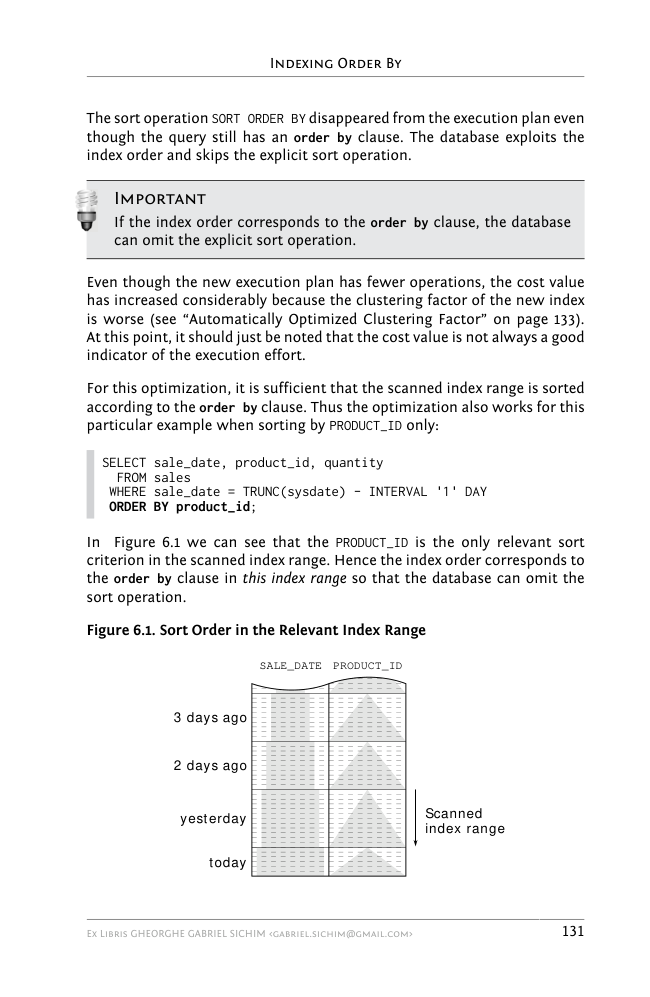
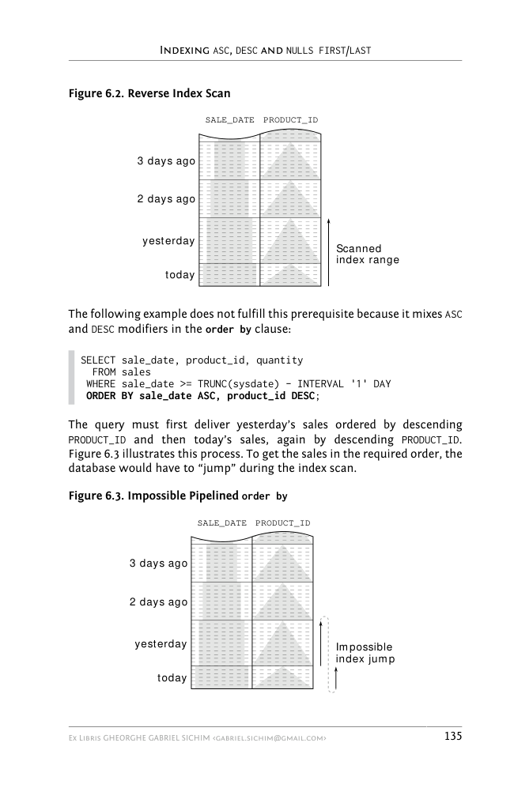
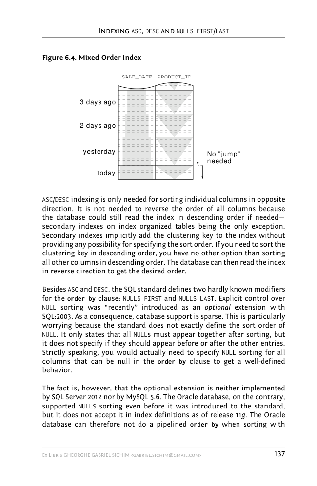
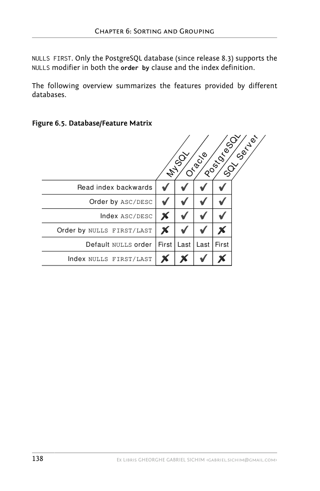

# Chương 6: Sắp xếp và gom nhóm (Chapter 6 – Sorting and Grouping)

**Mục lục**

- [Chương 6: Sắp xếp và gom nhóm (Chapter 6 – Sorting and Grouping)](#chương-6-sắp-xếp-và-gom-nhóm-chapter-6--sorting-and-grouping)
  - [Đánh index cho ORDER BY (Indexing Order By)](#đánh-index-cho-order-by-indexing-order-by)
  - [Đánh index với ASC, DESC và NULLS FIRST/LAST (Indexing ASC, DESC and NULLS FIRST/LAST)](#đánh-index-với-asc-desc-và-nulls-firstlast-indexing-asc-desc-and-nulls-firstlast)
  - [Đánh index cho GROUP BY (Indexing Group By)](#đánh-index-cho-group-by-indexing-group-by)
  - [Bảng thuật ngữ (Glossary)](#bảng-thuật-ngữ-glossary)

---

Sắp xếp (*sorting*) là một thao tác **cực kỳ tốn tài nguyên**. Nó cần khá nhiều thời gian CPU, nhưng vấn đề chính lại nằm ở chỗ khác: cơ sở dữ liệu phải **tạm thời lưu đệm (*buffer*) kết quả**. Suy cho cùng, một thao tác sắp xếp buộc phải đọc **toàn bộ** dữ liệu đầu vào thì mới có thể đưa ra dòng kết quả đầu tiên. Vì vậy thao tác sắp xếp **không thể thực thi theo kiểu đường ống** (*pipelined* – tức là vừa đọc vào vừa trả ra từng dòng ngay lập tức) — điều này có thể trở thành vấn đề lớn với các tập dữ liệu lớn.

Index cung cấp một **cách biểu diễn có thứ tự** của dữ liệu được đánh index: nguyên lý này đã được mô tả trong Chương 1. Ta cũng có thể nói rằng index lưu dữ liệu ở dạng **đã được sắp xếp sẵn** (*presorted*). Thực tế, index được sắp xếp y hệt như khi bạn đem chính định nghĩa của index đặt vào mệnh đề `order by`. Do đó, chẳng có gì ngạc nhiên khi ta có thể dùng index để **tránh thao tác sắp xếp** khi cần đáp ứng một mệnh đề `order by`.

Trớ trêu thay, một `INDEX RANGE SCAN` (quét một khoảng của index) cũng trở nên kém hiệu quả với các tập dữ liệu lớn — đặc biệt khi theo sau nó là thao tác truy cập bảng (*table access*). Điều này có thể **xóa sạch** khoản tiết kiệm có được nhờ tránh sắp xếp. Trong trường hợp đó, một `FULL TABLE SCAN` (quét toàn bộ bảng) kèm một thao tác sắp xếp tường minh thậm chí còn có thể nhanh hơn. Một lần nữa, việc đánh giá các execution plan (kế hoạch thực thi) khác nhau và chọn ra plan tốt nhất là **nhiệm vụ của optimizer** (bộ tối ưu hóa truy vấn).

Tuy nhiên, thực thi `order by` bằng index (*indexed order by*) không chỉ giúp tiết kiệm công sắp xếp; nó còn có khả năng **trả về những kết quả đầu tiên mà không cần xử lý hết toàn bộ dữ liệu đầu vào**. Nghĩa là `order by` khi đó được thực thi theo kiểu pipelined. Chương 7, "Kết quả từng phần" (*Partial Results*), sẽ giải thích cách khai thác cơ chế thực thi pipelined này để hiện thực các truy vấn phân trang (*pagination*) hiệu quả. Chính điều này khiến `order by` pipelined quan trọng đến mức tác giả gọi nó là **"sức mạnh thứ ba của indexing"** (*the third power of indexing*).

> 📝 **Giải thích thêm (không có trong sách):** Trong cả cuốn sách, tác giả nói về "ba sức mạnh" của index: (1) tìm nhanh dữ liệu theo mệnh đề `where` (duyệt cây B-tree + quét chuỗi leaf node); (2) tránh truy cập bảng nhờ *index-only scan* / clustering dữ liệu; (3) tránh sắp xếp và cho phép trả kết quả theo kiểu pipelined — chính là chủ đề của chương này.

Chương này giải thích cách dùng index để thực thi `order by` theo kiểu pipelined. Để làm được điều đó, ta phải đặc biệt chú ý đến **sự tương tác với mệnh đề `where`** và cả các bổ ngữ (*modifier*) `ASC` và `DESC`. Chương kết thúc bằng việc áp dụng các kỹ thuật này cho cả mệnh đề `group by`.

> 💡 **Ví dụ bổ sung (không có trong sách):** Hình dung "pipelined" và "không pipelined" như sau. Bạn cần đưa cho sếp 10 hóa đơn có số tiền lớn nhất trong một thùng 1 triệu hóa đơn để lộn xộn: bạn buộc phải xem hết 1 triệu tờ rồi mới biết đâu là 10 tờ lớn nhất (sắp xếp – phải đọc hết mới trả ra được tờ đầu tiên). Nhưng nếu các hóa đơn đã được xếp sẵn trong tủ hồ sơ theo số tiền giảm dần (giống index), bạn chỉ việc rút 10 tờ đầu tiên rồi dừng — đó là thực thi pipelined.

---

## Đánh index cho ORDER BY (Indexing Order By)

Các câu truy vấn SQL có mệnh đề `order by` **không cần sắp xếp kết quả một cách tường minh** nếu index liên quan đã trả về các dòng theo đúng thứ tự yêu cầu. Điều đó có nghĩa là **chính index được dùng cho mệnh đề `where` cũng phải bao phủ (*cover*) luôn mệnh đề `order by`**.

Ví dụ, hãy xét câu truy vấn sau, lấy ra các giao dịch bán hàng của ngày hôm qua, sắp xếp theo ngày bán và mã sản phẩm:

```sql
SELECT sale_date, product_id, quantity
  FROM sales
 WHERE sale_date = TRUNC(sysdate) - INTERVAL '1' DAY
 ORDER BY sale_date, product_id;
```

Hiện đã có một index trên `SALE_DATE` có thể dùng cho mệnh đề `where`. Tuy nhiên, cơ sở dữ liệu vẫn phải thực hiện một thao tác sắp xếp tường minh để đáp ứng mệnh đề `order by`:

```text
---------------------------------------------------------------
|Id | Operation                    | Name       | Rows | Cost |
---------------------------------------------------------------
| 0 | SELECT STATEMENT             |            |  320 |   18 |
| 1 |  SORT ORDER BY               |            |  320 |   18 |
| 2 |   TABLE ACCESS BY INDEX ROWID| SALES      |  320 |   17 |
|*3 |    INDEX RANGE SCAN          | SALES_DATE |  320 |    3 |
---------------------------------------------------------------
```

Dù sao thì một `INDEX RANGE SCAN` cũng trả kết quả theo thứ tự của index. Để tận dụng điều này, ta chỉ cần **mở rộng định nghĩa index** sao cho nó tương ứng với mệnh đề `order by`:

```sql
DROP INDEX sales_date;
CREATE INDEX sales_dt_pr ON sales (sale_date, product_id);
```

```text
---------------------------------------------------------------
|Id | Operation                   | Name        | Rows | Cost |
---------------------------------------------------------------
| 0 | SELECT STATEMENT            |             |  320 |  300 |
| 1 |  TABLE ACCESS BY INDEX ROWID| SALES       |  320 |  300 |
|*2 |   INDEX RANGE SCAN          | SALES_DT_PR |  320 |    4 |
---------------------------------------------------------------
```

Thao tác sắp xếp `SORT ORDER BY` đã **biến mất** khỏi execution plan, mặc dù câu truy vấn vẫn còn mệnh đề `order by`. Cơ sở dữ liệu khai thác thứ tự sẵn có của index và bỏ qua thao tác sắp xếp tường minh.

> **⚠️ Quan trọng (Important)**
>
> Nếu thứ tự của index tương ứng với mệnh đề `order by`, cơ sở dữ liệu có thể bỏ qua thao tác sắp xếp tường minh.

Dù execution plan mới có ít thao tác hơn, **giá trị cost lại tăng lên đáng kể** vì *clustering factor* (hệ số phân cụm – mức độ thứ tự các mục trong index khớp với thứ tự vật lý các dòng trong bảng) của index mới tệ hơn (xem "Clustering factor được tối ưu tự động" (*Automatically Optimized Clustering Factor*) ở trang 133 — tức hộp ghi chú ở cuối mục này). Ở thời điểm này, chỉ cần lưu ý rằng **giá trị cost không phải lúc nào cũng là thước đo tốt** cho khối lượng công việc thực thi thật sự.

Để tối ưu hóa này có hiệu lực, chỉ cần **khoảng index được quét** (*scanned index range*) được sắp xếp theo đúng mệnh đề `order by` là đủ. Vì thế, trong ví dụ cụ thể này, tối ưu hóa vẫn có tác dụng khi chỉ sắp xếp theo `PRODUCT_ID`:

```sql
SELECT sale_date, product_id, quantity
  FROM sales
 WHERE sale_date = TRUNC(sysdate) - INTERVAL '1' DAY
 ORDER BY product_id;
```

Trong Hình 6.1, ta có thể thấy `PRODUCT_ID` là **tiêu chí sắp xếp duy nhất có ý nghĩa** trong khoảng index được quét. Do đó, thứ tự index tương ứng với mệnh đề `order by` *trong khoảng index này*, nên cơ sở dữ liệu có thể bỏ qua thao tác sắp xếp.

**Hình 6.1 – Thứ tự sắp xếp trong khoảng index liên quan (Figure 6.1 – Sort Order in the Relevant Index Range)**



Vẽ lại hình (ASCII):

```text
                 SALE_DATE   PRODUCT_ID
               +-----------+------------+
               |           |     /\     |
  3 ngày trước |  (cùng    |    /  \    |   PRODUCT_ID tăng dần
  (3 days ago) |   ngày)   |   /    \   |   trong từng ngày
               +-----------+------------+
               |           |     /\     |
  2 ngày trước |           |    /  \    |
  (2 days ago) |           |   /    \   |
               +-----------+------------+  |
               |           |     /\     |  |  Khoảng index
  Hôm qua      |           |    /  \    |  |  được quét
  (yesterday)  |           |   /    \   |  |  (Scanned index range)
               +-----------+------------+  v
  Hôm nay      |           |    /\      |
  (today)      |           |   /  \     |
               +-----------+------------+
```

Mô tả: Index `SALES_DT_PR` có hai cột: `SALE_DATE` (cột trái) và `PRODUCT_ID` (cột phải). Các dòng được chia thành từng khối theo ngày: "3 days ago" (3 ngày trước), "2 days ago" (2 ngày trước), "yesterday" (hôm qua), "today" (hôm nay). Trong mỗi khối ngày, cột `SALE_DATE` có cùng một giá trị, còn cột `PRODUCT_ID` được vẽ thành một hình tam giác — biểu thị giá trị tăng dần từ nhỏ tới lớn bên trong khối đó, rồi lại "bắt đầu lại từ nhỏ" ở khối ngày kế tiếp. Mũi tên bên phải, chú thích "Scanned index range" (khoảng index được quét), chỉ bao đúng khối "yesterday" và hướng từ trên xuống dưới. Vì chỉ quét đúng một ngày, trong khoảng quét đó `SALE_DATE` là hằng số, nên các dòng đi ra **đã được sắp xếp theo `PRODUCT_ID`**.

Tối ưu hóa này có thể gây ra hành vi **bất ngờ** khi ta mở rộng khoảng index được quét:

```sql
SELECT sale_date, product_id, quantity
  FROM sales
 WHERE sale_date >= TRUNC(sysdate) - INTERVAL '1' DAY
 ORDER BY product_id;
```

Câu truy vấn này không lấy các giao dịch của ngày hôm qua, mà lấy **tất cả** giao dịch **kể từ** hôm qua. Như vậy nó trải qua nhiều ngày và quét một khoảng index **không chỉ được sắp xếp theo `PRODUCT_ID`**. Nếu nhìn lại Hình 6.1 và kéo dài khoảng index được quét xuống phía dưới, ta sẽ thấy lại xuất hiện các giá trị `PRODUCT_ID` nhỏ hơn. Vì thế cơ sở dữ liệu buộc phải dùng một thao tác sắp xếp tường minh để đáp ứng mệnh đề `order by`.

```text
---------------------------------------------------------------
|Id |Operation                    | Name        | Rows | Cost |
---------------------------------------------------------------
| 0 |SELECT STATEMENT             |             |  320 |  301 |
| 1 | SORT ORDER BY               |             |  320 |  301 |
| 2 |  TABLE ACCESS BY INDEX ROWID| SALES       |  320 |  300 |
|*3 |   INDEX RANGE SCAN          | SALES_DT_PR |  320 |    4 |
---------------------------------------------------------------
```

Nếu cơ sở dữ liệu dùng thao tác sắp xếp mặc dù bạn mong đợi một thực thi pipelined, có thể có **hai lý do**:

1. Execution plan có thao tác sắp xếp tường minh có **giá trị cost tốt hơn**;
2. Thứ tự index trong khoảng index được quét **không tương ứng** với mệnh đề `order by`.

Một cách đơn giản để phân biệt hai trường hợp là **dùng toàn bộ định nghĩa index trong mệnh đề `order by`** — tức là điều chỉnh câu truy vấn cho khớp với index để loại bỏ nguyên nhân thứ hai. Nếu cơ sở dữ liệu vẫn dùng thao tác sắp xếp tường minh, thì optimizer đang ưu tiên plan này vì giá trị cost của nó; ngược lại, nghĩa là cơ sở dữ liệu không thể dùng index cho mệnh đề `order by` ban đầu.

> **💡 Mẹo (Tip)**
>
> Hãy dùng toàn bộ định nghĩa index trong mệnh đề `order by` để tìm ra lý do của một thao tác sắp xếp tường minh.

> 💡 **Ví dụ bổ sung (không có trong sách):** Với index `sales_dt_pr (sale_date, product_id)` và câu truy vấn "kể từ hôm qua … `ORDER BY product_id`" ở trên, ta thử viết lại:
>
> ```sql
> SELECT sale_date, product_id, quantity
>   FROM sales
>  WHERE sale_date >= TRUNC(sysdate) - INTERVAL '1' DAY
>  ORDER BY sale_date, product_id;   -- toàn bộ định nghĩa index
> ```
>
> Nếu plan của câu này **không còn** `SORT ORDER BY` → index dùng được cho thứ tự `sale_date, product_id`, và lý do câu gốc phải sắp xếp là vì `ORDER BY product_id` **không** khớp thứ tự index trong khoảng quét nhiều ngày (lý do 2). Nếu plan **vẫn còn** `SORT ORDER BY` → optimizer cho rằng sắp xếp rẻ hơn (lý do 1), ví dụ vì khoảng quét quá lớn và một `FULL TABLE SCAN` + sort có cost thấp hơn. Lưu ý: kết quả của câu viết lại có thứ tự khác câu gốc — nó chỉ dùng để chẩn đoán.

Trong cả hai trường hợp, có thể bạn sẽ thắc mắc liệu có thể đạt được việc thực thi `order by` pipelined hay không, và bằng cách nào. Để trả lời, bạn có thể chạy câu truy vấn với toàn bộ định nghĩa index trong mệnh đề `order by` và xem xét kết quả. Bạn sẽ thường nhận ra rằng mình đã **hình dung sai về index**, và thứ tự của index thực sự không như mệnh đề `order by` ban đầu yêu cầu, nên cơ sở dữ liệu không thể dùng index để tránh thao tác sắp xếp.

Nếu optimizer ưu tiên thao tác sắp xếp tường minh vì giá trị cost, thường là do optimizer chọn execution plan tốt nhất cho việc **thực thi trọn vẹn** câu truy vấn. Nói cách khác, optimizer chọn execution plan **nhanh nhất để lấy được bản ghi cuối cùng**. Nếu cơ sở dữ liệu phát hiện ứng dụng chỉ lấy (*fetch*) vài dòng đầu tiên, nó có thể chuyển sang ưu tiên `order by` dùng index. Chương 7, "Kết quả từng phần" (*Partial Results*), giải thích các phương pháp tối ưu hóa tương ứng.

> **📦 Clustering factor được tối ưu tự động (Automatically Optimized Clustering Factor)**
>
> Cơ sở dữ liệu Oracle giữ clustering factor ở mức **thấp nhất có thể** bằng cách xét cả `ROWID` khi xác định thứ tự index. Bất cứ khi nào hai mục index có cùng giá trị khóa, `ROWID` sẽ quyết định thứ tự cuối cùng của chúng. Do đó index cũng được sắp xếp theo thứ tự của bảng, và vì thế có clustering factor nhỏ nhất có thể, bởi `ROWID` biểu diễn địa chỉ vật lý của dòng trong bảng.
>
> Khi thêm một cột nữa vào index, bạn chèn một tiêu chí sắp xếp mới **đứng trước `ROWID`**. Cơ sở dữ liệu có ít tự do hơn trong việc sắp các mục index theo thứ tự bảng, nên clustering factor của index **chỉ có thể tệ đi**.
>
> Dù vậy, vẫn có khả năng thứ tự index gần như tương ứng với thứ tự bảng. Các giao dịch trong cùng một ngày có lẽ vẫn nằm gần nhau trong bảng cũng như trong index — dù trình tự của chúng không còn giống hệt nhau nữa. Khi dùng index `SALE_DT_PR`, cơ sở dữ liệu phải đọc các khối (*block*) của bảng nhiều lần — nhưng đó vẫn chỉ là **chính những khối bảng như trước**. Nhờ cơ chế cache dữ liệu thường xuyên được truy cập, tác động thực tế lên hiệu năng có thể thấp hơn đáng kể so với những gì giá trị cost cho thấy.

> 📝 **Giải thích thêm (không có trong sách):** Trong ví dụ trên, cost tăng từ 18 lên 300. Với index `SALES_DATE` chỉ có một cột, các mục cùng ngày được xếp theo `ROWID`, nên khi duyệt index, Oracle đi qua các block của bảng theo thứ tự vật lý — mỗi block thường chỉ cần đọc một lần (clustering factor thấp). Với `SALES_DT_PR`, các mục cùng ngày được xếp theo `PRODUCT_ID` trước, nên khi duyệt, Oracle "nhảy qua nhảy lại" giữa các block của ngày đó; optimizer đếm mỗi lần nhảy như một lần đọc block mới (clustering factor cao). Nhưng vì tập block của một ngày vẫn chỉ là vài chục block và đã nằm trong buffer cache sau lần đọc đầu, chi phí thực tế tăng ít hơn nhiều so với cost.

> 💡 **Ví dụ bổ sung (không có trong sách):** Bảng `sales` mẫu (đơn giản hóa):
>
> | sale_date  | product_id | quantity |
> |------------|-----------:|---------:|
> | 2024-05-01 | 7          | 1        |
> | 2024-05-01 | 3          | 2        |
> | 2024-05-02 | 9          | 1        |
> | 2024-05-02 | 1          | 5        |
> | 2024-05-02 | 4          | 2        |
> | 2024-05-03 | 2          | 1        |
>
> Index `sales_dt_pr (sale_date, product_id)` lưu theo thứ tự: (05-01,3) (05-01,7) (05-02,1) (05-02,4) (05-02,9) (05-03,2).
>
> - `WHERE sale_date = DATE '2024-05-02' ORDER BY product_id` → khoảng quét là (05-02,1) (05-02,4) (05-02,9): đã đúng thứ tự `product_id` → **không cần sort**.
> - `WHERE sale_date >= DATE '2024-05-02' ORDER BY product_id` → khoảng quét là (05-02,1) (05-02,4) (05-02,9) (05-03,2): thứ tự `product_id` là 1, 4, 9, **2** — bị "gãy" → **phải sort**.
>
> Cách làm tương tự trong PostgreSQL (dùng `CURRENT_DATE - 1` thay cho `TRUNC(sysdate) - INTERVAL '1' DAY`): plan sẽ là `Index Scan using sales_dt_pr` không có nút `Sort` ở trường hợp đầu, và có nút `Sort` (Sort Key: product_id) ở trường hợp sau. Trong MySQL, dấu hiệu tương ứng là cột `Extra` của `EXPLAIN` có hay không có `Using filesort`.

> 📝 **Giải thích thêm (không có trong sách) — Đối chiếu với PostgreSQL hiện đại (PG 10–17): `Incremental Sort` (PG 13+) và Đột phá bộ nhớ Sort (PG 15–16):**
>
> 1. **`Incremental Sort` (PostgreSQL 13+) — Bước ngoặt kiến trúc cho `ORDER BY` nhiều cột:**
>    - **Thời điểm sách viết (2012 — PostgreSQL 9.1/9.2):** Sách khẳng định quy tắc cứng: để thực thi `ORDER BY` theo kiểu *pipelined* (không cần `Sort` toàn bộ tập kết quả), index bắt buộc phải bao phủ **đầy đủ mọi cột** trong mệnh đề `ORDER BY`. Ví dụ, nếu bạn đã có index trên `(subsidiary_id, ts_date)` (hoặc `(sale_date, product_id)`), nhưng giao diện người dùng lại yêu cầu `ORDER BY subsidiary_id, ts_date, price` (hoặc `ORDER BY sale_date, product_id, quantity`), thì PostgreSQL 9.1–12 buộc phải đọc hết toàn bộ các dòng khớp điều kiện `WHERE`, nạp tất cả vào bộ nhớ/đĩa tạm rồi chạy một nút `Sort` toàn cục từ đầu!
>    - **Từ PostgreSQL 13+ (được mở rộng thêm ở PG 14–17):** Bộ tối ưu hóa truy vấn có thêm toán tử **`Incremental Sort` (*Sắp xếp tăng dần từng phần*)**.
>      - **Nguyên lý hoạt động:** Khi dữ liệu đi ra từ `Index Scan` trên `(subsidiary_id, ts_date)`, nó **đã được sắp xếp sẵn theo phần tiền tố `(subsidiary_id, ts_date)`** — trong `EXPLAIN` của PostgreSQL gọi là **`Presorted Key`**. Thay vì gom toàn bộ 100.000 dòng của cả bảng để sắp xếp lại từ đầu, `Incremental Sort` đọc từng nhóm nhỏ có cùng giá trị `(subsidiary_id, ts_date)` (ví dụ chỉ có 5–20 dòng trong cùng một ngày của chi nhánh đó), sắp xếp cục bộ vài dòng đó theo cột còn thiếu (`price` hoặc `quantity`) ngay trong vài kilobyte bộ nhớ, rồi **đẩy kết quả ra ngay lập tức theo kiểu *pipelined***!
>      - **Tại sao đây là bước ngoặt thực tế khi thiết kế Index?**
>        - **Không cần tạo thêm các index "béo" dư thừa:** Bạn chỉ cần đánh index trên các cột có độ chọn lọc cao ở phần đầu (`(subsidiary_id, ts_date)`), các cột phụ thêm vào cuối `ORDER BY` (như `price`, `quantity`, `created_at`) sẽ được `Incremental Sort` xử lý với chi phí gần như bằng 0.
>        - **Giữ nguyên đặc tính *Pipelined* cho truy vấn `LIMIT` (phân trang):** Nếu câu truy vấn có `LIMIT 20`, `Incremental Sort` chỉ cần đọc nhóm tiền tố đầu tiên từ index, sắp xếp 20 dòng đó rồi dừng ngay lập tức — thời gian phản hồi dưới 1 ms thay vì phải đọc và sắp xếp hàng trăm nghìn dòng!
>        - **Tiết kiệm hàng trăm lần bộ nhớ `work_mem`:** Bộ nhớ tối đa mà `Incremental Sort` tiêu thụ chỉ bằng kích thước của **1 nhóm tiền tố lớn nhất**, chứ không phải toàn bộ tập kết quả.
> 2. **Tối ưu hóa thuật toán và bộ nhớ `Sort` trong PostgreSQL 15+ & 16+:**
>    Ngay cả khi bắt buộc phải thực hiện một thao tác `Sort` tường minh (hoặc bên trong mỗi nhóm của `Incremental Sort`), PostgreSQL 15 và 16 đã viết lại toàn bộ cơ chế sắp xếp trong bộ nhớ (`tuplesort`):
>    - **`Datum Sort` cho sắp xếp một cột (PostgreSQL 15+):** Khi sắp xếp chỉ trên một cột (`ORDER BY col`), thay vì đóng gói dòng thành cấu trúc `MinimalTuple` kèm theo header nặng nề, PG 15 sắp xếp trực tiếp trên mảng giá trị `Datum` nguyên thủy.
>    - **Hàm so sánh chuyên biệt theo kiểu dữ liệu (*Specialized Sort Routines* — PG 15+):** Thay vì gọi hàm so sánh tổng quát qua con trỏ hàm (*function pointer*) cho mỗi lần đọ giá trị trong `quicksort`, PG 15 cung cấp các hàm so sánh nội tuyến (*inline*) chuyên biệt cho `int4`, `int8`, `timestamp`, `numeric`, `text` (kết hợp *abbreviated keys* so sánh 8 byte đầu của chuỗi trong thanh ghi CPU 64-bit).
>    - **Quản lý bộ nhớ `Generation Memory Context` (PostgreSQL 15+ & 16+):** Loại bỏ header 16 byte của bộ cấp phát `AllocSet` cũ trên mỗi tuple sắp xếp, giúp **giảm từ 25% đến 50% dung lượng RAM tiêu thụ** và **tăng tốc độ `ORDER BY` từ 15% đến hơn 40%**. Nhờ tốn ít RAM hơn, cùng một cấu hình `work_mem` (ví dụ `4MB`) trên PG 15–17 có thể sắp xếp trọn vẹn trong RAM (*in-memory quicksort*) lượng dữ liệu lớn gấp đôi so với PG 14 trở về trước mà không bị tràn ra đĩa tạm (*external merge sort*).

> 💡 **Ví dụ bổ sung (không có trong sách) — Thực hành trên PostgreSQL 13–17: Quan sát `Incremental Sort` và `Presorted Key` trong `EXPLAIN (ANALYZE, BUFFERS)`:**
>
> Giả sử bảng `sales` có index `sales_dt_pr` chỉ gồm 2 cột `(sale_date, product_id)`, nhưng truy vấn cần lọc các đơn từ tháng trước, sắp xếp theo **3 cột** `ORDER BY sale_date, product_id, quantity DESC` và lấy 10 dòng đầu tiên:
> ```sql
> -- Index chỉ có 2 cột (sale_date, product_id), KHÔNG có cột quantity:
> CREATE INDEX sales_dt_pr ON sales (sale_date, product_id);
>
> EXPLAIN (ANALYZE, BUFFERS)
> SELECT sale_date, product_id, quantity
>   FROM sales
>  WHERE sale_date >= CURRENT_DATE - INTERVAL '30 days'
>  ORDER BY sale_date, product_id, quantity DESC
>  LIMIT 10;
> ```
> - **Trên PostgreSQL 9.1 – 12 (trước khi có `Incremental Sort`):** PostgreSQL phải đọc toàn bộ 50.000 dòng của 30 ngày qua, thực hiện `Sort (top-N heapsort)` trên cả 50.000 dòng rồi mới trả ra 10 dòng.
> - **Trên PostgreSQL 13 – 17 (có `Incremental Sort`):**
> ```text
> Limit  (cost=1.25..4.82 rows=10 width=12) (actual time=0.052..0.071 rows=10 loops=1)
>   Buffers: shared hit=12
>   ->  Incremental Sort  (cost=1.25..17854.20 rows=50000 width=12) (actual time=0.051..0.068 rows=10 loops=1)
>         Sort Key: sale_date, product_id, quantity DESC
>         Presorted Key: sale_date, product_id
>         Full-sort Groups: 1  Sort Method: quicksort  Average Memory: 25kB  Peak Memory: 25kB
>         Buffers: shared hit=12
>         ->  Index Scan using sales_dt_pr on sales  (cost=0.43..15604.20 rows=50000 width=12) (actual time=0.021..0.042 rows=14 loops=1)
>               Index Cond: (sale_date >= (CURRENT_DATE - '30 days'::interval))
>               Buffers: shared hit=12
> Planning Time: 0.110 ms
> Execution Time: 0.095 ms
> ```
> Hãy đọc kỹ các thông số đắt giá của `Incremental Sort`:
> - **`Sort Key: sale_date, product_id, quantity DESC`** và **`Presorted Key: sale_date, product_id`**: Bộ tối ưu nhận diện ngay 2 cột đầu đã được index sắp xếp sẵn!
> - **`rows=14 loops=1` ở `Index Scan`**: Thay vì đọc 50.000 dòng, `Index Scan` chỉ đọc đúng **14 dòng đầu tiên** từ index (đủ để gom trọn nhóm `(sale_date, product_id)` đầu tiên vượt mốc 10 dòng), chuyển cho `Incremental Sort` sắp xếp theo `quantity DESC` với **`Peak Memory: 25kB`** và kết thúc toàn bộ truy vấn trong **0,095 ms**!

---


## Đánh index với ASC, DESC và NULLS FIRST/LAST (Indexing ASC, DESC and NULLS FIRST/LAST)

Cơ sở dữ liệu có thể đọc index **theo cả hai chiều**. Điều đó có nghĩa là `order by` pipelined vẫn khả thi nếu khoảng index được quét có thứ tự **ngược hoàn toàn** với thứ tự mà mệnh đề `order by` chỉ định. Mặc dù các bổ ngữ `ASC` (tăng dần) và `DESC` (giảm dần) trong mệnh đề `order by` có thể ngăn cản việc thực thi pipelined, hầu hết các cơ sở dữ liệu đều cung cấp một cách đơn giản để **thay đổi thứ tự của index**, nhờ đó index trở nên dùng được cho `order by` pipelined.

Ví dụ sau dùng một index theo thứ tự ngược. Nó trả về các giao dịch kể từ hôm qua, sắp xếp theo ngày giảm dần và `PRODUCT_ID` giảm dần.

```sql
SELECT sale_date, product_id, quantity
  FROM sales
 WHERE sale_date >= TRUNC(sysdate) - INTERVAL '1' DAY
 ORDER BY sale_date DESC, product_id DESC;
```

Execution plan cho thấy cơ sở dữ liệu đọc index theo chiều giảm dần.

```text
---------------------------------------------------------------
|Id |Operation                    | Name        | Rows | Cost |
---------------------------------------------------------------
| 0 |SELECT STATEMENT             |             |  320 |  300 |
| 1 | TABLE ACCESS BY INDEX ROWID | SALES       |  320 |  300 |
|*2 |  INDEX RANGE SCAN DESCENDING| SALES_DT_PR |  320 |    4 |
---------------------------------------------------------------
```

Trong trường hợp này, cơ sở dữ liệu dùng cây index (*index tree*) để tìm mục khớp **cuối cùng**. Từ đó, nó đi theo chuỗi leaf node (*leaf node chain* – danh sách liên kết nối các nút lá của B-tree) "**ngược lên trên**" như minh họa trong Hình 6.2. Suy cho cùng, đây chính là lý do cơ sở dữ liệu dùng **danh sách liên kết đôi** (*doubly linked list*) để xây dựng chuỗi leaf node.

Dĩ nhiên, điều cốt yếu là khoảng index được quét phải có thứ tự **ngược hoàn toàn chính xác** so với thứ tự cần cho mệnh đề `order by`.

> **⚠️ Quan trọng (Important)**
>
> Cơ sở dữ liệu có thể đọc index theo cả hai chiều.

**Hình 6.2 – Quét index theo chiều ngược (Figure 6.2 – Reverse Index Scan)**



Vẽ lại hình (ASCII):

```text
                 SALE_DATE   PRODUCT_ID
               +-----------+------------+
  3 ngày trước |           |     /\     |
  (3 days ago) |           |    /  \    |
               +-----------+------------+
  2 ngày trước |           |     /\     |
  (2 days ago) |           |    /  \    |
               +-----------+------------+  ^
  Hôm qua      |           |     /\     |  |  Khoảng index được quét
  (yesterday)  |           |    /  \    |  |  (Scanned index range)
               +-----------+------------+  |  -- đọc từ dưới lên
  Hôm nay      |           |    /\      |  |
  (today)      |           |   /  \     |  |
               +-----------+------------+  |
```

Mô tả: Vẫn là index `SALES_DT_PR` (cột `SALE_DATE` và `PRODUCT_ID`, chia khối theo các ngày "3 days ago", "2 days ago", "yesterday", "today"; trong mỗi ngày `PRODUCT_ID` tăng dần – hình tam giác). Lần này mũi tên "Scanned index range" (khoảng index được quét) bao cả hai khối "yesterday" và "today", và **chỉ lên trên**: cơ sở dữ liệu bắt đầu từ mục cuối cùng của "today" rồi đọc ngược lên đến đầu khối "yesterday". Đọc như vậy, các dòng đi ra theo thứ tự `SALE_DATE DESC, PRODUCT_ID DESC` — đúng như mệnh đề `order by`.

Ví dụ sau **không thỏa mãn** điều kiện tiên quyết này vì nó trộn lẫn bổ ngữ `ASC` và `DESC` trong mệnh đề `order by`:

```sql
SELECT sale_date, product_id, quantity
  FROM sales
 WHERE sale_date >= TRUNC(sysdate) - INTERVAL '1' DAY
 ORDER BY sale_date ASC, product_id DESC;
```

Câu truy vấn trước hết phải trả về các giao dịch hôm qua theo `PRODUCT_ID` giảm dần, rồi mới đến các giao dịch hôm nay, cũng theo `PRODUCT_ID` giảm dần. Hình 6.3 minh họa quá trình này. Để lấy các giao dịch theo thứ tự yêu cầu, cơ sở dữ liệu sẽ phải "**nhảy**" trong khi quét index.

**Hình 6.3 – `order by` pipelined bất khả thi (Figure 6.3 – Impossible Pipelined order by)**


Vẽ lại hình (ASCII):

```text
                 SALE_DATE   PRODUCT_ID
               +-----------+------------+
  3 ngày trước |           |     /\     |
  (3 days ago) |           |    /  \    |
               +-----------+------------+
  2 ngày trước |           |     /\     |
  (2 days ago) |           |    /  \    |
               +-----------+------------+      .
  Hôm qua      |           |     /\     |  ^   :  "Cú nhảy" index
  (yesterday)  |           |    /  \    |  |   :  bất khả thi
               +-----------+------------+  (1) :  (Impossible
  Hôm nay      |           |    /\      |  ^   :   index jump)
  (today)      |           |   /  \     |  |   :
               +-----------+------------+ (2)  '
   (1) đọc "hôm qua" từ dưới lên, rồi phải nhảy xuống cuối "hôm nay"
   (2) đọc "hôm nay" từ dưới lên
```

Mô tả: Hai mũi tên ngắn đều chỉ lên trên: mũi tên thứ nhất phủ khối "yesterday" (đọc `PRODUCT_ID` giảm dần trong ngày hôm qua), mũi tên thứ hai phủ khối "today" (đọc `PRODUCT_ID` giảm dần trong ngày hôm nay). Một đường nét đứt bao quanh hai mũi tên, chú thích "Impossible index jump" (cú nhảy index bất khả thi): sau khi đọc xong đỉnh của khối "yesterday" (sản phẩm nhỏ nhất của hôm qua), cơ sở dữ liệu phải nhảy xuống đáy khối "today" (sản phẩm lớn nhất của hôm nay) — một bước nhảy không có đường liên kết nào trong index.

Thật vậy, index **không có liên kết nào** từ giao dịch hôm qua có `PRODUCT_ID` nhỏ nhất sang giao dịch hôm nay có `PRODUCT_ID` lớn nhất. Do đó cơ sở dữ liệu không thể dùng index này để tránh một thao tác sắp xếp tường minh.

Với những trường hợp như thế này, hầu hết các cơ sở dữ liệu cung cấp một phương pháp đơn giản để **điều chỉnh thứ tự index cho khớp với mệnh đề `order by`**. Cụ thể, bạn có thể dùng bổ ngữ `ASC` và `DESC` ngay trong khai báo index:

```sql
DROP INDEX sales_dt_pr;
CREATE INDEX sales_dt_pr
    ON sales (sale_date ASC, product_id DESC);
```

> **🚫 Cảnh báo (Warning)**
>
> Cơ sở dữ liệu MySQL bỏ qua các bổ ngữ `ASC` và `DESC` trong định nghĩa index.

> 📝 **Giải thích thêm (không có trong sách):** Cảnh báo trên đúng với MySQL 5.x (thời điểm sách viết, MySQL 5.6). Từ **MySQL 8.0**, InnoDB đã hỗ trợ thật sự *descending index*: `CREATE INDEX ... (sale_date ASC, product_id DESC)` được lưu đúng thứ tự hỗn hợp và có thể dùng để tránh `Using filesort` cho `ORDER BY sale_date ASC, product_id DESC`.

Giờ đây thứ tự index đã tương ứng với mệnh đề `order by`, nên cơ sở dữ liệu có thể bỏ qua thao tác sắp xếp:

```text
---------------------------------------------------------------
|Id | Operation                   | Name        | Rows | Cost |
---------------------------------------------------------------
| 0 | SELECT STATEMENT            |             |  320 |  301 |
| 1 |  TABLE ACCESS BY INDEX ROWID| SALES       |  320 |  301 |
|*2 |   INDEX RANGE SCAN          | SALES_DT_PR |  320 |    4 |
---------------------------------------------------------------
```

Hình 6.4 cho thấy thứ tự index mới. Việc đổi chiều sắp xếp của cột thứ hai, theo một cách nào đó, đã **đảo chiều các mũi tên** trong hình trước. Nhờ vậy mũi tên thứ nhất kết thúc đúng ở chỗ mũi tên thứ hai bắt đầu, và index chứa các dòng theo đúng thứ tự mong muốn.

> **⚠️ Quan trọng (Important)**
>
> Khi dùng hỗn hợp các bổ ngữ `ASC` và `DESC` trong mệnh đề `order by`, bạn phải định nghĩa index **tương tự như vậy** thì mới dùng được nó cho `order by` pipelined.
>
> Điều này **không ảnh hưởng** đến khả năng dùng index cho mệnh đề `where`.

**Hình 6.4 – Index có thứ tự hỗn hợp (Figure 6.4 – Mixed-Order Index)**



Vẽ lại hình (ASCII):

```text
                 SALE_DATE   PRODUCT_ID (DESC)
               +-----------+------------+
  3 ngày trước |           |   \    /   |
  (3 days ago) |           |    \  /    |
               +-----------+------------+
  2 ngày trước |           |   \    /   |
  (2 days ago) |           |    \  /    |
               +-----------+------------+  |
  Hôm qua      |           |   \    /   |  |  Không cần "nhảy"
  (yesterday)  |           |    \  /    |  v  (No "jump" needed)
               +-----------+------------+  |
  Hôm nay      |           |   \    /   |  |
  (today)      |           |    \/      |  v
               +-----------+------------+
```

Mô tả: Lần này trong mỗi khối ngày, tam giác `PRODUCT_ID` bị **lộn ngược** (đỉnh hướng xuống) — biểu thị `PRODUCT_ID` được lưu theo thứ tự giảm dần bên trong từng ngày, còn `SALE_DATE` vẫn tăng dần giữa các khối. Hai mũi tên chỉ xuống: mũi tên thứ nhất phủ khối "yesterday", mũi tên thứ hai nối tiếp ngay ở đầu khối "today". Chú thích "No "jump" needed" (không cần "nhảy"): chỉ cần đọc index liên tục từ trên xuống là được đúng thứ tự `sale_date ASC, product_id DESC`.

Indexing với `ASC`/`DESC` **chỉ cần thiết** khi phải sắp xếp từng cột riêng lẻ **theo chiều ngược nhau**. Không cần dùng nó để đảo ngược thứ tự của **tất cả** các cột, vì cơ sở dữ liệu vẫn có thể đọc index theo chiều giảm dần khi cần — ngoại lệ duy nhất là **index phụ (*secondary index*) trên bảng tổ chức theo index (*index-organized table*)**. Các index phụ này ngầm thêm khóa phân cụm (*clustering key*) vào index mà không cho phép chỉ định thứ tự sắp xếp của nó. Nếu bạn cần sắp xếp khóa phân cụm theo chiều giảm dần, bạn không còn cách nào khác ngoài việc sắp xếp **tất cả các cột khác** theo chiều giảm dần. Khi đó cơ sở dữ liệu có thể đọc index theo chiều ngược để có được thứ tự mong muốn.

> 📝 **Giải thích thêm (không có trong sách):** Ví dụ trong SQL Server (bảng có clustered index trên `sale_id ASC`) hoặc MySQL InnoDB (khóa chính luôn là clustering key), một index phụ `ix (sale_date)` thực chất được lưu như `(sale_date, sale_id)` với `sale_id` luôn tăng dần. Muốn có `ORDER BY sale_date ASC, sale_id DESC` mà không sắp xếp, bạn không thể khai báo `sale_id DESC` cho phần ngầm định đó; thay vào đó, khai báo `ix (sale_date DESC)` — index thực tế thành `(sale_date DESC, sale_id ASC)`, và đọc ngược nó sẽ cho đúng `sale_date ASC, sale_id DESC`.

Bên cạnh `ASC` và `DESC`, chuẩn SQL còn định nghĩa hai bổ ngữ **ít người biết đến** cho mệnh đề `order by`: `NULLS FIRST` và `NULLS LAST`. Khả năng kiểm soát tường minh cách sắp xếp `NULL` mới được đưa vào "gần đây" dưới dạng một phần mở rộng *tùy chọn* (*optional*) trong SQL:2003. Hệ quả là các cơ sở dữ liệu hỗ trợ nó rất thưa thớt. Điều này đặc biệt đáng lo ngại vì chuẩn **không quy định chính xác** thứ tự sắp xếp của `NULL`. Chuẩn chỉ nói rằng sau khi sắp xếp, tất cả các `NULL` phải đứng liền nhau, nhưng không nói chúng phải đứng trước hay sau các giá trị còn lại. Nói một cách nghiêm ngặt, bạn thực ra phải chỉ định cách sắp xếp `NULL` cho **mọi cột có thể chứa null** trong mệnh đề `order by` thì mới có được một hành vi được xác định rõ ràng.

Tuy nhiên, thực tế là phần mở rộng tùy chọn này **không được hiện thực** bởi SQL Server 2012 lẫn MySQL 5.6. Ngược lại, cơ sở dữ liệu Oracle đã hỗ trợ sắp xếp `NULLS` từ trước khi nó được đưa vào chuẩn, nhưng **không chấp nhận nó trong định nghĩa index** (tính đến bản 11g). Do đó, Oracle không thể thực hiện `order by` pipelined khi sắp xếp với `NULLS FIRST`. Chỉ có cơ sở dữ liệu PostgreSQL (từ bản 8.3) hỗ trợ bổ ngữ `NULLS` **ở cả** mệnh đề `order by` lẫn định nghĩa index.

Bảng tổng quan sau tóm tắt các tính năng mà từng cơ sở dữ liệu cung cấp.

**Hình 6.5 – Ma trận cơ sở dữ liệu/tính năng (Figure 6.5 – Database/Feature Matrix)**



Dựng lại bằng bảng (✔ = có hỗ trợ, ✘ = không hỗ trợ):

| Tính năng | MySQL | Oracle | PostgreSQL | SQL Server |
|---|:---:|:---:|:---:|:---:|
| Đọc index theo chiều ngược (*Read index backwards*) | ✔ | ✔ | ✔ | ✔ |
| `ASC`/`DESC` trong `order by` (*Order by ASC/DESC*) | ✔ | ✔ | ✔ | ✔ |
| `ASC`/`DESC` trong index (*Index ASC/DESC*) | ✘ | ✔ | ✔ | ✔ |
| `NULLS FIRST`/`LAST` trong `order by` (*Order by NULLS FIRST/LAST*) | ✘ | ✔ | ✔ | ✘ |
| Thứ tự `NULLS` mặc định (*Default NULLS order*) | First (đầu) | Last (cuối) | Last (cuối) | First (đầu) |
| `NULLS FIRST`/`LAST` trong index (*Index NULLS FIRST/LAST*) | ✘ | ✘ | ✔ | ✘ |

> 📝 **Giải thích thêm (không có trong sách):** Bảng trên phản ánh các phiên bản lúc sách được viết (MySQL 5.6, Oracle 11g, PostgreSQL 9.x, SQL Server 2012). Một số thay đổi đáng chú ý sau này: **MySQL 8.0** đã hỗ trợ `ASC`/`DESC` trong index (descending index), nhưng vẫn **không** có cú pháp `NULLS FIRST/LAST`; **SQL Server** đến nay vẫn không có `NULLS FIRST/LAST`. "Thứ tự NULLS mặc định" trong bảng là cho chiều `ASC`; với `DESC` thì đảo lại (ví dụ ở Oracle/PostgreSQL, `ORDER BY x DESC` mặc định là `NULLS FIRST`).

> 💡 **Ví dụ bổ sung (không có trong sách):** Trong **PostgreSQL**, giả sử bảng `employees(employee_id, last_name, bonus)` với `bonus` có thể `NULL`, và màn hình cần hiển thị nhân viên theo thưởng giảm dần nhưng đưa người chưa có thưởng xuống cuối:
>
> ```sql
> SELECT employee_id, last_name, bonus
>   FROM employees
>  ORDER BY bonus DESC NULLS LAST
>  LIMIT 10;
> ```
>
> Với index thường `CREATE INDEX emp_bonus ON employees (bonus);` (mặc định `ASC NULLS LAST`), đọc ngược sẽ cho `DESC NULLS FIRST` — **không khớp**, nên PostgreSQL phải sắp xếp (hoặc dùng Top-N heapsort). Tạo index khớp chính xác:
>
> ```sql
> CREATE INDEX emp_bonus_desc ON employees (bonus DESC NULLS LAST);
> ```
>
> Lúc này plan là `Limit -> Index Scan using emp_bonus_desc`, không có nút `Sort`, và chỉ cần đọc 10 mục đầu tiên của index rồi dừng — `order by` pipelined đúng nghĩa. Lưu ý: index `(bonus ASC NULLS FIRST)` cũng dùng được, vì đọc ngược nó cho ra đúng `DESC NULLS LAST`.

> 💡 **Ví dụ bổ sung (không có trong sách):** Bài toán: bảng `orders(customer_id, order_date, ...)`, màn hình "đơn hàng gần nhất của từng khách" cần
>
> ```sql
> SELECT * FROM orders
>  WHERE customer_id = :cust
>  ORDER BY order_date DESC;
> ```
>
> Index `orders_cust_dt (customer_id, order_date)` (đều `ASC`) là **đủ**: điều kiện `customer_id = :cust` làm cột đầu là hằng số trong khoảng quét, và DB đọc ngược khoảng đó (`INDEX RANGE SCAN DESCENDING` ở Oracle, `Index Scan Backward` ở PostgreSQL, `Backward` scan ở SQL Server, `Backward index scan` trong `EXPLAIN` của MySQL 8). Không cần tạo `(customer_id, order_date DESC)`. Chỉ khi truy vấn là `WHERE customer_id IN (...) ORDER BY customer_id ASC, order_date DESC` (trộn chiều trên **nhiều** khách) thì mới cần index hỗn hợp `(customer_id ASC, order_date DESC)`.

> 📝 **Giải thích thêm (không có trong sách) — Đối chiếu với PostgreSQL hiện đại (PG 10–17) về `ASC/DESC`, `NULLS FIRST/LAST` và cách `Incremental Sort` giải cứu bài toán Hình 6.3:**
>
> 1. **Cách `Incremental Sort` (PostgreSQL 13+) hóa giải "cú nhảy index bất khả thi" ở Hình 6.3:**
>    Trong Hình 6.3, sách chỉ ra rằng với index `sales_dt_pr (sale_date ASC, product_id ASC)`, truy vấn `ORDER BY sale_date ASC, product_id DESC` không thể chạy *pipelined* vì cột thứ hai ngược chiều cột thứ nhất — trên PostgreSQL 9.1–12 (cũng như Oracle thời 2012), cơ sở dữ liệu buộc phải đọc hết toàn bộ các ngày rồi `Sort` lại toàn bộ tập kết quả.
>    Tuy nhiên, từ **PostgreSQL 13+**, nhờ toán tử **`Incremental Sort`**, bức tranh đã thay đổi đáng kể:
>    - Vì cột đứng đầu `sale_date ASC` trong `ORDER BY` **vẫn khớp chiều** với cột đầu của index `(sale_date ASC, product_id ASC)`, PostgreSQL 13–17 nhận diện **`Presorted Key: sale_date`**.
>    - Thay vì phải sắp xếp toàn bộ bảng hay bắt buộc bạn phải tạo thêm một index hỗn hợp mới `(sale_date ASC, product_id DESC)`, PostgreSQL đọc từng ngày một từ index cũ (`sale_date ASC`), gom các dòng của riêng ngày đó lại rồi đảo chiều `product_id DESC` trong bộ nhớ bằng `Incremental Sort` và trả kết quả ra ngay theo kiểu *pipelined*!
>    - **Khi nào bạn vẫn nên tạo index hỗn hợp `(sale_date ASC, product_id DESC)` trên PostgreSQL 13–17?** Khi mỗi giá trị của cột đầu (`sale_date`) chứa **hàng chục nghìn đến hàng triệu dòng** và truy vấn có `LIMIT 10`: nếu chỉ dùng `Incremental Sort` trên index `(sale_date ASC, product_id ASC)`, PostgreSQL vẫn phải đọc hết toàn bộ các dòng của ngày đầu tiên để tìm ra 10 dòng có `product_id` lớn nhất; trong khi index hỗn hợp `(sale_date ASC, product_id DESC)` đọc đúng 10 mục đầu tiên của ngày đó rồi dừng ngay (`Index Scan` thuần túy không cần `Incremental Sort`).
> 2. **Quy tắc `NULLS FIRST / NULLS LAST` trong B-Tree của PostgreSQL và cái bẫy thường gặp:**
>    PostgreSQL là hệ quản trị cơ sở dữ liệu hỗ trợ chuẩn mực nhất `NULLS FIRST` và `NULLS LAST` ngay trong định nghĩa B-Tree Index (từ PG 8.3 đến PG 17). Quy tắc mặc định của PostgreSQL là **coi `NULL` lớn hơn mọi giá trị khác (*NULLs are greater than non-NULLs*)**:
>    - `ASC` mặc định là **`ASC NULLS LAST`**
>    - `DESC` mặc định là **`DESC NULLS FIRST`**
>    - **Cái bẫy kinh điển trên Production:** Khi bạn có cột có thể nhận `NULL` (như `last_login_at TIMESTAMP NULL`, `shipped_at TIMESTAMPTZ NULL`, hoặc `rating NUMERIC NULL`), bạn đánh index mặc định `CREATE INDEX idx_users_login ON users (last_login_at);` rồi viết câu truy vấn lấy những người mới đăng nhập gần nhất:
>      - Nếu viết `ORDER BY last_login_at DESC LIMIT 20`: PostgreSQL dùng được `Index Scan Backward`, nhưng 20 dòng trả về đầu tiên lại toàn là những tài khoản... **chưa từng đăng nhập (`last_login_at IS NULL`)** vì `DESC` mặc định là `NULLS FIRST`!
>      - Khi lập trình viên phát hiện lỗi và sửa câu SQL thành `ORDER BY last_login_at DESC NULLS LAST LIMIT 20`, truy vấn bỗng nhiên **chậm gấp hàng trăm lần** vì mất `Index Scan`, phải chuyển sang `Seq Scan + Sort`! Lý do: index mặc định `(last_login_at ASC NULLS LAST)` khi đọc ngược sẽ cho thứ tự `DESC NULLS FIRST`, không khớp với `DESC NULLS LAST`.
>      - **Giải pháp chuẩn trên PostgreSQL:** Luôn định nghĩa rõ `DESC NULLS LAST` (hoặc thêm `WHERE last_login_at IS NOT NULL` làm Partial Index nếu không cần lấy dòng NULL) ngay khi tạo index:
>        ```sql
>        CREATE INDEX idx_users_login_desc ON users (last_login_at DESC NULLS LAST);
>        ```

---


## Đánh index cho GROUP BY (Indexing Group By)

Các cơ sở dữ liệu SQL dùng **hai thuật toán `group by` hoàn toàn khác nhau**:

- Thuật toán thứ nhất, **thuật toán băm** (*hash algorithm*), gom (tổng hợp – *aggregate*) các bản ghi đầu vào trong một **bảng băm tạm thời** (*temporary hash table*). Khi đã xử lý xong tất cả bản ghi đầu vào, bảng băm được trả về làm kết quả.
- Thuật toán thứ hai, **thuật toán sắp xếp/gom nhóm** (*sort/group algorithm*), trước hết sắp xếp dữ liệu đầu vào theo khóa gom nhóm (*grouping key*) để các dòng của mỗi nhóm đứng nối tiếp nhau liền kề. Sau đó cơ sở dữ liệu chỉ việc tổng hợp chúng.

Nhìn chung, cả hai thuật toán đều cần **hiện thực hóa** (*materialize* – tạo ra và giữ lại trong bộ nhớ/đĩa) một trạng thái trung gian, nên chúng không được thực thi theo kiểu pipelined. Tuy vậy, thuật toán sort/group **có thể dùng index để tránh thao tác sắp xếp**, nhờ đó cho phép thực thi `group by` pipelined.

> **📌 Ghi chú (Note)**
>
> MySQL 5.6 không dùng thuật toán hash. Dù vậy, tối ưu hóa cho thuật toán sort/group vẫn hoạt động như mô tả dưới đây.

> 📝 **Giải thích thêm (không có trong sách):** Ghi chú này đúng với MySQL 5.6/5.7. Từ MySQL 8.0, MySQL dùng bảng tạm (temporary table, dạng băm theo khóa nhóm) cho `GROUP BY` khi không có index phù hợp, và từ 8.0 `GROUP BY` **không còn ngầm sắp xếp kết quả** nữa — muốn có thứ tự thì phải viết `ORDER BY` tường minh.

Hãy xét câu truy vấn sau. Nó trả về doanh thu của ngày hôm qua, gom nhóm theo `PRODUCT_ID`:

```sql
SELECT product_id, sum(eur_value)
  FROM sales
 WHERE sale_date = TRUNC(sysdate) - INTERVAL '1' DAY
 GROUP BY product_id;
```

Biết rằng đã có index trên `SALE_DATE` và `PRODUCT_ID` từ mục trước, thuật toán sort/group là **phù hợp hơn**, vì một `INDEX RANGE SCAN` tự động trả về các dòng theo đúng thứ tự cần thiết. Điều đó có nghĩa là cơ sở dữ liệu tránh được việc hiện thực hóa (materialization) vì không cần thao tác sắp xếp tường minh — `group by` được thực thi theo kiểu pipelined.

```text
---------------------------------------------------------------
|Id |Operation                    | Name        | Rows | Cost |
---------------------------------------------------------------
| 0 |SELECT STATEMENT             |             |   17 |  192 |
| 1 | SORT GROUP BY NOSORT        |             |   17 |  192 |
| 2 |  TABLE ACCESS BY INDEX ROWID| SALES       |  321 |  192 |
|*3 |   INDEX RANGE SCAN          | SALES_DT_PR |  321 |    3 |
---------------------------------------------------------------
```

Execution plan của Oracle đánh dấu một thao tác `SORT GROUP BY` pipelined bằng phần phụ chú `NOSORT`. Execution plan của các cơ sở dữ liệu khác thì **hoàn toàn không nhắc đến** thao tác sắp xếp nào.

> 📝 **Giải thích thêm (không có trong sách):** Ví dụ về cách các DB khác hiển thị `group by` pipelined: PostgreSQL hiện `GroupAggregate` đứng ngay trên một `Index Scan` (không có nút `Sort` ở giữa), còn khi dùng thuật toán băm thì hiện `HashAggregate`; SQL Server hiện `Stream Aggregate` (pipelined, cần đầu vào đã sắp xếp) so với `Hash Match (Aggregate)`; MySQL không ghi `Using temporary; Using filesort` trong cột `Extra` khi dùng được index cho `GROUP BY`.

`group by` pipelined có **cùng điều kiện tiên quyết** như `order by` pipelined, ngoại trừ việc ở đây không có bổ ngữ `ASC` và `DESC`. Điều đó có nghĩa là việc định nghĩa index với bổ ngữ `ASC`/`DESC` lẽ ra không được ảnh hưởng đến việc thực thi `group by` pipelined. Điều tương tự cũng đúng với `NULLS FIRST/LAST`. Tuy vậy, **có những cơ sở dữ liệu không thể dùng đúng cách** một index `ASC`/`DESC` cho `group by` pipelined.

> **🚫 Cảnh báo (Warning)**
>
> Với PostgreSQL, bạn phải thêm một mệnh đề `order by` thì một index sắp xếp `NULLS LAST` mới dùng được cho `group by` pipelined.
>
> Cơ sở dữ liệu Oracle không thể đọc ngược index để thực thi một `group by` pipelined mà theo sau là một `order by`.

Nếu ta mở rộng câu truy vấn để xét **tất cả** giao dịch kể từ hôm qua — như đã làm trong ví dụ về `order by` pipelined — thì `group by` pipelined bị ngăn cản vì đúng lý do như trước: `INDEX RANGE SCAN` không trả về các dòng theo thứ tự của khóa gom nhóm (so sánh với Hình 6.1 ở trang 131 — tức Hình 6.1 trong mục "Đánh index cho ORDER BY" phía trên).

```sql
SELECT product_id, sum(eur_value)
  FROM sales
 WHERE sale_date >= TRUNC(sysdate) - INTERVAL '1' DAY
 GROUP BY product_id;
```

```text
---------------------------------------------------------------
|Id |Operation                    | Name        | Rows | Cost |
---------------------------------------------------------------
| 0 |SELECT STATEMENT             |             |   24 |  356 |
| 1 | HASH GROUP BY               |             |   24 |  356 |
| 2 |  TABLE ACCESS BY INDEX ROWID| SALES       |  596 |  355 |
|*3 |   INDEX RANGE SCAN          | SALES_DT_PR |  596 |    4 |
---------------------------------------------------------------
```

Thay vào đó, cơ sở dữ liệu Oracle dùng thuật toán hash. Ưu điểm của thuật toán hash là nó **chỉ cần lưu đệm kết quả đã tổng hợp**, trong khi thuật toán sort/group phải hiện thực hóa **toàn bộ tập đầu vào**. Nói cách khác: thuật toán hash **cần ít bộ nhớ hơn**.

> 💡 **Ví dụ bổ sung (không có trong sách):** So sánh bộ nhớ: giả sử "kể từ hôm qua" có 596 dòng bán hàng nhưng chỉ thuộc 24 sản phẩm khác nhau (đúng như số liệu `Rows` trong plan trên).
>
> | Thuật toán | Cần giữ lại trong bộ nhớ | Trả dòng đầu tiên khi nào? |
> |---|---|---|
> | Hash (`HASH GROUP BY`) | 24 mục (mỗi sản phẩm một tổng `sum` đang cộng dồn) | Sau khi đọc hết 596 dòng |
> | Sort/group có sắp xếp (`SORT GROUP BY`) | Cả 596 dòng (để sắp xếp) | Sau khi đọc hết và sắp xếp xong 596 dòng |
> | Sort/group pipelined (`SORT GROUP BY NOSORT`) | Chỉ 1 nhóm hiện tại | Ngay khi gặp dòng đầu tiên của nhóm kế tiếp |
>
> Muốn câu "kể từ hôm qua" cũng được pipelined, cần index mà khóa gom nhóm đứng trước, ví dụ `CREATE INDEX sales_pr_dt ON sales (product_id, sale_date);`. Khi đó duyệt index theo `product_id` sẽ cho các dòng của mỗi sản phẩm liền nhau, còn `sale_date >= ...` chỉ được dùng như một vị từ lọc trên index (không còn là điều kiện truy cập thu hẹp khoảng quét) — nên phải quét toàn bộ index. Optimizer sẽ cân nhắc xem điều này có đáng không; thường chỉ đáng khi ứng dụng cần lấy vài nhóm đầu tiên (xem Chương 7).

Giống như với `order by` pipelined, thực thi nhanh **không phải** là khía cạnh quan trọng nhất của việc thực thi `group by` pipelined. Điều quan trọng hơn là cơ sở dữ liệu thực thi nó theo kiểu pipelined và **trả về kết quả đầu tiên trước khi đọc hết toàn bộ đầu vào**. Đây là điều kiện tiên quyết cho các phương pháp tối ưu hóa nâng cao được giải thích trong chương tiếp theo.

> **🤔 Thử nghĩ xem (Think about it)**
>
> Bạn có nghĩ ra được thao tác cơ sở dữ liệu nào khác — ngoài sắp xếp và gom nhóm — có thể dùng index để tránh phải sắp xếp không?

> 📝 **Giải thích thêm (không có trong sách):** Một vài gợi ý để bạn tự kiểm chứng (sách không đưa ra đáp án ở đây): `SELECT DISTINCT` (loại trùng có thể làm bằng sắp xếp hoặc băm, giống `group by`); các hàm cửa sổ (*window functions*) với `OVER (PARTITION BY ... ORDER BY ...)`; phép nối sort-merge (*sort merge join*) cần hai đầu vào đã sắp xếp theo khóa nối; các phép tập hợp như `UNION`, `INTERSECT`, `EXCEPT/MINUS` khi được hiện thực bằng sắp xếp; và `MIN`/`MAX` (có thể đọc đúng một mục ở đầu hoặc cuối index).

> 📝 **Giải thích thêm (không có trong sách) — Đối chiếu với PostgreSQL hiện đại (PG 10–17): Những cải tiến đột phá cho `GROUP BY`:**
>
> Kể từ thời điểm cuốn sách ra đời (PostgreSQL 9.1/9.2), cơ chế thực thi `GROUP BY` và tổng hợp dữ liệu (*Aggregation*) của PostgreSQL đã trải qua 5 cuộc nâng cấp toàn diện từ bản 10 đến bản 17:
>
> 1. **Gỡ bỏ hạn chế lịch sử về `NULLS LAST` trong `GROUP BY`:**
>    Trong hộp *Cảnh báo (Warning)* ở trên, tác giả viết: *"Với PostgreSQL, bạn phải thêm một mệnh đề `order by` thì một index sắp xếp `NULLS LAST` mới dùng được cho `group by` pipelined."* Lưu ý này **chỉ còn mang tính lịch sử của thời PostgreSQL 9.1**: ở các bản rất cũ, bộ lập kế hoạch của PostgreSQL không tự suy diễn *pathkeys* từ index để chạy `GroupAggregate` nếu câu truy vấn không có `ORDER BY`. Trong **PostgreSQL hiện đại (PG 10–17)**, bộ tối ưu hóa tự động nhận diện thứ tự của mọi B-Tree index (bất kể `ASC`/`DESC` hay `NULLS FIRST`/`NULLS LAST`) để thực thi `GroupAggregate` trực tiếp theo kiểu *pipelined* mà **không cần** viết thêm `ORDER BY` giả.
>
> 2. **Disk-spilling `HashAggregate` (PostgreSQL 13+) — Chấm dứt thảm họa tràn RAM (OOM):**
>    - **Trước PostgreSQL 13 (PG 9.x – PG 12):** Toán tử `HashAggregate` của PostgreSQL chỉ hoạt động hoàn toàn trong RAM và **không có khả năng tràn ra đĩa (*spill to disk*)**! Bộ tối ưu hóa chỉ chọn `HashAggregate` nếu nó *ước tính* bảng băm sẽ nằm vừa trong `work_mem`. Tuy nhiên, nếu thống kê bị lệch (*stale statistics*) hoặc biểu thức phức tạp khiến PostgreSQL ước tính chỉ có 1.000 nhóm nhưng thực tế khi chạy có tới 50 triệu nhóm, `HashAggregate` cứ thế phình to bảng băm trong RAM lên hàng chục Gigabyte, vượt qua mọi giới hạn `work_mem` và khiến tiến trình bị **Linux OOM Killer** tiêu diệt!
>    - **Từ PostgreSQL 13+:** `HashAggregate` chính thức hỗ trợ **tràn phân vùng ra đĩa tạm (*Disk-spilling HashAggregate*)**. Khi bộ nhớ dùng cho bảng băm chạm ngưỡng `work_mem × hash_mem_multiplier` (tham số `hash_mem_multiplier` mặc định là `2.0` từ PG 13–17), PostgreSQL tự động ngừng mở rộng bảng băm trong RAM, băm các dòng thuộc các nhóm mới vào các tệp phân vùng tạm trên đĩa (*batches*) và xử lý đệ quy từng phân vùng. Trong `EXPLAIN (ANALYZE, BUFFERS)`, bạn sẽ kiểm soát được ngay qua dòng:
>      `Batches: 16  Memory Usage: 8241kB  Disk Usage: 65536kB`
>      (Nếu `Batches: 1` và không có `Disk Usage`, toàn bộ `HashAggregate` đã chạy gọn trong RAM).
>
> 3. **Tổng hợp song song trên nhiều nhân CPU — `Parallel Aggregation` (PostgreSQL 9.6+, hoàn thiện ở PG 10–17):**
>    Khi phải gom nhóm hàng chục triệu dòng mà không có điều kiện lọc hẹp, PostgreSQL hiện đại tự động huy động nhiều tiến trình *Parallel Workers* thực thi `GROUP BY` qua 2 giai đoạn:
>    - **Giai đoạn 1 (`Partial HashAggregate` hoặc `Partial GroupAggregate`):** Mỗi worker tự quét một phần của bảng (`Parallel Seq Scan` hoặc `Parallel Index Scan`) và tính tổng cục bộ (`SUM`, `COUNT`, `AVG`...) cho phần dữ liệu nó đọc được.
>    - **Giai đoạn 2 (`Gather` / `Gather Merge` + `Finalize HashAggregate` / `Finalize GroupAggregate`):** Tiến trình chính thu thập các kết quả đã thu gọn từ các worker và gộp các tổng cục bộ thành kết quả cuối cùng, tăng tốc các truy vấn báo cáo từ 3 đến 8 lần!
>
> 4. **Tận dụng thứ tự Index cho `COUNT(DISTINCT ...)` và `ARRAY_AGG(... ORDER BY ...)` (PostgreSQL 16+):**
>    - Trước PostgreSQL 16, ngay cả khi câu truy vấn đã dùng `GroupAggregate` pipelined trên index `(sale_date, product_id)`, nếu trong mệnh đề `SELECT` có các hàm tổng hợp đòi hỏi sắp xếp như `COUNT(DISTINCT product_id)` hoặc `ARRAY_AGG(product_id ORDER BY product_id)` hay `STRING_AGG(...)`, PostgreSQL vẫn phải gom dữ liệu trong mỗi nhóm `sale_date` rồi chạy một bộ sắp xếp (`tuplesort`) riêng bên trong hàm tổng hợp đó!
>    - Từ **PostgreSQL 16+**, bộ lập kế hoạch nhận biết rằng đầu vào đi từ index `(sale_date, product_id)` (hoặc từ `Incremental Sort`) **đã được sắp xếp sẵn theo cả `sale_date` lẫn `product_id`**, nên thực thi luôn `COUNT(DISTINCT product_id)` và `ARRAY_AGG(product_id ORDER BY product_id)` theo kiểu *streaming* một mạch, hoàn toàn **không cần sắp xếp lại bên trong hàm tổng hợp**!
>
> 5. **Tự động hoán đổi thứ tự cột trong `GROUP BY` để khớp với B-Tree Index (PostgreSQL 17+):**
>    - Giả sử bảng có index trên `(sale_date, product_id)`, nhưng lập trình viên lại viết câu truy vấn `SELECT sale_date, product_id, SUM(eur_value) FROM sales GROUP BY product_id, sale_date;` (viết `product_id` đứng trước `sale_date` trong `GROUP BY`).
>    - Về mặt toán học, `GROUP BY product_id, sale_date` và `GROUP BY sale_date, product_id` tạo ra chính xác cùng một tập nhóm. Thế nhưng ở các bản cũ, khi xét chiến lược sort/group, bộ tối ưu thường sắp xếp theo đúng thứ tự liệt kê trong `GROUP BY` (`product_id, sale_date`), làm lỡ mất cơ hội dùng thứ tự sẵn có của index `(sale_date, product_id)`.
>    - Từ **PostgreSQL 17+**, planner tự động sắp xếp lại danh sách cột trong `GROUP BY` sao cho khớp với thứ tự cột của B-Tree index sẵn có (`Group Key: sale_date, product_id`), giúp biến truy vấn thành **`GroupAggregate` pipelined trực tiếp trên `Index Scan`** mà không tốn một bước `Sort` nào!

> 💡 **Ví dụ bổ sung (không có trong sách) — Thực hành trên PostgreSQL 13–17: So sánh `GroupAggregate` (Pipelined), `HashAggregate` (In-Memory vs. Disk-Spilling) và `Parallel HashAggregate`:**
>
> ```sql
> -- Đảm bảo có Covering Index cho truy vấn tổng hợp theo ngày và mã sản phẩm (PostgreSQL 11+)
> CREATE INDEX sales_dt_pr_eur_inc
>     ON sales (sale_date, product_id)
>     INCLUDE (eur_value);
>
> VACUUM ANALYZE sales;
> ```
>
> **Trường hợp 1: `GroupAggregate` Pipelined kết hợp `Index Only Scan` và `COUNT(DISTINCT)` (PostgreSQL 16/17):**
> ```sql
> EXPLAIN (ANALYZE, BUFFERS)
> SELECT sale_date,
>        COUNT(DISTINCT product_id) AS unique_products,
>        SUM(eur_value)             AS total_revenue
>   FROM sales
>  WHERE sale_date = CURRENT_DATE - 1
>  GROUP BY sale_date;
> ```
> ```text
> GroupAggregate  (cost=0.43..14.85 rows=1 width=44) (actual time=0.089..0.090 rows=1 loops=1)
>   Group Key: sale_date
>   Buffers: shared hit=5
>   ->  Index Only Scan using sales_dt_pr_eur_inc on sales  (cost=0.43..11.64 rows=321 width=14) (actual time=0.015..0.048 rows=321 loops=1)
>         Index Cond: (sale_date = (CURRENT_DATE - 1))
>         Heap Fetches: 0
>         Buffers: shared hit=5
> Planning Time: 0.084 ms
> Execution Time: 0.112 ms
> ```
> Không có nút `Sort` nào xuất hiện! Trên PostgreSQL 16/17, ngay cả `COUNT(DISTINCT product_id)` cũng tận dụng trực tiếp thứ tự của cột thứ hai `product_id` trong index `sales_dt_pr_eur_inc` để đếm dòng trùng ngay khi duyệt qua 5 trang lá của index.
>
> **Trường hợp 2: `HashAggregate` trên nhiều ngày và cơ chế tràn đĩa an toàn (PostgreSQL 13+):**
> ```sql
> -- Truy vấn gom nhóm theo product_id trên khoảng thời gian rộng:
> EXPLAIN (ANALYZE, BUFFERS)
> SELECT product_id, SUM(eur_value)
>   FROM sales
>  WHERE sale_date >= CURRENT_DATE - INTERVAL '90 days'
>  GROUP BY product_id;
> ```
> - Khi bảng băm nằm gọn trong `work_mem` (`Batches: 1`):
> ```text
> HashAggregate  (cost=1842.00..1854.50 rows=1000 width=36) (actual time=12.410..12.580 rows=1000 loops=1)
>   Group Key: product_id
>   Batches: 1  Memory Usage: 193kB
>   Buffers: shared hit=185
>   ->  Index Only Scan using sales_dt_pr_eur_inc on sales  (cost=0.43..1592.00 rows=50000 width=10) (actual time=0.022..5.410 rows=50000 loops=1)
>         Index Cond: (sale_date >= (CURRENT_DATE - '90 days'::interval))
>         Heap Fetches: 0
>         Buffers: shared hit=185
> ```
> - Nếu truy vấn gom nhóm trên một cột có hàng triệu giá trị phân biệt khiến bảng băm vượt quá `work_mem × hash_mem_multiplier`, PostgreSQL 13–17 sẽ tự động tràn ra đĩa tạm thay vì bị OOM:
> ```text
> HashAggregate  (cost=245120.00..289410.00 rows=2500000 width=36) (actual time=845.120..1240.350 rows=2500000 loops=1)
>   Group Key: customer_id, product_id
>   Batches: 16  Memory Usage: 8241kB  Disk Usage: 98304kB
>   Buffers: shared hit=45210, temp read=12288 written=12288
> ```
> Khi thấy `Batches > 1` và `Disk Usage: ... kB` trong `HashAggregate`, bạn chỉ cần tăng `SET LOCAL work_mem = '128MB';` cho phiên chạy báo cáo đó là toàn bộ bảng băm sẽ quay về xử lý 100% trong RAM (`Batches: 1`).

---

## Bảng thuật ngữ (Glossary)

| Thuật ngữ (English) | Nghĩa tiếng Việt | Giải thích ngắn |
|---|---|---|
| Sorting | Sắp xếp | Thao tác sắp xếp kết quả; phải đọc hết đầu vào mới trả ra dòng đầu tiên. |
| Grouping | Gom nhóm | Gộp các dòng có cùng khóa thành một nhóm để tính tổng hợp (`group by`). |
| Pipelined execution | Thực thi kiểu đường ống | Vừa đọc vừa trả kết quả, không cần xử lý hết đầu vào trước. |
| Pipelined order by | `order by` pipelined | `order by` được đáp ứng nhờ thứ tự sẵn có của index, không cần sắp xếp. |
| Third power of indexing | Sức mạnh thứ ba của indexing | Cách tác giả gọi khả năng tránh sắp xếp / thực thi pipelined của index. |
| Buffer | Lưu đệm | Giữ tạm dữ liệu trong bộ nhớ (hoặc đĩa) trong khi xử lý. |
| Materialize | Hiện thực hóa | Tạo và lưu lại toàn bộ một kết quả trung gian. |
| Presorted | Đã sắp xếp sẵn | Dữ liệu trong index luôn được giữ theo thứ tự. |
| INDEX RANGE SCAN | Quét khoảng index | Duyệt cây để tìm điểm đầu rồi đi theo chuỗi leaf node trong một khoảng. |
| INDEX RANGE SCAN DESCENDING | Quét khoảng index theo chiều ngược | Như trên nhưng đi theo chuỗi leaf node từ cuối lên đầu (Oracle). |
| FULL TABLE SCAN | Quét toàn bộ bảng | Đọc mọi block của bảng. |
| SORT ORDER BY | (Thao tác) sắp xếp cho `order by` | Thao tác sắp xếp tường minh trong plan Oracle. |
| SORT GROUP BY NOSORT | Gom nhóm kiểu sort/group không cần sắp xếp | Plan Oracle cho `group by` pipelined. |
| HASH GROUP BY | Gom nhóm bằng băm | Plan Oracle cho thuật toán hash. |
| Scanned index range | Khoảng index được quét | Phần index thực sự được đọc theo điều kiện `where`. |
| Execution plan | Kế hoạch thực thi | Các bước DB dùng để thực thi câu truy vấn. |
| Optimizer | Bộ tối ưu hóa | Thành phần chọn execution plan dựa trên cost. |
| Cost | Chi phí (ước tính) | Giá trị optimizer ước lượng; không phải lúc nào cũng phản ánh đúng công thực thi. |
| Clustering factor | Hệ số phân cụm | Mức độ thứ tự index khớp với thứ tự vật lý của dòng trong bảng. |
| ROWID | ROWID | Địa chỉ vật lý của một dòng trong bảng (Oracle). |
| Leaf node chain | Chuỗi nút lá | Danh sách liên kết nối các leaf node của B-tree. |
| Doubly linked list | Danh sách liên kết đôi | Mỗi nút trỏ tới cả nút trước và nút sau → duyệt được hai chiều. |
| Reverse index scan | Quét index ngược | Đọc index theo chiều giảm dần. |
| ASC / DESC modifier | Bổ ngữ tăng dần / giảm dần | Chỉ định chiều sắp xếp trong `order by` hoặc trong định nghĩa index. |
| Mixed-order index | Index thứ tự hỗn hợp | Index có các cột với chiều sắp xếp khác nhau, ví dụ `(a ASC, b DESC)`. |
| NULLS FIRST / NULLS LAST | `NULL` đứng đầu / đứng cuối | Bổ ngữ (SQL:2003, tùy chọn) quy định vị trí của `NULL` khi sắp xếp. |
| Index-organized table | Bảng tổ chức theo index | Bảng được lưu chính trong cấu trúc index (clustered index). |
| Secondary index | Index phụ | Index khác trên bảng tổ chức theo index; ngầm chứa clustering key. |
| Clustering key | Khóa phân cụm | Khóa quyết định thứ tự lưu của bảng tổ chức theo index. |
| Hash algorithm | Thuật toán băm | Gom nhóm bằng bảng băm tạm; chỉ cần giữ kết quả đã tổng hợp. |
| Sort/group algorithm | Thuật toán sắp xếp/gom nhóm | Sắp xếp theo khóa nhóm rồi tổng hợp; có thể dùng index để bỏ bước sắp xếp. |
| Grouping key | Khóa gom nhóm | Các cột trong mệnh đề `group by`. |
| Aggregate | Tổng hợp | Tính `sum`, `count`, `avg`... trên mỗi nhóm. |
| Pagination | Phân trang | Lấy kết quả theo từng trang (xem Chương 7). |
