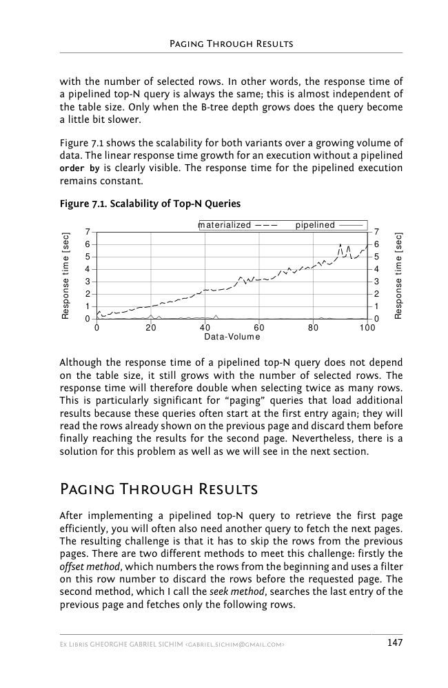
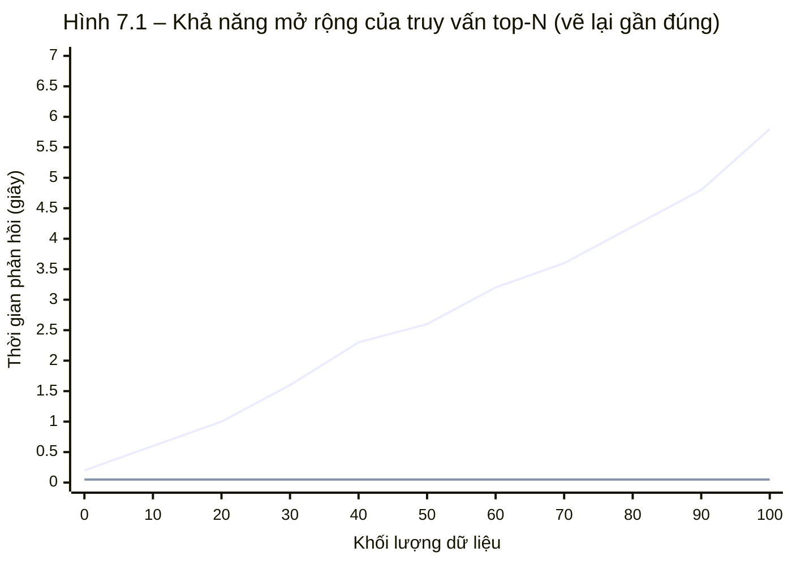
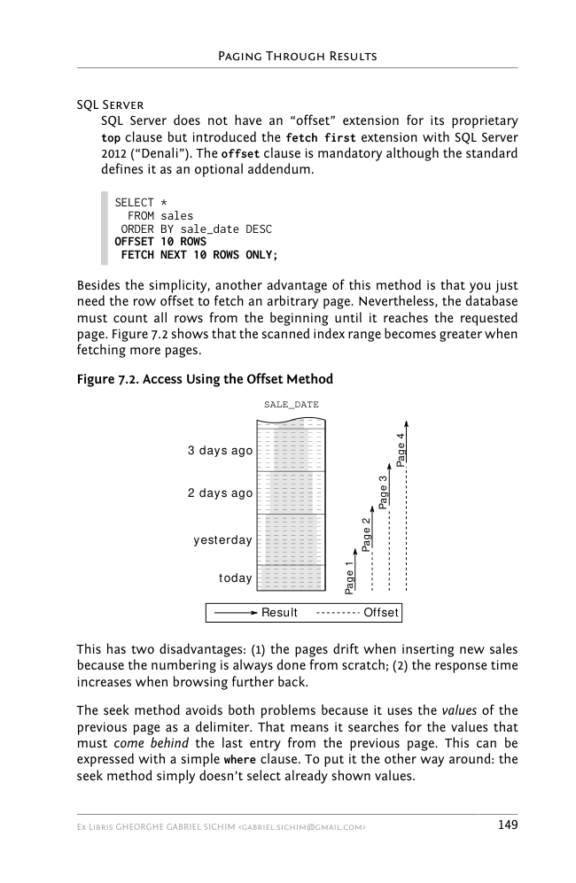
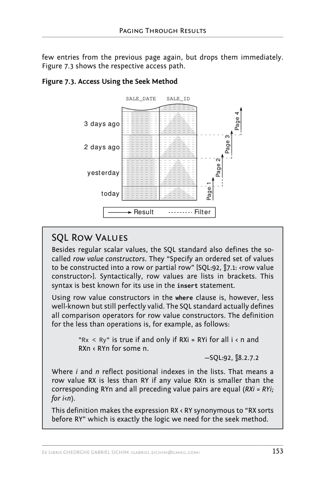
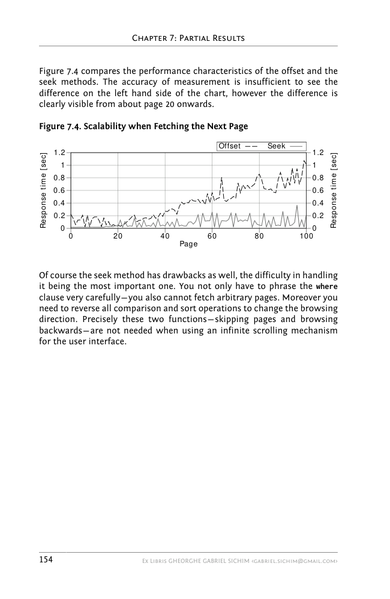
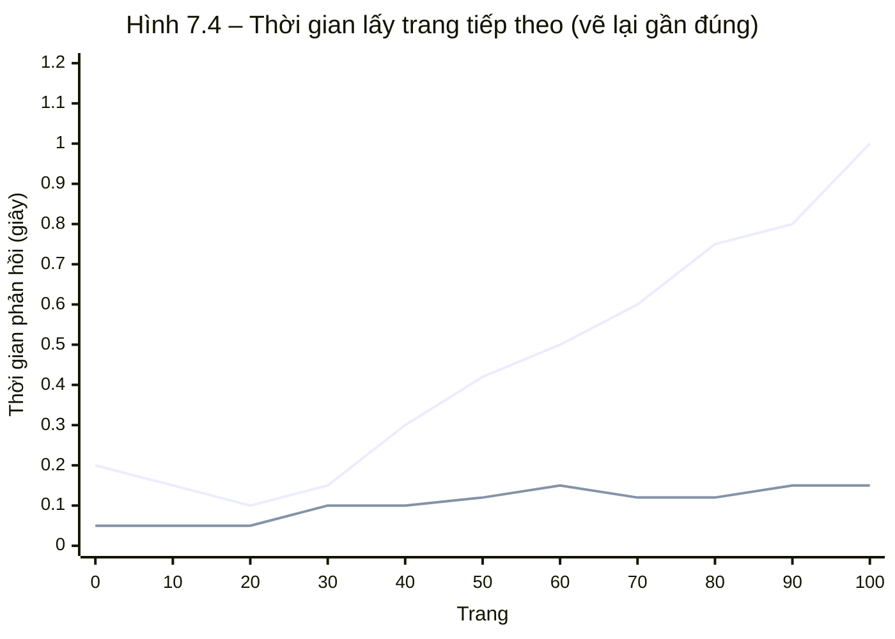

# Chương 7: Kết quả từng phần (Chapter 7 – Partial Results)

**Mục lục**

- [Chương 7: Kết quả từng phần (Chapter 7 – Partial Results)](#chương-7-kết-quả-từng-phần-chapter-7--partial-results)
  - [Truy vấn N dòng đầu tiên (Querying Top-N Rows)](#truy-vấn-n-dòng-đầu-tiên-querying-top-n-rows)
  - [Phân trang qua kết quả (Paging Through Results)](#phân-trang-qua-kết-quả-paging-through-results)
    - [Hộp: Giá trị dòng trong SQL (SQL Row Values)](#hộp-giá-trị-dòng-trong-sql-sql-row-values)
    - [Hộp: Đánh index cho các logic tương đương (Indexing Equivalent Logic)](#hộp-đánh-index-cho-các-logic-tương-đương-indexing-equivalent-logic)
  - [Dùng hàm cửa sổ để phân trang (Using Window Functions for Pagination)](#dùng-hàm-cửa-sổ-để-phân-trang-using-window-functions-for-pagination)
  - [Bảng thuật ngữ (Glossary)](#bảng-thuật-ngữ-glossary)

---

Đôi khi bạn không cần toàn bộ kết quả của một câu truy vấn SQL mà chỉ cần vài dòng đầu tiên — ví dụ, chỉ hiển thị mười tin nhắn mới nhất. Trong trường hợp này, việc cho phép người dùng duyệt xem các tin nhắn cũ hơn cũng rất phổ biến — hoặc bằng kiểu điều hướng phân trang truyền thống (*paging navigation*: các nút "Trang 1, 2, 3…", "Trang sau"), hoặc bằng biến thể hiện đại hơn là "cuộn vô hạn" (*infinite scrolling*: kéo xuống tới đâu tải thêm tới đó). Tuy nhiên, các câu truy vấn SQL dùng cho chức năng này có thể gây ra vấn đề hiệu năng nghiêm trọng nếu toàn bộ tin nhắn phải được sắp xếp thì mới tìm ra được những tin mới nhất. Vì vậy, một **`order by` dạng pipeline** (*pipelined order by*) là một công cụ tối ưu hóa cực kỳ mạnh cho những truy vấn kiểu này.

> 📝 **Giải thích thêm (không có trong sách):** "`order by` dạng pipeline" (đã được trình bày ở Chương 6 – Sorting and Grouping) nghĩa là cơ sở dữ liệu **không cần thực hiện thao tác sắp xếp tường minh** (*explicit sort*), vì nó đọc dữ liệu theo đúng thứ tự của một index vốn đã được sắp xếp sẵn theo các cột trong `order by`. Nhờ vậy, mỗi dòng đọc được từ index có thể được trả ngay cho ứng dụng, giống như nước chảy qua một đường ống (*pipeline*) — không phải đợi gom hết dữ liệu rồi mới sắp xếp.

Chương này minh họa cách dùng `order by` dạng pipeline để lấy kết quả từng phần (*partial results*) một cách hiệu quả. Mặc dù cú pháp của các truy vấn này khác nhau giữa các cơ sở dữ liệu, nhưng tất cả đều thực thi chúng theo cách rất giống nhau. Một lần nữa, điều này cho thấy "ai rồi cũng phải xỏ từng ống quần một" (*they all put their pants on one leg at a time*) — tức là dù bề ngoài khác nhau, bên trong các hệ quản trị cơ sở dữ liệu đều vận hành theo cùng một nguyên lý.

## Truy vấn N dòng đầu tiên (Querying Top-N Rows)

**Truy vấn top-N** (*top-N queries*) là những truy vấn giới hạn kết quả ở một số lượng dòng cụ thể. Đó thường là các truy vấn lấy những bản ghi mới nhất hoặc "tốt nhất" của một tập kết quả. Để thực thi hiệu quả, việc xếp hạng (*ranking*) phải được thực hiện bằng một `order by` dạng pipeline.

Cách đơn giản nhất để chỉ lấy những dòng đầu tiên của một truy vấn là lấy (*fetch*) đủ số dòng cần thiết rồi đóng câu lệnh (*statement*) lại. Đáng tiếc là optimizer (bộ tối ưu hóa truy vấn — thành phần của cơ sở dữ liệu chọn ra kế hoạch thực thi) không thể đoán trước được điều đó khi chuẩn bị execution plan (kế hoạch thực thi). Để chọn được execution plan tốt nhất, optimizer phải biết liệu cuối cùng ứng dụng có lấy hết tất cả các dòng hay không. Nếu có, thì một full table scan (quét toàn bộ bảng) kèm thao tác sắp xếp tường minh có thể cho hiệu năng tốt nhất; trong khi đó, một `order by` dạng pipeline có thể tốt hơn khi chỉ lấy mười dòng — kể cả khi cơ sở dữ liệu phải lấy từng dòng một cách riêng lẻ. Điều đó có nghĩa là optimizer phải biết bạn có định dừng câu lệnh giữa chừng trước khi lấy hết các dòng hay không, để nó có thể chọn execution plan tốt nhất.

> **Mẹo (Tip)**
>
> Hãy báo cho cơ sở dữ liệu biết mỗi khi bạn không cần tất cả các dòng.

Trong một thời gian dài, chuẩn SQL đã không đề cập đến yêu cầu này. Phần mở rộng tương ứng (`fetch first`) chỉ mới được đưa vào từ SQL:2008 và hiện tại (thời điểm sách được viết) chỉ có trong IBM DB2, PostgreSQL và SQL Server 2012. Một mặt, đó là vì tính năng này là một phần mở rộng không thuộc phần lõi (*non-core extension*) của chuẩn; mặt khác, là vì mỗi cơ sở dữ liệu đã cung cấp giải pháp độc quyền (*proprietary*) của riêng mình từ nhiều năm nay.

Các ví dụ dưới đây cho thấy cách dùng những phần mở rộng quen thuộc này để truy vấn mười giao dịch bán hàng (*sales*) gần đây nhất. Nền tảng luôn giống nhau: lấy tất cả các giao dịch bán hàng, bắt đầu từ giao dịch mới nhất. Cú pháp top-N tương ứng chỉ đơn giản là dừng việc thực thi sau khi đã lấy được mười dòng.

**MySQL**

MySQL và PostgreSQL dùng mệnh đề `limit` để giới hạn số dòng được lấy.

```sql
SELECT *
  FROM sales
 ORDER BY sale_date DESC
 LIMIT 10;
```

**Oracle Database**

Cơ sở dữ liệu Oracle cung cấp cột giả (*pseudo column*) `ROWNUM`, tự động đánh số các dòng trong tập kết quả. Để dùng cột này trong một điều kiện lọc, ta phải bọc truy vấn lại (đặt truy vấn có `ORDER BY` vào trong một truy vấn con):

```sql
SELECT *
  FROM (
       SELECT *
         FROM sales
        ORDER BY sale_date DESC
       )
 WHERE rownum <= 10;
```

> 📝 **Giải thích thêm (không có trong sách):** Phải bọc truy vấn là vì `ROWNUM` được gán **trước** khi `ORDER BY` ở cùng cấp được áp dụng. Nếu viết `SELECT * FROM sales WHERE rownum <= 10 ORDER BY sale_date DESC`, Oracle sẽ lấy 10 dòng *bất kỳ* rồi mới sắp xếp 10 dòng đó — sai ý đồ. Từ Oracle 12c trở đi, Oracle cũng hỗ trợ cú pháp chuẩn `FETCH FIRST 10 ROWS ONLY`, nên không bắt buộc phải bọc truy vấn nữa (bên trong Oracle vẫn tự chuyển nó thành dạng hàm cửa sổ `ROW_NUMBER`).

**PostgreSQL**

PostgreSQL hỗ trợ phần mở rộng `fetch first` kể từ phiên bản 8.4. Mệnh đề `limit` được dùng trước đó vẫn hoạt động như trong ví dụ MySQL.

```sql
SELECT *
  FROM sales
 ORDER BY sale_date DESC
 FETCH FIRST 10 ROWS ONLY;
```

**SQL Server**

SQL Server cung cấp mệnh đề `top` để giới hạn số dòng được lấy.

```sql
SELECT TOP 10 *
  FROM sales
 ORDER BY sale_date DESC;
```

Bắt đầu từ bản 2012, SQL Server cũng hỗ trợ phần mở rộng `fetch first`.

> 📝 **Giải thích thêm (không có trong sách):** Sách không có ghi chú riêng cho DB2 ở đây, nhưng như đã nói ở trên, DB2 hỗ trợ cú pháp chuẩn `FETCH FIRST 10 ROWS ONLY`. Tương tự, từ MySQL 8.0 vẫn chỉ dùng `LIMIT` (MySQL không hỗ trợ `FETCH FIRST`), còn MariaDB 10.6+ thì có hỗ trợ `OFFSET ... FETCH`.

> 📝 **Giải thích thêm (không có trong sách) — Đối chiếu với PostgreSQL hiện đại (PG 10–17): Cú pháp `FETCH FIRST N ROWS WITH TIES` (PostgreSQL 13+):**
>
> - **Thời điểm sách viết (PostgreSQL 9.1/9.2):** PostgreSQL đã hỗ trợ `FETCH FIRST N ROWS ONLY` (từ bản 8.4), vốn hoàn toàn tương đương với `LIMIT N` — tức là cắt cứng đúng $N$ dòng đầu tiên, bất kể dòng thứ $N+1$ có giá trị `ORDER BY` bằng hệt dòng thứ $N$ hay không.
> - **PostgreSQL hiện đại (từ PostgreSQL 13+):** PostgreSQL bổ sung hỗ trợ mệnh đề chuẩn SQL:2008 **`FETCH FIRST N ROWS WITH TIES`**. Khi dùng `WITH TIES` (bắt buộc phải đi kèm `ORDER BY`), nếu ở vị trí cắt thứ $N$ có nhiều dòng "đồng hạng" (*peer rows* — có cùng giá trị trên tất cả các cột trong `ORDER BY`), PostgreSQL sẽ tự động trả thêm tất cả các dòng đồng hạng đó thay vì cắt đứt ngang một cách tùy tiện.
> - **Cơ chế thực thi bên trong:** Vẫn tận dụng được **`order by` dạng pipeline** (`Limit -> Index Scan`) nếu có B-Tree index phù hợp! Nút `Limit` trong PostgreSQL 13+ chỉ đọc thêm vài mục tiếp theo trên lá B-Tree cho đến khi gặp giá trị khác với dòng thứ $N$ rồi dừng ngay lập tức.

> 💡 **Ví dụ bổ sung (không có trong sách) — Thực hành trên PostgreSQL: So sánh `ONLY` và `WITH TIES` (PG 13+):**
>
> ```sql
> -- Lấy top 3 giao dịch có giá trị cao nhất, nhưng nếu có nhiều giao dịch đồng hạng 3 thì lấy hết:
> SELECT sale_id, sale_date, eur_value
>   FROM sales
>  ORDER BY eur_value DESC
>  FETCH FIRST 3 ROWS WITH TIES;
> ```
>
> Với index `CREATE INDEX idx_sales_val ON sales (eur_value DESC);`, kế hoạch thực thi `EXPLAIN (ANALYZE, BUFFERS)` trên PostgreSQL 13–17 vẫn đạt chuẩn pipeline tối ưu:
>
> ```text
> Limit  (cost=0.42..1.58 rows=3 width=20) (actual time=0.018..0.025 rows=5 loops=1)
>   Buffers: shared hit=4
>   ->  Index Scan using idx_sales_val on sales  (cost=0.42..38520.42 rows=1000000 width=20) (actual time=0.017..0.023 rows=6 loops=1)
>         Buffers: shared hit=4
> ```
> *(Lưu ý: `Index Scan` đọc 6 dòng — 5 dòng trả về do đồng hạng 3, và đọc thêm dòng thứ 6 để phát hiện giá trị `eur_value` đã giảm xuống rồi dừng hẳn!)*

Tất cả các truy vấn SQL ở trên đều đặc biệt ở chỗ: các cơ sở dữ liệu nhận ra chúng là truy vấn top-N.

> **Quan trọng (Important)**
>
> Cơ sở dữ liệu chỉ có thể tối ưu hóa một truy vấn cho kết quả từng phần nếu nó biết điều đó ngay từ đầu.

Nếu optimizer biết rằng ta chỉ cần mười dòng, nó sẽ ưu tiên dùng `order by` dạng pipeline nếu có thể:

```text
-------------------------------------------------------------
| Operation                     | Name        | Rows | Cost |
-------------------------------------------------------------
| SELECT STATEMENT              |             |   10 |    9 |
|  COUNT STOPKEY                |             |      |      |
|   VIEW                        |             |   10 |    9 |
|    TABLE ACCESS BY INDEX ROWID| SALES       | 1004K|    9 |
|     INDEX FULL SCAN DESCENDING| SALES_DT_PR |   10 |    3 |
-------------------------------------------------------------
```

Execution plan của Oracle thể hiện việc dừng có kế hoạch này bằng thao tác `COUNT STOPKEY`. Điều đó có nghĩa là cơ sở dữ liệu đã nhận ra cú pháp top-N.

> **Mẹo (Tip)**
>
> Phụ lục A, "Execution Plans" (Kế hoạch thực thi), tổng hợp các thao tác tương ứng cho MySQL, Oracle, PostgreSQL và SQL Server.

Dùng đúng cú pháp mới chỉ là một nửa câu chuyện, vì muốn dừng việc thực thi một cách hiệu quả thì các thao tác bên dưới phải được thực thi theo kiểu pipeline. Điều đó có nghĩa là mệnh đề `order by` phải được một index "che phủ" (*covered*) — trong ví dụ này là index `SALE_DT_PR` trên hai cột `SALE_DATE` và `PRODUCT_ID`. Nhờ dùng index này, cơ sở dữ liệu có thể tránh được thao tác sắp xếp tường minh, và do đó có thể gửi ngay các dòng cho ứng dụng theo đúng thứ tự đọc được từ index. Việc thực thi bị dừng lại sau khi đã lấy mười dòng, nên cơ sở dữ liệu không đọc nhiều dòng hơn số dòng được chọn.

> **Quan trọng (Important)**
>
> Một truy vấn top-N dạng pipeline không cần đọc và sắp xếp toàn bộ tập kết quả.

Nếu không có index phù hợp trên `SALE_DATE` để thực hiện `order by` dạng pipeline, cơ sở dữ liệu buộc phải đọc và sắp xếp toàn bộ bảng. Dòng đầu tiên chỉ được trả về sau khi đã đọc xong dòng cuối cùng của bảng.

```text
--------------------------------------------------
| Operation               | Name  | Rows |  Cost |
--------------------------------------------------
| SELECT STATEMENT        |       |   10 | 59558 |
|  COUNT STOPKEY          |       |      |       |
|   VIEW                  |       | 1004K| 59558 |
|    SORT ORDER BY STOPKEY|       | 1004K| 59558 |
|     TABLE ACCESS FULL   | SALES | 1004K|  9246 |
--------------------------------------------------
```

Execution plan này không có `order by` dạng pipeline và chậm gần bằng việc dừng thực thi từ phía client (tức là để cơ sở dữ liệu chạy truy vấn đầy đủ, còn ứng dụng đọc 10 dòng rồi tự đóng câu lệnh). Dù vậy, dùng cú pháp top-N vẫn tốt hơn, vì cơ sở dữ liệu không cần vật chất hóa (*materialize* — tức là tạo ra và lưu giữ trong bộ nhớ/đĩa) toàn bộ kết quả mà chỉ cần giữ mười dòng mới nhất. Việc này tốn ít bộ nhớ hơn đáng kể. Execution plan của Oracle thể hiện tối ưu hóa này bằng bổ ngữ (*modifier*) `STOPKEY` trên thao tác `SORT ORDER BY`.

> 📝 **Giải thích thêm (không có trong sách):** `SORT ORDER BY STOPKEY` thường được hiện thực bằng kỹ thuật "top-N sort": thay vì sắp xếp cả 1 triệu dòng, cơ sở dữ liệu chỉ giữ một vùng đệm nhỏ chứa 10 dòng "tốt nhất" đến thời điểm hiện tại; mỗi dòng mới đọc vào được so sánh với dòng "kém nhất" trong vùng đệm và chỉ được giữ lại nếu tốt hơn. Vẫn phải đọc hết bảng (nên vẫn chậm), nhưng không cần bộ nhớ lớn hay ghi tạm ra đĩa. PostgreSQL hiển thị điều tương tự trong `EXPLAIN ANALYZE` là `Sort Method: top-N heapsort`.

Lợi ích của truy vấn top-N dạng pipeline không chỉ là cải thiện hiệu năng tức thì mà còn là khả năng mở rộng (*scalability*) tốt hơn. Nếu không thực thi theo kiểu pipeline, thời gian phản hồi (*response time*) của truy vấn top-N này tăng theo kích thước bảng. Còn khi thực thi theo kiểu pipeline, thời gian phản hồi chỉ tăng theo số dòng được chọn. Nói cách khác, thời gian phản hồi của một truy vấn top-N dạng pipeline luôn như nhau; nó gần như không phụ thuộc vào kích thước bảng. Chỉ khi độ sâu (*depth*) của cây B-tree tăng lên thì truy vấn mới chậm đi một chút.

Hình 7.1 cho thấy khả năng mở rộng của cả hai biến thể khi khối lượng dữ liệu tăng dần. Có thể thấy rõ thời gian phản hồi tăng tuyến tính đối với cách thực thi không có `order by` dạng pipeline. Còn thời gian phản hồi của cách thực thi pipeline thì giữ nguyên không đổi.

**Hình 7.1 – Khả năng mở rộng của truy vấn top-N (Figure 7.1 – Scalability of Top-N Queries)**



Mô tả hình: Biểu đồ đường với trục hoành là **khối lượng dữ liệu** (*Data-Volume*), từ 0 đến 100; trục tung (hai bên) là **thời gian phản hồi [giây]** (*Response time [sec]*), từ 0 đến 7. Chú giải: đường nét đứt là **materialized** (vật chất hóa — tức thực thi không pipeline, phải đọc và sắp xếp toàn bộ), đường liền là **pipelined** (dạng pipeline).
- Đường *materialized* bắt đầu gần 0 và tăng gần như tuyến tính, đạt khoảng 2,3 giây ở mức dữ liệu 40, khoảng 4 giây ở mức 75 và khoảng 5–6 giây ở mức 100 (có vài đỉnh nhiễu).
- Đường *pipelined* nằm sát trục 0 suốt toàn bộ biểu đồ — thời gian phản hồi gần như không đổi bất kể khối lượng dữ liệu.



Mặc dù thời gian phản hồi của một truy vấn top-N dạng pipeline không phụ thuộc vào kích thước bảng, nó vẫn tăng theo số dòng được chọn. Do đó, thời gian phản hồi sẽ tăng gấp đôi khi chọn số dòng gấp đôi. Điều này đặc biệt quan trọng với các truy vấn "phân trang" (*paging*) dùng để tải thêm kết quả, vì những truy vấn này thường lại bắt đầu từ bản ghi đầu tiên; chúng sẽ đọc lại những dòng đã hiển thị ở trang trước rồi bỏ đi, trước khi cuối cùng mới tới được các kết quả của trang thứ hai. Tuy nhiên, vấn đề này cũng có lời giải, như ta sẽ thấy ở mục tiếp theo.

> 💡 **Ví dụ bổ sung (không có trong sách):** Bài toán "10 bài viết mới nhất" trên PostgreSQL.
>
> ```sql
> CREATE TABLE posts (
>   post_id    bigint PRIMARY KEY,
>   created_at timestamp NOT NULL,
>   title      text
> );
> -- giả sử bảng có 5 triệu dòng
>
> SELECT post_id, created_at, title
>   FROM posts
>  ORDER BY created_at DESC
>  LIMIT 10;
> ```
>
> - **Không có index trên `created_at`:** plan sẽ là `Limit -> Sort (Sort Method: top-N heapsort) -> Seq Scan on posts`. Phải đọc hết 5 triệu dòng; thời gian tăng tuyến tính khi bảng lớn lên (đường *materialized* trong Hình 7.1).
> - **Sau khi tạo** `CREATE INDEX posts_created ON posts (created_at);` plan trở thành `Limit -> Index Scan Backward using posts_created on posts`. PostgreSQL đọc index từ cuối về đầu (giá trị lớn nhất trước), lấy đủ 10 dòng thì dừng. Dù bảng có 5 triệu hay 500 triệu dòng, chỉ khoảng 10 mục index + 10 lần truy cập bảng được thực hiện (đường *pipelined*).
> - Lưu ý: index tăng dần vẫn dùng được cho `ORDER BY ... DESC` vì B-tree có thể đọc theo cả hai chiều. MySQL 8.0+ và PostgreSQL còn cho phép khai báo index giảm dần (`created_at DESC`), hữu ích khi `ORDER BY` trộn chiều tăng/giảm giữa các cột.

## Phân trang qua kết quả (Paging Through Results)

Sau khi đã hiện thực một truy vấn top-N dạng pipeline để lấy trang đầu tiên một cách hiệu quả, bạn thường cũng sẽ cần thêm một truy vấn nữa để lấy các trang tiếp theo. Thách thức đặt ra là truy vấn đó phải bỏ qua các dòng thuộc những trang trước. Có hai phương pháp khác nhau để giải quyết thách thức này: thứ nhất là **phương pháp offset** (*offset method*), đánh số các dòng từ đầu và dùng một điều kiện lọc trên số thứ tự dòng này để loại bỏ những dòng nằm trước trang được yêu cầu. Phương pháp thứ hai, mà tôi (tác giả) gọi là **phương pháp seek** (*seek method* — "phương pháp tìm tới"), tìm bản ghi cuối cùng của trang trước rồi chỉ lấy những dòng đứng sau nó.

Các ví dụ dưới đây trình bày phương pháp offset, vốn được dùng rộng rãi hơn. Ưu điểm chính của nó là rất dễ sử dụng — đặc biệt với những cơ sở dữ liệu có từ khóa riêng cho nó (`offset`). Từ khóa này thậm chí đã được đưa vào chuẩn SQL như một phần của phần mở rộng `fetch first`.

**MySQL**

MySQL và PostgreSQL cung cấp mệnh đề `offset` để loại bỏ một số dòng được chỉ định tính từ đầu của một truy vấn top-N. Mệnh đề `limit` được áp dụng sau đó.

```sql
SELECT *
  FROM sales
 ORDER BY sale_date DESC
 LIMIT 10 OFFSET 10;
```

**Oracle Database**

Cơ sở dữ liệu Oracle cung cấp cột giả `ROWNUM`, tự động đánh số các dòng trong tập kết quả. Tuy nhiên, không thể áp dụng điều kiện lọc lớn hơn hoặc bằng (`>=`) trên cột giả này. Để làm được, trước hết bạn cần "vật chất hóa" các số thứ tự dòng bằng cách đổi tên cột thành một bí danh (*alias*).

```sql
SELECT *
  FROM ( SELECT tmp.*, rownum rn
           FROM ( SELECT *
                    FROM sales
                   ORDER BY sale_date DESC
                ) tmp
          WHERE rownum <= 20
       )
 WHERE rn > 10;
```

Hãy chú ý việc dùng bí danh `RN` cho cận dưới, và dùng chính cột giả `ROWNUM` cho cận trên.

> 📝 **Giải thích thêm (không có trong sách):** Vì sao `WHERE rownum > 10` không chạy? `ROWNUM` được gán cho một dòng chỉ khi dòng đó *vượt qua* điều kiện lọc. Dòng đầu tiên được thử với `ROWNUM = 1`; vì `1 > 10` là sai nên dòng bị loại, và dòng kế tiếp lại được thử với `ROWNUM = 1`… Kết quả là không dòng nào được trả về. Bằng cách đặt `rownum rn` vào truy vấn con, giá trị được "đóng băng" thành một cột bình thường, và lớp ngoài có thể lọc `rn > 10` thoải mái. Từ Oracle 12c có thể viết gọn: `... ORDER BY sale_date DESC OFFSET 10 ROWS FETCH NEXT 10 ROWS ONLY`.

**PostgreSQL**

Phần mở rộng `fetch first` cũng định nghĩa mệnh đề `offset ... rows`. Tuy nhiên, PostgreSQL chỉ chấp nhận `offset` mà không có từ khóa `rows` (theo thời điểm sách viết). Cú pháp `limit`/`offset` dùng trước đó vẫn hoạt động như trong ví dụ MySQL.

```sql
SELECT *
  FROM sales
 ORDER BY sale_date DESC
OFFSET 10
 FETCH NEXT 10 ROWS ONLY;
```

> 📝 **Giải thích thêm (không có trong sách):** Các phiên bản PostgreSQL hiện đại chấp nhận cả `OFFSET 10 ROWS` lẫn `OFFSET 10` (từ khóa `ROW`/`ROWS` là tùy chọn).

**SQL Server**

SQL Server không có phần mở rộng "offset" cho mệnh đề độc quyền `top` của mình, nhưng đã đưa vào phần mở rộng `fetch first` từ SQL Server 2012 ("Denali"). Mệnh đề `offset` là bắt buộc, mặc dù chuẩn SQL định nghĩa nó là một phần bổ sung tùy chọn.

```sql
SELECT *
  FROM sales
 ORDER BY sale_date DESC
OFFSET 10 ROWS
 FETCH NEXT 10 ROWS ONLY;
```

Bên cạnh sự đơn giản, một ưu điểm khác của phương pháp này là bạn chỉ cần độ lệch dòng (*row offset*) là có thể lấy một trang bất kỳ. Tuy nhiên, cơ sở dữ liệu phải đếm tất cả các dòng từ đầu cho tới khi đến được trang được yêu cầu. Hình 7.2 cho thấy phạm vi index được quét ngày càng lớn khi lấy các trang càng về sau.

**Hình 7.2 – Truy cập bằng phương pháp offset (Figure 7.2 – Access Using the Offset Method)**



Mô tả hình: Bên trái là một cột index `SALE_DATE`, được chia thành bốn nhóm ngày từ dưới lên: **today** (hôm nay), **yesterday** (hôm qua), **2 days ago** (2 ngày trước), **3 days ago** (3 ngày trước). Mỗi nhóm ngày chứa nhiều mục index (nhiều giao dịch trong cùng một ngày). Bên phải là bốn mũi tên thẳng đứng, đều bắt đầu từ đáy (từ bản ghi mới nhất – "today"):
- **Page 1** (Trang 1): một mũi tên liền ngắn — chỉ đọc phần đầu tiên.
- **Page 2** (Trang 2): một đoạn nét đứt (phần *Offset* – các dòng phải đọc rồi bỏ đi, tương ứng trang 1) rồi tiếp đến đoạn liền (phần *Result* – kết quả thật).
- **Page 3**, **Page 4**: đoạn nét đứt càng lúc càng dài, đoạn liền ở trên cùng vẫn dài như nhau.

Chú giải: mũi tên liền = **Result** (kết quả), nét đứt = **Offset** (phần bị bỏ qua nhưng vẫn phải đọc). Ý chính: để lấy trang thứ N, cơ sở dữ liệu vẫn phải đọc toàn bộ N−1 trang trước đó.

```text
 SALE_DATE                  Page1  Page2  Page3  Page4
 ┌────────────┐                                    ▲
 │ 3 days ago │                                    │   ← Result trang 4
 │            │                             ▲      ┆
 ├────────────┤                             │      ┆
 │ 2 days ago │                      ▲      ┆      ┆
 │            │                      │      ┆      ┆
 ├────────────┤               ▲      ┆      ┆      ┆
 │ yesterday  │               │      ┆      ┆      ┆
 ├────────────┤               ┆      ┆      ┆      ┆
 │ today      │        ▲      ┆      ┆      ┆      ┆
 │            │        │      ┆      ┆      ┆      ┆
 └────────────┘      (bắt đầu từ bản ghi mới nhất)
   ───▶ Result (kết quả)     ┆┆┆ Offset (đọc rồi bỏ đi)
```

Điều này dẫn tới hai nhược điểm: (1) các trang bị "trôi" (*drift*) khi có giao dịch mới được chèn vào, vì việc đánh số luôn được làm lại từ đầu; (2) thời gian phản hồi tăng lên khi duyệt càng về các trang cũ.

> 💡 **Ví dụ bổ sung (không có trong sách):** Hiện tượng "trang bị trôi" với phương pháp offset.
>
> Giả sử bảng `sales` hiện có các giao dịch với `sale_id` từ 1 đến 25, mới nhất là 25. Người dùng xem trang 1 (`LIMIT 10 OFFSET 0`) và thấy các id **25 → 16**. Trong lúc họ đang đọc, có 3 giao dịch mới (id 26, 27, 28) được chèn vào. Bây giờ họ bấm "Trang 2" (`LIMIT 10 OFFSET 10`):
>
> | Thứ tự (mới → cũ) | 1–3 | 4–10 | 11–20 | 21–28 |
> |---|---|---|---|---|
> | sale_id | 28, 27, 26 | 25 … 19 | **18 … 9** | 8 … 1 |
>
> Trang 2 trả về id **18 → 9** — nghĩa là các id 18, 17, 16 bị hiển thị **lặp lại** (người dùng đã thấy ở trang 1). Ngược lại, nếu có dòng bị xóa thì một số dòng sẽ bị **bỏ sót**. Phương pháp seek dưới đây không gặp vấn đề này vì nó hỏi "các dòng đứng *sau* id 16", chứ không hỏi "các dòng từ vị trí thứ 11".

Phương pháp seek tránh được cả hai vấn đề vì nó dùng các *giá trị* (*values*) của trang trước làm mốc phân cách (*delimiter*). Điều đó có nghĩa là nó tìm các giá trị phải *đứng sau* (*come behind*) bản ghi cuối cùng của trang trước. Điều này có thể được diễn đạt bằng một mệnh đề `where` đơn giản. Nói theo chiều ngược lại: phương pháp seek đơn giản là không chọn những giá trị đã được hiển thị.

Ví dụ tiếp theo minh họa phương pháp seek. Để tiện minh họa, ta sẽ bắt đầu với giả định rằng mỗi ngày chỉ có một giao dịch bán hàng. Điều này khiến `SALE_DATE` trở thành một khóa duy nhất (*unique key*). Để chọn các giao dịch phải đứng sau một ngày cụ thể, bạn phải dùng điều kiện nhỏ hơn (`<`) vì thứ tự sắp xếp là giảm dần. Với thứ tự tăng dần, bạn sẽ phải dùng điều kiện lớn hơn (`>`). Mệnh đề `fetch first` chỉ được dùng để giới hạn kết quả ở mười dòng.

```sql
SELECT *
  FROM sales
 WHERE sale_date < ?
 ORDER BY sale_date DESC
 FETCH FIRST 10 ROWS ONLY;
```

Thay vì dùng số thứ tự dòng, bạn dùng giá trị cuối cùng của trang trước để chỉ định cận dưới. Điều này mang lại lợi ích rất lớn về hiệu năng, vì cơ sở dữ liệu có thể dùng điều kiện `SALE_DATE < ?` để truy cập index. Điều đó có nghĩa là cơ sở dữ liệu thực sự có thể bỏ qua các dòng của những trang trước (không cần đọc chúng). Hơn nữa, bạn cũng sẽ nhận được kết quả ổn định khi có dòng mới được chèn vào.

Tuy nhiên, phương pháp này không hoạt động nếu mỗi ngày có nhiều hơn một giao dịch — như trong Hình 7.2 — vì việc dùng ngày cuối cùng của trang đầu tiên ("hôm qua") sẽ bỏ qua *tất cả* các kết quả của hôm qua — chứ không chỉ những kết quả đã hiển thị ở trang đầu tiên. Vấn đề là mệnh đề `order by` không thiết lập một thứ tự dòng tất định (*deterministic row sequence* — thứ tự xác định duy nhất, lần nào chạy cũng như nhau). Mà đó lại là điều kiện tiên quyết để dùng một điều kiện khoảng (*range condition*) đơn giản cho việc ngắt trang.

Nếu không có mệnh đề `order by` tất định, thì theo định nghĩa, cơ sở dữ liệu không trả về một thứ tự dòng tất định. Lý do duy nhất khiến bạn thường nhận được thứ tự dòng nhất quán là vì cơ sở dữ liệu thường thực thi truy vấn theo cùng một cách. Tuy nhiên, thực tế cơ sở dữ liệu hoàn toàn có thể xáo trộn các dòng có cùng `SALE_DATE` mà vẫn thỏa mãn mệnh đề `order by`. Trong các phiên bản gần đây, có thể thực sự xảy ra chuyện mỗi lần chạy truy vấn bạn lại nhận được kết quả theo một thứ tự khác — không phải vì cơ sở dữ liệu cố ý xáo trộn kết quả, mà vì cơ sở dữ liệu có thể dùng thực thi truy vấn song song (*parallel query execution*). Điều đó có nghĩa là cùng một execution plan có thể cho ra thứ tự dòng khác nhau, vì các luồng (*thread*) thực thi kết thúc theo một thứ tự không tất định.

> **Quan trọng (Important)**
>
> Phân trang đòi hỏi một thứ tự sắp xếp tất định.

Ngay cả khi đặc tả chức năng (*functional specifications*) chỉ yêu cầu sắp xếp "theo ngày, mới nhất trước", thì chúng ta — những lập trình viên — vẫn phải đảm bảo mệnh đề `order by` tạo ra một thứ tự dòng tất định. Để làm vậy, có thể ta cần mở rộng mệnh đề `order by` bằng những cột tùy ý chỉ nhằm đảm bảo có được thứ tự dòng tất định. Nếu index được dùng cho `order by` dạng pipeline có thêm các cột khác, thì một khởi đầu tốt là thêm chúng vào mệnh đề `order by`, để ta có thể tiếp tục dùng index này cho `order by` dạng pipeline. Nếu như vậy vẫn chưa tạo ra thứ tự sắp xếp tất định, thì cứ thêm một (hoặc vài) cột duy nhất (*unique*) bất kỳ và mở rộng index tương ứng.

Trong ví dụ sau, ta mở rộng mệnh đề `order by` và index bằng khóa chính (*primary key*) `SALE_ID` để có thứ tự dòng tất định. Hơn nữa, ta phải áp dụng logic "đứng sau" cho cả hai cột cùng lúc để có được kết quả mong muốn:

```sql
CREATE INDEX sl_dtid ON sales (sale_date, sale_id);
```

```sql
SELECT *
  FROM sales
 WHERE (sale_date, sale_id) < (?, ?)
 ORDER BY sale_date DESC, sale_id DESC
 FETCH FIRST 10 ROWS ONLY;
```

Mệnh đề `where` dùng cú pháp "giá trị dòng" (*row values*) ít được biết đến (xem hộp "SQL Row Values" – Giá trị dòng trong SQL). Cú pháp này gộp nhiều giá trị thành một đơn vị logic có thể dùng được với các toán tử so sánh thông thường. Giống như với giá trị vô hướng (*scalar values*), điều kiện nhỏ hơn tương ứng với "đứng sau" khi sắp xếp theo thứ tự giảm dần. Điều đó có nghĩa là truy vấn chỉ xét những giao dịch đứng sau cặp `SALE_DATE`, `SALE_ID` đã cho.

Mặc dù cú pháp giá trị dòng là một phần của chuẩn SQL, chỉ có ít cơ sở dữ liệu hỗ trợ nó. SQL Server 2012 ("Denali") hoàn toàn không hỗ trợ giá trị dòng. Cơ sở dữ liệu Oracle về nguyên tắc có hỗ trợ giá trị dòng, nhưng không thể áp dụng toán tử khoảng (*range operators*, như `<`, `>`) lên chúng (lỗi ORA-01796). MySQL đánh giá biểu thức giá trị dòng một cách chính xác nhưng không thể dùng chúng làm access predicate (vị từ truy cập — điều kiện dùng để xác định điểm bắt đầu/kết thúc khi duyệt index) trong quá trình truy cập index. PostgreSQL thì ngược lại, hỗ trợ cú pháp giá trị dòng và dùng chúng để truy cập index nếu có index tương ứng.

> 📝 **Giải thích thêm (không có trong sách):** Tình hình ở các phiên bản mới hơn (tham khảo, nên kiểm chứng trên phiên bản bạn dùng): SQL Server (kể cả 2019/2022) vẫn chưa hỗ trợ so sánh giá trị dòng; Oracle (kể cả 19c/21c/23ai) vẫn báo ORA-01796 cho `(a, b) < (x, y)`; DB2 for LUW có hỗ trợ cú pháp này; MySQL từ 8.0 (và 5.7 ở một số trường hợp) đã có thể dùng so sánh giá trị dòng làm điều kiện range scan trên index, nhưng nên kiểm tra bằng `EXPLAIN` để chắc chắn (cột `key`/`type = range`). PostgreSQL thì hỗ trợ tốt từ lâu (từ phiên bản 8.2).

> 📝 **Giải thích thêm (không có trong sách) — Đối chiếu với PostgreSQL hiện đại (PG 10–17): Keyset Pagination (Seek Method) với Row Constructor `(sale_date, sale_id) < ($1, $2)`:**
>
> - **Vì sao PostgreSQL là ngoại lệ xuất sắc:** Trong khi sách phải cảnh báo rằng phần lớn các hệ quản trị CSDL (Oracle, SQL Server, MySQL thời 2012) không dùng được Index hiệu quả khi viết `WHERE (sale_date, sale_id) < (?, ?)` và buộc phải viết lại thành biểu thức xấp xỉ phức tạp, thì **PostgreSQL hỗ trợ Row Constructor Comparison trực tiếp trong `Index Cond` của cây B-Tree** (`Index Cond: (ROW(sale_date, sale_id) < ROW('2026-10-24'::date, 1005))`).
> - **Cơ chế hoạt động trong B-Tree của PostgreSQL:** Thay vì tách thành `sale_date <= $1` (quét dư các dòng cùng ngày rồi lọc bỏ bằng Filter như cách xấp xỉ trên Oracle), động cơ B-Tree của PostgreSQL dùng cả hai giá trị `($1, $2)` để **nhảy thẳng (seek) tới đúng vị trí lá B-Tree** đứng ngay sau dòng `('2026-10-24', 1005)` với độ phức tạp $O(\log N)$ và **không phải đọc thừa hay lọc bỏ (`Rows Removed by Filter`) bất kỳ dòng nào**, kể cả khi một ngày có hàng triệu giao dịch!
> - **Điều kiện bắt buộc về chiều sắp xếp (Sort Direction):** Để PostgreSQL đưa được `(sale_date, sale_id) < ($1, $2)` vào `Index Cond`, **chiều so sánh của các cột trong Row Constructor phải đồng nhất với cấu trúc thứ tự của Index**:
>   - Nếu truy vấn sắp xếp **cùng chiều** (`ORDER BY sale_date DESC, sale_id DESC` hoặc cùng `ASC`), một index mặc định `CREATE INDEX sl_dtid ON sales (sale_date, sale_id)` (hoặc `(sale_date DESC, sale_id DESC)`) sẽ khớp hoàn hảo với `WHERE (sale_date, sale_id) < ($1, $2)` (khi `DESC`) hoặc `> ($1, $2)` (khi `ASC`).
>   - **Cạm bẫy thực tế:** Nếu bạn trộn chiều sắp xếp kiểu `ORDER BY sale_date DESC, sale_id ASC`, toán tử `<` của Row Constructor `(sale_date, sale_id) < ($1, $2)` sẽ hiểu là *cả hai cột đều nhỏ hơn* (`sale_date < $1` và khi bằng thì `sale_id < $2`), mâu thuẫn với `sale_id ASC`! Vì vậy, nguyên tắc vàng khi thiết kế Keyset Pagination trên PostgreSQL là **luôn đặt cột tie-breaker (`sale_id`) cùng chiều `ASC` hoặc cùng chiều `DESC` với cột chính (`sale_date`)**.

> 💡 **Ví dụ bổ sung (không có trong sách) — Thực hành trên PostgreSQL: Đối chiếu `EXPLAIN (ANALYZE, BUFFERS)` giữa `OFFSET` và Keyset Pagination (Row Constructor):**
>
> Giả sử bảng `sales` có 1.000.000 dòng và index `CREATE INDEX sl_dtid ON sales (sale_date DESC, sale_id DESC);`. Ta cần lấy 10 dòng ở trang thứ 5.000 (bỏ qua 50.000 dòng đầu):
>
> ```sql
> -- 1. Cách truyền thống dùng OFFSET 50000:
> EXPLAIN (ANALYZE, BUFFERS)
> SELECT sale_id, sale_date, eur_value
>   FROM sales
>  ORDER BY sale_date DESC, sale_id DESC
>  LIMIT 10 OFFSET 50000;
> ```
>
> ```text
> Limit  (cost=1685.20..1685.54 rows=10 width=20) (actual time=18.412..18.416 rows=10 loops=1)
>   Buffers: shared hit=42150
>   ->  Index Scan using sl_dtid on sales  (cost=0.42..33704.42 rows=1000000 width=20) (actual time=0.019..15.890 rows=50010 loops=1)
>         Buffers: shared hit=42150
> Execution Time: 18.445 ms
> ```
>
> ```sql
> -- 2. Keyset Pagination dùng Row Constructor trên PostgreSQL:
> EXPLAIN (ANALYZE, BUFFERS)
> SELECT sale_id, sale_date, eur_value
>   FROM sales
>  WHERE (sale_date, sale_id) < ('2026-10-24'::date, 1005)
>  ORDER BY sale_date DESC, sale_id DESC
>  FETCH FIRST 10 ROWS ONLY;
> ```
>
> ```text
> Limit  (cost=0.42..0.78 rows=10 width=20) (actual time=0.021..0.032 rows=10 loops=1)
>   Buffers: shared hit=14
>   ->  Index Scan using sl_dtid on sales  (cost=0.42..12045.80 rows=333333 width=20) (actual time=0.020..0.029 rows=10 loops=1)
>         Index Cond: (ROW(sale_date, sale_id) < ROW('2026-10-24'::date, 1005))
>         Buffers: shared hit=14
> Execution Time: 0.048 ms
> ```
>
> **Nhận xét:** Phương pháp `OFFSET 50000` phải đọc và chạm tới **42.150 trang bộ nhớ (`shared hit=42150`)** chỉ để vứt đi 50.000 dòng đầu, tốn **18,445 ms**. Trong khi đó, Row Constructor `(sale_date, sale_id) < ('2026-10-24', 1005)` được PostgreSQL đẩy thẳng xuống `Index Cond`, chỉ chạm đúng **14 buffer (`shared hit=14`)** (3 tầng B-Tree + 1 nút lá + 10 trang heap) và hoàn thành trong **0,048 ms** (nhanh hơn gần 400 lần)!

Dù vậy, vẫn có thể dùng một biến thể xấp xỉ (*approximated variant*) của phương pháp seek với những cơ sở dữ liệu không hỗ trợ đúng mức giá trị dòng — mặc dù cách xấp xỉ này không thanh lịch và hiệu quả bằng giá trị dòng trong PostgreSQL. Với cách xấp xỉ này, ta phải dùng các phép so sánh "thông thường" để diễn đạt logic cần thiết, như trong ví dụ Oracle sau:

```sql
SELECT *
  FROM ( SELECT *
           FROM sales
          WHERE sale_date <= ?
            AND NOT (sale_date = ? AND sale_id >= ?)
          ORDER BY sale_date DESC, sale_id DESC
       )
 WHERE rownum <= 10;
```

Mệnh đề `where` gồm hai phần. Phần thứ nhất chỉ xét `SALE_DATE` và dùng điều kiện nhỏ hơn hoặc bằng (`<=`) — nó chọn nhiều dòng hơn mức cần thiết. Phần này của mệnh đề `where` đủ đơn giản để mọi cơ sở dữ liệu đều có thể dùng nó để truy cập index. Phần thứ hai của mệnh đề `where` loại bỏ những dòng thừa đã được hiển thị ở trang trước. Hộp "Indexing Equivalent Logic" (Đánh index cho các logic tương đương) giải thích vì sao mệnh đề `where` được diễn đạt theo cách này.

Execution plan cho thấy cơ sở dữ liệu dùng phần thứ nhất của mệnh đề `where` làm access predicate.

```text
---------------------------------------------------------------
|Id | Operation                      | Name    |  Rows | Cost |
---------------------------------------------------------------
| 0 | SELECT STATEMENT               |         |    10 |    4 |
|*1 |  COUNT STOPKEY                 |         |       |      |
| 2 |   VIEW                         |         |    10 |    4 |
| 3 |    TABLE ACCESS BY INDEX ROWID | SALES   | 50218 |    4 |
|*4 |     INDEX RANGE SCAN DESCENDING| SL_DTIT |     2 |    3 |
---------------------------------------------------------------

Predicate Information (identified by operation id):
---------------------------------------------------
   1 - filter(ROWNUM<=10)
   4 - access("SALE_DATE"<=:SALE_DATE)
       filter("SALE_DATE"<>:SALE_DATE
           OR "SALE_ID"<TO_NUMBER(:SALE_ID))
```

> 📝 **Giải thích thêm (không có trong sách):** Tên index trong plan gốc của sách là `SL_DTIT`, trong khi câu lệnh `CREATE INDEX` ở trên đặt tên là `sl_dtid` — nhiều khả năng đây là lỗi đánh máy trong sách; plan được giữ nguyên văn. Cũng để ý rằng Oracle đã tự biến đổi `NOT (sale_date = ? AND sale_id >= ?)` thành dạng tương đương `sale_date <> ? OR sale_id < ?` (định luật De Morgan) ở phần filter.

Access predicate trên `SALE_DATE` cho phép cơ sở dữ liệu bỏ qua những ngày đã được hiển thị trọn vẹn ở các trang trước. Phần thứ hai của mệnh đề `where` chỉ là filter predicate (vị từ lọc — điều kiện chỉ được kiểm tra trên các mục đã đọc, không giúp thu hẹp phạm vi quét). Điều đó có nghĩa là cơ sở dữ liệu sẽ xem lại một vài bản ghi của trang trước, nhưng loại bỏ chúng ngay lập tức. Hình 7.3 cho thấy đường truy cập (*access path*) tương ứng.

**Hình 7.3 – Truy cập bằng phương pháp seek (Figure 7.3 – Access Using the Seek Method)**



Mô tả hình: Bên trái là index hai cột `SALE_DATE` và `SALE_ID`, chia thành bốn nhóm ngày từ dưới lên: **today** (hôm nay), **yesterday** (hôm qua), **2 days ago** (2 ngày trước), **3 days ago** (3 ngày trước). Trong mỗi nhóm ngày, cột `SALE_ID` được vẽ như một hình tam giác (các `SALE_ID` được sắp xếp bên trong mỗi ngày). Bên phải là bốn mũi tên:
- **Page 1** (Trang 1): mũi tên liền bắt đầu từ đáy (bản ghi mới nhất).
- **Page 2**, **Page 3**, **Page 4**: mỗi mũi tên bắt đầu ngay tại vị trí mà trang trước đã kết thúc (có đường nét đứt nằm ngang nối từ điểm kết thúc của trang trước sang). Mỗi mũi tên chỉ có một đoạn nét đứt rất ngắn ở đầu (**Filter** – vài mục của ngày hiện tại đã hiển thị ở trang trước, được đọc lại rồi lọc bỏ) và sau đó là đoạn liền (**Result** – kết quả).

Chú giải: mũi tên liền = **Result** (kết quả), nét đứt = **Filter** (bị lọc bỏ). Ý chính: khác với Hình 7.2, mỗi trang chỉ đọc khoảng một lượng dữ liệu bằng nhau, bất kể đó là trang thứ mấy — chi phí không tăng theo số trang.

```text
 SALE_DATE  SALE_ID         Page1  Page2  Page3  Page4
 ┌──────────┬────────┐                             ▲
 │3 days ago│  /\    │                             │  Result
 │          │ /  \   │ - - - - - - - - - - - - - - ┆  Filter (ngắn)
 ├──────────┼────────┤                      ▲
 │2 days ago│  /\    │                      │
 │          │ /  \   │ - - - - - - - - - - -┆
 ├──────────┼────────┤               ▲
 │yesterday │  /\    │               │
 │          │ /  \   │ - - - - - - - ┆
 ├──────────┼────────┤        ▲
 │today     │  /\    │        │
 └──────────┴────────┘        │ (bắt đầu từ bản ghi mới nhất)
   ───▶ Result (kết quả)    ┆ Filter (đọc lại vài mục rồi bỏ)
```

### Hộp: Giá trị dòng trong SQL (SQL Row Values)

Bên cạnh các giá trị vô hướng thông thường, chuẩn SQL còn định nghĩa cái gọi là **bộ tạo giá trị dòng** (*row value constructors*). Chúng "Chỉ định một tập giá trị có thứ tự để được tạo thành một dòng hoặc một phần của dòng" (*"Specify an ordered set of values to be constructed into a row or partial row"*) [SQL:92, §7.1: \<row value constructor\>]. Về mặt cú pháp, giá trị dòng là các danh sách đặt trong dấu ngoặc tròn. Cú pháp này được biết đến nhiều nhất qua việc dùng trong câu lệnh `insert`.

Tuy nhiên, dùng bộ tạo giá trị dòng trong mệnh đề `where` thì ít được biết đến hơn, nhưng vẫn hoàn toàn hợp lệ. Thực tế, chuẩn SQL định nghĩa tất cả các toán tử so sánh cho bộ tạo giá trị dòng. Chẳng hạn, định nghĩa cho phép toán nhỏ hơn như sau:

> "Rx < Ry" là đúng khi và chỉ khi RXi = RYi với mọi i < n và RXn < RYn với một n nào đó.
>
> (*"Rx < Ry" is true if and only if RXi = RYi for all i < n and RXn < RYn for some n.*)
>
> — SQL:92, §8.2.7.2

Trong đó *i* và *n* là các chỉ số vị trí trong danh sách. Điều đó có nghĩa là giá trị dòng RX nhỏ hơn RY nếu có một giá trị RXn nào đó nhỏ hơn giá trị tương ứng RYn và tất cả các cặp giá trị đứng trước đều bằng nhau (*RXi = RYi; với i<n*).

Định nghĩa này làm cho biểu thức RX < RY đồng nghĩa với "RX được sắp xếp đứng trước RY" — đó chính xác là logic ta cần cho phương pháp seek.

> 💡 **Ví dụ bổ sung (không có trong sách):** So sánh giá trị dòng giống như so sánh từ trong từ điển (thứ tự từ điển – *lexicographic order*).
>
> | Biểu thức | Kết quả | Lý do |
> |---|---|---|
> | `(1, 9) < (2, 0)` | TRUE | Phần tử đầu: 1 < 2, không cần xét tiếp |
> | `(2, 3) < (2, 5)` | TRUE | Phần tử đầu bằng nhau (2 = 2), phần tử thứ hai: 3 < 5 |
> | `(2, 5) < (2, 5)` | FALSE | Tất cả đều bằng nhau |
> | `(3, 0) < (2, 9)` | FALSE | Phần tử đầu: 3 > 2 |
>
> Do đó `(sale_date, sale_id) < ('2024-05-02', 1234)` tương đương về logic với `sale_date < '2024-05-02' OR (sale_date = '2024-05-02' AND sale_id < 1234)` — đúng với "mọi dòng đứng sau cặp (2024-05-02, 1234) khi sắp xếp giảm dần".

Hình 7.4 so sánh đặc tính hiệu năng của phương pháp offset và phương pháp seek. Độ chính xác của phép đo không đủ để thấy sự khác biệt ở phía bên trái của biểu đồ, tuy nhiên sự khác biệt thể hiện rõ ràng từ khoảng trang 20 trở đi.

**Hình 7.4 – Khả năng mở rộng khi lấy trang tiếp theo (Figure 7.4 – Scalability when Fetching the Next Page)**



Mô tả hình: Biểu đồ đường, trục hoành là **trang** (*Page*), từ 0 đến 100; trục tung (hai bên) là **thời gian phản hồi [giây]** (*Response time [sec]*), từ 0 đến 1,2. Chú giải: đường nét đứt là **Offset**, đường liền là **Seek**.
- Đường *Offset* dao động quanh 0,1–0,2 giây ở khoảng trang 0–20, sau đó tăng dần: khoảng 0,3 giây ở trang 40, 0,5 giây ở trang 60, 0,7–0,8 giây ở trang 80 và khoảng 1,0 giây ở trang 100.
- Đường *Seek* luôn ở mức thấp, dao động quanh 0–0,25 giây (đôi khi có đỉnh tới khoảng 0,35) trong suốt cả 100 trang — không có xu hướng tăng.



Tất nhiên phương pháp seek cũng có nhược điểm, trong đó quan trọng nhất là sự khó khăn khi sử dụng. Bạn không chỉ phải viết mệnh đề `where` rất cẩn thận — mà còn không thể lấy một trang bất kỳ (ví dụ nhảy thẳng tới trang 37). Hơn nữa, bạn cần đảo ngược tất cả các phép so sánh và thao tác sắp xếp để đổi chiều duyệt (từ "trang sau" sang "trang trước"). Chính hai chức năng này — nhảy trang và duyệt ngược — lại không cần thiết khi giao diện người dùng dùng cơ chế cuộn vô hạn (*infinite scrolling*).

> 💡 **Ví dụ bổ sung (không có trong sách):** Hiện thực "cuộn vô hạn" bằng phương pháp seek trên PostgreSQL, kèm duyệt ngược.
>
> ```sql
> CREATE INDEX sl_dtid ON sales (sale_date, sale_id);
>
> -- Trang đầu tiên
> SELECT sale_id, sale_date, eur_value
>   FROM sales
>  ORDER BY sale_date DESC, sale_id DESC
>  FETCH FIRST 10 ROWS ONLY;
> -- giả sử dòng cuối của trang là (sale_date = '2024-05-02', sale_id = 1234)
>
> -- "Tải thêm" (trang kế tiếp): ứng dụng gửi cặp giá trị cuối cùng đã hiển thị
> SELECT sale_id, sale_date, eur_value
>   FROM sales
>  WHERE (sale_date, sale_id) < ('2024-05-02', 1234)
>  ORDER BY sale_date DESC, sale_id DESC
>  FETCH FIRST 10 ROWS ONLY;
> ```
>
> PostgreSQL cho plan dạng `Limit -> Index Scan Backward using sl_dtid on sales  Index Cond: (ROW(sale_date, sale_id) < ROW('2024-05-02', 1234))` — tức điều kiện giá trị dòng được dùng làm điều kiện truy cập index, nhảy thẳng tới điểm bắt đầu của trang.
>
> Nếu muốn "trang trước" (duyệt ngược), phải đảo **cả** phép so sánh **lẫn** chiều sắp xếp, rồi đảo lại thứ tự ở lớp ngoài để hiển thị (giả sử dòng đầu tiên đang hiển thị là `('2024-05-04', 1500)`):
>
> ```sql
> SELECT *
>   FROM ( SELECT sale_id, sale_date, eur_value
>            FROM sales
>           WHERE (sale_date, sale_id) > ('2024-05-04', 1500)
>           ORDER BY sale_date ASC, sale_id ASC
>           FETCH FIRST 10 ROWS ONLY
>        ) prev_page
>  ORDER BY sale_date DESC, sale_id DESC;
> ```
>
> Trên SQL Server hoặc Oracle (không hỗ trợ so sánh giá trị dòng), dùng dạng xấp xỉ của sách: `WHERE sale_date <= @d AND NOT (sale_date = @d AND sale_id >= @id)` kết hợp với `ORDER BY ... OFFSET 0 ROWS FETCH NEXT 10 ROWS ONLY` (SQL Server 2012+) hoặc `FETCH FIRST 10 ROWS ONLY` (Oracle 12c+).

### Hộp: Đánh index cho các logic tương đương (Indexing Equivalent Logic)

Một điều kiện logic luôn có thể được diễn đạt theo nhiều cách khác nhau. Ví dụ, bạn cũng có thể hiện thực logic bỏ qua (*skip logic*) đã trình bày ở trên như sau:

```sql
WHERE (
         (sale_date < ?)
       OR
         (sale_date = ? AND sale_id < ?)
      )
```

Biến thể này chỉ dùng các điều kiện bao hàm (*including conditions* — các điều kiện mô tả những dòng *được chọn*, thay vì dùng `NOT` để loại trừ) và có lẽ dễ hiểu hơn — ít nhất là đối với con người. Cơ sở dữ liệu thì có góc nhìn khác. Chúng không nhận ra rằng mệnh đề `where` này chọn tất cả các dòng bắt đầu từ cặp `SALE_DATE`/`SALE_ID` tương ứng — với điều kiện là `SALE_DATE` giống nhau ở cả hai nhánh. Thay vào đó, cơ sở dữ liệu dùng toàn bộ mệnh đề `where` làm filter predicate. Ít nhất ta cũng có thể kỳ vọng optimizer "rút điều kiện `SALE_DATE <= ?` ra ngoài" (*factor the condition out*) khỏi hai nhánh `or`, nhưng không cơ sở dữ liệu nào cung cấp "dịch vụ" này.

Tuy nhiên, ta có thể tự thêm điều kiện thừa (*redundant condition*) này bằng tay — mặc dù nó không làm tăng tính dễ đọc:

```sql
WHERE sale_date <= ?
  AND (
         (sale_date < ?)
       OR
         (sale_date = ? AND sale_id < ?)
      )
```

May mắn là mọi cơ sở dữ liệu đều có thể dùng phần này của mệnh đề `where` (tức `sale_date <= ?`) làm access predicate. Tuy nhiên, mệnh đề đó còn khó hiểu hơn cả logic xấp xỉ đã trình bày ở trên. Hơn nữa, logic gốc (dạng `sale_date <= ? AND NOT (...)`) tránh được rủi ro phần "không cần thiết" (thừa) bị ai đó vô tình xóa khỏi mệnh đề `where` về sau.

> 📝 **Giải thích thêm (không có trong sách):** Ba cách viết trong mục này đều cho **cùng một tập kết quả**, nhưng khác nhau về khả năng dùng index:
>
> | Cách viết | Access predicate (thu hẹp phạm vi quét index) | Filter predicate |
> |---|---|---|
> | `(a < ?) OR (a = ? AND b < ?)` | không có → có thể phải quét toàn bộ index/bảng | toàn bộ điều kiện |
> | `a <= ? AND ((a < ?) OR (a = ? AND b < ?))` | `a <= ?` | phần `OR` |
> | `a <= ? AND NOT (a = ? AND b >= ?)` (cách của sách) | `a <= ?` | phần `NOT (...)` |
>
> Với cách thứ ba, phần `NOT (...)` không thể bị xóa mà kết quả vẫn đúng, nên người bảo trì sau này không có lý do để "dọn dẹp" nó; còn với cách thứ hai, `a <= ?` trông như thừa về mặt logic và rất dễ bị xóa — khiến truy vấn chậm hẳn đi mà không ai nhận ra ngay.

## Dùng hàm cửa sổ để phân trang (Using Window Functions for Pagination)

Hàm cửa sổ (*window functions*) mang lại thêm một cách nữa để hiện thực việc phân trang trong SQL. Đây là một phương pháp linh hoạt và trên hết là tuân thủ chuẩn SQL. Tuy nhiên (tại thời điểm sách viết), chỉ có SQL Server và cơ sở dữ liệu Oracle có thể dùng chúng cho một truy vấn top-N dạng pipeline. PostgreSQL không dừng việc quét index sau khi đã lấy đủ số dòng, và do đó thực thi các truy vấn này rất kém hiệu quả. MySQL thì hoàn toàn không hỗ trợ hàm cửa sổ.

Ví dụ sau dùng hàm cửa sổ `ROW_NUMBER` cho một truy vấn phân trang:

```sql
SELECT *
  FROM ( SELECT sales.*
              , ROW_NUMBER() OVER (ORDER BY sale_date DESC
                                          , sale_id   DESC) rn
           FROM sales
       ) tmp
 WHERE rn between 11 and 20
 ORDER BY sale_date DESC, sale_id DESC;
```

Hàm `ROW_NUMBER` đánh số các dòng theo thứ tự sắp xếp được định nghĩa trong mệnh đề `over`. Mệnh đề `where` ở lớp ngoài dùng cách đánh số này để giới hạn kết quả ở trang thứ hai (các dòng từ 11 đến 20).

Cơ sở dữ liệu Oracle nhận ra điều kiện dừng và dùng index trên `SALE_DATE` và `SALE_ID` để tạo ra hành vi top-N dạng pipeline:

```text
---------------------------------------------------------------
|Id | Operation                      | Name    | Rows |  Cost |
---------------------------------------------------------------
| 0 | SELECT STATEMENT               |         | 1004K| 36877 |
|*1 |  VIEW                          |         | 1004K| 36877 |
|*2 |   WINDOW NOSORT STOPKEY        |         | 1004K| 36877 |
| 3 |    TABLE ACCESS BY INDEX ROWID | SALES   | 1004K| 36877 |
| 4 |     INDEX FULL SCAN DESCENDING | SL_DTID | 1004K|  2955 |
---------------------------------------------------------------

Predicate Information (identified by operation id):
---------------------------------------------------
1 - filter("RN">=11 AND "RN"<=20)
2 - filter(ROW_NUMBER() OVER (
           ORDER BY "SALE_DATE" DESC, "SALE_ID" DESC )<=20)
```

Thao tác `WINDOW NOSORT STOPKEY` cho biết không có thao tác sắp xếp nào (`NOSORT`) và cơ sở dữ liệu sẽ dừng việc thực thi khi chạm tới ngưỡng trên (`STOPKEY`). Xét đến việc các thao tác bị dừng này được thực thi theo kiểu pipeline, điều đó có nghĩa là truy vấn này hiệu quả ngang với phương pháp offset đã giải thích ở mục trước.

> 📝 **Giải thích thêm (không có trong sách):** "Hiệu quả ngang phương pháp offset" có nghĩa là nó cũng mang **cùng nhược điểm** của offset: để lấy dòng 11–20, cơ sở dữ liệu vẫn phải đọc dòng 1–10 rồi bỏ đi (bộ lọc `rn >= 11` chỉ là filter ở thao tác `VIEW`; còn `STOPKEY` dựa trên cận trên `<= 20`). Trang càng xa thì càng chậm, giống Hình 7.2 và Hình 7.4. Hàm cửa sổ không thay thế được phương pháp seek về mặt hiệu năng.

Tuy nhiên, thế mạnh của hàm cửa sổ không phải là phân trang mà là các phép tính phân tích (*analytical calculations*). Nếu bạn chưa từng dùng hàm cửa sổ, bạn nhất định nên dành vài giờ để nghiên cứu tài liệu tương ứng.

> 📝 **Giải thích thêm (không có trong sách):** Tình hình ở các phiên bản mới hơn: MySQL đã hỗ trợ hàm cửa sổ từ **MySQL 8.0** (và MariaDB từ 10.2). PostgreSQL từ **phiên bản 15** có thể dừng sớm việc tính `row_number()`/`rank()`/`dense_rank()` khi truy vấn ngoài có điều kiện dạng `rn <= N` (thể hiện trong plan là `Run Condition` của nút `WindowAgg`), giúp truy vấn kiểu này hiệu quả hơn nhiều so với mô tả trong sách. Với các phiên bản cũ hơn, trên PostgreSQL nên dùng `LIMIT/OFFSET` hoặc phương pháp seek.

> 💡 **Ví dụ bổ sung (không có trong sách):** Một ứng dụng "đúng sở trường" của hàm cửa sổ — lấy **3 giao dịch mới nhất của mỗi nhân viên** (bài toán "top-N theo từng nhóm", rất khó viết gọn nếu chỉ dùng `LIMIT`).
>
> Dữ liệu mẫu bảng `sales`:
>
> | sale_id | employee_id | sale_date  | eur_value |
> |---|---|---|---|
> | 1 | 10 | 2024-05-01 | 100 |
> | 2 | 10 | 2024-05-02 | 250 |
> | 3 | 20 | 2024-05-02 |  80 |
> | 4 | 10 | 2024-05-03 |  40 |
> | 5 | 10 | 2024-05-04 |  60 |
> | 6 | 20 | 2024-05-04 | 300 |
>
> ```sql
> CREATE INDEX sales_emp_dt ON sales (employee_id, sale_date, sale_id);
>
> SELECT *
>   FROM ( SELECT s.*
>               , ROW_NUMBER() OVER (PARTITION BY employee_id
>                                    ORDER BY sale_date DESC, sale_id DESC) rn
>            FROM sales s
>        ) tmp
>  WHERE rn <= 3
>  ORDER BY employee_id, rn;
> ```
>
> Kết quả: nhân viên 10 → các sale_id 5, 4, 2; nhân viên 20 → các sale_id 6, 3. Index `(employee_id, sale_date, sale_id)` cho phép cơ sở dữ liệu đọc dữ liệu đã được nhóm và sắp xếp sẵn, nên không cần thao tác sắp xếp tường minh (trên Oracle thường thấy `WINDOW NOSORT`; trên SQL Server không có toán tử `Sort` trong plan). Truy vấn chạy được trên Oracle, SQL Server, DB2, PostgreSQL và MySQL 8.0+.

> 📝 **Giải thích thêm (không có trong sách) — Đối chiếu với PostgreSQL hiện đại (PG 10–17): Tối ưu hóa `WindowAgg` dừng sớm (PostgreSQL 15+) và Kỹ thuật `LATERAL JOIN + LIMIT N`:**
>
> 1. **Bước ngoặt ở PostgreSQL 15+ với `WindowAgg` (`Run Condition`):**
>    - **Thời điểm sách viết (PostgreSQL 9.1/9.2 cho tới PG 14):** Như tác giả cảnh báo ở đầu mục, khi bạn bọc `ROW_NUMBER() OVER (...) rn` trong subquery rồi lọc `WHERE rn <= 3` ở truy vấn ngoài, PostgreSQL (tới bản 14) không biết đẩy điều kiện `rn <= 3` vào bên trong nút `WindowAgg`. Hệ quả là nếu một phòng ban (`dept_id`) hoặc một nhân viên (`employee_id`) có 50.000 dòng, PostgreSQL vẫn phải đọc và đánh số từ 1 đến 50.000 rồi mới lọc lấy 3 dòng!
>    - **Từ PostgreSQL 15+:** Optimizer của PostgreSQL đã nhận diện được các hàm cửa sổ đơn điệu gồm `row_number()`, `rank()`, `dense_rank()`, `count()`. Khi truy vấn ngoài có vị từ `WHERE rn <= 3`, PostgreSQL 15+ chuyển điều kiện này thành **`Run Condition: (row_number() OVER (?) <= 3)`** nằm ngay bên trong nút `WindowAgg`!
>    - **Hiệu quả thực tế:** Ngay khi đếm đủ 3 dòng cho một `dept_id` (hoặc nếu không có `PARTITION BY`, ngay khi đếm đủ N dòng của toàn bảng), nút `WindowAgg` của PostgreSQL 15+ **dừng ngay lập tức** việc xử lý phần còn lại của phân vùng hiện tại và chuyển sang phân vùng tiếp theo!
> 2. **Kỹ thuật `LATERAL JOIN` + `LIMIT N` trong PostgreSQL (từ PG 9.3+ đến PG 17) — Vũ khí tối thượng cho bài toán Top-N mỗi nhóm:**
>    - Dù PostgreSQL 15+ đã có `Run Condition` cho `WindowAgg`, khi dùng `PARTITION BY dept_id` trên bảng `emp` lớn, để chuyển từ `dept_id = 10` sang `dept_id = 20`, `Index Scan` bên dưới `WindowAgg` vẫn phải đọc lướt qua các mục lá còn lại của `dept_id = 10` để tìm tới đầu phân vùng `dept_id = 20`.
>    - Nếu bạn có bảng danh mục nhóm (ví dụ bảng `departments` hoặc danh sách các `dept_id` cần lấy), PostgreSQL hỗ trợ **`CROSS JOIN LATERAL` (hoặc `LEFT JOIN LATERAL ... ON true`) kết hợp `ORDER BY ... LIMIT N`**. Khi đó, với mỗi phòng ban, PostgreSQL thực hiện một cú nhảy B-Tree (`Index Scan` + `Limit`) lấy đúng 3 dòng đầu tiên rồi **dừng hẳn**, nhảy thẳng sang `dept_id` kế tiếp bằng B-Tree traversal mà **bỏ qua hoàn toàn** hàng chục nghìn dòng còn lại của phòng ban đó!

> 💡 **Ví dụ bổ sung (không có trong sách) — Thực hành trên PostgreSQL: So sánh `ROW_NUMBER()` (PG 15+) và `LATERAL JOIN + LIMIT N` cho bài toán Top-N mỗi nhóm:**
>
> Giả sử ta có bảng `departments` (100 phòng ban) và bảng `emp` (1.000.000 nhân viên, trung bình 10.000 nhân viên/phòng ban), cùng index:
>
> ```sql
> CREATE INDEX idx_emp_dept_sal ON emp (dept_id ASC, salary DESC, emp_id DESC);
> ```
>
> **Cách 1: Dùng `ROW_NUMBER() OVER (PARTITION BY dept_id ...)` trên PostgreSQL 15–17:**
>
> ```sql
> EXPLAIN (ANALYZE, BUFFERS)
> SELECT *
>   FROM (
>        SELECT emp_id, dept_id, salary,
>               ROW_NUMBER() OVER (PARTITION BY dept_id ORDER BY salary DESC, emp_id DESC) AS rn
>          FROM emp
>        ) t
>  WHERE rn <= 3;
> ```
>
> ```text
> WindowAgg  (cost=0.42..52140.42 rows=1000000 width=24) (actual time=0.028..145.620 rows=300 loops=1)
>   Run Condition: (row_number() OVER (?) <= 3)
>   Buffers: shared hit=4820
>   ->  Index Scan using idx_emp_dept_sal on emp  (cost=0.42..34640.42 rows=1000000 width=16) (actual time=0.019..89.310 rows=1000000 loops=1)
>         Buffers: shared hit=4820
> Execution Time: 145.810 ms
> ```
> *(Nhờ `Run Condition: (row_number() OVER (?) <= 3)` của PG 15+, `WindowAgg` dừng tính hàm cửa sổ sớm sau dòng thứ 3 của mỗi `dept_id` và không cần nút `Subquery Scan` bọc ngoài nữa!)*
>
> **Cách 2: Dùng `LATERAL JOIN + LIMIT 3` trên PostgreSQL (nhanh gấp hơn 100 lần khi mỗi nhóm có nhiều dòng):**
>
> ```sql
> EXPLAIN (ANALYZE, BUFFERS)
> SELECT d.dept_id, d.dept_name, top_emp.emp_id, top_emp.salary
>   FROM departments d
>   CROSS JOIN LATERAL (
>        SELECT e.emp_id, e.salary
>          FROM emp e
>         WHERE e.dept_id = d.dept_id
>         ORDER BY e.salary DESC, e.emp_id DESC
>         FETCH FIRST 3 ROWS ONLY
>   ) top_emp;
> ```
>
> ```text
> Nested Loop  (cost=0.42..285.40 rows=300 width=32) (actual time=0.024..0.890 rows=300 loops=1)
>   Buffers: shared hit=602
>   ->  Seq Scan on departments d  (cost=0.00..2.00 rows=100 width=20) (actual time=0.007..0.018 rows=100 loops=1)
>         Buffers: shared hit=1
>   ->  Limit  (cost=0.42..2.80 rows=3 width=12) (actual time=0.006..0.008 rows=3 loops=100)
>         Buffers: shared hit=601
>         ->  Index Scan using idx_emp_dept_sal on emp e  (cost=0.42..7920.42 rows=10000 width=12) (actual time=0.006..0.007 rows=3 loops=100)
>               Index Cond: (dept_id = d.dept_id)
>               Buffers: shared hit=601
> Execution Time: 0.945 ms
> ```
>
> **Kết luận thực chiến trên PostgreSQL:** Với `LATERAL JOIN` + `FETCH FIRST 3 ROWS ONLY`, mỗi lần lặp (`loops=100`), `Index Scan` chỉ đọc đúng **3 dòng (`rows=3`)** rồi bị nút `Limit` ngắt ngay lập tức! Tổng số trang bộ nhớ phải đọc giảm từ **4.820** xuống chỉ còn **602 (`shared hit=602`)**, và thời gian thực thi giảm từ **145,8 ms** xuống còn **0,945 ms**!

---

## Bảng thuật ngữ (Glossary)

| Thuật ngữ (English) | Nghĩa tiếng Việt | Giải thích ngắn |
|---|---|---|
| Partial results | Kết quả từng phần | Chỉ lấy một phần (vài dòng đầu, một trang) của toàn bộ kết quả truy vấn. |
| Top-N query | Truy vấn top-N | Truy vấn giới hạn kết quả ở N dòng đầu tiên theo một thứ tự sắp xếp. |
| Pipelined order by | `order by` dạng pipeline | Sắp xếp nhờ đọc index theo thứ tự sẵn có, không cần thao tác sort; có thể trả dòng ngay và dừng sớm. |
| Explicit sort | Sắp xếp tường minh | Thao tác sắp xếp thật sự (ví dụ `SORT ORDER BY`), phải đọc hết dữ liệu đầu vào trước khi trả dòng đầu tiên. |
| Materialize | Vật chất hóa | Tạo ra và lưu giữ toàn bộ (hoặc một phần) kết quả trung gian trong bộ nhớ/đĩa. |
| Optimizer | Bộ tối ưu hóa | Thành phần của cơ sở dữ liệu chọn execution plan tốt nhất cho truy vấn. |
| Execution plan | Kế hoạch thực thi | Các bước (operation) mà cơ sở dữ liệu thực hiện để chạy một câu truy vấn. |
| Full table scan | Quét toàn bộ bảng | Đọc tất cả các dòng của bảng (`TABLE ACCESS FULL` trong Oracle). |
| `fetch first` | (giữ nguyên) | Cú pháp chuẩn SQL:2008 để giới hạn số dòng trả về. |
| `LIMIT` / `OFFSET` | (giữ nguyên) | Cú pháp của MySQL/PostgreSQL để giới hạn số dòng và bỏ qua một số dòng đầu. |
| `TOP` | (giữ nguyên) | Cú pháp độc quyền của SQL Server để giới hạn số dòng. |
| `ROWNUM` | Cột giả ROWNUM | Cột giả (pseudo column) của Oracle đánh số các dòng của tập kết quả. |
| Pseudo column | Cột giả | Cột không có thật trong bảng nhưng cơ sở dữ liệu cung cấp khi truy vấn. |
| `COUNT STOPKEY` | (giữ nguyên) | Operation của Oracle cho biết việc thực thi sẽ dừng khi đủ số dòng. |
| `STOPKEY` modifier | Bổ ngữ STOPKEY | Gắn vào operation (vd. `SORT ORDER BY STOPKEY`) cho biết chỉ cần giữ N dòng đầu. |
| Scalability | Khả năng mở rộng | Mức độ hiệu năng thay đổi khi khối lượng dữ liệu (hoặc số trang) tăng. |
| Response time | Thời gian phản hồi | Thời gian từ khi gửi truy vấn đến khi nhận kết quả. |
| B-tree depth | Độ sâu cây B-tree | Số tầng của cây index; tăng rất chậm (logarit) theo lượng dữ liệu. |
| Paging | Phân trang | Chia kết quả thành các trang và lấy từng trang một. |
| Infinite scrolling | Cuộn vô hạn | Giao diện tải thêm dữ liệu khi người dùng cuộn xuống, không có nút chọn trang. |
| Offset method | Phương pháp offset | Phân trang bằng cách đánh số dòng từ đầu và bỏ qua N dòng đầu tiên. |
| Seek method | Phương pháp seek | Phân trang bằng cách dùng giá trị của dòng cuối trang trước làm mốc trong mệnh đề `where`. |
| Page drift | Trang bị trôi | Hiện tượng dòng bị lặp/sót giữa các trang khi dữ liệu thay đổi trong lúc phân trang bằng offset. |
| Delimiter | Mốc phân cách | Giá trị dùng để xác định ranh giới giữa các trang (phương pháp seek). |
| Deterministic row sequence / sort order | Thứ tự dòng / thứ tự sắp xếp tất định | Thứ tự được xác định duy nhất, mọi lần chạy đều như nhau; bắt buộc để phân trang đúng. |
| Parallel query execution | Thực thi truy vấn song song | Nhiều luồng cùng xử lý một truy vấn; có thể làm thứ tự các dòng "ngang hàng" thay đổi. |
| Unique key | Khóa duy nhất | Cột (hoặc tổ hợp cột) không có hai dòng nào trùng giá trị. |
| Primary key | Khóa chính | Khóa duy nhất chính thức của bảng (ở đây là `SALE_ID`). |
| Row values / row value constructor | Giá trị dòng / bộ tạo giá trị dòng | Danh sách giá trị trong ngoặc, ví dụ `(sale_date, sale_id)`, so sánh được theo thứ tự từ điển. |
| Scalar value | Giá trị vô hướng | Một giá trị đơn lẻ (không phải danh sách). |
| Range condition / range operator | Điều kiện khoảng / toán tử khoảng | Điều kiện dùng `<`, `>`, `<=`, `>=`, `BETWEEN`. |
| Access predicate | Vị từ truy cập | Điều kiện dùng để xác định phạm vi quét index (điểm bắt đầu/kết thúc). |
| Filter predicate | Vị từ lọc | Điều kiện chỉ được kiểm tra trên các mục đã đọc, không thu hẹp phạm vi quét. |
| Access path | Đường truy cập | Cách cơ sở dữ liệu đi qua index/bảng để lấy dữ liệu. |
| `INDEX FULL SCAN DESCENDING` | (giữ nguyên) | Đọc toàn bộ index theo chiều giảm dần (có thể dừng sớm nhờ STOPKEY). |
| `INDEX RANGE SCAN DESCENDING` | (giữ nguyên) | Đọc một khoảng của index theo chiều giảm dần. |
| Redundant condition | Điều kiện thừa | Điều kiện không thay đổi kết quả logic nhưng giúp cơ sở dữ liệu dùng index. |
| Including conditions | Điều kiện bao hàm | Điều kiện mô tả các dòng được chọn (không dùng `NOT` để loại trừ). |
| Window function | Hàm cửa sổ | Hàm tính toán trên một "cửa sổ" các dòng liên quan, như `ROW_NUMBER() OVER (...)`. |
| `ROW_NUMBER` | (giữ nguyên) | Hàm cửa sổ đánh số thứ tự các dòng theo `ORDER BY` trong mệnh đề `OVER`. |
| `WINDOW NOSORT STOPKEY` | (giữ nguyên) | Operation của Oracle: tính hàm cửa sổ không cần sắp xếp và dừng khi đạt ngưỡng trên. |
| Analytical calculations | Phép tính phân tích | Các phép tính như xếp hạng, tổng lũy kế, trung bình trượt — thế mạnh của hàm cửa sổ. |
