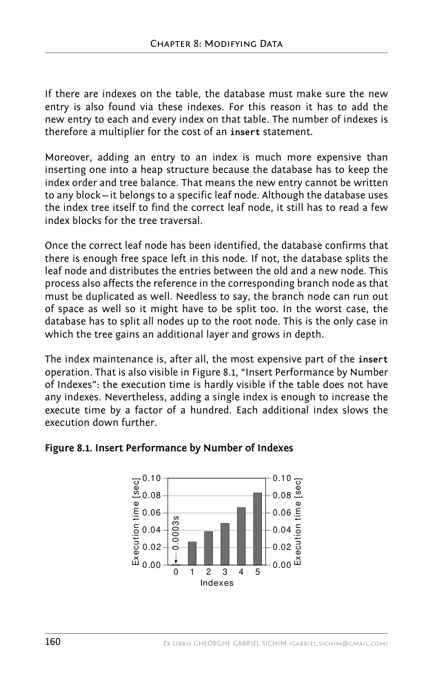
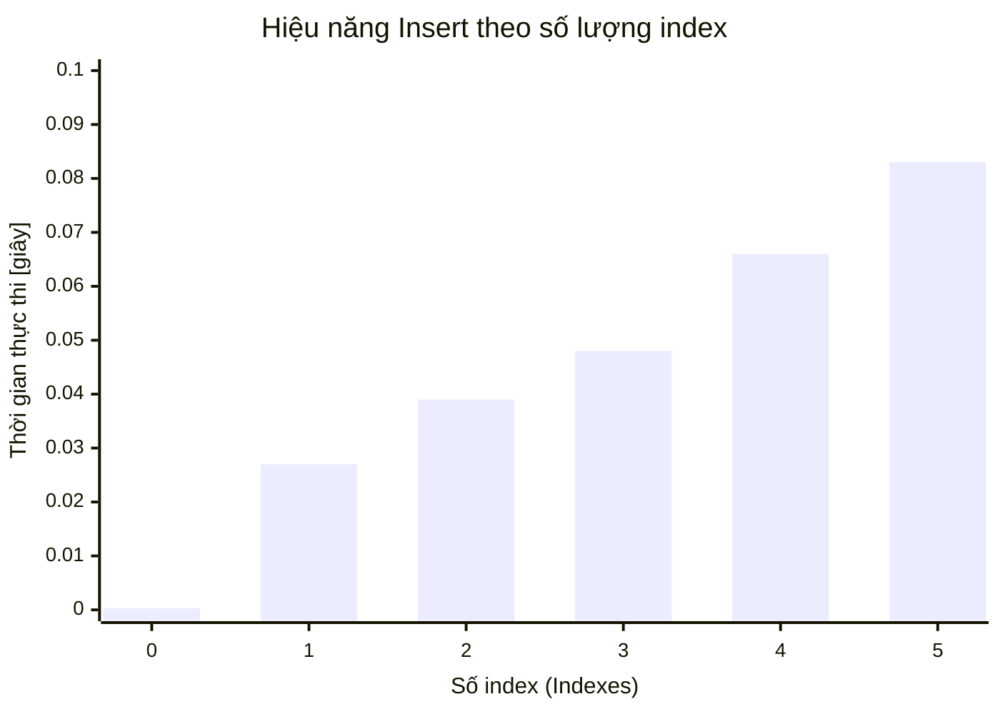
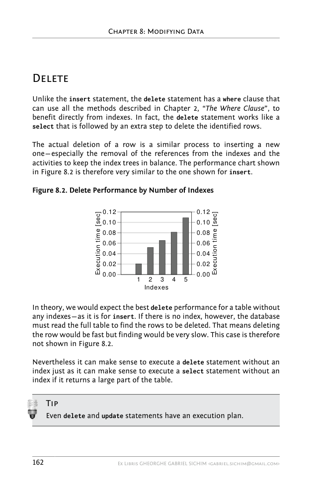
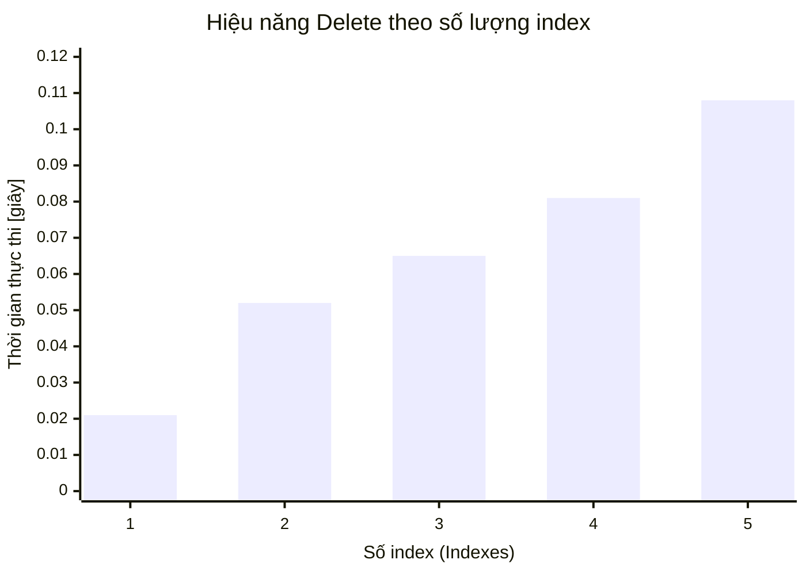
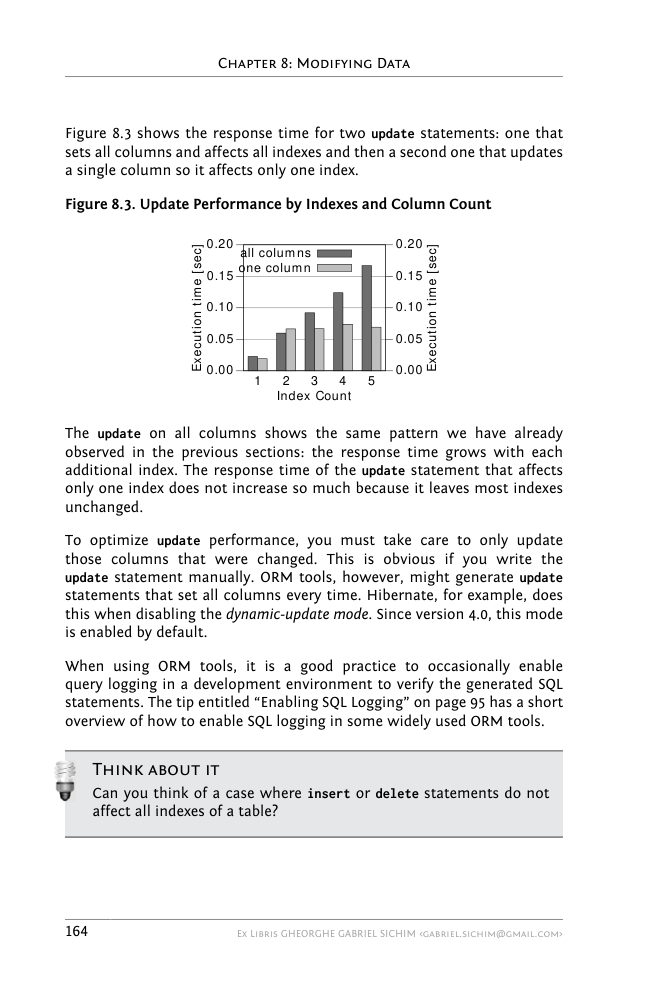
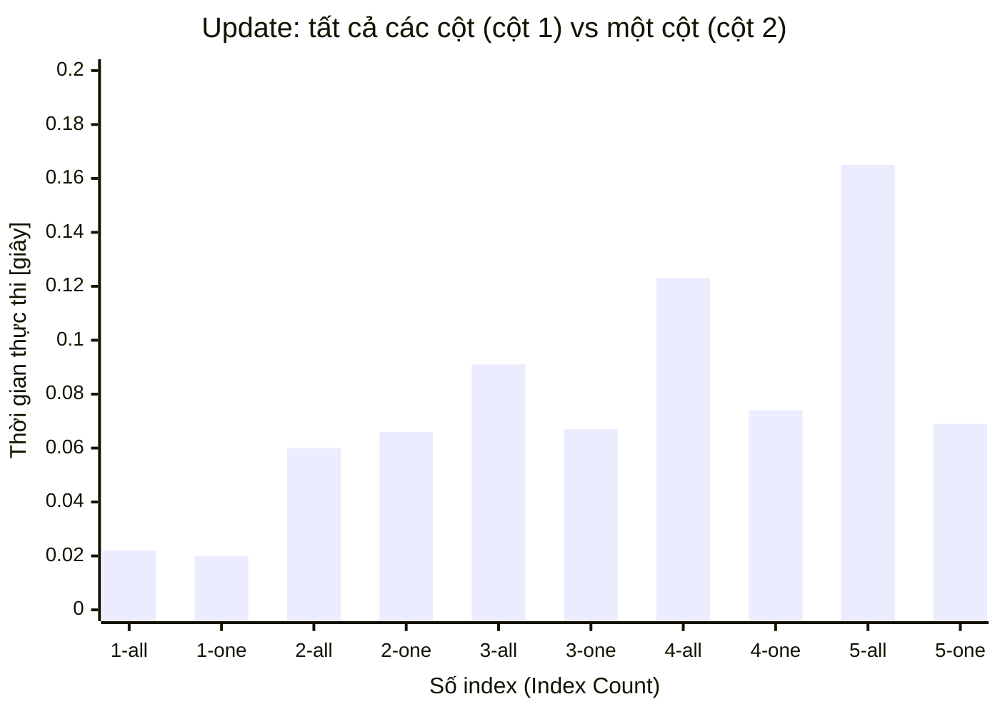

# Chương 8: Thay đổi dữ liệu (Chapter 8 – Modifying Data)

**Mục lục**

- [Chương 8: Thay đổi dữ liệu (Chapter 8 – Modifying Data)](#chương-8-thay-đổi-dữ-liệu-chapter-8--modifying-data)
  - [Thêm dữ liệu – Insert (Insert)](#thêm-dữ-liệu--insert-insert)
  - [Xóa dữ liệu – Delete (Delete)](#xóa-dữ-liệu--delete-delete)
  - [Cập nhật dữ liệu – Update (Update)](#cập-nhật-dữ-liệu--update-update)
  - [Bảng thuật ngữ (Glossary)](#bảng-thuật-ngữ-glossary)

---

Cho tới giờ, chúng ta mới chỉ bàn về hiệu năng của truy vấn (*query*), nhưng SQL không chỉ có truy vấn. SQL còn hỗ trợ cả việc thao tác, thay đổi dữ liệu. Các lệnh tương ứng — `insert`, `delete` và `update` — hợp thành cái gọi là "ngôn ngữ thao tác dữ liệu" (*data manipulation language* – **DML**), một phần của chuẩn SQL. Hiệu năng của các lệnh này, phần lớn, lại bị index ảnh hưởng theo hướng **tiêu cực**.

Một index là sự dư thừa (*redundancy*) thuần túy. Nó chỉ chứa những dữ liệu vốn đã được lưu trong bảng. Trong các thao tác ghi (*write operations*), cơ sở dữ liệu phải giữ cho những bản sao dư thừa đó luôn nhất quán (*consistent*) với nhau. Cụ thể, điều đó có nghĩa là `insert`, `delete` và `update` không chỉ tác động lên bảng mà còn tác động lên tất cả các index đang giữ một bản sao của dữ liệu bị ảnh hưởng.

> 📝 **Giải thích thêm (không có trong sách):** Hãy hình dung bảng là một cuốn sách, còn mỗi index là một "bảng tra cứu" ở cuối sách (tra theo tên người, tra theo địa danh, tra theo năm...). Khi bạn thêm một trang mới vào sách, bạn phải cập nhật **tất cả** các bảng tra cứu để trang đó tìm được qua chúng. Càng nhiều bảng tra cứu, việc thêm/xóa/sửa trang càng tốn công. Index giúp **đọc** nhanh, nhưng mỗi index là một "khoản thuế" phải trả khi **ghi**.

> 💡 **Ví dụ bổ sung (không có trong sách):** Bảng mẫu dùng xuyên suốt chương này (cú pháp chạy được trên PostgreSQL; các DB khác chỉ cần đổi kiểu dữ liệu nhỏ):
>
> ```sql
> CREATE TABLE employees (
>   employee_id   NUMERIC       NOT NULL,
>   subsidiary_id NUMERIC       NOT NULL,
>   first_name    VARCHAR(255)  NOT NULL,
>   last_name     VARCHAR(255)  NOT NULL,
>   date_of_birth DATE          NOT NULL,
>   phone_number  VARCHAR(255),
>   CONSTRAINT employees_pk PRIMARY KEY (employee_id, subsidiary_id)
> );
>
> CREATE INDEX emp_name     ON employees (last_name, first_name);
> CREATE INDEX emp_dob      ON employees (date_of_birth);
> CREATE INDEX emp_up_name  ON employees (UPPER(last_name));
> ```
>
> Bảng này có **4 index** (kể cả index của khóa chính `employees_pk`). Mỗi lệnh `insert` một dòng mới vào `employees` vì vậy phải ghi **1 lần vào bảng + 4 lần vào 4 cây B-tree**.

## Thêm dữ liệu – Insert (Insert)

Số lượng index trên một bảng là yếu tố **chi phối mạnh nhất** đối với hiệu năng của `insert`. Bảng càng có nhiều index thì việc thực thi càng chậm. Lệnh `insert` là thao tác duy nhất **không thể hưởng lợi trực tiếp** từ việc đánh index, vì nó không có mệnh đề `where`.

Việc thêm một dòng mới vào bảng gồm nhiều bước. Đầu tiên, cơ sở dữ liệu phải tìm một chỗ để lưu dòng đó. Với một bảng heap (*heap table*) thông thường — loại bảng không có thứ tự dòng cụ thể nào — cơ sở dữ liệu có thể lấy bất kỳ khối (*block*) nào của bảng còn đủ chỗ trống. Đây là một quá trình rất đơn giản và nhanh, phần lớn được thực hiện trong bộ nhớ chính (*main memory*). Sau đó, tất cả những gì cơ sở dữ liệu cần làm là thêm bản ghi mới vào khối dữ liệu tương ứng.

> 📝 **Giải thích thêm (không có trong sách):** "Heap table" là kiểu bảng mặc định của Oracle, PostgreSQL, và của SQL Server khi bảng không có clustered index. Trong MySQL/InnoDB thì **không có** heap table: mọi bảng InnoDB đều là bảng tổ chức theo index (*clustered index* theo khóa chính), nên ngay cả việc ghi vào "bảng" cũng đã là ghi vào một cây B-tree.

Nếu bảng có index, cơ sở dữ liệu phải bảo đảm bản ghi mới cũng có thể được tìm thấy thông qua các index này. Vì lý do đó, nó phải thêm bản ghi mới vào **từng index một** trên bảng đó. Do đó, số lượng index đóng vai trò như một **hệ số nhân** cho chi phí của một lệnh `insert`.

Hơn nữa, việc thêm một mục vào index tốn kém hơn nhiều so với chèn một dòng vào cấu trúc heap, vì cơ sở dữ liệu phải giữ được thứ tự của index và sự cân bằng của cây (*tree balance*). Điều đó có nghĩa là mục mới không thể được ghi vào một khối bất kỳ — nó thuộc về một leaf node (*nút lá* – tầng dưới cùng của cây B-tree, nơi chứa các mục index đã sắp xếp) cụ thể. Mặc dù cơ sở dữ liệu dùng chính cây index để tìm ra leaf node đúng, nó vẫn phải đọc một vài khối index cho việc duyệt cây (*tree traversal*).

Khi đã xác định được leaf node đúng, cơ sở dữ liệu kiểm tra xem nút đó còn đủ chỗ trống hay không. Nếu không, cơ sở dữ liệu sẽ tách (*split*) leaf node ra và phân bổ các mục giữa nút cũ và một nút mới. Quá trình này cũng ảnh hưởng tới tham chiếu trong branch node (*nút nhánh* – nút trung gian trỏ xuống các nút con) tương ứng, vì tham chiếu đó cũng phải được nhân đôi. Chẳng cần phải nói, branch node cũng có thể hết chỗ, nên có khi nó cũng phải bị tách. Trong trường hợp xấu nhất, cơ sở dữ liệu phải tách tất cả các nút ngược lên tới tận nút gốc (*root node*). Đây là **trường hợp duy nhất** mà cây có thêm một tầng mới và tăng độ sâu.

> 📝 **Giải thích thêm (không có trong sách):** Minh họa một lần tách leaf node (*leaf node split*). Giả sử mỗi leaf node chỉ chứa được 4 mục, và ta chèn giá trị `27` vào nút đã đầy:
>
> ```text
> Trước khi chèn 27:
>
>             [branch: ... | 30 | ...]
>                          |
>                 [21 | 24 | 26 | 30]   <- leaf đã đầy
>
> Sau khi chèn 27 (leaf bị tách làm đôi):
>
>        [branch: ... | 24 | 30 | ...]  <- branch có thêm 1 tham chiếu
>                     /        \
>          [21 | 24]            [26 | 27 | 30]
>          (leaf cũ)            (leaf mới)
> ```
>
> Nếu branch node cũng đầy thì nó lại bị tách, và cứ thế lan lên trên. Chỉ khi nút gốc bị tách thì cây mới cao thêm một tầng — đó là lý do cây B-tree luôn cân bằng: mọi leaf node luôn có cùng độ sâu.

Rốt cuộc, việc bảo trì index (*index maintenance*) là phần **tốn kém nhất** của thao tác `insert`. Điều này cũng thể hiện rõ trong Hình 8.1, "Hiệu năng Insert theo số lượng index": thời gian thực thi gần như không nhìn thấy được nếu bảng không có index nào. Thế nhưng, chỉ cần thêm **một** index là đủ để tăng thời gian thực thi lên **gấp khoảng một trăm lần**. Mỗi index bổ sung lại làm việc thực thi chậm thêm nữa.

**Hình 8.1 – Hiệu năng Insert theo số lượng index (Figure 8.1 – Insert Performance by Number of Indexes)**



Mô tả hình: biểu đồ cột; trục hoành là "Indexes" (số lượng index, từ 0 đến 5); trục tung (hai bên) là "Execution time [sec]" (thời gian thực thi, đơn vị giây, thang từ 0.00 đến 0.10). Tại 0 index, cột thấp tới mức không thấy được, nên có mũi tên chú thích giá trị **0.0003s**. Các cột tăng dần đều theo số index: khoảng 0.027s (1 index), 0.039s (2), 0.048s (3), 0.066s (4), 0.083s (5) — các giá trị này đọc ước lượng từ biểu đồ.

#### Thang trục tung của Hình 8.1: 0.00 – 0.02 – 0.04 – 0.06 – 0.08 – 0.10 giây

Vẽ lại (giá trị ước lượng từ biểu đồ):



```text
Thời gian [s]
0.10 |
0.08 |                              ███
0.06 |                        ███   ███
0.04 |            ███   ███   ███   ███
0.02 |      ███   ███   ███   ███   ███
0.00 |  ↑   ███   ███   ███   ███   ███
     +---------------------------------
        0     1     2     3     4     5    Số index
    0.0003s
```

> **Ghi chú (Note)**
>
> Index **đầu tiên** tạo ra khác biệt lớn nhất.

Để tối ưu hiệu năng `insert`, việc giữ cho số lượng index nhỏ là cực kỳ quan trọng.

> **Mẹo (Tip)**
>
> Hãy dùng index một cách có cân nhắc và tiết kiệm, đồng thời tránh các index dư thừa (*redundant indexes*) bất cứ khi nào có thể. Điều này cũng có lợi cho các lệnh `delete` và `update`.

Nếu chỉ xét riêng các lệnh `insert`, tốt nhất là tránh hoàn toàn index — cách này cho hiệu năng `insert` tốt nhất, bỏ xa mọi phương án khác. Tuy nhiên, bảng không có index nào là điều khá phi thực tế trong các ứng dụng thực tế. Thông thường, bạn muốn truy xuất lại dữ liệu đã lưu, nên bạn cần index để tăng tốc truy vấn. Ngay cả những bảng log chỉ-ghi (*write-only log tables*) cũng thường có một khóa chính (*primary key*) và index tương ứng của nó.

Dù vậy, hiệu năng khi không có index tốt đến mức có thể hợp lý khi **tạm thời xóa (drop) tất cả các index** trong lúc nạp một lượng lớn dữ liệu — với điều kiện các index đó không được bất kỳ câu lệnh SQL nào khác cần đến trong khoảng thời gian đó. Việc này có thể mang lại mức tăng tốc ngoạn mục, như thấy trong biểu đồ, và thực tế đây là một cách làm phổ biến trong các kho dữ liệu (*data warehouse*).

> 💡 **Ví dụ bổ sung (không có trong sách):** Nạp hàng loạt dữ liệu vào bảng `employees` ở trên (PostgreSQL):
>
> ```sql
> -- 1. Xóa tạm các index phụ (giữ lại khóa chính nếu cần đảm bảo tính duy nhất)
> DROP INDEX emp_name;
> DROP INDEX emp_dob;
> DROP INDEX emp_up_name;
>
> -- 2. Nạp dữ liệu số lượng lớn
> COPY employees FROM '/data/employees.csv' WITH (FORMAT csv);
>
> -- 3. Tạo lại index một lần (sắp xếp toàn bộ dữ liệu một lượt,
> --    nhanh hơn nhiều so với chèn từng mục và tách node liên tục)
> CREATE INDEX emp_name    ON employees (last_name, first_name);
> CREATE INDEX emp_dob     ON employees (date_of_birth);
> CREATE INDEX emp_up_name ON employees (UPPER(last_name));
> ```
>
> Các DB khác có cách tương đương: Oracle có `ALTER INDEX ... UNUSABLE` rồi `ALTER INDEX ... REBUILD` (kết hợp `SKIP_UNUSABLE_INDEXES`); SQL Server có `ALTER INDEX ... DISABLE` rồi `ALTER INDEX ... REBUILD`; MySQL/MyISAM có `ALTER TABLE ... DISABLE KEYS` / `ENABLE KEYS`. Lưu ý: trong lúc index bị xóa/vô hiệu, các truy vấn cần index đó sẽ chậm hẳn — đúng như điều kiện sách nêu.

> 💡 **Ví dụ bổ sung (không có trong sách):** Phát hiện index dư thừa. Giả sử ngoài `emp_name (last_name, first_name)` ai đó tạo thêm:
>
> ```sql
> CREATE INDEX emp_last ON employees (last_name);
> ```
>
> Index `emp_last` gần như dư thừa: mọi truy vấn `WHERE last_name = ?` đều có thể dùng `emp_name` vì `last_name` là cột **đầu tiên** của nó (nguyên tắc tiền tố trái của index nhiều cột). Xóa `emp_last` giúp mỗi `insert`/`delete` bớt đi một lần bảo trì B-tree mà hầu như không làm chậm truy vấn nào.

> **Suy ngẫm (Think about it)**
>
> - Hình 8.1 sẽ thay đổi thế nào khi dùng bảng tổ chức theo index (*index organized table*) hoặc clustered index?
> - Liệu có cách gián tiếp nào để một lệnh `insert` có thể hưởng lợi từ việc đánh index không? Tức là: một index bổ sung có thể làm cho lệnh `insert` nhanh hơn được không?

> 📝 **Giải thích thêm (không có trong sách):** Gợi ý suy nghĩ (không phải đáp án của sách):
> - Với index organized table (Oracle) / clustered index (SQL Server, MySQL InnoDB), bản thân bảng đã là một cây B-tree, nên ngay cả trường hợp "0 index phụ" cũng không còn rẻ như heap table: dòng mới phải chèn đúng vị trí trong cây, có thể gây tách node. Cột "0 index" trong Hình 8.1 sẽ cao lên đáng kể.
> - Một `insert` có thể gián tiếp hưởng lợi từ index khi nó phải **kiểm tra ràng buộc**: ví dụ ràng buộc `UNIQUE`/khóa chính (cần index để kiểm tra trùng nhanh), hay khóa ngoại (*foreign key*) — DB phải tra bảng cha xem giá trị có tồn tại không, và việc tra này nhanh được là nhờ index của khóa chính/unique ở bảng cha. Ngoài ra, lệnh dạng `INSERT INTO ... SELECT ... WHERE ...` có phần `select` hoàn toàn có thể dùng index.

> 📝 **Giải thích thêm (không có trong sách) — Đối chiếu với PostgreSQL hiện đại (PG 10–17): `INSERT ... ON CONFLICT` (Upsert), `MERGE` (PG 15–17) và Tối ưu hóa `COPY` / Bulk Load:**
>
> Vào năm 2012 (thời điểm sách viết, PostgreSQL 9.1/9.2), PostgreSQL chưa có lệnh Upsert nguyên tử lẫn lệnh `MERGE` chuẩn SQL, khiến lập trình viên phải viết vòng lặp `UPDATE ... IF NOT FOUND THEN INSERT` kèm khối `EXCEPTION WHEN unique_violation` trong PL/pgSQL (vừa chậm vừa tạo *subtransaction* gây tràn bộ đệm `SubtransSLRU` khi tải cao). Trong PostgreSQL hiện đại (PG 10–17), bức tranh ghi và đồng bộ dữ liệu đã thay đổi hoàn toàn nhờ 3 trụ cột sau:
>
> 1. **`INSERT ... ON CONFLICT` (Upsert — từ PostgreSQL 9.5+, hoàn thiện ở PG 10–17):**
>    - Sử dụng cơ chế *speculative insertion* kết hợp trực tiếp với B-Tree Unique Index để phát hiện đụng độ (*conflict*) ở mức nguyên tử mà **không sinh subtransaction** và không bị lỗi *race condition* khi chạy đồng thời cao.
>    - **Mẹo sống còn trên PostgreSQL:** Khi dùng `DO UPDATE SET ...`, **luôn thêm mệnh đề `WHERE` để kiểm tra dữ liệu thực sự thay đổi** (ví dụ `WHERE target.col IS DISTINCT FROM EXCLUDED.col`). Nếu không có `WHERE`, PostgreSQL vẫn sẽ ghi một phiên bản dòng mới (*dead tuple*) và sinh WAL cho cả những dòng trùng khóa mà giá trị không hề đổi!
> 2. **Câu lệnh chuẩn SQL `MERGE` (PostgreSQL 15+) và `MERGE ... RETURNING` (PostgreSQL 17+):**
>    - **PostgreSQL 15** chính thức giới thiệu lệnh `MERGE INTO ... USING ... ON ... WHEN MATCHED / WHEN NOT MATCHED`, cho phép gộp cả `INSERT`, `UPDATE` và `DELETE` trong một lần quét join duy nhất (rất lý tưởng cho bài toán đồng bộ lô / ETL từ bảng staging sang bảng chính).
>    - **PostgreSQL 17** nâng cấp mạnh mẽ `MERGE` với hai tính năng rất được mong đợi: nhánh **`WHEN NOT MATCHED BY SOURCE`** (xóa hoặc đánh dấu các dòng có ở bảng đích nhưng không còn ở bảng nguồn) và mệnh đề **`RETURNING`** đi kèm hàm **`merge_action()`** (trả về `'INSERT'`, `'UPDATE'` hoặc `'DELETE'` cho từng dòng bị tác động).
>    - *Lưu ý phân biệt:* Với thao tác đơn lẻ trực tuyến (*OLTP point upsert*) có cạnh tranh cao, `INSERT ... ON CONFLICT` vẫn an toàn hơn vì đảm bảo không bao giờ ném lỗi `unique_violation`. Ngược lại, với bài toán đồng bộ lô dữ liệu lớn (*batch ETL*), `MERGE` linh hoạt và nhanh hơn vượt trội.
> 3. **Tăng tốc `COPY` và Bulk Load trong PostgreSQL 11–17:**
>    - **Xây dựng B-Tree Index song song (`Parallel Index Build` — từ PostgreSQL 11+)** và **B-Tree Deduplication (từ PostgreSQL 13+)**: Khi xóa index để `COPY` rồi chạy `CREATE INDEX` lại như sách khuyên, PostgreSQL 11–17 tự động huy động nhiều tiến trình worker song song (điều khiển bởi `max_parallel_maintenance_workers` và `maintenance_work_mem`) để sắp xếp và dựng lại cây B-Tree nhanh gấp nhiều lần so với PG 9.2.
>    - **`COPY ... (FREEZE)` (tối ưu hóa mạnh từ PG 14+):** Nếu bạn tạo bảng mới hoặc `TRUNCATE` bảng ngay trong cùng một transaction với lệnh `COPY ... WITH (FREEZE)`, PostgreSQL sẽ ghi các dòng mới ở trạng thái **đã đóng băng (`frozen`)** và cập nhật sẵn *Visibility Map* — giúp truy vấn `Index Only Scan` chạy ngay lập tức với `Heap Fetches: 0` và loại bỏ hoàn toàn gánh nặng `VACUUM FREEZE` về sau!
>    - **`COPY ... (ON_ERROR ignore)` (PostgreSQL 17+):** Từ PG 17, `COPY FROM` cho phép bỏ qua các dòng lỗi định dạng kiểu dữ liệu mà không làm hủy toàn bộ tiến trình nạp hàng triệu dòng (và từ PG 16+, `DEFAULT` có thể dùng trong `COPY`).

> 💡 **Ví dụ bổ sung (không có trong sách) — Thực hành trên PostgreSQL: Tối ưu `INSERT ... ON CONFLICT`, `MERGE ... RETURNING` (PG 17) và `COPY FREEZE`:**
>
> ```sql
> -- 1. Upsert tối ưu (PG 9.5 - PG 17): dùng IS DISTINCT FROM để tránh ghi thừa dead tuple
> INSERT INTO employees (employee_id, subsidiary_id, first_name, last_name, date_of_birth, phone_number)
> VALUES (101, 1, 'Markus', 'Winand', DATE '1980-05-12', '+43-1-234567')
> ON CONFLICT (employee_id, subsidiary_id)
> DO UPDATE SET
>    phone_number = EXCLUDED.phone_number,
>    last_name    = EXCLUDED.last_name
>  WHERE (employees.phone_number, employees.last_name)
>     IS DISTINCT FROM (EXCLUDED.phone_number, EXCLUDED.last_name);
>
> -- 2. Đồng bộ lô bằng MERGE kết hợp RETURNING và merge_action() (PostgreSQL 17+):
> EXPLAIN (ANALYZE, BUFFERS)
> MERGE INTO employees e
> USING staging_employees s
>    ON e.employee_id = s.employee_id AND e.subsidiary_id = s.subsidiary_id
> WHEN MATCHED AND s.is_terminated THEN
>   DELETE
> WHEN MATCHED AND e.phone_number IS DISTINCT FROM s.phone_number THEN
>   UPDATE SET phone_number = s.phone_number
> WHEN NOT MATCHED AND NOT s.is_terminated THEN
>   INSERT (employee_id, subsidiary_id, first_name, last_name, date_of_birth, phone_number)
>   VALUES (s.employee_id, s.subsidiary_id, s.first_name, s.last_name, s.date_of_birth, s.phone_number)
> RETURNING merge_action(), e.employee_id, e.subsidiary_id;
> ```
>
> Kế hoạch thực thi `EXPLAIN (ANALYZE, BUFFERS)` của `MERGE` trên PostgreSQL 17:
>
> ```text
> Merge on employees e  (cost=154.20..842.50 rows=0 width=0) (actual time=4.120..4.890 rows=350 loops=1)
>   Tuples: inserted=200 updated=140 deleted=10 skipped=650
>   Buffers: shared hit=1840 dirtied=210
>   ->  Hash Right Join  (cost=154.20..842.50 rows=1000 width=128) (actual time=0.850..2.110 rows=1000 loops=1)
>         Hash Cond: ((e.employee_id = s.employee_id) AND (e.subsidiary_id = s.subsidiary_id))
>         Buffers: shared hit=320
>         ->  Seq Scan on employees e  (cost=0.00..420.00 rows=20000 width=64) (actual time=0.012..0.920 rows=20000 loops=1)
>         ->  Hash  (cost=120.00..120.00 rows=1000 width=68) (actual time=0.810..0.812 rows=1000 loops=1)
>               ->  Seq Scan on staging_employees s  (cost=0.00..120.00 rows=1000 width=68) (actual time=0.008..0.410 rows=1000 loops=1)
> Execution Time: 4.950 ms
> ```
> *(Chú ý dòng `Tuples: inserted=200 updated=140 deleted=10 skipped=650`: nhờ điều kiện `IS DISTINCT FROM`, 650 dòng không đổi được `skipped` ngay lập tức, không tốn chi phí ghi Heap hay cập nhật 4 cây B-Tree!)*
>
> ```sql
> -- 3. Nạp dữ liệu tốc độ tối đa bằng COPY FREEZE + Parallel Index Build (PG 14 - 17):
> BEGIN;
> TRUNCATE TABLE employees;
> DROP INDEX emp_name, emp_dob, emp_up_name;
>
> -- Nạp dữ liệu đã đóng băng sẵn (tránh VACUUM FREEZE về sau)
> COPY employees FROM '/data/employees.csv' WITH (FORMAT csv, FREEZE true);
>
> -- Tăng bộ nhớ và số worker để dựng lại B-Tree song song cực nhanh
> SET LOCAL maintenance_work_mem = '1GB';
> SET LOCAL max_parallel_maintenance_workers = 4;
>
> CREATE INDEX emp_name    ON employees (last_name, first_name);
> CREATE INDEX emp_dob     ON employees (date_of_birth);
> CREATE INDEX emp_up_name ON employees (UPPER(last_name));
> COMMIT;
> ```

## Xóa dữ liệu – Delete (Delete)

Khác với lệnh `insert`, lệnh `delete` có mệnh đề `where`, và mệnh đề này có thể dùng mọi phương pháp đã được mô tả trong Chương 2, "Mệnh đề Where" (*The Where Clause*), để **hưởng lợi trực tiếp** từ index. Thực tế, lệnh `delete` hoạt động giống như một lệnh `select` theo sau là một bước bổ sung để xóa những dòng đã được xác định.

Việc xóa thực sự một dòng là một quá trình tương tự như chèn một dòng mới — đặc biệt là việc gỡ bỏ các tham chiếu khỏi index và các hoạt động giữ cho cây index cân bằng. Vì vậy, biểu đồ hiệu năng trong Hình 8.2 rất giống với biểu đồ của `insert`.

**Hình 8.2 – Hiệu năng Delete theo số lượng index (Figure 8.2 – Delete Performance by Number of Indexes)**



Mô tả hình: biểu đồ cột; trục hoành là "Indexes" (số lượng index, từ 1 đến 5 — **không có** cột cho 0 index); trục tung (hai bên) là "Execution time [sec]" (thời gian thực thi, giây, thang từ 0.00 đến 0.12). Các cột tăng dần: khoảng 0.021s (1 index), 0.052s (2), 0.065s (3), 0.081s (4), 0.108s (5) — giá trị ước lượng từ biểu đồ.

#### Thang trục tung của Hình 8.2: 0.00 – 0.02 – 0.04 – 0.06 – 0.08 – 0.10 – 0.12 giây



```text
Thời gian [s]
0.12 |
0.10 |                        ███
0.08 |                  ███   ███
0.06 |            ███   ███   ███
0.04 |      ███   ███   ███   ███
0.02 |███   ███   ███   ███   ███
0.00 |███   ███   ███   ███   ███
     +----------------------------
       1     2     3     4     5    Số index
```

Về lý thuyết, ta sẽ kỳ vọng hiệu năng `delete` tốt nhất với một bảng không có index nào — giống như với `insert`. Tuy nhiên, nếu không có index, cơ sở dữ liệu phải đọc toàn bộ bảng (full table scan) để tìm những dòng cần xóa. Điều đó có nghĩa là việc *xóa* dòng thì nhanh nhưng việc *tìm* dòng lại rất chậm. Vì vậy trường hợp này không được thể hiện trong Hình 8.2.

Dù vậy, việc thực thi một lệnh `delete` mà không dùng index vẫn có thể hợp lý, cũng giống như việc thực thi một lệnh `select` không dùng index có thể hợp lý nếu nó trả về một phần lớn của bảng.

> **Mẹo (Tip)**
>
> Ngay cả các lệnh `delete` và `update` cũng có execution plan (*kế hoạch thực thi*).

> 💡 **Ví dụ bổ sung (không có trong sách):** Xem execution plan của một lệnh `delete` trên bảng `employees` (PostgreSQL). Không chạy thật, chỉ xem kế hoạch:
>
> ```sql
> EXPLAIN
> DELETE FROM employees
>  WHERE date_of_birth < DATE '1950-01-01';
> ```
>
> Kết quả có dạng (số liệu chỉ mang tính minh họa):
>
> ```text
>  Delete on employees  (cost=0.29..8.31 rows=1 width=6)
>    ->  Index Scan using emp_dob on employees  (cost=0.29..8.31 rows=1 width=6)
>          Index Cond: (date_of_birth < '1950-01-01'::date)
> ```
>
> Phần "tìm dòng" dùng index `emp_dob` (giống hệt một `select`). Phần "xóa dòng" (`Delete on employees`) sau đó còn phải gỡ mục tương ứng khỏi các index — riêng PostgreSQL thì trì hoãn việc này tới VACUUM, xem hộp "Tác dụng phụ của MVCC" bên dưới. Trong Oracle dùng `EXPLAIN PLAN FOR DELETE ...` rồi `SELECT * FROM TABLE(DBMS_XPLAN.DISPLAY)`; trong SQL Server dùng `SET SHOWPLAN_TEXT ON`; trong MySQL 5.6.3+ có thể `EXPLAIN DELETE ...`.
>
> Ngược lại, nếu điều kiện là `WHERE date_of_birth < DATE '2010-01-01'` (khớp gần hết bảng), optimizer có thể chọn `Seq Scan` (full table scan) — và đó lại là lựa chọn đúng, đúng như câu "có thể hợp lý khi `delete` không dùng index" ở trên.

Một lệnh `delete` không có mệnh đề `where` là ví dụ hiển nhiên về trường hợp cơ sở dữ liệu không thể dùng index, mặc dù đây là một trường hợp đặc biệt đã có lệnh SQL riêng: `truncate table`. Lệnh này có cùng tác dụng như `delete` không có `where`, ngoại trừ việc nó xóa tất cả các dòng **chỉ trong một lần**. Nó rất nhanh nhưng có hai tác dụng phụ quan trọng: (1) nó thực hiện một lệnh commit ngầm (*implicit commit*) (ngoại lệ: PostgreSQL); (2) nó không thực thi bất kỳ trigger nào.

> 💡 **Ví dụ bổ sung (không có trong sách):** So sánh hai cách xóa sạch bảng log `app_log`:
>
> ```sql
> -- Cách 1: xóa từng dòng, ghi undo/redo cho từng dòng, bảo trì từng index,
> --         kích hoạt trigger ON DELETE (nếu có), có thể ROLLBACK được.
> DELETE FROM app_log;
>
> -- Cách 2: giải phóng toàn bộ vùng lưu trữ một lượt, rất nhanh,
> --         KHÔNG chạy trigger xóa theo dòng.
> TRUNCATE TABLE app_log;
> ```
>
> Về commit ngầm: trong Oracle và MySQL, `TRUNCATE` là lệnh DDL nên sẽ commit cả những thay đổi đang dở trong giao dịch hiện tại và không thể rollback. Trong PostgreSQL, `TRUNCATE` là giao dịch được (*transactional*): `BEGIN; TRUNCATE app_log; ROLLBACK;` sẽ khôi phục lại dữ liệu. (SQL Server cũng cho phép rollback `TRUNCATE` nếu nó nằm trong một giao dịch tường minh — điểm này sách không nhắc tới.)

> **Tác dụng phụ của MVCC (Side Effects of MVCC)**
>
> Điều khiển đồng thời đa phiên bản (*Multiversion concurrency control* – **MVCC**) là một cơ chế của cơ sở dữ liệu cho phép truy cập dữ liệu đồng thời mà không chặn nhau (*non-blocking*) và mang lại một cái nhìn nhất quán cho giao dịch (*consistent transaction view*). Tuy nhiên, cách hiện thực khác nhau giữa các cơ sở dữ liệu, và thậm chí có thể gây ảnh hưởng đáng kể tới hiệu năng.
>
> Ví dụ, cơ sở dữ liệu PostgreSQL chỉ lưu thông tin phiên bản (= thông tin về khả năng hiển thị, *visibility information*) ở mức bảng: việc xóa một dòng chỉ đơn giản là đặt cờ "đã xóa" (*deleted*) trong khối của bảng. Vì vậy, hiệu năng `delete` của PostgreSQL không phụ thuộc vào số lượng index trên bảng. Việc xóa vật lý dòng trong bảng và việc bảo trì index liên quan chỉ được thực hiện trong tiến trình VACUUM (sách gốc in nhầm là "VACCUM").

> 📝 **Giải thích thêm (không có trong sách):** Trong PostgreSQL, "cờ đã xóa" cụ thể là trường `xmax` trong header của dòng (*tuple*): `delete` ghi mã giao dịch hiện tại vào `xmax`, các giao dịch khác vẫn có thể "nhìn thấy" phiên bản cũ cho tới khi giao dịch xóa commit. Dòng "chết" (*dead tuple*) và các mục index trỏ tới nó vẫn chiếm chỗ cho tới khi `VACUUM` (hoặc autovacuum) dọn dẹp. Hệ quả: `delete` ở PostgreSQL rẻ ngay lúc chạy, nhưng chi phí bị dời sang VACUUM — nếu autovacuum không theo kịp, bảng và index sẽ bị "phình" (*bloat*).

## Cập nhật dữ liệu – Update (Update)

Một lệnh `update` phải di chuyển các mục index bị thay đổi tới vị trí mới để duy trì thứ tự của index. Để làm vậy, cơ sở dữ liệu phải gỡ mục cũ và thêm mục mới vào vị trí mới. Thời gian phản hồi (*response time*) về cơ bản bằng tổng của các lệnh `delete` và `insert` tương ứng.

Hiệu năng `update`, cũng giống như `insert` và `delete`, phụ thuộc vào số lượng index trên bảng. Khác biệt duy nhất là lệnh `update` không nhất thiết tác động lên tất cả các cột, vì chúng thường chỉ sửa một vài cột được chọn. Do đó, một lệnh `update` không nhất thiết ảnh hưởng tới tất cả index trên bảng, mà chỉ ảnh hưởng tới những index **chứa các cột bị cập nhật**.

> 📝 **Giải thích thêm (không có trong sách):** Vì sao `update` một cột có index ≈ `delete` + `insert` trong index? Vì index được sắp xếp theo giá trị cột. Nếu `last_name` đổi từ `'Anderson'` thành `'Zimmer'`, mục index phải "chuyển nhà" từ đầu danh sách (gần chữ A) về cuối danh sách (gần chữ Z) — tức là gỡ khỏi leaf node cũ và chèn vào một leaf node hoàn toàn khác, có thể kéo theo tách node.

Hình 8.3 cho thấy thời gian phản hồi của hai lệnh `update`: một lệnh gán giá trị cho tất cả các cột nên ảnh hưởng tới tất cả index, và một lệnh thứ hai chỉ cập nhật một cột duy nhất nên chỉ ảnh hưởng tới một index.

**Hình 8.3 – Hiệu năng Update theo số lượng index và số cột được cập nhật (Figure 8.3 – Update Performance by Indexes and Column Count)**



Mô tả hình: biểu đồ cột nhóm; trục hoành là "Index Count" (số lượng index, từ 1 đến 5); trục tung (hai bên) là "Execution time [sec]" (thời gian thực thi, giây, thang từ 0.00 đến 0.20). Chú giải: cột màu xám đậm = "all columns" (cập nhật tất cả các cột); cột màu xám nhạt = "one column" (cập nhật một cột). Giá trị ước lượng từ biểu đồ:

#### Thang trục tung của Hình 8.3: 0.00 – 0.05 – 0.10 – 0.15 – 0.20 giây

| Số index (Index Count) | Tất cả các cột (all columns) | Một cột (one column) |
|---|---|---|
| 1 | ≈ 0.022 s | ≈ 0.020 s |
| 2 | ≈ 0.060 s | ≈ 0.066 s |
| 3 | ≈ 0.091 s | ≈ 0.067 s |
| 4 | ≈ 0.123 s | ≈ 0.074 s |
| 5 | ≈ 0.165 s | ≈ 0.069 s |



```text
Thời gian [s]            ▓ = all columns (tất cả các cột)
0.20 |                   ░ = one column  (một cột)
0.15 |                              ▓
0.10 |                       ▓      ▓
     |                ▓      ▓      ▓
0.05 |         ▓░     ▓░     ▓░     ▓░
0.00 |  ▓░     ▓░     ▓░     ▓░     ▓░
     +-----------------------------------
        1      2      3      4      5     Số index
```

Lệnh `update` trên tất cả các cột cho thấy cùng một khuôn mẫu mà ta đã thấy ở các mục trước: thời gian phản hồi tăng lên theo mỗi index bổ sung. Còn thời gian phản hồi của lệnh `update` chỉ ảnh hưởng tới một index thì không tăng nhiều như vậy, vì nó để nguyên hầu hết các index.

Để tối ưu hiệu năng `update`, bạn phải chú ý **chỉ cập nhật những cột thực sự thay đổi**. Điều này là hiển nhiên nếu bạn tự tay viết lệnh `update`. Tuy nhiên, các công cụ ORM (*Object-Relational Mapping* – công cụ ánh xạ đối tượng sang bảng quan hệ) có thể sinh ra các lệnh `update` gán giá trị cho tất cả các cột mỗi lần. Ví dụ, Hibernate làm như vậy khi tắt chế độ cập nhật động (*dynamic-update mode*). Kể từ phiên bản 4.0, chế độ này được bật mặc định.

> 📝 **Giải thích thêm (không có trong sách):** Lưu ý thực tế: trong các phiên bản Hibernate phổ biến hiện nay, `dynamic-update` thường vẫn **tắt** theo mặc định cho từng entity và phải bật tường minh bằng annotation `@DynamicUpdate` (hoặc `dynamic-update="true"` trong file mapping XML). Vì vậy đừng dựa vào giả định — hãy bật log SQL để kiểm tra như sách khuyên ngay dưới đây.

> 💡 **Ví dụ bổ sung (không có trong sách):** Người dùng chỉ đổi số điện thoại của nhân viên. ORM không dùng dynamic-update sẽ sinh ra:
>
> ```sql
> UPDATE employees
>    SET first_name    = ?,
>        last_name     = ?,
>        date_of_birth = ?,
>        phone_number  = ?
>  WHERE employee_id   = ?
>    AND subsidiary_id = ?;
> ```
>
> Dù giá trị mới của `first_name`, `last_name`, `date_of_birth` giống hệt giá trị cũ, nhiều DB vẫn coi các cột này "bị cập nhật" và phải xử lý các index `emp_name`, `emp_dob`, `emp_up_name` (ít nhất là kiểm tra/ghi log). Còn câu lệnh tối ưu chỉ là:
>
> ```sql
> UPDATE employees
>    SET phone_number  = ?
>  WHERE employee_id   = ?
>    AND subsidiary_id = ?;
> ```
>
> `phone_number` không nằm trong index nào, nên câu này không đụng tới index phụ nào cả (chỉ dùng `employees_pk` để *tìm* dòng). Trong PostgreSQL, trường hợp này còn có thể được thực hiện dưới dạng **HOT update** (*Heap-Only Tuple*) — phiên bản dòng mới được đặt cùng khối và không cần thêm mục mới vào bất kỳ index nào, với điều kiện khối còn đủ chỗ trống.
>
> Bật dynamic-update trong Hibernate:
>
> ```java
> @Entity
> @DynamicUpdate
> public class Employee {
>     // ...
> }
> ```

Khi dùng công cụ ORM, một thói quen tốt là thỉnh thoảng bật ghi log truy vấn (*query logging*) trong môi trường phát triển để kiểm tra các câu lệnh SQL được sinh ra. Mẹo có tiêu đề "Bật ghi log SQL" (*Enabling SQL Logging*) ở trang 95 có phần tổng quan ngắn về cách bật ghi log SQL trong một số công cụ ORM được dùng rộng rãi.

> **Suy ngẫm (Think about it)**
>
> Bạn có nghĩ ra trường hợp nào mà lệnh `insert` hoặc `delete` **không** ảnh hưởng tới tất cả các index của một bảng không?

> 📝 **Giải thích thêm (không có trong sách):** Gợi ý suy nghĩ (không phải đáp án của sách): hãy nghĩ tới các index **không chứa mọi dòng** của bảng — ví dụ *partial index* của PostgreSQL (`CREATE INDEX ... WHERE processed = 'N'`), *filtered index* của SQL Server, hoặc trong Oracle một index mà mọi cột đều `NULL` thì dòng đó không được đưa vào index. Một dòng mới không thỏa điều kiện của partial index (hoặc có toàn giá trị `NULL` trong các cột index ở Oracle) sẽ không cần ghi vào index đó.

> 📝 **Giải thích thêm (không có trong sách) — Đối chiếu với PostgreSQL hiện đại (PG 10–17): Kiến trúc MVCC của PostgreSQL, `HOT Updates` (Heap-Only Tuple), *Write Amplification* & Đột phá `Bottom-Up Index Deletion` (PG 14+):**
>
> Trong mục "Cập nhật dữ liệu – Update" ở trên, sách phát biểu quy tắc chung (dựa trên Oracle/SQL Server/MySQL): *"Một lệnh `update` không nhất thiết ảnh hưởng tới tất cả index trên bảng, mà chỉ ảnh hưởng tới những index chứa các cột bị cập nhật."*
>
> ⚠️ **CẢNH BÁO ĐẶC BIỆT CHO NGƯỜI DÙNG POSTGRESQL:** Phát biểu trên **KHÔNG ĐÚNG** một cách đơn giản trên PostgreSQL! Hiểu rõ cơ chế MVCC và `HOT Update` là kiến thức sống còn đối với mọi kỹ sư vận hành PostgreSQL:
>
> 1. **Tại sao `UPDATE` trong PostgreSQL lại khác biệt hoàn toàn với Oracle và MySQL/InnoDB?**
>    - Trong Oracle (dùng *Undo Segment*) hay MySQL/InnoDB (Secondary Index trỏ vào *Primary Key* chứ không trỏ vào địa chỉ vật lý), khi bạn `UPDATE` 1 cột, dòng dữ liệu giữ nguyên định danh hoặc cập nhật tại chỗ (*in-place*), nên chỉ những Index nào chứa đúng cột bị sửa mới phải cập nhật.
>    - Ngược lại, trong **PostgreSQL**, mọi Index (kể cả Primary Key lẫn Secondary Index) đều trỏ trực tiếp tới **địa chỉ vật lý của dòng trên trang Heap (`ctid` = `(block_number, item_offset)`)**. Khi bạn chạy `UPDATE`, PostgreSQL **không ghi đè tại chỗ** mà luôn tạo ra một **phiên bản dòng vật lý hoàn toàn mới (*new heap tuple*)** với một địa chỉ `ctid` mới (ví dụ từ `(0,1)` sang `(0,2)`), đồng thời đánh dấu `xmax` cho dòng cũ `(0,1)`.
> 2. **Trường hợp 1 — `HOT Update` (*Heap-Only Tuple*, từ PG 8.3+): 0 lần ghi Index!**
>    - Để tránh việc mỗi lần `UPDATE` lại phải chèn `ctid` mới vào tất cả các Index, PostgreSQL có cơ chế **HOT Update** (*Heap-Only Tuple*).
>    - Một lệnh `UPDATE` trở thành **HOT Update** khi và chỉ khi thỏa mãn **đồng thời 2 điều kiện**:
>      1. **Không có bất kỳ cột nào xuất hiện trong BẤT KỲ Index nào của bảng bị thay đổi giá trị** (tính cả cột khóa của index, cột trong `INCLUDE (...)`, biểu thức index, lẫn cột nêu trong mệnh đề `WHERE` của *partial index*).
>      2. **Trang Heap 8KB chứa dòng cũ vẫn còn đủ chỗ trống** để lưu phiên bản dòng mới trên **cùng trang 8KB đó**.
>    - Khi đạt chuẩn HOT Update: Các Index bên ngoài vẫn chỉ trỏ vào mục gốc `(0,1)`. Bên trong trang Heap 8KB đó, PostgreSQL nối một con trỏ chuỗi (**HOT chain**) từ `(0,1) -> (0,2)`. Tuyệt vời hơn nữa, các phiên bản dòng chết trong chuỗi HOT sẽ được dọn dẹp tức thì ngay trong các thao tác đọc/ghi tiếp theo trên trang đó (*single-page pruning / defragmentation*) mà **không cần đợi `VACUUM`**!
> 3. **Trường hợp 2 — `Non-HOT Update` (*Write Amplification*): Sửa 1 cột có Index = Phải chèn bản ghi mới vào TẤT CẢ các Index trên bảng!**
>    - Ngược lại, nếu bạn **sửa chỉ 1 cột nằm trong 1 Index bất kỳ** (hoặc nếu trang Heap 8KB đã đầy 100% khiến dòng mới phải nhảy sang trang Heap khác), PostgreSQL **không thể dùng HOT Update**!
>    - Lúc này, vì dòng mới có `ctid` mới không nằm trong chuỗi HOT hợp lệ với tất cả index, PostgreSQL **BẮT BUỘC phải chèn thêm một mục index mới (*index tuple*) vào TẤT CẢ các Index đang có trên bảng đó** — **kể cả những Index hoàn toàn KHÔNG chứa cột vừa bị sửa!**
>    - *Ví dụ:* Bảng `orders` có 8 Index. Bạn chạy `UPDATE orders SET status = 'PAID' WHERE order_id = 100` và cột `status` có 1 index. Vì `status` được đánh index, đây là **Non-HOT Update** → PostgreSQL phải chèn thêm 1 bản ghi mới vào **cả 8 Index** của bảng `orders`! Hiện tượng này gọi là **khuếch đại ghi (*Write Amplification*)**.
> 4. **Bước ngoặt ở PostgreSQL 14+: Cơ chế `Bottom-Up Index Deletion` giải cứu hiện tượng phình Index (*Index Bloat*):**
>    - **Trước PostgreSQL 14 (PG 9.1 → PG 13):** Các lệnh Non-HOT Update liên tục nhồi thêm bản ghi mới vào tất cả các Index chưa kịp được `autovacuum` dọn, dẫn đến tách nút lá (*leaf page split*) dây chuyền và làm **phình kích thước Index (*index bloat*)** gấp nhiều lần kích thước bảng thực.
>    - **Từ PostgreSQL 14+:** PostgreSQL giới thiệu cơ chế đột phá **Bottom-Up Index Deletion** (kết hợp cùng **B-Tree Deduplication** ở PG 13+). Ngay tại thời điểm một lệnh Non-HOT `UPDATE` chuẩn bị làm đầy một trang lá B-Tree (8KB) và sắp gây ra *page split*, tiến trình thực thi sẽ chủ động kiểm tra trang Heap để **xóa ngay tại chỗ các mục index cũ đã chết (*dead/promising index tuples*) trên trang lá B-Tree đó** mà không cần đợi `VACUUM`!
>    - **Kết quả thực tế trên PG 14–17:** Giảm từ **80% đến 95%** hiện tượng tách trang và phình Index (*index bloat*) đối với những Index không có cột bị thay đổi khi chạy các workload nặng về `UPDATE`!
> 5. **4 quy tắc thiết kế & tinh chỉnh thực chiến cho `UPDATE` trên PostgreSQL 10–17:**
>    - **Quy tắc 1:** Tuyệt đối **không đánh Index trên các cột cập nhật tần suất cao** (như `updated_at`, `view_count`, `heartbeat_at`, `status` thay đổi liên tục) trừ khi thật sự bắt buộc. Nếu chỉ cần lọc một trạng thái hiếm (vd: `status = 'PENDING'` chiếm 1% bảng), hãy dùng **Partial Index** `CREATE INDEX ... WHERE status = 'PENDING'` hoặc tách các cột cập nhật liên tục sang bảng phụ 1-1.
>    - **Quy tắc 2:** Hạ tham số **`fillfactor`** của bảng xuống **80 hoặc 85** (mặc định của bảng là `100` — nhồi kín 100% trang 8KB): `ALTER TABLE employees SET (fillfactor = 80);`. Việc chừa sẵn 15–20% khoảng trống trên mỗi trang Heap 8KB đảm bảo khi `UPDATE` các cột không có index, dòng mới luôn nằm cùng trang 8KB với dòng cũ để đạt tỷ lệ **HOT Update > 95%**.
>    - **Quy tắc 3:** Như sách đã nhấn mạnh, bắt buộc cấu hình ORM chỉ gửi các cột thực sự thay đổi (hoặc tránh gán lại cột có index nếu giá trị không đổi). Lưu ý thú vị: từ **PostgreSQL 10+**, nếu câu lệnh `UPDATE` có truyền cột được đánh index trong mệnh đề `SET col = 'A'`, nhưng giá trị mới `'A'` **bằng hệt** giá trị cũ đang lưu trong dòng, PostgreSQL đủ thông minh để **vẫn cho phép thực hiện HOT Update**!
>    - **Quy tắc 4:** Thường xuyên giám sát tỷ lệ HOT Update bằng bảng thống kê hệ thống `pg_stat_user_tables` (`n_tup_hot_upd` so với `n_tup_upd`).

> 💡 **Ví dụ bổ sung (không có trong sách) — Thực hành trên PostgreSQL: Kiểm chứng `HOT Update` vs `Non-HOT Update`, tinh chỉnh `fillfactor` và đo lường bằng `pg_stat_user_tables` & `EXPLAIN (ANALYZE, BUFFERS, WAL)`:**
>
> Hãy xem sự khác biệt rõ rệt trên bảng `employees` (có 4 index: `employees_pk`, `emp_name`, `emp_dob`, `emp_up_name`, còn cột `phone_number` **không** nằm trong index nào):
>
> ```sql
> -- Bước 1: Hạ fillfactor xuống 80 để luôn chừa 20% chỗ trống trên mỗi trang Heap 8KB cho HOT Update
> ALTER TABLE employees SET (fillfactor = 80);
> VACUUM FULL employees; -- Áp dụng lại bố cục trang theo fillfactor mới (chỉ chạy lúc bảo trì/bảng nhỏ)
> SELECT pg_stat_reset_single_table_counters('employees'::regclass);
>
> -- Bước 2: Cập nhật cột KHÔNG có trong bất kỳ index nào (phone_number) -> Đạt HOT Update!
> EXPLAIN (ANALYZE, BUFFERS, WAL)
> UPDATE employees
>    SET phone_number = '+84-909-111-222'
>  WHERE employee_id = 101 AND subsidiary_id = 1;
> ```
>
> Kết quả `EXPLAIN (ANALYZE, BUFFERS, WAL)` khi đạt **HOT Update** (chỉ chạm 3 trang B-Tree để tìm dòng + 1 trang Heap để ghi, **không đụng tới 3 index phụ**):
>
> ```text
> Update on employees  (cost=0.29..8.31 rows=0 width=0) (actual time=0.042..0.043 rows=0 loops=1)
>   Buffers: shared hit=4 dirtied=1
>   WAL: records=1 fpi=0 bytes=86
>   ->  Index Scan using employees_pk on employees  (cost=0.29..8.31 rows=1 width=38) (actual time=0.015..0.016 rows=1 loops=1)
>         Index Cond: ((employee_id = 101::numeric) AND (subsidiary_id = 1::numeric))
>         Buffers: shared hit=3
> ```
> *(Chỉ sinh đúng **1 bản ghi WAL (86 bytes)** và chỉ làm bẩn **1 trang bộ nhớ (`dirtied=1`)** chính là trang Heap!)*
>
> ```sql
> -- Bước 3: Cập nhật cột CÓ trong index (date_of_birth) -> Mất HOT Update (Non-HOT Update)!
> EXPLAIN (ANALYZE, BUFFERS, WAL)
> UPDATE employees
>    SET date_of_birth = DATE '1980-05-15'
>  WHERE employee_id = 101 AND subsidiary_id = 1;
> ```
>
> Kết quả `EXPLAIN (ANALYZE, BUFFERS, WAL)` khi bị **Non-HOT Update** (phải chèn mục mới vào **cả 4 Index** trên bảng):
>
> ```text
> Update on employees  (cost=0.29..8.31 rows=0 width=0) (actual time=0.095..0.096 rows=0 loops=1)
>   Buffers: shared hit=16 dirtied=5
>   WAL: records=5 fpi=0 bytes=412
>   ->  Index Scan using employees_pk on employees  (cost=0.29..8.31 rows=1 width=38) (actual time=0.014..0.015 rows=1 loops=1)
>         Index Cond: ((employee_id = 101::numeric) AND (subsidiary_id = 1::numeric))
>         Buffers: shared hit=3
> ```
> *(Số trang bị làm bẩn tăng vọt lên **5 trang (`dirtied=5`: 1 trang Heap + 4 trang lá của 4 cây B-Tree)**, số bản ghi WAL tăng gấp 5 lần (**5 records, 412 bytes**) dù ta chỉ đổi đúng `date_of_birth`!)*
>
> ```sql
> -- Bước 4: Truy vấn giám sát tỷ lệ HOT Update trên PostgreSQL Production:
> SELECT relname AS table_name,
>        n_tup_upd AS total_updates,
>        n_tup_hot_upd AS hot_updates,
>        ROUND(100.0 * n_tup_hot_upd / NULLIF(n_tup_upd, 0), 2) AS hot_update_ratio_pct,
>        n_dead_tup AS dead_tuples
>   FROM pg_stat_user_tables
>  WHERE relname = 'employees';
> ```
>
> ```text
>  table_name | total_updates | hot_updates | hot_update_ratio_pct | dead_tuples
> ------------+---------------+-------------+----------------------+-------------
>  employees  |             2 |           1 |                50.00 |           2
> ```

## Bảng thuật ngữ (Glossary)

| Thuật ngữ (English) | Nghĩa tiếng Việt | Giải thích ngắn |
|---|---|---|
| Data manipulation language (DML) | Ngôn ngữ thao tác dữ liệu | Nhóm lệnh `insert`, `delete`, `update` (và `merge`) trong chuẩn SQL dùng để thay đổi dữ liệu. |
| Redundancy | Sự dư thừa | Index chỉ chứa bản sao dữ liệu đã có trong bảng; phải giữ nhất quán khi ghi. |
| Write operation | Thao tác ghi | Các thao tác làm thay đổi dữ liệu (`insert`, `delete`, `update`). |
| Heap table | Bảng heap | Bảng không có thứ tự dòng cụ thể; dòng mới có thể đặt vào bất kỳ khối nào còn chỗ. |
| Block | Khối | Đơn vị lưu trữ nhỏ nhất mà DB đọc/ghi (trang dữ liệu). |
| Leaf node | Nút lá | Tầng dưới cùng của cây B-tree, chứa các mục index đã sắp xếp. |
| Branch node | Nút nhánh | Nút trung gian của B-tree, chứa tham chiếu tới các nút con. |
| Root node | Nút gốc | Nút trên cùng của cây B-tree. |
| Tree traversal | Duyệt cây | Đi từ nút gốc xuống leaf node để tìm vị trí của một giá trị. |
| Tree balance | Cân bằng cây | Mọi leaf node có cùng độ sâu; được giữ bằng cách tách node. |
| Node split / leaf node split | Tách nút | Khi nút hết chỗ, chia các mục ra nút cũ và nút mới; có thể lan lên tới nút gốc. |
| Index maintenance | Bảo trì index | Công việc cập nhật index khi dữ liệu bảng thay đổi; phần đắt nhất của `insert`. |
| Redundant index | Index dư thừa | Index không cần thiết vì một index khác đã đáp ứng được cùng truy vấn. |
| Primary key | Khóa chính | Cột/tập cột định danh duy nhất mỗi dòng; luôn đi kèm một index. |
| Data warehouse | Kho dữ liệu | Hệ thống phân tích, thường nạp dữ liệu số lượng lớn theo lô. |
| Index organized table / clustered index | Bảng tổ chức theo index / index cụm | Bảng mà bản thân dữ liệu được lưu trong cấu trúc B-tree. |
| Full table scan | Quét toàn bảng | Đọc toàn bộ bảng từ đầu đến cuối. |
| Execution plan | Kế hoạch thực thi | Cách DB thực sự thực thi một câu lệnh; `delete`/`update` cũng có. |
| `truncate table` | Cắt rỗng bảng | Xóa toàn bộ dòng một lượt; nhanh, commit ngầm (trừ PostgreSQL), không chạy trigger. |
| Implicit commit | Commit ngầm | Giao dịch tự động được commit mà không cần lệnh `COMMIT`. |
| Trigger | Trigger | Đoạn mã tự chạy khi có sự kiện `insert`/`update`/`delete` trên bảng. |
| Multiversion concurrency control (MVCC) | Điều khiển đồng thời đa phiên bản | Cơ chế giữ nhiều phiên bản dòng để đọc/ghi đồng thời không chặn nhau. |
| Visibility information | Thông tin khả năng hiển thị | Thông tin phiên bản cho biết giao dịch nào "nhìn thấy" dòng nào. |
| VACUUM | VACUUM | Tiến trình của PostgreSQL dọn dẹp dòng đã xóa và mục index liên quan. |
| Response time | Thời gian phản hồi | Thời gian từ khi gửi lệnh đến khi có kết quả. |
| ORM (Object-Relational Mapping) | Ánh xạ đối tượng – quan hệ | Công cụ (như Hibernate) tự sinh SQL từ đối tượng trong code. |
| Dynamic-update mode | Chế độ cập nhật động | Chế độ Hibernate chỉ đưa các cột thực sự thay đổi vào lệnh `update`. |
| Query logging / SQL logging | Ghi log truy vấn / log SQL | Ghi lại các câu SQL được gửi tới DB để kiểm tra. |
| HOT update (Heap-Only Tuple) | Cập nhật HOT | (PostgreSQL) `update` không đụng cột có index nên không cần thêm mục index mới. |
| Partial / filtered index | Index một phần / index có lọc | Index chỉ chứa các dòng thỏa một điều kiện `WHERE`. |
