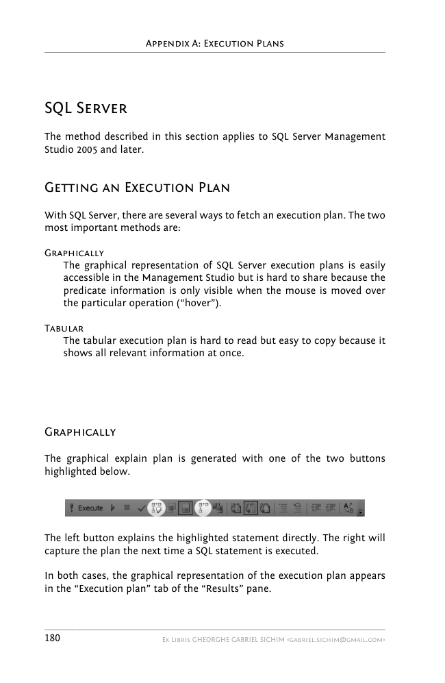
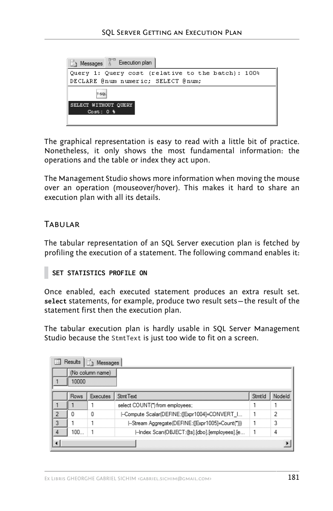
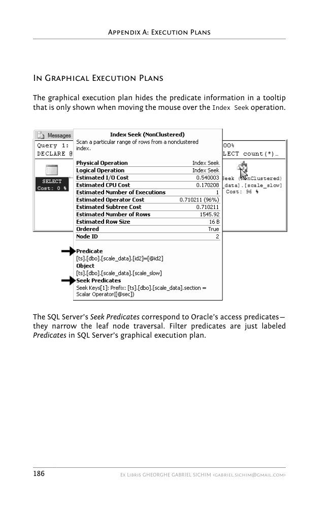
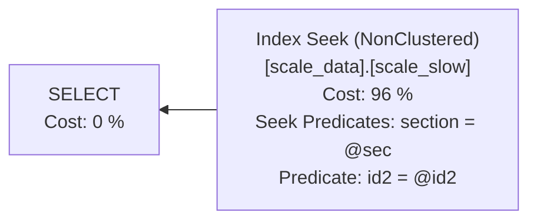

# Phụ lục A: Execution Plan – Kế hoạch thực thi (Appendix A – Execution Plans) — Phần 2

> Phần này dịch các trang 190–202 của sách *SQL Performance Explained* (Markus Winand): cách lấy và đọc execution plan trong **SQL Server** và **MySQL**.

## Mục lục

- [SQL Server (SQL Server)](#sql-server-sql-server)
  - [Lấy execution plan (Getting an Execution Plan) — SQL Server](#lấy-execution-plan-getting-an-execution-plan--sql-server)
    - [Dạng đồ họa (Graphically)](#dạng-đồ-họa-graphically)
    - [Dạng bảng (Tabular)](#dạng-bảng-tabular)
  - [Các thao tác (Operations) — SQL Server](#các-thao-tác-operations--sql-server)
    - [Truy cập index và bảng (Index and Table Access) — SQL Server](#truy-cập-index-và-bảng-index-and-table-access--sql-server)
    - [Các thao tác join (Join Operations)](#các-thao-tác-join-join-operations)
    - [Sắp xếp và gom nhóm (Sorting and Grouping) — SQL Server](#sắp-xếp-và-gom-nhóm-sorting-and-grouping--sql-server)
    - [Truy vấn Top-N (Top-N Queries) — SQL Server](#truy-vấn-top-n-top-n-queries--sql-server)
  - [Phân biệt access predicate và filter predicate (Distinguishing Access and Filter-Predicates) — SQL Server](#phân-biệt-access-predicate-và-filter-predicate-distinguishing-access-and-filter-predicates--sql-server)
    - [Trong execution plan dạng đồ họa (In Graphical Execution Plans)](#trong-execution-plan-dạng-đồ-họa-in-graphical-execution-plans)
    - [Trong execution plan dạng bảng (In Tabular Execution Plans)](#trong-execution-plan-dạng-bảng-in-tabular-execution-plans)
- [MySQL (MySQL)](#mysql-mysql)
  - [Lấy execution plan (Getting an Execution Plan) — MySQL](#lấy-execution-plan-getting-an-execution-plan--mysql)
  - [Các thao tác (Operations) — MySQL](#các-thao-tác-operations--mysql)
    - [Truy cập index và bảng (Index and Table Access) — MySQL](#truy-cập-index-và-bảng-index-and-table-access--mysql)
    - [Sắp xếp và gom nhóm (Sorting and Grouping) — MySQL](#sắp-xếp-và-gom-nhóm-sorting-and-grouping--mysql)
    - [Truy vấn Top-N (Top-N Queries) — MySQL](#truy-vấn-top-n-top-n-queries--mysql)
  - [Phân biệt access predicate và filter predicate (Distinguishing Access and Filter-Predicates) — MySQL](#phân-biệt-access-predicate-và-filter-predicate-distinguishing-access-and-filter-predicates--mysql)
- [Bảng thuật ngữ (Glossary)](#bảng-thuật-ngữ-glossary)

---

## SQL Server (SQL Server)

Phương pháp mô tả trong phần này áp dụng cho **SQL Server Management Studio 2005 trở về sau** (SSMS – công cụ quản trị đồ họa chính thức của SQL Server).

### Lấy execution plan (Getting an Execution Plan) — SQL Server

Với SQL Server, có nhiều cách để lấy một execution plan – kế hoạch thực thi (*execution plan*: bản mô tả từng bước mà database sẽ làm để chạy câu lệnh SQL, do optimizer – bộ tối ưu hóa truy vấn – lập ra). Hai phương pháp quan trọng nhất là:

**Dạng đồ họa (*Graphically*)**
: Cách hiển thị execution plan dạng đồ họa của SQL Server rất dễ truy cập ngay trong Management Studio, nhưng lại **khó chia sẻ** cho người khác, vì thông tin về predicate (vị từ – các điều kiện trong mệnh đề `where`) chỉ hiện ra khi bạn **di chuột lên** đúng thao tác đó (“hover”).

**Dạng bảng (*Tabular*)**
: Execution plan dạng bảng thì **khó đọc** nhưng lại **dễ sao chép**, vì nó hiển thị toàn bộ thông tin liên quan cùng một lúc.

#### Dạng đồ họa (Graphically)

Execution plan dạng đồ họa (*graphical explain plan*) được tạo ra bằng một trong hai nút được đánh dấu (khoanh tròn) trên thanh công cụ dưới đây.



*Mô tả hình (thanh công cụ của SQL Server Management Studio):* Thanh công cụ gồm nút **Execute** (Thực thi, có dấu chấm than màu đỏ), nút ▶ (Debug), nút ■ (dừng), dấu ✔ (Parse – kiểm tra cú pháp), và tiếp theo là hai nút được khoanh tròn:

| Vị trí | Tên nút trong SSMS | Phím tắt | Chức năng |
|---|---|---|---|
| Nút khoanh tròn bên trái | *Display Estimated Execution Plan* (Hiển thị kế hoạch thực thi ước tính) | `Ctrl+L` | Giải thích (explain) ngay câu lệnh đang được bôi đen, **không thực thi** câu lệnh |
| Nút khoanh tròn bên phải | *Include Actual Execution Plan* (Kèm kế hoạch thực thi thực tế) | `Ctrl+M` | Bật chế độ ghi lại plan: plan sẽ được bắt lấy **ở lần thực thi câu lệnh SQL kế tiếp** |

(Tên nút và phím tắt là thông tin bổ sung theo SSMS; sách chỉ khoanh tròn hai nút.)

Nút bên trái giải thích câu lệnh đang được bôi đen (*highlighted*) ngay lập tức. Nút bên phải sẽ bắt lấy plan vào lần tới một câu lệnh SQL được thực thi.

Trong cả hai trường hợp, biểu diễn đồ họa của execution plan đều xuất hiện trong thẻ (tab) **“Execution plan”** của khung **“Results”** (Kết quả).



*Mô tả hình đầu trang 191 (thẻ “Execution plan”):* Có hai thẻ: **Messages** (Thông báo) và **Execution plan** (Kế hoạch thực thi – đang được chọn). Nội dung thẻ hiển thị:

```text
Query 1: Query cost (relative to the batch): 100%
DECLARE @num numeric; SELECT @num;
```

(“Truy vấn 1: Chi phí truy vấn (tương đối so với cả lô lệnh): 100%”, bên dưới là chính câu lệnh.) Phía dưới có một biểu tượng nhỏ ghi **T-SQL**, kèm một ô nền đen ghi **SELECT WITHOUT QUERY – Cost: 0 %** (“SELECT không truy vấn bảng nào – Chi phí: 0 %”), vì câu lệnh ví dụ `SELECT @num` không đọc bảng nào cả.

Vẽ lại bằng ASCII:

```text
+---------------------------------------------------------+
| [Messages] [Execution plan]                             |
+---------------------------------------------------------+
| Query 1: Query cost (relative to the batch): 100%       |
| DECLARE @num numeric; SELECT @num;                      |
+---------------------------------------------------------+
|        [T-SQL]                                          |
|   +----------------------+                              |
|   | SELECT WITHOUT QUERY |                              |
|   |      Cost: 0 %       |                              |
|   +----------------------+                              |
+---------------------------------------------------------+
```

Biểu diễn đồ họa khá dễ đọc nếu bạn luyện tập một chút. Tuy vậy, nó chỉ cho thấy những thông tin cơ bản nhất: **các thao tác** và **bảng hoặc index** mà thao tác đó tác động lên.

Management Studio sẽ hiển thị thêm thông tin khi bạn di chuột lên một thao tác (*mouseover/hover*). Chính điều này khiến việc chia sẻ một execution plan kèm đầy đủ chi tiết trở nên khó khăn.

#### Dạng bảng (Tabular)

Biểu diễn dạng bảng của execution plan SQL Server được lấy ra bằng cách **profiling** (ghi nhận, đo đạc) quá trình thực thi một câu lệnh. Lệnh sau bật chế độ đó:

```sql
SET STATISTICS PROFILE ON
```

Khi đã bật, mỗi câu lệnh được thực thi sẽ sinh ra thêm một tập kết quả (*result set*) phụ. Ví dụ, câu lệnh `select` sẽ tạo ra hai tập kết quả – kết quả của câu lệnh trước, rồi đến execution plan.

Execution plan dạng bảng gần như không dùng được trong SQL Server Management Studio vì cột `StmtText` quá rộng, không vừa một màn hình.

*Mô tả hình cuối trang 191 (khung “Results” sau khi chạy `select COUNT(*) from employees;` với `STATISTICS PROFILE ON`):* Có hai thẻ **Results** và **Messages**. Tập kết quả thứ nhất là kết quả câu lệnh: một cột tên “(No column name)” (không có tên cột) với giá trị `10000`. Tập kết quả thứ hai là execution plan dạng bảng:

| | Rows | Executes | StmtText | StmtId | NodeId |
|---|---|---|---|---|---|
| 1 | 1 | 1 | `select COUNT(*) from employees;` | 1 | 1 |
| 2 | 0 | 0 | `\|--Compute Scalar(DEFINE:([Expr1004]=CONVERT_I...` | 1 | 2 |
| 3 | 1 | 1 | `\|--Stream Aggregate(DEFINE:([Expr1005]=Count(*)))` | 1 | 3 |
| 4 | 100... | 1 | `\|--Index Scan(OBJECT:([ts].[dbo].[employees].[e...` | 1 | 4 |

Có thể thấy chữ trong cột `StmtText` bị cắt cụt (“...”) vì cột quá rộng – đúng như tác giả nhận xét. Cột `Rows` là số dòng thực tế mà mỗi bước trả về, `Executes` là số lần bước đó được thực thi.

Ưu điểm của cách biểu diễn này là có thể sao chép mà **không làm mất thông tin quan trọng**. Điều này rất tiện nếu bạn muốn đăng một execution plan SQL Server lên diễn đàn hoặc nền tảng tương tự. Trong trường hợp đó, thường chỉ cần sao chép cột `StmtText` và định dạng lại một chút:

```text
select COUNT(*) from employees;
  |--Compute Scalar(DEFINE:([Expr1004]=CONVERT_IMPLICIT(...))
       |--Stream Aggregate(DEFINE:([Expr1005]=Count(*)))
            |--Index Scan(OBJECT:([employees].[employees_pk]))
```

Cuối cùng, bạn có thể tắt profiling đi:

```sql
SET STATISTICS PROFILE OFF
```

> 📝 **Giải thích thêm (không có trong sách):** Cách đọc plan dạng bảng ở trên: thao tác **thụt vào sâu nhất được thực hiện trước** và chuyển kết quả lên thao tác cha.
> 1. `Index Scan` đọc toàn bộ index `employees_pk` (đọc index thay vì bảng vì index nhỏ hơn mà vẫn đủ để đếm dòng).
> 2. `Stream Aggregate` đếm số dòng nhận được – `Count(*)` – lưu vào biểu thức tạm `[Expr1005]`.
> 3. `Compute Scalar` chuyển kiểu kết quả (`CONVERT_IMPLICIT`, vì `COUNT(*)` nội bộ được đếm bằng `bigint` rồi đổi về `int`) thành `[Expr1004]`.
>
> Ngoài `SET STATISTICS PROFILE ON`, SQL Server còn có các cách khác để lấy plan dạng văn bản: `SET SHOWPLAN_TEXT ON` / `SET SHOWPLAN_ALL ON` (chỉ hiện plan ước tính, **không** chạy câu lệnh), `SET SHOWPLAN_XML ON` / `SET STATISTICS XML ON` (plan dạng XML – chính là định dạng mà SSMS dùng để vẽ hình; có thể lưu thành file `.sqlplan` để gửi cho người khác). Từ SQL Server 2016 còn có **Query Store** lưu lại lịch sử plan. Lưu ý: `STATISTICS PROFILE` được Microsoft đánh dấu là tính năng cũ, nhưng vẫn hoạt động ở các phiên bản hiện tại.

### Các thao tác (Operations) — SQL Server

#### Truy cập index và bảng (Index and Table Access) — SQL Server

SQL Server có một hệ thuật ngữ đơn giản: các thao tác **“Scan”** đọc *toàn bộ* index hoặc bảng, còn các thao tác **“Seek”** dùng B-tree (cây cân bằng – cấu trúc cây của index) hoặc một địa chỉ vật lý (**RID** – *Row ID*, giống `ROWID` của Oracle) để truy cập vào *một phần cụ thể* của index hoặc bảng.

**Index Seek**
: Index Seek thực hiện một lần duyệt B-tree (*B-tree traversal*: đi từ nút gốc xuống tới leaf node – nút lá) rồi đi dọc theo chuỗi leaf node để tìm tất cả các mục khớp điều kiện. Xem thêm “Giải phẫu một Index” (*Anatomy of an Index*) ở trang 1.

**Index Scan**
: Đọc toàn bộ index – tất cả các dòng – theo thứ tự của index. Tùy vào các thống kê hệ thống (*system statistics*) khác nhau, database có thể chọn thao tác này nếu nó cần tất cả các dòng theo thứ tự index – ví dụ vì có mệnh đề `order by` tương ứng.

**Key Lookup (Clustered)**
: Lấy ra **một dòng duy nhất** từ một clustered index (index cụm – index mà leaf node chứa luôn toàn bộ dữ liệu của dòng). Thao tác này tương tự `INDEX UNIQUE SCAN` của Oracle trên một bảng tổ chức theo index (*Index-Organized-Table*, IOT). Xem thêm “Gom cụm dữ liệu” (*Clustering Data*) ở trang 111.

**RID Lookup (Heap)**
: Lấy ra một dòng duy nhất từ một bảng (bảng dạng heap – bảng không có clustered index, dữ liệu nằm lộn xộn không theo thứ tự) – giống `TABLE ACCESS BY INDEX ROWID` của Oracle. Xem thêm “Giải phẫu một Index” ở trang 1.

**Table Scan**
: Còn được gọi là full table scan (quét toàn bộ bảng). Đọc toàn bộ bảng – tất cả các dòng và các cột – theo đúng cách được lưu trên đĩa. Dù các thao tác đọc nhiều block một lúc (*multi-block read*) có thể tăng tốc Table Scan đáng kể, đây vẫn là một trong những thao tác **tốn kém nhất**. Ngoài tốc độ IO (vào/ra đĩa) cao, Table Scan còn phải kiểm tra tất cả các dòng của bảng nên cũng có thể tiêu tốn một lượng đáng kể thời gian CPU. Xem thêm “Full Table Scan” ở trang 13.

> 📝 **Giải thích thêm (không có trong sách):** Bảng đối chiếu nhanh tên thao tác giữa SQL Server và Oracle (theo các mô tả ở trên và ở Phần 1 của phụ lục):
>
> | SQL Server | Oracle tương đương | Ý nghĩa |
> |---|---|---|
> | Index Seek | INDEX RANGE SCAN / INDEX UNIQUE SCAN | Duyệt B-tree + (có thể) đi dọc leaf node |
> | Index Scan | INDEX FULL SCAN / INDEX FAST FULL SCAN | Đọc cả index |
> | Key Lookup (Clustered) | INDEX UNIQUE SCAN trên IOT | Lấy 1 dòng qua clustered index |
> | RID Lookup (Heap) | TABLE ACCESS BY INDEX ROWID | Lấy 1 dòng qua địa chỉ vật lý |
> | Table Scan | TABLE ACCESS FULL | Quét toàn bảng |
>
> Lưu ý thêm: trên bảng **có** clustered index, SQL Server không hiện `Table Scan` mà hiện `Clustered Index Scan` (đọc toàn bộ clustered index – thực chất chính là đọc cả bảng), và `Clustered Index Seek` khi dùng B-tree của clustered index.

> 💡 **Ví dụ bổ sung (không có trong sách):** Áp dụng cho SQL Server. Giả sử có bảng heap (không có clustered index):
>
> ```sql
> CREATE TABLE orders (
>    order_id    INT          NOT NULL,
>    customer_id INT          NOT NULL,
>    order_date  DATE         NOT NULL,
>    amount      DECIMAL(10,2)
> );
> CREATE NONCLUSTERED INDEX orders_cust ON orders (customer_id);
>
> SELECT order_id, amount
>   FROM orders
>  WHERE customer_id = 42;
> ```
>
> Nếu khách hàng 42 có ít đơn hàng, plan thường có dạng:
>
> ```text
> |--Nested Loops(Inner Join, OUTER REFERENCES:([Bmk1000]))
>      |--Index Seek(OBJECT:([orders].[orders_cust]),
>         SEEK:([orders].[customer_id]=(42)) ORDERED FORWARD)
>      |--RID Lookup(OBJECT:([orders]), SEEK:([Bmk1000]=[Bmk1000]) LOOKUP ORDERED FORWARD)
> ```
>
> `Index Seek` tìm các mục có `customer_id = 42` trong index; mỗi mục mang theo một RID (`Bmk1000` – bookmark), và `RID Lookup` dùng RID đó để lấy cột `order_id`, `amount` từ bảng. Để ý thao tác `Nested Loops` – SQL Server dùng nó để nối kết quả index với việc truy cập bảng (xem mục Join Operations ngay dưới). Nếu thêm `INCLUDE (order_id, amount)` vào index (SQL Server 2005+), `RID Lookup` biến mất vì index đã đủ dữ liệu. Ngược lại, nếu khách hàng 42 có tới phần lớn số dòng trong bảng, optimizer có thể chọn hẳn `Table Scan` vì hàng nghìn lần `RID Lookup` còn chậm hơn đọc cả bảng.

#### Các thao tác join (Join Operations)

Nhìn chung, các thao tác join chỉ xử lý **hai bảng một lúc**. Nếu một truy vấn có nhiều phép join hơn, chúng được thực hiện tuần tự: trước hết là hai bảng, sau đó lấy kết quả trung gian (*intermediate result*) join với bảng kế tiếp. Vì vậy, trong ngữ cảnh join, từ “bảng” cũng có thể mang nghĩa “kết quả trung gian”.

**Nested Loops**
: Join hai bảng bằng cách lấy kết quả từ một bảng rồi truy vấn bảng kia **cho từng dòng** của bảng thứ nhất (giống hai vòng lặp lồng nhau). SQL Server cũng dùng thao tác nested loops để lấy dữ liệu bảng sau khi truy cập index. Xem thêm “Nested Loops” ở trang 92.

**Hash Match**
: Phép hash match join nạp các bản ghi ứng viên từ một phía của phép join vào một bảng băm (*hash table*), rồi với mỗi dòng của phía còn lại sẽ dò (*probe*) vào bảng băm đó. Xem thêm “Hash Join” ở trang 101.

**Merge Join**
: Phép merge join kết hợp hai danh sách đã sắp xếp giống như **kéo khóa (dây kéo)** – hai hàng răng khớp lần lượt vào nhau. Cả hai phía của phép join phải được sắp xếp trước. Xem thêm “Sort Merge” ở trang 109.

> 💡 **Ví dụ bổ sung (không có trong sách):** Áp dụng cho SQL Server. Với hai bảng `employees` (khoảng 10 000 dòng) và `sales` (vài triệu dòng):
>
> ```sql
> SELECT e.first_name, s.sale_value
>   FROM employees e
>   JOIN sales s ON s.employee_id = e.employee_id
>  WHERE e.last_name = 'WINAND';
> ```
>
> - Nếu có index trên `employees(last_name)` và `sales(employee_id)`: điều kiện `last_name` chỉ lọc ra vài nhân viên → optimizer chọn **Nested Loops**: với mỗi nhân viên tìm được (Index Seek trên `employees`), nó làm một Index Seek trên `sales`.
> - Nếu bỏ điều kiện `WHERE` (join toàn bộ): optimizer thường chọn **Hash Match**: nạp `employees` (bảng nhỏ hơn) vào hash table, rồi quét `sales` và dò từng dòng.
> - Nếu cả hai phía đều đã có sẵn thứ tự theo `employee_id` (ví dụ đọc qua clustered index trên cột này): optimizer có thể chọn **Merge Join**, không cần sort thêm.
>
> Bạn có thể ép thử từng loại bằng gợi ý `OPTION (LOOP JOIN)`, `OPTION (HASH JOIN)`, `OPTION (MERGE JOIN)` để so sánh plan – chỉ nên dùng khi thử nghiệm.

#### Sắp xếp và gom nhóm (Sorting and Grouping) — SQL Server

**Sort**
: Sắp xếp kết quả theo mệnh đề `order by`. Thao tác này cần **rất nhiều bộ nhớ** để vật chất hóa (*materialize* – tạo ra và lưu toàn bộ) kết quả trung gian (tức là **không** pipelined – không thể vừa nhận dữ liệu vừa trả ra từng dòng ngay). Xem thêm “Đánh index cho Order By” (*Indexing Order By*) ở trang 130.

**Sort (Top N Sort)**
: Sắp xếp **một tập con** của kết quả theo mệnh đề `order by`. Được dùng cho các truy vấn top-N (lấy N dòng đầu tiên) khi không thể thực thi theo kiểu pipelined. Xem thêm “Truy vấn N dòng đầu tiên” (*Querying Top-N Rows*) ở trang 143.

**Stream Aggregate**
: Gom nhóm (tổng hợp) một tập **đã được sắp xếp sẵn** theo mệnh đề `group by`. Thao tác này không đệm (*buffer*) kết quả trung gian – nó được thực thi theo kiểu **pipelined**. Xem thêm “Đánh index cho Group By” (*Indexing Group By*) ở trang 139.

**Hash Match (Aggregate)**
: Gom nhóm kết quả bằng một bảng băm. Thao tác này cần rất nhiều bộ nhớ để vật chất hóa kết quả trung gian (không pipelined). Kết quả đầu ra **không có thứ tự** nào có ý nghĩa. Xem thêm “Đánh index cho Group By” ở trang 139.

> 💡 **Ví dụ bổ sung (không có trong sách):** Áp dụng cho SQL Server, với bảng `sales(sale_date, product_id, eur_value)`:
>
> ```sql
> SELECT product_id, SUM(eur_value)
>   FROM sales
>  WHERE sale_date = '2026-10-31'
>  GROUP BY product_id;
> ```
>
> - Chỉ có index `sales(sale_date)`: các dòng của ngày đó ra theo thứ tự lộn xộn về `product_id` → optimizer dùng **Hash Match (Aggregate)** (hoặc `Sort` + `Stream Aggregate`). Cả hai đều phải đọc hết dữ liệu trước khi trả dòng đầu tiên.
> - Có index `sales(sale_date, product_id)`: trong cùng một `sale_date`, các mục trong index đã được sắp theo `product_id` → optimizer có thể dùng **Stream Aggregate** trực tiếp trên kết quả Index Seek, không cần `Sort`, chạy pipelined và tốn rất ít bộ nhớ.

#### Truy vấn Top-N (Top-N Queries) — SQL Server

**Top**
: Dừng (hủy) các thao tác bên dưới khi đã lấy đủ số dòng mong muốn. Xem thêm “Truy vấn N dòng đầu tiên” ở trang 143.

Hiệu quả của truy vấn top-N phụ thuộc vào **chế độ thực thi** của các thao tác bên dưới. Nó sẽ rất kém hiệu quả khi phải hủy các thao tác không pipelined như `Sort` (vì lúc đó toàn bộ việc sắp xếp đã được làm xong rồi mới “dừng”).

> 💡 **Ví dụ bổ sung (không có trong sách):** Áp dụng cho SQL Server. Lấy 10 đơn bán gần nhất:
>
> ```sql
> SELECT TOP 10 *
>   FROM sales
>  ORDER BY sale_date DESC;
> -- SQL Server 2012+ cũng hỗ trợ cú pháp chuẩn:
> -- ORDER BY sale_date DESC OFFSET 0 ROWS FETCH NEXT 10 ROWS ONLY;
> ```
>
> - **Không** có index trên `sale_date`: plan có dạng `Top` ← `Sort (Top N Sort)` ← `Table Scan`. Database phải đọc cả bảng; `Top N Sort` chỉ giữ 10 dòng tốt nhất trong bộ nhớ (đỡ tốn bộ nhớ hơn `Sort` thường) nhưng vẫn phải đọc hết dữ liệu.
> - **Có** index `sales(sale_date)`: plan có dạng `Top` ← `Nested Loops` ← `Index Scan (ORDERED BACKWARD)` + `RID Lookup`. Index được đọc ngược từ cuối, và `Top` dừng ngay sau 10 dòng – chi phí gần như không phụ thuộc kích thước bảng. Đây chính là thực thi top-N kiểu pipelined.

### Phân biệt access predicate và filter predicate (Distinguishing Access and Filter-Predicates) — SQL Server

Database SQL Server dùng **ba phương pháp khác nhau** để áp dụng mệnh đề `where` (các predicate – vị từ):

**Access Predicate – vị từ truy cập (“Seek Predicates”)**
: Access predicate biểu diễn **điều kiện bắt đầu và kết thúc** của việc duyệt leaf node (tức là xác định đoạn index cần đọc).

**Index Filter Predicate – vị từ lọc trên index (“Predicates” hoặc “where” đối với các thao tác trên index)**
: Index filter predicate chỉ được áp dụng **trong khi** duyệt leaf node. Chúng không góp phần vào điều kiện bắt đầu và kết thúc, và **không thu hẹp** phạm vi bị quét.

**Table level filter predicate – vị từ lọc ở mức bảng (“where” đối với các thao tác trên bảng)**
: Các predicate trên những cột **không thuộc index** sẽ được đánh giá ở mức bảng. Để làm được việc đó, database phải nạp dòng từ bảng heap lên trước.

Phần sau giải thích cách nhận diện filter predicate trong execution plan của SQL Server. Nó dựa trên ví dụ đã được dùng để minh họa ảnh hưởng của index filter predicate ở Chương 3.

```sql
CREATE TABLE scale_data (
   section NUMERIC NOT NULL,
   id1     NUMERIC NOT NULL,
   id2     NUMERIC NOT NULL
);
CREATE INDEX scale_slow ON scale_data(section, id1, id2);
```

Câu lệnh mẫu chọn theo `SECTION` và `ID2`:

```sql
SELECT count(*)
  FROM scale_data
 WHERE section = @sec
   AND id2 = @id2
```

> 📝 **Giải thích thêm (không có trong sách):** Vì sao `id2` chỉ là filter predicate? Index `scale_slow` được sắp theo `(section, id1, id2)`. Với `section = @sec`, các mục khớp nằm liền nhau trong index → đây là điều kiện bắt đầu/kết thúc (access predicate). Nhưng trong đoạn đó, các mục được sắp theo `id1` trước, nên các giá trị `id2 = @id2` nằm **rải rác** khắp đoạn – database không thể nhảy thẳng tới chúng, chỉ có thể đọc qua toàn bộ đoạn `section = @sec` và lọc từng mục. Nếu đổi index thành `(section, id2, id1)` thì cả hai điều kiện đều trở thành access predicate và đoạn quét thu hẹp đáng kể.

#### Trong execution plan dạng đồ họa (In Graphical Execution Plans)

Execution plan dạng đồ họa giấu thông tin predicate trong một **tooltip** (khung chú thích nổi) chỉ hiện ra khi bạn di chuột lên thao tác `Index Seek`.



*Mô tả hình trang 196:* Phía sau là thẻ **Messages** với dòng “Query 1: … 00%”, “DECLARE @… SELECT count(*)…”, một biểu tượng **SELECT – Cost: 0 %** bên trái và biểu tượng **Index Seek (NonClustered) [scale_data].[scale_slow] – Cost: 96 %** bên phải (con trỏ chuột đang đặt lên đó). Một tooltip mở ra với nội dung sau (dịch kèm):

| Mục trong tooltip | Giá trị | Nghĩa tiếng Việt |
|---|---|---|
| **Index Seek (NonClustered)** | *Scan a particular range of rows from a nonclustered index.* | Tiêu đề: “Quét một khoảng dòng cụ thể từ một index không cụm.” |
| Physical Operation | Index Seek | Thao tác vật lý |
| Logical Operation | Index Seek | Thao tác logic |
| Estimated I/O Cost | 0.540003 | Chi phí I/O ước tính |
| Estimated CPU Cost | 0.170208 | Chi phí CPU ước tính |
| Estimated Number of Executions | 1 | Số lần thực thi ước tính |
| Estimated Operator Cost | 0.710211 (96%) | Chi phí của thao tác ước tính |
| Estimated Subtree Cost | 0.710211 | Chi phí cây con ước tính |
| Estimated Number of Rows | 1545.92 | Số dòng ước tính |
| Estimated Row Size | 16 B | Kích thước dòng ước tính |
| Ordered | True | Có thứ tự |
| Node ID | 2 | Mã nút |
| ➡ **Predicate** | `[ts].[dbo].[scale_data].[id2]=[@id2]` | **Vị từ (lọc)** – đây là **filter predicate** |
| **Object** | `[ts].[dbo].[scale_data].[scale_slow]` | Đối tượng (index được dùng) |
| ➡ **Seek Predicates** | `Seek Keys[1]: Prefix: [ts].[dbo].[scale_data].section = Scalar Operator([@sec])` | **Vị từ seek** – đây là **access predicate** |

Hai mũi tên đen trong hình chỉ vào hai mục **Predicate** và **Seek Predicates**.

Vẽ lại sơ đồ plan:



*Seek Predicates* của SQL Server tương ứng với **access predicate** của Oracle – chúng thu hẹp việc duyệt leaf node. Còn filter predicate chỉ đơn giản được gắn nhãn *Predicates* trong execution plan dạng đồ họa của SQL Server.

#### Trong execution plan dạng bảng (In Tabular Execution Plans)

Execution plan dạng bảng đặt thông tin predicate **ngay trong cùng cột** với các thao tác. Vì vậy rất dễ sao chép và dán toàn bộ thông tin liên quan trong một lần.

```sql
DECLARE @sec numeric;
DECLARE @id2 numeric;
SET STATISTICS PROFILE ON
SELECT count(*)
  FROM scale_data
 WHERE section = @sec
   AND id2 = @id2
SET STATISTICS PROFILE OFF
```

Execution plan được hiển thị như tập kết quả thứ hai trong khung kết quả. Dưới đây là cột `StmtText` – đã được định dạng lại một chút cho dễ đọc:

```text
|--Compute Scalar(DEFINE:([Expr1004]=CONVERT_IMPLICIT(...))
     |--Stream Aggregate(DEFINE:([Expr1008]=Count(*)))
          |--Index Seek(OBJECT:([scale_data].[scale_slow]),
             SEEK: ([scale_data].[section]=[@sec])
                    ORDERED FORWARD
             WHERE:([scale_data].[id2]=[@id2]))
```

Nhãn `SEEK` đánh dấu **access predicate**, còn nhãn `WHERE` đánh dấu **filter predicate**.

> 💡 **Ví dụ bổ sung (không có trong sách):** Áp dụng cho SQL Server – phân biệt đủ ba loại predicate trong một plan. Giả sử bảng `scale_data` có thêm cột `note VARCHAR(100)` (không có trong index) và ta chạy:
>
> ```sql
> SELECT note
>   FROM scale_data
>  WHERE section = @sec
>    AND id2     = @id2
>    AND note LIKE 'x%'
> ```
>
> Plan dạng bảng sẽ có dạng (rút gọn):
>
> ```text
> |--Nested Loops(Inner Join, OUTER REFERENCES:([Bmk1000]))
>      |--Index Seek(OBJECT:([scale_data].[scale_slow]),
>         SEEK:([scale_data].[section]=[@sec]) ORDERED FORWARD
>         WHERE:([scale_data].[id2]=[@id2]))
>      |--RID Lookup(OBJECT:([scale_data]), SEEK:([Bmk1000]=[Bmk1000]),
>         WHERE:([scale_data].[note] like 'x%') LOOKUP ORDERED FORWARD)
> ```
>
> - `SEEK` trong `Index Seek`: `section = @sec` → **access predicate** (xác định đoạn index cần đọc).
> - `WHERE` trong `Index Seek`: `id2 = @id2` → **index filter predicate** (lọc trong lúc đọc leaf node).
> - `WHERE` trong `RID Lookup`: `note like 'x%'` → **table level filter predicate** (phải đọc dòng từ bảng heap rồi mới lọc được) – loại tốn kém nhất.

---

## MySQL (MySQL)

Phương pháp mô tả trong phần này áp dụng cho **mọi phiên bản** MySQL.

### Lấy execution plan (Getting an Execution Plan) — MySQL

Đặt từ khóa `explain` trước một câu lệnh SQL để lấy execution plan.

```sql
EXPLAIN SELECT 1;
```

Plan được hiển thị ở dạng bảng (đã bỏ bớt một số cột ít quan trọng – các dấu `~` đánh dấu chỗ cột bị lược bỏ hoặc bị cắt):

```text
~+-------+------+---------------+------+~+------+------------~
~| table | type | possible_keys | key  |~| rows | Extra
~+-------+------+---------------+------+~+------+------------~
~| NULL  | NULL | NULL          | NULL |~| NULL | No tables...
~+-------+------+---------------+------+~+------+------------~
```

(Cột `Extra` ở đây ghi “No tables used” – không dùng bảng nào, vì `SELECT 1` không đọc bảng.)

Thông tin quan trọng nhất nằm ở cột **`TYPE`**. Dù tài liệu MySQL gọi nó là “join type” (kiểu join), tôi (tác giả) thích gọi nó là **“access type” (kiểu truy cập)** hơn, vì nó thực sự cho biết dữ liệu được truy cập **như thế nào**. Ý nghĩa của các giá trị trong cột type được mô tả ở mục tiếp theo.

> 📝 **Giải thích thêm (không có trong sách):** Ý nghĩa các cột thường gặp trong output của `EXPLAIN` (MySQL):
>
> | Cột | Ý nghĩa |
> |---|---|
> | `table` | Bảng mà dòng plan này truy cập |
> | `type` | Kiểu truy cập (xem mục Operations bên dưới) |
> | `possible_keys` | Các index mà optimizer **có thể** dùng |
> | `key` | Index optimizer **thực sự** chọn |
> | `key_len` | Số byte của index được dùng làm access predicate (xem cuối phụ lục) |
> | `ref` | Cột/hằng số được so sánh với index |
> | `rows` | Số dòng ước tính phải xét |
> | `Extra` | Thông tin thêm: `Using index`, `Using where`, `Using filesort`, ... |
>
> Ở các phiên bản mới: MySQL 5.6+ hỗ trợ `EXPLAIN FORMAT=JSON` (chi tiết hơn, có cả chi phí), MySQL 8.0.16+ có `EXPLAIN FORMAT=TREE` (hiển thị dạng cây giống plan của các DB khác), và MySQL 8.0.18+ có `EXPLAIN ANALYZE` – thực thi câu lệnh thật và báo số dòng/thời gian thực tế của từng bước.

### Các thao tác (Operations) — MySQL

#### Truy cập index và bảng (Index and Table Access) — MySQL

Explain plan của MySQL có xu hướng tạo ra **cảm giác an toàn giả tạo**, vì nó nói rất nhiều về việc index đang được dùng. Dù đúng về mặt kỹ thuật, điều đó **không có nghĩa** là index đang được dùng một cách hiệu quả. Thông tin quan trọng nhất nằm ở cột `TYPE` trong output explain của MySQL – nhưng ngay cả ở đó, từ khóa `INDEX` cũng **không** cho thấy index được thiết kế đúng.

**eq_ref**
: Chỉ thực hiện một lần duyệt B-tree. Database dùng thao tác này nếu một khóa chính (*primary key*) hoặc ràng buộc duy nhất (*unique constraint*) đảm bảo điều kiện tìm kiếm sẽ khớp **không quá một** mục. Xem thêm “Giải phẫu một Index” ở trang 1.

**ref, range**
: Thực hiện một lần duyệt B-tree và đi dọc theo các leaf node để tìm tất cả các mục khớp (tương tự `INDEX RANGE SCAN` của Oracle). Xem thêm “Giải phẫu một Index” ở trang 1.

**index**
: Đọc toàn bộ index – tất cả các dòng – theo thứ tự index (tương tự `INDEX FULL SCAN`). *(Đây chính là chữ `INDEX` gây hiểu lầm nói ở trên: nghe như “có dùng index” nhưng thực ra là quét hết index.)*

**ALL**
: Đọc toàn bộ bảng – tất cả các dòng và các cột – theo đúng cách được lưu trên đĩa. Ngoài tốc độ IO cao, một lần quét bảng (*table scan*) còn phải kiểm tra tất cả các dòng của bảng nên cũng có thể gây tải đáng kể lên CPU. Xem thêm “Full Table Scan” ở trang 13.

**Using Index (trong cột “Extra”)**
: Khi cột “Extra” hiển thị “Using Index”, điều đó có nghĩa là **bảng không bị truy cập**, vì index đã có đủ toàn bộ dữ liệu cần thiết. Hãy nghĩ nó là “using index **ONLY**” (chỉ dùng index). Xem thêm “Gom cụm dữ liệu” (*Clustering Data*) ở trang 111.

**PRIMARY (trong cột “key” hoặc “possible_keys”)**
: `PRIMARY` là tên của index được tạo tự động cho khóa chính.

> 💡 **Ví dụ bổ sung (không có trong sách):** Áp dụng cho MySQL (InnoDB). Bảng mẫu:
>
> ```sql
> CREATE TABLE employees (
>    employee_id INT PRIMARY KEY,
>    last_name   VARCHAR(50) NOT NULL,
>    first_name  VARCHAR(50) NOT NULL,
>    INDEX emp_name (last_name, first_name)
> );
> ```
>
> | Câu truy vấn | `type` | `key` | `Extra` | Giải thích |
> |---|---|---|---|---|
> | `... JOIN employees e ON e.employee_id = s.employee_id` | `eq_ref` | `PRIMARY` | | Mỗi dòng của `s` khớp tối đa 1 nhân viên (khóa chính) |
> | `SELECT * FROM employees WHERE employee_id = 7` | `const` | `PRIMARY` | | Như `eq_ref` nhưng với hằng số – optimizer đọc trước 1 dòng duy nhất |
> | `SELECT * FROM employees WHERE last_name = 'WINAND'` | `ref` | `emp_name` | | Duyệt B-tree + đi dọc leaf node |
> | `SELECT * FROM employees WHERE employee_id BETWEEN 1 AND 50` | `range` | `PRIMARY` | `Using where` | Quét một khoảng |
> | `SELECT last_name, first_name FROM employees` | `index` | `emp_name` | `Using index` | Đọc **toàn bộ** index (nhỏ hơn bảng) – không hề "hiệu quả" dù có chữ index |
> | `SELECT * FROM employees WHERE UPPER(last_name) = 'WINAND'` | `ALL` | NULL | `Using where` | Hàm trên cột làm index không dùng được → quét cả bảng (MySQL 8.0.13+ có thể khắc phục bằng functional index) |
>
> Dòng thứ 5 minh họa đúng cảnh báo của tác giả: `type = index` và `Extra = Using index` trông rất “yên tâm”, nhưng thực chất database vẫn đọc hết mọi mục trong index. (`const` là một giá trị type khác không được sách liệt kê, là trường hợp đặc biệt của truy cập bằng khóa chính/unique với hằng số.)

#### Sắp xếp và gom nhóm (Sorting and Grouping) — MySQL

**using filesort (trong cột “Extra”)**
: “using filesort” trong cột Extra cho biết có một thao tác **sắp xếp tường minh** – bất kể việc sắp xếp diễn ra ở đâu (trong bộ nhớ chính hay trên đĩa; cái tên “filesort” dễ gây hiểu lầm là luôn dùng file). “Using filesort” cần rất nhiều bộ nhớ để vật chất hóa kết quả trung gian (không pipelined). Xem thêm “Đánh index cho Order By” ở trang 130.

> 📝 **Giải thích thêm (không có trong sách):** Với `GROUP BY`, MySQL còn có thể hiện “Using temporary” trong cột Extra – nghĩa là dùng bảng tạm để gom nhóm (cũng phải vật chất hóa, không pipelined). Ở MySQL 5.7 trở về trước, `GROUP BY` còn ngầm sắp xếp kết quả nên thường đi kèm “Using filesort”; từ MySQL 8.0, việc sắp xếp ngầm định này đã bị bỏ.

#### Truy vấn Top-N (Top-N Queries) — MySQL

**ngầm định (*implicit*): không có “using filesort” trong cột “Extra”**
: Execution plan của MySQL **không thể hiện tường minh** một truy vấn top-N. Nếu bạn đang dùng cú pháp `limit` và **không** thấy “using filesort” trong cột extra, thì truy vấn được thực thi theo kiểu pipelined. Xem thêm “Truy vấn N dòng đầu tiên” ở trang 143.

> 💡 **Ví dụ bổ sung (không có trong sách):** Áp dụng cho MySQL, bảng `sales(sale_id, sale_date, eur_value)`:
>
> ```sql
> EXPLAIN SELECT * FROM sales ORDER BY sale_date DESC LIMIT 10;
> ```
>
> - Không có index trên `sale_date`: `type = ALL`, `Extra = Using filesort` → đọc cả bảng và sắp xếp, `LIMIT` chỉ cắt bớt ở cuối cùng.
> - Sau khi `CREATE INDEX sales_dt ON sales(sale_date);`: `type = index`, `key = sales_dt`, `Extra` có thể là `Backward index scan` (MySQL 8.0+) và **không** có `Using filesort` → đọc index ngược từ cuối và dừng sau 10 dòng (pipelined). Lưu ý: ở đây `type = index` lại là điều tốt, vì `LIMIT` làm việc đọc dừng sớm – cột `rows` có thể vẫn hiển thị ước tính lớn, gây khó hiểu.

### Phân biệt access predicate và filter predicate (Distinguishing Access and Filter-Predicates) — MySQL

Database MySQL dùng **ba cách khác nhau** để đánh giá mệnh đề `where` (các predicate):

**Access predicate (thông qua cột “key_len”)**
: Access predicate biểu diễn điều kiện bắt đầu và kết thúc của việc duyệt leaf node.

**Index filter predicate (“Using index condition”, từ MySQL 5.6)**
: Index filter predicate chỉ được áp dụng trong khi duyệt leaf node. Chúng không góp phần vào điều kiện bắt đầu và kết thúc, và không thu hẹp phạm vi bị quét.

**Table level filter predicate (“Using where” trong cột “Extra”)**
: Các predicate trên những cột không thuộc index được đánh giá ở mức bảng. Để làm được điều đó, database phải nạp dòng từ bảng lên trước.

Execution plan của MySQL **không cho biết** loại predicate nào được dùng cho **từng điều kiện** – chúng chỉ liệt kê các loại predicate đang được dùng.

Trong ví dụ sau, toàn bộ mệnh đề `where` được dùng làm access predicate:

```sql
CREATE TABLE demo (
   id1 NUMERIC
 , id2 NUMERIC
 , id3 NUMERIC
 , val NUMERIC);
INSERT INTO demo VALUES (1,1,1,1);
INSERT INTO demo VALUES (2,2,2,2);
CREATE INDEX demo_idx
          ON demo
             (id1, id2, id3);
EXPLAIN
 SELECT *
   FROM demo
  WHERE id1=1
    AND id2=1;
```

```text
+------+----------+---------+------+-------+
| type | key      | key_len | rows | Extra |
+------+----------+---------+------+-------+
| ref  | demo_idx | 12      |    1 |       |
+------+----------+---------+------+-------+
```

Không có “Using where” hay “Using index condition” nào xuất hiện trong cột “Extra”. Tuy nhiên index **có** được dùng (`type=ref`, `key=demo_idx`), nên bạn có thể suy ra rằng toàn bộ mệnh đề `where` đủ điều kiện làm access predicate.

Bạn có thể dùng giá trị `key_len` để kiểm chứng điều này. Nó cho thấy truy vấn dùng **12 byte đầu tiên** của định nghĩa index. Để ánh xạ con số này sang tên cột, bạn “chỉ” cần biết mỗi cột cần bao nhiêu chỗ lưu trữ (xem mục “Data Type Storage Requirements” – Yêu cầu lưu trữ của các kiểu dữ liệu – trong tài liệu MySQL). Khi không có ràng buộc `NOT NULL`, MySQL cần thêm **một byte** cho mỗi cột. Tính ra, mỗi cột `NUMERIC` trong ví dụ cần 6 byte. Vì vậy, độ dài khóa 12 xác nhận rằng **hai cột đầu tiên** của index được dùng làm access predicate.

> 📝 **Giải thích thêm (không có trong sách):** Cách tính 6 byte: trong MySQL, `NUMERIC` không chỉ định độ chính xác tương đương `DECIMAL(10,0)`. Kiểu `DECIMAL` lưu mỗi nhóm 9 chữ số bằng 4 byte, phần dư 1 chữ số cần thêm 1 byte → 10 chữ số = 4 + 1 = **5 byte**. Cộng thêm **1 byte** đánh dấu NULL (vì cột không có `NOT NULL`) → **6 byte/cột**. Do đó:
>
> | key_len | Số cột index được dùng làm access predicate |
> |---|---|
> | 6 | `id1` |
> | 12 | `id1, id2` |
> | 18 | `id1, id2, id3` |
>
> Với cột chuỗi `VARCHAR(n)` cần thêm 2 byte độ dài và nhân với số byte tối đa của charset (ví dụ `utf8mb4` là 4 byte/ký tự), nên `VARCHAR(50) NOT NULL` utf8mb4 cho key_len = 50×4 + 2 = 202.

Khi lọc theo cột `ID3` (thay vì `ID2`), MySQL 5.6 trở lên sẽ dùng **index filter predicate** (“Using index condition”):

```sql
EXPLAIN
 SELECT *
   FROM demo
  WHERE id1=1
    AND id3=1;
```

```text
+------+----------+---------+------+-----------------------+
| type | key      | key_len | rows | Extra                 |
+------+----------+---------+------+-----------------------+
| ref  | demo_idx | 6       |    1 | Using index condition |
+------+----------+---------+------+-----------------------+
```

Trong trường hợp này, độ dài khóa bằng 6 nghĩa là chỉ **một cột** được dùng làm access predicate.

Các phiên bản MySQL trước đó dùng **table level filter predicate** cho truy vấn này – được nhận diện bằng “Using where” trong cột “Extra”:

```text
+------+----------+---------+------+-------------+
| type | key      | key_len | rows | Extra       |
+------+----------+---------+------+-------------+
| ref  | demo_idx | 6       |    1 | Using where |
+------+----------+---------+------+-------------+
```

> 📝 **Giải thích thêm (không có trong sách):** “Using index condition” là tính năng **Index Condition Pushdown (ICP)** có từ MySQL 5.6: điều kiện `id3=1` được “đẩy xuống” tầng storage engine để kiểm tra ngay trên mục index, trước khi đọc dòng từ bảng. Trước 5.6, engine phải đọc dòng từ bảng cho **mọi** mục có `id1=1` rồi tầng server mới lọc `id3=1` – tốn nhiều truy cập bảng hơn. ICP có thể tắt để so sánh: `SET optimizer_switch = 'index_condition_pushdown=off';`.

> 💡 **Ví dụ bổ sung (không có trong sách):** Áp dụng cho MySQL 5.6+, tiếp tục với bảng `demo`. Thêm điều kiện trên cột `val` (không có trong index):
>
> ```sql
> EXPLAIN
>  SELECT *
>    FROM demo
>   WHERE id1=1
>     AND id3=1
>     AND val=1;
> ```
>
> Kết quả dự kiến:
>
> ```text
> +------+----------+---------+------+------------------------------------+
> | type | key      | key_len | rows | Extra                              |
> +------+----------+---------+------+------------------------------------+
> | ref  | demo_idx | 6       |    1 | Using index condition; Using where |
> +------+----------+---------+------+------------------------------------+
> ```
>
> Đọc plan: `key_len = 6` → chỉ `id1` là access predicate; “Using index condition” → có index filter predicate (đó là `id3=1`); “Using where” → có table level filter predicate (đó là `val=1`, vì `val` không nằm trong index). Như tác giả nói, MySQL **không ghi rõ** điều kiện nào thuộc loại nào – ta phải tự suy luận từ `key_len` và định nghĩa index như trên. Để `id3` trở thành access predicate, cần index bắt đầu bằng `(id1, id3, ...)`; khi đó `key_len` sẽ là 12.

---

## Bảng thuật ngữ (Glossary)

| Thuật ngữ (English) | Nghĩa tiếng Việt | Giải thích ngắn |
|---|---|---|
| Execution plan / explain plan | Kế hoạch thực thi | Các bước database thực hiện để chạy một câu lệnh SQL |
| SQL Server Management Studio (SSMS) | Công cụ quản trị SQL Server | Giao diện đồ họa để chạy truy vấn và xem plan |
| Graphical execution plan | Plan dạng đồ họa | Plan vẽ bằng biểu tượng; chi tiết ẩn trong tooltip |
| Tabular execution plan | Plan dạng bảng | Plan dạng văn bản/bảng, dễ sao chép |
| Hover / mouseover / tooltip | Di chuột lên / khung chú thích nổi | Cách SSMS hiển thị chi tiết của một thao tác |
| `SET STATISTICS PROFILE ON/OFF` | Bật/tắt profiling | Làm SQL Server trả thêm plan dạng bảng sau mỗi câu lệnh |
| Result set | Tập kết quả | Bảng kết quả trả về của một câu lệnh |
| `StmtText` | Cột văn bản câu lệnh | Cột chứa cây thao tác trong plan dạng bảng của SQL Server |
| Scan / Seek | Quét / Tìm | SQL Server: Scan đọc toàn bộ; Seek dùng B-tree hoặc RID để đọc một phần |
| RID (Row ID) | Mã định danh dòng | Địa chỉ vật lý của dòng trong bảng heap (giống ROWID của Oracle) |
| Heap table | Bảng heap | Bảng không có clustered index, dữ liệu không theo thứ tự |
| Clustered index | Index cụm | Index mà leaf node chứa toàn bộ dữ liệu dòng |
| Index-Organized Table (IOT) | Bảng tổ chức theo index | Khái niệm của Oracle tương đương bảng có clustered index |
| Index Seek / Index Scan | — | Duyệt B-tree + leaf node / đọc toàn bộ index |
| Key Lookup / RID Lookup | Tra khóa / Tra RID | Lấy một dòng từ clustered index / từ bảng heap |
| Table Scan / full table scan | Quét toàn bảng | Đọc mọi dòng, mọi cột của bảng |
| Multi-block read | Đọc nhiều block một lúc | Tăng tốc quét bảng bằng cách đọc nhiều block mỗi lần IO |
| Intermediate result | Kết quả trung gian | Kết quả của bước join trước, làm đầu vào cho bước sau |
| Nested Loops | Vòng lặp lồng nhau | Join: với mỗi dòng bên ngoài, truy vấn bảng bên trong |
| Hash Match / hash join | Join băm | Nạp một phía vào hash table rồi dò bằng phía còn lại |
| Probe | Dò | Tra cứu bảng băm bằng giá trị join |
| Merge Join / sort merge | Join trộn | Trộn hai danh sách đã sắp xếp như kéo khóa |
| Materialize | Vật chất hóa | Tạo và lưu toàn bộ kết quả trung gian trước khi xử lý tiếp |
| Pipelined | Thực thi kiểu đường ống | Trả dòng ngay khi có, không cần chờ xử lý hết |
| Sort / Top N Sort | Sắp xếp / Sắp xếp N dòng đầu | Sắp toàn bộ / chỉ giữ N dòng tốt nhất |
| Stream Aggregate | Gom nhóm dạng luồng | Gom nhóm dữ liệu đã sắp sẵn, pipelined |
| Hash Match (Aggregate) | Gom nhóm bằng băm | Gom nhóm bằng hash table, không pipelined, không có thứ tự |
| Top / top-N query | Truy vấn N dòng đầu | Dừng thao tác bên dưới khi đủ N dòng |
| Predicate | Vị từ | Một điều kiện trong mệnh đề `where` |
| Access predicate (Seek Predicates) | Vị từ truy cập | Điều kiện bắt đầu/kết thúc của việc duyệt leaf node |
| Index filter predicate | Vị từ lọc trên index | Lọc trong lúc duyệt leaf node, không thu hẹp phạm vi quét |
| Table level filter predicate | Vị từ lọc mức bảng | Lọc sau khi đã đọc dòng từ bảng |
| Leaf node traversal | Duyệt nút lá | Đi dọc chuỗi leaf node của B-tree |
| `EXPLAIN` | — | Lệnh lấy execution plan trong MySQL |
| Join type / access type | Kiểu join / kiểu truy cập | Cột `type` trong `EXPLAIN` của MySQL |
| eq_ref, ref, range, index, ALL | — | Các giá trị của cột `type` (MySQL) |
| Using index | Chỉ dùng index | Bảng không bị truy cập (index-only scan) |
| PRIMARY | — | Tên index tự động tạo cho khóa chính trong MySQL |
| Using filesort | Sắp xếp tường minh | MySQL phải sắp xếp (trong bộ nhớ hoặc trên đĩa) |
| `key_len` | Độ dài khóa | Số byte của index được dùng làm access predicate |
| Using index condition (ICP) | Đẩy điều kiện xuống index | Index filter predicate, từ MySQL 5.6 |
| Using where | Lọc bằng where | Table level filter predicate trong MySQL |
| Data Type Storage Requirements | Yêu cầu lưu trữ kiểu dữ liệu | Mục tài liệu MySQL cho biết kích thước từng kiểu |
